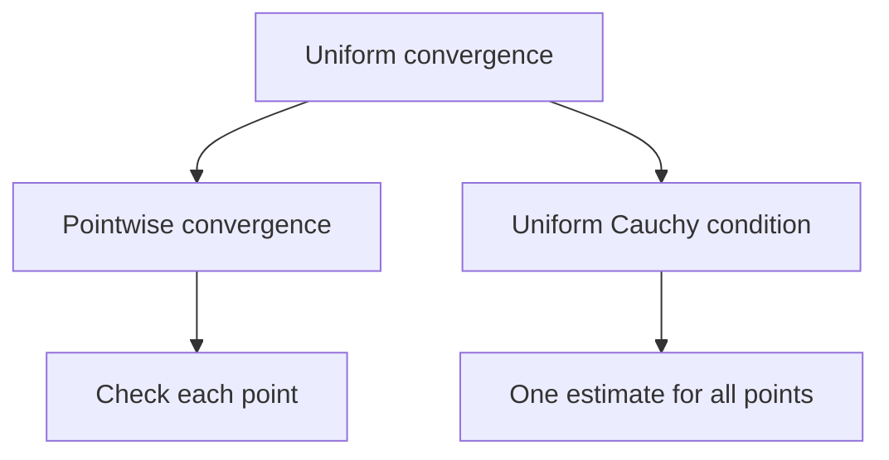

# 10. Sequences and Series of Functions

[[en/09-improper-integrals-applications|← 9. Improper Integrals and Applications]] · [[en/index|Course index]] · [[en/term-index|Terms & theorems]] · [[en/11-power-series|11. Power Series and Analytic Functions →]]

> [!abstract] Goal
> Distinguish pointwise from [[#10.1 Two modes of convergence|uniform convergence]] and know when limits commute with analytic operations.

## 10.1 Two modes of convergence

Let $f_n,f:E\to\mathbb R$. The sequence converges **pointwise** if

$$
\forall x\in E\;\forall\varepsilon>0\;\exists N\;\forall n\ge N:
|f_n(x)-f(x)|<\varepsilon.
$$

It converges **uniformly** if

$$
\forall\varepsilon>0\;\exists N\;\forall n\ge N\;\forall x\in E:
|f_n(x)-f(x)|<\varepsilon.
$$

Equivalently, $\sup_{x\in E}|f_n(x)-f(x)|\to0$. In pointwise convergence $N$ may depend on $x$; in uniform convergence it cannot.

On $[0,1]$, $f_n(x)=x^n$ tends pointwise to $0$ for $x<1$ and to $1$ at $x=1$. The limit is discontinuous, so convergence cannot be uniform. On $[0,r]$ with $r<1$, it is uniform because $\sup|f_n|=r^n\to0$.

## 10.2 Uniform Cauchy criterion

A sequence is uniformly Cauchy if for every $\varepsilon>0$ there is $N$ such that

$$
m,n\ge N\implies \sup_{x\in E}|f_n(x)-f_m(x)|<\varepsilon.
$$

On $\mathbb R$-valued functions, uniform convergence and the uniform [[en/03-sequences#3.4 Subsequences and Cauchy sequences|Cauchy condition]] are equivalent. This is the main tool when the limit is not known.

For series $\sum f_n$, these definitions apply to [[en/04-numeric-series#4.1 Convergence through partial sums|partial sums]] $s_N=\sum_{n=1}^N f_n$.

> [!theorem] Weierstrass M-test
> If $|f_n(x)|\le M_n$ on $E$ and $\sum M_n<\infty$, then $\sum f_n$ converges absolutely and uniformly on $E$.

^weierstrass-m-test

The proof follows from $|f_n(x)+\cdots+f_m(x)|\le M_n+\cdots+M_m$.

## 10.3 Continuity and integration

> [!theorem] Continuity theorem
> If each $f_n$ is continuous and $f_n\to f$ uniformly, then $f$ is continuous.

^uniform-limit-continuity

The standard $3\varepsilon$ proof chooses $n$ with $|f_n-f|$ uniformly small and then uses continuity of that single $f_n$.

> [!theorem] Integration theorem
> If $f_n$ are integrable on $[a,b]$ and converge uniformly to $f$, then $f$ is integrable and
> $$
> \lim_{n\to\infty}\int_a^b f_n=\int_a^b f.
> $$

^uniform-limit-integration

Indeed, the integrals differ by at most $(b-a)\sup|f_n-f|$. Pointwise convergence is insufficient: moving triangular “hats” on $[0,1]$ can converge to zero pointwise while their integrals stay equal to one.

## 10.4 Differentiation

Uniform convergence of $f_n$ alone does not justify differentiating the limit. A sufficient theorem is:

> If $f_n$ are [[en/15-multivariable-differentiation#15.1 The total derivative|continuously differentiable]] on a bounded interval $[a,b]$, $f_n(x_0)$ converges at one point, and $f_n'\to g$ uniformly, then $f_n$ converges uniformly on $[a,b]$ to a [[en/06-derivatives#6.1 Definition and linear approximation|differentiable]] $f$ and $f'=g$.

For series on a bounded interval, differentiate term by term when the differentiated series converges uniformly and the original series converges at one point.

Dini's theorem gives another useful special case: on a [[en/13-metric-spaces#13.4 Compactness|compact]] set, a [[en/03-sequences#3.3 Monotone convergence|monotone sequence]] of continuous functions converging pointwise to a continuous limit converges uniformly.

## Worked example

For $|x|\le r<1$,

$$
\sum_{n=0}^{\infty}x^n=\frac1{1-x}
$$

uniformly by the [[#^weierstrass-m-test|M-test]] with $M_n=r^n$. Differentiating the series is justified on $|x|\le r$ because $\sum nx^{n-1}$ also converges uniformly there. Therefore

$$
\sum_{n=1}^{\infty}nx^{n-1}=\frac1{(1-x)^2}.
$$

Since $r<1$ is arbitrary, the identity holds for every $|x|<1$.

## Common pitfalls

1. Pointwise convergence does not preserve continuity.
2. The M-test proves uniform [[en/04-numeric-series#4.3 Absolute and conditional convergence|absolute convergence]], not merely convergence at selected points.
3. To interchange derivatives and limits, control the derivatives as well as the functions.

## Exercises

1. Show that $f_n(x)=x/(1+nx^2)$ converges uniformly to zero on $\mathbb R$.
2. Decide whether $\sum\sin(nx)/n^2$ converges uniformly on $\mathbb R$.
3. Give an example showing that pointwise convergence does not preserve integrals.

> [!answer]- Short answers
> 1. Maximize $|x|/(1+nx^2)$; its [[en/02-real-numbers#2.2 Supremum and infimum|supremum]] is $1/(2\sqrt n)$.
> 2. Yes, by the M-test with $M_n=1/n^2$.
> 3. Use a triangular spike supported on $(0,1/n)$ with height $2n$ and area $1$; it tends pointwise to zero.

---

[[en/09-improper-integrals-applications|← 9. Improper Integrals and Applications]] · [[en/index|Course index]] · [[en/term-index|Terms & theorems]] · [[en/11-power-series|11. Power Series and Analytic Functions →]]
