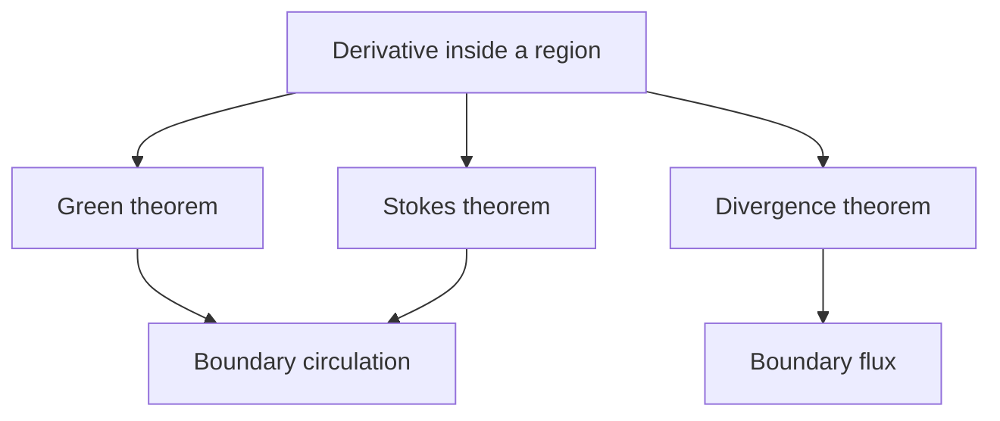

# 18. Vector Calculus and Integral Theorems

[[en/17-multiple-integrals|← 17. Multiple Integrals and Change of Variables]] · [[en/index|Course index]] · [[en/term-index|Terms & theorems]] · [[en/19-measure-theory|19. Measure Theory and Measurable Functions →]]

> [!abstract] Goal
> Integrate along curves and surfaces and relate boundary integrals to derivatives in the interior.

## 18.1 Line integrals

For a smooth [[en/09-improper-integrals-applications#9.3 Area, arc length, and volume|parametrized curve]] $\gamma:[a,b]\to\mathbb R^n$, scalar line integration is

$$
\int_\gamma f\,ds
=\int_a^b f(\gamma(t))\,\|\gamma'(t)\|\,dt.
$$

It is independent of orientation. For a vector field $F$, the work or circulation integral is

$$
\int_\gamma F\cdot dr
=\int_a^b F(\gamma(t))\cdot\gamma'(t)\,dt,
$$

which changes sign when orientation is reversed. Reparametrization by the same orientation leaves both integrals unchanged.

A field is **conservative** if $F=\nabla\varphi$ for a potential $\varphi$. Then

$$
\int_\gamma\nabla\varphi\cdot dr=\varphi(\gamma(b))-\varphi(\gamma(a)),
$$

so the integral depends only on the endpoints. On a simply [[en/13-metric-spaces#13.5 Continuity and connectedness|connected]] domain in $\mathbb R^3$, a $C^1$ field is conservative exactly when $\nabla\times F=0$; on general domains, topological obstructions can occur.

## 18.2 Surface integrals and flux

For a smooth surface parametrized by $r(u,v)$, the area element is

$$
dS=\|r_u\times r_v\|\,du\,dv.
$$

Thus $\iint_\Sigma f\,dS=\iint f(r(u,v))\|r_u\times r_v\|\,du\,dv$. An orientation is specified by a unit normal $n$. The flux integral is

$$
\iint_\Sigma F\cdot n\,dS
=\iint F(r(u,v))\cdot(r_u\times r_v)\,du\,dv,
$$

with the parametrization chosen to match the desired normal. Reversing orientation reverses flux but not scalar surface area.

## 18.3 Gradient, divergence, and curl

In Cartesian coordinates,

$$
\nabla f=\left(f_x,f_y,f_z\right),
$$
$$
\nabla\cdot F=P_x+Q_y+R_z,
$$
$$
\nabla\times F=
\begin{vmatrix}
\mathbf i&\mathbf j&\mathbf k\\
\partial_x&\partial_y&\partial_z\\
P&Q&R
\end{vmatrix},
\qquad F=(P,Q,R).
$$

Divergence measures local outflow density; curl measures local rotation. Useful identities include $\nabla\times(\nabla f)=0$ and $\nabla\cdot(\nabla\times F)=0$ under $C^2$ assumptions.

## 18.4 Green, Stokes, and divergence theorems

> [!theorem] Green's theorem
> For a positively oriented piecewise-smooth boundary of a planar region $D$,
> $$
> \oint_{\partial D}P\,dx+Q\,dy
> =\iint_D(Q_x-P_y)\,dA.
> $$

^green-theorem

Positive orientation means counterclockwise around the outer boundary, with holes oriented clockwise. In particular,

$$
\operatorname{area}(D)=\frac12\oint_{\partial D}(x\,dy-y\,dx).
$$

> [!theorem] Stokes' theorem
> For an oriented surface $\Sigma$ with compatibly oriented boundary,
> $$
> \oint_{\partial\Sigma}F\cdot dr
> =\iint_\Sigma(\nabla\times F)\cdot n\,dS.
> $$

^stokes-theorem

[[#^green-theorem|Green's theorem]] is the planar special case. The boundary orientation follows the right-hand rule relative to $n$.

> [!theorem] Divergence theorem (Gauss)
> For a solid $\Omega$ with outward-oriented piecewise-smooth boundary,
> $$
> \iint_{\partial\Omega}F\cdot n\,dS
> =\iiint_\Omega\nabla\cdot F\,dV.
> $$

^divergence-theorem

All three results require suitable smoothness and include every boundary component with the correct orientation.

## Worked example

Let $F(x,y,z)=(x,y,z)$ on the ball of radius $R$. Since $\nabla\cdot F=3$, the [[#^divergence-theorem|divergence theorem]] gives outward [[#18.2 Surface integrals and flux|flux]]

$$
\iiint_{B_R}3\,dV=3\cdot\frac{4\pi R^3}{3}=4\pi R^3.
$$

Directly, $n=(x,y,z)/R$ on the sphere, so $F\cdot n=R$ and the flux is $R\cdot4\pi R^2=4\pi R^3$.

## Common pitfalls

1. Scalar line and surface integrals are unoriented; work and flux are oriented.
2. A zero [[#18.3 Gradient, divergence, and curl|curl]] implies a potential only with suitable domain topology.
3. Boundary orientation is part of the theorem, not a cosmetic detail.

## Exercises

1. Compute $\int_\gamma(x\,dx+y\,dy)$ along any smooth path from $(0,0)$ to $(1,1)$.
2. Use Green's theorem to evaluate $\oint(x^2+y^2)\,dy$ around the unit circle counterclockwise.
3. Find the flux of $F=(x,y,z)$ through the boundary of the unit cube $[0,1]^3$.

> [!answer]- Short answers
> 1. The potential is $(x^2+y^2)/2$, so the integral is $1$.
> 2. Here $P=0$, $Q=x^2+y^2$; the integral is $\iint_D2x\,dA=0$ by symmetry.
> 3. The divergence is $3$ and the cube has volume $1$, so the outward flux is $3$.

---

[[en/17-multiple-integrals|← 17. Multiple Integrals and Change of Variables]] · [[en/index|Course index]] · [[en/term-index|Terms & theorems]] · [[en/19-measure-theory|19. Measure Theory and Measurable Functions →]]
