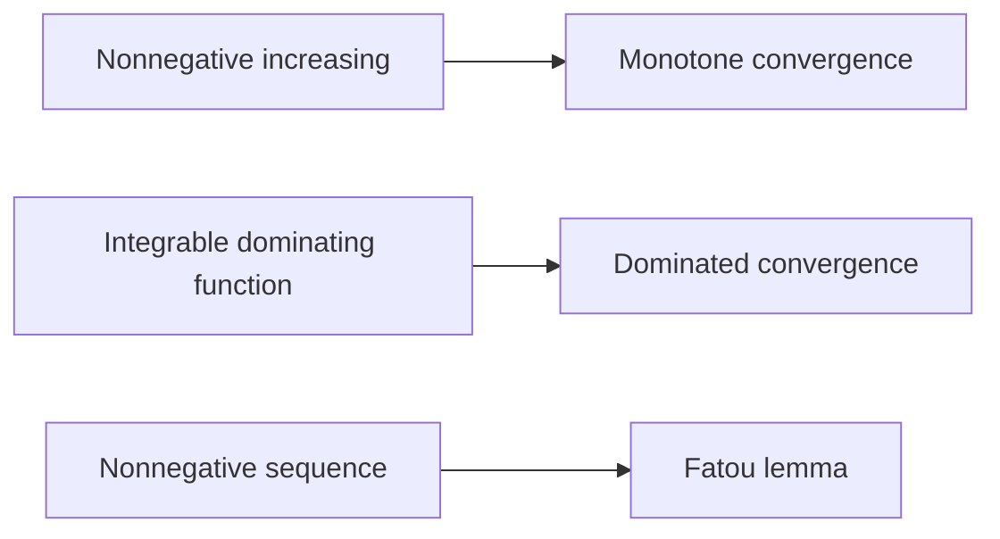

# 20. Lebesgue Integration and Convergence Theorems

[[en/19-measure-theory|← 19. Measure Theory and Measurable Functions]] · [[en/index|Course index]] · [[en/term-index|Terms & theorems]] · [[en/21-lp-spaces|21. Lp Spaces and Modes of Convergence →]]

> [!abstract] Goal
> Define the [[#20.1 Construction of the integral|Lebesgue integral]] and apply the limit theorems that make it more flexible than [[en/08-riemann-integration#8.2 Riemann sums and properties|Riemann integration]].

## 20.1 Construction of the integral

For a nonnegative [[en/19-measure-theory#19.4 Measurable functions|simple function]] $\varphi=\sum_{k=1}^{m}a_k1_{A_k}$, define

$$
\int_X\varphi\,d\mu=\sum_{k=1}^{m}a_k\mu(A_k),
$$

with $0\cdot\infty=0$. For a general measurable $f\ge0$,

$$
\int_X f\,d\mu
=\sup\left\{\int_X\varphi\,d\mu:
0\le\varphi\le f,\ \varphi\text{ simple}\right\}.
$$

The value may be $+\infty$. Write $f^+=\max(f,0)$ and $f^-=\max(-f,0)$, so $f=f^+-f^-$ and $|f|=f^++f^-$. A measurable $f$ is **integrable**, written $f\in L^1(\mu)$, if

$$
\int_X|f|\,d\mu<\infty,
$$

and then $\int f\,d\mu=\int f^+\,d\mu-\int f^-\,d\mu$.

The integral is linear and monotone. Changing a function on a null set does not change its integral. If $f$ is integrable, it is finite almost everywhere, and

$$
\left|\int_Xf\,d\mu\right|\le\int_X|f|\,d\mu.
$$

## 20.2 The three fundamental limit theorems

> [!theorem] Monotone convergence theorem
> If $0\le f_n\uparrow f$ almost everywhere, then
> $$
> \int_Xf_n\,d\mu\uparrow\int_Xf\,d\mu,
> $$
> including the possibility of an infinite limit.

^lebesgue-monotone-convergence-theorem

> [!lemma] Fatou's lemma
> For measurable $f_n\ge0$,
> $$
> \int_X\liminf_{n\to\infty}f_n\,d\mu
> \le\liminf_{n\to\infty}\int_Xf_n\,d\mu.
> $$

^fatou-lemma

> [!theorem] Dominated convergence theorem
> If measurable $f_n\to f$ a.e. and $|f_n|\le g$ for an integrable $g$, then
> $$
> \lim_{n\to\infty}\int_X|f_n-f|\,d\mu=0,
> \qquad
> \lim_{n\to\infty}\int_Xf_n\,d\mu=\int_Xf\,d\mu.
> $$

^dominated-convergence-theorem

Domination is crucial. The functions $n1_{(0,1/n)}$ tend to zero pointwise on $(0,1)$ but all have integral $1$. They are not bounded by one integrable function independent of $n$.

## 20.3 Relation to Riemann integration

A bounded Riemann-integrable function on $[a,b]$ is Lebesgue integrable, and the two integrals coincide. Lebesgue integration also handles many highly discontinuous functions: for example, $\int_{[0,1]}1_{\mathbb Q}\,d\lambda=0$.

An absolutely convergent improper Riemann integral gives a Lebesgue integral with the same value. A [[en/04-numeric-series#4.3 Absolute and conditional convergence|conditionally convergent]] [[en/09-improper-integrals-applications#9.1 Definitions|improper integral]], such as $\int_1^\infty\sin x/x\,dx$, does **not** define a finite Lebesgue integral over the whole interval because $\int|\sin x|/x=\infty$.

## 20.4 Product measures and Fubini–Tonelli

Given $\sigma$-finite [[en/19-measure-theory#19.2 Measures|measure]] spaces, one constructs the product measure $\mu\times\nu$ with $(\mu\times\nu)(A\times B)=\mu(A)\nu(B)$.

- **Tonelli:** for measurable $f\ge0$, the product integral and both [[en/17-multiple-integrals#17.1 Definition and iterated integrals|iterated integrals]] are equal, possibly infinite.
- **Fubini:** if $\int|f|\,d(\mu\times\nu)<\infty$, both iterated integrals exist and equal the product integral.

Without nonnegativity or absolute integrability, iterated integrals can differ or fail to exist. The $\sigma$-finiteness hypothesis covers $\mathbb R^n$ with [[en/19-measure-theory#19.3 Lebesgue measure|Lebesgue measure]] and most standard applications.

## Worked example

Compute $\int_0^1x^{-1/2}\,dx$. Let

$$
f_n(x)=x^{-1/2}1_{(1/n,1)}(x).
$$

These functions increase to $x^{-1/2}$ for $0<x<1$. Monotone convergence gives

$$
\int_0^1x^{-1/2}\,dx
=\lim_{n\to\infty}\int_{1/n}^{1}x^{-1/2}\,dx
=\lim_{n\to\infty}2(1-n^{-1/2})=2.
$$

## Common pitfalls

1. Almost-everywhere convergence alone does not imply convergence of integrals.
2. Conditional improper convergence is not absolute Lebesgue integrability.
3. Fubini's theorem requires absolute integrability; Tonelli's theorem requires nonnegativity.

## Exercises

1. Evaluate $\int_{[0,1]}1_{\mathbb Q}\,d\lambda$.
2. Apply [[#^dominated-convergence-theorem|dominated convergence]] to $\lim_n\int_0^1\frac{1+nx}{n(1+x^2)}\,dx$.
3. Give an example where Fatou's inequality is strict.

> [!answer]- Short answers
> 1. It is zero because $\mathbb Q\cap[0,1]$ is null.
> 2. The integrands are bounded by $2$ for $n\ge1$ on $(0,1)$ and tend to $x/(1+x^2)$; the limit is $\frac12\log2$. On the finite interval, constant $2$ is integrable.
> 3. For $f_n=n1_{(0,1/n)}$, the pointwise limit is zero a.e., so the left side is $0$ while the right side is $1$.

---

[[en/19-measure-theory|← 19. Measure Theory and Measurable Functions]] · [[en/index|Course index]] · [[en/term-index|Terms & theorems]] · [[en/21-lp-spaces|21. Lp Spaces and Modes of Convergence →]]
