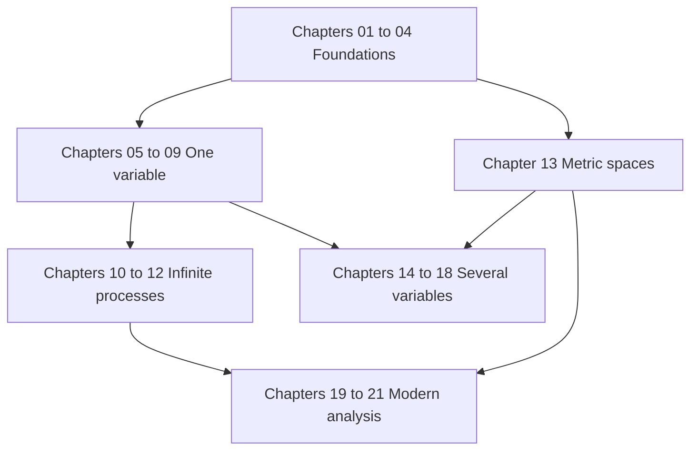

# Mathematical Analysis

**English** · [[ru/index|Русский]] · [[es/index|Español]]

A rigorous course from first principles to modern integration, in 21 chapters. Read it here on GitHub, or open `MathInMind-Obsidian/` as an Obsidian vault for wikilinks, hover previews and theorem callouts; [[en/00-notation|the guide to both views]] explains the difference.

## Study aids

- [[en/term-index|Index of terms and theorems]] — every definition and result, one click from its statement.
- [[en/00-notation|How to read the course: views and notation]]
- [[en/formula-sheet|Formula sheet]]
- [[en/glossary|Trilingual glossary]]
- [Recommended books and problem collections](https://github.com/NikiHunter/matan/blob/main/REFERENCES.md)

## Illustrated lectures 2025/26

- [[en/lectures-2025-26/index|Index of all lectures 0–64]]: full transcriptions of the 2025/26 lectures, Russian originals with English and Spanish translations, including the handwritten proofs and figures.
- **Semester 1:** lectures 0–32. **Semester 2:** lectures 33–64. Semester 2 overlaps the Russian exam-oriented [[ru/lectures/index|register `ru/lectures/`]]; every lecture links to the matching register section.
- Where each figure comes from (PDF, page and crop) is recorded batch by batch in [`assets/lectures-2025-26/`](https://github.com/NikiHunter/matan/tree/main/MathInMind/assets/lectures-2025-26).

## Course map

## Part I — Foundations

1. [[en/01-logic-sets-functions|Logic, sets, and functions]] — quantifiers, proofs, cardinality.
2. [[en/02-real-numbers|The real numbers and completeness]] — supremum, Archimedean property, density.
3. [[en/03-sequences|Sequences and limits]] — monotone and Cauchy criteria, subsequences.
4. [[en/04-numeric-series|Numerical series]] — convergence tests, absolute and conditional convergence.

## Part II — One-variable calculus

5. [[en/05-limits-continuity|Limits and continuity]] — functional limits, intermediate values, uniform continuity.
6. [[en/06-derivatives|Differentiation]] — linear approximation, chain rule, inverse functions.
7. [[en/07-taylor-convexity|Mean value theorems, Taylor expansion, and convexity]].
8. [[en/08-riemann-integration|The Riemann integral]] — Darboux sums, fundamental theorem, techniques.
9. [[en/09-improper-integrals-applications|Improper integrals and applications]] — convergence, area, length, volume, work.

## Part III — Infinite processes

10. [[en/10-function-sequences-series|Sequences and series of functions]] — uniform convergence and interchange theorems.
11. [[en/11-power-series|Power series and analytic functions]] — radius, termwise calculus, Taylor series.
12. [[en/12-fourier-series|Fourier series]] — orthogonality, pointwise and mean-square convergence.

## Part IV — Several variables and topology

13. [[en/13-metric-spaces|Metric spaces, compactness, and completeness]].
14. [[en/14-several-variables|Functions of several variables]] — joint limits, continuity, compact domains.
15. [[en/15-multivariable-differentiation|Multivariable differentiation]] — Jacobian, gradient, Hessian.
16. [[en/16-implicit-functions-extrema|Inverse and implicit functions; extrema]] — local theorems and Lagrange multipliers.

## Part V — Integration in several variables

17. [[en/17-multiple-integrals|Multiple integrals and change of variables]] — Fubini, polar and spherical coordinates.
18. [[en/18-vector-calculus|Vector calculus and integral theorems]] — line and surface integrals, Green, Stokes, Gauss.

## Part VI — Modern analysis

19. [[en/19-measure-theory|Measure theory and measurable functions]].
20. [[en/20-lebesgue-integration|Lebesgue integration and convergence theorems]].
21. [[en/21-lp-spaces|$L^p$ spaces and modes of convergence]] — Hölder, completeness, Hilbert-space geometry.

## Suggested study routine

1. Read the goals and reproduce each definition without looking.
2. Work through the examples, then identify exactly where every theorem hypothesis is used.
3. Attempt the exercises before opening the short answers.
4. Keep a personal error log and link it to the relevant chapter.
5. Review with the formula sheet only after understanding the derivations; it is not a substitute for the theory.

For a first course, study Chapters 1–12 and 14–18, using Chapter 13 as needed. For a second course, review the earlier summaries and concentrate on Chapters 13 and 19–21. The original supplied lecture archive is documented separately in [source notes](https://github.com/NikiHunter/matan/blob/main/source/README.md).
