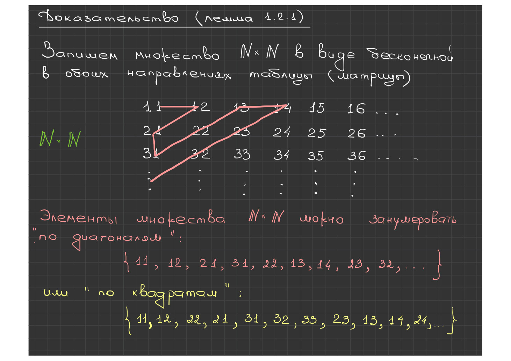
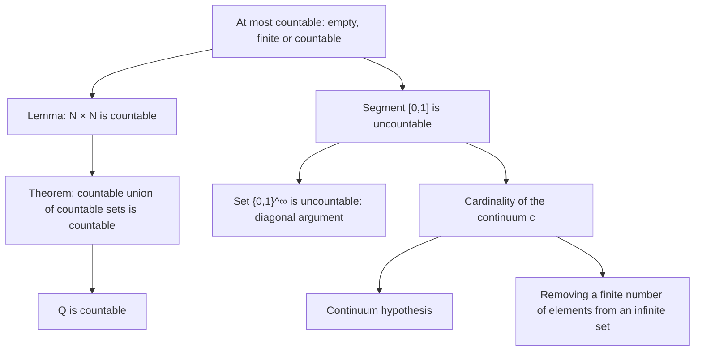

# Lecture 3 — At most countable sets and the continuum

[[en/lectures-2025-26/lecture-01-02|← Lectures 1–2]] · [[en/lectures-2025-26/index|Lecture index]] · [[en/lectures-2025-26/lecture-04|Lecture 4 →]] · [[en/term-index|Terms & theorems]] · [[ru/lectures-2025-26/lecture-03|Русский]] · [[es/lectures-2025-26/lecture-03|Español]]

> [!info] Source
> `ма25_26_лекция_3_notes.pdf` — 17 pages: 9 typed slides with a text layer and 8 handwritten pages. Figures from handwritten pages 5, 12 and 17 are embedded as illustrations. PDF page numbers are given in the headings.

## Slide 2. Quote of the day

> "Do what you must, and let come what will."
>
> — Marcus Aurelius

## Slide 3. Aim of the lecture

- We discuss at most [[en/lectures-2025-26/lecture-01-02#^def-1-2-5|countable sets]].
- We give examples of countable and [[#^thm-1-2-5|uncountable]] sets.
- We talk about the continuum hypothesis and the cardinality of sets. a series of axioms of the field of real numbers (field, order and completeness axioms).

## §2. Cardinality. Countable and uncountable sets

### Slide 4. At most countable sets

> [!definition] Definition 1.2.6
> An empty, finite or countable set is called at most countable.

^def-1-2-6

> [!theorem] Theorem 1.2.3
> An at most countable union of at most countable sets is at most countable.

^thm-1-2-3

> [!lemma] Lemma 1.2.1
> The set $\mathbb{N} \times \mathbb{N}$ is countable.

^lem-1-2-1

### Handwritten page 5 (PDF p. 5). Proof of Lemma 1.2.1

Write the set $\mathbb{N} \times \mathbb{N}$ as an infinite table, infinite in both directions (a matrix):

$$
\begin{array}{ccccccc}
11 & 12 & 13 & 14 & 15 & 16 & \dots \\
21 & 22 & 23 & 24 & 25 & 26 & \dots \\
31 & 32 & 33 & 34 & 35 & 36 & \dots \\
\vdots & \vdots & \vdots & \vdots & \vdots & \vdots &
\end{array}
$$

The elements of $\mathbb{N} \times \mathbb{N}$ can be numbered "along diagonals":

$$
\{\,11,\ 12,\ 21,\ 31,\ 22,\ 13,\ 14,\ 23,\ 32,\ \dots\,\},
$$

or "by squares":

$$
\{\,11,\ 12,\ 22,\ 21,\ 31,\ 32,\ 33,\ 23,\ 13,\ 14,\ 24,\ \dots\,\}.
$$

### Handwritten page 6 (PDF p. 6). Continuation of the lemma and proof of Theorem 1.2.3

In other words, a [[en/lectures-2025-26/lecture-01-02#^def-1-1-6|bijection]] between $\mathbb{N} \times \mathbb{N}$ and $\mathbb{N}$ is given. This proves that $\mathbb{N} \times \mathbb{N}$ is countable.

**Proof ([[#^thm-1-2-3|Theorem 1.2.3]]).** Let $B = \bigcup_{k=1}^{n} A_k$ or $B = \bigcup_{k=1}^{\infty} A_k$, where the sets $A_k$ are at most countable. Write the elements of $A_1$ in the first row of the matrix, the elements of $A_2 \setminus A_1$ in the second row, and so on; that is, if the set $A_k$ is given, the elements

$$
A_k \setminus \bigcup_{j=1}^{k-1} A_j
$$

are written in the $k$-th row of the matrix.

Thus all elements of $B$ end up written in the cells of the matrix (some cells may remain empty).

### Handwritten page 7 (PDF p. 7). End of the proof of Theorem 1.2.3

Hence $B$ is [[en/lectures-2025-26/lecture-01-02#Slide 12. Definition 1.2.1 (equinumerosity)|equinumerous]] with some subset of the countable (by [[#^lem-1-2-1|Lemma 1.2.1]]) set $\mathbb{N} \times \mathbb{N}$. By [[en/lectures-2025-26/lecture-01-02#^thm-1-2-2|Theorem 1.2.2]], the set $B$ is at most countable.

### Slide 8. Examples of countable sets

> [!theorem] Theorem 1.2.4
> The set $\mathbb{Q}$ is countable.

^thm-1-2-4

> [!corollary] Corollary 1.2.1
> If $a, b \in \mathbb{R}$ and $a < b$, then $\mathbb{Q} \cap (a, b)$ is countable.

^cor-1-2-1

### Handwritten page 9 (PDF p. 9). Proof of Theorem 1.2.4

Introduce the notation:

$$
\mathbb{Q}_+ = \{\, x \in \mathbb{Q} : x > 0 \,\}, \qquad \mathbb{Q}_- = \{\, x \in \mathbb{Q} : x < 0 \,\}, \qquad \mathbb{Q} = \mathbb{Q}_+ \cup \mathbb{Q}_- \cup \{0\}.
$$

$$
\forall\, q \in \mathbb{N} \ \mapsto\ \mathbb{Q}_q = \left\{ \frac{1}{q}, \frac{2}{q}, \frac{3}{q}, \frac{4}{q}, \dots \right\} \quad \text{— a countable set.}
$$

$$
\mathbb{Q}_+ = \bigcup_{q=1}^{\infty} \mathbb{Q}_q \quad \text{— a countable set (by Theorem 1.2.3).}
$$

$\mathbb{Q}_-$ is treated analogously and is also countable. Hence $\mathbb{Q} = \mathbb{Q}_+ \cup \mathbb{Q}_- \cup \{0\}$ is countable too (by [[#^thm-1-2-3|Theorem 1.2.3]]).

### Slide 10. Examples of uncountable sets

So far we have not given a single example of an infinite set that is provably not countable (such sets are called uncountable).

> [!theorem] Theorem 1.2.5
> The segment $[0, 1]$ is uncountable.

^thm-1-2-5

> [!corollary] Corollary 1.2.2
> The sets $\mathbb{R}$ and $\mathbb{R} \setminus \mathbb{Q}$ are uncountable.

^cor-1-2-2

### Handwritten pages 11–13 (PDF pp. 11–13). Cantor's example (an uncountable set)

**Cantor's example.** Consider the set of all infinite sequences of $0$s and $1$s:

$$
\{0, 1\}^{\infty}.
$$

**Claim.** The set $\{0,1\}^{\infty}$ is not countable.

**Proof (by contradiction).** Make an assumption $\Rightarrow$ logical deductions $\Rightarrow$ absurdity (a contradiction) $\Rightarrow$ this shows that the initial assumption is false.

Assume that the set $\{0,1\}^{\infty}$ is countable. Then we can number these sequences by natural numbers:

1. $\to\ 0\ 1\ 1\ 0\ \dots$
2. $\to\ 1\ 1\ 1\ 1\ \dots$
3. $\to\ 0\ 1\ 0\ 1\ \dots$
4. $\vdots$

Now consider the sequence formed by the diagonal elements: $0\ 1\ 0\ \dots$. In the $n$-th place stands the $n$-th element of the $n$-th sequence.

Build the "green" sequence (it is written under the table of diagonal elements in the figure): in each place $n$ put an element different from the $n$-th element of the $n$-th sequence.

> [!note] Editor's clarification
> "different" here means the opposite of $0$ or $1$; in the figure the green sequence is $1\ 0\ 1\ \dots$.

In the first place this sequence has something different from what the 1st sequence has; in the second place, something different from the 2nd sequence; …; in the $n$-th place, something different from the $n$-th sequence; …

Could the "green sequence" be the $k$-th sequence of the numbered list? No, because in the $k$-th place the "green sequence" has something different from what the $k$-th sequence has.

So we have not counted the "green sequence", which is a contradiction!

Hence our assumption is false, and the set $\{0,1\}^{\infty}$ is uncountable.

### Slide 14. Cardinality of the continuum

> [!definition] Definition 1.2.7
> If a set is equivalent to the segment $[0, 1]$, one says that it has the cardinality of the continuum.

^def-1-2-7

We state, without proof, some further facts about cardinalities of sets:

1. Every non-degenerate segment, and in particular the whole line $\mathbb{R}$, has the cardinality of the continuum. More generally, for every $m \in \mathbb{N}$ the set $\mathbb{R}^m$ has the cardinality of the continuum.
2. The set of all functions $f : [0,1] \to \mathbb{R}$ is "richer" than the segment $[0,1]$: it is not equinumerous with the segment, but it contains a part that is equinumerous with the segment.

### Slide 15. The continuum hypothesis

**Continuum hypothesis.** Every infinite subset of $\mathbb{R}$ is equinumerous with $\mathbb{N}$ or with $\mathbb{R}$.

1. The hypothesis was formulated by G. Cantor.
2. In 1934 K. Gödel proved that the continuum hypothesis is consistent with the remaining axioms of set theory.
3. In 1964 P. Cohen proved that its negation is also consistent with the remaining axioms of set theory.

### Slide 16. Cardinality of a set

We have defined equinumerosity of sets without ever defining what the cardinality of a set is, and without using that notion.

To define the cardinality of a set one can proceed as follows. [[en/lectures-2025-26/lecture-37-38#^def-4-2-2|Partition]] all sets into equivalence classes: two sets belong to the same class if they are equivalent. Then call each class a cardinality.

Usually the cardinality of an $n$-element set (the class of $n$-element sets) is denoted by the number $n$, and the cardinality of the continuum by the letter $\mathfrak{c}$.

### Handwritten page 17 (PDF p. 17). Remark

If a finite number of elements is removed from an infinite set, the result is a set equinumerous with the original.

**Finite sets do not have this property!**

## Lecture map

