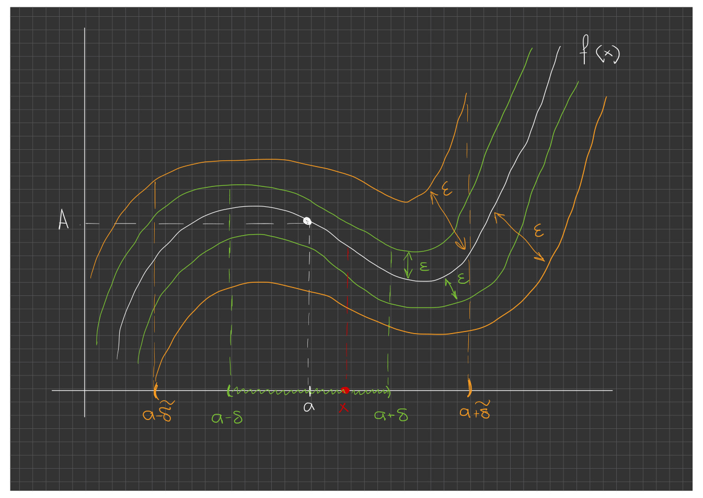

# Lecture 14 — The limit of a function: definitions by Cauchy and by Heine

[[en/lectures-2025-26/lecture-13|← Lecture 13]] · [[en/lectures-2025-26/index|Lecture index]] · [[en/lectures-2025-26/lecture-15|Lecture 15 →]] · [[en/term-index|Terms & theorems]] · [[ru/lectures-2025-26/lecture-14|Русский]] · [[es/lectures-2025-26/lecture-14|Español]]

> [!info] Source
> `ма25_26_лекция_14_notes.pdf` — 18 pages: typed slides (pages 1–5, 7–9, 11–12, 15–16) and handwritten pages (6, 10, 13, 14, 17, 18). Page 5 and page 16 are typed slides with handwritten annotations. Handwritten pages were transcribed from their images. PDF page numbers are given in the headings.
>
> **Editor's note.** The lecture date is taken from the footer of the slides ("16 October 2025").

## Typed slides 1–3. Introduction

**Quote of the day:** "I'm a wicked witch . . . I got up on the wrong foot . . . I flew off on the wrong broom . . . And I flew in the wrong direction . . . "

**Aim of the lecture.** Define [[#^def-2-4-1|limit points]] and isolated points of a set. Give the definitions of the [[#^def-2-4-4|limit of a function]] by Cauchy and by Heine. Prove the uniqueness of the limit of a function. Prove results on the local boundedness of functions that have a limit, and on the stabilization of sign.

## §4. The limit of a function

### Typed slide 4. Limit point

> [!definition] Definition 2.4.1
> Let $a \in \mathbb{R}$, $D \subset \mathbb{R}$. The point $a$ is called a **limit point** (accumulation point) of the set $D$ if every neighbourhood of $a$ contains a point of $D$ different from $a$.

^def-2-4-1

> [!definition] Definition 2.4.2
> The **punctured neighbourhood** of a point $a$ is the set $\dot V(a) = V(a) \setminus \{a\}$.

^def-2-4-2

Thus, $a$ is a limit point of $D$ if every [[#^def-2-4-2|punctured neighbourhood]] of $a$ has nonempty intersection with $D$.

### Typed slide 5 with handwritten annotations. Remarks on limit points

1. A limit point of a set may or may not belong to the set. For example, every point of the segment $[c, d]$ is a limit point of the interval $(c, d)$.
2. If $a$ is a limit point of $D$, then every neighbourhood of $a$ (punctured or not, it does not matter) contains infinitely many points of $D$.
3. Let $a$ be a limit point of $D$. Then for every $n \in \mathbb{N}$ the punctured $\frac{1}{n}$-neighbourhood of $a$ contains a point $x_n$ of $D$. The constructed sequence $\{x_n\}$ tends to $a$, since $|x_n - a| < \frac{1}{n} \to 0$.
4. The definition of a limit point also applies in the cases $a = \pm\infty$ and $a = \infty$.

Handwritten annotation (to remark 2): on the number line the points $a-1$, $a-\frac12$, $a-\frac1n$, $a$, $a+\frac1n$, $a+\frac12$, $a+1$ are marked, with neighbourhoods around them (an illustration).

## Handwritten page 6 (PDF p. 6). Reminder

Recall that

$$
\dot V(+\infty) = (E, +\infty), \qquad \dot V(-\infty) = (-\infty, -E), \qquad \dot V(\infty) = (-\infty, -E) \cup (E, +\infty),
$$

for a sufficiently large $E > 0$.

### Typed slide 7. Isolated points

> [!definition] Definition 2.4.3
> If a point $a$ belongs to a set $D$ but is not a limit point of $D$, then $a$ is called an **isolated point** of $D$.

^def-2-4-3

### Typed slides 8–9. The limit of a function by Cauchy and by Heine

> [!definition] Definition 2.4.4
> Let $f : D \subset \mathbb{R} \to \mathbb{R}$, let $a \in \mathbb{R}$ be a limit point of $D$, and let $A \in \mathbb{R}$. The number $A$ is called the **limit of the function** $f$ at the point $a$, written $\lim\limits_{x\to a} f(x) = A$ or $f(x) \xrightarrow[x\to a]{} A$, if one of the following statements holds (they are equivalent, Theorem 2.4.1):
>
> 1. **Definition in the $\varepsilon$–$\delta$ language, or by Cauchy.** $\forall \varepsilon > 0\ \exists \delta > 0\ \forall x \in D \setminus\{a\}$: $|x - a| < \delta \Rightarrow |f(x) - A| < \varepsilon$.
> 2. **Definition in the language of neighbourhoods.** $\forall V(A)\ \exists V(a)$: $f(\dot V(a) \cap D) \subset V(A)$.
> 3. **Definition in the language of sequences, or by Heine.** For every sequence $\{x_n\}$ with $x_n \in D \setminus \{a\}$, $x_n \to a$, we have $f(x_n) \to A$.

^def-2-4-4

### Typed slide 11. Remarks on the definition of the limit

1. The condition that $a$ is a limit point of $D$ implies that $V(a) \cap D \ne \varnothing$ for every neighbourhood of $a$, and that there exists a sequence $\{x_n\}$ with $x_n \in D$, $x_n \ne a$, $x_n \to a$.
2. The existence of the limit of a function at $a$ is a **local** property: it depends on the behaviour of the function in any prescribed neighbourhood of the point.
3. The value of $f$ at $a$ does not enter the definition of the limit at $a$. Therefore, for the existence and value of the limit at $a$ it is immaterial whether $f$ is defined at $a$ and, if it is, how.

### Typed slide 12. Equivalence of the definitions

> [!theorem] Theorem 2.4.1
> The definitions of the limit of a function by Cauchy and by Heine are equivalent.

^thm-2-4-1

## Handwritten page 10 (PDF p. 10). Figure for the $\varepsilon$–$\delta$ definition

Illustration (handwritten): the graph of $f(x)$, a horizontal line at height $A$, the point $a$ on the $x$-axis; the intervals $(a-\delta, a+\delta)$ (green) and $(a-\tilde\delta, a+\tilde\delta)$ (orange); a band of width $\varepsilon$ around $A$ (green and orange arrows); the point $x$ (red) in the $\delta$-neighbourhood of $a$.

## Handwritten page 13 (PDF p. 13). Proof of Theorem 2.4.1

**Proof ([[#^thm-2-4-1|Theorem 2.4.1]]).** To be definite, we prove the theorem for $a, A \in \mathbb{R}$.

**①** Let $A$ be the limit of $f$ by Cauchy. We show that then $A$ is also the limit of $f$ by Heine.

Take $\{x_n\}$ with $x_n \in D$, $x_n \ne a$, $x_n \to a$. We must show that $f(x_n) \to A$.

Take $\forall \varepsilon > 0$. By the Cauchy definition, $\exists \delta > 0$: $\forall x \in D$, $x \ne a$, $|x - a| < \delta$ $\Rightarrow$ $|f(x) - A| < \varepsilon$.

Since $x_n \to a$, $\exists N$ $\forall n > N$: $|x_n - a| < \delta$. But then $|f(x_n) - A| < \varepsilon$. This means exactly that $f(x_n) \to A$.

**②** Let $A$ be the limit of $f$ at $a$ by Heine. We show that $A$ is also the limit by Cauchy. (Continued on the next page.)

## Handwritten page 14 (PDF p. 14). Proof of Theorem 2.4.1, item ②

We prove by contradiction that $A$ is the limit of $f$ by Cauchy. Suppose $A$ is not a Cauchy limit, i.e.

$$
\exists \varepsilon^* > 0\ \ \forall \delta > 0\ \ \exists x \text{ (depending on } \delta\text{)}: \quad x \in D,\ x \ne a,\ |x - a| < \delta,\ |f(x) - A| \ge \varepsilon^*.
$$

Then for each $n \in \mathbb{N}$, taking $\delta = \frac{1}{n}$, we find a point $x_n$ such that $x_n \in D$, $x_n \ne a$, $|x_n - a| < \frac{1}{n}$, $|f(x_n) - A| \ge \varepsilon^*$.

Then $0 < |x_n - a| < \frac{1}{n}$ $\Rightarrow$ by the [[en/lectures-2025-26/lecture-08#^thm-2-1-4|squeeze theorem]] $x_n \to a$. But then, by the Heine definition, $f(x_n) \to A$, which contradicts the inequality $|f(x_n) - A| \ge \varepsilon^*$.

## Typed slide 15. Uniqueness of the limit of a function

> [!theorem] Theorem 2.4.2
> A function cannot have more than one limit at a given point: if $f : D \subset \mathbb{R} \to \mathbb{R}$, $a$ is a limit point of $D$, $A, B \in \mathbb{R}$, $f(x) \xrightarrow[x\to a]{} A$ and $f(x) \xrightarrow[x\to a]{} B$, then $A = B$.

^thm-2-4-2

## Typed slide 16 with a blue handwritten note. Local boundedness

> [!theorem] Theorem 2.4.3
> Let $f : D \subset \mathbb{R} \to \mathbb{R}$, let $a$ be a limit point of $D$, $A \in \mathbb{R}$, and $f(x) \xrightarrow[x\to a]{} A$. Then there exists a neighbourhood $V(a)$ of $a$ such that $f$ is bounded on $V(a) \cap D$.

^thm-2-4-3

Handwritten (in blue): $f(x) \to A$ as $x \to a$ $\Leftrightarrow$ $\forall \varepsilon > 0\ \exists \delta > 0$: $|x - a| < \delta$, $|f(x) - A| < \varepsilon$.

## Handwritten page 17 (PDF p. 17). Example

**Example.** $f(x) = x$, $\lim\limits_{x\to 3} f(x) = 3$.

Handwritten figure: the graph of $f(x) = x$; on the $x$-axis the points $3$ and $3 + \varepsilon$ are marked; the part of the graph corresponding to this interval is highlighted. On the right, the neighbourhood of $a$: $(a-\delta, a+\delta)$; $|x - a| < \delta \iff a - \delta < x < a + \delta \iff x \in V_\delta(a)$.

> [!remark] Editor's note
> The handwriting does not record an explicit choice $\delta = \varepsilon$.

## Handwritten page 18 (PDF p. 18). Proof of Theorem 2.4.3

**Proof ([[#^thm-2-4-3|Theorem 2.4.3]]).** By the definition of the limit for $\varepsilon = 1$: $\exists V(a)$: $\forall x \in \dot V(a) \cap D$: $|f(x) - A| < 1$.

$\big||f(x)| - |A|\big| \le |f(x) - A| < 1$ $\Rightarrow$ $|f(x)| < 1 + |A|$.

If $a \notin D$, then $V(a) \cap D = \dot V(a) \cap D$, and the proof is complete.

If $a \in D$, then $\forall x \in V(a) \cap D$: $|f(x)| \le \max\{|A| + 1,\ |f(a)|\}$.

At the bottom of the page there is a sketch (a remark): the graph of a function with a point $c \notin D$ (a dashed vertical line at $c$; red curves to the left and right of $c$).
