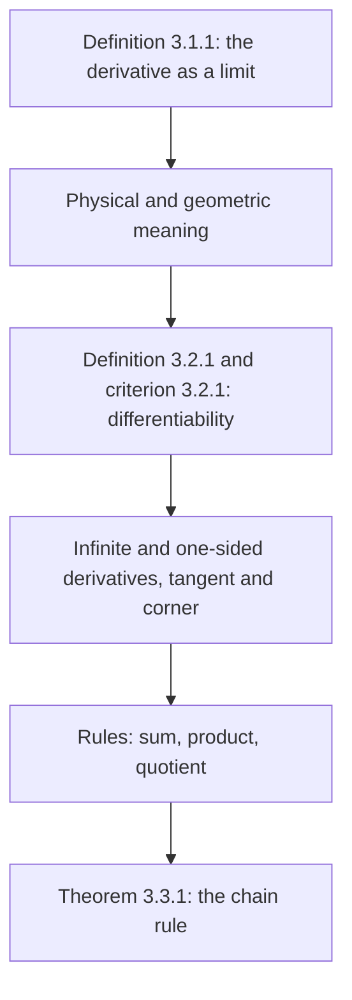

# Lectures 22–23 — The derivative, differentiability and rules of differentiation

[[en/lectures-2025-26/lecture-21|← Lecture 21]] · [[en/lectures-2025-26/index|Lecture index]] · [[en/lectures-2025-26/lecture-24-25-26|Lectures 24–26 →]] · [[en/term-index|Terms & theorems]] · [[ru/lectures-2025-26/lecture-22-23|Русский]] · [[es/lectures-2025-26/lecture-22-23|Español]]

> [!info] Source
> `ma25_26_lectures_22-23_notes.pdf` — 27 pages: typed slides with a text layer (pages 1–5, 7–9, 12–14, 16, 19–21, 24, 25), handwritten pages without a text layer (6, 10, 11, 15, 17, 18, 22, 23, 26, 27). Handwritten pages were transcribed from their images. PDF page numbers are given in the headings; the typed slides are numbered "1/17"–"17/17" in the PDF.
>
> **Editor's note.** The lecture date is taken from the footer of the slides ("13 November 2025"). The notation $\langle a, b\rangle$ denotes an interval of any type.

## Typed slides 1–4. Introduction

**Quote of the day (slide 2).** "TYPICAL METHODS OF PROOF — 3":

- *Proof by lulling:* "A detailed justification will be given in Chapter 7 after the corresponding theory is developed … Chapter 7: for simplicity assume $z = 0$ (the general case is treated in Appendix 2) … Appendix 2: A formal proof is beyond the scope of this monograph …"
- *Proof of the ancient Hindus:* a picture and the inscription "LOOK!"
- *Proof in the style of Terence Tao* (the slide says "in the strength"): "Theorem 3.3.8. Proof: see Exercise 3.4.2. Exercise 3.4.2: Prove Theorem 3.3.8."

**Aim of the lecture.** Define the [[#^def-3-1-1|derivative]] and its mechanical and geometric meaning. Discuss [[#^def-3-2-1|differentiability]] and its criteria. Introduce infinite and [[en/06-derivatives#6.1 Definition and linear approximation|one-sided derivatives]]. Consider the tangent line as a limit of secant lines. Discuss the rules of differentiation, including differentiation of a composition.

**Chapter 3. Differential calculus of functions of one real variable** (title slide 4).

## Chapter 3, §1. The derivative

### Typed slide 5 (PDF p. 5). Definition of the derivative

> [!definition] Definition 3.1.1
> Let $f : \langle a, b\rangle \to \mathbb{R}$, $x_0 \in \langle a, b\rangle$.
>
> $$
> f'(x_0) = \lim_{h \to 0} \frac{f(x_0 + h) - f(x_0)}{h}, \qquad x_0 + h \in \langle a, b\rangle.
> $$

^def-3-1-1

$f'(x_0)$ is called the **derivative** of $f$ at $x_0$.

### Handwritten page 6 (PDF p. 6). Physical and geometric meaning of the derivative

**Physical meaning of the derivative.** $f = f(t)$, $t_0$, $t_0 + h$ $\Rightarrow$ $\dfrac{f(t_0 + h) - f(t_0)}{h}$ is the average rate of change of $f$ on $[t_0, t_0 + h]$; $h \to 0$ $\Rightarrow$ $v_{\text{av}} \to v_{\text{inst}}(t_0)$.

| $f(t)$ | $f'(t)$ |
|---|---|
| ① distance travelled | ① velocity |
| ② velocity | ② acceleration |
| ③ work | ③ power |
| ④ temperature | ④ thermal conductivity (as written) |
| ⑤ momentum | ⑤ force |

**Geometric meaning of the derivative** (at the bottom of the page, in yellow): the picture shows a red curve $y = f(x)$ and the line $y = mx + n$, the tangent to the graph of $f$ at the point $x_0$ $\Rightarrow$ $m = f'(x_0)$.

## Chapter 3, §2. Differentiability of a function

### Typed slide 7 (PDF p. 7). Definition of differentiability

> [!definition] Definition 3.2.1
> Let $f : \langle a, b\rangle \to \mathbb{R}$, $x_0 \in \langle a, b\rangle$. The function $f$ is called **differentiable at $x_0$** if there exists a number $k$ such that
>
> $$
> f(x) = f(x_0) + k(x - x_0) + o(x - x_0), \qquad (x \to x_0).
> $$

^def-3-2-1

### Typed slide 8 (PDF p. 8). Criterion for differentiability at a point

> [!theorem] Theorem 3.2.1
> Suppose $f : \langle a, b\rangle \to \mathbb{R}$, $x_0 \in \langle a, b\rangle$, $k \in \mathbb{R}$. Then the following statements are equivalent:
>
> 1. $f$ is differentiable at $x_0$ and $f'(x_0) = k$.
> 2. The limit $\lim\limits_{x \to x_0} \dfrac{f(x) - f(x_0)}{x - x_0}$ exists and equals $k$.
> 3. There exists a function $F : \langle a, b\rangle \to \mathbb{R}$, continuous at $x_0$, with $F(x_0) = k$ and $f(x) - f(x_0) = F(x)(x - x_0)$ for $x \in \langle a, b\rangle$.

^thm-3-2-1

### Typed slide 9 (PDF p. 9). Remarks on the characterizations of differentiability

Statement 2 is convenient because it gives a way to compute the derivative. Moreover, representing the derivative as a limit allows one to define infinite derivatives and one-sided derivatives.

Statement 3, which gives an explicit expression of the increment of the function through the increment of the argument, will be used to derive the rules of differentiation.

The characterizations of differentiability in statements 2 and 3 cannot be carried over to functions of several variables, whereas [[#^def-3-2-1|Definition 3.2.1]] has a multidimensional analogue. That is why we did not use statement 2 as the definition of differentiability, although it is more convenient for practical purposes.

### Handwritten pages 10–11 (PDF pp. 10–11). Proof of Theorem 3.2.1

**Proof ([[#^thm-3-2-1|Theorem 3.2.1]]).** Scheme in the manuscript: ① $\Rightarrow$ ② $\Rightarrow$ ③ $\Rightarrow$ ①.

① $\Rightarrow$ ②: ① means that $f(x) - f(x_0) = k(x - x_0) + o(x - x_0)$ as $x \to x_0$, whence $\dfrac{f(x) - f(x_0)}{x - x_0} = k + \dfrac{o(x - x_0)}{x - x_0} \xrightarrow[x \to x_0]{} k$, where the term circled in green tends to $0$ as $x \to x_0$ by the definition of being [[en/lectures-2025-26/lecture-09-10#^def-2-2-1|infinitesimal]] in comparison with $(x - x_0)$.

② $\Rightarrow$ ③: put $F(x) = \begin{cases} \dfrac{f(x) - f(x_0)}{x - x_0}, & x \ne x_0, \\ k, & x = x_0. \end{cases}$ By ②, $\lim\limits_{x \to x_0} \dfrac{f(x) - f(x_0)}{x - x_0} = k = F(x_0)$, i.e. $\lim\limits_{x \to x_0} F(x) = F(x_0)$, i.e. $F$ is continuous at $x_0$, and

$$
F(x)(x - x_0) = \begin{cases} f(x) - f(x_0), & x \ne x_0, \\ k(x - x_0), & x = x_0 \end{cases} = f(x) - f(x_0) \quad \forall x \in \langle a, b\rangle.
$$

③ $\Rightarrow$ ①: by ③, $f(x) - f(x_0) = F(x) \cdot (x - x_0)$ $\Rightarrow$

$$
f(x) = f(x_0) + F(x) \cdot (x - x_0) \pm k(x - x_0) = f(x_0) + k(x - x_0) + \underbrace{(F(x) - k)(x - x_0)}_{o(x - x_0)},
$$

(in yellow:) $F$ is continuous at $x_0$ $\Rightarrow$ $F(x) \xrightarrow[x \to x_0]{} F(x_0) = k$, and we obtain ①. $\blacksquare$

> [!remark] Editor's note
> In the manuscript (PDF p. 11) the right-hand side in the equality for $F(x)(x - x_0)$ is written as "$f(x - x_0)$", and under the brace $o(x - x_0)$ is written as $O(x - x_0)$; the correct expressions $f(x) - f(x_0)$ and $o(x - x_0)$ are given above.

### Typed slide 12 (PDF p. 12). The difference quotient

The fraction $\dfrac{f(x) - f(x_0)}{x - x_0}$ is called the **difference quotient**. It has the following physical meaning. If $f$ describes the dependence of the coordinate of a moving material point on time, then the difference quotient gives the average velocity of the point over the time interval between the moments $x_0$ and $x$. Then $f'(x_0)$ can be understood as the instantaneous velocity at time $x_0$.

### Typed slide 13 (PDF p. 13). Infinite and one-sided derivatives

1. **Infinite derivatives.** We shall say that $f'(x_0) = \pm\infty$ if $\lim\limits_{x \to x_0} \dfrac{f(x) - f(x_0)}{x - x_0} = \pm\infty$. The equality $f'(x_0) = \infty$ is defined analogously. Note that if $f$ has an infinite derivative at $x_0$, then it is **not** differentiable at that point.
2. **One-sided derivatives.** Write $f'_{\pm}(x_0) = \lim\limits_{x \to x_0^{\pm}} \dfrac{f(x) - f(x_0)}{x - x_0}$. If $f'_-(x_0)$ and $f'_+(x_0)$ exist, they are called respectively the **left-hand** and **right-hand derivatives** of $f$ at $x_0$. Differentiability of $f$ at $x_0 \in (a, b)$ means that $f'_-(x_0)$ and $f'_+(x_0)$ are finite and equal. Their common value in this case is $f'(x_0)$.

### Typed slide 14 (PDF p. 14). The tangent line as a limit of secant lines

Let $x_1 \in \langle a, b\rangle$. Consider the line through the points $(x_0, f(x_0))$ and $(x_1, f(x_1))$ (call it a **secant line**). It is given by the equation $y = f(x_0) + k(x_1)(x - x_0)$, where $k(x_1) = \dfrac{f(x_1) - f(x_0)}{x_1 - x_0}$.

If $f$ is differentiable at $x_0$, then $\lim\limits_{x_1 \to x_0} k(x_1) = f'(x_0)$. Hence as $x_1 \to x_0$ the secant line, rotating about the point $(x_0, f(x_0))$, approaches the line $y = f(x_0) + f'(x_0)(x - x_0)$, i.e. the **tangent line**.

In the case $f'(x_0) = \pm\infty$ the angle of inclination of the secant line tends to $\dfrac\pi2$ from the right or from the left, respectively, and the line itself tends to the vertical position.

### Handwritten page 15 (PDF p. 15). Pictures: secants, the tangent, a corner

Top picture: a yellow graph-curve on $[a, b]$, the points $(x_0, f(x_0))$ and $(x_1, f(x_1))$ (dashed lines to the axes), red and green secants through these points and a blue tangent at $x_0$. Bottom left: a green "hill" with a blue horizontal tangent at the top (blue point). Bottom right (in red): the graph $f(x) = |x| = \begin{cases} x, & x \ge 0, \\ -x, & x < 0 \end{cases}$ (the function is denoted $Y(x)$ in the manuscript) labelled $f'_+(0) = 1$, $f'_-(0) = -1$.

### Typed slide 16 (PDF p. 16). The tangent line as a limit of secant lines-2

Finally, if $f'_-(x_0)$ and $f'_+(x_0)$ exist and are different, then the limiting position of the secant line depends on which side $x_1$ approaches $x_0$ from (left or right). In this case the graph of $f$ has a **corner** (break).

In the printed picture on the slide (the point is labelled $a$ instead of $x_0$): on the left, secants and a vertical dashed line $x = a$ with a right angle (the case of an infinite derivative); on the right, a graph with a corner at $a$ and two dashed limiting positions of the secant with marked angles of inclination.

### Handwritten pages 17–18 (PDF pp. 17–18). Examples of computing the derivative from the definition

**Examples.**

① $f(x) = x^2$, $f : \mathbb{R} \to \mathbb{R}$:

$$
\lim_{x \to a} \frac{f(x) - f(a)}{x - a} = \lim_{x \to a} \frac{x^2 - a^2}{x - a} = \lim_{x \to a} \frac{(x - a)(x + a)}{x - a} = \lim_{x \to a} (x + a) = 2a \Rightarrow f'(a) = 2a
$$

(the factor $(x - a)$ is crossed out in red in the manuscript). $\Rightarrow$ $f(x) = x^2$ is differentiable at every point $a \in \mathbb{R}$ and $f'(a) = 2a$.

② $f(x) = \sqrt[3]{x}$, $f : \mathbb{R} \to \mathbb{R}$:

$$
\lim_{x \to 0} \frac{f(x) - f(0)}{x - 0} = \lim_{x \to 0} \frac{x^{1/3}}{x} = \lim_{x \to 0} x^{-2/3} = +\infty
$$

$\Rightarrow$ $f(x) = \sqrt[3]{x}$ is not differentiable at $0$, but $f'(0) = +\infty$.

③ $f(x) = \begin{cases} x^2 \sin\dfrac1x, & x \ne 0, \\ 0, & x = 0: \end{cases}$

$$
\lim_{x \to 0} \frac{f(x) - f(0)}{x - 0} = \lim_{x \to 0} \frac{f(x)}{x} = \lim_{x \to 0} \frac{x^2 \sin\frac1x}{x} = \lim_{x \to 0} x \cdot \sin\frac1x = 0,
$$

where $x$ is infinitesimal (in yellow) and $\sin\dfrac1x$ is a bounded function, since $|\sin t| \le 1$ $\forall t \in \mathbb{R}$ (in green). $\Rightarrow$ $f$ is differentiable at $0$ and $f'(0) = 0$.

④ $f(x) = \begin{cases} x \sin\dfrac1x, & x \ne 0, \\ 0, & x = 0: \end{cases}$

$$
\lim_{x \to 0} \frac{f(x) - f(0)}{x - 0} = \lim_{x \to 0} \frac{x \sin\frac1x}{x} = \lim_{x \to 0} \sin\frac1x \text{ — the limit does not exist.}
$$

$f(x)$ does not even have one-sided derivatives at $0$!

### Typed slide 19 (PDF p. 19). Remarks: differentiability and continuity

1. If $f$ is differentiable at $x_0$, then it is continuous at $x_0$. Indeed, $f(x) - f(x_0) = f'(x_0)(x - x_0) + o(x - x_0) \to 0$ ($x \to x_0$).
2. Remark 1 cannot be reversed. Moreover, a stronger fact holds, first established by Weierstrass: there exists a function continuous on $\mathbb{R}$ that is differentiable at no point.

## Chapter 3, §3. Rules of differentiation

### Typed slide 20 (PDF p. 20). Introduction to the rules of differentiation

The derivative of a differentiable function can be found by computing the limit of its difference quotient. This method gives a possibility in principle to differentiate a function, but it is inconvenient in practice. Below we establish how differentiation interacts with other operations on functions — compositions and arithmetic operations.

### Typed slide 21 (PDF p. 21). Rules of differentiation

1. $f$ is differentiable at $x$, $\lambda \in \mathbb{R}$. Then $g(x) = \lambda f(x)$ is differentiable at $x$ and $g'(x) = \lambda f'(x)$.
2. $f$ and $g$ are differentiable at $x$. Then $f \pm g$ and $fg$ are differentiable at the same point and $(f \pm g)'(x) = f'(x) \pm g'(x)$, $(fg)'(x) = f'(x) g(x) + f(x) g'(x)$.
3. $f$ and $g$ are differentiable at $x$, $g(x) \ne 0$. Then $\dfrac{f}{g}$ is differentiable at the same point and $\left(\dfrac{f}{g}\right)'(x) = \dfrac{f'(x) g(x) - f(x) g'(x)}{(g(x))^2}$.

### Handwritten pages 22–23 (PDF pp. 22–23). Proof of the product and quotient rules

**Proof: ②** (product; the term $f(x_0) g(x)$ is added and subtracted in yellow in the numerator):

$$
\lim_{x \to x_0} \frac{f(x) g(x) - f(x_0) g(x_0) \mp f(x_0) g(x)}{x - x_0} = \lim_{x \to x_0} \frac{f(x) g(x) - f(x_0) g(x)}{x - x_0} + \lim_{x \to x_0} \frac{f(x_0) g(x) - f(x_0) g(x_0)}{x - x_0}
$$

$$
= \lim_{x \to x_0} \frac{f(x) - f(x_0)}{x - x_0} \cdot g(x) + \lim_{x \to x_0} f(x_0) \cdot \frac{g(x) - g(x_0)}{x - x_0} = \lim_{x \to x_0} \frac{f(x) - f(x_0)}{x - x_0} \cdot \lim_{x \to x_0} g(x) + \lim_{x \to x_0} f(x_0) \cdot \lim_{x \to x_0} \frac{g(x) - g(x_0)}{x - x_0},
$$

where (annotations in the manuscript): the first limit $= f'(x_0)$, since $f$ is differentiable at $x_0$ (red box); $\lim\limits_{x \to x_0} g(x) = g(x_0)$, since $g$ is differentiable at $x_0$ $\Rightarrow$ $g$ is continuous at $x_0$ $\Rightarrow$ and for a continuous function $\lim\limits_{x \to x_0} g(x) = g(x_0)$ (green oval); $\lim\limits_{x \to x_0} f(x_0) = f(x_0)$, since $f(x_0) = \mathrm{const}$ (yellow oval); the last limit $= g'(x_0)$, since $g$ is differentiable at $x_0$ (red box).

Thus $(f \cdot g)'(x_0) = \lim\limits_{x \to x_0} \dfrac{f(x) g(x) - f(x_0) g(x_0)}{x - x_0} = f'(x_0) g(x_0) + f(x_0) g'(x_0)$. ✓

③ (quotient):

$$
\lim_{x \to x_0} \frac{\left(\frac{f}{g}\right)(x) - \left(\frac{f}{g}\right)(x_0)}{x - x_0} = \lim_{x \to x_0} \frac{f(x) g(x_0) - f(x_0) g(x)}{(x - x_0) g(x) g(x_0)} = \frac{\lim\limits_{x \to x_0} \dfrac{f(x) g(x_0) - f(x_0) g(x)}{x - x_0}}{\lim\limits_{x \to x_0} g(x) g(x_0)} = \frac{f'(x_0) g(x_0) - f(x_0) g'(x_0)}{g^2(x_0)}. \quad \checkmark
$$

Here the denominator: $\lim\limits_{x \to x_0} g(x) \cdot g(x_0) = g(x_0) g(x_0) = g^2(x_0)$ (green box), and the numerator (in yellow and blue at the bottom of the page): adding and subtracting $f(x_0) g(x_0)$ (in pink),

$$
\lim_{x \to x_0} \frac{f(x) g(x_0) - f(x_0) g(x) \mp f(x_0) g(x_0)}{x - x_0} = \underbrace{\lim_{x \to x_0} \frac{f(x) g(x_0) - f(x_0) g(x_0)}{x - x_0}}_{=\, f'(x_0) \cdot g(x_0)} - \underbrace{\lim_{x \to x_0} \frac{f(x_0) g(x) - f(x_0) g(x_0)}{x - x_0}}_{=\, f(x_0) \cdot g'(x_0)}.
$$

(The manuscript treats the product and the quotient; the sum/difference and multiplication by a constant are analogous.)

### Typed slide 24 (PDF p. 24). Differentiation of a composition

> [!theorem] Theorem 3.3.1
> Let $f : \langle A, B\rangle \to \langle C, D\rangle$, $g : \langle C, D\rangle \to \mathbb{R}$, $a \in \langle A, B\rangle$. If $f$ is differentiable at $a$ and $g$ is differentiable at $f(a)$, then $g \circ f$ is differentiable at $a$ and $(g \circ f)'(a) = g'(f(a)) \cdot f'(a)$.

^thm-3-3-1

### Typed slide 25 (PDF p. 25). Remarks: the chain rule

1. For linear functions $f$ and $g$ the statement of [[#^thm-3-3-1|Theorem 3.3.1]] is obvious, since their composition is again a linear function whose slope is the product of the slopes of $f$ and $g$, i.e. of their derivatives.
2. The rule for differentiating a composition is easily generalized to several functions: the derivative of the composition is the product of the derivatives of all the functions at the corresponding points. For example, for three functions the formula reads $(h \circ g \circ f)'(a) = h'((g \circ f)(a)) \cdot g'(f(a)) \cdot f'(a)$. That is why [[#^thm-3-3-1|Theorem 3.3.1]] is also called the **chain rule**.

### Handwritten pages 26–27 (PDF pp. 26–27). The linear case and proof of Theorem 3.3.1

(Top of page 26 — illustration of Remark 1:) $f(x) = mx + n$, $g(y) = \alpha y + \beta$; $(g \circ f)(x) = g(f(x)) = \alpha(mx + n) + \beta = \alpha m x + \alpha n + \beta$; $(g \circ f)'(x) = \alpha \cdot m = \underbrace{g'(f(x))}_{= \alpha} \cdot \underbrace{f'(x)}_{= m}$. ✓

**Proof ([[#^thm-3-3-1|Theorem 3.3.1]]).** We use the third statement of the differentiability criterion ([[#^thm-3-2-1|Theorem 3.2.1]]).

$f$ is differentiable at $a$ $\iff$ $\exists F : \langle A, B\rangle \to \mathbb{R}$: $F$ is continuous at $a$, $F(a) = f'(a)$, $f(x) - f(a) = F(x) \cdot (x - a)$ $\forall x \in \langle A, B\rangle$.

$g$ is differentiable at $f(a)$ $\iff$ $\exists G : \langle C, D\rangle \to \mathbb{R}$: $G$ is continuous at $b = f(a)$, $G(b) = g'(b)$, $g(y) - g(b) = G(y) \cdot (y - b)$ $\forall y \in \langle C, D\rangle$.

Then, with $y = f(x)$:

$$
(g \circ f)(x) - (g \circ f)(a) = g(f(x)) - g(f(a)) = G(f(x)) \cdot (f(x) - f(a)) = \underbrace{G(f(x)) \cdot F(x)}_{=\, H(x)} \cdot (x - a).
$$

$\begin{cases} F \text{ is continuous at } a \\ G \text{ is continuous at } f(a) \end{cases} \Rightarrow$ $H$ is continuous at $a$.

Thus we have an $H : \langle A, B\rangle \to \mathbb{R}$ such that $H$ is continuous at $a$, $(g \circ f)(x) - (g \circ f)(a) = H(x) \cdot (x - a)$ and

$$
H(a) = \underbrace{G(f(a))}_{g'(f(a))} \cdot \underbrace{F(a)}_{f'(a)} = g'(f(a)) \cdot f'(a).
$$

On the other hand, $H(a) = (g \circ f)'(a)$. $\blacksquare$

## Structure of the lecture

## Service pages

- Page 1 is the title page; page 2 is the "quote of the day"; page 3 gives the aim of the lecture; page 4 is the title slide of Chapter 3.
- The proof of [[#^thm-3-2-1|Theorem 3.2.1]]: PDF p. 10 (① ⇒ ② and ② ⇒ ③) and p. 11 (③ ⇒ ①).
