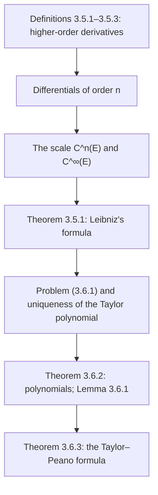

# Lectures 27–28 — Higher-order derivatives and Taylor's formula

[[en/lectures-2025-26/lecture-24-25-26|← Lectures 24–26]] · [[en/lectures-2025-26/index|Lecture index]] · [[en/lectures-2025-26/lecture-29-30|Lectures 29–30 →]] · [[en/term-index|Terms & theorems]] · [[ru/lectures-2025-26/lecture-27-28|Русский]] · [[es/lectures-2025-26/lecture-27-28|Español]]

> [!info] Source
> `ma25_26-lectures_27-28_notes.pdf` — 31 pages: typed slides with a text layer (pages 1–12, 14, 16–18, 21–23, 26, 29, 31) and handwritten pages without a text layer (13, 15, 19, 20, 24, 25, 27, 28, 30). Handwritten pages were transcribed from their images. PDF page numbers are given in the headings; the typed slides are numbered "1/22"–"22/22" in the PDF.
>
> **Editor's note.** The lecture date is taken from the footer of the slides ("4 December 2025").

## Typed slides 1–3. Introduction

**Quote of the day (slide 2).** "— How will I know if he [~~my supervisor~~ the dragon] has chosen me? — He will try to kill you." (Avatar.) On the slide the words "my supervisor" are struck through; below the quote there is a photo of a dragon in glasses at a laptop and a still with an ikran from *Avatar*.

**Aim of the lecture.** Introduce the notion of a [[en/lectures-2025-26/lecture-22-23#^def-3-1-1|derivative]] of arbitrary order. Discuss [[#^thm-3-6-3|Taylor's formula]].

## Chapter 3, §5. Higher-order derivatives

### Typed slide 4 (PDF p. 4). The set of differentiability

So far we have spoken about the first derivative of a function. Now let us introduce the notion of a derivative of arbitrary order.

Let $E \subset \mathbb{R}$, $f : E \to \mathbb{R}$, $a \in \mathbb{R}$, and suppose the condition

$$
\exists \delta > 0 : (a - \delta, a + \delta) \cap E \text{ is a non-degenerate interval} \tag{5.1}
$$

holds.

> [!definition] Definition 3.5.1
> Let $E_1$ be the set of points of $E$ satisfying condition (5.1) at which the function $f$ is differentiable. We call $E_1$ the set of differentiability of $f$, and the function $x \mapsto f'(x)$, defined on $E_1$, the derivative of $f$.

^def-3-5-1

### Typed slide 5 (PDF p. 5). The second derivative of $f$

Denote by $E_2$ the set of all points $a \in E_1$ such that

1. $\exists \delta > 0 : E_1 \cap (a - \delta, a + \delta) = E \cap (a - \delta, a + \delta)$;
2. The function $f'$ is [[en/lectures-2025-26/lecture-22-23#^def-3-2-1|differentiable]] at the point $a$.

> [!definition] Definition 3.5.2
> Let $a \in E_2$. The number $(f')'(a)$ is called the second derivative of $f$ at the point $a$ and is denoted $f''(a)$, and the function $f$ is called twice differentiable at the point $a$. The function $f''$, defined on $E_2$ by $x \mapsto f''(x)$, is called the second derivative of $f$.Other notations on the slide: $f^{(2)}(a)$, $\dfrac{d^2 f}{dx^2}(a)$, $D^2 f(a)$.

^def-3-5-2

### Typed slide 6 (PDF p. 6). The $n$-th derivative of $f$

Suppose we have already defined the functions $f^{(2)}, \ldots, f^{(n-1)}$, defined on $E_2, \ldots, E_{n-1}$ respectively. Denote by $E_n$ the set of all points $a \in E_{n-1}$ such that

1. $\exists \delta > 0 : E_{n-1} \cap (a - \delta, a + \delta) = E \cap (a - \delta, a + \delta)$;
2. The function $f^{(n-1)}$ is differentiable at the point $a$.

> [!definition] Definition 3.5.3
> Let $a \in E_n$. The number $(f^{(n-1)})'(a)$ is called the $n$-th derivative of $f$ at the point $a$ and is denoted $f^{(n)}(a)$, and the function $f$ is called $n$ times differentiable at the point $a$. The function $f^{(n)}$, defined on $E_n$ by $x \mapsto f^{(n)}(x)$, is called the $n$-th derivative of $f$.Conventions: $f^{(0)} = f$, $E_0 = E$.

^def-3-5-3

### Typed slide 7 (PDF p. 7). One-sided derivatives of higher order

For $a \in E$ and $n \in \mathbb{N}$ define the [[en/06-derivatives#6.1 Definition and linear approximation|one-sided derivatives]] of order $n$ by

$$
f^{(n)}_+(a) = \left(f\big|_{[a, +\infty) \cap E}\right)^{(n)}(a), \qquad f^{(n)}_-(a) = \left(f\big|_{(-\infty, a] \cap E}\right)^{(n)}(a).
$$

Note that for $n = 1$ we obtain the definition of one-sided derivatives introduced earlier.

### Typed slide 8 (PDF p. 8). Differentials of order $n$ of the function $f$

Let $h \in \mathbb{R}$. Denote $g_1(x) = d_x f(h) = f'(x) dh$, $x \in E_1$ (the notation $dh$ is used on the slides for the increment $h$).

> [!definition] Definition 3.5.4
> For $a \in E_2$ put
>
> $$
> d^2_a f(h) = d_a g_1(g) = g_1'(a) dh = \big(f'(a) dh\big)' dh = f''(a)(dh)^2.
> $$

^def-3-5-4

Then $d^2_a f(h)$ is called the **second differential of $f$ at the point $a$ on the increment $h$**.

> [!remark] Editor's note
> The argument in $d_a g_1(g)$ on the slide is apparently a typo: it should be the increment $h$ (cf. [[#^def-3-5-5|Definition 3.5.5]] below, which has $d_a g_{n-1}(h)$).Suppose $d^2_a f, \ldots, d^{(n-1)}_a f$ have already been defined. Put $g_{n-1}(x) = d^{n-1}_x f(h)$, $x \in E_{n-1}$.

> [!definition] Definition 3.5.5
> For $a \in E_n$ the number $d_a g_{n-1}(h)$ is called the **$n$-th differential of $f$ at the point $a$ on the increment $h$** and is denoted $d^n_a f(h)$.

^def-3-5-5

### Typed slide 9 (PDF p. 9). Differentials of order $n$ — summary

By [[en/01-logic-sets-functions#^example-induction|induction]] we have defined the [[en/lectures-2025-26/lecture-24-25-26#^def-3-3-1|differential]] of a function $f$ of arbitrary order $n$. For $n = 1$ we write simply $d_a f$ instead of $d^1_a f$. Note that

$$
d^n_a f(h) = f^{(n)}(a) h^n \qquad \forall n \in \mathbb{N} \text{ and } a \in E_n.
$$

### Typed slide 10 (PDF p. 10). $n$-fold differentiability of a function on a set

> [!definition] Definition 3.5.6
> Let $F \subset E$. The function $f$ is called $n$ times differentiable on $F$ if it is $n$ times differentiable at every point of $F$ (that is, $F \subset E_n$). If, moreover, $f^{(n)}$ is continuous on $F$, then $f$ is called $n$ times continuously differentiable on $F$.

^def-3-5-6

### Typed slide 11 (PDF p. 11). The scale of continuously differentiable functions $C^k$

> [!definition] Definition 3.5.7
> Let $n \in \mathbb{N} \cup \{0\} =: \mathbb{N}_0$, let $E \subset \mathbb{R}$. Denote by $C^n(E)$ the set of functions defined and $n$ times continuously differentiable on $E$.

^def-3-5-7

For $n = 0$ the class $C^n(E)$ is the set of functions continuous on $E$. In this case instead of $C^0(E)$ we write simply $C(E)$. In addition, put

$$
C^{\infty}(E) = \bigcap_{n=0}^{\infty} C^n(E).
$$

This class consists of the functions having derivatives of all orders on $E$.

### Typed slide 12 (PDF p. 12). The $C^k$ scale — remarks

The classes $C^n$ decrease as $n$ grows, that is,

$$
C(E) \supset C^1(E) \supset \cdots \supset C^n(E) \supset C^{n+1}(E) \supset \cdots \supset C^{\infty}(E).
$$

**Remarks.**

1. All inclusions are strict.
2. The class of functions differentiable on $E$ is strictly larger than the class of functions [[en/15-multivariable-differentiation#15.1 The total derivative|continuously differentiable]] on $E$.

### Handwritten page 13 (PDF p. 13). Examples for the remarks

**Example (handwritten).**

1 (framed) $f_n(x) = x^{n + 1/3}$:

$f_n'(x) = \left(n + \tfrac13\right) x^{n + 1/3 - 1} = \left(n + \tfrac13\right) x^{n - 2/3}$;

$f_n''(x) = \left(n + \tfrac13\right)\left(n - \tfrac23\right) x^{n - 2/3 - 1} = \left(n + \tfrac13\right)\left(n - \tfrac23\right) x^{n - 5/3}$; …

$f_n^{(n)}(x) = \left(n + \tfrac13\right)\left(n - \tfrac23\right) \cdots \dfrac43 \sqrt[3]{x}$ is defined and continuous on $\mathbb{R}$, but not differentiable at $0$.

$\Rightarrow$ $f_n \in C^n(\mathbb{R})$, but $f_n \notin C^{n+1}(\mathbb{R})$, and even more so $f \notin C^{\infty}(\mathbb{R})$ (as on the board; $f_n$ is meant).

2 (framed) $f(x) = \begin{cases} x^2 \sin\dfrac1x, & x \ne 0, \\ 0, & x = 0, \end{cases}$ $f$ is differentiable on $\mathbb{R}$,

$f'(x) = \begin{cases} 2x \sin\dfrac1x - \cos\dfrac1x, & x \ne 0, \\ 0, & x = 0, \end{cases}$ $f'(x)$ is discontinuous at the point $0$, since it has no limit there!

### Typed slide 13 (PDF p. 14). Higher derivatives and arithmetic operations

> [!theorem] Theorem 3.5.1
> Let $E \subset \mathbb{R}$, $a \in E$, $n \in \mathbb{N}$. If $f$ and $g$ are $n$ times differentiable at the point $a$, then:
>
> 1. For any $\alpha, \beta \in \mathbb{R}$ the function $\alpha f + \beta g$ is $n$ times differentiable at the point $a$ and $(\alpha f + \beta g)^{(n)}(a) = \alpha f^{(n)}(a) + \beta g^{(n)}(a)$.
> 2. The function $fg$ is $n$ times differentiable at the point $a$ and
>
> $$
> (fg)^{(n)}(a) = \sum_{k=0}^{n} C^k_n f^{(k)}(a) g^{(n-k)}(a)
> $$

^thm-3-5-1

(Leibniz's formula).

### Handwritten page 15 (PDF p. 15). Remark: Leibniz's formula for $n = 1$

**Remark (handwritten).** ($n = 1$ circled)

$$
(f \cdot g)^{(1)}(a) = \sum_{k=0}^{1} C^k_1 f^{(k)}(a) g^{(1-k)}(a),
$$

where the left-hand side is labelled $(f \cdot g)'(a)$ (underlined in turquoise):

$$
= C^0_1 f^{(0)}(a) g^{(1)}(a) + C^1_1 f^{(1)}(a) g^{(0)}(a) = \frac{1!}{0! \, 1!} f(a) g'(a) + \frac{1!}{1! \, 0!} f'(a) g(a) = f(a) g'(a) + f'(a) g(a)
$$

(underlined in turquoise) — the usual product rule.

## Chapter 3, §6. Taylor's formula

### Typed slide 14 (PDF p. 16). Motivation

In certain situations, studying the behaviour of a function can be reduced to studying a polynomial that "approximates well" this function. Let us note the advantages of this approach.

1. Evaluating polynomials requires only the operations of addition and multiplication. Therefore, approximating a function by polynomials gives a convenient (the slide has the misspelling "udobnyy") way to compute its values approximately.
2. Analysing the behaviour of polynomials of the first or second degree is not difficult, since their graphs are easy to draw. If such polynomials approximate a function well enough in a neighbourhood of some point, we can obtain information about certain local properties of this function.

### Typed slide 15 (PDF p. 17). Formalising the problem

Let $E \subset \mathbb{R}$, $a \in E$ a [[en/lectures-2025-26/lecture-14#^def-2-4-1|limit point]] of the set $E$, $f : E \to \mathbb{R}$, $n \in \mathbb{Z}_+$. We need to construct a polynomial

$$
p(x) = \sum_{k=0}^{n} c_k (x - a)^k
$$

of degree at most $n$ such that

$$
p(a) = f(a) \quad \text{and} \quad f(x) = p(x) + o\big((x - a)^n\big) \quad (x \mapsto a). \tag{3.6.1}
$$

### Typed slide 16 (PDF p. 18). Uniqueness of the polynomial $p$

> [!theorem] Theorem 3.6.1
> If a polynomial $p$ satisfying condition (3.6.1) exists, then it is unique.

^thm-3-6-1

### Handwritten pages 19–20 (PDF pp. 19–20). Proof of Theorem 3.6.1

**Proof ([[#^thm-3-6-1|Theorem 3.6.1]]).** Let $p(x) = \sum\limits_{k=0}^{n} c_k (x - a)^k$, $p(a) = f(a)$, $f(x) = p(x) + o\big((x - a)^n\big)$. Suppose there exists $q(x) = \sum\limits_{k=0}^{n} b_k (x - a)^k$, $q(a) = f(a)$, $f(x) = q(x) + o\big((x - a)^n\big)$.

Then $r(x) := p(x) - q(x) = \sum\limits_{k=0}^{n} r_k (x - a)^k$, where $r_k := c_k - b_k$, and $r(x) = o\big((x - a)^n\big)$ as $x \mapsto a$.

Suppose that $r(x) \not\equiv 0$, i.e. not all $r_k = 0$ $\Rightarrow$ (p. 20) $r(x) = r_m (x - a)^m + \ldots + r_n (x - a)^n$, where $m \in \mathbb{Z}_+$ and $r_m \ne 0$ (the first non-zero coefficient). Then

$$
\sum_{k=m}^{n} r_k (x - a)^{k - m} = \frac{r(x)}{(x - a)^m} = \frac{o\big((x - a)^n\big)}{(x - a)^m} = o\big((x - a)^{n - m}\big) \quad \text{as } x \mapsto a
$$

(the last equality is in green on p. 19). But the left-hand side tends to $r_m \ne 0$ as $x \mapsto a$, while the right-hand side tends to $0$: a contradiction (lightning). At the bottom of p. 20 there is an auxiliary computation: $\dfrac{\sum\limits_{k=0}^{n} r_k (x - a)^k}{(x - a)^m} = \dfrac{\sum\limits_{k=m}^{n} r_k (x - a)^k}{(x - a)^m} = \sum\limits_{k=m}^{n} r_k (x - a)^{k - m}$. $\blacksquare$

### Typed slide 17 (PDF p. 21). The Taylor polynomial

> [!definition] Definition 3.6.1
> The polynomial $p$ of degree at most $n$ satisfying condition (3.6.1) is called the Taylor polynomial of the function $f$ of order $n$ at the point $a$ and is denoted $T_{a,n} f$.

^def-3-6-1

### Typed slide 18 (PDF p. 22). Taylor's formula for polynomials

Let $a \in \mathbb{R}$, $n \in \mathbb{N}$. Consider first the case where the function is a polynomial of degree at most $n$. Denote it by $p$ and write it as $p(x) = \sum\limits_{k=0}^{n} c_k (x - a)^k$, where $c_0, \ldots, c_n \in \mathbb{R}$. Clearly, $c_0 = p(a)$. How can the remaining coefficients $c_k$ be expressed in terms of $p$?

### Typed slide 19 (PDF p. 23). Taylor's formula for polynomials — 2

> [!theorem] Theorem 3.6.2
> Let $n \in \mathbb{Z}_+$, $p$ a polynomial of degree at most $n$. Then for all $a, x \in \mathbb{R}$
>
> $$
> p(x) = \sum_{k=0}^{n} \frac{p^{(k)}(a)}{k!} (x - a)^k.
> $$

^thm-3-6-2

### Handwritten pages 24–25 (PDF pp. 24–25). Proof of Theorem 3.6.2

**Proof ([[#^thm-3-6-2|Theorem 3.6.2]]).** Let us first show that

$$
\left. \big((x - a)^k\big)^{(m)} \right|_{x = a} = \begin{cases} 0, & \text{if } m \ne k, \\ m!, & \text{if } m = k. \end{cases}
$$

(In yellow:) **Reminder:** $\big[(x - a)^3\big]' = 3(x - a)^2$, $\big[(x - a)^3\big]'' = \big[3(x - a)^2\big]' = 3 \cdot 2 \cdot (x - a)$, $\big[(x - a)^3\big]''' = 3 \cdot 2 \cdot 1$.

① $m \le k$: $\left. \big((x - a)^k\big)^{(m)} \right|_{x = a} = \left. k \cdot (k - 1) \cdot \ldots \cdot (k - m + 1) (x - a)^{k - m} \right|_{x = a} = \begin{cases} 0, & m < k, \\ k! = m!, & \text{for } m = k. \end{cases}$

② $m > k$ $\Rightarrow$ $\big((x - a)^k\big)^{(m)} = 0$ $\forall x \in \mathbb{R}$, since $\big((x - a)^k\big)^{(k)} = \mathrm{const}$.

$p(x) = \sum\limits_{k=0}^{n} c_k (x - a)^k$ $\Rightarrow$ $p^{(m)}(a) = \sum\limits_{k=0}^{n} c_k \left. \big((x - a)^k\big)^{(m)} \right|_{x = a} = c_m \cdot m!$ $\forall m = 1, 2, \ldots, n$ ($p^{(m)}(a)$ and $c_m \cdot m!$ underlined in turquoise).

**Illustration (p. 25).** $n > 4$:

$p^{(4)}(x) = c_0^{(4)} + c_1 \left. \big[(x - a)\big]^{(4)} \right|_{x = a} + c_2 \left. \big[(x - a)^2\big]^{(4)} \right|_{x = a} + c_3 \left. \big[(x - a)^3\big]^{(4)} \right|_{x = a} + c_4 \left. \big[(x - a)^4\big]^{(4)} \right|_{x = a} + c_5 \ldots$,

where the brackets equal to $0$ ("$= 0$") are highlighted in pink, and $4 \cdot 3 \cdot 2 \cdot 1$ is written under the fourth term.

$\Rightarrow$ $p^{(m)}(a) = c_m \cdot m!$ $\Rightarrow$ $c_m = \dfrac{p^{(m)}(a)}{m!}$.

(In green:) Thus, $T_{a,n} p(x) = p(x) = \sum\limits_{k=0}^{n} \dfrac{p^{(k)}(a)}{k!} (x - a)^k$. $\blacksquare$

### Typed slide 20 (PDF p. 26). A property of an $n$ times differentiable function

> [!lemma] Lemma 3.6.1
> Let $E \subset \mathbb{R}$, $a \in E$, $g : E \to \mathbb{R}$, $n \in \mathbb{N}$. Suppose the function $g$ is $n$ times differentiable at the point $a$ and
>
> $$
> g(a) = g'(a) = \cdots = g^{(n)}(a) = 0.
> $$

^lem-3-6-1

Then $g(x) = o\big((x - a)^n\big)$ as $x \mapsto a$.

### Handwritten pages 27–28 (PDF pp. 27–28). Proof of Lemma 3.6.1

**Proof ([[#^lem-3-6-1|Lemma 3.6.1]]):** induction on $n$.

**Base:** $n = 1$ (framed) $\Rightarrow$ $g$ is differentiable at the point $a$ $\Rightarrow$ by the definition of differentiability $\Rightarrow$ $g(x) = g(a) + g'(a)(x - a) + o(x - a)$ as $x \mapsto a$, where $g(a) = 0$ and $g'(a) = 0$ by the hypothesis of the lemma (yellow braces) $\Rightarrow$ $g(x) = o(x - a)$ as $x \mapsto a$ ✓.

**Induction hypothesis:** $g(x) = o\big((x - a)^n\big)$.

**Induction step:** $n \mapsto n + 1$ $\Rightarrow$ that is, we assume that $g(x)$ is $(n + 1)$ times differentiable at the point $a$ and $g(a) = g'(a) = \ldots = g^{(n)}(a) = g^{(n+1)}(a) = 0$ $\Rightarrow$ (in yellow) apply the induction hypothesis to the function $g'$, where $g'(a) = \ldots = (g')^{(n)}(a) = 0$ $\Rightarrow$ (p. 28) $g'(x) = o\big((x - a)^n\big)$ as $x \mapsto a$ (underlined in turquoise).

(In yellow:) $\exists \sigma > 0$ such that $E \cap (a - \sigma, a + \sigma)$ is an interval and the function $g'$ is $n$ times differentiable on it. By the definition of "$o$" $\Rightarrow$ $\exists \delta \in (0, \sigma)$ such that $|g'(x)| \le \varepsilon |x - a|^n$ for $x \in E$, $|x - a| < \delta$.

Let $x \in E$, $|x - a| < \delta$ $\Rightarrow$ $\exists \theta \in (0, 1)$ such that $g(x) = g(x) - g(a) = g'(a + \theta(x - a))(x - a)$ (the finite increment formula).

(In red:) Note that $|a + \theta(x - a) - a| = \theta |x - a| < \theta \delta < \delta$ $\Rightarrow$ $|g'(a + \theta(x - a))| \le \varepsilon \big(\theta |x - a|\big)^n \le \varepsilon |x - a|^n$.

Then

$$
|g(x)| = |g(x) - g(a)| = |g'(a + \theta(x - a))| \cdot |x - a| \le \varepsilon |x - a|^n \cdot |x - a| = \varepsilon |x - a|^{n + 1} \Rightarrow g(x) = o\big((x - a)^{n + 1}\big) \quad \text{as } x \mapsto a. \qquad \blacksquare
$$

> [!remark] Editor's note
> In the last chain on the board, $|g(x) - g(0)|$ is written instead of $|g(x) - g(a)|$; corrected above. The quantity $\varepsilon > 0$ in the definition of "$o$" is arbitrary; the [[en/01-logic-sets-functions#1.1 Propositions and quantifiers|quantifier]] $\forall \varepsilon > 0$ is not written out separately on the board.

### Typed slide 21 (PDF p. 29). The Taylor–Peano formula

> [!theorem] Theorem 3.6.3
> Let $E \subset \mathbb{R}$, $a \in E$, $f : E \to \mathbb{R}$, $n \in \mathbb{N}$. Suppose that $f$ is $n$ times differentiable at the point $a$. Then
>
> $$
> f(x) = \sum_{k=0}^{n} \frac{f^{(k)}(a)}{k!} (x - a)^k + o\big((x - a)^n\big), \qquad (x \mapsto a). \tag{3.6.2}
> $$

^thm-3-6-3

### Handwritten page 30 (PDF p. 30). Proof of Theorem 3.6.3

**Proof ([[#^thm-3-6-3|Theorem 3.6.3]]).** Put $p(x) = \sum\limits_{k=0}^{n} \dfrac{f^{(k)}(a)}{k!} (x - a)^k$ (underlined in turquoise).

By [[#^thm-3-6-2|Theorem 3.6.2]], $p(x)$ also equals $\sum\limits_{k=0}^{n} \dfrac{p^{(k)}(a)}{k!} (x - a)^k$ (underlined in turquoise).

Equating the coefficients of these polynomials at $(x - a)^k$: $k = 0$: $p^{(0)}(a) = f^{(0)}(a)$; $k = 1$: $p'(a) = f'(a)$; … $\Rightarrow$ $p^{(k)}(a) = f^{(k)}(a)$ $\forall k = 0, 1, \ldots, n$.

Put $g(x) = f(x) - p(x)$ $\Rightarrow$ $g(a) = g'(a) = \ldots = g^{(n)}(a) = 0$ $\Rightarrow$ by [[#^lem-3-6-1|Lemma 3.6.1]], $g(x) = o\big((x - a)^n\big)$ as $x \mapsto a$, that is,

$$
f(x) = p(x) + o\big((x - a)^n\big) = \sum_{k=0}^{n} \frac{f^{(k)}(a)}{k!} (x - a)^k + o\big((x - a)^n\big) \quad \text{as } x \mapsto a. \qquad \blacksquare
$$

### Typed slide 22 (PDF p. 31). Remarks

1. If $a = 0$, the resulting equality (3.6.2) is also called [[en/07-taylor-convexity#7.3 Taylor's formula|Maclaurin's formula]].
2. The Taylor–Peano formula does not give an estimate of the error (the remainder in Taylor's formula)

$$
R_{a,n} f(x) = f(x) - \sum_{k=0}^{n} \frac{f^{(k)}(a)}{k!} (x - a)^k
$$

of such an approximation at a specific $x$, which makes it unsuitable for approximate computations.

## Structure of the lecture

## Auxiliary pages

- P. 1 — title; p. 2 — quote of the day (photos inserted above); p. 3 — aim of the lecture.
- Proof of [[#^thm-3-6-2|Theorem 3.6.2]]: p. 24 (main part) and p. 25 (illustration for $n > 4$).
