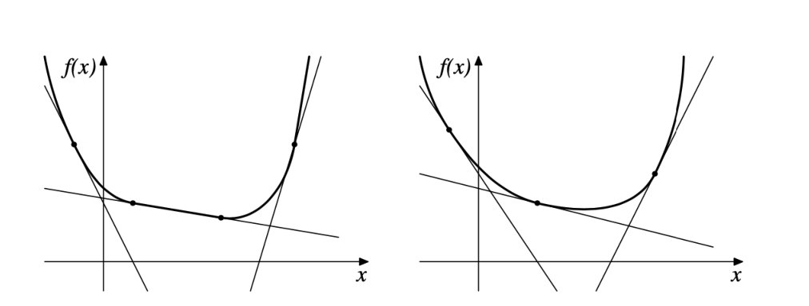
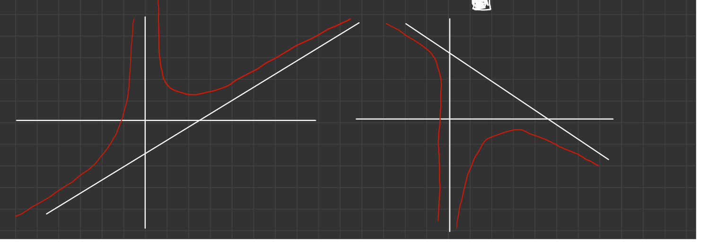
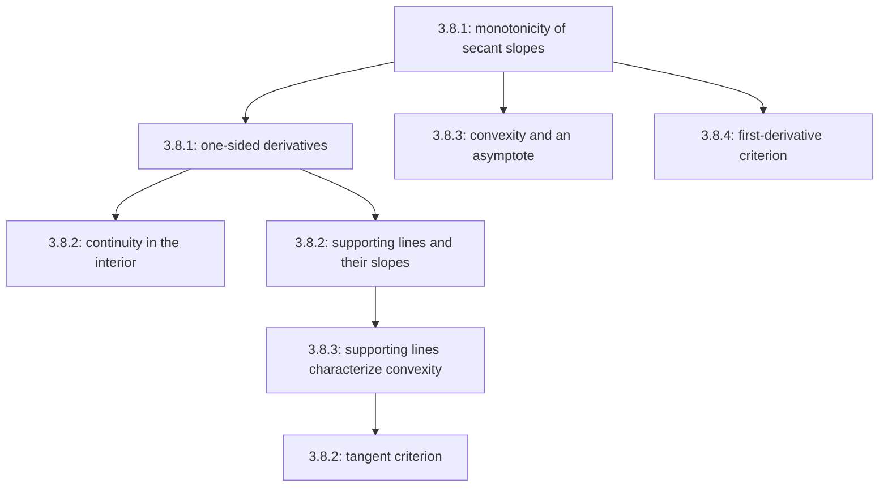

# Lectures 33–34 — Convexity, supporting lines and convexity criteria

[[en/lectures-2025-26/lecture-31-32|← Lectures 31–32]] · [[en/lectures-2025-26/index|Lecture index]] · [[en/lectures-2025-26/lecture-35|Lecture 35 →]] · [[en/term-index|Terms & theorems]] · [[ru/lectures-2025-26/lecture-33-34|Русский]] · [[es/lectures-2025-26/lecture-33-34|Español]]

> [!info] Source
> `ma25_26-lectures_33-34_notes.pdf` — 28 pages, 16 typed slides. Handwritten pages: 6–7, 9–10, 12, 17–18, 22, 24–25, 27–28. Some handwritten pages have a meaningless text layer: they were transcribed from the images, not that layer. Slide date: 12 February 2026.
>
> **Semester 2, lectures 33–64.** Semester 1 ended with lecture 32. **Starting at lecture 33, duplicate material already exists** in another folder: the [[ru/lectures/index|Russian lecture register `ru/lectures/`]], [[ru/lectures/01-convexity-3-8|§3.8 “Convexity”]]. The [archived “Lecture 33-34” notes](https://github.com/NikiHunter/matan/blob/main/source/MathInMind/%D0%9C%D0%90%D0%A2%D0%90%D0%9D_%D0%9B/%D0%9B%D0%B5%D0%BA%D1%86%D0%B8%D1%8F%2033-34.md) are also preserved. This file is a complete, self-contained illustrated transcription of the new PDF, not a link-only replacement with the older material.
>
> **Notation.** $I=\langle A,B\rangle$; $f'_-(a)$ and $f'_+(a)$ are the left and [[en/06-derivatives#6.1 Definition and linear approximation|right derivatives]]. The non-strict Russian “increasing” means “nondecreasing”. Stray strict inequalities in the handwritten proof for ordinary [[en/lectures-2025-26/lecture-31-32#^def-3-8-1|convexity]] are replaced below by non-strict ones, with an explanation; the typed statements are preserved.

## Typed slides 1–3 (PDF pp. 1–3). Introduction

**Quote of the day:** “The absolute truth is that most people cannot do anything well.” G. H. Hardy, *A Mathematician's Apology* — attribution on the slide; translated from its Russian wording.

**Aim:** continue discussing convex functions, the relationship between convexity and monotonicity, and various convexity criteria.

## Chapter 3, §8. Convex functions — continued

### Typed slide 4 (PDF p. 4). Recalling the definition

> [!definition] Definition 3.8.1
> is repeated from [[en/lectures-2025-26/lecture-31-32|lectures 31–32]]. For $f:I\to\mathbb R$,
>
> $$
> f(\lambda a+(1-\lambda)b)\le\lambda f(a)+(1-\lambda)f(b)
> \qquad(a,b\in I,\ 0<\lambda<1)
> $$

^def-3-8-1

means convexity; a strict inequality for $a\ne b$ means strict convexity. Handwritten annotation: “Recall the definition of convexity.”

### Typed slide 5 (PDF p. 5). Convexity and monotonicity of secant slopes

> [!corollary] Corollary 3.8.1
> Let $f:I\to\mathbb R$, $a\in I$, and
>
> $$
> F(x)=\frac{f(x)-f(a)}{x-a},\qquad x\in I\setminus\{a\}.
> $$
>
> 1. If $f$ is convex on $I$, then $F$ is nondecreasing on $I\setminus\{a\}$.
> 2. If $f$ is strictly convex, then $F$ is strictly increasing on that set.

^cor-3-8-1

### Handwritten page (PDF p. 6). Proof of Corollary 3.8.1

Assertion 2 is proved. For $x<y$, $x,y\ne a$, the three-chord lemma gives, respectively,

$$
\begin{array}{ll}
\dfrac{f(x)-f(a)}{x-a}<\dfrac{f(y)-f(a)}{y-a},&a<x<y,\\[6pt]
\dfrac{f(a)-f(x)}{a-x}<\dfrac{f(a)-f(y)}{a-y},&x<y<a,\\[6pt]
\dfrac{f(a)-f(x)}{a-x}<\dfrac{f(y)-f(a)}{y-a},&x<a<y.
\end{array}
$$

In each case this is $F(x)<F(y)$. For assertion 1, use non-strict inequalities. $\blacksquare$

### Handwritten page (PDF p. 7). An example of strict convexity

The function $f(x)=x^2$ is strictly convex on $\mathbb R$. Indeed, for $a<c<b$,

$$
\frac{f(c)-f(a)}{c-a}-\frac{f(b)-f(c)}{b-c}
=\frac{c^2-a^2}{c-a}-\frac{b^2-c^2}{b-c}
=c+a-(b+c)=a-b<0.
$$

Apply [[en/lectures-2025-26/lecture-31-32#^lem-3-8-1|Lemma 3.8.1]].

### Typed slide 6 (PDF p. 8). One-sided derivatives

So far neither continuity nor [[en/lectures-2025-26/lecture-22-23#^def-3-2-1|differentiability]] has been assumed. Convexity itself ensures some regularity.

> [!theorem] Theorem 3.8.1
> Suppose $f$ is convex on $I$, $a\in I$.
>
> 1. If $a<B$, then $f'_+(a)\in[-\infty,+\infty)$ exists; if $a>A$, then $f'_-(a)\in(-\infty,+\infty]$ exists.
> 2. If $a\in(A,B)$, both [[en/lectures-2025-26/lecture-22-23#^def-3-1-1|derivatives]] are finite and
>
> $$
> f'_-(a)\le f'_+(a).
> $$

^thm-3-8-1

### Handwritten pages (PDF pp. 9–10). Proof of Theorem 3.8.1

Again consider $F(x)=(f(x)-f(a))/(x-a)$. By [[#^cor-3-8-1|Corollary 3.8.1]] it is nondecreasing. If $a<B$, the theorem on limits of monotone functions gives

$$
f'_+(a)=\lim_{x\to a+}F(x)=\inf_{x>a}F(x)\in[-\infty,+\infty).
$$

Similarly,

$$
f'_-(a)=\lim_{x\to a-}F(x)=\sup_{x<a}F(x)\in(-\infty,+\infty].
$$

At an [[en/lectures-2025-26/lecture-57-58#Printed slide 4 (PDF p. 4) — The interior of a set — Definition 5.3.3|interior point]], take [[en/lectures-2025-26/lecture-15#^def-2-4-5|one-sided limits]] in $F(x)\le F(y)$ for $x<a<y$ to obtain $f'_-(a)\le f'_+(a)$. Fixing $u<a<v$ in $I$ also gives

$$
F(u)\le f'_-(a)\le f'_+(a)\le F(v).
$$

The outer values are finite, so both derivatives are finite. $\blacksquare$

> [!remark] Editor's note
> Handwritten pp. 9–10 use “strictly increasing” and strict inequalities even though the theorem assumes only convexity. Non-strict inequalities are both needed and valid here. The limiting inequality is also non-strict even in the strictly convex case: the one-sided derivatives of $x^2$ agree.

### Typed slide 7 (PDF p. 11). Continuity in the interior

> [!corollary] Corollary 3.8.2
> A function convex on $I$ is continuous on $(A,B)$.

^cor-3-8-2

**Handwritten proof on the slide.** At every interior point, finite left and right derivatives exist. This implies left and right continuity, hence continuity at that point. $\blacksquare$

### Handwritten page (PDF p. 12). Worse behaviour at endpoints

Example:

$$
f(x)=-\sqrt{1-x^2}\quad(-1<x\le1),\qquad f(-1)=1.
$$

The function is convex on $[-1,1]$: its graph on $(-1,1]$ is the lower semicircle, and raising the value at the left endpoint does not violate convexity. Nevertheless,

$$
f'_+(-1)=-\infty,\qquad f'_-(1)=+\infty,
$$

and the function is discontinuous at $-1$. A convex function can be less regular at the endpoints than in the interior of its interval.

### Typed slide 8 (PDF p. 13). A supporting line

> [!definition] Definition 3.8.2
> Let $f:I\to\mathbb R$, $a\in I$, $k\in\mathbb R$, and $g(x)=f(a)+k(x-a)$.
>
> 1. The line $y=g(x)$ is **supporting** for $f$ at $a$ if $f(x)\ge g(x)$ for all $x\in I$.
> 2. It is **strictly supporting** if $f(x)>g(x)$ for all $x\in I\setminus\{a\}$.

^def-3-8-2

A supporting line passes through $(a,f(a))$ and lies nowhere above the graph; a strictly supporting line intersects the graph only at that point.

### Typed slides 9–10 (PDF pp. 14–15). All supporting lines

> [!lemma] Lemma 3.8.2
> Let $f:I\to\mathbb R$, $a\in(A,B)$, $k\in\mathbb R$, and $\ell:\ y=f(a)+k(x-a)$.
>
> 1. If $f$ is convex on $I$, then $\ell$ is supporting at $a$ if and only if
>
> $$
> k\in[f'_-(a),f'_+(a)].
> $$
>
> 2. If $f$ is strictly convex, then $\ell$ is strictly supporting if and only if the same condition on $k$ holds.

^lem-3-8-2

### Typed slide 11 (PDF p. 16). Existence and uniqueness

1. By [[#^thm-3-8-1|Theorem 3.8.1]], $[f'_-(a),f'_+(a)]$ is a nonempty finite interval at an interior point. Thus a convex function has a supporting line at every interior point, and a strictly convex function has a strictly supporting line. At an endpoint, it suffices to require a finite one-sided derivative.
2. If $f$ is differentiable at $a\in(A,B)$, the supporting line is unique and coincides with the tangent.

Handwritten annotation:

$$
f'_-(a)=f'_+(a)=f'(a)\quad\Longrightarrow\quad k=f'(a).
$$

### Handwritten pages (PDF pp. 17–18). Proof of Lemma 3.8.2

The manuscript treats the strictly convex case, assertion 2.

**Necessity.** If $\ell$ is strictly supporting, then as $x\to a+$,

$$
0<f(x)-f(a)-k(x-a)
=(x-a)\bigl(f'_+(a)-k+o(1)\bigr).
$$

Divide by $x-a>0$ and pass to the limit to obtain $k\le f'_+(a)$. Similarly on the left, where $x-a<0$, we obtain $f'_-(a)\le k$.

**Sufficiency.** Suppose $f'_-(a)\le k\le f'_+(a)$. For $x>a$, strict monotonicity of secant slopes gives

$$
F(x)>\inf_{t>a}F(t)=f'_+(a)\ge k.
$$

Thus $f(x)-f(a)>k(x-a)$. For $x<a$, we have $F(x)<\sup_{t<a}F(t)=f'_-(a)\le k$; multiplying by the negative number $x-a$ again gives the same strict supporting inequality. Hence the graph away from $a$ lies above $\ell$. For ordinary convexity, use the corresponding non-strict inequalities. $\blacksquare$

### Typed slide 12 (PDF p. 19). Supporting lines characterize convexity

> [!lemma] Lemma 3.8.3
> Let $f:I\to\mathbb R$.
>
> 1. If there is a supporting line at every $a\in I$, then $f$ is convex on $I$.
> 2. If there is a strictly supporting line at every point, then $f$ is strictly convex.

^lem-3-8-3

> [!remark] Editorial explanation
> The PDF contains no separate proof of this lemma. For $c=\lambda a+(1-\lambda)b$, take a supporting line at $c$, multiply $f(a)\ge f(c)+k(a-c)$ and $f(b)\ge f(c)+k(b-c)$ by $\lambda$ and $1-\lambda$, and add. The terms involving $k$ cancel; for strict support and $a\ne b$, the inequality is strict.

### Typed slides 13–14 (PDF pp. 20–21). The tangent criterion

Put $T_{a,1}f(x)=f(a)+f'(a)(x-a)$.

> [!theorem] Theorem 3.8.2
> Suppose $f:I\to\mathbb R$ is differentiable on $I$.
>
> 1. $f$ is convex on $I$ if and only if for all $a,x\in I$,
>
> $$
> f(x)\ge T_{a,1}f(x).
> $$
>
> 2. $f$ is strictly convex on $I$ if and only if for all distinct $a,x\in(A,B)$,
>
> $$
> f(x)>T_{a,1}f(x).
> $$

^thm-3-8-2

The graph of a convex function is the upper envelope of its tangents. For strict convexity, each tangent has only one point in common with the graph.

### Handwritten page (PDF p. 22). Proof of Theorem 3.8.2

The strict case is proved. Under differentiability, a supporting line coincides with the tangent, and the required fact has already been proved for supporting lines. Conversely, if $f(x)>T_{a,1}f(x)$ for $x\ne a$, the tangent is strictly supporting; [[#^lem-3-8-3|Lemma 3.8.3]] gives strict convexity. $\blacksquare$

> [!remark] Editor's note
> The slide states the strict condition for interior $a,x$. It yields strict convexity in the interior; continuity at included endpoints, which follows from the differentiability assumed in the theorem, extends it to all of $I$.

### Typed slide 15 (PDF p. 23). Convexity and an asymptote

> [!theorem] Theorem 3.8.3
> Suppose $f:(A,+\infty)\to\mathbb R$ has the asymptote $y=kx+b$ as $x\to+\infty$.
>
> 1. If $f$ is convex, then $f(x)\ge kx+b$ for every $x>A$.
> 2. If $f$ is strictly convex, then $f(x)>kx+b$ for every $x>A$.

^thm-3-8-3

The assertions also hold for [[en/lectures-2025-26/lecture-21#^thm-2-6-2|asymptotes]] as $x\to-\infty$. An asymptote can be understood as a “supporting line at infinity”.

> [!note] Editorial correction
> The remark on slide 15 prints $f(x)=kx-b\to0$. The asymptote condition is $f(x)-kx-b\to0$. Each branch in the figure is considered on its own interval; the function across a vertical asymptote is not being declared convex on the whole real line.

### Handwritten pages (PDF pp. 24–25). Proof of Theorem 3.8.3

The strict assertion is proved. Put $g(x)=f(x)-kx$. By the definition of an asymptote, $g(x)\to b$. We show that $g$ is strictly decreasing.

For $A<x<y$, consider

$$
F(t)=\frac{f(t)-f(x)}{t-x},\qquad t>x.
$$

Strict convexity makes $F$ strictly increasing. Moreover,

$$
\lim_{t\to+\infty}F(t)
=\lim_{t\to+\infty}\frac{kt+b+o(1)-f(x)}{t-x}=k.
$$

Hence $F(y)<k$, that is,

$$
f(y)-f(x)<k(y-x)
\quad\Longleftrightarrow\quad
g(y)<g(x).
$$

A strictly decreasing function with limit $b$ satisfies $g(x)>b$. Therefore $f(x)>kx+b$. The non-strict case yields $g(y)\le g(x)$ and $g(x)\ge b$. $\blacksquare$

> [!remark] Editor's note
> The limit calculation uses the definition of an asymptote. Handwritten p. 24 mentions only $f(t)\to+\infty$ for $k\ne0$; if $k<0$, the limit is $-\infty$, but the calculation above works for every $k$.

### Typed slide 16 (PDF p. 26). The first-derivative criterion

> [!theorem] Theorem 3.8.4
> Let $f:I\to\mathbb R$ be continuous on $I$ and differentiable on $(A,B)$.
>
> 1. $f$ is convex on $I$ if and only if $f'$ is nondecreasing on $(A,B)$.
> 2. $f$ is strictly convex on $I$ if and only if $f'$ is strictly increasing on $(A,B)$.

^thm-3-8-4

### Handwritten pages (PDF pp. 27–28). Proof of Theorem 3.8.4

Assertion 2 is proved.

**Necessity.** For $x<y$ in $(A,B)$, we show

$$
f'(x)<\frac{f(y)-f(x)}{y-x}<f'(y).
$$

The function $F(t)=(f(t)-f(x))/(t-x)$ is strictly increasing on $(x,y]$. Hence

$$
f'(x)=\lim_{t\to x+}F(t)=\inf_{t\in(x,y]}F(t)<F(y).
$$

The right-hand inequality follows analogously, using secants from $y$. In particular, $f'(x)<f'(y)$.

**Sufficiency.** Let $a<c<b$ be in $I$. [[en/lectures-2025-26/lecture-24-25-26#^thm-3-4-3|Lagrange's mean value theorem]] gives $\alpha\in(a,c)$ and $\beta\in(c,b)$ such that

$$
\frac{f(c)-f(a)}{c-a}=f'(\alpha)
<f'(\beta)=\frac{f(b)-f(c)}{b-c},
$$

because $\alpha<\beta$ and $f'$ is strictly increasing. The three-chord lemma gives strict convexity. The non-strict case follows by replacing the corresponding inequalities. $\blacksquare$

## Lecture structure

---

Previous: [[en/lectures-2025-26/lecture-31-32|lectures 31–32 — end of semester 1]] · Next: [[en/lectures-2025-26/lecture-35|lecture 35]] · Duplicate section: [[ru/lectures/01-convexity-3-8|§3.8 in `ru/lectures/`]].
