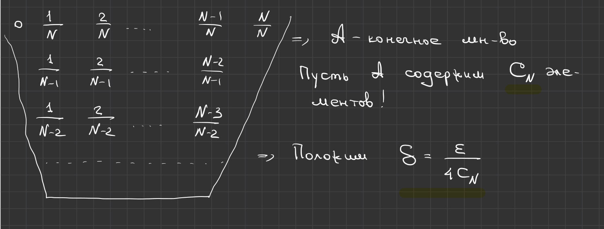
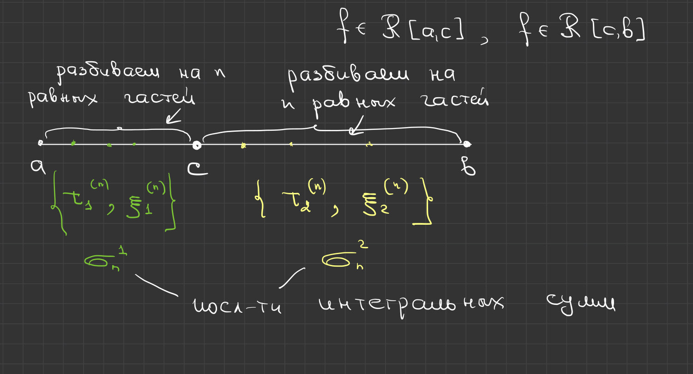
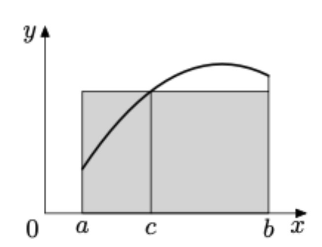
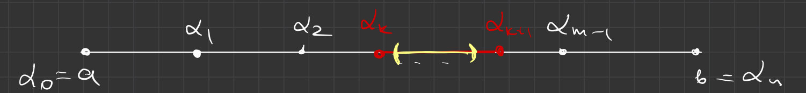
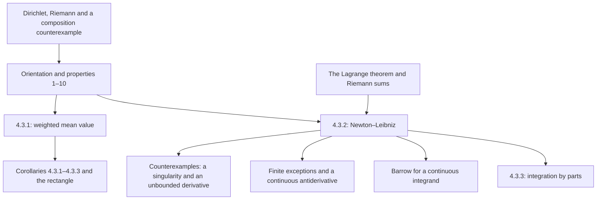

# Lectures 43–44 — Properties of the Riemann integral and the Newton–Leibniz formula

[[en/lectures-2025-26/lecture-41-42|← Lectures 41–42]] · [[en/lectures-2025-26/index|Lecture index]] · [[en/lectures-2025-26/lecture-45-46|Lectures 45–46 →]] · [[en/term-index|Terms & theorems]] · [[ru/lectures-2025-26/lecture-43-44|Русский]] · [[es/lectures-2025-26/lecture-43-44|Español]]

> [!info] Source
> `ma25_26-lectures_43-44_notes.pdf` — 38 pages, 16 printed slides. Handwritten pages: 4–8, 11–13, 15–16, 18–19, 21, 26–27, 29, 31–32, 34–36, 38. Handwritten additions on the printed slides are included. Date: 19 March 2026. Five illustrations were extracted from their corresponding PDF pages and checked individually.
>
> **Semester 2: lectures 33–64; semester 1 ended with lecture 32. Duplicate material exists from lecture 33 onward** in the [[ru/lectures/index|Russian `ru/lectures/` folder]]. The opening examples overlap with [[ru/lectures/03-riemann-integral-4-2|§4.2 “The Riemann integral”]], and the main part with [[ru/lectures/04-riemann-properties-4-3|§4.3 “Properties of the Riemann integral”]]; the [archived “Lecture 43-44 1”](https://github.com/NikiHunter/matan/blob/main/source/MathInMind/%D0%9C%D0%90%D0%A2%D0%90%D0%9D_%D0%9B/%D0%9B%D0%B5%D0%BA%D1%86%D0%B8%D1%8F%2043-44%201.md) is preserved. Below is a complete, independent illustrated version of the new source, not a set of links replacing it.
>
> **Conventions.** Unless explicitly stated otherwise, $a<b$; conventions for degenerate intervals and reversed limits are introduced separately. $\mathcal R[a,b]$ and $C[a,b]$ are the classes of [[en/lectures-2025-26/lecture-39-40#^def-4-2-6|Riemann-integrable]] and continuous functions. Definitions of sums, oscillations and criteria are in [[en/lectures-2025-26/lecture-39-40|lectures 39–40]]; classes of integrable functions are in [[en/lectures-2025-26/lecture-41-42|lectures 41–42]]. Every integral here is a proper Riemann integral. The continuity assumptions essential to properties 9–10 are stated explicitly.

## Printed slides 1–3 (PDF pp. 1–3). Introduction and source boundaries

**Quote of the day:** “Everything is possible! The impossible just takes a little longer!”

**Goals on the slide:** integral properties and Barrow’s theorem; mean-value theorems and corollaries; the [[#^thm-4-3-2|Newton–Leibniz formula]] and remarks; [[en/lectures-2025-26/lecture-37-38#^thm-4-1-4|integration by parts]] and [[en/lectures-2025-26/lecture-37-38#^thm-4-1-5|change of variables in definite integrals]]; Taylor’s formula with an integral remainder.

> [!note] PDF boundary
> This file ends with the proof of integration by parts, [[#^thm-4-3-3|Theorem 4.3.3]]. Change of variables and Taylor’s integral remainder are **mentioned in the goals but not developed here**; their formulas and proofs are not attributed to this source.

## Handwritten examples before §3

### Handwritten page (PDF p. 4). The Dirichlet function

$$
\chi(x)=
\begin{cases}
1,&x\in\mathbb Q,\\
0,&x\notin\mathbb Q.
\end{cases}
$$

Every nondegenerate subinterval contains rational and irrational points. Thus, for every [[en/lectures-2025-26/lecture-37-38#^def-4-2-2|partition]],

$$
M_k=1,\quad m_k=0,\quad\omega_k(\chi)=1,
\qquad
\sum_{k=0}^{n-1}\omega_k(\chi)\Delta x_k=b-a\ne0.
$$

The [[en/lectures-2025-26/lecture-39-40#^thm-4-2-1|integrability criterion]] fails: $\chi\notin\mathcal R[a,b]$.

### Handwritten pages (PDF pp. 5–7). Riemann’s function (Thomae’s function)

$$
\psi(x)=
\begin{cases}
1/q,&x=p/q\in\mathbb Q,\ p\in\mathbb Z,\ q\in\mathbb N,\ \gcd(p,q)=1,\\
0,&x\notin\mathbb Q.
\end{cases}
$$

Claim: the function is integrable on every closed interval, with integral zero. The handwritten proof considers $[0,1]$.

**1. Lower sums.** Each subinterval contains irrational points and the function is nonnegative, so $s_\tau(\psi)=0$.

**2. Upper sums.** Given $\varepsilon>0$, choose a natural number

$$
N>\frac2\varepsilon,\qquad\frac1N<\frac\varepsilon2.
$$

The set of rational points with small denominators,

$$
A=\{p/q\in\mathbb Q\cap[0,1]:\ \gcd(p,q)=1,\ q\le N\}
$$

is finite. Let $C_N$ be its cardinality. The sketch groups fractions by their denominators; possible repetitions after reduction do not affect finiteness.

Set $\delta=\varepsilon/(4C_N)$ and consider any partition with $\lambda_\tau<\delta$. Divide its subintervals into two groups:

- “high”: $M_k\ge1/N$; each contains a point of $A$;
- the others: $M_k<1/N$.

> [!note] Editorial clarification of the supremum estimate
> If a subinterval contains no points of $A$, all nonzero values of $\psi$ on it are at most $1/(N+1)$. Hence $M_k\le1/(N+1)<1/N$. This justifies the existence of a small-denominator point in every “high” subinterval; attainment of an arbitrary [[en/lectures-2025-26/lecture-11-12#^def-2-3-1|supremum]] is not being assumed.

Each point of the set belongs to at most two adjacent subintervals, so there are at most $2C_N$ high subintervals. Since $0\le\psi\le1$,

$$
S_\tau(\psi)
\le 2C_N\lambda_\tau+\frac1N\sum_{k=0}^{n-1}\Delta x_k
<2C_N\delta+\frac1N
<\frac\varepsilon2+\frac\varepsilon2=\varepsilon.
$$

Thus $S_\tau(\psi)-s_\tau(\psi)\to0$ as $\lambda_\tau\to0$. The criterion and the corollary on limits of sums give

$$
\psi\in\mathcal R[0,1],\qquad\int_0^1\psi=0.
$$

$\blacksquare$

> [!remark] Editorial explanation for a general interval
> On an arbitrary interval, the low contribution is bounded by $(b-a)/N$ instead of $1/N$; the number of rational points with bounded denominators is still finite, and the parameters are chosen accordingly. If there are no such high points, the high contribution simply disappears. This explains the manuscript’s claim for every closed interval.

### Handwritten page (PDF p. 8). Composition of integrable functions

The counterexample begins at the bottom of p. 7. Let the outer function on $[0,1]$ be

$$
f(y)=
\begin{cases}
1,&0<y\le1,\\
0,&y=0.
\end{cases}
$$

It is integrable because it differs from a constant at only one point. The inner Riemann function is also integrable, but

$$
f\circ\psi=\chi\notin\mathcal R[a,b].
$$

**Conclusion:** the composition of two integrable functions need not be integrable.

**Handwritten qualification (without proof).** Requiring the outer function to be continuous on a **closed interval** containing the inner function’s range makes the assertion true:

$$
\varphi:[\alpha,\beta]\to[a,b],\qquad
\varphi\in\mathcal R[\alpha,\beta],\qquad f\in C[a,b]
\quad\Longrightarrow\quad
f\circ\varphi\in\mathcal R[\alpha,\beta].
$$

## Chapter 4, §3. Properties of the Riemann integral

### Printed slide 4 (PDF p. 9). Orientation and a degenerate interval

Extend the definition by conventions. If $b<a$ and $f\in\mathcal R[b,a]$, set

$$
\int_a^b f=-\int_b^a f.
$$

Every function on a degenerate interval is regarded as integrable, with

$$
\int_a^a f=0.
$$

> [!note] Slide correction
> The condition for reversed endpoints prints $\mathcal R[a,b]$; the ordinary interval on which integrability is required is $[b,a]$. Only the endpoint order in the hypothesis is corrected, not the sign in the formula.

### Printed slide 5 (PDF p. 10). Properties 1–6

Assume the integrands are integrable on the corresponding intervals.

**1. Reversal of limits:**

$$
\int_b^a f(x)\,dx=-\int_a^b f(x)\,dx.
$$

**2. Additivity over intervals:** if $a<c<b$,

$$
\int_a^b f(x)\,dx
=\int_a^c f(x)\,dx+\int_c^b f(x)\,dx.
$$

**3. Constant factors:** for $\alpha\in\mathbb R$,

$$
\int_a^b\alpha f(x)\,dx=\alpha\int_a^b f(x)\,dx.
$$

**4. Sum and difference:**

$$
\int_a^b(f(x)\pm g(x))\,dx
=\int_a^b f(x)\,dx\pm\int_a^b g(x)\,dx.
$$

**5. Nonnegativity:**

$$
f\ge0\quad\Longrightarrow\quad\int_a^b f(x)\,dx\ge0.
$$

**6. Monotonicity:**

$$
f\le g\quad\Longrightarrow\quad
\int_a^b f(x)\,dx\le\int_a^b g(x)\,dx.
$$

Properties 5–6 retain the **nonstrict** inequalities shown on the slide.

### Handwritten pages (PDF pp. 11–13). Proofs of properties 1–6

**1.** This follows from the convention.

**2.** Integrability on the pieces follows from [[en/lectures-2025-26/lecture-41-42#^thm-4-2-4|Theorem 4.2.4]]. Divide each of $[a,c]$ and $[c,b]$ into $n$ equal parts. Choose tags and denote the corresponding sums by $\sigma_n^1,\sigma_n^2$. Their union is a [[en/lectures-2025-26/lecture-37-38#^def-4-2-4|tagged partition]] of the whole interval.

Its mesh tends to zero, and the combined sum satisfies

$$
\sigma_n=\sigma_n^1+\sigma_n^2,
\qquad
\lambda_{\tau_n}=\max\left\{\frac{c-a}{n},\frac{b-c}{n}\right\}\to0.
$$

Passing to the limit proves additivity.

**3–4.** For the same tags, the identities are

$$
\sigma_\tau(\alpha f,\xi)=\alpha\sigma_\tau(f,\xi),
\qquad
\sigma_\tau(f\pm g,\xi)=\sigma_\tau(f,\xi)\pm\sigma_\tau(g,\xi).
$$

Arithmetic operations on limits give the required equalities; [[en/lectures-2025-26/lecture-41-42#^thm-4-2-6|Theorem 4.2.6]] already ensures integrability of these functions.

**6.** Pointwise comparison with the same tags gives

$$
f\le g\quad\Longrightarrow\quad
\sigma_\tau(f,\xi)\le\sigma_\tau(g,\xi).
$$

Pass to the limit, preserving a nonstrict inequality.

**5.** Apply property 6 to the zero function and a nonnegative function. $\blacksquare$

### Printed slide 6 (PDF p. 14). Properties 7–10

**7. Absolute-value estimate:**

$$
\left|\int_a^b f(x)\,dx\right|\le\int_a^b|f(x)|\,dx.
$$

**8. Length estimate:** if $|f(x)|\le M$ on the interval, then

$$
\left|\int_a^b f(x)\,dx\right|\le M(b-a).
$$

**9. Zero integral of a nonnegative continuous function:**

$$
f\in C[a,b],\qquad f\ge0,\qquad \int_a^b f(x)\,dx=0
\quad\Longrightarrow\quad f\equiv0\text{ on }[a,b].
$$

**10. Barrow’s theorem.** For $f\in C[a,b]$, the function

$$
\varphi(x)=\int_a^x f(y)\,dy,\qquad a\le x\le b,
$$

is [[en/lectures-2025-26/lecture-22-23#^def-3-2-1|differentiable]] at [[en/lectures-2025-26/lecture-57-58#Printed slide 4 (PDF p. 4) — The interior of a set — Definition 5.3.3|interior points]], with

$$
\varphi'(x)=f(x).
$$

At the endpoints, the corresponding [[en/06-derivatives#6.1 Definition and linear approximation|one-sided derivatives]] are intended. The source postpones the proof until p. 36.

> [!note] Essential hypotheses
> Continuity in property 9 is **added by hand** on the slide. For property 10 it is explicitly restored here: the printed claim is too broad without an additional hypothesis on the function, and the proof on p. 36 uses the existence of an [[en/lectures-2025-26/lecture-36#^def-4-1-1|antiderivative]]. Integrability alone does not imply differentiability of the variable-limit integral at every point. Property 9 is also false without continuity: a function equal to one at one point and zero elsewhere has integral zero but is not identically zero. This last example is an editorial explanation based on lectures 41–42.

### Handwritten pages (PDF pp. 15–16). Proofs of properties 7–9

**7.** From $-|f|\le f\le|f|$, monotonicity and linearity give

$$
-\int_a^b|f|\le\int_a^b f\le\int_a^b|f|.
$$

This is the absolute-value estimate.

**8.** By property 7 and comparison with a constant,

$$
\left|\int_a^b f\right|\le\int_a^b|f|
\le\int_a^b M=M(b-a).
$$

**9.** If the function is not identically zero, nonnegativity gives a point $x_0\in[a,b]$ with $f(x_0)>0$. Continuity provides a subinterval $[\alpha,\beta]\subset[a,b]$ of positive length on which $f(x)\ge f(x_0)/2$. Additivity and nonnegativity on the remaining pieces then imply

$$
\int_a^b f\ge\int_\alpha^\beta f
\ge\frac{f(x_0)}2(\beta-\alpha)>0,
$$

contrary to the hypothesis. $\blacksquare$

> [!proof] Proof clarification
> If the positive value occurs at an endpoint, use a **one-sided** subinterval within the domain, not a symmetric neighbourhood extending outside it.

### Printed slide 7 (PDF p. 17). The first mean-value theorem

> [!theorem] Theorem 4.3.1
> Let $f,g\in\mathcal R[a,b]$, let $g\ge0$ or $g\le0$, and let $m,M\in\mathbb R$ satisfy $m\le f\le M$. Then there is $\mu\in[m,M]$ such that
>
> $$
> \int_a^b fg=\mu\int_a^b g.
> $$

^thm-4-3-1

### Handwritten pages (PDF pp. 18–19). Proof of Theorem 4.3.1

First suppose $g\ge0$. Then $\int_a^b g\ge0$, and $m\le f\le M$ gives $mg\le fg\le Mg$. The properties of the integral imply

$$
m\int_a^b g\le\int_a^b fg\le M\int_a^b g.
$$

- If $\int_a^b g=0$, both bounds are zero, so $\int_a^b fg=0$. Any $\mu\in[m,M]$ works; division by a zero integral is not allowed.
- If $\int_a^b g>0$, divide the inequality and set

$$
\mu=\frac{\int_a^b fg}{\int_a^b g}\in[m,M].
$$

For $g\le0$, apply the result to $-g\ge0$ and reverse the sign in the resulting equality. $\blacksquare$

### Printed slide 8 (PDF p. 20). A continuous function in the mean-value formula

> [!corollary] Corollary 4.3.1
> Let $f\in C[a,b]$, $g\in\mathcal R[a,b]$, and $g\ge0$ or $g\le0$. Then there is $c\in[a,b]$ such that
>
> $$
> \int_a^b fg=f(c)\int_a^b g.
> $$

^cor-4-3-1

### Handwritten page (PDF p. 21). Proof of Corollary 4.3.1

By the [[en/05-limits-continuity#^extreme-value-theorem|Weierstrass theorem]], $m=\min_{[a,b]}f$ and $M=\max_{[a,b]}f$ exist. [[#^thm-4-3-1|Theorem 4.3.1]] gives $\mu\in[m,M]$. By the [[en/lectures-2025-26/lecture-17-18#^thm-2-5-5|intermediate value theorem]], the continuous function attains that value: $f(c)=\mu$ for some $c\in[a,b]$. Substitute into the theorem’s equality. $\blacksquare$

### Printed slide 9 (PDF p. 22). Mean value of a bounded integrable function

> [!corollary] Corollary 4.3.2
> Let $f\in\mathcal R[a,b]$ and $m\le f\le M$, where $m,M\in\mathbb R$. Then there is $\mu\in[m,M]$ such that
>
> $$
> \int_a^b f=\mu(b-a).
> $$

^cor-4-3-2

**Handwritten proof on the slide:** set $g\equiv1$ in [[#^thm-4-3-1|Theorem 4.3.1]]:

$$
\int_a^b f=\int_a^b f\cdot1=\mu\int_a^b1=\mu(b-a).
$$

$\blacksquare$

### Printed slide 10 (PDF p. 23). Mean value of a continuous function

> [!corollary] Corollary 4.3.3
> For $f\in C[a,b]$, there is $c\in[a,b]$ such that
>
> $$
> \int_a^b f=f(c)(b-a).
> $$

^cor-4-3-3

**Handwritten proof on the slide:** set $g\equiv1$ in [[#^cor-4-3-1|Corollary 4.3.1]]. $\blacksquare$

### Printed slide 11 (PDF p. 24). Terminology and geometry

1. [[#^cor-4-3-2|Corollaries 4.3.2]] and [[#^cor-4-3-3|4.3.3]] are usually called the **first mean-value theorem**, while [[#^thm-4-3-1|Theorem 4.3.1]] and [[#^cor-4-3-1|Corollary 4.3.1]] are called the **strengthened**, or **generalized first mean-value theorem**.
2. [[#^cor-4-3-3|Corollary 4.3.3]] says that the integral of a continuous function equals some Riemann sum with **one** term. For the nonnegative function drawn, the area under the graph equals the area of a rectangle of height $f(c)$ and width $b-a$.

### Printed slide 12 (PDF p. 25). The Newton–Leibniz formula

> [!theorem] Theorem 4.3.2
> Let $f\in\mathcal R[a,b]$, and let $F$ be an antiderivative of $f$ on $[a,b]$. Then
>
> $$
> \int_a^b f=F(b)-F(a).
> $$

^thm-4-3-2

### Handwritten pages (PDF pp. 26–27). Proof of Theorem 4.3.2

For each natural number $n$, take the uniform partition $\tau_n$:

$$
x_k=a+\frac{k(b-a)}n,\qquad k=0,\ldots,n,
\qquad\lambda_{\tau_n}=\frac{b-a}{n}\to0.
$$

On each subinterval, the [[en/lectures-2025-26/lecture-24-25-26#^thm-3-4-3|Lagrange mean value theorem]] gives $\xi_k\in(x_k,x_{k+1})$ such that

$$
F(x_{k+1})-F(x_k)=F'(\xi_k)\Delta x_k=f(\xi_k)\Delta x_k.
$$

Sum telescopically:

$$
\begin{aligned}
F(b)-F(a)
&=\sum_{k=0}^{n-1}\bigl(F(x_{k+1})-F(x_k)\bigr)\\
&=\sum_{k=0}^{n-1}f(\xi_k)\Delta x_k
=\sigma_{\tau_n}(f,\xi).
\end{aligned}
$$

The left-hand side does not depend on the number of parts. The right-hand side tends to the integral because $f$ is integrable, so $\int_a^b f=F(b)-F(a)$. $\blacksquare$

### Printed slide 13 (PDF p. 28). Endpoint evaluation

**Remark 1.** The difference of the endpoint values is called **endpoint evaluation** (“double substitution” in the source). The slide’s notations are

$$
\left.F\right|_a^b
=\left.F(x)\right|_a^b
=\left.F(x)\right|_{x=a}^{b}
=\left.[F(x)]\right|_{x=a}^{b}
=F(b)-F(a).
$$

**Remark 2.** The endpoint evaluation is independent of the antiderivative chosen. If $\Phi=F+C$, then

$$
\Phi(b)-\Phi(a)=F(b)+C-(F(a)+C)=F(b)-F(a).
$$

### Handwritten page (PDF p. 29). The formula cannot be used across a singularity

The source presents the following **invalid** calculation:

$$
\int_{-1}^{1}\frac{dx}{x^2}
\overset{\text{invalid}}{=}\left.-\frac1x\right|_{-1}^{1}=-2.
$$

The integrand is positive away from zero, yet the result is negative. The error is not arithmetic: the function is undefined at zero and unbounded near it. Even assigning an arbitrary value at zero cannot make it Riemann integrable. The function $-1/x$ is also not an antiderivative **on the whole interval** $[-1,1]$. The hypotheses of [[#^thm-4-3-2|Theorem 4.3.2]] fail; the displayed proper integral does not exist.

### Printed slide 14 (PDF p. 30). The hypotheses cannot be dropped

**Remark 3.** If $F$ is differentiable on the interval and $F'\in\mathcal R[a,b]$, then

$$
\int_a^b F'=F(b)-F(a).
$$

**Remark 4.** A [[en/lectures-2025-26/lecture-22-23#^def-3-1-1|derivative]] may fail to be integrable, so its integrability is an essential hypothesis.

**Remark 5.** Integrability of a function and existence of its antiderivative are independent conditions.

> [!note] Slide correction
> Remark 3 has an extra letter in its printed hypothesis: $FF'$ instead of $F'$. The needed integrability condition on the derivative is separately restored by the handwritten annotation to Remark 4.

### Handwritten page (PDF p. 31). A derivative that is not Riemann integrable

$$
F(x)=
\begin{cases}
x^2\sin(1/x^2),&x\ne0,\\
0,&x=0.
\end{cases}
$$

Differentiation away from zero and the definition of the derivative at zero give

$$
F'(x)=
\begin{cases}
2x\sin(1/x^2)-\dfrac2x\cos(1/x^2),&x\ne0,\\
0,&x=0.
\end{cases}
$$

Indeed, at zero the difference quotient has limit

$$
F'(0)=\lim_{h\to0}\frac{F(h)-F(0)}h
=\lim_{h\to0}h\sin(1/h^2)=0.
$$

The handwritten unboundedness check uses the sequence

$$
F'\!\left(\frac1{\sqrt{2k\pi}}\right)
=-2\sqrt{2k\pi}\xrightarrow[k\to\infty]{}-\infty.
$$

Thus $F'\notin\mathcal R[-1,1]$ by the boundedness lemma, although it has an antiderivative — $F$ itself.

### Handwritten page (PDF p. 32). Independence of the two conditions

The converse example is $\operatorname{sgn}x$ on $[-1,1]$. It is integrable, for instance by piecewise continuity, but has no antiderivative on the whole interval: its jump at zero is incompatible with the intermediate value property of derivatives. Together with the preceding page, this establishes independence:

- existence of an antiderivative does not guarantee integrability;
- integrability does not guarantee existence of an antiderivative.

### Printed slide 15 (PDF p. 33). Finitely many exceptional points

**Remark 6.** Let $f\in\mathcal R[a,b]$, $F\in C[a,b]$, and suppose $F'=f$ holds on the interval except at finitely many points. Then still

$$
\int_a^b f=F(b)-F(a).
$$

Continuity of $F$ at the exceptional points remains part of the hypothesis.

### Handwritten pages (PDF pp. 34–35). Proof of Remark 6

List the interior exceptional points $\alpha_1<\cdots<\alpha_{m-1}$ and set $\alpha_0=a$, $\alpha_m=b$.

For sufficiently small $\varepsilon>0$, [[#^thm-4-3-2|Theorem 4.3.2]] applies on $[\alpha_k+\varepsilon,\alpha_{k+1}-\varepsilon]$. Therefore,

$$
\begin{aligned}
\int_{\alpha_k}^{\alpha_{k+1}}f
&=\lim_{\varepsilon\to0+}\int_{\alpha_k+\varepsilon}^{\alpha_{k+1}-\varepsilon}f\\
&=\lim_{\varepsilon\to0+}
\bigl(F(\alpha_{k+1}-\varepsilon)-F(\alpha_k+\varepsilon)\bigr)\\
&=F(\alpha_{k+1})-F(\alpha_k).
\end{aligned}
$$

The first step uses continuity of the integral in its variable limits; the last uses continuity of $F$.

> [!remark] Explanation of the first step
> Boundedness $|f|\le M$ and property 8 give $|\int_u^v f|\le M|v-u|$. The integrals over the two trimmed pieces tend to zero. Continuity of the integrand is not being assumed here.

Additivity and telescopic cancellation yield

$$
\int_a^b f
=\sum_{k=0}^{m-1}\int_{\alpha_k}^{\alpha_{k+1}}f
=\sum_{k=0}^{m-1}\bigl(F(\alpha_{k+1})-F(\alpha_k)\bigr)
=F(b)-F(a).
$$

$\blacksquare$

### Handwritten page (PDF p. 36). The postponed proof of Barrow’s theorem

Let $f\in C[a,b]$. Existence of an antiderivative $F$ follows from [[en/lectures-2025-26/lecture-36#^thm-4-1-2|Theorem 4.1.2]] in [[en/lectures-2025-26/lecture-36|lecture 36]]. The manuscript starts its proof by choosing such an antiderivative. By the Newton–Leibniz formula,

$$
\varphi(x)=\int_a^x f(y)\,dy=F(x)-F(a).
$$

Differentiate:

$$
\varphi'(x)=F'(x)-0=f(x).
$$

$\blacksquare$

The explicit continuity hypothesis above ensures existence of the antiderivative being used; this proof does not infer its existence from integrability alone.

### Printed slide 16 (PDF p. 37). Integration by parts

> [!theorem] Theorem 4.3.3
> Let $f,g$ be differentiable on $[a,b]$ and $f',g'\in\mathcal R[a,b]$. Then
>
> $$
> \int_a^b fg'
> =\left.fg\right|_a^b-\int_a^b f'g.
> $$

^thm-4-3-3

### Handwritten page (PDF p. 38). Proof of Theorem 4.3.3

1. Differentiable functions $f,g$ are continuous, hence integrable by [[en/lectures-2025-26/lecture-41-42#^thm-4-2-2|Theorem 4.2.2]].
2. By [[en/lectures-2025-26/lecture-41-42#^thm-4-2-6|Theorem 4.2.6]], the products $fg'$ and $f'g$ are integrable. By the product rule, their sum is the derivative of the product:

$$
(fg)'=fg'+f'g\in\mathcal R[a,b].
$$

3. Apply linearity and the Newton–Leibniz formula:

$$
\int_a^b fg'+\int_a^b f'g
=\int_a^b(fg)'
=\left.fg\right|_a^b.
$$

Moving the second term gives the integration-by-parts formula. $\blacksquare$

This is the end of the PDF’s actual content; no change-of-variables formula or Taylor integral remainder follows it.

## Lecture structure

---

Previous: [[en/lectures-2025-26/lecture-41-42|lectures 41–42]] · [[en/lectures-2025-26/index|Lecture index]] · [[assets/lectures-2025-26/provenance-39-44|Figure provenance]] · Next: [[en/lectures-2025-26/lecture-45-46|lectures 45–46]].
