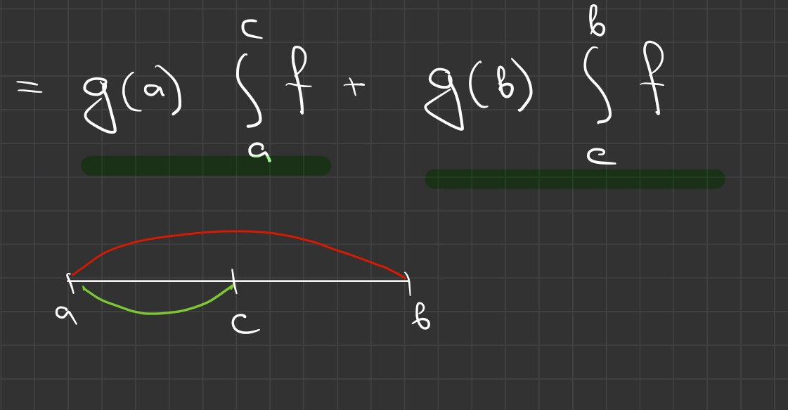

# Lectures 45–46 — Substitution, Taylor and Wallis formulas, integral inequalities

[[en/lectures-2025-26/lecture-43-44|← Lectures 43–44]] · [[en/lectures-2025-26/index|Lecture index]] · [[en/lectures-2025-26/lecture-47-48|Lectures 47–48 →]] · [[en/term-index|Terms & theorems]] · [[ru/lectures-2025-26/lecture-45-46|Русский]] · [[es/lectures-2025-26/lecture-45-46|Español]]

> [!info] Source
> `ma25_26-lectures_45-46_notes.pdf` — 29 PDF pages, 14 printed slides; the date printed on the slides is 26 March 2026. Printed pages: 1–7, 10–12, 18, 22, 26, 29. Handwritten pages: 8–9, 13–17, 19–21, 23–25, 27–28. No PDF page is missing: all 29 are accounted for exactly once below. Printed-slide numbers (1–14) are distinct from PDF-page numbers.
>
> **Semester-2 duplication.** Semester 1 ends with lecture 32; semester 2 comprises lectures 33–64. This lecture fully overlaps [[ru/lectures/04-riemann-properties-4-3|§4.3, “Properties of the Riemann integral”]] and [[ru/lectures/05-taylor-wallis-inequalities-4-4|§4.4, “Taylor, Wallis, and integral inequalities”]], and is also present in the existing [[ru/lectures/index|semester-2 register]]. The unchanged archived original is [“Лекция 45-46.md”](https://github.com/NikiHunter/matan/blob/main/source/MathInMind/%D0%9C%D0%90%D0%A2%D0%90%D0%9D_%D0%9B/%D0%9B%D0%B5%D0%BA%D1%86%D0%B8%D1%8F%2045-46.md). These cross-references supplement, but do not replace, this complete illustrated transcription of the PDF.
>
> **Editorial conventions.** The theorem numbering is preserved, including the jump from 4.3.3 to 4.3.5; no theorem 4.3.4 is supplied. Formulas and the handwritten proof steps are transcribed from the page images; editorial clarifications are labelled. Integrals are proper unless stated otherwise.

## Printed slide 1 (PDF p. 1). Title

“Mathematical Analysis,” lectures 45–46, 26 March 2026; D. E. Apushkinskaya, RUDN University.

## Printed slide 2 (PDF p. 2). Quote of the day

“Nothing helps with the housework like turning off the Internet.”

## Printed slide 3 (PDF p. 3). Lecture goals

1. Remarks on the change-of-variable theorem for a [[en/lectures-2025-26/lecture-39-40#^def-4-2-6|definite integral]].
2. Taylor and Wallis formulas and integral inequalities.

## Chapter 4. Integral calculus, §3. Properties of the Riemann integral

### Printed slide 4 (PDF p. 4). Change of variable

> [!theorem] Theorem 4.3.5
> Let $\varphi:[\alpha,\beta]\to[A,B]$, let $\varphi$ be differentiable on $[\alpha,\beta]$, with $\varphi'\in\mathcal R[\alpha,\beta]$, and let $f\in C[A,B]$. Then
>
> $$
> \int_\alpha^\beta (f\circ\varphi)(x)\varphi'(x)\,dx
> =\int_{\varphi(\alpha)}^{\varphi(\beta)} f(t)\,dt.
> $$

^thm-4-3-5

### Printed slide 5 (PDF p. 5). Remarks on substitution

1. Some values $\varphi(t)$ for $t\in[\alpha,\beta]$ need not lie between $\varphi(\alpha)$ and $\varphi(\beta)$. What matters is that every value $\varphi(t)$ belongs to $[A,B]$, the interval on which $f$ is defined.
2. The lower integration limit need not be smaller than the upper one. If $\varphi$ is strictly decreasing and $\alpha<\beta$, then $\varphi(\alpha)>\varphi(\beta)$; the oriented integral accounts for this without a separate reversal of limits.

## §4. Taylor and Wallis formulas and integral inequalities

### Printed slide 6 (PDF p. 6). Section title

“§4. Taylor and Wallis formulas and integral inequalities.”

### Printed slide 7 (PDF p. 7). Taylor formula with integral remainder

> [!theorem] Theorem 4.4.1
> Let $n\in\mathbb Z_+$, $f\in C^{n+1}\langle A,B\rangle$, and $a,x\in\langle A,B\rangle$. Then
>
> $$
> f(x)=\sum_{k=0}^{n}\frac{f^{(k)}(a)}{k!}(x-a)^k+
> \frac1{n!}\int_a^x f^{(n+1)}(t)(x-t)^n\,dt.
> $$

^thm-4-4-1

### Handwritten page (PDF p. 8). Proof of Theorem 4.4.1: base case and integration by parts

The blackboard proof starts by [[en/01-logic-sets-functions#^example-induction|induction]]. For $n=0$, the [[en/lectures-2025-26/lecture-43-44#^thm-4-3-2|fundamental theorem of calculus]] gives

$$
f(x)=f(a)+\int_a^x f'(t)\,dt.
$$

Assuming the formula for $n-1$, its remainder is

$$
\frac1{(n-1)!}\int_a^x f^{(n)}(t)(x-t)^{n-1}\,dt
=\int_a^x f^{(n)}(t)\,d\!\left(-\frac{(x-t)^n}{n!}\right).
$$

[[en/lectures-2025-26/lecture-37-38#^thm-4-1-4|Integration by parts]] gives the expression at the end of this page:

$$
=-\frac1{n!}\left[f^{(n)}(t)(x-t)^n\right]_{t=a}^{x}
+\frac1{n!}\int_a^x f^{(n+1)}(t)(x-t)^n\,dt.
$$

### Handwritten page (PDF p. 9). Completion of the Taylor proof

The boundary term simplifies to

$$
-\frac1{n!}\left[f^{(n)}(t)(x-t)^n\right]_{a}^{x}
=-\frac1{n!}\left(0-f^{(n)}(a)(x-a)^n\right)
=\frac{f^{(n)}(a)}{n!}(x-a)^n.
$$

Substitution into the induction hypothesis adds the term with index $n$ to the sum and leaves the order-$n+1$ remainder in [[#^thm-4-4-1|Theorem 4.4.1]]. The board identifies the integration-by-parts factors as $f^{(n)}(t)$ and $-(x-t)^n/n!$.

### Printed slide 8 (PDF p. 10). Remarks on the integral remainder

1. The integral form of the remainder is sometimes called the C. Jacobi form.
2. By the first mean-value theorem, under the assumptions of [[#^thm-4-4-1|Theorem 4.4.1]] there is a $c\in[a,x]$ (for $x<a$, use the oriented-integral convention) such that

$$
\frac1{n!}\int_a^x f^{(n+1)}(t)(x-t)^n\,dt
=\frac{f^{(n+1)}(c)}{n!}\int_a^x(x-t)^n\,dt
=\frac{f^{(n+1)}(c)}{(n+1)!}(x-a)^{n+1}.
$$

3. The advantage of the integral form is that it contains no unknown point $c$.

### Printed slide 9 (PDF p. 11). Wallis formula

The double factorial $m!!$ is the product of the positive integers not exceeding $m$ that have the same parity as $m$; by convention, $0!!=(-1)!!=1$.

> [!theorem] Theorem 4.4.2
>
> $$
> \pi=\lim_{n\to\infty}\frac1n\left(\frac{(2n)!!}{(2n-1)!!}\right)^2.
> $$

^thm-4-4-2

### Printed slide 10 (PDF p. 12). Integrals of powers of sine

> [!lemma] Lemma 4.4.1
> If $m\in\mathbb Z_+$, then
>
> $$
> \int_0^{\pi/2}\sin^m x\,dx
> =\frac{(m-1)!!}{m!!}\begin{cases}
> \dfrac\pi2,&m\text{ even},\\[2pt]
> 1,&m\text{ odd}.
> \end{cases}
> $$

^lem-4-4-1

### Handwritten page (PDF p. 13). Proof of Lemma 4.4.1: notation and base cases

Set $J_m=\int_0^{\pi/2}\sin^m x\,dx$. The base cases are

$$
J_0=\int_0^{\pi/2}dx=\frac\pi2,\qquad
J_1=\int_0^{\pi/2}\sin x\,dx=[-\cos x]_0^{\pi/2}=1.
$$

Red annotations verify the double-factorial formula for $m=0$ and $m=1$; the recurrence is then derived by integration by parts for $m\ge2$.

### Handwritten page (PDF p. 14). Recurrence for $J_m$

Write $J_m=\int_0^{\pi/2}\sin^{m-1}x\,d(-\cos x)$. Integration by parts, $d(\sin^{m-1}x)=(m-1)\sin^{m-2}x\cos x\,dx$, and $\cos^2x=1-\sin^2x$ give

$$
J_m=(m-1)\left(J_{m-2}-J_m\right),\qquad
mJ_m=(m-1)J_{m-2},\qquad
J_m=\frac{m-1}{m}J_{m-2}.
$$

The boundary term $[-\sin^{m-1}x\cos x]_0^{\pi/2}$ is zero.

### Handwritten page (PDF p. 15). First odd-index values and comparison

For odd indices the board lists

$$
J_3=\frac23J_1=\frac23,\qquad
J_5=\frac45J_3=\frac45\frac23,
\qquad J_7=\frac67J_5=\frac67\frac45\frac23.
$$

It then uses $0<\sin x<1$ for $0<x<\pi/2$:

$$
\sin^{2n+1}x<\sin^{2n}x<\sin^{2n-1}x.
$$

### Handwritten page (PDF p. 16). First even-index values and integral comparison

For even indices:

$$
J_2=\frac12J_0=\frac\pi4,\qquad
J_4=\frac34J_2=\frac34\frac12\frac\pi2,
\qquad J_6=\frac56J_4=\frac56\frac34\frac12\frac\pi2.
$$

Integrating the comparison on PDF p. 15 gives $J_{2n+1}<J_{2n}<J_{2n-1}$.

### Handwritten page (PDF p. 17). Proof of Wallis' formula

Substituting the expressions from the lemma gives

$$
\frac{(2n)!!}{(2n+1)!!}
<\frac{(2n-1)!!}{(2n)!!}\frac\pi2
<\frac{(2n-2)!!}{(2n-1)!!}.
$$

Multiplication by $\frac{(2n)!!}{(2n-1)!!}$ and the identities $(2n+1)!!=(2n+1)(2n-1)!!$, $(2n)!!=2n(2n-2)!!$ yield

$$
\frac1{2n+1}\left(\frac{(2n)!!}{(2n-1)!!}\right)^2
<\frac\pi2<
\frac1{2n}\left(\frac{(2n)!!}{(2n-1)!!}\right)^2.
$$

Set $x_n=\frac1n\left(\frac{(2n)!!}{(2n-1)!!}\right)^2$. Then $\frac{2n}{2n+1}x_n<\pi<x_n$, equivalently $\pi<x_n<\frac{2n+1}{2n}\pi$. Both bounds tend to $\pi$, so the [[en/lectures-2025-26/lecture-08#^thm-2-1-4|squeeze theorem]] proves [[#^thm-4-4-2|Theorem 4.4.2]].

### Printed slide 11 (PDF p. 18). Bonnet's second mean-value theorem for integrals

> [!theorem] Theorem 4.4.3 (O. Bonnet)
> Let $f\in C[a,b]$, $g\in C^1[a,b]$, and suppose $g$ is monotone on $[a,b]$. Then there is a $c\in[a,b]$ such that
>
> $$
> \int_a^b fg=g(a)\int_a^c f+g(b)\int_c^b f.
> $$

^thm-4-4-3

### Handwritten page (PDF p. 19). Proof of Bonnet's theorem: integration by parts

Set $F(x)=\int_a^x f$, so $F(a)=0$ and $F'=f$. Then

$$
\int_a^b fg=\int_a^b gF'
=-\int_a^b Fg'+[Fg]_a^b
=-\int_a^b Fg'+g(b)\int_a^b f.
$$

### Handwritten page (PDF p. 20). Applying the first mean-value theorem

Since $g$ is monotone and [[en/lectures-2025-26/lecture-22-23#^def-3-2-1|differentiable]], $g'$ has constant sign. The first weighted mean-value theorem applied to $F$ with weight $g'$ gives a $c\in[a,b]$ such that

$$
\int_a^b Fg'=F(c)\int_a^b g'=F(c)(g(b)-g(a)).
$$

Since $F(c)=\int_a^c f$, substitution into the previous line gives

$$
\int_a^b fg
=-\left(g(b)-g(a)\right)\int_a^c f+g(b)\int_a^b f
=g(a)\int_a^c f+g(b)\int_c^b f.
$$

### Handwritten page (PDF p. 21). Geometric interval sketch

The handwritten sketch marks $[a,b]$, the point $c$, and the two integral pieces $\int_a^c f$ and $\int_c^b f$. The red arc spans the full interval and the green arc the first part. It illustrates the decomposition in [[en/lectures-2025-26/lecture-43-44#^thm-4-3-1|Bonnet's formula]]; it is not a graph of a function.

### Printed slide 12 (PDF p. 22). Remarks on Bonnet's theorem

1. Bonnet's theorem remains valid under weaker assumptions: $f\in\mathcal R[a,b]$ and $g$ monotone on $[a,b]$.
2. The second mean-value theorem usually yields no new results beyond those obtainable by integration by parts.

### Handwritten page (PDF p. 23). Estimate for an oscillatory integral

The board considers

$$
I=\int_{100\pi}^{200\pi}\frac{\sin x}{x}\,dx.
$$

The integral has no elementary [[en/lectures-2025-26/lecture-36#^def-4-1-1|antiderivative]], but it can be estimated. Since $x>0$ on the interval,

$$
|I|\le\int_{100\pi}^{200\pi}\frac{|\sin x|}{x}\,dx
\le\int_{100\pi}^{200\pi}\frac{dx}{x}
=\log 2.
$$

The page also begins a more detailed estimate by periods:

$$
I=\sum_{k=100}^{199}\int_{k\pi}^{(k+1)\pi}\frac{\sin x}{x}\,dx,
\qquad
\left|\int_{k\pi}^{(k+1)\pi}\frac{\sin x}{x}\,dx\right|
\le\frac{2}{k\pi}.
$$

This gives a coarse bound of order $\sum_{k=100}^{199}2/(k\pi)$; the page also records the [[en/02-real-numbers#2.2 Supremum and infimum|upper bound]] $\log 2$ for the integral of the absolute value.

### Handwritten page (PDF p. 24). Estimating with Bonnet's formula

Take $g(x)=1/x$, which is monotone, and $f(x)=\sin x$. Bonnet's theorem on $[100\pi,200\pi]$ gives some $c\in[100\pi,200\pi]$ with

$$
I=g(100\pi)\int_{100\pi}^{c}\sin x\,dx
+g(200\pi)\int_c^{200\pi}\sin x\,dx.
$$

Integrating $\sin x$ gives endpoint expressions involving $[-\cos x]$. Since $\cos(100\pi)=\cos(200\pi)=1$, the boundary terms simplify and the two terms can be bounded.

### Handwritten page (PDF p. 25). Completion of the estimate

Using $\cos c\in[-1,1]$ and the preceding formula, the written calculation simplifies to $(1-\cos c)/(200\pi)$, hence $0\le I\le1/(100\pi)$. **Transcription note:** on the handwritten page the notation for the integral of the absolute value and the signed integral is close together. They are kept distinct here: estimating the signed integral does not establish [[en/04-numeric-series#4.3 Absolute and conditional convergence|absolute convergence]] of the integrand $f$.

### Printed slide 13 (PDF p. 26). Jensen's integral inequality

> [!theorem] Theorem 4.4.4
> Let $f$ be convex and continuous on $\langle A,B\rangle$, let $\varphi:[a,b]\to\langle A,B\rangle$ be continuous, and let $\lambda:[a,b]\to[0,+\infty)$ be continuous with $\int_a^b\lambda=1$. Then
>
> $$
> f\left(\int_a^b\lambda\varphi\right)
> \le\int_a^b\lambda\,(f\circ\varphi).
> $$

^thm-4-4-4

### Handwritten page (PDF p. 27). Jensen proof: support-line setup

The page defines

$$
E=\{x\in[a,b]:\lambda(x)>0\},\qquad
m=\inf_E\varphi,\qquad M=\sup_E\varphi,
$$

and $c=\int_a^b\lambda\varphi$. By continuity, $\varphi$ is bounded on the interval. If $m=M$, $\varphi$ is constant on $E$ and equality holds. If $m<M$, then $c\in[m,M]$; [[en/lectures-2025-26/lecture-31-32#^def-3-8-1|convexity]] supplies a supporting line $y=\alpha x+\beta$ at $c$:

$$
f(c)=\alpha c+\beta,\qquad f(t)\ge\alpha t+\beta.
$$

### Handwritten page (PDF p. 28). Jensen proof: integrate the support-line inequality

Multiply the support-line inequality by $\lambda\ge0$ and integrate:

$$
\int_a^b\lambda f(\varphi)
\ge\int_a^b\lambda(\alpha\varphi+\beta)
=\alpha\int_a^b\lambda\varphi+\beta\int_a^b\lambda
=\alpha c+\beta=f(c).
$$

This proves [[#^thm-4-4-4|Theorem 4.4.4]]. The handwritten argument uses continuity and convexity on the interval of values of $\varphi$.

### Printed slide 14 (PDF p. 29). Remarks on Jensen's inequality

1. If $\varphi$ is not constant on $E=\{x\in[a,b]:\lambda(x)>0\}$ and $f$ is strictly convex, [[#^thm-4-4-4|Jensen's inequality]] is strict.
2. For a concave function $f$, the inequality holds with the opposite sign.

---

**Navigation:** [[en/lectures-2025-26/lecture-43-44|Lectures 43–44]] · [[en/lectures-2025-26/lecture-47-48|Lectures 47–48]] · [[en/lectures-2025-26/index|Index]].
