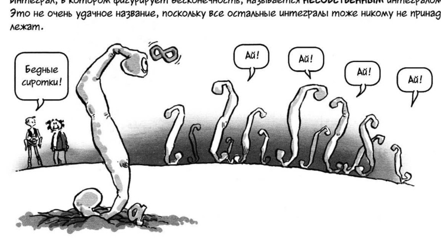

# Lectures 49–50 — Absolute convergence, Dirichlet's and Abel's tests

[[en/lectures-2025-26/lecture-47-48|← Lectures 47–48]] · [[en/lectures-2025-26/index|Lecture index]] · [[en/lectures-2025-26/lecture-51-52|Lectures 51–52 →]] · [[en/term-index|Terms & theorems]] · [[ru/lectures-2025-26/lecture-49-50|Русский]] · [[es/lectures-2025-26/lecture-49-50|Español]] · [Continuation: lectures 51–52](https://github.com/NikiHunter/matan/blob/main/source/MathInMind/%D0%9C%D0%90%D0%A2%D0%90%D0%9D_%D0%9B/%D0%9B%D0%B5%D0%BA%D1%86%D0%B8%D1%8F%2051-52.md)

> [!info] Source
> `ma25_26-lectures_49-50_notes.pdf` — 14 PDF pages, 10 printed slides; the printed date is 9 April 2026. Printed pages: 1–7, 9, 12, 14. Handwritten pages: 8, 10–11, 13. Every page is listed exactly once. Handwritten additions on printed slides 6 and 7 are identified separately.
>
> **Semester-2 duplication.** Semester 1 ends with lecture 32; semester 2 spans lectures 33–64. The material fully overlaps [[ru/lectures/06-improper-integrals-4-5|§4.5, “Improper integrals”]] and is also part of the [[ru/lectures/index|semester-2 register]]. The archived original is preserved without renaming: [“Лекция 49-50.md”](https://github.com/NikiHunter/matan/blob/main/source/MathInMind/%D0%9C%D0%90%D0%A2%D0%90%D0%9D_%D0%9B/%D0%9B%D0%B5%D0%BA%D1%86%D0%B8%D1%8F%2049-50.md). This link does not replace the independent full transcription.
>
> **Limits and qualifications.** Convergence of an [[en/lectures-2025-26/lecture-47-48#^def-4-5-2|improper integral]] means an ordinary finite [[en/lectures-2025-26/lecture-15#^def-2-4-5|one-sided limit]]. No [[en/09-improper-integrals-applications#9.1 Definitions|Cauchy principal value]] is implied. At an interior or two-sided singularity, each one-sided part must be checked separately; [[en/lectures-2025-26/lecture-43-44#^thm-4-3-2|Newton–Leibniz]] is not applied across a singularity without proof.

## Printed slide 1 (PDF p. 1). Title

“Mathematical Analysis,” lectures 49–50, 9 April 2026; D. E. Apushkinskaya, RUDN University.

## Printed slide 2 (PDF p. 2). Quote and illustration

“An integral in which infinity occurs is called an improper integral. This is not a very good name, since all the other integrals do not belong to anyone either.”

In the original cartoon, a large integral sign holds the infinity symbol and says, “Poor orphans!”; the smaller integral signs cry, “Ow!” The illustration is taken from the PDF and has not been redrawn.

## Printed slide 3 (PDF p. 3). Lecture goals

Improper integrals; substitution and [[en/lectures-2025-26/lecture-37-38#^thm-4-1-4|integration by parts]] for improper integrals; convergence tests; [[en/04-numeric-series#4.3 Absolute and conditional convergence|absolute convergence]]; Dirichlet's and Abel's tests.

## Chapter 4, §5. Improper integrals

### Printed slide 4 (PDF p. 4). Remarks on convergence

1. Integrals of nonnegative functions equivalent near a singular point converge or diverge together.
2. Convergence of $\int_a^{+\infty}f$ does not imply $f(x)\to0$ as $x\to+\infty$, even if $f\ge0$ and is continuous.
3. Bounded partial integrals are necessary but not sufficient for convergence. For example, $\int_0^{+\infty}\cos x\,dx$ diverges because $\int_0^A\cos x\,dx=\sin A$ has no limit as $A\to+\infty$.

### Printed slide 5 (PDF p. 5). Absolute convergence: definition

> [!definition] Definition 4.5.4
> Let $-\infty<a<b\le+\infty$, $f\in\mathcal R_{loc}[a,b)$. The integral $\int_a^b f$ is absolutely convergent if $\int_a^b|f|$ converges.

^def-4-5-4

### Printed slide 6 (PDF p. 6). Properties of absolute convergence

1. If $\int_a^b f$ and $\int_a^b g$ converge absolutely and $\alpha,\beta\in\mathbb R$, then $\int_a^b(\alpha f+\beta g)$ converges absolutely. A handwritten note on the slide gives

$$
|\alpha f+\beta g|\le|\alpha|\,|f|+|\beta|\,|g|,
$$

followed by the comparison test.

2. If $\int_a^b f$ exists in the [[en/lectures-2025-26/lecture-05-06#^def-1-3-4|extended real line]], then

$$
\left|\int_a^b f\right|\le\int_a^b|f|.
$$

### Printed slide 7 (PDF p. 7). Ordinary and absolute convergence

> [!lemma] Lemma 4.5.6
> Absolute convergence implies convergence.
>
> 1. The converse is false: an integral may converge without converging absolutely.
> 2. If an integral converges but not absolutely, it is called conditionally (or non-absolutely) convergent.
> 3. If $\int_a^b f$ converges conditionally while $\int_a^b g$ converges absolutely, then $\int_a^b(f+g)$ converges conditionally. The slide notes the identity $f=(f+g)-g$.

^lem-4-5-6

### Handwritten page (PDF p. 8). Proof of Lemma 4.5.6

Let $\varepsilon>0$. By the [[en/lectures-2025-26/lecture-13#^thm-2-3-7|Cauchy criterion]] for absolute convergence, choose $\Delta\in(a,b)$ such that for all $A,B\in(\Delta,b)$ with $A<B$,

$$
\int_A^B|f|<\varepsilon.
$$

Then

$$
\left|\int_A^Bf\right|\le\int_A^B|f|<\varepsilon,
$$

so the Cauchy criterion holds for $\int_a^b f$ and the original integral converges.

### Printed slide 8 (PDF p. 9). Dirichlet's test

> [!theorem] Theorem 4.5.4
> Let $f\in C([a,b))$, $g\in C^1([a,b))$, and let $g$ be monotone. Suppose
>
> 1. $g(x)\to0$ as $x\to b-$;
> 2. there is an $M>0$ such that
>
> $$
> \left|\int_a^Bf(x)\,dx\right|\le M\qquad\text{for all }B<b,
> $$

^thm-4-5-4

Then the improper integral $\int_a^{\to b}f(x)g(x)\,dx$ converges.

### Handwritten pages (PDF pp. 10–11). Proof of Dirichlet's test

Set $F(x)=\int_a^x f$, so $F(a)=0$ and $|F(x)|\le M$. For finite $B<b$, integration by parts gives

$$
\int_a^Bfg=F(B)g(B)-\int_a^BFg'.
$$

The first term tends to zero because $F$ is bounded and $g(B)\to0$. Since the [[en/lectures-2025-26/lecture-22-23#^def-3-2-1|differentiable]] monotone function $g$ has [[en/lectures-2025-26/lecture-22-23#^def-3-1-1|derivative]] $g'$ of constant sign,

$$
\int_a^{\to b}|Fg'|
\le M\int_a^{\to b}|g'|
=M\left|g(b-)-g(a)\right|<+\infty.
$$

Thus $\int Fg'$ converges absolutely, and integration by parts proves convergence of $\int fg$. The handwritten pages explicitly justify the endpoint term and the [[#^def-4-5-4|absolute convergence of the integral]] containing $Fg'$.

### Printed slide 9 (PDF p. 12). Abel's test

> [!theorem] Theorem 4.5.5
> Let $f\in C([a,b))$, $g\in C^1([a,b))$, and let $g$ be monotone. If $g$ is bounded and $\int_a^{\to b}f(x)\,dx$ converges, then $\int_a^{\to b}f(x)g(x)\,dx$ converges.

^thm-4-5-5

### Handwritten page (PDF p. 13). Proof of Abel's test

A bounded monotone function has a finite limit $\alpha=\lim_{x\to b-}g(x)$. The function $g-\alpha$ is monotone and tends to zero, while the partial integrals $F(B)=\int_a^Bf$ are bounded because the integral of $f$ converges. [[#^thm-4-5-4|Dirichlet's test]] gives convergence of $\int_a^{\to b}f(g-\alpha)$. By hypothesis, $\alpha\int_a^{\to b}f$ also converges. Adding,

$$
\int_a^{\to b}fg
=\int_a^{\to b}f(g-\alpha)+\alpha\int_a^{\to b}f
$$

converges.

### Printed slide 10 (PDF p. 14). Weaker assumptions

[[#^thm-4-5-4|Theorems 4.5.4]] and [[#^thm-4-5-5|4.5.5]] remain valid under weaker assumptions: $f\in\mathcal R_{loc}([a,b))$ and $g$ is monotone on $[a,b)$.

---

**Navigation:** [[en/lectures-2025-26/lecture-47-48|Lectures 47–48]] · [[en/lectures-2025-26/index|Index]] · [Archived lectures 51–52](https://github.com/NikiHunter/matan/blob/main/source/MathInMind/%D0%9C%D0%90%D0%A2%D0%90%D0%9D_%D0%9B/%D0%9B%D0%B5%D0%BA%D1%86%D0%B8%D1%8F%2051-52.md) · [[assets/lectures-2025-26/provenance-45-50|Source and illustrations]].
