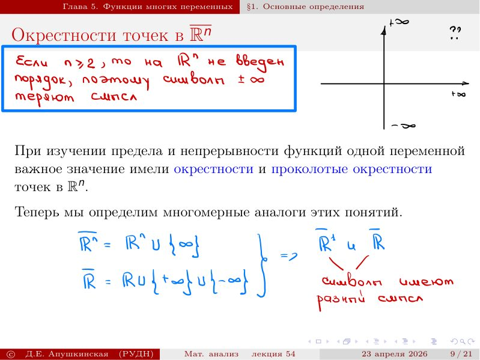

# Lecture 54 — multivariable functions and vector sequences

[[en/lectures-2025-26/lecture-53|← Lecture 53]] · [[en/lectures-2025-26/index|Lecture index]] · [[en/lectures-2025-26/lecture-55-56|Lectures 55–56 →]] · [[en/term-index|Terms & theorems]] · [[ru/lectures-2025-26/lecture-54|Русский]] · [[es/lectures-2025-26/lecture-54|Español]]

> [!info] Source and coverage
> `ма25_26_лекция_54_notes.pdf.txt`: 25 PDF pages, 21 printed slides and 4 handwritten pages; dated 23 April 2026. Handwritten pages 8, 19, 21 and 24 are included alongside slide annotations. Only the chat PDF was used; the source folder was not consulted.

> [!info] Semester-2 duplication
> This lecture overlaps thematically with [[ru/lectures/09-rn-foundations-5-1|§5.1]] and [[ru/lectures/10-vector-sequences-5-2|§5.2]]; see also the [[ru/lectures/index|register]]. Semester 2 spans lectures 33–64.

## Printed slide 1 (PDF p. 1) — Title slide

“Mathematical Analysis”, lecture 54; 23 April 2026.

## Printed slide 2 (PDF p. 2) — Student–Teacher game

A printed payoff-matrix slide; the four strategy pairs illustrate possible outcomes.

## Printed slide 3 (PDF p. 3) — Lecture goal

Introduce functions of several variables, the [[#^def-5-1-1|Euclidean norm]] and limits of sequences in $\mathbb R^n$; extend basic limit properties.

## Printed slide 4 (PDF p. 4) — Chapter 5. Functions of several variables

Opening slide for the chapter on functions of several variables.

## Printed slide 5 (PDF p. 5) — Basic definitions

Consider maps $f:E\subset\mathbb R^n\to\mathbb R^m$. For $m=1$ this is a function of $n$ real variables; vector coordinates use subscripts.

$$
f:E\subset\mathbb R^n\to\mathbb R^m
$$

$$
x=(x_1,\ldots,x_n)
$$

## Printed slide 6 (PDF p. 6) — Euclidean norm

> [!definition] Definition 5.1.1
> The Euclidean norm of a vector is the square root of the sum of the squares of its coordinates. For $n=1$ it is absolute value; for $n=2,3$ it is ordinary length.
>
>
> $$
> \|x\|=\sqrt{\sum_{k=1}^{n}x_k^2}
> $$

^def-5-1-1

## Printed slide 7 (PDF p. 7) — Norm axioms

The [[en/14-several-variables#14.1 Euclidean space and norms|norm]] is nonnegative and vanishes only at zero; it is homogeneous under scalar multiplication; and it satisfies the triangle inequality.

$$
\|x\|\ge0
$$

$$
\|\lambda x\|=|\lambda|\,\|x\|
$$

$$
\|x+y\|\le\|x\|+\|y\|
$$

## Handwritten page (PDF p. 8) — Euclidean norm: handwritten properties

[[en/lectures-2025-26/lecture-47-48#^thm-4-4-6|Cauchy–Schwarz]] follows from nonnegativity of the quadratic $\|x-ty\|^2$. The definition gives $|x_k|\le\|x\|$ and an [[en/02-real-numbers#2.2 Supremum and infimum|upper bound]] via the largest coordinate magnitude; the dimension is written $n$.

## Printed slide 8 (PDF p. 9) — Further norm properties

The reverse triangle inequality bounds the difference of norms by the norm of the difference. Cauchy–Schwarz controls the scalar product; each coordinate is bounded by the Euclidean norm.

$$
\|x-y\|\ge|\|x\|-\|y\||
$$

$$
|x\cdot y|\le\|x\|\,\|y\|
$$

## Printed slide 9 (PDF p. 10) — Neighborhoods in $\mathbb R^n$

Multivariable analysis uses analogues of neighborhoods and [[en/lectures-2025-26/lecture-14#^def-2-4-2|deleted neighborhoods]] on the real line. Handwritten notes clarify the symbols at infinity.

## Printed slide 10 (PDF p. 11) — Neighborhoods and the point at infinity

> [!definition] Definition 5.1.2
> A neighborhood of a point is an open ball of radius $\delta$ in the Euclidean norm; a deleted neighborhood omits the point. A neighborhood of the point at infinity consists of vectors whose norm exceeds $\delta$.
>
>
> $$
> V_\delta(a)=\{x\in\mathbb R^n:\|x-a\|<\delta\}
> $$
>
>
> $$
> \dot V_\delta(a)=V_\delta(a)\setminus\{a\}
> $$
>
>
> $$
> V_\delta(\infty)=\{x\in\mathbb R^n:\|x\|>\delta\}
> $$

^def-5-1-2

## Printed slide 11 (PDF p. 12) — Geometry of neighborhoods

In $\mathbb R$, $\mathbb R^2$ and $\mathbb R^3$ these are an interval, disk and ball. A handwritten note says that for $n\ge2$, $+\infty$ and $-\infty$ are not distinguished in the multidimensional space.

$$
V_\delta(a)=(a-\delta,a+\delta)
$$

## Printed slide 12 (PDF p. 13) — Intersections of neighborhoods

The intersection of two neighborhoods of one point is still a neighborhood; distinct finite points have disjoint neighborhoods for suitable radii.

$$
V_{\delta_1}(a)\cap V_{\delta_2}(a)=V_{\min(\delta_1,\delta_2)}(a)
$$

## Printed slide 13 (PDF p. 14) — Operations on vectors

Addition and scalar multiplication are coordinatewise; the scalar product is the sum of products of corresponding coordinates.

$$
x+y=(x_1+y_1,\ldots,x_n+y_n)
$$

$$
\lambda x=(\lambda x_1,\ldots,\lambda x_n)
$$

$$
x\cdot y=\sum_{i=1}^{n}x_iy_i
$$

## Printed slide 14 (PDF p. 15) — Operations on mappings

Vector operations extend pointwise to maps valued in $\mathbb R^m$; the scalar product of maps sums the products of their components.

$$
(f\cdot g)(x)=\sum_{k=1}^{m}f_k(x)g_k(x)
$$

## Printed slide 15 (PDF p. 16) — §2. Limits of vector sequences

> [!definition] Definition 5.2.1
> A vector sequence converges to $a$ if, for every $\varepsilon>0$, all sufficiently late terms lie in the $\varepsilon$-neighborhood of $a$.
>
>
> $$
> \forall\varepsilon>0\ \exists N\ \forall k>N:\ x_k\in V_\varepsilon(a)
> $$
>
>
> $$
> \lim_{k\to\infty}x_k=a
> $$

^def-5-2-1

## Printed slide 16 (PDF p. 17) — Equivalent definitions of a limit

Convergence to a finite vector is equivalent to the norm of the difference tending to zero; a norm tending to infinity defines the limit $\infty$.

$$
\|x_k-a\|<\varepsilon
$$

$$
\lim_{k\to\infty}\|x_k-a\|=0
$$

$$
\lim_{k\to\infty}\|x_k\|=+\infty
$$

## Printed slide 17 (PDF p. 18) — Uniqueness of a limit

> [!lemma] Lemma 5.2.1
> If a sequence has limits $a$ and $b$, then $a=b$. Convergence to $a$ also implies convergence of the norms to $\|a\|$ by the reverse triangle inequality.
>
>
> $$
> |\|x_k\|-\|a\||\le\|x_k-a\|
> $$

^lem-5-2-1

## Handwritten page (PDF p. 19) — Uniqueness of a limit: proof

Assume $a\ne b$. Choose disjoint neighborhoods of $a$ and $b$. If a sequence converges to both, every sufficiently late term must lie in their intersection, which is empty. This contradiction proves uniqueness.

## Printed slide 18 (PDF p. 20) — Coordinatewise convergence

> [!theorem] Theorem 5.2.1
> A sequence in $\mathbb R^n$ converges exactly when each coordinate sequence converges to the corresponding coordinate of the limit vector.
>
>
> $$
> |x_i^k-a_i|\le\|x^k-a\|
> $$

^thm-5-2-1

## Handwritten page (PDF p. 21) — Coordinatewise convergence: proof

If $\|x^k-a\|\to0$, then $|x_i^k-a_i|\le\|x^k-a\|\to0$ for every coordinate. Conversely, if all $n$ coordinates converge, for a given $\varepsilon$ choose a common index after which every coordinate error is less than $\varepsilon/\sqrt n$; the Euclidean error is then less than $\varepsilon$.

## Printed slide 19 (PDF p. 22) — A vector can diverge while coordinates have no limits

An example alternates directions while its length grows: the norm tends to infinity even though the coordinate sequences need not have limits.

$$
x_k=\left(k\cos\frac{\pi k}{2},k\sin\frac{\pi k}{2}\right)
$$

$$
\|x_k\|=k\to+\infty
$$

## Printed slide 20 (PDF p. 23) — Limit arithmetic

> [!theorem] Theorem 5.2.2
> The limit of a sum is the sum of limits; if $\lambda_k\to\lambda$, multiplying a vector sequence by the scalar sequence gives the expected limit; the limit of scalar products is the scalar product of the limits.
>
>
> $$
> \lim_{k\to\infty}(x_k+y_k)=a+b
> $$
>
>
> $$
> \lim_{k\to\infty}\lambda_kx_k=\lambda a
> $$
>
>
> $$
> \lim_{k\to\infty}x_k\cdot y_k=a\cdot b
> $$

^thm-5-2-2

## Handwritten page (PDF p. 24) — Sum law: proof

For each $i$, the scalar coordinate sequences converge, so $x_i^k+y_i^k\to a_i+b_i$. [[#^thm-5-2-1|Theorem 5.2.1]] then gives $x^k+y^k\to a+b$ in $\mathbb R^n$.

## Printed slide 21 (PDF p. 25) — Linearity of the sequence limit

Combining the sum law and scalar multiplication gives linearity of the limit of a vector sequence.

$$
\lim_{k\to\infty}(\lambda x_k+\mu y_k)=\lambda a+\mu b
$$

---

[[en/lectures-2025-26/lecture-53|← Lecture 53]] · [[en/lectures-2025-26/index|Lecture index]] · [[en/lectures-2025-26/lecture-55-56|Lectures 55–56 →]] · [[en/term-index|Terms & theorems]] · [[ru/lectures-2025-26/lecture-54|Русский]] · [[es/lectures-2025-26/lecture-54|Español]]
