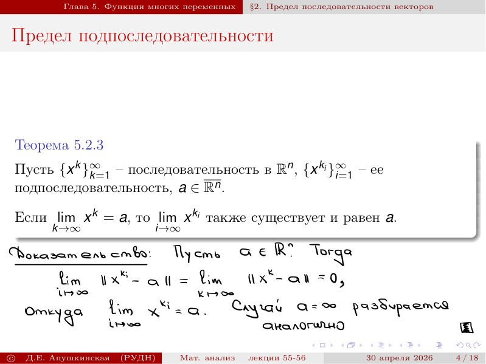
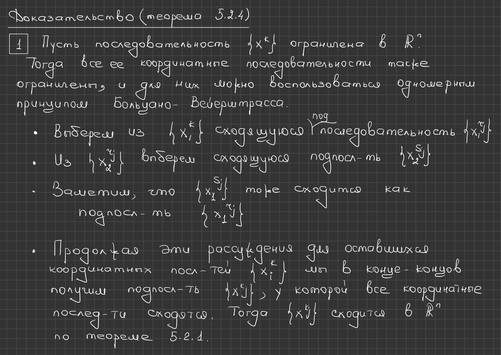
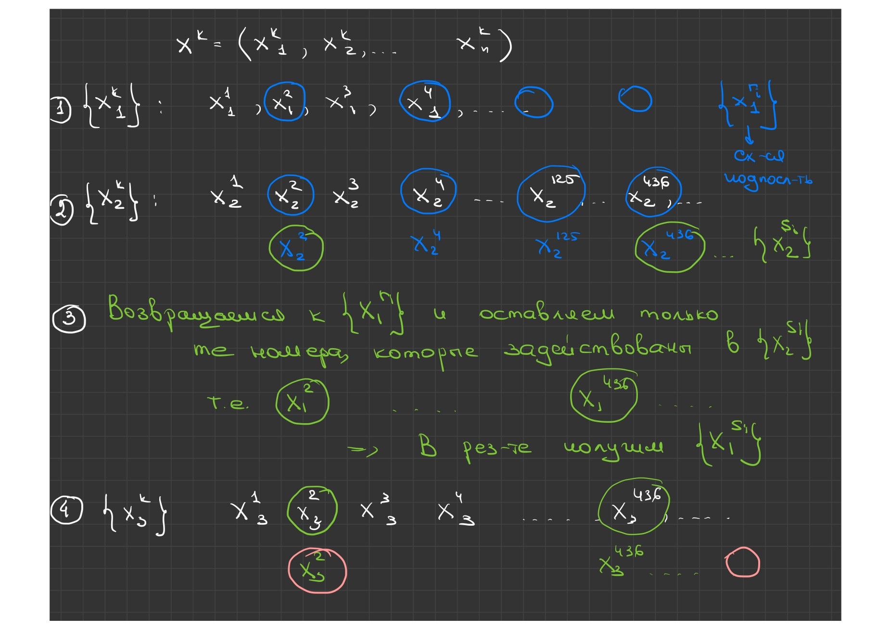
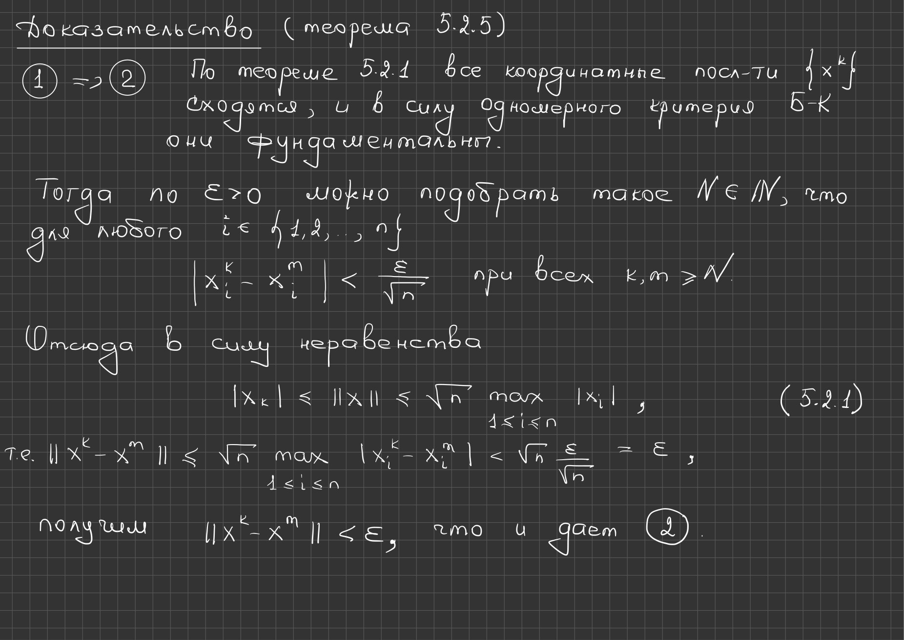

# Lectures 55–56 — Limits of Subsequences, Compactness and the Topology of $\mathbb R^n$

[[en/lectures-2025-26/lecture-54|← Lecture 54]] · [[en/lectures-2025-26/index|Lecture index]] · [[en/lectures-2025-26/lecture-57-58|Lectures 57–58 →]] · [[en/term-index|Terms & theorems]] · [[ru/lectures-2025-26/lecture-55-56|Русский]] · [[es/lectures-2025-26/lecture-55-56|Español]]

> [!info] Source and coverage
> `MA25-26_ktrwbb_55-56_notes.pdf.txt`: 31 PDF pages, 18 printed slides and 13 handwritten pages; dated 30 April 2026. Printed slides 1–9 occupy PDF pages 1–9; after that slide 10 is on PDF page 13, slide 11 on 16, slide 12 on 17, slide 13 on 19, slide 14 on 20, slide 15 on 22, slide 16 on 26, slide 17 on 29 and slide 18 on 30. Handwritten PDF pages 10, 11, 12, 14, 15, 18, 21, 23, 24, 25, 27, 28 and 31 are included. Handwritten annotations on printed slides 4, 5, 7, 8, 19 and 26 are included and attributed to their slides rather than to separate PDF pages. Only the PDF supplied in the chat was used; the source folder was not consulted, so archive names and links are not given.

> [!info] Semester-2 duplication
> The lecture overlaps thematically with [[ru/lectures/10-vector-sequences-5-2|§5.2]] and [[ru/lectures/11-topology-rn-5-3|§5.3]]; see also the [[ru/lectures/index|register]]. Semester 2 covers lectures 33–64.

## Printed slide 1 (PDF p. 1) — Title slide

"Mathematical Analysis", lectures 55–56; D. E. Apushkinskaya, RUDN University; 30 April 2026.

## Printed slide 2 (PDF p. 2) — Quote of the day

"Good will defeat evil if it gets enough sleep and rest.."

## Printed slide 3 (PDF p. 3) — Aim of the lecture

The transfer of statements proved earlier for one-dimensional numerical sequences to the multidimensional case continues. The task is to find reasonable analogues in $\mathbb R^n$ of open and closed intervals and of [[en/lectures-2025-26/lecture-57-58#^def-5-3-7|compact]] sets.

## Printed slide 4 (PDF p. 4) — §2. Limit of a subsequence — Theorem 5.2.3

> [!theorem] Theorem 5.2.3
> Let $\{x^k\}_{k=1}^{\infty}$ be a sequence in $\mathbb R^n$, let $\{x^{k_i}\}_{i=1}^{\infty}$ be a [[en/lectures-2025-26/lecture-11-12#^def-2-3-7|subsequence]] of it, and let $a\in\overline{\mathbb R^n}$. If $\lim_{k\to\infty}x^k=a$, then $\lim_{i\to\infty}x^{k_i}$ also exists and equals $a$.

> [!remark] Editorial note on the text layer
> In the printed slide the point $a$ is taken from the extended space $\overline{\mathbb R^n}$; the PDF text layer loses the overline and reads $a\in\mathbb R^n$. Here and below the overlines are restored from the page image (see also slide 16, where the bars over $B_\delta$ are lost).

**Handwritten proof (lower part of the same slide).** Let $a\in\mathbb R^n$. Then

$$
\lim_{i\to\infty}\|x^{k_i}-a\|=\lim_{k\to\infty}\|x^k-a\|=0,
$$

whence

$$
\lim_{i\to\infty}x^{k_i}=a.
$$

The case $a=\infty$ is treated similarly.

## Printed slide 5 (PDF p. 5) — Boundedness in $\mathbb R^n$ — Definition 5.2.2

> [!definition] Definition 5.2.2
> 1) Let $E$ be a subset of $\mathbb R^n$. It is called bounded if there is a $C>0$ such that $E\subset V_C(0)$, that is, $\|x\|<C$ for every $x\in E$. 2) Let $f:E\subset\mathbb R^n\to\mathbb R^m$. The map $f$ is called bounded if its image $f(E)$ is bounded in $\mathbb R^m$.
>
> $$
> E\subset V_C(0)\iff\|x\|<C\ \ \forall x\in E
> $$

^def-5-2-2

Handwritten note below the slide: "i.e. if $f(E)$ is bounded in $\mathbb R^m$".

## Printed slide 6 (PDF p. 6) — Boundedness as a finite supremum

A set $E\subset\mathbb R^n$ is bounded if and only if $\sup_{x\in E}\|x\|<+\infty$, and a map $f:E\subset\mathbb R^n\to\mathbb R^m$ is bounded if and only if $\sup_{x\in E}\|f(x)\|<+\infty$. In particular, a sequence $\{x^k\}_{k=1}^{\infty}$ is bounded in $\mathbb R^n$ exactly when $\sup_{k\in\mathbb N}\|x^k\|<+\infty$.

$$
\sup_{x\in E}\|x\|<+\infty,\qquad \sup_{x\in E}\|f(x)\|<+\infty
$$

$$
\sup_{k\in\mathbb N}\|x^k\|<+\infty
$$

## Printed slide 7 (PDF p. 7) — Boundedness and projections

1) Let $E\subset\mathbb R^n$ and $j\in\{1,\ldots,n\}$. The projection of $E$ onto the $j$-th axis is the set $E_j=\{x_j:x\in E\}$. The set $E$ is bounded if and only if all its projections $E_j$, $j=1,\ldots,n$, are bounded; this follows directly from the estimate below. 2) By point 1, a map $f:E\subset\mathbb R^n\to\mathbb R^n$ is bounded if and only if all of its coordinate functions are bounded. In particular, a sequence $\{x^k\}$ in $\mathbb R^n$ is bounded exactly when all of its coordinate sequences are bounded.

$$
E_j=\{x_j:\ x\in E\}
$$

$$
|x_j|\le\|x\|\le\sqrt{n}\max_{1\le i\le n}|x_i|
$$

> [!info] Source inconsistency and editorial clarification
> In point 2 the printed slide again writes the map as $f:E\subset\mathbb R^n\to\mathbb R^n$, although [[#^def-5-2-2|Definition 5.2.2]] and the rest of the exposition take values in $\mathbb R^m$. The discrepancy is not silently corrected: the notation $f:E\subset\mathbb R^n\to\mathbb R^m$ is used below.

Handwritten note: $x=(x_1,x_2,\ldots,x_n)\in E$.

## Printed slide 8 (PDF p. 8) — Lemma 5.2.2

> [!lemma] Lemma 5.2.2
> Every sequence $\{x^k\}$ convergent in $\mathbb R^n$ is bounded.

**Handwritten proof (on the same slide).** Indeed, by [[en/lectures-2025-26/lecture-54#^thm-5-2-1|Theorem 5.2.1]] all coordinate sequences $\{x_i^k\}$ converge and hence are bounded (according to the one-dimensional theory). But then, by point 2 of the previous slide, the sequence $\{x^k\}$ itself is bounded.

## Printed slide 9 (PDF p. 9) — The Bolzano–Weierstrass selection principle

> [!theorem] Theorem 5.2.4
> Let $\{x^k\}_{k=1}^{\infty}$ be a sequence in $\mathbb R^n$. Then: 1) if it is bounded, one can select from it a convergent subsequence; 2) if it is unbounded, it has a subsequence $\{x^{k_i}\}$ tending to infinity.

^thm-5-2-4

## Handwritten page (PDF p. 10) — Proof of Theorem 5.2.4, part 1

Let the sequence $\{x^k\}$ be bounded in $\mathbb R^n$. Then all of its coordinate sequences are bounded as well, and for each of them the one-dimensional [[en/lectures-2025-26/lecture-11-12#^thm-2-3-4|Bolzano–Weierstrass principle]] can be used. Select from $\{x_1^k\}$ a convergent subsequence $\{x_1^{k_i}\}$; from $\{x_2^{k_i}\}$ select a convergent subsequence $\{x_2^{s_i}\}$, noting that $\{x_1^{s_i}\}$ also converges as a subsequence of the convergent $\{x_1^{k_i}\}$. Continuing these arguments for the remaining coordinate sequences, one finally obtains a subsequence $\{x^{t_i}\}$ whose coordinate sequences all converge; then $\{x^{t_i}\}$ converges in $\mathbb R^n$ by [[en/lectures-2025-26/lecture-54#^thm-5-2-1|Theorem 5.2.1]].

$$
\{x_1^{k}\}\supset\{x_1^{k_i}\}\supset\{x_1^{s_i}\}\supset\cdots
$$

## Handwritten page (PDF p. 11) — Diagram of the diagonal selection

The page contains a selection diagram corresponding to the previous proof. The vector is written out in coordinates; members of the first coordinate sequence from which the convergent subsequence is chosen are circled in blue; in green the return to the chosen indices is shown, thinning the first coordinate sequence so that only the indices used in the second coordinate remain. Below, the same procedure is repeated for the third coordinate; red marks the next thinning step.

$$
x^k=\left(x_1^k,x_2^k,\ldots,x_n^k\right)
$$

## Handwritten page (PDF p. 12) — Proof of Theorem 5.2.4, part 2

Since the numerical sequence $\{\|x^k\|\}_{k=1}^{\infty}$ is not [[en/lectures-2025-26/lecture-05-06#^def-1-3-7|bounded above]], it has a subsequence $\{\|x^{k_i}\|\}_{i=1}^{\infty}$ tending to $+\infty$. Then

$$
\lim_{i\to\infty}\|x^{k_i}\|=+\infty\ \Longrightarrow\ \lim_{i\to\infty}x^{k_i}=\infty.
$$

## Printed slide 10 (PDF p. 13) — The Bolzano–Cauchy criterion

> [!theorem] Theorem 5.2.5
> Let $\{x^k\}_{k=1}^{\infty}$ be a sequence in $\mathbb R^n$. Then the following statements are equivalent: 1) the sequence $\{x^k\}$ converges in $\mathbb R^n$; 2) for every $\varepsilon>0$ there is an $N\in\mathbb N$ such that $\|x^k-x^m\|<\varepsilon$ for all $k,m>N$.

^thm-5-2-5

**Remark.** A sequence in $\mathbb R^n$ satisfying condition 2 is called a [[en/lectures-2025-26/lecture-13#^def-2-3-10|Cauchy sequence]].

$$
\forall\varepsilon>0\ \ \exists N\in\mathbb N\ \ \forall k,m>N:\ \|x^k-x^m\|<\varepsilon
$$

## Handwritten page (PDF p. 14) — Proof of 1) ⇒ 2)

By [[en/lectures-2025-26/lecture-54#^thm-5-2-1|Theorem 5.2.1]] all coordinate sequences $\{x_i^k\}$ converge and, by the one-dimensional Bolzano–Cauchy criterion, they are Cauchy. Hence, given $\varepsilon>0$, one can choose an $N\in\mathbb N$ such that for every $i\in\{1,\ldots,n\}$

$$
|x_i^k-x_i^m|<\frac{\varepsilon}{\sqrt n}
$$

for all $k,m\ge N$. From this, by inequality (5.2.1)

$$
|x_i|\le\|x\|\le\sqrt{n}\max_{1\le i\le n}|x_i|,
$$

that is,

$$
\|x^k-x^m\|\le\sqrt{n}\max_{1\le i\le n}|x_i^k-x_i^m|<\sqrt n\,\frac{\varepsilon}{\sqrt n}=\varepsilon,
$$

we obtain $\|x^k-x^m\|<\varepsilon$, which gives statement 2.

## Handwritten page (PDF p. 15) — Proof of 2) ⇒ 1)

Condition 2 means that $\forall\varepsilon>0$ $\exists N\in\mathbb N$ $\forall k,m\in\mathbb N$ one has $\|x^k-x^m\|<\varepsilon$. By (5.2.1), for all $k,m\in\mathbb N$ and $i\in\{1,\ldots,n\}$,

$$
|x_i^k-x_i^m|\le\|x^k-x^m\|<\varepsilon.
$$

Therefore condition 2 implies that the coordinate sequences $\{x_i^k\}$ are Cauchy. By the one-dimensional Bolzano–Cauchy criterion all of them converge in $\mathbb R$, and then by [[en/lectures-2025-26/lecture-54#^thm-5-2-1|Theorem 5.2.1]] the sequence $\{x^k\}$ converges in $\mathbb R^n$.

## Printed slide 11 (PDF p. 16) — Limit points and isolated points

> [!definition] Definition 5.2.3
> Let $E\subset\mathbb R^n$. 1) A point $a\in\overline{\mathbb R^n}$ is called a limit point of $E$ if for every $\varepsilon>0$ the set $E\cap\dot V_\varepsilon(a)$ is non-empty. 2) A point $a\in E$ is called isolated for $E$ if it is not a limit point of $E$.
>
> $$
> E\cap\dot V_\varepsilon(a)\ne\varnothing
> $$

^def-5-2-3

> [!note] Text-layer mismatch
> Here and below the text layer drops the dots over punctured-neighbourhood symbols and the overlines: the printed line has $\dot V_\varepsilon(a)$ and $a\in\overline{\mathbb R^n}$, whereas the extracted text gives $V_\varepsilon(a)$ and $a\in\mathbb R^n$.

## Printed slide 12 (PDF p. 17) — Characterisation of limit points

> [!theorem] Theorem 5.2.6
> Let $E\subset\mathbb R^n$ and $a\in\overline{\mathbb R^n}$. Then the following statements are equivalent: 1) the point $a$ is a limit point of $E$; 2) there is a sequence $\{x^k\}_{k=1}^{\infty}$ in $E\setminus\{a\}$ with $\lim_{k\to\infty}x^k=a$.

^thm-5-2-6

## Handwritten page (PDF p. 18) — Proof of Theorem 5.2.6

The proof is carried out only for $a\in\mathbb R^n$; the case $a=\infty$ is left as an exercise. 1) ⇒ 2) Let $a$ be a limit point of $E$, that is, $\forall\varepsilon>0$ the set $E\cap\dot V_\varepsilon(a)\ne\varnothing$. Then for every $k$ there is a point $x^k\in E\setminus\{a\}$ with $\|x^k-a\|<1/k$. Hence $\lim_{k\to\infty}\|x^k-a\|=0$, that is, $\lim_{k\to\infty}x^k=a$. 2) ⇒ 1) Let $\{x^k\}_{k=1}^{\infty}$ be a sequence in $E\setminus\{a\}$ converging to $a$. For every $\varepsilon>0$ there is a $k\in\mathbb N$ with $\|x^k-a\|<\varepsilon$. Therefore $x^k\in V_\varepsilon(a)\cap\left(E\setminus\{a\}\right)$, that is, $x^k\in\dot V_\varepsilon(a)\cap E$. Then for every $\varepsilon>0$ the set $E\cap\dot V_\varepsilon(a)\ne\varnothing$, so $a$ is a limit point of $E$.

$$
\forall\varepsilon>0\ \ E\cap\dot V_\varepsilon(a)\ne\varnothing
$$

$$
\|x^k-a\|<\frac1k,\qquad x^k\in E\setminus\{a\}
$$

## Printed slide 13 (PDF p. 19) — §3. Open, closed and compact sets

> [!definition] Definition 5.3.1
> Let $E\subset\mathbb R^n$. 1) A point $a\in E$ is called interior for $E$ if it has a neighbourhood contained in $E$. 2) A set $E$ is called open in $\mathbb R^n$ if every one of its points is interior for $E$. 3) A set $E$ is called closed in $\mathbb R^n$ if its complement $\mathbb R^n\setminus E$ is open in $\mathbb R^n$.

^def-5-3-1

**Remark.** The complement of any set open in $\mathbb R^n$ is in turn closed; thus closed and [[#^def-5-3-1|open sets]] are mutually complementary.

Handwritten diagram on the slide: a set $E$ with an [[en/lectures-2025-26/lecture-57-58#Printed slide 4 (PDF p. 4) — The interior of a set — Definition 5.3.3|interior point]] $a$ and its neighbourhood $V(a)\subset E$ is drawn; a [[en/lectures-2025-26/lecture-57-58#Printed slide 5 (PDF p. 7) — The boundary of a set — Definition 5.3.4|boundary point]] that is not interior is marked separately.

$$
V(a)\subset E
$$

## Printed slide 14 (PDF p. 20) — Characterisation of closed sets

> [!theorem] Theorem 5.3.1
> Let $E\subset\mathbb R^n$. Then the following statements are equivalent: 1) $E$ is closed in $\mathbb R^n$; 2) $E$ contains all of its limit points in $\mathbb R^n$; 3) if $\{x^k\}_{k=1}^{\infty}$ is a convergent sequence in $E$, then $\lim_{k\to\infty}x^k\in E$.

^thm-5-3-1

## Handwritten page (PDF p. 21) — Proof of Theorem 5.3.1

The proof follows the scheme 1) ⇒ 3) ⇒ 2) ⇒ 1). 1) ⇒ 3): let $\{x^k\}$ be a sequence in $E$, $a\in\mathbb R^n$, $\lim_{k\to\infty}x^k=a$; we show that $a\in E$. If this is not so, that is, $a\notin E$, then the closedness of $E$ implies the existence of a neighbourhood $V(a)\subset\mathbb R^n\setminus E$. By the definition of the limit, for all sufficiently large $k\in\mathbb N$ we have $x^k\in V(a)\subset\mathbb R^n\setminus E$; on the other hand, for all $k\in\mathbb N$ we have $x^k\in E$ — a contradiction. 3) ⇒ 2): let $a\in\mathbb R^n$ be a limit point of $E$. By [[#^thm-5-2-6|Theorem 5.2.6]] there is a sequence $\{x^k\}\subset E$ converging to $a$; then by 3) we get $a\in E$. 2) ⇒ 1): we prove that $\mathbb R^n\setminus E$ is open. Let $a\in\mathbb R^n\setminus E$; we check that there is a neighbourhood $V(a)\subset\mathbb R^n\setminus E$. If this is not so, then for every $\varepsilon>0$ the set $\dot V_\varepsilon(a)\cap E\ne\varnothing$, that is, $a$ is a limit point of $E$, and by 2) $a\in E$ — a contradiction.

$$
\mathbb R^n\setminus E
$$

## Printed slide 15 (PDF p. 22) — Theorem 5.3.2 on families of sets

> [!theorem] Theorem 5.3.2
> Let $A$ be an index set, and let $\{E_\alpha\}_{\alpha\in A}$ and $\{F_\alpha\}_{\alpha\in A}$ be families of open and of closed subsets of $\mathbb R^n$ respectively. Then: 1) the union of all $E_\alpha$ is open and the intersection of all $F_\alpha$ is closed in $\mathbb R^n$; 2) if the index set $A$ is finite, then the intersection of all $E_\alpha$ is open and the union of all $F_\alpha$ is closed in $\mathbb R^n$.

**Corollary.** Let $E$ be open and $F$ closed in $\mathbb R^n$. Then $E\setminus F$ is open and $F\setminus E$ is closed in $\mathbb R^n$.

$$
\bigcup_{\alpha\in A}E_\alpha,\qquad \bigcap_{\alpha\in A}F_\alpha
$$

$$
E\setminus F,\qquad F\setminus E
$$

## Handwritten page (PDF p. 23) — Proof of Theorem 5.3.2, part 1

Put $E:=\bigcup_{\alpha\in A}E_\alpha$ and $F:=\bigcap_{\alpha\in A}F_\alpha$. If $a\in E$, then $a\in E_\alpha$ for some $\alpha\in A$; since $E_\alpha$ is open and $a\in E_\alpha$, there is a neighbourhood $V(a)\subset E_\alpha$, hence $V(a)\subset E$, that is, $E$ is open. To prove that $F$ is closed, note that by de Morgan's rule

$$
\mathbb R^n\setminus F=\mathbb R^n\setminus\bigcap_{\alpha\in A}F_\alpha=\bigcup_{\alpha\in A}\left(\mathbb R^n\setminus F_\alpha\right).
$$

Each set $\mathbb R^n\setminus F_\alpha$ is open by point 1 as the complement of the closed $F_\alpha$, so their union is open; consequently $F$ is closed.

## Handwritten page (PDF p. 24) — Proof of Theorem 5.3.2, part 2

Let the index set $A$ be finite and $E:=\bigcap_{\alpha\in A}E_\alpha$. If $a\in E$, then $a\in E_\alpha$ for all $\alpha\in A$; since every $E_\alpha$ is open, for each $\alpha\in A$ there is a $\delta_\alpha>0$ with $V_{\delta_\alpha}(a)\subset E_\alpha$. Put $\delta:=\min_{\alpha\in A}\delta_\alpha$; since $A$ is finite, this minimum exists and is positive. Then $V_\delta(a)\subset E_\alpha$ for all $\alpha\in A$, that is, $V_\delta(a)\subset E$, and $E$ is open. The closedness of the union $\bigcup_{\alpha\in A}F_\alpha$ is derived from the openness of $E$ by de Morgan's rule in the same way as in point 1.

$$
\delta:=\min_{\alpha\in A}\delta_\alpha>0,\qquad V_\delta(a)\subset E_\alpha\ \ \forall\alpha\in A
$$

## Handwritten page (PDF p. 25) — Proof of the corollary to Theorem 5.3.2

We have $E\setminus F=E\cap\left(\mathbb R^n\setminus F\right)$. The set $\mathbb R^n\setminus F$ is open since $F$ is closed, so by [[#Printed slide 15 (PDF p. 22) — Theorem 5.3.2 on families of sets|Theorem 5.3.2]] the intersection of two open sets is open and $E\setminus F$ is open. The second statement is proved similarly.

$$
E\setminus F=E\cap\left(\mathbb R^n\setminus F\right)
$$

## Printed slide 16 (PDF p. 26) — Examples

1) The sets $\mathbb R^n$ and $\varnothing$ are simultaneously open and closed in $\mathbb R^n$. 2) Every finite subset of $\mathbb R^n$ is closed. 3) Let $a\in\mathbb R^n$, $\delta>0$, and put $\overline{B_\delta(a)}=\{x\in\mathbb R^n:\|x-a\|\le\delta\}$. Then the set $B_\delta(a)$ is open in $\mathbb R^n$ and the set $\overline{B_\delta(a)}$ is closed in $\mathbb R^n$. 4) Let $a\in\mathbb R^n$, $\delta>0$, and put $S_\delta(a)=\{x\in\mathbb R^n:\|x-a\|=\delta\}$. Then $S_\delta(a)$ is closed in $\mathbb R^n$.

>
> **Source inconsistency and editorial clarification.** In the PDF text layer points 3.1 and 3.2 are printed without the bars, that is, as "$B_\delta(a)$ is open" and "$B_\delta(a)$ is closed", which cannot hold simultaneously. According to the page image the first occurrence is the open ball $B_\delta(a)$ and the second is the closed ball $\overline{B_\delta(a)}$; that reading is used below, and the discrepancy is stated here explicitly.

Handwritten notes: "ball in $\mathbb R^n$" next to the symbol $\overline{B_\delta(a)}$, "sphere in $\mathbb R^n$" next to $S_\delta(a)$, the formula $S_\delta(a)=\overline{B_\delta(a)}\setminus B_\delta(a)$, and a blue entry: "Important: if $E\subset\mathbb R^n$, $E$ is both open and closed, then either $E=\mathbb R^n$ or $E=\varnothing$".

$$
S_\delta(a)=\overline{B_\delta(a)}\setminus B_\delta(a)
$$

## Handwritten page (PDF p. 27) — Example 3: openness of the ball $B_\delta(a)$

We show that $B_\delta(a)$ is open in $\mathbb R^n$. Let $b\in B_\delta(a)$; we must check that $b$ is an interior point of $B_\delta(a)$. Put $\sigma:=\delta-\|b-a\|>0$; this number is positive because $B_\delta(a)=\{x\in\mathbb R^n:\|x-a\|<\delta\}$ and $b\in B_\delta(a)$, that is, $\|b-a\|<\delta$. Consider the ball $B_\sigma(b)$. For every $x\in B_\sigma(b)$,

$$
\|x-a\|=\|x-b+b-a\|\le\|x-b\|+\|b-a\|<\sigma+\|b-a\|=\delta,
$$

hence $x\in B_\delta(a)$, that is, $B_\sigma(b)\subset B_\delta(a)$. Thus $b$ is an interior point and $B_\delta(a)$ is open.

$$
\sigma:=\delta-\|b-a\|>0,\qquad \|x-a\|\le\|x-b\|+\|b-a\|<\sigma+\|b-a\|=\delta
$$

## Handwritten page (PDF p. 28) — Example 3: closedness of $\overline{B_\delta(a)}$ and a remark

Let $\{x^k\}$ be a sequence in $\overline{B_\delta(a)}$ converging to $x\in\mathbb R^n$. Then

$$
\|x-a\|=\lim_{k\to\infty}\|x^k-a\|\le\delta,
$$

so $x\in\overline{B_\delta(a)}$ and $\overline{B_\delta(a)}$ is closed. Blue note at the bottom: "Important: the set $[0,1)$ is neither open nor closed in $\mathbb R$, that is, one should not think that every subset of $\mathbb R^n$ is either open or closed".

## Printed slide 17 (PDF p. 29) — The closure of a set

> [!definition] Definition 5.3.2
> Let $E\subset\mathbb R^n$. The closure of $E$ is the closed set $F\subset\mathbb R^n$ satisfying two conditions: 1) $F\supset E$; 2) if $A$ is another closed subset of $\mathbb R^n$ containing $E$, then $A\supset F$. The closure of $E$ is usually denoted by $\overline E$ or $\operatorname{Cl}E$.

^def-5-3-2

**Remark.** $\overline E$ is the smallest [[#^thm-5-3-1|closed set]] containing $E$ with respect to inclusion. Moreover, the equality below holds.

$$
\overline E=\bigcap\{F\subset\mathbb R^n:\ F\supset E,\ F=\overline F\}
$$

## Printed slide 18 (PDF p. 30) — Description of the closure

The description above is inconvenient for practical purposes, so the characterisation of the [[#^def-5-3-2|closure]] is formulated in terms of sequences and limit points.

> [!theorem] Theorem 5.3.3
> Let $E\subset\mathbb R^n$ and $a\in\mathbb R^n$. Then the following statements are equivalent: 1) $a\in\overline E$; 2) the point $a$ lies in $E$ or is a limit point of $E$; 3) there is a sequence in $E$ converging to $a$.
>
> $$
> a\in\overline E
> $$

^thm-5-3-3

## Handwritten page (PDF p. 31) — Proof of Theorem 5.3.3

The proof follows the scheme 1) ⇒ 2) ⇒ 3) ⇒ 1). 1) ⇒ 2): if $a\notin E$ and $a$ is not a limit point of $E$, then there is a $\delta>0$ with $V_\delta(a)\subset\mathbb R^n\setminus E$. Rewrite this inclusion as $E\subset\mathbb R^n\setminus V_\delta(a)$. Hence, since $\mathbb R^n\setminus V_\delta(a)$ is closed, it follows that $\overline E\subset\mathbb R^n\setminus V_\delta(a)$. But this is impossible, because $a\in\overline E$. 2) ⇒ 3): if $a$ is a limit point of $E$, the required sequence exists by the theorem on the characterisation of limit points; in the case $a\in E$ the constant sequence with all terms equal to $a$ will do. 3) ⇒ 1): let $\{x^k\}$ be a sequence in $E$ converging to $a$. Then $\{x^k\}\subset\overline E$ by [[#^thm-5-3-1|Theorem 5.3.1]], whence $a\in\overline E$.

$$
\overline E\subset\mathbb R^n\setminus V_\delta(a)
$$

---

[[en/lectures-2025-26/lecture-54|← Lecture 54]] · [[en/lectures-2025-26/index|Lecture index]] · [[en/lectures-2025-26/lecture-57-58|Lectures 57–58 →]] · [[en/term-index|Terms & theorems]] · [[ru/lectures-2025-26/lecture-55-56|Русский]] · [[es/lectures-2025-26/lecture-55-56|Español]]
