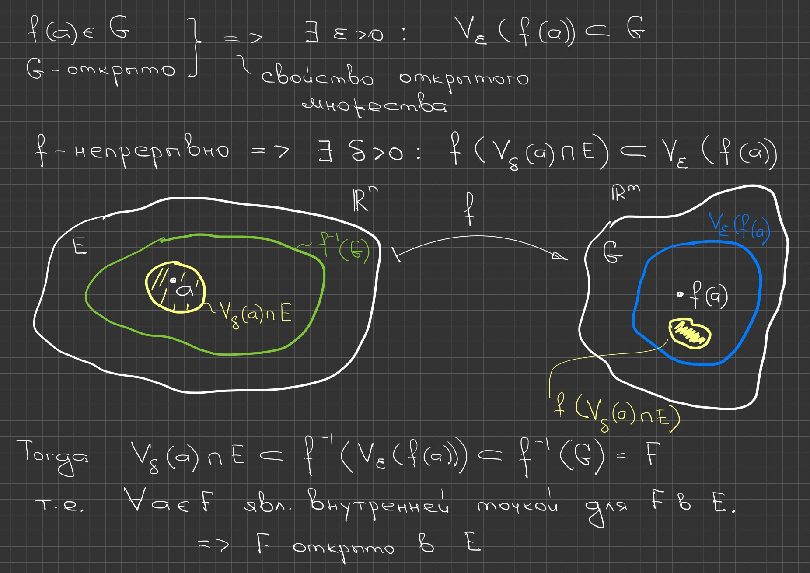
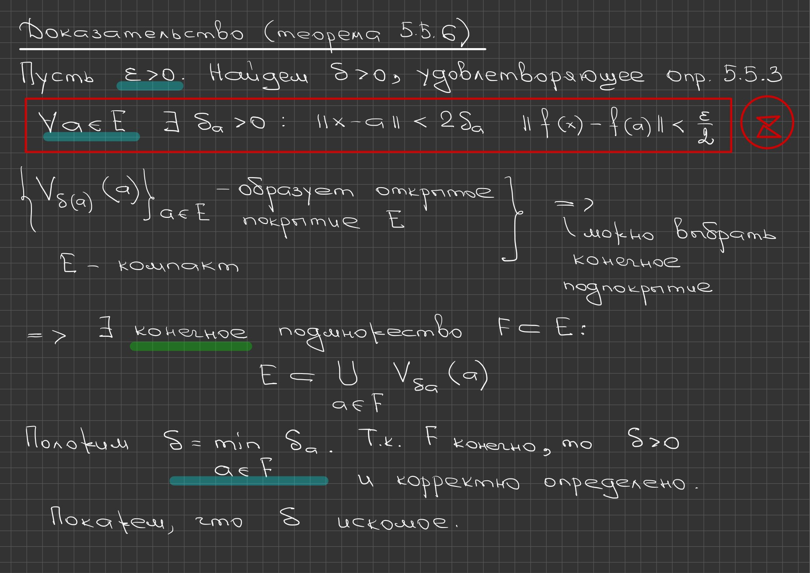

# Lectures 59–60 — Continuous Maps and Differentiability at a Point

[[en/lectures-2025-26/lecture-57-58|← Lectures 57–58]] · [[en/lectures-2025-26/index|Lecture index]] · [[en/lectures-2025-26/lecture-61-62|Lectures 61–62 →]] · [[en/term-index|Terms & theorems]] · [[ru/lectures-2025-26/lecture-59-60|Русский]] · [[es/lectures-2025-26/lecture-59-60|Español]]

> [!info] Source and coverage
> `ma25_26-lectures_59-60_notes.pdf.txt`: 28 PDF pages, 17 printed slides and 11 handwritten pages; dated 14 May 2026. Printed slides 1–6 occupy PDF pages 1–6; after that slide 7 is on PDF page 8, slide 8 on 10, slide 9 on 14, slide 10 on 16, slide 11 on 18, slide 12 on 21, slide 13 on 22, slide 14 on 23, slide 15 on 24, slide 16 on 26 and slide 17 on 27. Handwritten PDF pages 7, 9, 11, 12, 13, 15, 17, 19, 20, 25 and 28 are included. Handwritten annotations on slides 15 and 16 are attributed to their slides. Only the PDF supplied in the chat was used; the source folder was not consulted, so archive names and links are not given.

> [!info] Semester-2 duplication
> The lecture overlaps thematically with [[ru/lectures/13-continuity-rn-5-5|§5.5]] and [[ru/lectures/14-differentiability-6-1|§6.1]]; see also the [[ru/lectures/index|register]]. Semester 2 covers lectures 33–64.

## Printed slide 1 (PDF p. 1) — Title slide

"Mathematical Analysis", lectures 59–60; D. E. Apushkinskaya, RUDN University; 14 May 2026.

## Printed slide 2 (PDF p. 2) — Quote of the day

"In life a person has to be lucky at least 3 times: 1 in the parents he is born to, 2 in the teacher he studies with, 3 and in the person he marries."

## Printed slide 3 (PDF p. 3) — Aim of the lecture

The notion of continuity is defined for maps of several variables, and a number of one-dimensional statements are generalised to them. The notion of differentiability of a map of several variables at a point is introduced.

## Printed slide 4 (PDF p. 4) — §5. Continuous maps of several variables — Definition 5.5.1

> [!definition] Definition 5.5.1
> Let $E\subset\mathbb R^n$, $a\in E$, $f:E\to\mathbb R^m$. The map $f$ is called continuous at the point $a$ if
>
> $$
> \forall\varepsilon>0\ \ \exists\delta>0\ \ \forall x\in V_\delta(a)\cap E\ \ f(x)\in V_\varepsilon(f(a)).
> $$

^def-5-5-1

This definition can be rewritten in the language of inequalities:

$$
\forall\varepsilon>0\ \ \exists\delta>0\ \ \forall x\in E:\ \ \|x-a\|<\delta\ \Rightarrow\ \|f(x)-f(a)\|<\varepsilon.
$$

## Printed slide 5 (PDF p. 5) — Remarks on continuity at a point

1) Let the point $a$ be a limit point of $E$. Then the continuity of $f$ at the point $a$ is equivalent to the equality $\lim_{x\to a}f(x)=f(a)$. 2) If $a$ is an isolated point of the set $E$, then the map $f$ is [[en/lectures-2025-26/lecture-16#^def-2-5-1|continuous at the point]] $a$. 3) The continuity of the map $f$ at the point $a$ is equivalent to the following statement: for every sequence $\{x^k\}_{k=1}^{\infty}\subset E$, from $x^k\to a$ it follows that $f(x^k)\to f(a)$ as $k\to\infty$.

$$
\lim_{x\to a}f(x)=f(a)
$$

## Printed slide 6 (PDF p. 6) — Continuity of a composition

> [!theorem] Theorem 5.5.1
> Let $E\subset\mathbb R^n$, $F\subset\mathbb R^m$, $a\in E$, $f:E\to F$, $g:F\to\mathbb R^s$. If $f$ is continuous at the point $a$ and $g$ is continuous at the point $f(a)$, then $g\circ f$ is continuous at the point $a$.

^thm-5-5-1

## Handwritten page (PDF p. 7) — Proof of Theorem 5.5.1

Let $\{x^k\}_{k=1}^{\infty}$ be a sequence in $E$ such that $x^k\to a$ as $k\to\infty$. Applying remark 3 first to $f$ and then to $g$, we obtain

$$
f(x^k)\to f(a),\qquad g\left(f(x^k)\right)\to g\left(f(a)\right)\quad\text{as } k\to\infty.
$$

Thus $(g\circ f)(x^k)\to(g\circ f)(a)$ as $k\to\infty$. Hence, by remark 3, the continuity of $g\circ f$ at the point $a$ follows.

$$
(g\circ f)(x^k)\to(g\circ f)(a)\quad\text{as } k\to\infty
$$

## Printed slide 7 (PDF p. 8) — Continuity and arithmetic operations

> [!theorem] Theorem 5.5.2
> Let $E\subset\mathbb R^n$, $a\in E$, and let the maps $f,g:E\to\mathbb R^m$ be continuous at the point $a$. Then the following statements hold. 1) The map $f+g$ is continuous at the point $a$. 2) If the function $\lambda:E\to\mathbb R$ is continuous at the point $a$, then the map $\lambda f$ is continuous at the point $a$. 3) The map $f\cdot g$ is continuous at the point $a$. 4) If $m=1$ and $g(a)\ne0$, then the function $\frac fg$ is continuous at the point $a$.

^thm-5-5-2

## Handwritten page (PDF p. 9) — Proof of Theorem 5.5.2

If $a$ is a limit point of $E$, all the statements follow from [[en/lectures-2025-26/lecture-57-58#^thm-5-4-2|Theorem 5.4.2]], while for an isolated point they are true by remark 2.

$$
\left.\begin{aligned} &a\ \text{is a limit point of } E\\ &\text{Theorem 5.4.2}\end{aligned}\right\}\Longrightarrow\ \text{all statements of Theorem 5.5.2}
$$

## Printed slide 8 (PDF p. 10) — Continuity of a map on a set

> [!definition] Definition 5.5.2
> Let $E\subset\mathbb R^n$, $f:E\to\mathbb R^m$. The map $f$ is called continuous on the set $E$ if it is continuous at every point of $E$.

^def-5-5-2

> [!theorem] Theorem 5.5.3
> Let $E\subset\mathbb R^n$, $f:E\to\mathbb R^m$. Then the following statements are equivalent. 1) The map $f$ is continuous on $E$. 2) If the set $G$ is open in $\mathbb R^m$, then $f^{-1}(G)$ is open in $E$.

^thm-5-5-3

Thus the continuity of $f$ on $E$ means that the preimage of every set open in $\mathbb R^m$ is open in $E$.

$$
f^{-1}(G)
$$

## Handwritten page (PDF p. 11) — Proof of Theorem 5.5.3: 1) ⇒ 2)

The figure shows: a set $E$ in $\mathbb R^n$, its image under the continuous map $f\in C(E,\mathbb R^m)$, and a set $G$ open in $\mathbb R^m$; the preimage $f^{-1}(G)$ is marked as a set open in $E$.

By assumption $f\in C(E,\mathbb R^m)$ is known. Let $G\subset\mathbb R^m$ be open; denote $F:=f^{-1}(G)$. If $a\in F$, then $f(a)\in G$, since $a$ lies in the preimage of $G$.

**Important:** $f^{-1}(G)$ is open in $E$, not in $\mathbb R^n$!

$$
F:=f^{-1}(G),\qquad a\in F\ \Rightarrow\ f(a)\in G
$$

## Handwritten page (PDF p. 12) — End of 1) ⇒ 2)

Since $f(a)\in G$ and $G$ is open, by the property of an [[en/lectures-2025-26/lecture-55-56#^def-5-3-1|open set]] $\exists\varepsilon>0$: $V_\varepsilon(f(a))\subset G$. Since $f$ is continuous, $\exists\delta>0$:

$$
f\left(V_\delta(a)\cap E\right)\subset V_\varepsilon\left(f(a)\right).
$$

Then

$$
V_\delta(a)\cap E\subset f^{-1}\left(V_\varepsilon(f(a))\right)\subset f^{-1}(G)=F,
$$

that is, $\forall a\in F$ is an [[en/lectures-2025-26/lecture-57-58#Printed slide 4 (PDF p. 4) — The interior of a set — Definition 5.3.3|interior point]] for $F$ in $E$; consequently $F$ is open in $E$.

$$
V_\delta(a)\cap E\subset f^{-1}\left(V_\varepsilon(f(a))\right)\subset f^{-1}(G)=F
$$

## Handwritten page (PDF p. 13) — Proof of 2) ⇒ 1) and a remark

Let $a\in E$ and $\varepsilon>0$. Then $f^{-1}\left(V_\varepsilon(f(a))\right)$ is open in $E$ by 2), whence $\exists\delta>0$:

$$
V_\delta(a)\cap E\subset f^{-1}\left(V_\varepsilon(f(a))\right),
$$

that is, $f\left(V_\delta(a)\cap E\right)\subset V_\varepsilon\left(f(a)\right)$. Consequently $f$ is continuous at the point $a$.

**Yours:** statement 2) of [[#^thm-5-5-3|Theorem 5.5.3]] does not change if one assumes that $G$ is open in $f(E)$ rather than in $\mathbb R^m$.

$$
f\left(V_\delta(a)\cap E\right)\subset V_\varepsilon\left(f(a)\right)
$$

## Printed slide 9 (PDF p. 14) — The continuous image of a compact set

> [!theorem] Theorem 5.5.4
> Let $E\subset\mathbb R^n$, $f\in C(E,\mathbb R^m)$. If the set $E$ is compact, then $f(E)$ is compact as well.

^thm-5-5-4

**Corollary.** Let $a,b\in\mathbb R^n$. Then the set

$$
\Delta_{a,b}:=\{a+t(b-a):\ t\in[0,1]\}
$$

is [[en/lectures-2025-26/lecture-57-58#^def-5-3-7|compact]] in $\mathbb R^n$.

**Remark.** If $n=1$, then $\Delta_{a,b}=[a,b]$.

$$
\Delta_{a,b}:=\{a+t(b-a):\ t\in[0,1]\}
$$

## Handwritten page (PDF p. 15) — Proof of Theorem 5.5.4

Let $\{y^k\}_{k=1}^{\infty}$ be a sequence in $f(E)$. Then $\exists\{x^k\}_{k=1}^{\infty}$ — a sequence in $E$ such that $f(x^k)=y^k$ for all $k\in\mathbb N$. Since $E$ is compact and $\{x^k\}_{k=1}^{\infty}$ is a sequence in $E$, one can select a [[en/lectures-2025-26/lecture-11-12#^def-2-3-7|subsequence]] $\{x^{k_i}\}_{i=1}^{\infty}$ such that $x^{k_i}\to a\in E$ as $i\to\infty$. Hence, since $f$ is continuous, $y^{k_i}=f(x^{k_i})\to f(a)\in f(E)$ as $i\to\infty$. Thus the sequence $\{y^{k_i}\}$ has a limit in $f(E)$, that is, $f(E)$ is compact.

$$
x^{k_i}\to a\in E\ \Longrightarrow\ y^{k_i}=f(x^{k_i})\to f(a)\in f(E)
$$

## Printed slide 10 (PDF p. 16) — The Weierstrass theorem

> [!theorem] Theorem 5.5.5
> Let the set $E\subset\mathbb R^n$ be compact and $f\in C(E,\mathbb R^m)$. Then the following statements hold. 1) The map $f$ is bounded on $E$. 2) If $m=1$ (that is, $f$ is a function), then $f$ attains its greatest and least values on $E$.

^thm-5-5-5

## Handwritten page (PDF p. 17) — Proof of Theorem 5.5.5

Put $F=f(E)$. By [[#^thm-5-5-4|Theorem 5.5.4]] the set $F$ is compact and hence bounded in $\mathbb R^m$. This proves the boundedness of $f$.

Let us check statement 2) ($m=1$, that is, $f:E\to\mathbb R^1$). Put $M=\sup_E f$. The set $F$ is bounded in $\mathbb R$, therefore $M\in\mathbb R$. Then

$$
\forall k\in\mathbb N\ \ \exists y^k\in F:\ \ M-\frac1k<y^k\le M.
$$

By the [[en/lectures-2025-26/lecture-08#^thm-2-1-4|squeeze theorem]] $y^k\to M$ as $k\to\infty$. Since $F$ is closed ([[en/lectures-2025-26/lecture-55-56#^thm-5-3-1|Theorem 5.3.1]]), $M\in F$, that is, $M\in f(E)$. The inclusion $\inf_E f\in f(E)$ is proved similarly.

$$
\forall k\in\mathbb N\ \ \exists y^k\in F:\ \ M-\frac1k<y^k\le M
$$

## Printed slide 11 (PDF p. 18) — Uniform continuity and Cantor's theorem

> [!definition] Definition 5.5.3
> Let $E\subset\mathbb R^n$, $f:E\to\mathbb R^m$. The map $f$ is called uniformly continuous on $E$ if
>
> $$
> \forall\varepsilon>0\ \ \exists\delta>0\ \ \forall x,y\in E:\ \ \|x-y\|<\delta\ \Rightarrow\ \|f(x)-f(y)\|<\varepsilon.
> $$

^def-5-5-3

> [!theorem] Theorem 5.5.6
> Let $E$ be a compact subset of $\mathbb R^n$ and $f\in C(E,\mathbb R^m)$. Then $f$ is uniformly continuous on $E$.

^thm-5-5-6

## Handwritten page (PDF p. 19) — Proof of Theorem 5.5.6, beginning

Let $\varepsilon>0$. We look for a $\delta>0$ satisfying [[#^def-5-5-3|Definition 5.5.3]]. First, for every point we have statement ✳:

$$
\forall a\in E\ \ \exists\delta_a>0:\ \ \|x-a\|<2\delta_a\ \Rightarrow\ \|f(x)-f(a)\|<\frac{\varepsilon}{2}.
$$

The family $\left\{V_{\delta(a)}(a)\right\}_{a\in E}$ forms an open cover of $E$; since $E$ is compact, a finite subcover can be selected from it, that is, $\exists$ a finite subset $F\subset E$:

$$
E\subset\bigcup_{a\in F}V_{\delta_a}(a).
$$

Put $\delta=\min_{a\in F}\delta_a$. Since $F$ is finite, $\delta>0$ is well defined. We show that this $\delta$ is the required one.

$$
E\subset\bigcup_{a\in F}V_{\delta_a}(a),\qquad \delta=\min_{a\in F}\delta_a>0
$$

> [!remark] Notation in the handwritten notes
> In the covering family and in the union the board shows $V_{\delta(a)}(a)$ and $V_{\delta_a}(a)$ — two different spellings of one and the same radius; the formula below uses $\delta_a$, consistent with the minimum $\delta=\min_{a\in F}\delta_a$.

## Handwritten page (PDF p. 20) — Proof of Theorem 5.5.6, end

Indeed, let $x,y\in E$, $\|x-y\|<\delta$. Then $\exists a\in F$: $\|x-a\|<\delta_a$. Further,

$$
\|y-a\|\le\|y-x\|+\|x-a\|<\delta+\delta_a\le 2\delta_a.
$$

Applying ✳, we obtain

$$
\|f(x)-f(y)\|\le\|f(x)-f(a)\|+\|f(y)-f(a)\|<\frac{\varepsilon}{2}+\frac{\varepsilon}{2}=\varepsilon.
$$

Hence $f$ is [[en/lectures-2025-26/lecture-17-18#^def-2-5-7|uniformly continuous]] on $E$.

$$
\|y-a\|\le\|y-x\|+\|x-a\|<\delta+\delta_a\le 2\delta_a
$$

$$
\|f(x)-f(y)\|\le\|f(x)-f(a)\|+\|f(y)-f(a)\|<\frac{\varepsilon}{2}+\frac{\varepsilon}{2}=\varepsilon
$$

## Printed slide 12 (PDF p. 21) — Chapter 6. Differential calculus

The slide announces chapter 6: "Differential calculus of maps of several variables". The running head, however, carries a different wording — "Differential calculus-2"; the discrepancy between the running head and the slide title is recorded but not corrected.

## Printed slide 13 (PDF p. 22) — §1. Differentiability of a map at a point — Definition 6.1.1

> [!definition] Definition 6.1.1
> Let $E\subset\mathbb R^n$, let the point $a\in\mathbb R^n$ be a limit point of $E$, $f:E\to\mathbb R^m$, $N\in\mathbb N$. Put $\alpha(x)=f(x)\cdot\|x-a\|^{-N}=\frac{f(x)}{\|x-a\|^N}$. 1) If the map $\alpha(x)$ is bounded in some [[en/lectures-2025-26/lecture-14#^def-2-4-2|punctured neighbourhood]] $\dot V(a)$ of the point $a$, one says that $f(x)=O(\|x-a\|^N)$ as $x\to a$. 2) If $\lim_{x\to a}\alpha(x)=0$, one says that $f(x)=o(\|x-a\|^N)$ as $x\to a$.
>
> $$
> f(x)=O(\|x-a\|^N)\quad (x\to a),\qquad f(x)=o(\|x-a\|^N)\quad (x\to a)
> $$

## Printed slide 14 (PDF p. 23) — Remarks on the symbols $o$ and $O$

Let $a\in E$. Although in the definition of the symbol $o$ the value $\alpha(a)$ is inessential, it is convenient to put $\alpha(a)=0$, that is, to regard the map $\alpha$ as continuous at the point $a$. In what follows we shall always do so. If $N=1$, then instead of $o(\|x-a\|)$ we shall simply write $o(x-a)$, as in the case of functions of one variable. This remark applies to the symbol $O$ as well.

$$
o(x-a):=o(\|x-a\|)
$$

## Printed slide 15 (PDF p. 24) — Differentiability at a point — Definitions 6.1.2 and 6.1.3

> [!definition] Definition 6.1.2
> Let $E\subset\mathbb R^n$, let $a$ be an interior point of $E$, $f:E\to\mathbb R^m$. The map $f$ is called differentiable at the point $a$ if $\exists$ a linear operator $T\in\mathcal L(\mathbb R^n,\mathbb R^m)$ for which
>
> $$
> f(x)=f(a)+T(x-a)+o(x-a)\qquad\text{as } x\to a. \tag{6.1.1}
> $$

^def-6-1-2

The operator $T$ is called the differential of $f$ at the point $a$ and is denoted by the symbol $d_af$.

> [!definition] Definition 6.1.3
> Let the map $T:\mathbb R^n\to\mathbb R^m$ satisfy the linearity condition: $T(\lambda x+\mu y)=\lambda T(x)+\mu T(y)$ for all $x,y\in\mathbb R^n$ and $\lambda,\mu\in\mathbb R$. Then $T$ is called a linear operator.

^def-6-1-3

Handwritten note on the slide: "Notation $T\in\mathcal L(\mathbb R^n,\mathbb R^m)$" with an arrow to the entry $\mathcal L(\mathbb R^n,\mathbb R^m)$ in [[#^def-6-1-2|Definition 6.1.2]].

$$
T(\lambda x+\mu y)=\lambda T(x)+\mu T(y)
$$

## Handwritten page (PDF p. 25) — Explanation for Definition 6.1.2

Relation (6.1.1) is equivalent to the representation

$$
f(x)=f(a)+T(x-a)+\beta(x),
$$

where

$$
\frac{\beta(x)}{\|x-a\|}\to0\qquad\text{as } x\to a,\ x\ne a.
$$

$$
\frac{\beta(x)}{\|x-a\|}\to0\qquad (x\to a,\ x\ne a)
$$

## Printed slide 16 (PDF p. 26) — Remarks on formula (6.1.1)

Formula (6.1.1) is often written using the increment $h$ of the argument:

$$
f(a+h)=f(a)+d_af(h)+o(h)\qquad (h\to0) \tag{6.1.2}
$$

or, in more detail,

$$
f(a+h)=f(a)+d_af(h)+\alpha(h)\|h\|, \tag{6.1.3}
$$

where the map $\alpha$ is continuous at zero and $\alpha(0)=0$.

In the case $n=1$ the operator $d_af$ is a linear vector function, that is, a map of the form $h\mapsto k\cdot h$, where $k\in\mathbb R^m$. The coefficient $k$ is called the derivative of $f$ at the point $a$ and is denoted by the symbol $f'(a)$.

Handwritten note at the bottom of the slide: $h=x-a$.

$$
f(a+h)=f(a)+d_af(h)+\alpha(h)\|h\|
$$

## Printed slide 17 (PDF p. 27) — Differentiability implies continuity

**Remark.** The differentiability of the map $f$ at the point $a$ implies its continuity at the point $a$. Indeed, by formula (6.1.3)

$$
f(a+h)-f(a)=d_af(h)+\alpha(h)\cdot\|h\|\to0\qquad (h\to0)
$$

by the continuity of $d_af$ and [[en/lectures-2025-26/lecture-63-64#Printed slide 21 (PDF p. 41). Computing higher differentials — Theorem 6.4.2|Theorem 6.4.2]].

As in the one-dimensional case, continuity does **NOT** imply differentiability!

$$
f(a+h)-f(a)=d_af(h)+\alpha(h)\cdot\|h\|\to0\qquad (h\to0)
$$

> [!note] Reference to a statement not yet covered
> Here "[[en/lectures-2025-26/lecture-63-64#Printed slide 21 (PDF p. 41). Computing higher differentials — Theorem 6.4.2|Theorem 6.4.2]]" is quoted, which had not been formulated up to this point of the course; apparently what is meant is the property that a linear operator is continuous (or that a linear operator is bounded). The reference is kept as in the source.

## Handwritten page (PDF p. 28) — Examples 1 and 2

**Example 1.** Let $f:\mathbb R^n\to\mathbb R^m$, $f(x)=C=\text{const}$ (where $C\in\mathbb R^m$). Then $\forall h\in\mathbb R^n$

$$
f(a+h)=f(a)=f(a)+\mathbf{0}\cdot h,
$$

where $\mathbf{0}$ is the zero operator. Consequently $d_af=\mathbf{0}$ and $\alpha(x)\equiv0$. Hence the map $f=\text{const}$ is differentiable at every point $a\in\mathbb R^n$.

**Example 2.** Let $f\in\mathcal L(\mathbb R^n,\mathbb R^m)$. Then $\forall h\in\mathbb R^n$

$$
f(a+h)-f(a)=f(a+h-a)=f(h)
$$

by linearity. In this case $d_af=f$ and $\alpha\equiv0$, consequently the linear map $f$ is differentiable at every point $a\in\mathbb R^n$.

$$
f(a+h)=f(a)+\mathbf{0}\cdot h,\qquad d_af=\mathbf{0}
$$

$$
f(a+h)-f(a)=f(h),\qquad d_af=f
$$

---

[[en/lectures-2025-26/lecture-57-58|← Lectures 57–58]] · [[en/lectures-2025-26/index|Lecture index]] · [[en/lectures-2025-26/lecture-61-62|Lectures 61–62 →]] · [[en/term-index|Terms & theorems]] · [[ru/lectures-2025-26/lecture-59-60|Русский]] · [[es/lectures-2025-26/lecture-59-60|Español]]
