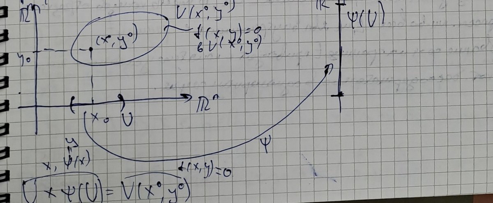

# Lectures 65–66 — Taylor's formula for maps of several variables, implicit maps, necessary condition for an extremum

[[en/lectures-2025-26/lecture-63-64|← Lectures 63–64]] · [[en/lectures-2025-26/index|Lecture index]] · [[en/lectures-2025-26/lecture-67-68|Lectures 67–68 →]] · [[en/term-index|Terms & theorems]] · [[ru/lectures-2025-26/lecture-65-66|Русский]] · [[es/lectures-2025-26/lecture-65-66|Español]]

> [!info] Source and numbering
> These notes were copied from a handwritten notebook (pages p001–p011; the raw page text is in [`ocr/raw/`](https://github.com/NikiHunter/matan/blob/main/ocr/raw/p001.md)) and checked against the scans of those pages. The date in the frame on page p001 is “3 September”. The plan of the class written in the notebook: existence and uniqueness of the multivariate [[#^def-6-5-1|Taylor polynomial]]; the Taylor–Peano and Taylor–Lagrange formulas; the [[en/16-implicit-functions-extrema#16.3 Implicit function theorem|implicit function]]; extrema. The lower half of page p005 (statement (∗) and its proof) is missing from the page transcription and was typed from the scan. The proof of [[#^thm-6-7-1|Theorem 6.7.1]] starts on page p011 and ends at the beginning of [[en/lectures-2025-26/lecture-67-68|lectures 67–68]]. The numbering of definitions and theorems is the lecturer's (checked against the slides of the 2024/25 course). Slips in the notes are corrected and marked with “Source correction” blocks; lost passages are restored and marked with “Restored” blocks; the tags match [`ocr/RESOLVED.md`](https://github.com/NikiHunter/matan/blob/main/ocr/RESOLVED.md). Places that still have to be checked against the notebook are listed in [`ocr/ISSUES.md`](https://github.com/NikiHunter/matan/blob/main/ocr/ISSUES.md).

## §6.5. Taylor's formula

Let $f:E\subset\mathbb R^n\to\mathbb R^m$, let $a$ be an [[en/lectures-2025-26/lecture-57-58#Printed slide 4 (PDF p. 4) — The interior of a set — Definition 5.3.3|interior point]] of $E$, $s\in\mathbb Z_+$. We want to construct a polynomial $p:\mathbb R^n\to\mathbb R^m$ of degree at most $s$ such that
$$
p(a)=f(a),\qquad f(x)=p(x)+o(\|x-a\|^s)\quad(x\to a).\qquad(6.5.1)
$$
Here $\|x-a\|=\sqrt{(x_1-a_1)^2+(x_2-a_2)^2+\ldots+(x_n-a_n)^2}$ is the [[en/lectures-2025-26/lecture-54#^def-5-1-1|Euclidean norm]]. ^p001

**Remark.** Let us recall the notions needed to write polynomials in several variables.

- Every vector $\alpha=(\alpha_1,\ldots,\alpha_n)\in\mathbb Z_+^n$ is called a multi-index of dimension $n$. The order of a multi-index $\alpha$ is the number $|\alpha|=\alpha_1+\ldots+\alpha_n$.
- Let $M$ be a finite set of multi-indices of dimension $n$, and let $\{C_\alpha\}_{\alpha\in M}$ be a family of elements of $\mathbb R^m$. Then the map
$$
p(x)=\sum_{\alpha\in M}C_\alpha x^\alpha=\sum_{\alpha\in M}C_\alpha x_1^{\alpha_1}x_2^{\alpha_2}\cdots x_n^{\alpha_n}\qquad(x\in\mathbb R^n)
$$
is called a polynomial in $n$ variables with values in $\mathbb R^m$.

**Example.** Let $n=3$, $m=1$, $s=3$, $x=(x_1,x_2,x_3)\in\mathbb R^3$, and let the polynomial $p:\mathbb R^3\to\mathbb R$ have degree at most $3$:
$$
p(x)=p(x_1,x_2,x_3)=C_{I}x_1^3+C_{II}x_2x_3+C_{III}x_1^2x_2+C_{IV}x_1x_2x_3 .
$$
Here $M=\{(3,0,0),(0,1,1),(2,1,0),(1,1,1)\}$; the orders of these multi-indices are $3$, $2$, $3$, $3$ respectively, and $\{C_\alpha\}_{\alpha\in M}=\{C_I,C_{II},C_{III},C_{IV}\}$, where all $C_i\in\mathbb R$. If we take $M_1=M\cup\{(2,1,1)\}$, the maximal order of a multi-index becomes $4$: for $C_V\ne0$ the polynomial $p_1(x)=C_Vx_1^2x_2x_3+p(x)$ has degree $4$.

### The Taylor polynomial

**Remark.** If $p\ne0$, the degree of the polynomial $p$ is the number
$$
\deg p=\max\{|\alpha|:\ \alpha\in M,\ C_\alpha\ne0\}.
$$
Otherwise we set the degree of $p$ equal to $-\infty$.

> [!definition] Definition 6.5.1
> Let $E\subset\mathbb R^n$, let $a$ be an interior point of $E$, $f:E\to\mathbb R^m$, $s\in\mathbb Z_+$. A polynomial $p:\mathbb R^n\to\mathbb R^m$ of degree at most $s$ satisfying condition (6.5.1) is called the Taylor polynomial of $f$ of order $s$ at the point $a$ and is denoted by $T_{a,s}f$.

^def-6-5-1

**Remark.** If a Taylor polynomial exists, it is unique.

**Proof.** Suppose there are polynomials $p$ and $q$, $\deg p\le s$, $\deg q\le s$, such that as $x\to a$
$$
p(a)=f(a),\quad f(x)=p(x)+o(\|x-a\|^s);\qquad q(a)=f(a),\quad f(x)=q(x)+o(\|x-a\|^s).
$$
Put $r:=p-q$; we must show that $r\equiv0$. Without loss of generality $a=0$ (the shift $x\mapsto x-a$ maps polynomials of degree at most $s$ to polynomials of degree at most $s$). Subtracting the two relations we get $0=r(x)+o(\|x\|^s)$, i.e. $r(x)=o(\|x\|^s)$ as $x\to0$. Hence $r(x)=\alpha(x)\,\|x\|^s$, where $\alpha(x)\to0$ as $x\to0$.

A polynomial $\hat p$ is called homogeneous of degree $k$ if all its monomials have order $k$; then $\hat p(tx)=t^k\hat p(x)$ for all $t\in\mathbb R$, $x\in\mathbb R^n$. Grouping the monomials of $r$ by their orders we write $r(x)=\sum_{k=0}^{s}r_k(x)$, where $r_k$ is a homogeneous polynomial of degree $k$ with values in $\mathbb R^m$. Then for $t\in\mathbb R$, $x\in\mathbb R^n$
$$
\sum_{k=0}^{s}r_k(x)\,t^k=\sum_{k=0}^{s}r_k(tx)=r(tx)=\alpha(tx)\,\|tx\|^s=|t|^s\,\alpha(tx)\,\|x\|^s .
$$
Fix $x$. On the left we have a vector-valued polynomial in $t$ of degree at most $s$, and the right-hand side is $o(|t|^s)$ as $t\to0$; hence every coordinate function of this polynomial is $o(t^s)$ as $t\to0$. But a scalar polynomial $c_0+c_1t+\ldots+c_st^s$ that equals $o(t^s)$ vanishes identically: if $c_j$ were its first nonzero coefficient, then after division by $t^j$ we would get $c_j+O(t)=o(t^{s-j})\to0$, i.e. $c_j=0$. Therefore $r_k(x)=0$ for all $k\in\{0,1,\ldots,s\}$ and all $x$, i.e. $r\equiv0$. $\square$

### Existence of the Taylor polynomial

- For $s=0$ relation (6.5.1) is equivalent to the continuity of $f$ at the point $a$: a polynomial of degree $0$ is the constant $p\equiv f(a)$, and $f(x)=p(x)+o(\|x-a\|^0)=p(x)+o(1)$.
- For $s=1$ relation (6.5.1) is equivalent to the differentiability of $f$ at the point $a$: $f(x)=p(x)+o(\|x-a\|)$.
- The case $s\ge2$ is harder to study.
- For functions of one variable it is known that the existence of $T_{a,s}f$ follows from the $s$-fold differentiability of $f$ at the point $a$. A similar result holds in the multivariate case ([[#^thm-6-5-1|Theorem 6.5.1]]).

> [!info] Source correction
> (T516). In the page transcription the last item is written the other way round: “the existence of $T_{a,s}f$ implies $s$-fold differentiability”. The notebook (and the slide of the 2024/25 course) says “follows from”. The converse is false for $s\ge2$: for $f(x)=x^3\sin\frac1x$, $f(0)=0$, we have $f(x)=o(x^2)$, i.e. $T_{0,2}f=0$ exists, but $f''(0)$ does not exist.

> [!lemma] Lemma 6.5.1
> Let $E\subset\mathbb R^n$, let $a$ be an interior point of $E$, $s\in\mathbb N$, let the map $f:E\to\mathbb R^m$ be $s$ times differentiable at the point $a$, and let $f$ and all its partial derivatives of order at most $s$ vanish at the point $a$. Then $f(a+h)=o(\|h\|^s)$ as $h\to0$.

^lem-6-5-1

> [!info] Source correction
> (M511). In the page transcription the hypothesis of the lemma reads “$f$ is differentiable at the point $a$” — without the words “$s$ times”. The notebook (and the slide of the 2024/25 course) says “$s$ times differentiable”. This condition is essential: it is used in the [[en/01-logic-sets-functions#^example-induction|induction]] step, and with mere differentiability the lemma fails already for $s=2$. For example, for the function $f(x,y)=\frac{x^2y^2}{x^2+y^2}$, $f(0,0)=0$, all [[en/lectures-2025-26/lecture-61-62#Printed slide 8 (PDF p. 9). Partial derivatives — Definition 6.1.5|partial derivatives]] of order at most $2$ vanish at the point $(0,0)$ and $f$ is differentiable at this point, but $f(t,t)=\frac{t^2}{2}\ne o(t^2)$.

**Proof.** It suffices to check the statement for the coordinate functions $f_1,\ldots,f_m$: the hypotheses of the lemma hold for each of them, and $\|f(a+h)\|\le\sum_{i=1}^{m}|f_i(a+h)|$, so $f_i(a+h)=o(\|h\|^s)$ for all $i$ implies $f(a+h)=o(\|h\|^s)$. Hence we may assume $m=1$.

We argue by induction on $s$.

*Base:* $s=1$. Since $f$ is differentiable at the point $a$, and $f(a)=0$ and $\frac{\partial f}{\partial x_k}(a)=0$ by hypothesis,
$$
f(a+h)=f(a)+\sum_{k=1}^{n}\frac{\partial f}{\partial x_k}(a)h_k+o(\|h\|)=o(\|h\|)\qquad(h\to0).
$$

*Induction hypothesis:* the statement holds for some $s$.

*Induction step* $s\mapsto s+1$. Let $f$ be $s+1$ times differentiable at the point $a$, and let all its partial derivatives of order at most $s+1$ vanish at the point $a$. Then all first-order partial derivatives of $f$ are defined in some neighbourhood of the point $a$ and are $s$ times differentiable at the point $a$, and all their partial derivatives of order at most $s$ vanish at the point $a$. Applying the induction hypothesis to the first-order partial derivatives of $f$:
$$
\frac{\partial f}{\partial x_k}(a+h)=o(\|h\|^s)\qquad(h\to0)
$$
for all $k\in\{1,\ldots,n\}$. Applying the definition of the symbol $o$ with $\frac{\varepsilon}{n}$ instead of $\varepsilon$ and taking the smallest of the $n$ numbers $\delta$ so obtained, we get: for every $\varepsilon>0$ there is $\delta>0$ such that $V_\delta(a)\subset E$ and for all $k\in\{1,\ldots,n\}$ and all $h\in V_\delta(0)$
$$
\left|\frac{\partial f}{\partial x_k}(a+h)\right|\le\frac{\varepsilon}{n}\|h\|^s .
$$
Let $h\in V_\delta(0)$. By [[en/lectures-2025-26/lecture-63-64#Printed slide 4 (PDF p. 4). Coordinate-increment lemma — Lemma 6.3.1|Lemma 6.3.1]] (on increments along the coordinates) there exist $c^1,\ldots,c^n\in V_\delta(a)$, with $\|c^k-a\|\le\|h\|$, such that

$$
f(a+h)=f(a+h)-f(a)=\sum_{k=1}^{n}\frac{\partial f}{\partial x_k}(c^k)h_k
$$
(here $f(a)=0$ by hypothesis). ^p004

> [!info] Source correction
> (T512). The notes refer here to “[[en/lectures-2025-26/lecture-63-64#Printed slide 8 (PDF p. 14). Lower-order derivatives — Lemma 6.4.1|Lemma 6.4.1]]”. The representation of the increment through partial derivatives at intermediate points is [[en/lectures-2025-26/lecture-63-64#Printed slide 4 (PDF p. 4). Coordinate-increment lemma — Lemma 6.3.1|Lemma 6.3.1]] on increments along the coordinates (lectures 63–64); [[en/lectures-2025-26/lecture-63-64#Printed slide 8 (PDF p. 14). Lower-order derivatives — Lemma 6.4.1|Lemma 6.4.1]] is about the differentiability of lower-order derivatives. The estimate $\|c^k-a\|\le\|h\|$ is not stated in the notes but is used below; it is visible from the proof of [[en/lectures-2025-26/lecture-63-64#Printed slide 4 (PDF p. 4). Coordinate-increment lemma — Lemma 6.3.1|Lemma 6.3.1]]: $c^k-a=(h_1,\ldots,h_{k-1},\theta_kh_k,0,\ldots,0)$, $\theta_k\in(0,1)$.

Then, since $\|c^k-a\|\le\|h\|$ and $|h_k|\le\|h\|$,
$$
|f(a+h)|=\left|\sum_{k=1}^{n}\frac{\partial f}{\partial x_k}(c^k)h_k\right|\le\sum_{k=1}^{n}\left|\frac{\partial f}{\partial x_k}(c^k)\right||h_k|\le\sum_{k=1}^{n}\frac{\varepsilon}{n}\|h\|^s\,\|h\|=\varepsilon\|h\|^{s+1}.
$$
Since $\varepsilon>0$ is arbitrary, $f(a+h)=o(\|h\|^{s+1})$ as $h\to0$. $\square$

### The Taylor–Peano formula

> [!theorem] Theorem 6.5.1 (Taylor–Peano formula)
> Let $E\subset\mathbb R^n$, let $a$ be an interior point of $E$, $s\in\mathbb Z_+$, and let the map $f:E\to\mathbb R^m$ be $s$ times differentiable at the point $a$. Then
> $$
> f(x)=\sum_{|\alpha|\le s}\frac{1}{\alpha!}\frac{\partial^\alpha f}{\partial x^\alpha}(a)(x-a)^\alpha+o(\|x-a\|^s)\qquad(x\to a).
> $$
> In other words, the Taylor polynomial of $f$ of order $s$ at the point $a$ exists and is given by
> $$
> T_{a,s}f(x)=\sum_{|\alpha|\le s}\frac{1}{\alpha!}\frac{\partial^\alpha f}{\partial x^\alpha}(a)(x-a)^\alpha .
> $$
> The sum is taken over all multi-indices of order at most $s$.

^thm-6-5-1

> [!info] Source correction
> (M515). In the notes (and on the slide of the 2024/25 course) $s\in\mathbb Z_+$, but a “$0$ times differentiable” map is not defined ([[en/lectures-2025-26/lecture-63-64#Printed slide 7 (PDF p. 12). Repeated differentiability — Definition 6.4.2|Definition 6.4.2]] is given for $s\in\mathbb N$), and without an extra condition the statement fails for $s=0$. For $s=0$ the hypothesis of the theorem should be read as continuity of $f$ at the point $a$: then the formula $f(x)=f(a)+o(1)$ is exactly continuity (the first item above). The proof below concerns $s\in\mathbb N$.

Notation:
$$
\frac{\partial^\alpha f}{\partial x^\alpha}(a)=\frac{\partial^{|\alpha|}f}{\partial x_1^{\alpha_1}\partial x_2^{\alpha_2}\cdots\partial x_n^{\alpha_n}}(a),\qquad\alpha=(\alpha_1,\alpha_2,\ldots,\alpha_n)
$$
(if $\alpha_k=0$, there is no differentiation in the variable $x_k$), and also
$$
\alpha!=\alpha_1!\,\alpha_2!\cdots\alpha_n!,\qquad|\alpha|=\alpha_1+\alpha_2+\ldots+\alpha_n,\qquad(x-a)^\alpha=(x_1-a_1)^{\alpha_1}\cdots(x_n-a_n)^{\alpha_n}.
$$

> [!info] Source correction
> (A021). The notes say “$\frac{1}{\alpha!}=\frac{1}{|\alpha|!}=\frac{1}{1\cdot2\cdots|\alpha|}$”. Corrected to $\alpha!=\alpha_1!\,\alpha_2!\cdots\alpha_n!$: this is how the factorial of a multi-index is defined in lectures 63–64 ([[en/lectures-2025-26/lecture-63-64#Printed slide 21 (PDF p. 41). Computing higher differentials — Theorem 6.4.2|Theorem 6.4.2]]), and only with this definition is Taylor's formula true. For example, for $f(x_1,x_2)=x_1x_2$, $a=0$, $\alpha=(1,1)$ the term $\frac{1}{\alpha!}\frac{\partial^2f}{\partial x_1\partial x_2}(0)\,x_1x_2$ equals $x_1x_2=f(x)$, whereas the factor $\frac{1}{|\alpha|!}=\frac12$ would give $\frac12x_1x_2\ne f(x)$.

**Example.** Let $n=4$, $\alpha=(0,2,3,1)$, $|\alpha|=6$. Then
$$
\frac{\partial^{(0,2,3,1)}f}{\partial x^{(0,2,3,1)}}=\frac{\partial^0}{\partial x_1^0}\,\frac{\partial^2}{\partial x_2^2}\,\frac{\partial^3}{\partial x_3^3}\,\frac{\partial^1}{\partial x_4^1}\,f=\frac{\partial^6f}{\partial x_2^2\,\partial x_3^3\,\partial x_4}
$$
(no differentiation in $x_1$). For a function $u$ of two variables the matrix of second derivatives (the [[en/15-multivariable-differentiation#15.4 Higher derivatives and Taylor's formula|Hessian matrix]]) is
$$
D^2u=\begin{pmatrix}\dfrac{\partial^2u}{\partial x_1^2}&\dfrac{\partial^2u}{\partial x_1\partial x_2}\\[2mm]\dfrac{\partial^2u}{\partial x_2\partial x_1}&\dfrac{\partial^2u}{\partial x_2^2}\end{pmatrix}.
$$

**Proof of [[#^thm-6-5-1|Theorem 6.5.1]].** Put
$$
p(x)=\sum_{|\alpha|\le s}\frac{1}{\alpha!}\frac{\partial^\alpha f}{\partial x^\alpha}(a)(x-a)^\alpha,\qquad F:=f-p .
$$
For multi-indices $\alpha,\beta$ the derivative $\frac{\partial^\alpha}{\partial x^\alpha}(x-a)^\beta$ at the point $a$ equals $\alpha!$ if $\beta=\alpha$ and zero if $\beta\ne\alpha$; hence $\frac{\partial^\alpha p}{\partial x^\alpha}(a)=\frac{\partial^\alpha f}{\partial x^\alpha}(a)$. Therefore, if $\alpha$ is a multi-index of order at most $s$, then
$$
\frac{\partial^\alpha F}{\partial x^\alpha}(a)=\frac{\partial^\alpha f}{\partial x^\alpha}(a)-\frac{\partial^\alpha p}{\partial x^\alpha}(a)=0 .
$$
The map $F$ is $s$ times differentiable at the point $a$ ($p$ is a polynomial), and for a map that is $s$ times differentiable at the point $a$ the partial derivatives of order at most $s$ at the point $a$ do not depend on the order of differentiation (a corollary of [[en/lectures-2025-26/lecture-63-64#Printed slide 16 (PDF p. 30). Sufficient conditions for equality — Theorem 6.4.1|Theorem 6.4.1]]). Hence all partial derivatives of $F$ of order at most $s$ vanish at the point $a$. We apply [[#^lem-6-5-1|Lemma 6.5.1]] to $F$ with $h=x-a$ and obtain
$$
F(x)=f(x)-p(x)=F\bigl(a+(x-a)\bigr)=o(\|x-a\|^s)\qquad(x\to a).
$$
This is the assertion of the theorem. $\square$

**Remark.**

^p005

- The map $R_{a,s}f=f-T_{a,s}f$ is called the remainder in Taylor's formula.
- Thus the statement of [[#^thm-6-5-1|Theorem 6.5.1]] can be written as $R_{a,s}f(x)=o(\|x-a\|^s)$ $(x\to a)$.
- The Taylor polynomial can be expressed through higher-order differentials (by [[en/lectures-2025-26/lecture-63-64#Printed slide 21 (PDF p. 41). Computing higher differentials — Theorem 6.4.2|Theorem 6.4.2]]):
$$
T_{a,s}f(x)=\sum_{k=0}^{s}\frac{d_a^kf(x-a)}{k!}.
$$
- If the map $f$ is a polynomial of degree at most $s$, then $R_{a,s}f\equiv0$ ($f$ itself satisfies condition (6.5.1), and by uniqueness $T_{a,s}f=f$), i.e.
$$
f(x)=\sum_{|\alpha|\le s}\frac{1}{\alpha!}\frac{\partial^\alpha f}{\partial x^\alpha}(a)(x-a)^\alpha .
$$

> [!info] Source correction
> (T022). In the second item the notes have “$R_{a,s}f(x)=O(\|x-a\|^s)$”. Corrected to $o(\|x-a\|^s)$: [[#^thm-6-5-1|Theorem 6.5.1]] says that the remainder is an [[en/lectures-2025-26/lecture-09-10#^def-2-2-1|infinitesimal]] of higher order than $\|x-a\|^s$; the estimate $O(\|x-a\|^s)$ is weaker (the slide of the 2024/25 course also has $o$).

### The Taylor–Lagrange formula for functions

Put
$$
\Delta_{a,b}=\{a+t(b-a):\ t\in[0,1]\},\qquad\hat{\Delta}_{a,b}=\Delta_{a,b}\setminus\{a,b\}
$$
— the segment with endpoints $a$, $b$ and the same segment without its endpoints.

> [!theorem] Theorem 6.5.2 (Taylor–Lagrange formula)
> Let the set $E$ be open in $\mathbb R^n$, $s\in\mathbb Z_+$, let the function $f:E\to\mathbb R$ be $s+1$ times differentiable on $E$, let the points $a,x\in E$ satisfy $a\ne x$ and $\Delta_{a,x}\subset E$. Then there exists $c\in\hat{\Delta}_{a,x}$ such that
> $$
> f(x)=\sum_{k=0}^{s}\frac{d_a^kf(x-a)}{k!}+\frac{d_c^{s+1}f(x-a)}{(s+1)!}.
> $$
> Here $d_c^{s+1}f(x-a)$ is the differential of order $s+1$ at the point $c$ evaluated at the increment $h=x-a$ ([[en/lectures-2025-26/lecture-63-64#Printed slide 19 (PDF p. 39). Higher-order differentials — Definition 6.4.3|Definition 6.4.3]]).

^thm-6-5-2

> [!info] Source correction
> (T023). In the notes the condition $s\in\mathbb Z_+$ is preceded by one more inclusion for $s$ (in the transcription: “$s\in\mathbb N$”), and the points $a$, $x$ are not introduced. We keep $s\in\mathbb Z_+$ (as on the slide of the 2024/25 course) and add $a,x\in E$ (as in [[#^thm-6-5-4|Theorem 6.5.4]]).

**Proof.** Put $h:=x-a$ and $F(t)=f(a+th)$, $t\in[0,1]$. Then $F(t)=d^0_{a+th}f(h)$.

> [!note] Restored
> (from the notebook scan, page p005: the lower half of the page is missing from the transcription; the same proof is on the slides of the 2024/25 course, FS p41; S513). Let us show that for all $t\in[0,1]$
> $$
> F^{(k)}(t)=d^k_{a+th}f(h)\qquad\forall k\in\{0,1,\ldots,s+1\}.\qquad(*)
> $$
> We argue by induction on $k$. The base $k=0$ is obvious.
>
> Induction hypothesis: let $k\in\{1,\ldots,s+1\}$ and let equality (∗) be proved for $k-1$. Induction step $k-1\mapsto k$. Note that:
>
> 1. the map $y\mapsto d^{k-1}_yf(h)$ is differentiable on $E$ (its coefficients are the partial derivatives of $f$ of order $k-1\le s$, and $f$ is $s+1$ times differentiable on $E$);
> 2. the vector function $\varphi(t)=a+th$ is differentiable in $t$, and $d_t\varphi(dt)=h\,dt$ for all $t\in[0,1]$ and all $dt\in\mathbb R$.
>
> By the induction hypothesis $F^{(k-1)}(t)=d^{k-1}_{a+th}f(h)=\bigl(d^{k-1}f(h)\bigr)\circ\varphi(t)$. By the theorem on differentiating a composition, $F^{(k-1)}$ is differentiable on $[0,1]$, and for all $t\in[0,1]$
> $$
> F^{(k)}(t)=d_tF^{(k-1)}(1)=d_{\varphi(t)}\bigl(d^{k-1}f(h)\bigr)\bigl(d_t\varphi(1)\bigr)=d_{a+th}\bigl(d^{k-1}f(h)\bigr)(h)=d^k_{a+th}f(h)
> $$
> (the last equality is [[en/lectures-2025-26/lecture-63-64#Printed slide 19 (PDF p. 39). Higher-order differentials — Definition 6.4.3|Definition 6.4.3]]). Thus (∗) is proved.

> [!info] Source correction
> (T514). In the notebook (∗) is stated and proved for $k\in\{0,1,\ldots,s\}$, but below it is used for $k=s+1$. The induction step also works for $k=s+1$, since $f$ is $s+1$ times differentiable; so the range is extended to $k\in\{0,1,\ldots,s+1\}$.

Now, having (∗), we can say that $F$ is $s+1$ times differentiable on $[0,1]$ and $F^{(k)}(t)=d^k_{a+th}f(h)$. Apply to $F$ the one-variable Taylor formula with the remainder in Lagrange form: there exists $\theta\in(0,1)$ such that
$$
F(1)=\sum_{k=0}^{s}\frac{F^{(k)}(0)}{k!}(1-0)^k+\frac{F^{(s+1)}(\theta)}{(s+1)!}(1-0)^{s+1}.
$$
Here $F(1)=f(a+h)=f(x)$ and
$$
\sum_{k=0}^{s}\frac{F^{(k)}(0)}{k!}(1-0)^k=\sum_{k=0}^{s}\frac{d_a^kf(x-a)}{k!},\qquad\frac{F^{(s+1)}(\theta)}{(s+1)!}(1-0)^{s+1}=\frac{d_{a+\theta h}^{s+1}f(x-a)}{(s+1)!}.
$$
Consequently,
$$
f(x)=\sum_{k=0}^{s}\frac{d_a^kf(x-a)}{k!}+\frac{d_{a+\theta h}^{s+1}f(x-a)}{(s+1)!}.
$$
It remains to put $c=a+\theta h$; since $\theta\in(0,1)$, the point $c$ lies in $\hat{\Delta}_{a,x}$. $\square$ ^p006

**Corollary.** Under the hypotheses of [[#^thm-6-5-2|Theorem 6.5.2]] we have the estimate
$$
|R_{a,s}f(x)|\le\sup_{c\in\hat{\Delta}_{a,x}}\frac{|d_c^{s+1}f(x-a)|}{(s+1)!}.
$$

### The mean value theorem

> [!theorem] Theorem 6.5.3 (mean value theorem)
> Let the set $E$ be open in $\mathbb R^n$, let the function $f:E\to\mathbb R$ be differentiable on $E$, $a,b\in E$, with $a\ne b$ and $\Delta_{a,b}\subset E$. Then there exists $c\in\hat{\Delta}_{a,b}$ such that
> $$
> f(b)-f(a)=d_cf(b-a).
> $$
> This is the special case of [[#^thm-6-5-2|Theorem 6.5.2]] corresponding to $s=0$.

^thm-6-5-3

**Example.** For maps (with values in $\mathbb R^m$, $m\ge2$) both [[#^thm-6-5-2|Theorem 6.5.2]] and [[#^thm-6-5-3|Theorem 6.5.3]] fail. Let the vector function $f:\mathbb R\to\mathbb R^2$ be given by $f(x)=(\cos x,\sin x)$, $x\in\mathbb R$. Then the map $f$ is differentiable on $\mathbb R$ and $f'(x)=(-\sin x,\cos x)$ for all $x\in\mathbb R$.

> [!note] Restored
> (from the 2022 notes, M3S p15; in the notebook the example breaks off at the formula for $f'$). Put $a=0$, $b=2\pi$. Then $f(b)-f(a)=(0,0)$, but for every $c\in(a,b)$
> $$
> \|d_cf(b-a)\|=\|f'(c)\|\,(b-a)=2\pi\sqrt{\sin^2c+\cos^2c}=2\pi\ne0 .
> $$
> Hence the equality $f(b)-f(a)=d_cf(b-a)$ holds for no point $c\in\hat{\Delta}_{a,b}$: [[#^thm-6-5-3|Theorem 6.5.3]], and with it [[#^thm-6-5-2|Theorem 6.5.2]] (for $s=0$), fails for maps.

### The Taylor–Lagrange formula for maps

> [!note] Restored
> (from the slides of the 2024/25 course, FS p42). Although [[#^thm-6-5-2|Theorem 6.5.2]] fails for maps, the corollary that follows from it remains true for maps if the absolute values in its statement are replaced by [[en/14-several-variables#14.1 Euclidean space and norms|norms]]. This is the general version of the Taylor–Lagrange formula.

> [!theorem] Theorem 6.5.4 (Taylor–Lagrange formula for maps)
> Let the set $E$ be open in $\mathbb R^n$, $s\in\mathbb Z_+$, let the map $f:E\to\mathbb R^m$ be $s+1$ times differentiable on $E$, $a,x\in E$, with $a\ne x$ and $\Delta_{a,x}\subset E$. Then
> $$
> \left\|f(x)-\sum_{k=0}^{s}\frac{d_a^kf(x-a)}{k!}\right\|\le\frac{1}{(s+1)!}\sup_{c\in\hat{\Delta}_{a,x}}\left\|d_c^{s+1}f(x-a)\right\|.\qquad(6.5.2)
> $$

^thm-6-5-4

> [!note] Restored
> (by the standard proof, cf. Zorich; there is no proof in the notebook).
>
> **Proof.** Write $v=f(x)-\sum_{k=0}^{s}\frac{d_a^kf(x-a)}{k!}$. If $v=0$, there is nothing to prove. Otherwise put $e=\frac{v}{\|v\|}$ and consider the function $g(y)=\langle f(y),e\rangle$, $y\in E$. It is a linear combination of the coordinate functions $f$, hence $s+1$ times differentiable on $E$, and $d^k_yg(h)=\langle d^k_yf(h),e\rangle$ for all $k\le s+1$. By [[#^thm-6-5-2|Theorem 6.5.2]] there is $c\in\hat{\Delta}_{a,x}$ such that
> $$
> \|v\|=\langle v,e\rangle=g(x)-\sum_{k=0}^{s}\frac{d_a^kg(x-a)}{k!}=\frac{d_c^{s+1}g(x-a)}{(s+1)!}=\frac{\langle d_c^{s+1}f(x-a),e\rangle}{(s+1)!}\le\frac{\|d_c^{s+1}f(x-a)\|}{(s+1)!}
> $$
> (the last step is the [[en/lectures-2025-26/lecture-47-48#^thm-4-4-6|Cauchy–Bunyakovsky inequality]], $\|e\|=1$). It remains to replace the right-hand side by its [[en/lectures-2025-26/lecture-11-12#^def-2-3-1|supremum]] over $c\in\hat{\Delta}_{a,x}$. $\square$

### Estimate of the remainder in Taylor's formula

Under the hypotheses of [[#^thm-6-5-4|Theorem 6.5.4]] it is not clear whether the right-hand side of (6.5.2) is finite. The answer is positive for maps of class $C^{s+1}(E,\mathbb R^m)$.

> [!theorem] Theorem 6.5.5 (estimate of the remainder)
> Let the set $E$ be open in $\mathbb R^n$, $s\in\mathbb Z_+$, $f\in C^{s+1}(E,\mathbb R^m)$, $a,x\in E$, with $a\ne x$ and $\Delta_{a,x}\subset E$. Put
> $$
> M=\max_{\alpha\in M_{s+1}}\ \sup_{c\in\hat{\Delta}_{a,x}}\left\|\frac{\partial^\alpha f}{\partial x^\alpha}(c)\right\|,
> $$
> where $M_{s+1}$ is the set of multi-indices of dimension $n$ and order $s+1$. Then $M<+\infty$ and
> $$
> \|R_{a,s}f(x)\|\le\frac{M}{(s+1)!}\bigl(\sqrt n\,\|x-a\|\bigr)^{s+1}.
> $$

^thm-6-5-5

> [!note] Restored
> (by the standard proof; there is no proof in the notebook).
>
> **Proof.** Each derivative $\frac{\partial^\alpha f}{\partial x^\alpha}$, $|\alpha|=s+1$, is continuous on $E$ and therefore bounded on the [[en/lectures-2025-26/lecture-57-58#^def-5-3-7|compact]] segment $\Delta_{a,x}\subset E$, and the set $M_{s+1}$ is finite; hence $M<+\infty$. Let $c\in\hat{\Delta}_{a,x}$, $h=x-a$. By [[en/lectures-2025-26/lecture-63-64#Printed slide 21 (PDF p. 41). Computing higher differentials — Theorem 6.4.2|Theorem 6.4.2]]
> $$
> d_c^{s+1}f(h)=\sum_{i_1,\ldots,i_{s+1}=1}^{n}\frac{\partial^{s+1}f}{\partial x_{i_1}\cdots\partial x_{i_{s+1}}}(c)\,h_{i_1}\cdots h_{i_{s+1}},
> $$
> and each of these partial derivatives coincides with $\frac{\partial^\alpha f}{\partial x^\alpha}(c)$ for a suitable $\alpha\in M_{s+1}$ (for $f\in C^{s+1}$ the order of differentiation does not matter), so its norm is at most $M$. Therefore, using the inequality $|h_1|+\ldots+|h_n|\le\sqrt n\,\|h\|$ (Cauchy–Bunyakovsky),
> $$
> \|d_c^{s+1}f(h)\|\le M\sum_{i_1,\ldots,i_{s+1}=1}^{n}|h_{i_1}|\cdots|h_{i_{s+1}}|=M\bigl(|h_1|+\ldots+|h_n|\bigr)^{s+1}\le M\bigl(\sqrt n\,\|h\|\bigr)^{s+1}.
> $$
> Since $f\in C^{s+1}(E,\mathbb R^m)$ is $s+1$ times differentiable on $E$, [[#^thm-6-5-4|Theorem 6.5.4]] applies, and (6.5.2) gives the required estimate. $\square$

## §6.6. Implicit maps

Let $f:E\subset\mathbb R^2\to\mathbb R$ be given. Consider the equation in the variables $x$ and $y$
$$
f(x,y)=0,\qquad(x,y)\in E.\qquad(6.6.1)
$$
Equation (6.6.1) defines a relation between $x$ and $y$ which is called implicit. Suppose that one variable can be expressed uniquely through the other from (6.6.1) (for example, $y$ through $x$). Then the solution set of (6.6.1) is the graph of some function $\varphi$, i.e. it has the form
$$
\{(x,y)\in E:\ y=\varphi(x)\}.
$$
Such a function $\varphi$ is called the implicit function generated by equation (6.6.1).

**Example.** The equation $x^2+y^2=1$ does not define $y$ as a function of $x$ on the whole plane: for $|x|<1$ it is satisfied by two values $y$. But in the half-plane $y>0$ it is equivalent to $y=\sqrt{1-x^2}$, and in the half-plane $y<0$ to $y=-\sqrt{1-x^2}$; in each half-plane the solution set is the graph of a function $y=\varphi(x)$.

- The question of the existence of an implicit function is very difficult.
- In many applications it suffices to consider (6.6.1) not on the whole set $E$ but only in some neighbourhood of a point of the set $E$.
- If near every point $E$ equation (6.6.1) generates an implicit function, the equation is called locally solvable, and the implicit function itself is called local.
- The tools of differential calculus are convenient for studying local solvability.

^p008

Let $a=(x^0,y^0)$ be an interior point of the set $E$, $f(x^0,y^0)=0$, and let $f$ be differentiable at the point $a$. If $f(x,y)=0$ and the point $(x,y)$ is close enough to $a$, we can write
$$
0=f(x,y)-f(x^0,y^0)\approx\frac{\partial f}{\partial x}(a)(x-x^0)+\frac{\partial f}{\partial y}(a)(y-y^0).
$$
Consider the linear equation
$$
\frac{\partial f}{\partial x}(a)(x-x^0)+\frac{\partial f}{\partial y}(a)(y-y^0)=0 .
$$
From it $y$ can be expressed uniquely through $x$ if $\frac{\partial f}{\partial y}(a)\ne0$, and $x$ through $y$ if $\frac{\partial f}{\partial x}(a)\ne0$. Therefore a sufficient condition for the unique solvability of (6.6.1) near $a$ is the relation $\operatorname{grad}f(a)\ne(0,0)$ (this is a conclusion at the level of the linear approximation; the exact statement for $f$ of class $C^s$ is [[#^thm-6-6-1|Theorem 6.6.1]] below).

### The implicit function problem

Let us now generalise the implicit function problem. Let $m,n\in\mathbb N$, $f:E\subset\mathbb R^{n+m}\to\mathbb R^m$. Consider the system of equations
$$
\begin{cases}f_1(x_1,\ldots,x_n,y_1,\ldots,y_m)=0,\\ \ldots\ldots\ldots\ldots\ldots\ldots\\ f_m(x_1,\ldots,x_n,y_1,\ldots,y_m)=0.\end{cases}\qquad(6.6.2)
$$
We write the elements of $\mathbb R^{n+m}$ as $(x,y)$, where $x\in\mathbb R^n$, $y\in\mathbb R^m$. Then system (6.6.2) is equivalent to a vector equation in two vector variables:
$$
f(x,y)=0,\qquad(x,y)\in E.\qquad(6.6.3)
$$

### Local solvability of (6.6.3) with respect to y

Let $a=(x^0,y^0)$ be an interior point of the set $E$ satisfying (6.6.3), and let the map $f$ be differentiable at the point $a$. Note that for every vector $(dx,dy)\in\mathbb R^n\times\mathbb R^m$

$$
d_af(dx,dy)=\sum_{i=1}^{n}\frac{\partial f}{\partial x_i}(a)\,dx_i+\sum_{j=1}^{m}\frac{\partial f}{\partial y_j}(a)\,dy_j=f'_x(a)\,dx+f'_y(a)\,dy,\qquad(6.6.4)
$$
where
$$
f'_x(a)=\left(\frac{\partial f_k}{\partial x_i}(a)\right),\qquad f'_y(a)=\left(\frac{\partial f_k}{\partial y_j}(a)\right)
$$
are matrices of sizes $m\times n$ and $m\times m$ (the row number $k$ is the number of the coordinate function $f_k$, the column number is the number of the variable). If $(x,y)$ is a solution of equation (6.6.3) close enough to $a$, then
$$
0=f(x,y)-f(x^0,y^0)\approx d_af(x-x^0,y-y^0).
$$
This leads to the linear system
$$
f'_x(a)(x-x^0)+f'_y(a)(y-y^0)=0 .
$$
This system is solvable with respect to $y$ if the matrix $f'_y(a)$ is invertible: $y=y^0-[f'_y(a)]^{-1}f'_x(a)(x-x^0)$. It turns out that under this condition equation (6.6.3) is also uniquely solvable with respect to $y$ near the point $a$. ^p009

### The implicit map theorem

> [!theorem] Theorem 6.6.1 (implicit map theorem)
> Let the set $E$ be open in $\mathbb R^{n+m}$, $(x^0,y^0)\in E$, $s\in\mathbb N$, $f\in C^s(E,\mathbb R^m)$, with $f(x^0,y^0)=0$ and $\det f'_y(x^0,y^0)\ne0$. Then there exist a neighbourhood $V(x^0,y^0)$, a set $U$ open in $\mathbb R^n$ and containing $x^0$, and a map $\psi\in C^s(U,\mathbb R^m)$ such that
> $$
> \{(x,y)\in V(x^0,y^0):\ f(x,y)=0\}=\{(x,\psi(x)):\ x\in U\}.
> $$
> Thus near $(x^0,y^0)$ the solution set of (6.6.3) is the graph of the map $\psi$, which has the same smoothness class as $f$.

^thm-6-6-1

*Figure in the notes (page p009): $\mathbb R^n$ is horizontal, $\mathbb R^m$ is vertical; in the neighbourhood $V(x^0,y^0)$ the set $\{f(x,y)=0\}$ coincides with the graph of $y=\psi(x)$ over the set $U\ni x^0$; a separate arrow $\psi$ shows the map $U$ into $\psi(U)\subset\mathbb R^m$. Caption under the figure: “$U\times\psi(U)=V(x^0,y^0)$”.*

> [!info] Source correction
> (G038). The caption “$U\times\psi(U)=V(x^0,y^0)$” is inaccurate: the set $\psi(U)$ need not be open (for example, for constant $\psi$ it is a single point), so $U\times\psi(U)$ is, in general, not a neighbourhood. The neighbourhood in [[#^thm-6-6-1|Theorem 6.6.1]] can be chosen in the form $V(x^0,y^0)=U\times W$, where $W$ is a neighbourhood of the point $y^0$; then $\psi(U)\subset W$.

> [!definition] Definition 6.6.1
> The map $\psi$ introduced in Theorem 6.6.1 is called the implicit map generated by the equation $f(x,y)=0$ in a neighbourhood of the point $(x^0,y^0)$.

^def-6-6-1

**Remark.** Let, in the notation of [[#^thm-6-6-1|Theorem 6.6.1]], the map $f:E\to\mathbb R^m$ be differentiable on $V(x^0,y^0)$ and
$$
g(x)=f(x,\psi(x))\qquad(x\in U).
$$
Then the following formula holds (differentiation of a composition)
$$
g'(x)=f'_x(x,\psi(x))+f'_y(x,\psi(x))\,\psi'(x).
$$

> [!note] Restored
> (a standard corollary of [[#^thm-6-6-1|Theorem 6.6.1]], cf. Zorich; the notebook has no formula for $\psi'$). Since $f(x,\psi(x))=0$ for all $x\in U$, the function $g$ vanishes identically on $U$, hence $g'(x)=0$:
> $$
> f'_x(x,\psi(x))+f'_y(x,\psi(x))\,\psi'(x)=0\qquad(x\in U).
> $$
> The matrix $f'_y(x^0,y^0)$ is invertible, and $f'_y$ and $\psi$ are continuous; therefore $\det f'_y(x,\psi(x))\ne0$ for all $x\in U$ close enough to $x^0$, and for such $x$
> $$
> \psi'(x)=-\bigl[f'_y(x,\psi(x))\bigr]^{-1}f'_x(x,\psi(x)).
> $$
> In particular, $\psi'(x^0)=-[f'_y(x^0,y^0)]^{-1}f'_x(x^0,y^0)$; for $n=m=1$ this is the formula $\psi'(x)=-\frac{\partial f}{\partial x}(x,\psi(x))\Big/\frac{\partial f}{\partial y}(x,\psi(x))$.

## §6.7. Extrema of functions of several variables

To examine a function of one variable for an extremum:

1. the necessary condition discards the points where there can be no extremum;
2. then for each of the remaining points the sufficient condition checks whether there is an extremum and of which type.

The same scheme works for functions of several variables.

Another important problem is to find the greatest and least values of a function defined on a compact set in $\mathbb R^n$. To find the extremum (the greatest and least values) of a function on a segment one compares its values at the critical points and at the endpoints of the segment. If the function is defined on a compact set $E\subset\mathbb R^n$, then instead of the endpoints one has to consider the set of all points of $E$ that are not interior, i.e. the boundary of $E$. Studying the function on the boundary of $E$ leads to the notion of a [[en/16-implicit-functions-extrema#16.4 Lagrange multipliers|conditional extremum]], which is meaningless in the one-dimensional case (the boundary of a segment consists of two points).

### Extremum of a function

> [!definition] Definition 6.7.1
> Suppose that $E\subset\mathbb R^n$, $a\in E$, $f:E\to\mathbb R$.
>
> - If there is a neighbourhood $V(a)$ of the point $a$ such that $f(x)\ge f(a)$ for all $x\in V(a)\cap E$, then $a$ is called a minimum point of $f$.
> - If for some neighbourhood $V(a)$ we have $f(x)\le f(a)$ for all $x\in V(a)\cap E$, then $a$ is called a maximum point of $f$.
> - If there is a neighbourhood $V(a)$ of the point $a$ such that $f(x)>f(a)$ for all $x\in\mathring{V}(a)\cap E$ ($\mathring{V}(a)$ is a [[en/lectures-2025-26/lecture-14#^def-2-4-2|punctured neighbourhood]]), then $a$ is called a strict minimum point of $f$.
> - If for some neighbourhood $V(a)$ we have $f(x)<f(a)$ for all $x\in\mathring{V}(a)\cap E$, then $a$ is called a strict maximum point of $f$.
> - If $a$ is a minimum or maximum point of $f$, it is called an extremum point of $f$.

^def-6-7-1

### Necessary condition for an extremum of a function of several variables

> [!theorem] Theorem 6.7.1 (necessary condition for an extremum)
> Let $E\subset\mathbb R^n$, let $a$ be an interior point of $E$, and let the function $f:E\to\mathbb R$ be differentiable at the point $a$. If $a$ is an extremum point of $f$, then $d_af=0$.

^thm-6-7-1

**Remark.** The statement of the theorem means that $\operatorname{grad}f(a)=0$, or, in more detail,
$$
\frac{\partial f}{\partial x_k}(a)=0\qquad\forall k\in\{1,\ldots,n\}.
$$
Such a point $a$ is called a stationary point of the function $f$.

**Proof.** For definiteness let $a$ be a minimum point of $f$ (for a maximum it suffices to replace $f$ by $-f$). Then there is $\delta>0$ such that $V_\delta(a)\subset E$ and $f(x)\ge f(a)$ for all $x\in V_\delta(a)$. Let $h\in\mathbb R^n\setminus\{0\}$, i.e. $h=(h_1,\ldots,h_n)$ and at least one of the coordinates $h_i\ne0$; then $\|h\|\ne0$. Put
$$
F(t)=f(a+th),\qquad t\in\left(-\frac{\delta}{\|h\|},\frac{\delta}{\|h\|}\right).
$$
*The end of the proof is in [[en/lectures-2025-26/lecture-67-68|lectures 67–68]].*

## Cross-references

- Course topic: [[en/15-multivariable-differentiation|chapter 15 “Differentiation of maps of several variables”]], [[en/16-implicit-functions-extrema|chapter 16 “Inverse and implicit functions; extrema”]]; the one-variable Taylor formula — [[en/07-taylor-convexity|chapter 7 “Mean value theorems, Taylor's formula and convexity”]].
- Facts used from [[en/lectures-2025-26/lecture-63-64|lectures 63–64]]: [[en/lectures-2025-26/lecture-63-64#Printed slide 4 (PDF p. 4). Coordinate-increment lemma — Lemma 6.3.1|Lemma 6.3.1]] on increments along the coordinates, [[en/lectures-2025-26/lecture-63-64#Printed slide 7 (PDF p. 12). Repeated differentiability — Definition 6.4.2|Definition 6.4.2]] (a $s$ times [[en/lectures-2025-26/lecture-59-60#^def-6-1-2|differentiable map]]), [[en/lectures-2025-26/lecture-63-64#Printed slide 16 (PDF p. 30). Sufficient conditions for equality — Theorem 6.4.1|Theorem 6.4.1]] on the equality of [[en/lectures-2025-26/lecture-63-64#Printed slide 16 (PDF p. 30). Sufficient conditions for equality — Theorem 6.4.1|mixed derivatives]], [[en/lectures-2025-26/lecture-63-64#Printed slide 19 (PDF p. 39). Higher-order differentials — Definition 6.4.3|Definition 6.4.3]] and [[en/lectures-2025-26/lecture-63-64#Printed slide 21 (PDF p. 41). Computing higher differentials — Theorem 6.4.2|Theorem 6.4.2]] (higher-order differentials, multi-indices); the thematic register of semester 2: [[ru/lectures/16-continuous-differentiability-6-3|§6.3]], [[ru/lectures/17-higher-derivatives-6-4|§6.4]].
- Continuation: the end of the proof of [[#^thm-6-7-1|Theorem 6.7.1]], sufficient conditions for an extremum, conditional extremum and the beginning of chapter 7 “[[en/04-numeric-series#4.1 Convergence through partial sums|Numerical series]]” — [[en/lectures-2025-26/lecture-67-68|lectures 67–68]].

---

[[en/lectures-2025-26/lecture-63-64|← Lectures 63–64]] · [[en/lectures-2025-26/index|Lecture index]] · [[en/lectures-2025-26/lecture-67-68|Lectures 67–68 →]] · [[en/term-index|Terms & theorems]] · [[ru/lectures-2025-26/lecture-65-66|Русский]] · [[es/lectures-2025-26/lecture-65-66|Español]]
