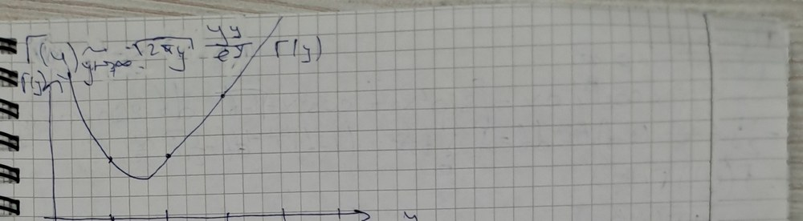
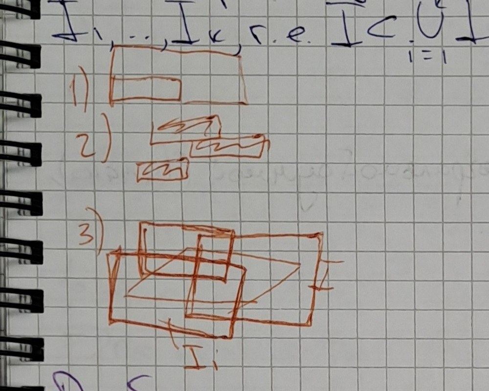

# Lectures 79–80 — the gamma and beta functions, the Riemann integral over an n-dimensional box

[[en/lectures-2025-26/lecture-77-78|← Lectures 77–78]] · [[en/lectures-2025-26/index|Lecture index]] · [[en/lectures-2025-26/lecture-81-82|Lectures 81–82 →]] · [[en/term-index|Terms & theorems]] · [[ru/lectures-2025-26/lecture-79-80|Русский]] · [[es/lectures-2025-26/lecture-79-80|Español]]

> [!info] Source and numbering
> These notes were copied from a handwritten notebook (pages p067–p073; the raw page text is in [`ocr/raw/`](https://github.com/NikiHunter/matan/blob/main/ocr/raw/p067.md)). At the top of page p067 the date “22 October” stands in a frame; below it, in red, begins the record “Lectures …” with the plan: the gamma function; the [[en/lectures-2025-26/lecture-39-40#^def-4-2-6|Riemann integral]] over an $n$-dimensional box; the Riemann integral over a set; one more item, illegible in the transcription (“ineq-ties of integration iden-ties”; possibly “inequalities and identities of integration”, i.e. properties of the integral). The number of the class in the heading of the plan is not legible; by the order of the notebook these are lectures 79–80, which cover the first two items of the plan (the integral over a set is in lectures 81–82). The numbering of definitions and theorems is the lecturer's; the statements of [[#^def-9-3-1|Definition 9.3.1]], of the properties of the gamma function, of [[#^def-10-1-1|Definitions 10.1.1]]–[[#^def-10-1-7|10.1.7]] and of [[#^thm-10-1-1|Theorem 10.1.1]] are checked against the slides of the 2024/25 course (FS p88–p91). The notes contain no proof of the reflection formula (property ⑨; it is left without proof) and no definition of the mesh of a partition (restored); Stirling's formula (⑧) is derived heuristically in the notes (a justification has been added); the derivation of the relation between the beta and gamma functions is written in a garbled way and is restored according to the record of the 2024/25 lecture (FS p89) and standard courses (Fichtenholz, vol. II, ch. XIV; Zorich, vol. II, ch. XVII). Figures inserted: the graph of the gamma function (page p070) and three small figures on the properties of the measure of a box (page p072); the remaining figures in the margins are described in words. Slips in the notes are corrected and marked with “Source correction” blocks; lost passages are restored and marked with “Restored” blocks; the tags match [`ocr/RESOLVED.md`](https://github.com/NikiHunter/matan/blob/main/ocr/RESOLVED.md). Places that still have to be checked against the notebook are listed in [`ocr/ISSUES.md`](https://github.com/NikiHunter/matan/blob/main/ocr/ISSUES.md).

## §9.3. The gamma function

> [!definition] Definition 9.3.1
> The gamma function (at the point $y$) is the function given by the formula
> $$
> \Gamma(y)=\int_0^{\infty}x^{y-1}e^{-x}\,dx\qquad(y>0).
> $$

^def-9-3-1

Let us check that the integral converges for all $y>0$. It is improper: for $y<1$ the integrand is unbounded near $x=0$, and, moreover, the [[en/lectures-2025-26/lecture-13#Definition 2.3.9 (upper and lower limits)|upper limit]] is infinite. Split it into two integrals (in the notes the splitting point is denoted $a$; we take $a=1$):
$$
\int_0^{\infty}e^{-x}x^{y-1}\,dx=\int_0^{1}e^{-x}x^{y-1}\,dx+\int_1^{\infty}e^{-x}x^{y-1}\,dx .
$$
The integral converges if both terms converge.

*Convergence at $x\to0+$.* Since $e^{-x}\to1$, for $x\to0+$ we have $x^{y-1}e^{-x}\sim x^{y-1}=\dfrac1{x^{1-y}}$. The integral $\int_0^1\dfrac{dx}{x^{1-y}}$ converges if and only if $1-y<1$, i.e. $y>0$. By the comparison test the integral $\int_0^1e^{-x}x^{y-1}\,dx$ converges for $y>0$ (for $y\le0$ it diverges).

> [!info] Source correction
> (M326, A327). The notes say “$x^{y-1}e^{-x}\sim x^{y-1}=x^{\frac1{y-2}}\Rightarrow1-y<1\Rightarrow y>0$” and “$\int_0^\infty e^{-x}v^{y-1}\,dx$ — converges by the comparison test for $y>0$”. The record “$x^{\frac1{y-2}}$” is a slip: $x^{y-1}=\frac1{x^{1-y}}$, and it is the exponent $1-y$ that is compared with one. In the last line “$v$” is $x$, and the upper limit is not $\infty$ but the splitting point ($a$ in the notes, $1$ here): convergence at infinity is studied separately.

*Convergence at $x\to+\infty$.* If $y\in(0,1]$, then for $x\ge1$ we have $x^{y-1}\le1$, hence $0<x^{y-1}e^{-x}\le e^{-x}$, and the integral $\int_1^\infty e^{-x}x^{y-1}\,dx$ converges by the comparison test, since $\int_1^\infty e^{-x}\,dx<\infty$. If $y>1$, then
$$
\frac{x^{y-1}e^{-x}}{1/x^2}=\frac{x^{y+1}}{e^x}\to0\qquad(x\to+\infty),
$$
i.e. $x^{y-1}e^{-x}=o\!\left(\dfrac1{x^2}\right)$, and the integral $\int_1^\infty\dfrac{dx}{x^2}$ converges; hence $\int_1^\infty e^{-x}x^{y-1}\,dx$ converges too. (The estimate $o(1/x^2)$ holds for any $y$.) Thus $\Gamma(y)$ is defined for all $y>0$.

> [!info] Source correction
> (S328, A329, M330). The notes say: a red note in the margin “if $y\in(0,1)$, then $e^{-x}\cdot x^{y-1}\to0$”, then “$x\to\infty$: $e^{-x}\cdot x^{y-1}=o\left(\frac1{x^2}\right)$ for $y>1$” and “$\frac{x^{y-1}e^{-x}}{1/x^2}=\frac{x^{y+1}}{e^x}\to0\Rightarrow\int_a^\infty e^{-x}x^{y-1}\,dx\to0$”. The note in the margin is read as treating the case $y\in(0,1)$ for $x\to\infty$, and the line with $o(1/x^2)$ as treating the case $y>1$; for $y\in(0,1)$ the mere fact that the integrand tends to zero is not enough for convergence, so the majorant $e^{-x}$ is given. The conclusion “$\int_a^\infty e^{-x}x^{y-1}\,dx\to0$” is not a conclusion about convergence: the estimate $o(1/x^2)$ implies by the comparison test that the integral converges (i.e. is a finite number).

**Properties.** The gamma function has the following properties.

① $\Gamma(1)=1$.

② $\Gamma\!\left(\tfrac12\right)=\sqrt\pi$.

③ $\Gamma(y+1)=y\,\Gamma(y)$ for $y>0$.

④ $\Gamma(n+1)=n\,\Gamma(n)=\ldots=n!$ for $n\in\mathbb N$.

⑤ $\Gamma\!\left(n+\tfrac12\right)=\dfrac{(2n-1)!!}{2^n}\sqrt\pi=\dfrac{(2n)!}{4^n\,n!}\sqrt\pi$ for $n\in\mathbb N$.

> [!info] Source correction
> (T331). The notes say “$\Gamma\left(n+\frac12\right)=\frac{(2n-1)!!}{2^n}\sqrt\pi=\frac{(2n-1)!}{2^n}\sqrt\pi$”. The second equality is false: for $n=2$ we have $\frac{3!}{2^2}\sqrt\pi=\frac32\sqrt\pi$, while $\Gamma\left(\frac52\right)=\frac34\sqrt\pi$. Correct is $(2n-1)!!=\frac{(2n)!}{2^nn!}$, whence $\Gamma\left(n+\frac12\right)=\frac{(2n)!}{4^nn!}\sqrt\pi$.

⑥ $\Gamma'(y)=\displaystyle\int_0^{\infty}x^{y-1}e^{-x}\ln x\,dx$ for $y>0$ (the gamma function is differentiable, and the derivative can be computed under the integral sign).

⑦ $\Gamma''(y)=\displaystyle\int_0^{\infty}x^{y-1}e^{-x}\ln^2x\,dx>0$; in particular, $\Gamma$ is convex (downwards) on $(0,+\infty)$. ^p068

⑧ $\Gamma(y+1)\sim\sqrt{2\pi y}\,\dfrac{y^y}{e^y}$ as $y\to+\infty$ (Stirling's formula); for $y=n\in\mathbb N$, when $\Gamma(n+1)=n!$, this gives $n!\sim\sqrt{2\pi n}\,\dfrac{n^n}{e^n}$.

⑨ $\Gamma(y)\,\Gamma(1-y)=\dfrac{\pi}{\sin(\pi y)}$ for $0<y<1$ (the reflection formula). The proof was not given in the notes.

⑩ $\dfrac{\Gamma(y)}{b^y}=\displaystyle\int_0^{\infty}u^{y-1}e^{-ub}\,du$ for $y>0$, $b>0$ (Euler's formula).

### Proofs of the properties

> [!info] Source correction
> (T333). In the notes the block of proofs opens with the heading “Pf (prop. 6)”; then properties ①–⑥ are proved in order (then ⑦, ⑧ and ⑩; ⑨ is not proved). The heading is read as “Pf (props. 1–6)”, and the proofs below are grouped by content.

**Proof of properties ①–⑤.**

① $\Gamma(1)=\int_0^{+\infty}e^{-x}x^{0}\,dx=\int_0^{+\infty}e^{-x}\,dx=-e^{-x}\Big|_0^{+\infty}=1$.

② $\Gamma\left(\tfrac12\right)=\int_0^{+\infty}e^{-x}x^{-1/2}\,dx=\int_0^{+\infty}\dfrac{e^{-x}}{\sqrt x}\,dx$. The substitution $x=t^2$ ($dx=2t\,dt$, $\sqrt x=t$) gives
$$
\Gamma\left(\tfrac12\right)=\int_0^{\infty}e^{-t^2}\,\frac{2t\,dt}{t}=2\int_0^{\infty}e^{-t^2}\,dt=\sqrt\pi ,
$$
since $\int_0^\infty e^{-t^2}\,dt=\frac{\sqrt\pi}{2}$ (the Euler–Poisson integral; the notes take it as known, and an independent derivation of the equality $\Gamma\left(\frac12\right)=\sqrt\pi$ is given in the remark after the example below).

③ For $y>0$ we [[en/lectures-2025-26/lecture-37-38#^thm-4-1-4|integrate by parts]]:
$$
\Gamma(y+1)=\int_0^{\infty}x^{y}e^{-x}\,dx=-\int_0^{\infty}x^y\,d\bigl(e^{-x}\bigr)=-x^ye^{-x}\Big|_0^{\infty}+y\int_0^{\infty}x^{y-1}e^{-x}\,dx=y\,\Gamma(y),
$$
since $x^ye^{-x}\to0$ both for $x\to+\infty$ and for $x\to0+$ (here $y>0$).

④ Substituting successively $y=n,\,n-1,\ldots,1$ into ③ and using ①, we get $\Gamma(n+1)=n\,\Gamma(n)=n(n-1)\,\Gamma(n-1)=\ldots=n!\,\Gamma(1)=n!$. This is a consequence of ③.

⑤ From ② and ③: $\Gamma\left(\tfrac32\right)=\tfrac12\Gamma\left(\tfrac12\right)=\tfrac12\sqrt\pi$, $\ \Gamma\left(\tfrac52\right)=\tfrac32\Gamma\left(\tfrac32\right)=\tfrac32\cdot\tfrac12\sqrt\pi$. In general, applying ③ $n$ times, for $n\in\mathbb N$ we get
$$
\Gamma\left(n+\tfrac12\right)=\left(n-\tfrac12\right)\left(n-\tfrac32\right)\cdots\tfrac12\,\Gamma\left(\tfrac12\right)=\frac{(2n-1)(2n-3)\cdots1}{2^n}\sqrt\pi=\frac{(2n-1)!!}{2^n}\sqrt\pi .
$$
Since $(2n-1)!!=\dfrac{(2n)!}{(2n)!!}=\dfrac{(2n)!}{2^nn!}$, this equals $\dfrac{(2n)!}{4^nn!}\sqrt\pi$. $\square$

**Proof of properties ⑥ and ⑦.** Formally differentiating $\Gamma(y)=\int_0^{\infty}x^{y-1}e^{-x}\,dx$ with respect to the parameter $y$ under the integral sign and noting that $\frac{\partial}{\partial y}x^{y-1}=x^{y-1}\ln x$, we would get ⑥. Let us justify this passage, i.e. check the hypotheses of [[en/lectures-2025-26/lecture-77-78#^thm-9-2-2|Theorem 9.2.2]] on differentiating an [[en/lectures-2025-26/lecture-47-48#^def-4-5-2|improper integral]] with respect to a parameter. The integral has two singularities ($x=0$ and $x=+\infty$), so, as above, we write it as $\int_0^1+\int_1^\infty$ and apply [[en/lectures-2025-26/lecture-77-78#^thm-9-2-2|Theorem 9.2.2]] to each term (a singularity at the lower endpoint is treated similarly; see the remark on singularities in lectures 77–78).

Fix numbers $0<\delta<C<\infty$ and assume $y\in[\delta,C]$: every point $y_0>0$ lies inside such a segment (for example, for $\delta=y_0/2$, $C=2y_0$), and differentiability is a local property. The functions $f(x,y)=x^{y-1}e^{-x}$ and $f'_y(x,y)=x^{y-1}e^{-x}\ln x$ are continuous for $x>0$, $y\in[\delta,C]$, and the integral of $f$ converges for each such $y$. It remains to check the [[en/10-function-sequences-series#10.1 Two modes of convergence|uniform convergence]] of the integral $\int_0^{\infty}x^{y-1}e^{-x}\ln x\,dx$ on $[\delta,C]$; we do this by the [[en/10-function-sequences-series#^weierstrass-m-test|Weierstrass test]].

① *Neighbourhood of zero, $x\in(0,1]$.* Since $y\ge\delta$, we have $y-\frac\delta2\ge\frac\delta2>0$, whence $x^{y-\delta/2}\le x^{\delta/2}$ for $x\in(0,1]$; moreover, $e^{-x}\le1$. Therefore
$$
\bigl|x^{y-1}e^{-x}\ln x\bigr|\le x^{\frac\delta2-1}\,\bigl|x^{y-\frac\delta2}\ln x\bigr|\le x^{\frac\delta2-1}\cdot x^{\frac\delta2}\,|\ln x| .
$$
By the remarkable limit $x^p\ln x\to0$ as $x\to0+$, for every $p>0$ the function $x^{\delta/2}|\ln x|$ is bounded on $(0,1]$; more precisely, $x^{\delta/2}|\ln x|\le\frac{2}{e\delta}$ (the maximum of the function $x^p\ln\frac1x$ on $(0,1]$ equals $\frac1{ep}$ and is attained at $x=e^{-1/p}$).

Consequently $\bigl|x^{y-1}e^{-x}\ln x\bigr|\le\frac{2}{e\delta}\,x^{\frac\delta2-1}$ for all $x\in(0,1]$, $y\in[\delta,C]$, and the integral $\int_0^1x^{\frac\delta2-1}\,dx=\frac2\delta$ converges. We have found a convergent majorant independent of $y$; by the Weierstrass test the integral $\int_0^1x^{y-1}e^{-x}\ln x\,dx$ converges uniformly on $[\delta,C]$. ^p069

> [!info] Source correction
> (S336, U337, T338, M339, S340, M535). The notes say: “Returning to 0”, “Let us check that $\exists\forall\delta(y)$, in which or the integral conv. uniformly. We took the partition $\delta>0$ such that $\delta\le y$”, “$x^{y-1}=x^{\delta-1}x^{y-\delta}$”, “$y=\delta+\delta$”, “$\left|x^{y-1}e^{-x}\ln x\right|\le x^{\delta/2-1}\left|x^{y-\delta/2}\ln x\right|$”, “② $x^{\delta/2-1}\ln x$” and “$\int_0^\infty x^{\delta/2-1}\,dx<+\infty$”. According to the record of the 2024/25 lecture (FS p88) these lines read: “① Near zero. Let us check that there is a neighbourhood $V_\delta(y)$ in which the integral converges uniformly; an arbitrary $\delta>0$, $\delta\le y$ is taken; $y=\delta+(y-\delta)$”. The splitting $x^{y-1}=x^{\delta-1}x^{y-\delta}$ leaves an unsuppressed logarithm in the majorant $x^{\delta-1}|\ln x|$ (for $y=\delta$ the factor $x^{y-\delta}=1$ does not kill it); to make the majorant a power, part of the exponent is used to suppress $\ln x$ — this is why the estimate contains $\delta/2$ (as in the notes), and “②” is the sign of the next inequality of the chain ($x^{y-\delta/2}\le x^{\delta/2}$ and the boundedness of $x^{\delta/2}\ln x$). Instead of the neighbourhood $V_\delta(y)$ it is more convenient to take the segment $[\delta,C]$. Finally, the integral of the majorant is written as $\int_0^\infty x^{\delta/2-1}\,dx<+\infty$: at infinity it diverges (the exponent $\frac\delta2-1>-1$), and only the integral near zero, $\int_0^1x^{\delta/2-1}\,dx<\infty$, is needed (in the 2024/25 record, $\int_0^a$).

② *Neighbourhood of infinity, $x\ge1$.* Since $y\le C$ and $x\ge1$, we have $x^{y-1}\le x^{C-1}$; moreover, $\ln x\ge0$. Therefore
$$
\bigl|x^{y-1}e^{-x}\ln x\bigr|\le x^{C-1}e^{-x}\ln x=:g(x),\qquad y\in[\delta,C],\ x\ge1 .
$$
The function $g$ does not depend on $y$, and $x^2g(x)=\dfrac{x^{C+1}\ln x}{e^x}\to0$ as $x\to+\infty$, i.e. $g(x)=o\!\left(\frac1{x^2}\right)$; hence the integral $\int_1^\infty g(x)\,dx$ converges. By the Weierstrass test the integral $\int_1^\infty x^{y-1}e^{-x}\ln x\,dx$ converges uniformly on $[\delta,C]$.

> [!info] Source correction
> (M536). The notes say (item “in a neighbourhood of $\infty$, $y\le C$”): “$\left|x^{y-1}e^{-x}\ln x\right|\le x^{C-1}e^{-x}\ln x\to0\Rightarrow$ boundedness $\Rightarrow$ absolute majorant $\Rightarrow$ Weierstrass test”. Boundedness of the majorant is not enough for its integrability on $[1,\infty)$ (for example, $g\equiv1$ is bounded but not integrable); $g$ has to decrease fast enough. This is exactly what is shown above: $g(x)=o\left(x^{-2}\right)$.

Thus the integral $\int_0^\infty x^{y-1}e^{-x}\ln x\,dx$ converges uniformly on $[\delta,C]$. The hypotheses of [[en/lectures-2025-26/lecture-77-78#^thm-9-2-2|Theorem 9.2.2]] are satisfied (continuity of $f$ and $f'_y$, uniform convergence of the integral of $f'_y$, convergence of the integral of $f$), so $\Gamma$ is differentiable on $[\delta,C]$ and $\Gamma'(y)=\int_0^\infty x^{y-1}e^{-x}\ln x\,dx$. Since $\delta$ and $C$ are arbitrary, this holds for all $y>0$: property ⑥ is proved.

Property ⑦ is obtained by repeating this argument for the integral from ⑥ (it converges for each $y>0$). The derivative of its integrand with respect to $y$ equals $x^{y-1}e^{-x}\ln^2x$ and is continuous for $x>0$; its integral converges uniformly on $[\delta,C]$ by the Weierstrass test: for $x\in(0,1]$
$$
x^{y-1}e^{-x}\ln^2x\le x^{\frac\delta2-1}\cdot x^{\frac\delta2}\ln^2x\le\frac{16}{e^2\delta^2}\,x^{\frac\delta2-1}
$$
(the maximum of $x^p\ln^2x$ on $(0,1]$ equals $\frac4{e^2p^2}$, $p=\frac\delta2$), and for $x\ge1$ this function does not exceed $x^{C-1}e^{-x}\ln^2x=o\left(x^{-2}\right)$. By [[en/lectures-2025-26/lecture-77-78#^thm-9-2-2|Theorem 9.2.2]]
$$
\Gamma''(y)=\bigl(\Gamma'(y)\bigr)'_y=\left(\int_0^{\infty}x^{y-1}e^{-x}\ln x\,dx\right)'_y=\int_0^{\infty}x^{y-1}e^{-x}\ln^2x\,dx .
$$
The integrand is non-negative and positive for $x\ne1$, so $\Gamma''(y)>0$ for all $y>0$, i.e. $\Gamma$ is strictly convex (downwards). $\square$

> [!info] Source correction
> (T341, T342). The notes say “$(\Gamma'(y))'_y=\left(\int_0^\infty e^{-x}x^{y-1}\,dx\right)'_y=\int_0^\infty e^{-x}\frac{d}{dy}\left(x^{y-1}\right)dx=\int_0^\infty e^{-x}x^{y-1}\ln x\,dx$” and “③ $\Gamma'(y)>0\Rightarrow\Gamma(y)$ is convex. It is proved from ⑥ by repeating the proof of ⑥”. In the first chain the second expression has $\Gamma$ instead of $\Gamma'$, and as a result the square is missing: the second derivative is obtained by differentiating the integral from ⑥, $\frac{\partial}{\partial y}\bigl(x^{y-1}\ln x\bigr)=x^{y-1}\ln^2x$. The second record means property ⑦ ($\Gamma''>0$), not ③; [[en/lectures-2025-26/lecture-31-32#^def-3-8-1|convexity]] follows precisely from $\Gamma''>0$, while the condition $\Gamma'>0$ is false (the function $\Gamma$ decreases for $y<1{,}46\ldots$) and would mean increase, not convexity.

**Derivation of property ⑧ (heuristic).** For $y=n\in\mathbb N$ we have $\Gamma(n+1)=n!$, and property ⑧ becomes Stirling's formula $n!\sim\sqrt{2\pi n}\,n^ne^{-n}$, i.e. $\dfrac{n!}{\sqrt{2\pi n}\,n^ne^{-n}}\to1$. Let us derive ⑧ by Laplace's method. The substitution $x=yt$ ($dx=y\,dt$) gives
$$
\Gamma(y+1)=\int_0^{\infty}x^{y}e^{-x}\,dx=y^{y+1}\int_0^{\infty}t^{y}e^{-yt}\,dt .
$$
Put $\varphi(t)=\ln t-t+1$; then $t^ye^{-yt}=e^{y(\ln t-t)}=e^{-y}e^{y\varphi(t)}$ and
$$
\Gamma(y+1)=y^{y+1}e^{-y}\int_0^{\infty}e^{y\varphi(t)}\,dt .
$$
For large $y$ the main contribution to the integral comes from the values of $t$ near the maximum point $\varphi$. We find: $\varphi'(t)=\frac1t-1=0$ only for $t=1$, $\varphi(1)=\ln1-1+1=0$ (so that $e^{\varphi(1)}=1$), $\varphi''(t)=-\frac1{t^2}<0$; hence $t=1$ is a maximum point of the function $\varphi$ on $(0,\infty)$ (a global one, since $\varphi$ is concave). Expand $\varphi$ by Taylor's formula in a neighbourhood of the maximum point:
$$
\varphi(t)=\varphi(1)+\varphi'(1)(t-1)+\tfrac12\varphi''(1)(t-1)^2+o\bigl((t-1)^2\bigr)=-\tfrac12(t-1)^2+o\bigl((t-1)^2\bigr),\qquad t\to1 .
$$
Dropping the remainder and replacing $(0,\infty)$ by the whole line (the added part is exponentially small), we get by Gauss
$$
\int_0^{\infty}e^{y\varphi(t)}\,dt\approx\int_{-\infty}^{+\infty}e^{-\frac y2(t-1)^2}\,dt=\sqrt{\frac{2\pi}{y}},
$$
whence
$$
\Gamma(y+1)\sim y^{y+1}e^{-y}\sqrt{\frac{2\pi}{y}}=\sqrt{2\pi y}\,\frac{y^y}{e^y}.
$$

> [!info] Source correction
> (U343, A344, M345, M533, T346, U347). The notes say: “⑧ for $y\in\mathbb N$ $\Gamma(n+1)=n!$ and $\frac{n!\sqrt{2\pi n}}{n^ne^{-n}}$”, “$[\varphi(t):=\ln t-t+1]$”, “$\varphi'(t)=\frac1t-1$, $\varphi'(1)=0\Rightarrow\varphi=1-\frac1t-1=0\Rightarrow e^\varphi=1$ is the only candidate for a critical point”, “$\varphi''(t)=-\frac1{t^2}>0\Rightarrow t=1$ is the max”, “$\varphi(t)=\varphi(1)+\varphi'(1)(t-1)+\frac12\varphi''(1)(t-1)^2+O((t-1)^2)=-\frac12/(t-1)^2+O((t-1)^2)$” and “$e^{y\varphi}dx=\int_0^\infty e^{-y\frac12(t-1)^2}\,dt=\sqrt{\frac{2\pi}{y}}$ (obtained by Gauss)”. Corrected: 1) Stirling's formula is $\frac{n!}{\sqrt{2\pi n}\,n^ne^{-n}}\to1$ (as in the 2024/25 record, FS p89: “$n!\sim\sqrt{2\pi n}\,\frac{n^n}{e^n}$”); 2) $\varphi(t)=\ln t-t+1$ — it is with this term $+1$ that one gets $\varphi(1)=0$ and $e^{\varphi(1)}=1$; the line “$\varphi=1-\frac1t-1=0$” is a slip, correct is $\varphi(1)=\ln1-1+1=0$, and the uniqueness of the critical point means: $\varphi'(t)=0\iff t=1$; 3) the sign of the second derivative: $\varphi''(t)=-\frac1{t^2}<0$ — it is the negativity of $\varphi''$ that gives a maximum (the record “$>0$” would correspond to a minimum); 4) the remainder in Taylor's formula with the Peano remainder is $o\left((t-1)^2\right)$, not $O\left((t-1)^2\right)$ (otherwise the remainder cannot be separated from the principal term), and the principal term is $-\frac12(t-1)^2$ (the sign “/” in the notes is a slip); 5) in the last line $\int_0^\infty$ before $e^{y\varphi}$ is missing, $dx$ stands instead of $dt$, and the equality is approximate: the remainder is dropped, and the integral over $(0,\infty)$ is replaced by the integral over the whole line.

> [!note] Restored
> (justification of the derivation of ⑧, by the standard proof of Laplace's method; in the notes the step “drop the remainder” is not justified). Let us prove that $\sqrt y\int_0^\infty e^{y\varphi(t)}\,dt\to\sqrt{2\pi}$ as $y\to+\infty$; then $\Gamma(y+1)=y^{y+1}e^{-y}\int_0^\infty e^{y\varphi}\,dt\sim y^{y+1}e^{-y}\sqrt{2\pi/y}$, i.e. ⑧. Let $\varepsilon\in(0,1)$. The function $\varphi''(s)=-s^{-2}$ is continuous and $\varphi''(1)=-1$, so there is $\eta\in(0,1)$ such that $-(1+\varepsilon)\le\varphi''(s)\le-(1-\varepsilon)$ for $|s-1|\le\eta$. Since $\varphi(1)=\varphi'(1)=0$, by Taylor's formula with the Lagrange remainder $\varphi(t)=\frac12\varphi''(s)(t-1)^2$ for some $s$ between $1$ and $t$; consequently
> $$
> -\tfrac{1+\varepsilon}{2}(t-1)^2\le\varphi(t)\le-\tfrac{1-\varepsilon}{2}(t-1)^2,\qquad|t-1|\le\eta .
> $$
> Hence
> $$
> \int_{|t-1|\le\eta}e^{y\varphi(t)}\,dt\le\int_{-\infty}^{+\infty}e^{-\frac{y(1-\varepsilon)}{2}(t-1)^2}\,dt=\sqrt{\frac{2\pi}{y(1-\varepsilon)}},
> $$
> $$
> \int_{|t-1|\le\eta}e^{y\varphi(t)}\,dt\ge\int_{|t-1|\le\eta}e^{-\frac{y(1+\varepsilon)}{2}(t-1)^2}\,dt=\sqrt{\frac{2\pi}{y(1+\varepsilon)}}\,\bigl(1-r(y)\bigr),
> $$
> where $r(y)=\frac{2}{\sqrt\pi}\int_{\eta\sqrt{y(1+\varepsilon)/2}}^{\infty}e^{-u^2}\,du\to0$ as $y\to+\infty$ (the tail of the Gauss integral). Outside the segment $|t-1|\le\eta$ we use the concavity of $\varphi$: $\varphi(1)=0$, $\varphi(1\pm\eta)<0$ (the maximum at the point $1$ is strict); put $\kappa=\min\{-\varphi(1+\eta),-\varphi(1-\eta)\}>0$. For $t\ge1+\eta$ the point $1+\eta$ lies between $1$ and $t$, and concavity gives $\varphi(1+\eta)\ge\frac{\eta}{t-1}\varphi(t)$, i.e. $\varphi(t)\le-\kappa\frac{t-1}{\eta}$; similarly $\varphi(t)\le-\kappa\frac{1-t}{\eta}$ for $0<t\le1-\eta$. Therefore
> $$
> \int_{t>0,\ |t-1|>\eta}e^{y\varphi(t)}\,dt\le2\int_\eta^\infty e^{-y\kappa s/\eta}\,ds=\frac{2\eta}{y\kappa}\,e^{-y\kappa}=o\bigl(y^{-1/2}\bigr).
> $$
> Adding the estimates, we get $\frac1{\sqrt{1+\varepsilon}}\le\liminf_{y\to+\infty}\sqrt{\frac{y}{2\pi}}\int_0^\infty e^{y\varphi}\,dt\le\limsup_{y\to+\infty}\sqrt{\frac{y}{2\pi}}\int_0^\infty e^{y\varphi}\,dt\le\frac1{\sqrt{1-\varepsilon}}$; since $\varepsilon$ is arbitrary, the limit equals $1$. $\square$

Consider the behaviour of $\Gamma$ at the boundary of the domain $y\in(0,+\infty)$. For $y\to0+$, by property ③, $\Gamma(y)=\dfrac{\Gamma(y+1)}{y}$ for all $y>0$, and $\Gamma(y+1)\to\Gamma(1)=1$ as $y\to0+$ (the function $\Gamma$ is differentiable, hence continuous). Therefore $\Gamma(y)\sim\dfrac1y\to+\infty$ as $y\to0+$. As $y\to+\infty$, by property ⑧, $\Gamma(y)=\dfrac{\Gamma(y+1)}{y}\sim\sqrt{\dfrac{2\pi}{y}}\left(\dfrac{y}{e}\right)^{y}\to+\infty$.

> [!info] Source correction
> (U348, U349). The notes say “$\forall y>0\ \exists\delta(y)=\frac{y}{\Gamma(y+1)}=\frac1y$” and “$\Gamma(y+1)\xrightarrow[y\to0+]{}1$”. According to the record of the 2024/25 lecture (FS p89), the first line reads “$\Gamma(y)=\frac{\Gamma(y+1)}{y}$” (the sign “$\delta$” is $\Gamma$, and the fraction is upside down), the second as “$\Gamma(y+1)\to\Gamma(1)=1$ as $y\to0+$”; together they give $\Gamma(y)\sim\frac1y$ as $y\to0+$.

Since $\Gamma$ is strictly convex (⑦), tends to $+\infty$ at both ends of the interval $(0,+\infty)$ and $\Gamma(1)=\Gamma(2)=1$, it has a unique minimum point lying between $1$ and $2$: by [[en/lectures-2025-26/lecture-24-25-26#^thm-3-4-2|Rolle's theorem]] $\Gamma'$ vanishes inside $(1,2)$, and $\Gamma'$ is strictly increasing, since $\Gamma''>0$ (numerically $y_{\min}\approx1{,}46$, $\Gamma(y_{\min})\approx0{,}886$). To the left of this point $\Gamma$ decreases, to the right it increases. This is how the graph drawn in the notes looks.

 ^p070

*Figure in the notes (page p070): the graph of $\Gamma(y)$ — the axis $y$ with the marks $1,2,3,4,5$; the curve decreases from $+\infty$ as $y\to0+$, has a minimum between $1$ and $2$ and then increases; the points of the curve at $y=1,2,3$ are marked (the values $1,1,2$). Above the figure, in the margin, the asymptotics $\Gamma(y)\sim\sqrt{2\pi y}\,\frac{y^y}{e^y}$ as $y\to+\infty$ is written out.*

> [!info] Source correction
> (G350, T534). The asymptotics above the graph is written for $\Gamma(y)$, while property ⑧ refers to $\Gamma(y+1)$. For $\Gamma$ itself, ⑧ and ③ give $\Gamma(y)=\frac{\Gamma(y+1)}{y}\sim\sqrt{\frac{2\pi}{y}}\,\frac{y^y}{e^y}$; the factor $\sqrt{2\pi y}$ in the record in the margin is correct only for $\Gamma(y+1)$.

**Proof of property ⑩ (Euler's formula).** In the integral $\Gamma(y)=\int_0^{\infty}x^{y-1}e^{-x}\,dx$ make the substitution $x=bu$, where $b>0$ is a parameter, $dx=b\,du$:
$$
\Gamma(y)=\int_0^{\infty}(bu)^{y-1}e^{-bu}\,b\,du=b^y\int_0^{\infty}u^{y-1}e^{-ub}\,du ,
$$
whence $\dfrac{\Gamma(y)}{b^y}=\displaystyle\int_0^{\infty}u^{y-1}e^{-ub}\,du$. $\square$

> [!info] Source correction
> (A332). In the list of properties in the notes (and on the slide FS p88) Euler's formula is written as $\frac{\Gamma(y)}{t^y}=\int_0^\infty u^{y-1}e^{-ut}\,du$, while in the proof (page p070) the same parameter is denoted $b$. Here it is $b$ everywhere: the letter $t$ is needed below for the variable of integration.

> [!info] Source correction
> (U351). Before the derivation of the relation between the beta and gamma functions the notes have an illegible mark “⑨ Skl.” (possibly “⑨ Cor.” — “corollary”). In the main text it is omitted: the proof of the reflection formula ⑨ is not given in the notes; the “Restored” block after the derivation of the relation between the beta and gamma functions shows how ⑨ reduces to it.

### The beta function

For $y,z>0$ the function
$$
B(y,z)=\int_0^1x^{y-1}(1-x)^{z-1}\,dx
$$
is called the beta function, or Euler's integral (of the first kind). The integral converges for $y>0$, $z>0$: near $x=0$ the integrand is equivalent to $x^{y-1}$, near $x=1$ to the function $(1-x)^{z-1}$ (convergence also follows from the derivation below). The beta function is expressed through the gamma function:
$$
B(y,z)=\int_0^1x^{y-1}(1-x)^{z-1}\,dx=\frac{\Gamma(y)\,\Gamma(z)}{\Gamma(y+z)},\qquad y,z>0 .
$$

**Proof.** Take $y,z>0$ and write Euler's formula ⑩ for $y+z$ instead of $y$ and $b+1$ instead of $b$ (denote the variable of integration by $t$):
$$
\frac{\Gamma(y+z)}{(b+1)^{y+z}}=\int_0^{\infty}t^{y+z-1}e^{-(b+1)t}\,dt,\qquad b>0 .
$$
Multiply both sides by $b^{y-1}$ and integrate over $b$ from $0$ to $\infty$:
$$
\Gamma(y+z)\int_0^{\infty}\frac{b^{y-1}}{(b+1)^{y+z}}\,db=\int_0^{\infty}\left(\int_0^{\infty}b^{y-1}\,t^{y+z-1}e^{-t}\,e^{-bt}\,dt\right)db .
$$
Change the order of integration (the justification is in the “Restored” block below) and apply Euler's formula ⑩ with the parameter $t$ instead of $b$ to the inner integral: $\int_0^\infty b^{y-1}e^{-bt}\,db=\dfrac{\Gamma(y)}{t^y}$. We get
$$
\int_0^{\infty}t^{y+z-1}e^{-t}\left(\int_0^{\infty}b^{y-1}e^{-bt}\,db\right)dt=\int_0^{\infty}t^{y+z-1}e^{-t}\,\frac{\Gamma(y)}{t^{y}}\,dt=\Gamma(y)\int_0^{\infty}t^{z-1}e^{-t}\,dt=\Gamma(y)\,\Gamma(z).
$$
Consequently,
$$
\int_0^{\infty}\frac{b^{y-1}}{(b+1)^{y+z}}\,db=\frac{\Gamma(y)\,\Gamma(z)}{\Gamma(y+z)} .
$$
In the left-hand integral make the substitution $x=\dfrac{b}{b+1}$, i.e. $b+1=\dfrac1{1-x}$, $b=\dfrac{x}{1-x}$, $db=\dfrac{dx}{(1-x)^2}$; the interval $b\in(0,\infty)$ goes to $x\in(0,1)$:
$$
\int_0^{\infty}\frac{b^{y-1}}{(b+1)^{y+z}}\,db=\int_0^1\frac{x^{y-1}}{(1-x)^{y-1}}\,(1-x)^{y+z}\,\frac{dx}{(1-x)^2}=\int_0^1x^{y-1}(1-x)^{z-1}\,dx=B(y,z),
$$
since $-(y-1)+(y+z)-2=z-1$. Comparing the two computations of the left-hand side, we get the required equality. $\square$

> [!info] Source correction
> (M352, U353, U354). The derivation in the notes (page p070) is written in a garbled way and is partly illegible: after Euler's formula for $(y+z,b+1)$ stands “$=\int_0^\infty\left(\int_0^\infty u^{y-1}e^{-ub}\,t^{y+z-1}e^{-t}\,du\right)dt$”, then “$=\int_0^\infty u^{y-1}e^{-ub}\left(\int_0^\infty t^{y+z-1}e^{-ut}\,dt\right)du=\int u^{y-1}e^{-ub}\frac{\Gamma(y+z)}{u^{y+z}}\,du=\Rightarrow\frac{\Gamma(y+z)}{\Gamma(z)}\int_0^\infty\frac{b^{z-1}}{(b+1)^{y+z}}\,db=\ldots=B(y,z)-$”, then “$\left[b+1=\frac1{1-x},\ db=\frac{dx}{(1-x)^2}\right]$ $=\int_0^1\frac{x^{y-1}-(1-x)^{y+z}}{(1-x)^2}=\int_0^1x^{y-1}(1-x)^{z-1}\,dx=:B(y,z)-$ $=$ Vtorov integral”. These lines are not consistent with each other: the first equality does not follow from Euler's formula (the integral over $u$ equals $\frac{\Gamma(y)}{b^y}$ and does not depend on $t$), in the second double integral the exponent $e^{-t}$ is replaced by $e^{-ut}$, the power $b^{z-1}$ in one line changes to $x^{y-1}$ in another, and the signs “$-$” in the numerator and at the ends of lines are illegible multiplication and equality signs (in the numerator $\frac{x^{y-1}}{(1-x)^{y-1}}\cdot(1-x)^{y+z}$ is meant). The steps are restored according to the record of the 2024/25 lecture (FS p89): Euler's formula for $(y+z,\,t+1)$ is multiplied by $t^{y-1}$ and integrated over $t$; above, the same is done with the parameter $b$. “Vtorov integral” is “Euler's integral” (so on the slide FS p89).

> [!note] Restored
> (justification of the change of the order of integration; the notes do not discuss it). The integrand $F(b,t)=b^{y-1}t^{y+z-1}e^{-(b+1)t}$ is continuous and non-negative for $b,t>0$. For such functions the iterated improper integrals coincide ([[en/20-lebesgue-integration#20.4 Product measures and Fubini–Tonelli|Tonelli's theorem]]; in our case it can be obtained from [[en/lectures-2025-26/lecture-77-78#^thm-9-1-3|Theorem 9.1.3]] for the squares $[\frac1N,N]^2$ by the passage to the limit $N\to\infty$ with the help of Dini's theorem, since both inner integrals are continuous functions: $\Gamma(y+z)\,b^{y-1}(b+1)^{-(y+z)}$ and $\Gamma(y)\,t^{z-1}e^{-t}$). Both iterated integrals are then finite, since $\int_0^\infty\frac{b^{y-1}}{(b+1)^{y+z}}\,db<\infty$ for $y,z>0$ (the integrand is $\sim b^{y-1}$ as $b\to0+$ and $\sim b^{-z-1}$ as $b\to+\infty$).

> [!note] Restored
> (by a standard course; in the notes the reflection formula ⑨ is left without proof). In the proved equality put $z=1-y$, $0<y<1$, and take into account $\Gamma(1)=1$: $\Gamma(y)\,\Gamma(1-y)=B(y,1-y)=\int_0^\infty\frac{b^{y-1}}{1+b}\,db$ (this is the first integral of the derivation for $y+z=1$). The value of this integral is $\frac{\pi}{\sin\pi y}$ — a classical integral, computed, for example, by residues; ⑨ follows. For $y=\frac12$ the formula gives $\Gamma\left(\frac12\right)^2=\pi$, in agreement with property ②.

**Example.** Let us compute the integral $\displaystyle\int_0^{\pi/2}\sin^{\alpha}x\cos^{\beta}x\,dx$, $\alpha,\beta>0$. Make the substitution $t=\sin^2x$: then $\cos^2x=1-t$, $dt=2\sin x\cos x\,dx$, i.e. $dx=\dfrac{dt}{2\sqrt t\sqrt{1-t}}$, and for $x\in\left(0,\frac\pi2\right)$ the variable $t$ runs monotonically over $(0,1)$. Consequently
$$
\begin{aligned}
\int_0^{\pi/2}\sin^{\alpha}x\cos^{\beta}x\,dx&=\frac12\int_0^1t^{\frac{\alpha-1}{2}}(1-t)^{\frac{\beta-1}{2}}\,dt=\frac12\int_0^1t^{\frac{\alpha+1}{2}-1}(1-t)^{\frac{\beta+1}{2}-1}\,dt\\
&=\frac12\,B\!\left(\frac{\alpha+1}{2},\frac{\beta+1}{2}\right)=\frac{\Gamma\!\left(\frac{\alpha+1}{2}\right)\Gamma\!\left(\frac{\beta+1}{2}\right)}{2\,\Gamma\!\left(\frac{\alpha+\beta}{2}+1\right)},
\end{aligned}
$$
since $\frac{\alpha+1}{2}+\frac{\beta+1}{2}=\frac{\alpha+\beta}{2}+1$. The formula also holds for $\alpha,\beta>-1$ (it is exactly under this condition that the integral converges and the beta function converges). ^p071

> [!note] Restored
> (by a standard course; an independent derivation of property ② that does not use the Euler–Poisson integral). Put $\alpha=\beta=0$ in the formula of the example: $\frac\pi2=\int_0^{\pi/2}dx=\frac{\Gamma\left(\frac12\right)^2}{2\,\Gamma(1)}=\frac12\,\Gamma\left(\tfrac12\right)^2$. Since $\Gamma\left(\frac12\right)>0$, this gives $\Gamma\left(\frac12\right)=\sqrt\pi$, and the equality $\Gamma\left(\frac12\right)=2\int_0^\infty e^{-t^2}\,dt$ (proof of ②) gives the value $\int_0^\infty e^{-t^2}\,dt=\frac{\sqrt\pi}{2}$ as well.

## §10.1. The Riemann integral over an n-dimensional box

Chapter 10 “Multiple integrals” begins. Just as we passed from the derivative $f'(x)$ of a function of one variable $x\in\mathbb R$ to the [[en/lectures-2025-26/lecture-61-62#Printed slide 8 (PDF p. 9). Partial derivatives — Definition 6.1.5|partial derivatives]] $\dfrac{\partial f}{\partial x_i}(x_1,\ldots,x_n)$ of functions of $n$ variables $x=(x_1,\ldots,x_n)\in\mathbb R^n$, we now pass from the integral of a function of one variable to the integral of a function of $n$ variables:
$$
\int_a^bf(x)\,dx,\quad\int f(x)\,dx\ \longmapsto\ \int f(x_1,\ldots,x_n)\,dx_1\ldots dx_n ,\qquad\Omega\subset\mathbb R^n .
$$
First the integral is defined over the “simplest” set, an $n$-dimensional box, and then (lectures 81–82) over a more general set $\Omega\subset\mathbb R^n$.

### A box and its measure

> [!definition] Definition 10.1.1
> The set
> $$
> I=I_{a,b}=\{x\in\mathbb R^n:\ a_i\le x_i\le b_i,\ i=1,\ldots,n\},\qquad a=(a_1,\ldots,a_n),\ b=(b_1,\ldots,b_n)\in\mathbb R^n,\ a_i\le b_i ,
> $$
> is called a box (otherwise, a brick) in $\mathbb R^n$.

^def-10-1-1

> [!definition] Definition 10.1.2
> To the box $I=I_{a,b}$ we assign the number
> $$
> \mu(I):=\prod_{i=1}^n(b_i-a_i),
> $$
> called the measure of the box.

^def-10-1-2

> [!info] Source correction
> (A356, T355). In the notes [[#^def-10-1-2|Definition 10.1.2]] is written for a “rectangle” $I=\{x\in\mathbb R^n:\ a_i<x_i<b_i\}$ (with strict inequalities), while in [[#^def-10-1-1|Definition 10.1.1]] and on the slide FS p90 the box is given by the non-strict inequalities $a_i\le x_i\le b_i$. Non-strict inequalities are taken: the number $\prod_{i=1}^n(b_i-a_i)$ depends only on $a_i$ and $b_i$ and is the same for an open, closed and half-open box. The heading of the section in the notes (“The Riemann integral or n-dimensional box”) is read as “The Riemann integral over an $n$-dimensional box” (so on the slide FS p90).

For $n=2$ the box $I_{a,b}=[a_1,b_1]\times[a_2,b_2]$ is a rectangle with sides $b_1-a_1$ and $b_2-a_2$, and $\mu(I)=(b_1-a_1)(b_2-a_2)$ is its area.

*Figure in the notes (page p071): on the right, in the margin, the shaded rectangle $I_{a,b}$ in the plane; $a_1,b_1$ and $a_2,b_2$ are marked on the axes.*

**Properties (of the measure of a box).** The measure of a box in $\mathbb R^n$ is:

^p072

- homogeneous: for every $\lambda>0$ we have $\mu(I_{\lambda a,\lambda b})=\lambda^n\mu(I_{a,b})$ (the slides FS p90 have $\lambda\ge0$; for $\lambda=0$ the box degenerates into a point and the equality holds as well);
- additive: if $I=\bigcup_{i=1}^kI_i$, where the boxes $I_1,\ldots,I_k$ pairwise have no common [[en/lectures-2025-26/lecture-57-58#Printed slide 4 (PDF p. 4) — The interior of a set — Definition 5.3.3|interior points]], then $\mu(I)=\sum_{i=1}^k\mu(I_i)$;
- if the box $I$ is covered by a finite system of boxes $I_1,\ldots,I_k$, i.e. $I\subset\bigcup_{i=1}^kI_i$, then $\mu(I)\le\sum_{i=1}^k\mu(I_i)$.

These properties are given in the notes without proof. They also hold for open or half-open boxes (in particular, for a covering by open boxes, as they are used in lectures 81–82): the measure depends only on the numbers $a_i$, $b_i$, and the [[en/lectures-2025-26/lecture-55-56#^def-5-3-2|closures]] of the boxes have the same measures.

> [!info] Source correction
> (A358, M537). In the notes (likewise on the slide FS p90) the condition of additivity is written as “$I=\bigcup_{i=1}^kI_i$, $I_i\cap I_j=\varnothing$”. For closed boxes ([[#^def-10-1-1|Definition 10.1.1]]) this condition cannot be satisfied for $k\ge2$: the connected set $I$ cannot be represented as the union of two non-empty disjoint [[en/lectures-2025-26/lecture-55-56#^thm-5-3-1|closed sets]]. What is meant is that the boxes $I_i$ have no common interior points (adjacent boxes may share a face); then the equality $\mu(I)=\sum\mu(I_i)$ holds. For homogeneity $\lambda>0$ is taken, as in the notes.

*Figures in the notes (page p072): 1) a box and a smaller similar box nested in it (homogeneity); 2) several boxes lying side by side and not overlapping (additivity); 3) the box $I$ covered by overlapping boxes $I_1,\ldots,I_k$ (estimate of the measure under a covering).*

### A partition of a box

Let a box $I=I_{a,b}$ be given. Partitions of the coordinate segments $[a_i,b_i]$, $i=1,\ldots,n$, induce a partition of $I$ into smaller boxes, obtained as direct products of the intervals of the partitions of these coordinate segments.

> [!definition] Definition 10.1.3
> The representation of the box $I$ described above as the union $I=\bigcup_{j=1}^kI_j$ of smaller boxes $I_j$ will be called a partition of the box $I$ and denoted by the symbol $P$ (for “partition”).

^def-10-1-3

*Figure in the notes (page p072): for $n=2$, a rectangle divided by a grid of lines parallel to the coordinate axes; caption: “$n=2$, partition”.*

### A partition with marked points

*Figure in the notes (page p072): the same rectangle with a grid, a point marked in each cell; caption: “[[en/lectures-2025-26/lecture-37-38#^def-4-2-4|tagging]]” (the set of marked points is called a tagging of the partition).*

> [!definition] Definition 10.1.4
> If in each box $I_j$ of the partition $P$ some point $\xi_j\in I_j$ is fixed, we say that we have a partition with marked points (a tagged partition).

^def-10-1-4

### The integral sum and the integral

Let $f:I\to\mathbb R$ be a given function, and $P=\{I_1,\ldots,I_k\}$ a partition of this box with marked points $\xi=\{\xi_1,\ldots,\xi_k\}$.

> [!definition] Definition 10.1.5
> The sum
> $$
> \sigma(f,P,\xi):=\sum_{i=1}^kf(\xi_i)\,\mu(I_i)
> $$
> is called the (Riemann) integral sum of the function $f$ corresponding to the partition of the box $I$ with marked points $\xi$.

^def-10-1-5

*Figure in the notes (page p073): for $I\subset\mathbb R^2$, a “column” over the cell $I_i$ with the marked point $\xi_i$ and height $f(\xi_i)$; for $f\ge0$ its volume $f(\xi_i)\,\mu(I_i)$ is a term of the integral sum.*

> [!note] Restored
> (S538; by a standard course: in the notes and on the slides FS p91 the mesh $\lambda(P)$ is used in [[#^def-10-1-6|Definition 10.1.6]] without a definition; it is given in agreement with lectures 81–82, where the mesh is the largest of the diameters of the boxes of the partition). The *mesh* of a partition $P=\{I_1,\ldots,I_k\}$ is the number
> $$
> \lambda(P)=\max_{1\le j\le k}d(I_j),\qquad d(I_j)=\sup_{x,y\in I_j}|x-y| ,
> $$
> where $d(I_j)$ is the diameter of the box $I_j$ (the length of its main diagonal). The equality $\lim_{\lambda(P)\to0}\sigma(f,P,\xi)=J$ means: for every $\varepsilon>0$ there is $\delta>0$ such that $|\sigma(f,P,\xi)-J|<\varepsilon$ for every partition $P$ of the box $I$ with $\lambda(P)<\delta$ and every choice of the marked points $\xi$. This is not an ordinary limit of a function of one variable: the sum $\sigma(f,P,\xi)$ depends on the whole partition and on all the marked points, not only on the number $\lambda(P)$ (cf. the definition of the Riemann integral over a segment in lectures 39–40).

> [!definition] Definition 10.1.6
> ($I\subset\mathbb R^n$) The quantity
> $$
> \int_If(x)\,dx:=\lim_{\lambda(P)\to0}\sigma(f,P,\xi)=\lim_{\lambda(P)\to0}\sum_{i=1}^kf(\xi_i)\,\mu(I_i),
> $$
> if the indicated limit exists, is called the (Riemann) integral of the function $f$ over the box $I$.

^def-10-1-6

> [!definition] Definition 10.1.7
> If for a function $f:I\to\mathbb R$ the finite limit indicated in Definition 10.1.6 exists, then $f$ is called a (Riemann) integrable function on the box $I$. The set of all such functions is denoted by the symbol $R(I)$.

^def-10-1-7

### A necessary condition for integrability

> [!theorem] Theorem 10.1.1 (necessary condition for integrability)
> If $f\in R(I)$, then $f$ is bounded on $I$.

^thm-10-1-1

The proof is written at the beginning of the next page of the notebook (page p074) and is given in lectures 81–82.

## Cross-references

- Course topic: [[en/17-multiple-integrals|chapter 17 “Multiple integrals and change of variables”]] — [[en/17-multiple-integrals#17.1 Definition and iterated integrals|§17.1 “Definition and iterated integrals”]]; the one-dimensional Riemann integral, integral sums — [[en/08-riemann-integration|chapter 8 “The Riemann integral”]] — [[en/08-riemann-integration#8.2 Riemann sums and properties|§8.2 “Integral sums and properties”]]; improper integrals and comparison tests — [[en/09-improper-integrals-applications|chapter 9 “Improper integrals and applications”]] — [[en/09-improper-integrals-applications#9.1 Definitions|§9.1 “Definitions”]].
- Results of chapter 9 used: the Weierstrass test, [[en/lectures-2025-26/lecture-77-78#^thm-9-2-2|Theorem 9.2.2]] on differentiating an improper integral with respect to a parameter and the remark on singularities at both endpoints (proof of properties ⑥ and ⑦) — [[en/lectures-2025-26/lecture-77-78|lectures 77–78]]; [[en/lectures-2025-26/lecture-77-78#^thm-9-1-3|Theorem 9.1.3]] on integrating a proper integral with respect to a parameter (justification of the change of the order of integration in the derivation for the beta function) — ibid.
- The one-dimensional definition of the Riemann integral as the limit of integral sums as the mesh of the partition tends to zero: [[en/lectures-2025-26/lecture-39-40|lectures 39–40]].
- Continuation of §10.1 (proof of [[#^thm-10-1-1|Theorem 10.1.1]], [[en/lectures-2025-26/lecture-41-42#^thm-4-2-5|Lebesgue's criterion]], [[en/lectures-2025-26/lecture-39-40#^def-4-2-8|Darboux sums]]) and the integral over a set: [[en/lectures-2025-26/lecture-81-82|lectures 81–82]].

---

[[en/lectures-2025-26/lecture-77-78|← Lectures 77–78]] · [[en/lectures-2025-26/index|Lecture index]] · [[en/lectures-2025-26/lecture-81-82|Lectures 81–82 →]] · [[en/term-index|Terms & theorems]] · [[ru/lectures-2025-26/lecture-79-80|Русский]] · [[es/lectures-2025-26/lecture-79-80|Español]]
