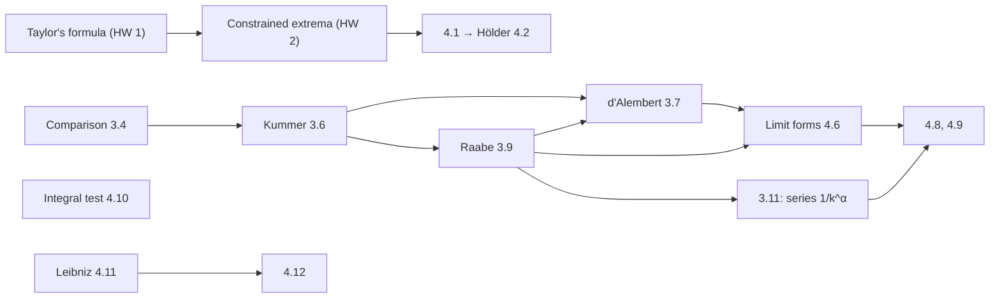

# Seminar NM-204, semester 3: homework solutions

[[ru/seminar-sem3/index|Русский]] · **English** · [[es/seminar-sem3/index|Español]]

[[en/index|Course index]] · [[en/lectures-2025-26/index|Lectures 2025/26]] · [[ru/exam-sem3/EXAM_SEM3|Exam, semester 3 (in Russian)]]

Solutions to homework assignments 1–4 of the course "Mathematical Analysis" (NM-204, 2026). Every problem is laid out the same way: a short statement, a solution or proof, the answer, and a **"Why it works"** paragraph explaining what the result rests on and what happens if the hypotheses are changed. The statements were checked against the source PDFs (which are in Russian); numerical answers and expansions were checked by substitution.

Problems are carried over from one assignment to the next under the same numbers, so each is solved once.

| Assignment | File | Problems | Topic |
|---|---|---|---|
| HW 1 | [[en/seminar-sem3/hw1-taylor\|Taylor's formula]] | 1.1–1.4 | Taylor polynomial in $\mathbb R^n$, Lagrange remainder |
| HW 2 | [[en/seminar-sem3/hw2-conditional-extremum\|Constrained extrema]] | 2.1–2.3, 2'.1–2'.3 | Lagrange multipliers, sufficient conditions |
| HW 3 | [[en/seminar-sem3/hw3-numerical-series\|Numerical series]] | 3.1–3.11 | comparison, Kummer, d'Alembert, Raabe |
| HW 4 | [[en/seminar-sem3/hw4-series-inequalities-bases\|Series, inequalities, bases]] | 4.1–4.12 | Hölder, bases, limit tests, integral test, Leibniz |

**Test 1.** [[en/seminar-sem3/test1-guide|How to prepare]] — the likely structure, methods for each task, typical mistakes and a three-day plan; [[en/seminar-sem3/test1-variants|practice variants]] — three variants in the format 1.1, 1.2, 2.1, 2.2, 3, 4 with solutions.

## Answers on one page

**HW 1.** Notation: $h$ is the increment from the expansion point.

- 1.1. At $(1;1;1)$: $3(h_1^2+h_2^2+h_3^2-h_1h_2-h_1h_3-h_2h_3)+h_1^3+h_2^3+h_3^3-3h_1h_2h_3$. At $(1;-1;2)$: $14+9h_1-3h_2+15h_3+3h_1^2-3h_2^2+6h_3^2-6h_1h_2+3h_1h_3-3h_2h_3+h_1^3+h_2^3+h_3^3-3h_1h_2h_3$.
- 1.2. $322-448h_1-42h_2+254h_1^2+94h_1h_2+36h_2^2-60h_1^3-16h_1^2h_2+24h_1h_2^2+24h_2^3+5h_1^4-4h_1^2h_2^2+3h_2^4$.
- 1.3. $e^9\bigl[1+L+\bigl(\tfrac{L^2}2+Q\bigr)+\bigl(\tfrac{L^3}6+LQ\bigr)\bigr]+R_3$, where $L=-2h_2+6h_3$, $Q=h_1h_2+h_3^2$, $R_3=\tfrac1{24}e^{9+L\theta+Q\theta^2}\bigl[(L+2Q\theta)^4+12Q(L+2Q\theta)^2+12Q^2\bigr]$.
- 1.4. $e^{\pi+2}\bigl[-\pi h_1+h_2+2\pi h_1^2+h_2^2-(3+\pi)h_1h_2-\pi h_1h_3+h_2h_3\bigr]+R_2$; the remainder $R_2=\tfrac16d^3_cf(h)$ is written out in the solution.

**HW 2.**

- 2.1. $(0;0)$ is a constrained local maximum ($f=0$), $(1;1)$ a constrained local minimum ($f=-1$).
- 2.2. $\pm\sqrt{a/6}\,(1;1;1)$: maximum $e^{\sqrt{6a}}$ and minimum $e^{-\sqrt{6a}}$.
- 2.3. There are no points of constrained extremum (stationary points exist, but the term $2x^3$ gets in the way). In the variant with $y^2$ the answer is different; it is treated in a remark.
- 2'.1. $\max=\frac1{3\sqrt6}$ at $\frac1{\sqrt6}(1;1;2)$, $\frac1{\sqrt6}(1;-2;-1)$, $\frac1{\sqrt6}(-2;1;-1)$; $\min=-\frac1{3\sqrt6}$ at the opposite points.
- 2'.2. For $m=1$ the function is constant on $M$. For $n,m\ge2$ the only extremum point is $(\frac an;\dots;\frac an)$, a minimum $\frac{a^m}{n^{m-1}}$ (global for even $m$, local for odd $m$).
- 2'.3. A local maximum at $x_k=\frac{a\,m_k}{m_1+\dots+m_n}$; in addition, points with zero coordinates for which all the corresponding $m_k$ are even are extrema with value $0$.

**HW 3.**

- 3.3. The series $\sum\cos(kx_0)$ always diverges; the partial sums are bounded if and only if $x_0\notin2\pi\mathbb Z$.
- 3.7 and 3.9. Kummer's test with $x_n=1$ and $x_n=n$.
- 3.10. The example is the series of 3.8.
- 3.11. Converges if and only if $\alpha>1$.

**HW 4.**

- 4.1. Maximum $1$ at $x_k=b_k^{\,p'-1}$; minimum $\min_kb_k$ at the vertices $e_j$ (or $0$ on the face where $b_k=0$).
- 4.5. $a_{2m}=\frac1{m!}$, $a_{2m-1}=\bigl(1+\frac1{2m-1}\bigr)\frac1{m!}$.
- 4.7. The first two series converge, the third diverges ($c_k\to1$).
- 4.8. $\sum a_k$ converges for $\alpha>\frac12$; $\sum b_k$ converges for $\beta<e$.
- 4.9. $\sum a_k$ and $\sum d_k$ converge, $\sum b_k$ and $\sum c_k$ diverge.
- 4.11$^*$. Yes, the statement remains true under $a_ka_{k+1}\le0$.

## What to clarify with the instructor

1. **Problem 4.3, families $\mathcal M_3$ and $\mathcal M_5$.** With the parameter $r\in(0;+\infty)$ their unions are $\mathbb R\setminus\{0\}$ and $(0;+\infty)$, not $\mathbb R$, so the first condition in the definition of a base on $\mathbb R$ literally fails. The solution proves what is true and says how to repair the statement.
2. **Problem 2.3.** HW 2 has $y^3$, the shortened HW 3 file has $y^2$. The answers differ; both variants are solved, with $y^3$ as the main one.
3. **Problem 2'.2, the hint.** "The trivial case $k=1$" is read as $m=1$ ($k$ is the summation index in the statement).

## How the assignments fit together

Series of constant sign are studied with one tool — boundedness of partial sums — and a chain of ever finer reference series: the geometric progression (Cauchy, d'Alembert), the power series $\sum k^{-\alpha}$ (Raabe). Sign-changing series converge for a different reason — cancellation — and need a test of their own (Leibniz).
