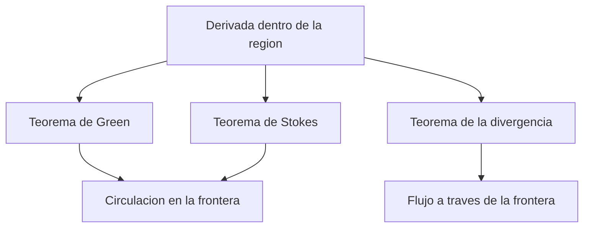

# 18. Cálculo vectorial y teoremas integrales

[[es/17-multiple-integrals|← 17. Integrales múltiples y cambio de variables]] · [[es/index|Índice]] · [[es/term-index|Términos y teoremas]] · [[es/19-measure-theory|19. Teoría de la medida y funciones medibles →]]

> [!abstract] Objetivo
> Integrar a lo largo de curvas y superficies y relacionar integrales frontera con derivadas en el interior.

## 18.1 Integrales de línea

Para una curva suave $\gamma:[a,b]\to\mathbb R^n$, la integral escalar de línea es

$$
\int_\gamma f\,ds
=\int_a^b f(\gamma(t))\,\|\gamma'(t)\|\,dt.
$$

Es independiente de la orientación. Para un campo vectorial $F$, el trabajo o circulación es

$$
\int_\gamma F\cdot dr
=\int_a^b F(\gamma(t))\cdot\gamma'(t)\,dt,
$$

que cambia de signo al invertir la orientación. Una reparametrización con la misma orientación no altera las integrales.

Un campo es **conservativo** si $F=\nabla\varphi$ para un potencial $\varphi$. Entonces

$$
\int_\gamma\nabla\varphi\cdot dr=\varphi(\gamma(b))-\varphi(\gamma(a)),
$$

por lo que la integral solo depende de los extremos. En un dominio simplemente [[es/13-metric-spaces#13.5 Continuidad y conexión|conexo]] de $\mathbb R^3$, un campo $C^1$ es conservativo exactamente cuando $\nabla\times F=0$; en dominios generales puede haber obstrucciones topológicas.

## 18.2 Integrales de superficie y flujo

Para una superficie suave parametrizada por $r(u,v)$, el elemento de área es

$$
dS=\|r_u\times r_v\|\,du\,dv.
$$

Así, $\iint_\Sigma f\,dS=\iint f(r(u,v))\|r_u\times r_v\|\,du\,dv$. Una orientación viene dada por una normal unitaria $n$. El flujo es

$$
\iint_\Sigma F\cdot n\,dS
=\iint F(r(u,v))\cdot(r_u\times r_v)\,du\,dv,
$$

con parametrización compatible con la normal deseada. Invertir la orientación cambia el flujo, pero no el área escalar.

## 18.3 Gradiente, divergencia y rotacional

En coordenadas cartesianas,

$$
\nabla f=(f_x,f_y,f_z),
$$
$$
\nabla\cdot F=P_x+Q_y+R_z,
$$
$$
\nabla\times F=
\begin{vmatrix}
\mathbf i&\mathbf j&\mathbf k\\
\partial_x&\partial_y&\partial_z\\
P&Q&R
\end{vmatrix},
\qquad F=(P,Q,R).
$$

La divergencia mide la densidad local de salida; el rotacional, la rotación local. Con hipótesis $C^2$, $\nabla\times(\nabla f)=0$ y $\nabla\cdot(\nabla\times F)=0$.

## 18.4 Teoremas de Green, Stokes y Gauss

> [!theorem] Teorema de Green
> Para la frontera suave a trozos y positivamente orientada de una región plana $D$,
> $$
> \oint_{\partial D}P\,dx+Q\,dy
> =\iint_D(Q_x-P_y)\,dA.
> $$

^green-theorem

La orientación positiva es antihoraria en la frontera exterior y horaria en los agujeros. En particular,

$$
\operatorname{area}(D)=\frac12\oint_{\partial D}(x\,dy-y\,dx).
$$

> [!theorem] Teorema de Stokes
> Para una superficie orientada $\Sigma$ con frontera compatible,
> $$
> \oint_{\partial\Sigma}F\cdot dr
> =\iint_\Sigma(\nabla\times F)\cdot n\,dS.
> $$

^stokes-theorem

Green es el caso plano. La orientación frontera sigue la regla de la mano derecha respecto de $n$.

> [!theorem] Teorema de la divergencia (Gauss)
> Para un sólido $\Omega$ con frontera suave a trozos y normal exterior,
> $$
> \iint_{\partial\Omega}F\cdot n\,dS
> =\iiint_\Omega\nabla\cdot F\,dV.
> $$

^divergence-theorem

Todos requieren regularidad adecuada e incluyen cada componente frontera con la orientación correcta.

## Ejemplo resuelto

Sea $F(x,y,z)=(x,y,z)$ en la bola de radio $R$. Como $\nabla\cdot F=3$, el [[#^divergence-theorem|teorema de la divergencia]] da [[#18.2 Integrales de superficie y flujo|flujo]] exterior

$$
\iiint_{B_R}3\,dV=3\cdot\frac{4\pi R^3}{3}=4\pi R^3.
$$

Directamente, $n=(x,y,z)/R$ en la esfera, así que $F\cdot n=R$ y el flujo es $R\cdot4\pi R^2=4\pi R^3$.

## Errores frecuentes

1. Las integrales escalares no están orientadas; trabajo y flujo sí.
2. [[#18.3 Gradiente, divergencia y rotacional|Rotacional]] nulo implica potencial solo con topología adecuada del dominio.
3. La orientación frontera es parte esencial del teorema.

## Ejercicios

1. Calcula $\int_\gamma(x\,dx+y\,dy)$ a lo largo de cualquier [[es/09-improper-integrals-applications#9.3 Área, longitud y volumen|camino suave]] de $(0,0)$ a $(1,1)$.
2. Usa Green para evaluar $\oint(x^2+y^2)\,dy$ en la circunferencia unidad, sentido antihorario.
3. Halla el flujo de $F=(x,y,z)$ a través de la frontera del cubo $[0,1]^3$.

> [!answer]- Respuestas breves
> 1. El potencial es $(x^2+y^2)/2$, así que la integral vale $1$.
> 2. $P=0$, $Q=x^2+y^2$; la integral es $\iint_D2x\,dA=0$ por simetría.
> 3. La divergencia es $3$ y el volumen del cubo es $1$, por lo que el flujo exterior es $3$.

---

[[es/17-multiple-integrals|← 17. Integrales múltiples y cambio de variables]] · [[es/index|Índice]] · [[es/term-index|Términos y teoremas]] · [[es/19-measure-theory|19. Teoría de la medida y funciones medibles →]]
