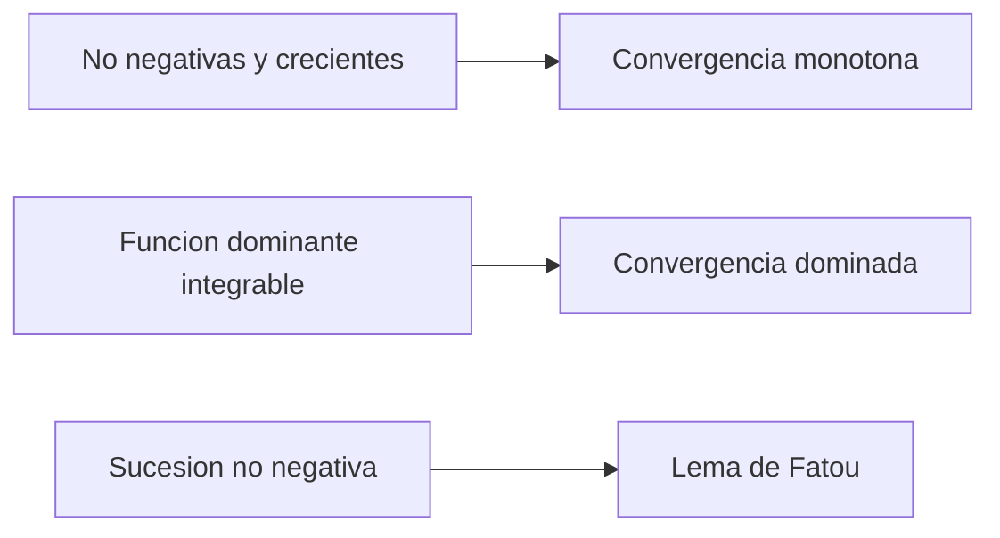

# 20. Integración de Lebesgue y teoremas de convergencia

[[es/19-measure-theory|← 19. Teoría de la medida y funciones medibles]] · [[es/index|Índice]] · [[es/term-index|Términos y teoremas]] · [[es/21-lp-spaces|21. Espacios Lp y modos de convergencia →]]

> [!abstract] Objetivo
> Definir la [[#20.1 Construcción de la integral|integral de Lebesgue]] y aplicar los teoremas de límite que la hacen más flexible que la de Riemann.

## 20.1 Construcción de la integral

Para una [[es/19-measure-theory#19.4 Funciones medibles|función simple]] no negativa $\varphi=\sum_{k=1}^{m}a_k1_{A_k}$, definimos

$$
\int_X\varphi\,d\mu=\sum_{k=1}^{m}a_k\mu(A_k),
$$

con $0\cdot\infty=0$. Para una $f\ge0$ medible general,

$$
\int_X f\,d\mu
=\sup\left\{\int_X\varphi\,d\mu:
0\le\varphi\le f,\ \varphi\text{ simple}\right\}.
$$

El valor puede ser $+\infty$. Escribimos $f^+=\max(f,0)$ y $f^-=\max(-f,0)$, de modo que $f=f^+-f^-$ y $|f|=f^++f^-$. Una $f$ medible es **integrable**, $f\in L^1(\mu)$, si

$$
\int_X|f|\,d\mu<\infty,
$$

y entonces $\int f\,d\mu=\int f^+\,d\mu-\int f^-\,d\mu$.

La integral es lineal y monótona. Cambiar una función en un conjunto nulo no altera su integral. Si $f$ es integrable, es finita casi en todas partes, y

$$
\left|\int_Xf\,d\mu\right|\le\int_X|f|\,d\mu.
$$

## 20.2 Los tres teoremas fundamentales de límite

> [!theorem] Teorema de convergencia monótona
> Si $0\le f_n\uparrow f$ casi en todas partes, entonces
> $$
> \int_Xf_n\,d\mu\uparrow\int_Xf\,d\mu,
> $$
> incluyendo la posibilidad de límite infinito.

^lebesgue-monotone-convergence-theorem

> [!lemma] Lema de Fatou
> Para $f_n\ge0$ medibles,
> $$
> \int_X\liminf_{n\to\infty}f_n\,d\mu
> \le\liminf_{n\to\infty}\int_Xf_n\,d\mu.
> $$

^fatou-lemma

> [!theorem] Teorema de convergencia dominada
> Si funciones medibles $f_n\to f$ c.t.p. y $|f_n|\le g$ para una $g$ integrable, entonces
> $$
> \lim_{n\to\infty}\int_X|f_n-f|\,d\mu=0,
> \qquad
> \lim_{n\to\infty}\int_Xf_n\,d\mu=\int_Xf\,d\mu.
> $$

^dominated-convergence-theorem

La dominación es crucial. Las funciones $n1_{(0,1/n)}$ tienden puntualmente a cero en $(0,1)$, pero todas tienen integral $1$. No están acotadas por una única función integrable independiente de $n$.

## 20.3 Relación con la integral de Riemann

Una función acotada e integrable Riemann en $[a,b]$ es integrable Lebesgue y ambas integrales coinciden. Lebesgue también admite funciones muy discontinuas: $\int_{[0,1]}1_{\mathbb Q}\,d\lambda=0$.

Una [[es/09-improper-integrals-applications#9.1 Definiciones|integral impropia]] de Riemann absolutamente convergente da una integral de Lebesgue con el mismo valor. Una impropia [[es/04-numeric-series#4.3 Convergencia absoluta y condicional|condicionalmente convergente]], como $\int_1^\infty\sin x/x\,dx$, **no** define una integral de Lebesgue finita en todo el intervalo porque $\int|\sin x|/x=\infty$.

## 20.4 Medidas producto y Fubini–Tonelli

Dados [[es/19-measure-theory#19.2 Medidas|espacios de medida]] $\sigma$-finitos, se construye $\mu\times\nu$ con $(\mu\times\nu)(A\times B)=\mu(A)\nu(B)$.

- **Tonelli:** para $f\ge0$ medible, la integral producto y ambas iteradas son iguales, posiblemente infinitas.
- **Fubini:** si $\int|f|\,d(\mu\times\nu)<\infty$, ambas iteradas existen y son iguales a la integral producto.

Sin no negatividad o integrabilidad absoluta, las iteradas pueden diferir o no existir. La $\sigma$-finitud cubre $\mathbb R^n$ con [[es/19-measure-theory#19.3 Medida de Lebesgue|medida de Lebesgue]] y la mayoría de aplicaciones habituales.

## Ejemplo resuelto

Calculamos $\int_0^1x^{-1/2}\,dx$. Sea

$$
f_n(x)=x^{-1/2}1_{(1/n,1)}(x).
$$

Estas funciones crecen hacia $x^{-1/2}$ para $0<x<1$. La convergencia monótona da

$$
\int_0^1x^{-1/2}\,dx
=\lim_{n\to\infty}\int_{1/n}^{1}x^{-1/2}\,dx
=\lim_{n\to\infty}2(1-n^{-1/2})=2.
$$

## Errores frecuentes

1. La convergencia c.t.p. por sí sola no implica convergencia de integrales.
2. La convergencia impropia condicional no es integrabilidad absoluta de Lebesgue.
3. Fubini exige integrabilidad absoluta; Tonelli, no negatividad.

## Ejercicios

1. Calcula $\int_{[0,1]}1_{\mathbb Q}\,d\lambda$.
2. Aplica [[#^dominated-convergence-theorem|convergencia dominada]] a $\lim_n\int_0^1\frac{1+nx}{n(1+x^2)}\,dx$.
3. Da un ejemplo de desigualdad estricta en Fatou.

> [!answer]- Respuestas breves
> 1. Es cero porque $\mathbb Q\cap[0,1]$ es nulo.
> 2. Los integrandos están acotados por $2$ para $n\ge1$ y tienden a $x/(1+x^2)$; el límite es $\frac12\log2$. La constante $2$ es integrable en el intervalo finito.
> 3. Para $f_n=n1_{(0,1/n)}$, el límite puntual es cero c.t.p.; el lado izquierdo es $0$ y el derecho $1$.

---

[[es/19-measure-theory|← 19. Teoría de la medida y funciones medibles]] · [[es/index|Índice]] · [[es/term-index|Términos y teoremas]] · [[es/21-lp-spaces|21. Espacios Lp y modos de convergencia →]]
