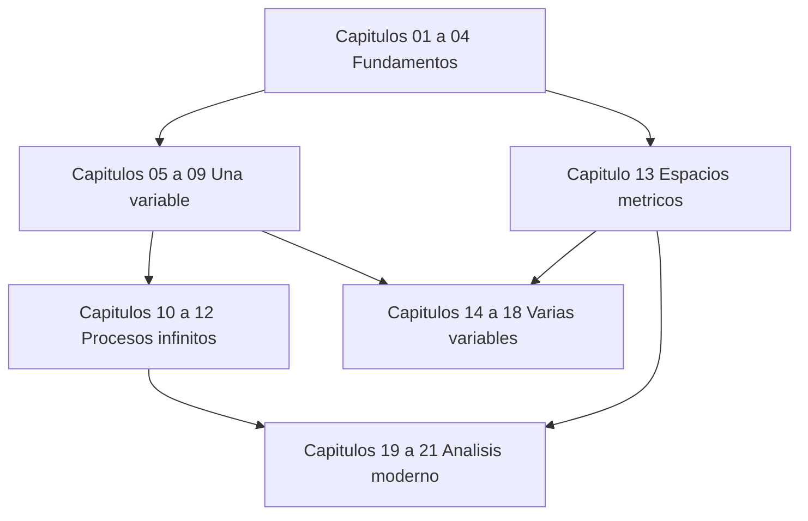

# Análisis matemático

[[en/index|English]] · [[ru/index|Русский]] · **Español**

Un curso riguroso desde los fundamentos hasta la integración moderna, en 21 capítulos. Léelo aquí en GitHub o abre `MathInMind-Obsidian/` como vault de Obsidian para tener wikienlaces, vista previa al pasar el ratón y recuadros de teoremas; [[es/00-notation|la guía de ambas vistas]] explica la diferencia.

## Material de apoyo

- [[es/term-index|Índice de términos y teoremas]] — cada definición y resultado, a un clic de su enunciado.
- [[es/00-notation|Cómo leer el curso: vistas y notación]]
- [[es/formula-sheet|Hoja de fórmulas]]
- [[es/glossary|Glosario trilingüe]]
- [Libros y colecciones de problemas recomendados](https://github.com/NikiHunter/matan/blob/main/REFERENCES.md)

## Lecciones ilustradas 2025/26

- [[es/lectures-2025-26/index|Índice de todas las lecciones 0–64]]: transcripciones completas de las lecciones 2025/26, originales en ruso con traducciones al inglés y al español, incluidas las demostraciones manuscritas y las figuras.
- **Semestre 1:** lecciones 0–32. **Semestre 2:** lecciones 33–64. El semestre 2 se solapa con el [[ru/lectures/index|registro ruso `ru/lectures/`]], orientado al examen; cada lección enlaza con la sección correspondiente del registro.
- El origen de cada figura (PDF, página y recorte) se registra por lotes en [`assets/lectures-2025-26/`](https://github.com/NikiHunter/matan/tree/main/MathInMind/assets/lectures-2025-26).

## Mapa del curso

## Parte I — Fundamentos

1. [[es/01-logic-sets-functions|Lógica, conjuntos y funciones]] — cuantificadores, demostraciones, cardinalidad.
2. [[es/02-real-numbers|Los números reales y la completitud]] — supremo, propiedad arquimediana, densidad.
3. [[es/03-sequences|Sucesiones y límites]] — criterios de monotonía y Cauchy, subsucesiones.
4. [[es/04-numeric-series|Series numéricas]] — criterios, convergencia absoluta y condicional.

## Parte II — Cálculo de una variable

5. [[es/05-limits-continuity|Límites y continuidad]] — límites funcionales, valores intermedios, continuidad uniforme.
6. [[es/06-derivatives|Derivación]] — aproximación lineal, regla de la cadena, funciones inversas.
7. [[es/07-taylor-convexity|Teoremas del valor medio, Taylor y convexidad]].
8. [[es/08-riemann-integration|La integral de Riemann]] — sumas de Darboux, teorema fundamental, técnicas.
9. [[es/09-improper-integrals-applications|Integrales impropias y aplicaciones]] — convergencia, área, longitud, volumen, trabajo.

## Parte III — Procesos infinitos

10. [[es/10-function-sequences-series|Sucesiones y series de funciones]] — convergencia uniforme e intercambio de operaciones.
11. [[es/11-power-series|Series de potencias y funciones analíticas]] — radio, cálculo término a término, series de Taylor.
12. [[es/12-fourier-series|Series de Fourier]] — ortogonalidad, convergencia puntual y cuadrática media.

## Parte IV — Varias variables y topología

13. [[es/13-metric-spaces|Espacios métricos, compacidad y completitud]].
14. [[es/14-several-variables|Funciones de varias variables]] — límites conjuntos, continuidad, dominios compactos.
15. [[es/15-multivariable-differentiation|Derivación multivariable]] — jacobiana, gradiente, hessiana.
16. [[es/16-implicit-functions-extrema|Funciones inversas e implícitas; extremos]] — teoremas locales y multiplicadores de Lagrange.

## Parte V — Integración en varias variables

17. [[es/17-multiple-integrals|Integrales múltiples y cambio de variables]] — Fubini, coordenadas polares y esféricas.
18. [[es/18-vector-calculus|Cálculo vectorial y teoremas integrales]] — línea y superficie, Green, Stokes, Gauss.

## Parte VI — Análisis moderno

19. [[es/19-measure-theory|Teoría de la medida y funciones medibles]].
20. [[es/20-lebesgue-integration|Integración de Lebesgue y teoremas de convergencia]].
21. [[es/21-lp-spaces|Espacios $L^p$ y modos de convergencia]] — Hölder, completitud, geometría de Hilbert.

## Rutina de estudio sugerida

1. Lee los objetivos y reproduce cada definición sin mirar.
2. Trabaja los ejemplos e identifica dónde se usa cada hipótesis.
3. Intenta los ejercicios antes de abrir las respuestas.
4. Lleva un registro personal de errores y enlázalo con los capítulos.
5. Repasa con la hoja de fórmulas solo después de entender las deducciones; no sustituye la teoría.

Para un primer curso, estudia los capítulos 1–12 y 14–18, consultando el 13 cuando sea necesario. Para un segundo curso, repasa los resúmenes y concéntrate en los capítulos 13 y 19–21. El archivo de lecciones original se documenta en las [notas de fuentes](https://github.com/NikiHunter/matan/blob/main/source/README.md).
