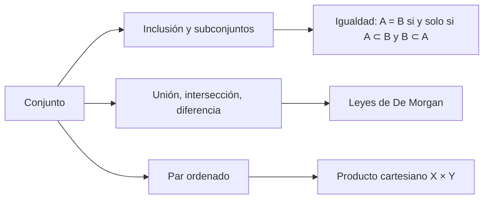

# Lección 0 — Conjuntos y lógica matemática

[[es/lectures-2025-26/index|Índice de lecciones]] · [[es/lectures-2025-26/lecture-01-02|Lecciones 1–2 →]] · [[es/term-index|Términos y teoremas]] · [[ru/lectures-2025-26/lecture-00|Русский]] · [[en/lectures-2025-26/lecture-00|English]]

> [!info] Fuente
> `МА2526_лекция_0.pdf` — 17 diapositivas (Beamer), D. E. Apushkinskaya, Universidad RUDN, 1 de septiembre de 2025. El texto se extrajo de la capa de texto del PDF y se comprobó con las imágenes de las diapositivas; las fórmulas se reescribieron en LaTeX. Este archivo no tiene ilustraciones porque las diapositivas contienen solo texto y fórmulas.

## Diapositiva 1. Portada

Análisis Matemático · Lección 0 · 1 de septiembre de 2025.

## Diapositiva 2. Objetivo de la lección

- Nos familiarizaremos con las definiciones básicas de la teoría de conjuntos.
- Discutiremos la notación lógica y las operaciones sobre conjuntos.
- Enunciaremos las leyes de De Morgan.
- Discutiremos los pares ordenados y el producto cartesiano.

## Diapositiva 3. Capítulo 1, §0. Conjuntos

> [!definition] Definición 1.0.1
> Un conjunto es un conjunto, colección o agregado de objetos, llamados elementos del conjunto. Los conjuntos pueden ser finitos o infinitos. Usualmente los conjuntos se denotan con letras latinas mayúsculas.

^def-1-0-1

En rigor, la [[#^def-1-0-1|definición 1.0.1]] no es una definición formal: el concepto de conjunto es un concepto no definido. Sin definir estrictamente el concepto de conjunto, discutiremos, sin embargo, sus propiedades y las reglas para trabajar con él.

En un curso de análisis matemático nos resultará más cómodo mantenernos dentro de la teoría «ingenua» de conjuntos.

## Diapositiva 4. Formas de dar conjuntos

Formas de dar un conjunto:

1. Enumeración de sus elementos.
2. Selección de los elementos de un conjunto mediante alguna propiedad.

Describir un conjunto mediante una propiedad puede llevar a veces a una contradicción (paradoja de Russell).

**Notación.** El elemento $a$ pertenece al conjunto $A$: $a \in A$. El elemento $a$ no pertenece al conjunto $A$: $a \notin A$.

## Diapositiva 5. Inclusión (subconjunto)

> [!definition] Definición 1.0.2
> Si cada elemento de un conjunto $X$ pertenece a un conjunto $Y$, se dice que $X$ está contenido en $Y$ (y también que $X$ es un subconjunto de $Y$, que $X$ es una parte de $Y$, que $Y$ contiene a $X$) y se escribe
>
> $$
> X \subset Y \quad\text{o}\quad Y \supset X .
> $$

^def-1-0-2

Pertenencia: el propio elemento pertenece al conjunto: $\{1, 2\} \in \{3, 4, \{1, 2\}\}$.

Inclusión: todos los elementos de uno de los conjuntos son elementos del segundo: $\{1, 2\} \subset \{3, 4, 1, 2\}$.

## Diapositiva 6. El conjunto vacío

Conviene introducir el conjunto vacío: el conjunto que no tiene ningún elemento. El conjunto vacío se denota por $\varnothing$.

$\varnothing \subset X$ para todo $X$; es decir, el conjunto vacío es subconjunto de cualquier otro conjunto.

## Diapositiva 7. Propiedades de la inclusión; igualdad de conjuntos

Propiedades de la inclusión:

- $A \subset A$, es decir, un conjunto es subconjunto de sí mismo;
- $A \subset B$ y $B \subset C \Rightarrow A \subset C$.

> [!definition] Definición 1.0.3
> Si los conjuntos $A$ y $B$ constan de los mismos elementos, se dice que son iguales y se escribe $A = B$.

^def-1-0-3

Dicho de otro modo, $A = B$ si y solo si $A \subset B$ y $B \subset A$.

## Diapositiva 8. Conjuntos numéricos

Algunos conjuntos numéricos tienen notación de uso general:

- $\mathbb{N}$ — conjunto de los números naturales;
- $\mathbb{Z}_+$ — conjunto de los enteros no negativos;
- $\mathbb{Z}$ — conjunto de los enteros;
- $\mathbb{Q}$ — conjunto de los números racionales, es decir, fracciones $\dfrac{p}{q}$ con $p \in \mathbb{Z}$, $q \in \mathbb{N}$;
- $\mathbb{R}$ — conjunto de los números reales;
- $\mathbb{C}$ — conjunto de los números complejos.

## Diapositiva 9. Lenguaje matemático: implicación, equivalencia, negación

Si $P$ y $Q$ son dos enunciados, la expresión

$$
P \Rightarrow Q
$$

se llama implicación y significa que si se cumple $P$, entonces se cumple también $Q$. La expresión $Q \Leftarrow P$ significa lo mismo.

También se dice: de $P$ se sigue $Q$; $P$ implica $Q$; $P$ es suficiente para $Q$; $Q$ es necesario para $P$.

Si $P \Rightarrow Q$ y $Q \Rightarrow P$, se dice que los enunciados $P$ y $Q$ son equivalentes, o que $P$ es necesario y suficiente para $Q$, y se escribe $P \Leftrightarrow Q$.

La negación de un enunciado $P$ se denota por $\neg P$.

## Diapositiva 10. Lenguaje matemático: cuantificadores

Para abreviar la escritura conviene usar dos símbolos especiales, llamados [[es/01-logic-sets-functions#1.1 Proposiciones y cuantificadores|cuantificadores]]:

- $\forall$ — cuantificador universal (de generalidad); sustituye las palabras «cualquier», «todo», «cada», o las expresiones «para cualquier», «para todo», «para cada»;
- $\exists$ — cuantificador existencial; sustituye las palabras «existe», «se encuentra», «se puede elegir».

Los dos puntos en fórmulas con cuantificadores sustituyen a las palabras «tal que», aunque no siempre se escribirán.

## Diapositiva 11. Familias de conjuntos

Un conjunto se determina por sus elementos, por eso no tiene sentido decir que un elemento pertenece a un conjunto varias veces, ni que un conjunto contiene varios elementos iguales. Para considerar varios ejemplares de un mismo elemento se usa el concepto de familia.

> [!definition] Definición 1.0.4
> Sean $X$ y $A$ conjuntos, y supongamos que algunos elementos de $X$ están provistos de (numerados por) elementos de $A$ (índices). Cada índice se usa exactamente una vez, pero un elemento de $X$ puede llevar más de un índice. Esto último significa que los elementos de $X$ pueden aparecer en una familia en muchos ejemplares. Las familias se denotan $\{x_\alpha\}_{\alpha \in A}$ o $(x_\alpha)_{\alpha \in A}$.

^def-1-0-4

## Diapositiva 12. Operaciones con conjuntos: unión

> [!definition] Definición 1.0.5
> Sea $\{X_\alpha\}_{\alpha \in A}$ una familia de conjuntos. La unión de la familia $\{X_\alpha\}_{\alpha \in A}$ es el conjunto de todos los elementos que pertenecen al menos a uno de los conjuntos $X_\alpha$:
>
> $$
> \bigcup_{\alpha \in A} X_\alpha = \{\, x : \exists\, \alpha \in A,\ x \in X_\alpha \,\}.
> $$

^def-1-0-5

Si la familia consta de dos conjuntos $X$ e $Y$, se escribe $X \cup Y$ (no importa cómo se numeren los conjuntos).

Está claro que

$$
(X \cup Y) \cup Z = X \cup (Y \cup Z), \qquad X \cup Y = Y \cup X, \qquad X \cup X = X \cup \varnothing = X .
$$

## Diapositiva 13. Operaciones con conjuntos: intersección

> [!definition] Definición 1.0.6
> Sea $\{X_\alpha\}_{\alpha \in A}$ una familia de conjuntos. La intersección de la familia es el conjunto de todos los elementos que pertenecen a cada uno de los conjuntos $X_\alpha$:
>
> $$
> \bigcap_{\alpha \in A} X_\alpha = \{\, x : \forall\, \alpha \in A,\ x \in X_\alpha \,\}.
> $$

^def-1-0-6

Si la familia consta de dos conjuntos $X$ e $Y$, se escribe $X \cap Y$ (no importa cómo se numeren los conjuntos).

Está claro que

$$
(X \cap Y) \cap Z = X \cap (Y \cap Z), \qquad X \cap Y = Y \cap X, \qquad X \cap X = X, \qquad X \cap \varnothing = \varnothing .
$$

## Diapositiva 14. Operaciones con conjuntos: diferencia y complemento

> [!definition] Definición 1.0.7
> La diferencia de los conjuntos $X$ e $Y$ es el conjunto de todos los elementos que pertenecen a $X$ pero no pertenecen a $Y$:
>
> $$
> X \setminus Y = \{\, x : x \in X,\ x \notin Y \,\}.
> $$

^def-1-0-7

En la [[#^def-1-0-7|definición 1.0.7]] no se supone que $Y \subset X$. Si $Y \subset X$, la diferencia $X \setminus Y$ se llama también complemento de $Y$ en $X$. El complemento de $X$ respecto de un conjunto fundamental $U$ se llama complemento de $X$ y se denota $X^c$.

Está claro que

$$
(X^c)^c = X, \qquad X \cup X^c = U, \qquad X \cap X^c = \varnothing .
$$

## Diapositiva 15. Leyes de De Morgan

> [!theorem] Teorema 1.0.1
> Sean $\{X_\alpha\}_{\alpha \in A}$ una familia de conjuntos e $Y$ un conjunto. Entonces
>
> $$
> Y \setminus \bigcup_{\alpha \in A} X_\alpha = \bigcap_{\alpha \in A} \left(Y \setminus X_\alpha\right),
> $$
>
> $$
> Y \setminus \bigcap_{\alpha \in A} X_\alpha = \bigcup_{\alpha \in A} \left(Y \setminus X_\alpha\right),
> $$
>
> $$
> Y \cap \bigcup_{\alpha \in A} X_\alpha = \bigcup_{\alpha \in A} \left(Y \cap X_\alpha\right),
> $$
>
> $$
> Y \cup \bigcap_{\alpha \in A} X_\alpha = \bigcap_{\alpha \in A} \left(Y \cup X_\alpha\right).
> $$

^thm-1-0-1

## Diapositiva 16. Par ordenado

> [!definition] Definición 1.0.8
> Un par ordenado es una familia de dos elementos cuyo conjunto de índices es $\{1, 2\}$.

^def-1-0-8

En la notación del par ordenado $(a, b)$ se entiende que en el primer lugar se escribe el elemento indexado por $1$, y en el segundo, el indexado por $2$. Dos pares $(a, b)$ y $(c, d)$ son iguales si $a = c$ y $b = d$.

De manera análoga se define una $m$-upla ordenada $(x_1, x_2, \dots, x_m)$. Los elementos de una upla ordenada se llaman sus coordenadas o componentes.

## Diapositiva 17. Producto cartesiano (directo)

> [!definition] Definición 1.0.9
> El producto cartesiano (o directo) de los conjuntos $X$ e $Y$ es el conjunto de todos los pares ordenados tales que el primer elemento del par pertenece a $X$ y el segundo a $Y$:
>
> $$
> X \times Y = \{\, (x, y) : x \in X,\ y \in Y \,\}.
> $$

^def-1-0-9

Esta definición se extiende a varios factores:

$$
X_1 \times \cdots \times X_m = \{\, (x_1, \dots, x_m) : x_i \in X_i \ \ \forall\, i = 1, \dots, m \,\}.
$$

**¡El orden de los factores es esencial!**

## Esquema de la lección

