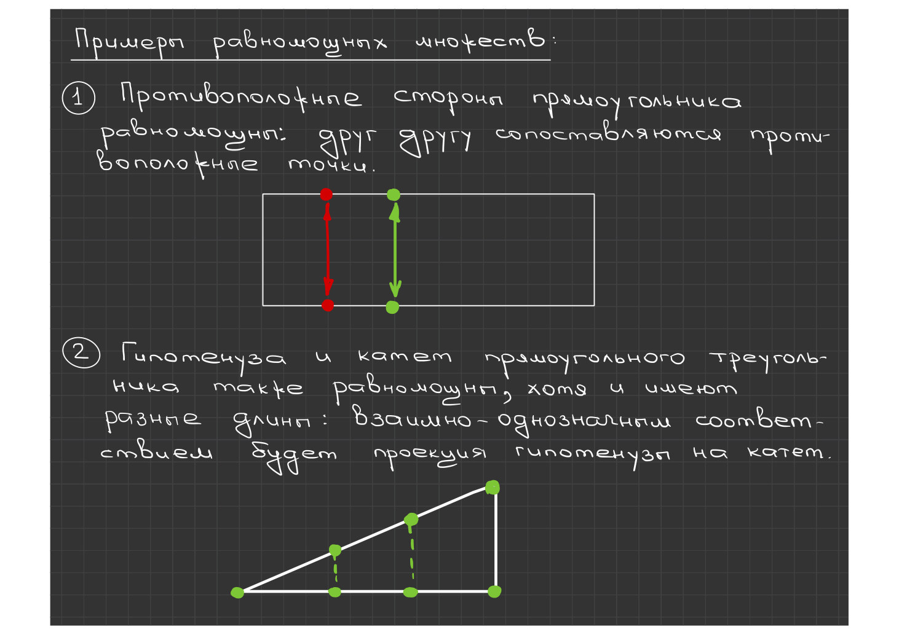
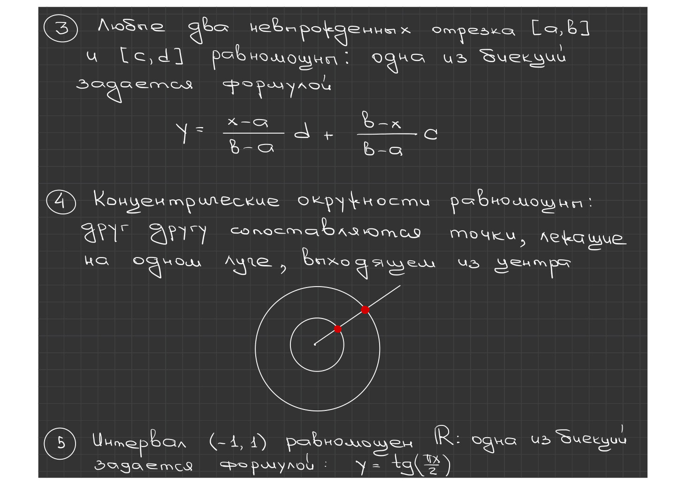
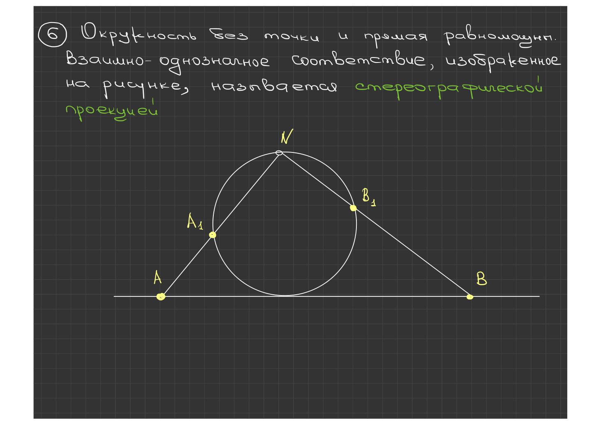
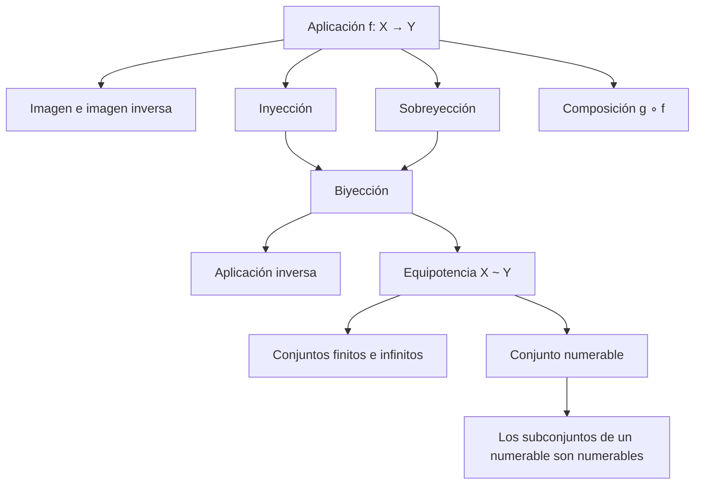

# Lecciones 1–2 — Aplicaciones y conjuntos numerables

[[es/lectures-2025-26/lecture-00|← Lección 0]] · [[es/lectures-2025-26/index|Índice de lecciones]] · [[es/lectures-2025-26/lecture-03|Lección 3 →]] · [[es/term-index|Términos y teoremas]] · [[ru/lectures-2025-26/lecture-01-02|Русский]] · [[en/lectures-2025-26/lecture-01-02|English]]

> [!info] Fuente
> `ma25_26-lectures_1-2_notes.pdf` — 23 páginas: 15 diapositivas impresas con capa de texto y 8 páginas manuscritas (sin capa de texto). Las diapositivas impresas se extrajeron de la capa de texto y se comprobaron con las imágenes; las páginas manuscritas se transcribieron a partir de las imágenes. Las figuras de las páginas manuscritas 13, 14 y 15 se incluyen como ilustraciones. Los números de página del PDF aparecen en los encabezados.

## Diapositiva 2. Cita del día

> «La primera clase siempre empieza con una sesión de intimidación ritual. Hola, soy Baba Yaga del cuento, la profesora A., y les daré las clases de esta asignatura. Tiemblen, pues la hora del ajuste de cuentas está cerca.
>
> Si faltan K clases, serán considerados alumnos con faltas graves. Si faltan M clases, su retrato aparecerá en la puerta del decanato con la inscripción «Wanted», y si faltan N, entonces nunca han existido. Y así sucesivamente.
>
> Esta parte de la clase siempre se escucha con atención: a lo mejor la asignatura no interesa en absoluto a los estudiantes, pero todos quieren sobrevivir hasta el próximo semestre…»
>
> — tchainka, LiveJournal

## Diapositiva 3. Objetivo de la lección

- Hablaremos de las aplicaciones y de los conceptos relacionados con ellas.
- Introduciremos el concepto de equivalencia.
- Discutiremos la numerabilidad y la no numerabilidad de conjuntos.

## §1. Aplicaciones

### Diapositiva 4. Definición 1.1.1

Consideremos dos conjuntos arbitrarios $X$ e $Y$. Si a cada elemento $x$ del conjunto $X$ se le asigna, según una regla determinada $f$, un único elemento $y$ del conjunto $Y$, se dice que está dada una aplicación del conjunto $X$ en el conjunto $Y$, y se escribe

$$
f : X \to Y \qquad\text{o}\qquad X \xrightarrow{\ f\ } Y .
$$

Esta descripción no puede considerarse una definición estricta del término «aplicación», ya que contiene los conceptos todavía no definidos de «regla» y «asignado». Nos resultará más cómodo considerar el concepto de aplicación como no definido.

### Diapositiva 5. Aplicaciones

Una aplicación es una terna de objetos $(X, Y, f)$. Si del contexto se entiende a qué conjuntos $X$ e $Y$ nos referimos, se indica solo la regla $f$ y se habla de «la aplicación $f$».

El conjunto $X$ se llama dominio (de definición) y el conjunto $Y$, codominio (conjunto de valores) de la aplicación.

El elemento $y \in Y$ que la regla $f$ asigna al elemento $x \in X$ se denota $f(x)$ y se llama valor de la aplicación $f$ en $x$, o imagen de $x$. Aquí $x$ se llama argumento de la aplicación, o variable independiente, e $y$, valor de la aplicación, o variable dependiente.

Si $X$ e $Y$ son conjuntos numéricos, la aplicación se llama función.

### Diapositiva 6. Imagen e imagen inversa

> [!definition] Definición 1.1.2
> Sean $f : X \to Y$ y $A$ un conjunto. El conjunto
>
> $$
> f(A) = \{\, y \in Y : \exists\, x \in A,\ f(x) = y \,\}
> $$

^def-1-1-2

se llama imagen de $A$ por $f$. El conjunto de valores de $f$ es $f(X)$, es decir, la imagen de $X$.

> [!definition] Definición 1.1.3
> Sean $f : X \to Y$ y $B$ un conjunto. El conjunto
>
> $$
> f^{-1}(B) = \{\, x \in X : f(x) \in B \,\}
> $$

^def-1-1-3

se llama imagen inversa (o preimagen) de $B$ por $f$.

### Diapositiva 7. Inyección, sobreyección, biyección

> [!definition] Definición 1.1.4
> Una aplicación $f : X \to Y$ se llama inyectiva (inyección) si
>
> $$
> \forall\, x_1, x_2 \in X:\quad x_1 \neq x_2 \ \Rightarrow\ f(x_1) \neq f(x_2).
> $$

^def-1-1-4

> [!definition] Definición 1.1.5
> Una aplicación $f : X \to Y$ se llama sobreyectiva (sobreyección) si
>
> $$
> \forall\, y \in Y\ \ \exists\, x \in X:\quad f(x) = y .
> $$

^def-1-1-5

> [!definition] Definición 1.1.6
> Una aplicación $f : X \to Y$ se llama biyectiva (biyección) si es inyectiva y sobreyectiva.

^def-1-1-6

### Página manuscrita 8 (p. 8 del PDF). Ejemplos

La aplicación $f : X \to Y$, $f(x) = x^2$.

1. Si $X = Y = \mathbb{R}$, entonces $f$ no es [[#^def-1-1-5|sobreyectiva]] (no toma valores negativos); $f$ no es [[#^def-1-1-4|inyectiva]], pues $f(-1) = f(1) = 1$.
2. Si $X = \mathbb{R}$, $Y = \mathbb{R}_+$, entonces $f$ es sobreyectiva, pero no inyectiva.
3. Si $X = \mathbb{R}_+$, $Y = \mathbb{R}$, entonces $f$ es inyectiva, pero no sobreyectiva.
4. Si $X = Y = \mathbb{R}_+$, entonces $f$ es sobreyectiva e inyectiva, es decir, [[#^def-1-1-6|biyectiva]].

### Diapositiva 9. Gráfica de una aplicación y aplicación inversa

> [!definition] Definición 1.1.7
> Sea $f : X \to Y$. La gráfica de la aplicación es el conjunto
>
> $$
> \Gamma_f = \{\, (x, y) : x \in X,\ y = f(x) \,\}.
> $$

^def-1-1-7

> [!definition] Definición 1.1.8
> Sea $f : X \to Y$ inyectiva. La aplicación que a cada $y \in f(X)$ le asigna el (único) valor $x \in X$ tal que $f(x) = y$ se llama inversa de $f$ y se denota $f^{-1}$.

^def-1-1-8

### Diapositiva 10. Composición

> [!definition] Definición 1.1.9
> Sean $f : X \to Y$, $g : Y_0 \to Z$, $f(X) \subset Y_0 \subset Y$. La aplicación $h : X \to Z$ definida por
>
> $$
> h(x) = g(f(x)), \qquad x \in X,
> $$

^def-1-1-9

se llama composición (o superposición) de $f$ y $g$, y se denota $g \circ f$. Aquí $g$ se llama aplicación externa y $f$, aplicación interna.

En general, $g \circ f \neq f \circ g$, incluso cuando ambas composiciones están definidas.

### Diapositiva 11. Aplicación identidad. Restricción y extensión

> [!definition] Definición 1.1.10
> La aplicación $\mathrm{id}_X : X \to X$ que a cada $x \in X$ le asigna el propio $x$ se llama aplicación identidad en el conjunto $X$.

^def-1-1-10

> [!definition] Definición 1.1.11
> Sean $f : X \to Y$ y $X_0 \subset X$. La aplicación que a cada $x \in X_0$ le asigna $f(x)$ se llama restricción de $f$ al conjunto $X_0$ y se denota $f|_{X_0}$. Si una aplicación $g$ es una restricción de $f$, entonces $f$ se llama extensión de $g$.

^def-1-1-11

## §2. Cardinalidad. Conjuntos numerables y no numerables

### Diapositiva 12. Definición 1.2.1 (equipotencia)

> [!definition] Definición 1.2.1
> Los conjuntos $X$ e $Y$ se llaman equivalentes, o equipotentes, y se escribe $X \sim Y$, si existe una biyección $\varphi : X \to Y$. Dicho de otro modo, dos conjuntos son equivalentes si entre ellos se puede establecer una correspondencia biunívoca.

### Páginas manuscritas 13, 14, 15 (pp. 13–15 del PDF). Ejemplos de conjuntos equipotentes

**Página 13.** Ejemplos de conjuntos [[#Diapositiva 12. Definición 1.2.1 (equipotencia)|equipotentes]]:

1. Los lados opuestos de un rectángulo son equipotentes: a cada punto de un lado se le asocia el punto opuesto del otro lado.
2. La hipotenusa y un cateto de un triángulo rectángulo también son equipotentes, aunque sus longitudes son distintas: la correspondencia biunívoca es la proyección de la hipotenusa sobre el cateto.

**Página 14.**

3. Dos segmentos no degenerados cualesquiera $[a,b]$ y $[c,d]$ son equipotentes: una de las biyecciones viene dada por la fórmula

$$
 y = \frac{x-a}{b-a}\, d + \frac{b-x}{b-a}\, c .
$$

4. Las circunferencias concéntricas son equipotentes: a los puntos situados sobre un mismo rayo que parte del centro se les asocian entre sí.
5. El intervalo $(-1, 1)$ es equipotente a $\mathbb{R}$: una de las biyecciones viene dada por $y = \operatorname{tg}\!\left(\dfrac{\pi x}{2}\right)$.

**Página 15.**

6. Una circunferencia sin un punto y una recta son equipotentes. La correspondencia biunívoca que se muestra en la figura se llama **proyección estereográfica**.

### Diapositiva 16. Conjuntos finitos e infinitos

> [!definition] Definición 1.2.2
> Un conjunto $X$ se llama finito si es equivalente a algún segmento de $\mathbb{N}$ (un segmento de $\mathbb{N}$ consta de $n$ números naturales consecutivos).

^def-1-2-2

> [!definition] Definición 1.2.3
> Un conjunto $X$ se llama infinito si no es finito, o si es equivalente a una de sus partes propias.

^def-1-2-3

### Diapositiva 17. Relación de equivalencia

> [!definition] Definición 1.2.4
> Una relación $\sim$ entre elementos de un conjunto se llama relación de equivalencia si tiene las tres propiedades siguientes:
>
> 1. Reflexividad: $A \sim A$.
> 2. Simetría: si $A \sim B$, entonces $B \sim A$.
> 3. Transitividad: si $A \sim B$ y $B \sim C$, entonces $A \sim C$.

^def-1-2-4

> [!theorem] Proposición 1.2.1
> La equipotencia de conjuntos es una relación de equivalencia.

^prop-1-2-1

### Página manuscrita 18 (p. 18 del PDF). Demostración de la proposición 1.2.1

Como $\mathrm{id}_A$ es una biyección de $A$ sobre sí mismo, se tiene $A \sim A$.

Si $\varphi : A \to B$ es una biyección, entonces $\varphi^{-1} : B \to A$ también es una biyección; por tanto, de $A \sim B$ se sigue que $B \sim A$.

Si $\varphi : A \to B$ y $\psi : B \to C$ son biyecciones, entonces $\psi \circ \varphi : A \to C$ también es una biyección.

Por lo tanto, de $A \sim B$ y $B \sim C$ se sigue que $A \sim C$.

### Diapositiva 19. Conjunto numerable

> [!definition] Definición 1.2.5
> Un conjunto se llama numerable si es equivalente al conjunto de los números naturales.

^def-1-2-5

Así, un conjunto es [[#^def-1-2-5|numerable]] si sus elementos pueden disponerse en una sucesión $A = \{a_1, a_2, a_3, \dots\}$, es decir, si se pueden numerar con números naturales de modo que cada elemento reciba exactamente un número y se agote toda la serie natural.

### Página manuscrita 20 (p. 20 del PDF). Ejemplos de conjuntos numerables

1. El conjunto $A = \{2, 4, 6, 8, 10, \dots\}$ de todos los números naturales pares es numerable. Biyección: $a_n = 2n$.
2. El conjunto $A = \{1, 4, 9, 16, 25, \dots\}$ de todos los cuadrados de números naturales es numerable. Biyección: $a_n = n^2$.
3. El conjunto $\mathbb{Z} = \{0, \pm 1, \pm 2, \dots\}$ es numerable. Biyección:

$$
 a_{2n-1} = 1 - n, \qquad a_{2n} = n .
$$

Para $n=1$: $a_1 = 0$, $a_2 = 1$; para $n=2$: $a_3 = -1$, $a_4 = 2$; para $n=3$: $a_5 = -2$, $a_6 = 3$, …

### Diapositiva 21. Subconjuntos de un conjunto numerable

> [!theorem] Teorema 1.2.1
> Todo conjunto infinito contiene un subconjunto numerable.

^thm-1-2-1

> [!theorem] Teorema 1.2.2
> Todo subconjunto infinito de un conjunto numerable es numerable: si $A$ es numerable, $B \subset A$ y $B$ es infinito, entonces $B$ es numerable.

^thm-1-2-2

### Página manuscrita 22 (p. 22 del PDF). Demostración del teorema 1.2.1

Sea el conjunto $A$ infinito. Entonces contiene un elemento $a_1$.

El conjunto $A \setminus \{a_1\}$ es infinito, así que existe $a_2 \in A \setminus \{a_1\}$.

El conjunto $A \setminus \{a_1, a_2\}$ también es infinito, así que existe $a_3 \in A \setminus \{a_1, a_2\}$.

Como $A$ es infinito, este proceso no se interrumpe en ningún paso. Continuándolo, obtenemos el conjunto $B = \{a_1, a_2, a_3, \dots\}$, que por construcción es un subconjunto numerable de $A$.

### Página manuscrita 23 (p. 23 del PDF). Demostración del teorema 1.2.2

Dispongamos los elementos de $A$ en una sucesión $A = \{a_1, a_2, a_3, a_4, \dots\}$.

Numeremos los elementos de $B$ en el orden en que aparecen en esta sucesión. Entonces cada elemento de $B$ recibe exactamente un número.

Como $B$ es infinito, para la numeración se usa todo $\mathbb{N}$.

## Esquema de la lección

