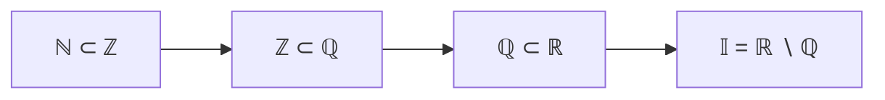

# Lecciones 5–6 — Intervalos, axiomas de completitud, inducción, binomio de Newton, extremos

[[es/lectures-2025-26/lecture-04|← Lección 4]] · [[es/lectures-2025-26/index|Índice de lecciones]] · [[es/lectures-2025-26/lecture-07|Lección 7 →]] · [[es/term-index|Términos y teoremas]] · [[ru/lectures-2025-26/lecture-05-06|Русский]] · [[en/lectures-2025-26/lecture-05-06|English]]

> [!info] Fuente
> `ma25_26-lectures_5-6_notes.pdf` — 32 páginas: diapositivas impresas con capa de texto y páginas manuscritas sin capa de texto utilizable. Las páginas manuscritas se transcribieron a partir de su imagen. La figura de la página 12 se incluye como ilustración. Los números de página del PDF aparecen en los encabezados.
>
> **Nota del editor sobre la numeración.** En las diapositivas fuente, la etiqueta «[[#^def-1-3-5|Definición 1.3.5]]» aparece tres veces: para el [[es/02-real-numbers#2.1 Cuerpo ordenado|cuerpo ordenado]] arquimediano (página 10), para el conjunto inductivo y para el conjunto de los números naturales (página 18). La numeración se conserva tal como en la fuente y no se ha corregido. Del mismo modo, «[[#^def-1-3-2|Definición 1.3.2]]» se refiere a las semirrectas y «[[#^def-1-3-3|Definición 1.3.3]]» a un punto situado entre dos números.

## Diapositiva 2. Cita del día

> Varios científicos recibieron el encargo de demostrar que todos los enteros impares mayores que 2 son primos.
>
> Matemático: 3 es primo, 5 es primo, 7 es primo, y por [[es/01-logic-sets-functions#^example-induction|inducción]], todo entero impar mayor que 2 es primo.
>
> Físico: 3 es primo, 5 es primo, 7 es primo, 9 es un error experimental, 11 es primo. Para estar seguros, comprobemos algunos números elegidos al azar: 17 es primo, 23 es primo.
>
> Ingeniero: 3 es primo, 5 es primo, 7 es primo, 9 es una aproximación a un primo, 11 es primo.

## Diapositiva 3. Objetivo de la lección

- Continuar con los axiomas del cuerpo de los números reales (el [[#^def-1-3-5|axioma de Arquímedes]] y el axioma de Cantor de los segmentos encajados).
- Enunciar el principio de inducción matemática.
- Demostrar el teorema del binomio de Newton.
- Discutir algunas consecuencias de los axiomas de completitud.
- Demostrar los resultados sobre el máximo y el mínimo de un conjunto finito.
- Hablar sobre la densidad de los números racionales.

## §3. Números reales

### Diapositiva 4. Segmentos e intervalos

El orden permite definir intervalos en el conjunto $\mathbb{R}$.

> [!definition] Definición 1.3.1
> Sean $a, b \in \mathbb{R}$. Si $a \le b$, el conjunto
>
> $$
> [a, b] = \{ x \in \mathbb{R} : a \le x \le b \}
> $$

^def-1-3-1

se llama **segmento** (o **intervalo cerrado**).

Si $a < b$, el conjunto

$$
(a, b) = \{ x \in \mathbb{R} : a < x < b \}
$$

se llama **intervalo abierto**, y los conjuntos

$$
[a, b) = \{ x \in \mathbb{R} : a \le x < b \}, \qquad (a, b] = \{ x \in \mathbb{R} : a < x \le b \}
$$

se llaman **semiintervalos**.

### Página manuscrita 6 (p. PDF 6). La notación ⟨a, b⟩

$\langle a, b\rangle$ denota un intervalo de cualquiera de los cuatro tipos: $[a,b]$, $(a,b)$, $[a,b)$ o $(a,b]$. Esta notación se usa cuando no importa si los extremos $a, b$ pertenecen al intervalo o no. Análogamente se escriben $\langle a, b]$, $[a, b\rangle$, $\langle a, +\infty)$, etc.

### Diapositiva 5. Más definiciones

Cuando $a = b$, el segmento $[a,a]$ consta de un solo punto y se llama **degenerado**.

> [!definition] Definición 1.3.2
> Los conjuntos
>
> $$
> [a, +\infty) = \{ x \in \mathbb{R} : a \le x \},\qquad (a, +\infty) = \{ x \in \mathbb{R} : a < x \},
> $$
> $$
> (-\infty, b] = \{ x \in \mathbb{R} : x \le b \},\qquad (-\infty, b) = \{ x \in \mathbb{R} : x < b \}
> $$

^def-1-3-2

se llaman **semirrectas** (la primera y la tercera son semirrectas cerradas, la segunda y la cuarta, abiertas).

El conjunto $\mathbb{R}$ completo se denota también $(-\infty, +\infty)$. Los símbolos $-\infty$ y $+\infty$ no tienen significado propio en estas notaciones.

### Diapositiva 7. Todavía más

> [!definition] Definición 1.3.3
> Si $a, b \in \mathbb{R}$ y un punto $c$ pertenece al intervalo con extremos $a$ y $b$, se dice que $c$ está entre $a$ y $b$.

^def-1-3-3

Denotamos también por $\mathbb{R}_+$ el conjunto de los números no negativos: $\mathbb{R}_+ = [0, +\infty)$.

> [!definition] Definición 1.3.4
> El conjunto $\overline{\mathbb{R}} = \mathbb{R} \cup \{-\infty, +\infty\}$ se llama **recta real extendida**.

^def-1-3-4

### Diapositiva 8. Los elementos impropios $+\infty$ y $-\infty$

Con los elementos impropios se pueden realizar algunas operaciones. Se define:

$$
x + (+\infty) = (+\infty) + x = +\infty, \quad x \in \mathbb{R},
$$
$$
x + (-\infty) = (-\infty) + x = -\infty, \quad x \in \mathbb{R},
$$
$$
x \cdot (+\infty) = (+\infty) \cdot x = \begin{cases} +\infty, & x > 0, \\ -\infty, & x < 0, \end{cases}
\qquad
x \cdot (-\infty) = (-\infty) \cdot x = \begin{cases} -\infty, & x > 0, \\ +\infty, & x < 0, \end{cases}
$$
$$
(+\infty) + (+\infty) = +\infty, \quad (-\infty) + (-\infty) = -\infty,
$$
$$
(+\infty) \cdot (+\infty) = (-\infty) \cdot (-\infty) = +\infty, \quad (+\infty) \cdot (-\infty) = (-\infty) \cdot (+\infty) = -\infty.
$$

### Página manuscrita 9 (p. PDF 9). Indeterminaciones

A las expresiones

$$
(+\infty) + (-\infty),\quad (+\infty) - (+\infty),\quad (-\infty) - (-\infty),\quad 0 \cdot (\pm\infty),\quad (\pm\infty)\cdot 0
$$

no se les asigna ningún valor.

Anotación al margen: «Futuro: $0 \cdot (+\infty) = 0 \cdot \frac{1}{0} = \frac{0}{0}$ — esto se resolverá en la teoría de límites (¡pronto!)».

### Diapositiva 10. III. Axioma de Arquímedes

**III.1.** Cualesquiera que sean los números positivos $x, y \in \mathbb{R}$, existe un número natural $n$ tal que $nx > y$.

> [!definition] Definición 1.3.5
> Un cuerpo ordenado en el que se cumple el axioma de Arquímedes se llama **arquimediano**.

^def-1-3-5

Del axioma de Arquímedes se sigue que existen números naturales arbitrariamente grandes.

### Diapositiva 11. IV. Axioma de Cantor de los segmentos encajados

Los 15 axiomas formulados hasta ahora no determinan por completo el conjunto $\mathbb{R}$: por ejemplo, estos axiomas también los cumple el conjunto $\mathbb{Q}$. Por eso es necesario introducir más axiomas que permitan distinguir $\mathbb{R}$ de $\mathbb{Q}$.

**IV.1.** Sea $\{[a_n, b_n]\}_{n=1}^{\infty}$ una sucesión de segmentos encajados, es decir,

$$
a_n \le a_{n+1} \le b_{n+1} \le b_n, \qquad \forall n \in \mathbb{N}.
$$

Entonces existe un punto que pertenece simultáneamente a todos los segmentos $[a_n, b_n]$, es decir,

$$
\bigcap_{n=1}^{\infty} [a_n, b_n] \ne \varnothing.
$$

En el conjunto $\mathbb{Q}$ esta afirmación no se cumple.

### Página manuscrita 12 (p. PDF 12). Ejemplo: $\mathbb{Q}$ tiene «huecos»

Por ejemplo, consideremos los conjuntos

$$
\{ x \in \mathbb{Q} : x > 0 \text{ y } x^2 < 2 \}, \qquad \{ y \in \mathbb{Q} : y > 0 \text{ y } y^2 > 2 \}.
$$

Sean $x^2 < 2$ e $y^2 > 2$. Entonces $y^2 > x^2 \Rightarrow (y - x)(y + x) > 0 \Rightarrow y - x > 0 \Rightarrow y > x$.

Supongamos que existe $c \in \mathbb{Q}$ tal que $x \le c \le y$.

### Página manuscrita 13 (p. PDF 13). Demostración de que $c^2 \neq 2$

Hay tres casos: ① $c^2 > 2$; ② $c^2 < 2$; ③ $c^2 = 2$. Veamos que ninguno de ellos puede darse.

**③** Sea $c^2 = 2$, $c \in \mathbb{Q}$. Entonces $c = \frac{p}{q}$ es una fracción irreducible, $\gcd(p, q) = 1$. De $\frac{p^2}{q^2} = 2$ obtenemos $p^2 = 2q^2$ ⇒ $p = 2k$ ⇒ $4k^2 = 2q^2$ ⇒ $2k^2 = q^2$ ⇒ $q = 2m$. Así, $p$ y $q$ son divisibles por $2$, lo que contradice $\gcd(p, q) = 1$. Por tanto, $c^2 \ne 2$ (el caso ③ es imposible).

### Página manuscrita 14 (p. PDF 14). Caso ②: $c^2 < 2$

**②** $c^2 < 2$. Busquemos $\varepsilon > 0$, $\varepsilon \in \mathbb{Q}$, tal que $(c+\varepsilon)^2 < 2$:

$$
c^2 + 2c\varepsilon + \varepsilon^2 < 2 \ \Rightarrow\ 2c\varepsilon + \varepsilon^2 < 2 - c^2 \ \Rightarrow\ \varepsilon(2c + \varepsilon) < 2 - c^2.
$$

Consideremos $\varepsilon$ con $0 < \varepsilon < 1$. Basta encontrar $\varepsilon$ tal que $\varepsilon(2c+1) < 2 - c^2$, pues $\varepsilon(2c+\varepsilon) < \varepsilon(2c+1)$.

Tomemos $\varepsilon = \dfrac{2 - c^2}{(2c+1)\cdot 2025}$. Entonces $c + \varepsilon > c$ y $(c+\varepsilon)^2 < 2$ — contradicción (marcada con una flecha en zigzag en la página manuscrita).

**①** Análogo al caso ②.

### Página manuscrita 15 (p. PDF 15). Números irracionales y observación sobre el axioma de Cantor

$$
\mathbb{R} = \mathbb{Q} \cup \mathbb{I},
$$

donde $\mathbb{Q}$ es el conjunto de los números racionales y $\mathbb{I}$ el de los irracionales: $\sqrt{2}, \sqrt{3}, \dots$; $\pi \approx 3.14\dots$; $e \approx 2.718\dots$

**Observación.** En el axioma de Cantor es esencial que se trate de segmentos, es decir, de $[a_n, b_n]$ (en la página manuscrita está enmarcado y señalado con un signo de admiración). La intersección de [[es/lectures-2025-26/lecture-11-12#^thm-2-3-1|intervalos encajados]] de otro tipo puede ser vacía. Por ejemplo,

$$
\bigcap_{n=1}^{\infty} \left(0, \frac{1}{n}\right] = \varnothing \qquad \text{o} \qquad \bigcap_{n=1}^{\infty} [n, +\infty) = \varnothing.
$$

### Diapositiva 16. Principio de inducción matemática

**Principio de inducción matemática.** Sea $\{P_n\}$ una sucesión de enunciados. Si

1. $P_1$ es verdadero;
2. para todo $n \in \mathbb{N}$, de $P_n$ se sigue $P_{n+1}$,

entonces $P_n$ es verdadero para todo $n \in \mathbb{N}$.

El enunciado 1) se llama **base de la inducción**, y el 2), **paso inductivo**; $P_n$ se llama **hipótesis de inducción**.

Obsérvese que al verificar el enunciado 2) hay que demostrar no la verdad de $P_n$, sino la implicación de $P_n$ a $P_{n+1}$.

### Página manuscrita 17 (p. PDF 17). Una modificación del principio de inducción

A veces se usa una **modificación** del principio de inducción matemática: $\{P_n\}_{n=m}^{\infty}$, donde $m$ es un entero. En este caso la base de la inducción es el enunciado $P_m$, y el paso inductivo se realiza para todos los $n \ge m$.

### Diapositiva 18. El conjunto $\mathbb{N}$

En la definición axiomática de los números naturales, el principio de inducción matemática (o algún enunciado cercano) se toma como axioma. No daremos la axiomática de $\mathbb{N}$; en cambio, definimos $\mathbb{N}$ como un subconjunto de $\mathbb{R}$.

> [!definition] Definición 1.3.5
> (conjunto inductivo). Un conjunto $M \subset \mathbb{R}$ se llama **inductivo** si $1 \in M$ y, junto con cada uno de sus elementos $x$, el conjunto $M$ contiene también a $x + 1$.

> [!definition] Definición 1.3.5
> (números naturales). El conjunto de los números naturales es el subconjunto inductivo mínimo (respecto de la inclusión) de $\mathbb{R}$.

> [!remark] Nota del editor
> El número «1.3.5» está repetido; véase la nota al inicio de este archivo.

### Diapositiva 19. Más definiciones y notación

1. Si $m, n \in \mathbb{Z}$ y $m \le n$, se define

$$
\sum_{k=m}^{n} a_k = a_m + \dots + a_n, \qquad \prod_{k=m}^{n} a_k = a_m \cdot \dots \cdot a_n.
$$

2. Si $m > n$, la suma $\sum_{k=m}^{n} a_k$ se considera igual a $0$, y el producto $\prod_{k=m}^{n} a_k$, igual a $1$.

3. La siguiente transformación se llama **desplazamiento del índice de suma**: si $p \in \mathbb{Z}$, entonces

$$
\sum_{k=m}^{n} a_k = \sum_{j=m+p}^{n+p} a_{j-p}.
$$

### Diapositiva 20. Factorial y coeficientes binomiales

Si $n \in \mathbb{Z}_+$, el producto $n! = \prod_{k=1}^{n} k$ se llama **factorial** de $n$; por convención $0! = 1$.

Los números

$$
C_n^k = \frac{n!}{k!\,(n-k)!}
$$

se llaman **coeficientes binomiales**.

Obsérvese que

$$
C_n^0 = C_n^n = 1, \qquad C_n^1 = C_n^{n-1} = n, \qquad C_{n+1}^k = C_n^{k-1} + C_n^k.
$$

Convenimos en que $x^0 = 1$ para todo $x$, incluido $x = 0$.

### Diapositiva 21. Binomio de Newton

> [!theorem] Teorema 1.3.1
> Si $n \in \mathbb{Z}_+$ y $x, y \in \mathbb{R}$, entonces
>
> $$
> (x + y)^n = \sum_{k=0}^{n} C_n^k\, x^k y^{n-k}.
> $$

^thm-1-3-1

### Páginas manuscritas 22–25 (p. PDF 22–25). Demostración del teorema 1.3.1

**Demostración ([[#^thm-1-3-1|teorema 1.3.1]]).**

**① Base de la inducción ($n = 1$).**

$$
(x+y) = C_1^0 x^0 y^1 + C_1^1 x^1 y^0 = y + x,
$$

donde $C_1^0 = \dfrac{1!}{0!\,(1-0)!} = 1$, $C_1^1 = \dfrac{1!}{1!\,(1-1)!} = 1$, y $x^0 = y^0 = 1$. El enunciado es válido para $n = 1$, luego la base de la inducción se verifica ✓.

**② Hipótesis de inducción.** Supongamos que la fórmula vale para $n = m$:

$$
(x+y)^m = \sum_{k=0}^{m} C_m^k x^k y^{m-k}.
$$

**③ Paso inductivo.** Hay que demostrar la fórmula para $n = m+1$.

$$
(x+y)^{m+1} = (x+y)(x+y)^m = (x+y) \sum_{k=0}^{m} C_m^k x^k y^{m-k}
= \sum_{k=0}^{m} C_m^k x^{k+1} y^{m-k} + \sum_{k=0}^{m} C_m^k x^k y^{m+1-k}.
$$

Recordemos que se puede desplazar el índice de suma (esto ya se vio antes en las lecciones): $\sum_{k=m}^{n} a_k = \sum_{j=m+p}^{n+p} a_{j-p}$. En la primera suma hacemos el desplazamiento $j = k+1$:

$$
= \sum_{j=1}^{m+1} C_m^{j-1} x^{j} y^{m+1-j} + \sum_{k=0}^{m} C_m^k x^k y^{m+1-k}
$$
$$
= C_m^m x^{m+1} y^0 + \sum_{k=1}^{m} C_m^{k-1} x^k y^{m+1-k} + C_m^0 x^0 y^{m+1} + \sum_{k=1}^{m} C_m^k x^k y^{m+1-k}.
$$

Agrupamos las sumas en $k$ (la suma $\sum_{k=1}^m$):

$$
= C_m^m x^{m+1} y^0 + \sum_{k=1}^{m} \left( C_m^{k-1} + C_m^k \right) x^k y^{m+1-k} + C_m^0 x^0 y^{m+1}.
$$

Usamos la identidad de Pascal $C_m^{k-1} + C_m^k = C_{m+1}^k$. Comprobación:

$$
C_m^{k-1} + C_m^k = \frac{m!}{(k-1)!\,(m+1-k)!} + \frac{m!}{k!\,(m-k)!}
= \frac{m!}{(k-1)!\,(m-k)!}\left[\frac{1}{m-k+1} + \frac{1}{k}\right]
$$
$$
= \frac{m!}{(k-1)!\,(m-k)!}\cdot\frac{k + m - k + 1}{(m-k+1)\,k} = \frac{(m+1)!}{k!\,(m+1-k)!} = C_{m+1}^k.
$$

(En la página manuscrita aparece «$m+1$» sobre el numerador.)

Como $C_m^m = \dfrac{m!}{m!\,0!} = 1 = C_{m+1}^{m+1} = \dfrac{(m+1)!}{(m+1)!\,0!}$ y $C_m^0 = \dfrac{m!}{0!\,m!} = 1 = C_{m+1}^0$, obtenemos

$$
C_{m+1}^{m+1} x^{m+1} y^0 + \sum_{k=1}^{m} C_{m+1}^k x^k y^{m+1-k} + C_{m+1}^0 x^0 y^{m+1} = \sum_{k=0}^{m+1} C_{m+1}^k x^k y^{m+1-k}.
$$

Esta es la fórmula para $n = m+1$. ∎

> [!remark] Nota del editor
> En la última línea de la página manuscrita 25 aparece $C_m^k$; el término pretendido es $C_{m+1}^k$. Es un descuido de la escritura a mano y se ha corregido en el texto.

### Página manuscrita 26 (p. PDF 26). Ejemplo: desigualdad de Bernoulli

**Ejemplo.** Demostremos por inducción matemática la **desigualdad de Bernoulli**: para todo $n \in \mathbb{N}$ y todo $x \in \mathbb{R}$ con $x \ge -1$,

$$
(1+x)^n \ge 1 + nx.
$$

**Base de la inducción** ($n = 1$): $1 + x \ge 1 + x$ para todo $x \ge -1$ ✓.

**Hipótesis de inducción** ($n = m$): para todo $x \in \mathbb{R}$, $x \ge -1$: $(1+x)^m \ge 1 + mx$.

**Paso inductivo** ($m \mapsto m+1$). El cálculo detallado está en la página siguiente.

### Página manuscrita 27 (p. PDF 27). El paso inductivo de la desigualdad de Bernoulli

Sea $x \ge -1$.

$$
(1+x)^{m+1} = (1+x)^m (1+x) \ge (1+mx)(1+x)
\quad\text{(por la hipótesis de inducción; el factor } 1+x \ge 0\text{)}.
$$

$$
= 1 + mx + x + mx^2 = 1 + (m+1)x + mx^2 \ge 1 + (m+1)x,
$$

pues $mx^2 \ge 0$, ya que $m \in \mathbb{N}$ y $x^2 \ge 0$ para todo $x \in \mathbb{R}$. La condición $x \ge -1$ se usa en el paso de multiplicación (en la página está marcada en rojo: «Aquí se usó la condición $x \ge -1$»). ∎

### Diapositiva 28. Conjuntos acotados

> [!definition] Definición 1.3.7
> Un conjunto $A \subset \mathbb{R}$ se llama **acotado superiormente** si
>
> $$
> \exists c \in \mathbb{R}:\ \forall x \in A\ \ x \le c.
> $$

^def-1-3-7

El número $c$ se llama entonces una **cota superior** de $A$.

> [!definition] Definición 1.3.8
> Un conjunto $A \subset \mathbb{R}$ se llama **acotado inferiormente** si
>
> $$
> \exists c \in \mathbb{R}:\ \forall x \in A\ \ x \ge c.
> $$

^def-1-3-8

El número $c$ se llama entonces una **cota inferior** de $A$.

### Diapositiva 29. Conjunto acotado (continuación)

> [!definition] Definición 1.3.9
> Un conjunto $A \subset \mathbb{R}$ se llama **acotado** si está acotado tanto superior como inferiormente.

^def-1-3-9

**Observación.** Si $M$ es una [[es/02-real-numbers#2.2 Supremo e ínfimo|cota superior]] de $A$, todo número mayor que $M$ es también una cota superior de $A$. Si $m$ es una cota inferior de $A$, todo número menor que $m$ es también una cota inferior de $A$.

### Diapositiva 30. Supremo y máximo

> [!definition] Definición 1.3.10
> Un número $a$ se llama **cota superior exacta** (supremo) de un conjunto $A \subset \mathbb{R}$ si
>
> 1. $a$ es una cota superior de $A$;
> 2. para todo $\tilde a \in A$: $\tilde a < a$ y $\tilde a$ no es una cota superior de $A$ — es decir, ningún número menor que $a$ es cota superior de $A$.

^def-1-3-10

La cota superior exacta es la menor de todas las cotas superiores. Notación: $\sup A$.

> [!remark] Nota del editor
> La diapositiva escribe la condición como «$\forall \tilde a \in A$»; en esencia se refiere a todo número $\tilde a < a$, no solo a los elementos de $A$. El texto sigue la diapositiva, con la condición entendida en este sentido.

> [!definition] Definición 1.3.11
> Un número $M$ se llama **máximo** (o elemento mayor) de un conjunto $A \subset \mathbb{R}$ si $M \in A$ y $x \le M$ para todo $x \in A$. Notación: $\max A$.

^def-1-3-11

### Página manuscrita 31 (p. PDF 31). Ejemplo: sup, max, inf, min para intervalos

**Ejemplo.**

- **⟨1⟩** $[a, b]$: $\sup [a,b] = b$; $\max [a,b] = b$.
- **⟨2⟩** $[a, b)$: $\sup [a,b) = b$; $\max [a,b)$ no existe.
- **⟨3⟩** $[a, +\infty)$: $\sup [a,+\infty)$ no existe; $\max [a,+\infty)$ no existe; $\inf [a,+\infty) = a$; $\min [a,+\infty) = a$.
- **⟨4⟩** $(a, b]$: $\inf (a,b] = a$; $\min (a,b]$ no existe.

> [!remark] Nota del editor
> En el bloque ⟨3⟩ la última línea de la página manuscrita se lee «$\max [a,+\infty) = a$»; en esencia es $\min$, pues $a$ es el menor elemento de $[a,+\infty)$. En el bloque ⟨4⟩ el extremo derecho aparece escrito como «$>$»; en esencia es «$]$». Ambas cosas están corregidas en el texto.

### Diapositiva 32. Ínfimo y mínimo

> [!definition] Definición 1.3.12
> Un número $a$ se llama **cota inferior exacta** (ínfimo) de un conjunto $A \subset \mathbb{R}$ si
>
> 1. $a$ es una cota inferior de $A$;
> 2. ningún número mayor que $a$ es cota inferior de $A$.

^def-1-3-12

La cota inferior exacta es la mayor de todas las cotas inferiores. Notación: $\inf A$.

> [!definition] Definición 1.3.13
> Un número $m$ se llama **mínimo** (o elemento menor) de un conjunto $A \subset \mathbb{R}$ si $m \in A$ y $x \ge m$ para todo $x \in A$. Notación: $\min A$.

^def-1-3-13

## Páginas no relacionadas con el contenido

- La página 1 es la portada; la página 2 es la cita del día (traducida arriba).
- En el PDF no hay una página 33; todas las páginas manuscritas 6–31 están cubiertas en las secciones anteriores.
