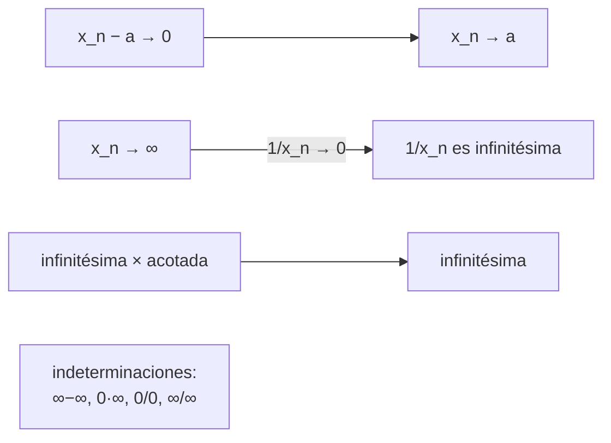

# Lecciones 9–10 — Sucesiones infinitésimas e infinitamente grandes, aritmética de límites

[[es/lectures-2025-26/lecture-08|← Lección 8]] · [[es/lectures-2025-26/index|Índice de lecciones]] · [[es/lectures-2025-26/lecture-11-12|Lecciones 11–12 →]] · [[es/term-index|Términos y teoremas]] · [[ru/lectures-2025-26/lecture-09-10|Русский]] · [[en/lectures-2025-26/lecture-09-10|English]]

> [!info] Fuente
> `ma25_26-lectures_9-10_notes.pdf` — 28 páginas: diapositivas impresas con capa de texto, diapositivas con anotaciones manuscritas (páginas 4, 5) y páginas manuscritas sin capa de texto utilizable (páginas 6, 8–11, 14, 16, 19, 21, 24–28). Las páginas manuscritas se transcribieron a partir de su imagen. Los números de página del PDF aparecen en los encabezados. La lección no contiene figuras.
>
> **Nota del editor.** Los números ③ y ④ en la observación de las páginas 26 y 28 no coinciden. En la página 26: ③ es $\infty,\infty$ y ④ es $0,0$; en la página 28: ③ es $0,0$ y ④ es $\infty,\infty$. Se conservan ambas versiones tal como aparecen en las páginas manuscritas respectivas.

## Diapositiva 2. Cita del día

> Todo se puede explicar, pero no a todos.

## Diapositiva 3. Objetivo de la lección

- Definir las sucesiones infinitésimas e [[#^def-2-2-4|infinitamente grandes]] y estudiar sus propiedades.

## §2. Infinitésimos e infinitos

### Diapositiva 4. Sucesión infinitésima

> [!definition] Definición 2.2.1
> Una sucesión numérica se llama **infinitésima** si tiende a cero.

^def-2-2-1

Así, la convergencia de $\{x_n\}$ a $a$ equivale a que $\{x_n - a\}$ sea infinitésima.

**Anotación manuscrita** (márgenes de la diapositiva 4):

$$
x_n \to a \iff x_n - a \to 0 \iff \{x_n - a\}\ \text{es infinitésima}.
$$

$$
\{x_n\} \text{ converge a } a \iff \{x_n - a\} \text{ es una sucesión infinitésima.}
$$

### Diapositiva 5. Lema 2.2.1

> [!lemma] Lema 2.2.1
> El producto de una sucesión infinitésima por una sucesión acotada es infinitésimo: si $\{x_n\}$, $\{y_n\}$ son sucesiones reales, $\{x_n\}$ es infinitésima y $\{y_n\}$ es acotada, entonces $\{x_n y_n\}$ es infinitésima.

**Anotación manuscrita:** $\{x_n\}$ infinitésima ⇔ $x_n \to 0$; $\{y_n\}$ acotada ⇔ $\exists M \in \mathbb{R}: |y_n| \le M\ \forall n$; ⇒ $\{x_n y_n\}$ infinitésima ⇔ $x_n y_n \to 0$ cuando $n \to \infty$.

### Página manuscrita 6 (p. PDF 6). Demostración del lema 2.2.1

**Demostración ([[#Diapositiva 5. Lema 2.2.1|lema 2.2.1]]).** $\{y_n\}$ es acotada ⇔ $\exists M > 0$: $|y_n| \le M\ \forall n$. «Sin pérdida de generalidad» podemos suponer que $M \ge 1$.

Tomemos $\varepsilon > 0$. $x_n \to 0$ ⇔ $\exists N$: $\forall n > N$ $|x_n| < \dfrac{\varepsilon}{M}$.

Entonces, para todo $n > N$:

$$
|x_n y_n - 0| = |x_n y_n| = |x_n| \cdot |y_n| < \frac{\varepsilon}{M} \cdot M = \varepsilon.
$$

(Se usa la propiedad del valor absoluto $|AB| = |A|\cdot|B|$ y $|y_n| \le M$.) ∎

### Diapositiva 7. Aritmética de sucesiones convergentes

> [!theorem] Teorema 2.2.1
> Sean $\{x_n\}$, $\{y_n\}$ sucesiones reales, $x_0, y_0 \in \mathbb{R}$, $x_n \to x_0$, $y_n \to y_0$. Entonces
>
> 1. $x_n + y_n \to x_0 + y_0$;
> 2. $x_n y_n \to x_0 y_0$;
> 3. $x_n - y_n \to x_0 - y_0$;
> 4. $|x_n| \to |x_0|$;
> 5. si, además, $y_n \ne 0$ para todo $n$ e $y_0 \ne 0$, entonces $\dfrac{x_n}{y_n} \to \dfrac{x_0}{y_0}$.

^thm-2-2-1

### Página manuscrita 8 (p. PDF 8). Demostración del teorema 2.2.1, punto ①

**Demostración ([[#^thm-2-2-1|teorema 2.2.1]]).**

**①** Sean $x_n \to x_0$, $y_n \to y_0$. Veamos que $x_n + y_n \to x_0 + y_0$.

Tomemos $\varepsilon > 0$. $x_n \to x_0$ ⇔ $\exists N_1$: $\forall n > N_1$ $|x_n - x_0| < \dfrac{\varepsilon}{2}$; $\ y_n \to y_0$ ⇔ $\exists N_2$: $\forall n > N_2$ $|y_n - y_0| < \dfrac{\varepsilon}{2}$.

Sea $N = \max\{N_1, N_2\}$. Para todo $n > N$:

$$
|(x_n + y_n) - (x_0 + y_0)| = |(x_n - x_0) + (y_n - y_0)| \le |x_n - x_0| + |y_n - y_0| < \frac{\varepsilon}{2} + \frac{\varepsilon}{2} = \varepsilon.
$$

### Página manuscrita 9 (p. PDF 9). Puntos ② y ③

**②** Estimamos $|x_n y_n - x_0 y_0|$:

$$
|x_n y_n - x_0 y_0| = |x_n y_n - x_0 y_n + x_0 y_n - x_0 y_0| = \bigl|(x_n - x_0) y_n + x_0 (y_n - y_0)\bigr|
$$
$$
\le |x_n - x_0|\cdot |y_n| + |x_0|\cdot |y_n - y_0|.
$$

Anotaciones al margen:

- $|x_n - x_0|$ es **infinitésima**, pues $x_n \to x_0$;
- $|y_n|$ es **acotada**, pues $\{y_n\}$ es convergente, y toda [[es/lectures-2025-26/lecture-08#^def-2-1-3|sucesión convergente]] es acotada;
- $|x_0|$ es **acotada**, pues $x_0 \in \mathbb{R}$ es finito;
- $|y_n - y_0|$ es **infinitésima**, pues $y_n \to y_0$.

Así, (infinitésima)·(acotada) + (acotada)·(infinitésima) = infinitésima por el punto ①.

**③** Se sigue de ① y ②: $x_n - y_n = x_n + (-1) y_n \to x_0 + (-1) y_0 = x_0 - y_0$.

### Página manuscrita 10 (p. PDF 10). Puntos ④ y ⑤

**④** Usamos la propiedad del valor absoluto: $\bigl| |x_n| - |x_0| \bigr| \le |x_n - x_0|$.

**⑤** Basta probar que $\dfrac{1}{y_n} \to \dfrac{1}{y_0}$, pues por el punto ② tenemos

$$
\frac{x_n}{y_n} = x_n\cdot\frac{1}{y_n} \to x_0 \cdot \frac{1}{y_0} = \frac{x_0}{y_0}.
$$

Estimamos la diferencia:

$$
\left|\frac{1}{y_n} - \frac{1}{y_0}\right| = \left|\frac{y_0 - y_n}{y_0 y_n}\right| = |y_n - y_0| \cdot \frac{1}{|y_n|} \cdot \frac{1}{|y_0|}.
$$

Aquí $|y_n - y_0|$ es infinitésima y $\dfrac{1}{|y_0|}$ es una constante. Queda por probar que $\dfrac{1}{y_n}$ es acotada.

Tomemos $\varepsilon = \dfrac{|y_0|}{2} > 0$, pues por hipótesis $y_0 \ne 0$. $y_n \to y_0$ ⇔ $\exists N$: $\forall n > N$ $|y_n - y_0| < \varepsilon = \dfrac{|y_0|}{2}$.

### Página manuscrita 11 (p. PDF 11). Conclusión del punto ⑤

Entonces, para todo $n > N$

$$
|y_n| = |y_0 + y_n - y_0| \ge |y_0| - |y_n - y_0| > |y_0| - \varepsilon = \frac{|y_0|}{2}
$$

(propiedad del valor absoluto).

Denotemos $k := \min\left\{ |y_1|, |y_2|, \dots, |y_N|,\ \dfrac{|y_0|}{2} \right\}$. Entonces $\dfrac{1}{|y_n|} \le \dfrac{1}{k}$ para todo $n$, es decir, $\left\{\dfrac{1}{y_n}\right\}$ es acotada.

Por tanto,

$$
\left|\frac{1}{y_n} - \frac{1}{y_0}\right| = |y_n - y_0|\cdot\frac{1}{|y_n|}\cdot\frac{1}{|y_0|} = \text{infinitésima} \cdot \text{acotada} \cdot \text{acotada} = \text{infinitésima}.
$$

> [!remark] Nota del editor
> La escritura a mano no indica que $y_n \ne 0$ para todo $n$ (esto es necesario para definir $1/y_n$). Para $n \le N$ se sobrentiende que $y_n \ne 0$; se señala como una suposición del curso.

**Observación.** $z_n \to a$ ⇔ $z_n - a \to 0$ ⇔ $\{z_n - a\}$ es infinitésima.

### Diapositiva 12. Infinitamente grandes: $\pm\infty$

> [!definition] Definición 2.2.2
> Se dice que una sucesión real $\{x_n\}$ tiende a:
>
> 1. **más infinito**, y se escribe $\lim_{n\to\infty} x_n = +\infty$ o $x_n \xrightarrow[n\to\infty]{} +\infty$, si
>
> $$
> \forall E > 0\ \ \exists N \in \mathbb{N}:\ \forall n > N\ \ x_n > E;
> $$
>
> 2. **menos infinito**, y se escribe $\lim_{n\to\infty} x_n = -\infty$ o $x_n \xrightarrow[n\to\infty]{} -\infty$, si
>
> $$
> \forall E > 0\ \ \exists N \in \mathbb{N}:\ \forall n > N\ \ x_n < -E.
> $$

^def-2-2-2

**Anotación manuscrita:** $x_n > E$ ⇔ $\{x_n\} \to +\infty$; $x_n < -E$ ⇔ $\{x_n\} \to -\infty$ ⇔ $\{-x_n\} \to +\infty$.

### Diapositiva 13. Infinito de signo indeterminado

> [!definition] Definición 2.2.3
> Se dice que una sucesión real $\{x_n\}$ tiende a **infinito** (infinito de signo indeterminado), y se escribe $\lim_{n\to\infty} x_n = \infty$ o $x_n \xrightarrow[n\to\infty]{} \infty$, si
>
> $$
> \forall E > 0\ \ \exists N \in \mathbb{N}:\ \forall n > N\ \ |x_n| > E.
> $$

^def-2-2-3

**Observación 1.** De las definiciones se sigue que si $x_n \to \pm\infty$, entonces $x_n \to \infty$. **¡El recíproco es falso!**

### Página manuscrita 14 (p. PDF 14). Ejemplo

**Ejemplo.** $x_n = (-1)^n \cdot n$ ⇒ $|x_n| = n \to \infty$.

Los valores son $-1, 2, -3, 4, -5, \dots$. La sucesión **no tiende ni a $+\infty$ ni a $-\infty$**, pero sí tiende a infinito de signo indeterminado.

### Diapositiva 15. Sucesión infinitamente grande

> [!definition] Definición 2.2.4
> Una sucesión que tiende a infinito se llama **infinitamente grande**.

^def-2-2-4

**Observación 2.** De las definiciones se sigue que si $x_n \to \infty$, entonces $\{x_n\}$ no es acotada. **¡El recíproco es falso!**

**Observación 3.** El límite en $\mathbb{R}$ es único: si $a, b \in \mathbb{R}$, $x_n \to a$ y $x_n \to b$, entonces $a = b$.

### Página manuscrita 16 (p. PDF 16). Ejemplo para la observación 2

**Ejemplo (para la observación 2).** Si $\{x_n\}$ no es acotada, no se sigue que $x_n \to \infty$ (la flecha «⇒» aparece tachada en la página). Contraejemplo:

$$
x_n = \bigl(1 + (-1)^n\bigr) \cdot n: \quad 0,\ 4,\ 0,\ 8,\ 0,\ 10,\ \dots
$$

La sucesión no está acotada, pero no tiende a $\infty$ (los términos de índice impar son iguales a $0$).

### Diapositiva 17. Observaciones sobre las sucesiones infinitamente grandes

**Observación 4.** La definición basta verificarla solo para números $E$ suficientemente grandes; también se puede omitir en la definición la exigencia $E > 0$.

**Observación 5.** La definición de sucesión convergente no cambia: una sucesión se llama convergente si tiene límite finito. Las sucesiones infinitamente grandes son divergentes.

### Diapositiva 18. Entornos de puntos infinitamente alejados

> [!definition] Definición 2.2.5
>
> $$
> V(+\infty) = (E, +\infty], \qquad V(-\infty) = (-\infty, -E), \qquad V(\infty) = \{ x \in \mathbb{R} : |x| > E \}.
> $$

^def-2-2-5

Si se quieren específicamente $\varepsilon$-entornos, se define $V_\varepsilon(+\infty) = \left(\dfrac{1}{\varepsilon}, +\infty\right]$, etc. Entonces los $\varepsilon$-entornos se estrechan al disminuir $\varepsilon > 0$.

**Observación 6.**

1. Si $x_n > y_n$ para todo $n$ e $y_n \to +\infty$, entonces $x_n \to +\infty$.
2. Si $x_n \le y_n$ para todo $n$ e $y_n \to -\infty$, entonces $x_n \to -\infty$.

### Página manuscrita 19 (p. PDF 19). Explicación de la observación 6

$y_n \to +\infty$ ⇔ $\forall E > 0\ \exists N_0 \in \mathbb{N}:\ \forall n > N_0\ \ y_n > E$.

Para todo $n$: $y_n \le x_n$ ⇒ para todo $n > N_0$: $x_n > E$ ⇒ $x_n \to +\infty$.

**La observación 6** complementa el [[es/lectures-2025-26/lecture-08#^thm-2-1-4|teorema del emparedado]] (teorema de los dos guardias).

### Diapositiva 20. Relación entre sucesiones infinitamente grandes e infinitésimas

> [!lemma] Lema 2.2.2
> Sea $\{x_n\}$ una sucesión real con $x_n \ne 0$ para todo $n$. Entonces $\{x_n\}$ es infinitamente grande si y solo si $\left\{\dfrac{1}{x_n}\right\}$ es infinitésima.

^lem-2-2-2

### Página manuscrita 21 (p. PDF 21). Demostración del lema 2.2.2

**Demostración ([[#^lem-2-2-2|lema 2.2.2]]).**

**①** (⇒): $\{x_n\}$ es infinitamente grande ⇔ $x_n \to \infty$. Veamos que $\dfrac{1}{x_n} \to 0$.

Tomemos $\varepsilon > 0$. Sea $E = \dfrac{1}{\varepsilon}$. Para $E = \dfrac{1}{\varepsilon} > 0$ existe $N$ con $|x_n| > E$ para todo $n > N$, es decir, $\varepsilon > \dfrac{1}{|x_n|} = \left|\dfrac{1}{x_n}\right|$ ⇒ $\left\{\dfrac{1}{x_n}\right\}$ es infinitésima.

**②** (⇐): la demostración es análoga (queda para casa).

### Diapositiva 22. Aritmética de infinitamente grandes

> [!theorem] Teorema 2.2.2
> Sean $\{x_n\}$, $\{y_n\}$ sucesiones reales y $a, b \in \mathbb{R} \cup \{\infty\}$.
>
> 1. Si $x_n \to +\infty$ y $\{y_n\}$ está [[es/lectures-2025-26/lecture-05-06#^def-1-3-7|acotada inferiormente]], entonces $x_n + y_n \to +\infty$.
> 2. Si $x_n \to -\infty$ y $\{y_n\}$ está acotada superiormente, entonces $x_n + y_n \to -\infty$.
> 3. Si $x_n \to \infty$ y $\{y_n\}$ está acotada, entonces $x_n + y_n \to \infty$.
> 4. Si $x_n \to \pm\infty$ e $y_n \ge b > 0$ para todo $n$ (o $y_n \to b > 0$), entonces $x_n y_n \to \pm\infty$.
> 5. Si $x_n \to \pm\infty$ e $y_n \le b < 0$ para todo $n$ (o $y_n \to b < 0$), entonces $x_n y_n \to \mp\infty$.
> 6. Si $x_n \to \infty$ y $|y_n| \ge b > 0$ para todo $n$ (o $y_n \to b \ne 0$), entonces $x_n y_n \to \infty$.
> 7. Si $x_n \to a \ne 0$, $y_n \to 0$ e $y_n \ne 0$ para todo $n$, entonces $\dfrac{x_n}{y_n} \to \infty$.

^thm-2-2-2

### Diapositiva 23. Teorema 2.2.2 (continuación)

8. Si $x_n \to a \in \mathbb{R}$ e $y_n \to \infty$, entonces $\dfrac{x_n}{y_n} \to 0$.
9. Si $x_n \to \infty$, $y_n \to b \in \mathbb{R}$ e $y_n \ne 0$ para todo $n$, entonces $\dfrac{x_n}{y_n} \to \infty$.

### Página manuscrita 24 (p. PDF 24). Demostración del teorema 2.2.2, punto ①

**Demostración ([[#^thm-2-2-2|teorema 2.2.2]]).** Nos limitamos a demostrar los enunciados 1, 6 y 8.

**①** $\{y_n\}$ está acotada inferiormente ⇔ $\exists m \in \mathbb{R}$: $\forall n \in \mathbb{N}$ $y_n \ge m$.

Tomemos $E > 0$. $x_n \to +\infty$ ⇒ aplicamos la definición con $E - m$: $\exists N$: $\forall n > N$ $x_n > E - m$ ⇒

$$
x_n + y_n > E - m + m = E.
$$

Como $E$ es arbitrario, esto significa que $x_n + y_n \to +\infty$.

> [!remark] Nota del editor
> En la última desigualdad la escritura a mano dice $y_m$; en esencia es $y_n$.

### Página manuscrita 25 (p. PDF 25). Punto ⑥

**⑥** Sea $|y_n| \ge b > 0$ para todo $n \in \mathbb{N}$.

Tomemos $E > 0$. $x_n \to +\infty$ ⇒ aplicamos la definición de límite con $\dfrac{E}{b}$: $\exists N$: $\forall n > N$ $|x_n| > \dfrac{E}{b}$.

Entonces, para todo $n > N$: $|x_n y_n| = |x_n|\cdot|y_n| > \dfrac{E}{b}\cdot b = E$.

**Nota:** $y_n \to b \ne 0$. Sea $b_1 = \dfrac{|b|}{2}$ si $b$ es un número; $b_1 = 1$ si $b = \infty$. Entonces, a partir de cierto índice, $|y_n| \ge b_1$, y aplicamos el enunciado demostrado al inicio del punto ⑥.

### Página manuscrita 26 (p. PDF 26). Punto ⑧ y observación sobre indeterminaciones

**⑧** $\dfrac{x_n}{y_n} = x_n \cdot \dfrac{1}{y_n} \to a \cdot 0 = 0$: aquí $y_n \to \infty$ ⇒ $\dfrac{1}{y_n}$ es infinitésima (por el [[#^lem-2-2-2|lema 2.2.2]]); aplicamos el teorema del límite de un producto y el [[#^lem-2-2-2|lema 2.2.2]].

Los demás enunciados quedan como ejercicios.

**Observación.** No podemos decir nada sobre el valor del límite en las siguientes situaciones:

- **①** $x_n \to +\infty$, $y_n \to -\infty$: $x_n + y_n = ?$
- **②** $x_n \to 0$, $y_n \to \infty$: $x_n \cdot y_n = ?$
- **③** $x_n \to \infty$, $y_n \to \infty$: $\dfrac{x_n}{y_n} = ?$
- **④** $x_n \to 0$, $y_n \to 0$: $\dfrac{x_n}{y_n} = ?$

### Página manuscrita 27 (p. PDF 27). Ejemplos

**Ejemplos.**

- **1a)** $x_n = a + n$, $a \in \mathbb{R}$; $y_n = -n$ ⇒ $x_n + y_n = a \to a$.
- **1b)** $x_n = n^2 + n$; $y_n = -n$ ⇒ $x_n + y_n = n^2 \to +\infty$.
- **1c)** $x_n = n^2$; $y_n = -n^2 - n$ ⇒ $x_n + y_n = -n \to -\infty$.
- **1d)** $x_n = n + (-1)^n$; $y_n = -n$ ⇒ $x_n + y_n = (-1)^n$ — **no tiene límite**.

### Página manuscrita 28 (p. PDF 28). Observación sobre indeterminaciones

**Observación.** En las situaciones:

1. $x_n \to +\infty$, $y_n \to -\infty$ (suma);
2. $x_n \to 0$, $y_n \to \infty$ (producto);
3. $x_n \to 0$, $y_n \to 0$ (cociente $x_n / y_n$);
4. $x_n \to \infty$, $y_n \to \infty$ (cociente $x_n / y_n$)

se dice que hay una **indeterminación** de tipo $\infty - \infty$, $0 \cdot \infty$, $\dfrac{0}{0}$, $\dfrac{\infty}{\infty}$, respectivamente.

En este caso, hallar el límite se llama **resolver la indeterminación**.

## Páginas no relacionadas con el contenido

- La página 1 es la portada; la página 2 es la cita del día (traducida arriba).
- Las páginas 4, 5, 12, 13, 15, 17, 18, 20, 22, 23 son diapositivas impresas; las anotaciones manuscritas de las diapositivas 4 y 5 se incluyen arriba.
