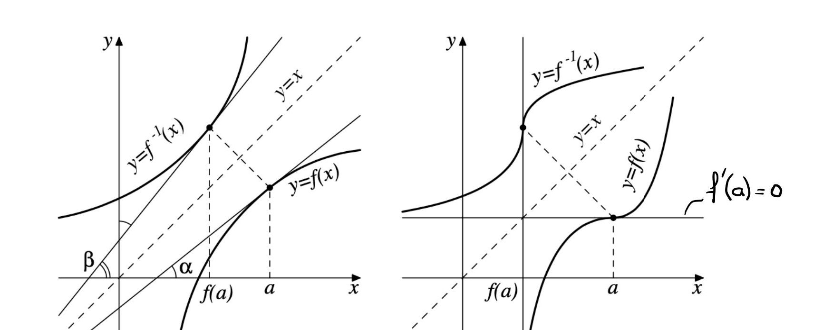
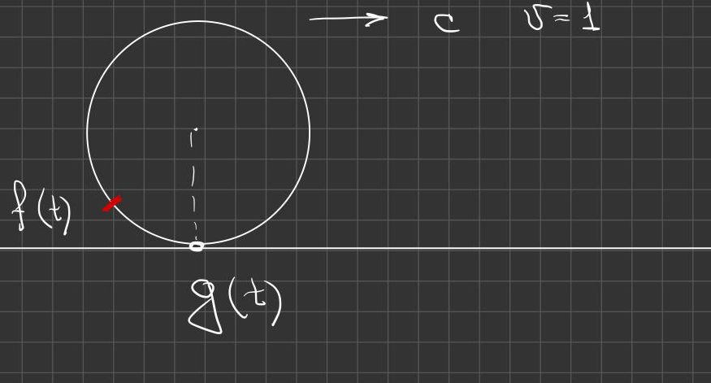
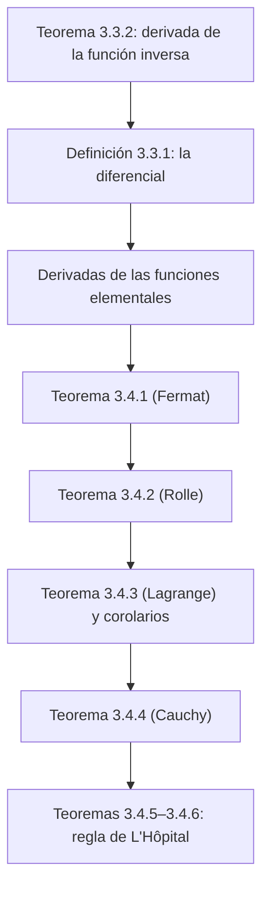

# Lecciones 24–26 — Derivación de la función inversa, diferencial, teoremas del valor medio y regla de L'Hôpital

[[es/lectures-2025-26/lecture-22-23|← Lecciones 22–23]] · [[es/lectures-2025-26/index|Índice de lecciones]] · [[es/lectures-2025-26/lecture-27-28|Lecciones 27–28 →]] · [[es/term-index|Términos y teoremas]] · [[ru/lectures-2025-26/lecture-24-25-26|Русский]] · [[en/lectures-2025-26/lecture-24-25-26|English]]

> [!info] Fuente
> `ma25_26-lectures_24-25-26_notes.pdf` — 42 páginas: diapositivas impresas con capa de texto (páginas 1–5, 8, 13–15, 18, 19, 22, 24, 25, 27, 29, 31, 32, 34, 38) y páginas manuscritas sin capa de texto (6, 7, 9–12, 16, 17, 20, 21, 23, 26, 28, 30, 33, 35–37, 39–42). Las páginas manuscritas se transcribieron a partir de su imagen. Los números de página del PDF aparecen en los encabezados; las diapositivas impresas están numeradas en el PDF como «1/20»–«20/20».
>
> **Nota del editor.** La fecha de la lección se toma del pie de las diapositivas («20 de noviembre de 2025»). La notación $\langle A, B\rangle$ denota un intervalo de cualquier tipo.

## Diapositivas impresas 1–3. Introducción

**Cita del día (diapositiva 2).** «Principio de Arnold: si un concepto lleva un nombre personal, no es el nombre de su descubridor». (V. I. Arnold)

**Objetivo de la lección.** Estudiar la regla de derivación de la [[es/lectures-2025-26/lecture-01-02#^def-1-1-8|función inversa]]. Introducir el concepto de [[#^def-3-3-1|diferencial]]. Demostrar teoremas que relacionan los valores de una función en los extremos de un intervalo con los valores de su [[es/lectures-2025-26/lecture-22-23#^def-3-1-1|derivada]] en ciertos puntos «medios» situados dentro del intervalo. Deducir varias consecuencias de los teoremas del valor medio, en particular la [[#^thm-3-4-5|regla de L'Hôpital]], útil para calcular límites.

## Capítulo 3, §3. Reglas de derivación (continuación)

### Diapositiva impresa 4 (p. PDF 4). Derivación de la función inversa

> [!theorem] Teorema 3.3.2
> Sea $f$ una función estrictamente monótona y continua en $\langle A, B\rangle$, $a \in \langle A, B\rangle$, $f$ derivable en el punto $a$, con $f'(a) \ne 0$. Entonces la función inversa $f^{-1}$ es derivable en el punto $f(a)$ y
>
> $$
> \left(f^{-1}\right)'(f(a)) = \frac{1}{f'(a)}.
> $$

^thm-3-3-2

### Diapositiva impresa 5 (p. PDF 5). Sentido geométrico del teorema 3.3.2

Como la gráfica de $f^{-1}$ se obtiene de la gráfica de $f$ por simetría respecto de la recta $y = x$, se tiene

$$
\left(f^{-1}\right)'(f(a)) = \operatorname{tg} \beta = \operatorname{ctg} \alpha = \frac{1}{f'(a)}.
$$

En la figura de la izquierda: las gráficas $y = f(x)$ e $y = f^{-1}(x)$, simétricas respecto de la recta discontinua $y = x$, las tangentes en los puntos $a$ y $f(a)$ y los ángulos $\alpha$, $\beta$. En la figura de la derecha, el caso $f'(a) = 0$ (escrito a mano sobre la diapositiva): la tangente a la gráfica de $f$ en $a$ es horizontal, y la tangente a la gráfica de $f^{-1}$ en $f(a)$ es vertical.

### Páginas manuscritas 6–7 (pp. PDF 6–7). Demostración del teorema 3.3.2

**Demostración ([[#^thm-3-3-2|teorema 3.3.2]]).** Sea $y = f(x)$, $x = f^{-1}(y)$.

$y_0 = f(a)$ $\Rightarrow$ $a = f^{-1}(y_0)$ (en amarillo). Pongamos $f(a + h) =: \widetilde y_0$.

Si $h \ne 0$ $\Rightarrow$ $\widetilde y_0 \ne y_0$ (nota: porque $f$ es estrictamente monótona y existe $f^{-1}(y)$) $\Rightarrow$ $\widetilde y_0 = y_0 + k$, $k \ne 0$.

$$
\frac{f^{-1}(y_0 + k) - f^{-1}(y_0)}{k} = \frac{a + h - a}{\widetilde y_0 - y_0} = \frac{h}{f(a + h) - f(a)}.
$$

Si $k \ne 0$ $\Rightarrow$ $h \ne 0$ $\to$ se puede «invertir la fracción» (en amarillo):

$$
= \frac{1}{\dfrac{f(a + h) - f(a)}{h}}.
$$

«Pasamos ahora al límite cuando $k \mapsto 0$» (en la pizarra figura $k \mapsto \infty$; es una errata). Entonces

$$
\lim_{k \mapsto 0} \frac{f^{-1}(y_0 + k) - f^{-1}(y_0)}{k} = \left(f^{-1}\right)'(y_0) = \left(f^{-1}\right)'(f(a)).
$$

Por otra parte,

$$
\lim_{k \mapsto 0} \frac{1}{\dfrac{f(a + h) - f(a)}{h}} = \lim_{h \mapsto 0} \frac{1}{\dfrac{f(a + h) - f(a)}{h}} = \frac{1}{f'(a)}.
$$

Nota con una flecha hacia el paso $k \mapsto 0 \to h \mapsto 0$: si $k \mapsto 0$, entonces $h \mapsto 0$; esto se sigue de la continuidad de $f^{-1}$, y $f^{-1}$ es continua si $f$ es continua y monótona. $\blacksquare$

### Diapositiva impresa 6 (p. PDF 8). La diferencial

> [!definition] Definición 3.3.1
> La diferencial de una función $f$ en un punto $x_0$ es la función
>
> $$
> df(x_0, h) = df(x_0) = f'(x_0) h.
> $$

^def-3-3-1

### Páginas manuscritas 9–12 (pp. PDF 9–12). Derivadas de las funciones elementales

**Derivadas de las funciones elementales** (título en la p. 9).

① $f(x) = \sin x$, $a \in \mathbb{R}$:

$$
f'(a) = \lim_{x \mapsto a} \frac{f(x) - f(a)}{x - a} = \lim_{x \mapsto a} \frac{\sin x - \sin a}{x - a} = \lim_{x \mapsto a} \frac{2 \sin\dfrac{x - a}{2} \cos\dfrac{x + a}{2}}{x - a} = \lim_{x \mapsto a} \frac{2 \cdot \dfrac{x - a}{2} \cos\dfrac{x + a}{2}}{x - a},
$$

donde (en amarillo) a) $\dfrac{x - a}{2} \xrightarrow[x \mapsto a]{} 0$ $\Rightarrow$ $\sin\dfrac{x - a}{2} \sim_a \dfrac{x - a}{2}$; b) $\lim\limits_{x \mapsto a} \dfrac{2\sin\dfrac{x - a}{2}}{x - a} = \lim\limits_{x \mapsto a} \dfrac{\sin\dfrac{x - a}{2}}{\dfrac{x - a}{2}} = 1$ (primer límite notable). Total: $= \lim\limits_{x \mapsto a} \cos\dfrac{x + a}{2} = \cos a$ ✓.

② $f(x) \equiv 1$, $a \in \mathbb{R}$:

$f'(a) = \lim\limits_{x \mapsto a} \dfrac{f(x) - f(a)}{x - a} = \lim\limits_{x \mapsto a} \dfrac{1 - 1}{x - a} = \left[\dfrac00\right]$.

$f(x) - f(a) = F(x)(x - a)$ $\forall x \in \mathbb{R}$, $F(a) = f'(a)$ (tercera afirmación del criterio de diferenciabilidad, [[es/lectures-2025-26/lecture-22-23#^thm-3-2-1|teorema 3.2.1]]).

$f(x) - f(a) = 1 - 1 = 0$ $\Rightarrow$ $0 = F(x) \cdot (x - a)$ $\forall x \in \mathbb{R}$ $\Rightarrow$ $F(x) \equiv 0$ $\Rightarrow$ $f'(a) = 0$.

③ $f(x) = b^x$ ($b > 0$), $a \in \mathbb{R}$:

$$
f'(a) = \lim_{x \mapsto a} \frac{b^x - b^a}{x - a} = \lim_{x \mapsto a} \frac{b^a (b^{x - a} - 1)}{x - a} = b^a \lim_{x \mapsto a} \frac{b^{x - a} - 1}{x - a} = b^a \ln b,
$$

donde debajo del último límite está escrito $\ln b$; al margen, en amarillo: $\lim\limits_{y \to 0} \dfrac{b^y - 1}{y} = \ln b$ (quinto límite notable).

④ $f(x) = x^{\alpha}$, $\alpha \ne 0$:

a) $\alpha \in \mathbb{N}$ $\Rightarrow$ $f'(x)$ está definida en $\mathbb{R}$. En el caso $\alpha = 1$ tomamos $x^{\alpha - 1} = 1$ incluso en $x = 0$, es decir, $x' \equiv 1$.

b) $\alpha \in \mathbb{Z} \setminus \mathbb{N}$. Entonces $f'$ está definida en $\mathbb{R} \setminus \{0\}$.

c) $\alpha = \dfrac{m}{2n + 1}$, $m \in \mathbb{Z}$, $n \in \mathbb{N}$ $\Rightarrow$ si $\alpha > 1$, $f'$ está definida en $\mathbb{R}$; si $\alpha < 1$, entonces $f'$ está definida en $\mathbb{R} \setminus \{0\}$.

d) $\alpha \in \mathbb{R} \setminus \mathbb{Q}$ o $\alpha = \dfrac{2m + 1}{2n}$, $m \in \mathbb{Z}$, $n \in \mathbb{N}$ $\Rightarrow$ para $\alpha > 1$, $f'$ está definida en $[0; +\infty)$; para $\alpha < 1$, en $(0; +\infty)$.

$$
f'(a) = \lim_{x \mapsto a} \frac{x^{\alpha} - a^{\alpha}}{x - a} = a^{\alpha} \lim_{x \mapsto a} \frac{\left(\dfrac xa\right)^{\alpha} - 1}{x - a} = a^{\alpha} \lim_{x \mapsto a} \frac{\alpha\left(\dfrac xa - 1\right)}{x - a} = \alpha a^{\alpha - 1},
$$

para $\alpha \in \mathbb{R} \setminus \{0\}$ en los casos a)–c), y para $a > 0$ en el caso d) (se usa que $(1 + t)^{\alpha} - 1 \sim \alpha t$ cuando $t \to 0$, el cuarto límite notable).

Si $a = 0$: para $\alpha < 0$ no está definida $f(0)$ $\Rightarrow$ no está definida $f'(0)$;

$$
\alpha > 0 \Rightarrow f'(0) = \lim_{x \mapsto 0} \frac{f(x) - f(0)}{x} = \lim_{x \mapsto 0} \frac{x^{\alpha}}{x} = \lim_{x \mapsto 0} x^{\alpha - 1} = \begin{cases} 0, & \alpha > 1, \\ 1, & \alpha = 1, \\ \infty, & \alpha \in (0, 1). \end{cases}
$$

## Capítulo 3, §4. Teoremas del valor medio y sus aplicaciones

### Diapositiva impresa 7 (p. PDF 13). Introducción al §4

Demostraremos primero una condición necesaria para que una función alcance su valor máximo o mínimo en un punto interior dado de un intervalo. Este hecho se utilizará más adelante tanto en la demostración de los teoremas del valor medio como en el estudio de los [[es/lectures-2025-26/lecture-29-30#^def-3-7-1|extremos locales]].

### Diapositiva impresa 8 (p. PDF 14). Teorema de P. Fermat

> [!theorem] Teorema 3.4.1
> Sea $a \in (A, B)$, $f : \langle A, B\rangle \to \mathbb{R}$ una función derivable en el punto $a$. Si $f(a) = \max\limits_{\langle A, B\rangle} f$ o $f(a) = \min\limits_{\langle A, B\rangle} f$, entonces $f'(a) = 0$.

^thm-3-4-1

### Diapositiva impresa 9 (p. PDF 15). Sentido geométrico del teorema de Fermat

(Nota manuscrita en la parte superior de la diapositiva:) Por ejemplo, $f(x) = x$ en $[0, 1]$: la afirmación del [[#^thm-3-4-1|teorema 3.4.1]] es falsa, pues $\max\limits_{x \in [0,1]} f(x) = f(1) = 1$, pero $f'(1) = 1 \ne 0$.

- En las hipótesis del [[#^thm-3-4-1|teorema 3.4.1]] es esencial que el punto $a$ se encuentre **en el interior** del intervalo.
- El sentido geométrico del [[#^thm-3-4-1|teorema de Fermat]] consiste en que en el punto $a$ la tangente a la gráfica de la función es horizontal (en las figuras: un máximo y un mínimo en un punto interior $a$ con tangentes horizontales).

### Página manuscrita 16 (p. PDF 16). Demostración del teorema de Fermat

**Demostración ([[#^thm-3-4-1|teorema 3.4.1]]).** Supongamos, para fijar ideas, que $f(a) = \max\limits_{x \in \langle A, B\rangle} f$ $\Rightarrow$ $f(x) - f(a) \le 0$ $\forall x \in \langle A, B\rangle$.

Si $x > a$, entonces $\dfrac{f(x) - f(a)}{x - a} \le 0$ $\Rightarrow$ $f'_+(a) = \lim\limits_{x \mapsto a^+} \dfrac{f(x) - f(a)}{x - a} \le 0$.

Si $x < a$, entonces $\dfrac{f(x) - f(a)}{x - a} \ge 0$ $\Rightarrow$ $f'_-(a) = \lim\limits_{x \mapsto a^-} \dfrac{f(x) - f(a)}{x - a} \ge 0$.

(En amarillo:) ¡Pero! Por hipótesis, $f$ es [[es/lectures-2025-26/lecture-22-23#^def-3-2-1|derivable]] en el punto $a$ $\Rightarrow$ $f'(a) = f'_+(a) = f'_-(a)$ $\Rightarrow$ $f'(a) = f'_+(a) \ge 0$ y $f'(a) = f'_-(a) \le 0$ $\Rightarrow$ $f'(a) = 0$. $\blacksquare$

> [!remark] Nota del editor
> En la última línea de la pizarra los signos de las [[es/06-derivatives#6.1 Definición y aproximación lineal|derivadas laterales]] están intercambiados respecto de las líneas anteriores (lo correcto es $f'_+(a) \le 0$ y $f'_-(a) \ge 0$); la conclusión $f'(a) = 0$ no se ve afectada.

### Página manuscrita 17 (p. PDF 17). Observación: el teorema de Fermat no es suficiente

**Observación (manuscrita).** El teorema de Fermat no es una condición suficiente (subrayado en verde) de extremo.

**Ejemplo.** $f(x) = x^3$, $f'(x) = 3x^2$, $f : \mathbb{R} \mapsto \mathbb{R}$, $f'(0) = 0$. (En rojo:) Pero $x = 0$ es un punto interior que no es punto de extremo (junto a ello, la gráfica roja de $x^3$ con el punto $0$ marcado).

(En verde:) $f'(a) = 0$ $\Rightarrow$ el punto $a$ puede ser o no un punto de extremo.

### Diapositiva impresa 10 (p. PDF 18). Teorema de M. Rolle

> [!definition] Definición 3.4.1
> Una función $f : \langle A, B\rangle \to \mathbb{R}$ se dice derivable en $\langle A, B\rangle$ si es derivable en todo punto del intervalo $\langle A, B\rangle$.

^def-3-4-1

> [!theorem] Teorema 3.4.2
> Sea la función $f$ continua en $[A, B]$ y derivable en $(A, B)$. Si $f(A) = f(B)$, entonces existe un punto $c \in (A, B)$ tal que $f'(c) = 0$.

^thm-3-4-2

### Diapositiva impresa 11 (p. PDF 19). Observaciones sobre el teorema de Rolle

- El sentido geométrico del [[#^thm-3-4-2|teorema 3.4.2]] consiste también en que la tangente a la gráfica de $f$ en el punto $c$ es horizontal.
- La afirmación del [[#^thm-3-4-2|teorema 3.4.2]] puede ser falsa si $f$ no es derivable en algún punto de $(A, B)$ o es discontinua en uno de los extremos de $[A, B]$ (en las figuras: una «casita» con un vértice anguloso y un segmento inclinado con un salto en $B$).

### Páginas manuscritas 20–21 (pp. PDF 20–21). Demostración del teorema de Rolle y una observación

**Demostración ([[#^thm-3-4-2|teorema 3.4.2]]).** Por hipótesis, $f$ es continua en $[A, B]$ $\Rightarrow$ por el [[es/05-limits-continuity#^extreme-value-theorem|teorema de Weierstrass]] $\exists a, b \in [A, B]$: $f(a) = \min\limits_{[A, B]} f$, $f(b) = \max\limits_{[A, B]} f$.

① Supongamos que $a$ y $b$ son los extremos de $[A, B]$. Como $f(A) = f(B)$ por hipótesis $\Rightarrow$ $f$ es constante en $[A, B]$ $\Rightarrow$ $f'(c) = 0$ $\forall c \in (A, B)$.

② Supongamos ahora que $a$ o $b$ pertenece a $(A, B)$ $\Rightarrow$ por el teorema de Fermat, o bien $f'(a) = 0$, o bien $f'(b) = 0$. $\blacksquare$

**Observación (manuscrita, pp. 20–21).** La igualdad $f'(a) = \lim\limits_{x \mapsto a} \dfrac{f(x) - f(a)}{x - a}$ significa que $\dfrac{f(x) - f(a)}{x - a} \approx f'(a)$ para $x$ próximos a $a$. Esta relación tiene un análogo global: incluso para un $x$ **fijo** (subrayado en verde), el cociente incremental $\dfrac{f(x) - f(a)}{x - a}$ es la derivada de $f$, pero no en el punto $a$, sino en algún punto «medio» entre $a$ y $x$.

### Diapositiva impresa 12 (p. PDF 22). Teorema de J.-L. Lagrange

> [!theorem] Teorema 3.4.3
> Sea la función $f$ continua en $[A, B]$ y derivable en $(A, B)$. Entonces existe un punto $c \in (A, B)$ tal que
>
> $$
> \frac{f(B) - f(A)}{B - A} = f'(c).
> $$

^thm-3-4-3

### Página manuscrita 23 (p. PDF 23). Demostración del teorema de Lagrange

**Demostración ([[#^thm-3-4-3|teorema 3.4.3]]).** Consideremos la función $g(x) = f(x) - \dfrac{f(B) - f(A)}{B - A}(x - A)$.

$g(A) = f(A) - \dfrac{f(B) - f(A)}{B - A} \cdot (A - A) = f(A)$;

$g(B) = f(B) - \dfrac{f(B) - f(A)}{B - A} \cdot (B - A) = f(A)$.

Así, $\begin{cases} g \text{ es continua en } [A, B] \\ g \text{ es derivable en } (A, B) \\ g(A) = g(B) \end{cases} \Rightarrow$ por el [[#^thm-3-4-2|teorema de Rolle]] $\exists c \in (A, B)$: $g'(c) = 0$.

$g'(c) = f'(c) - \dfrac{f(B) - f(A)}{B - A} = 0$. $\blacksquare$

### Diapositiva impresa 13 (p. PDF 24). Sentido geométrico del teorema de Lagrange

El sentido geométrico del [[#^thm-3-4-3|teorema de Lagrange]] es el siguiente: en algún punto $c \in (A, B)$ la tangente a la gráfica de $f$ es paralela a la cuerda que une los extremos de la gráfica de $f$ (en la figura están marcados los ángulos de inclinación iguales de la cuerda y de la tangente).

### Diapositiva impresa 14 (p. PDF 25). Observaciones sobre el teorema de Lagrange

1. El punto $c$, en general, no es único.
2. El teorema de Rolle es un caso particular del teorema de Lagrange.
3. La afirmación del teorema de Lagrange puede escribirse como $f(B) - f(A) = f'(c)(B - A)$. Esta igualdad se llama **fórmula de los incrementos finitos**, ya que expresa el incremento de la función $f$ en el segmento $[A, B]$ en términos del incremento de su argumento.
4. El teorema de Lagrange se usa a menudo en la siguiente forma simétrica: existe $\theta \in (0, 1)$ tal que $\dfrac{f(B) - f(A)}{B - A} = f'(A + \theta(B - A))$.

### Página manuscrita 26 (p. PDF 26). Sobre la observación 4

Para demostrar 4 (enmarcado) basta tomar $\theta = \dfrac{c - A}{B - A}$, donde $c$ es el punto del enunciado del teorema de Lagrange: $A + \dfrac{c - A}{B - A} \cdot (B - A) = c$.

La ventaja de la forma de 4 es que también vale para funciones definidas en $[B, A]$ con $B < A$. En efecto, el punto $A + \theta(B - A)$ se encuentra entre $A$ y $B$ para **cualesquiera** (subrayado) $A$ y $B$ ($A \ne B$), y $\dfrac{f(B) - f(A)}{B - A}$ no cambia al permutar $A$ y $B$.

### Diapositiva impresa 15 (p. PDF 27). Acotación de los incrementos finitos

> [!corollary] Corolario 3.4.1
> Sea la función $f$ continua en $[A, B]$ y derivable en $(A, B)$. Si existen $m, M \in \mathbb{R}$: $m \le f'(x) \le M$ $\forall x \in (A, B)$, entonces
>
> $$
> m(B - A) \le f(B) - f(A) \le M(B - A).
> $$

^cor-3-4-1

En particular, si $|f'(x)| \le M$ para todo $x \in (A, B)$, entonces $|f(B) - f(A)| \le M(B - A)$.

### Página manuscrita 28 (p. PDF 28). Demostración del corolario 3.4.1

**Demostración ([[#^cor-3-4-1|corolario 3.4.1]]).** Por la fórmula de los incrementos finitos, $f(B) - f(A) = f'(c)(B - A)$, donde

$$
\left. \begin{aligned} m &\le f'(x) \le M \quad \forall x \in (A, B) \\ c &\in (A, B) \end{aligned} \right\} \Rightarrow m \le f'(c) \le M. \qquad \blacksquare
$$

### Diapositiva impresa 16 (p. PDF 29). Sobre la continuidad uniforme

> [!corollary] Corolario 3.4.2
> Sea $f$ derivable en $\langle A, B\rangle$ y supongamos que existe $M > 0$ tal que $|f'(x)| \le M$ $\forall x \in \langle A, B\rangle$. Entonces $f$ es uniformemente continua en $\langle A, B\rangle$.

^cor-3-4-2

### Página manuscrita 30 (p. PDF 30). Demostración del corolario 3.4.2

**Demostración ([[#^cor-3-4-2|corolario 3.4.2]]).** Para todo $\varepsilon > 0$ (subrayado en verde) pongamos $\delta = \dfrac{\varepsilon}{M}$ (subrayado en verde).

Si $x, y \in \langle A, B\rangle$ y $|x - y| < \delta$ (subrayado en verde) $\Rightarrow$ en virtud del [[#^cor-3-4-1|corolario 3.4.1]] $\Rightarrow$ $|f(x) - f(y)| \le M |x - y| < M \cdot \delta = \varepsilon$ (partes subrayadas en verde). $\blacksquare$

### Diapositiva impresa 17 (p. PDF 31). Teorema de A. Cauchy

> [!theorem] Teorema 3.4.4
> Sean las funciones $f$ y $g$ continuas en $[A, B]$ y derivables en $(A, B)$. Supongamos que $g'(x) \ne 0$ $\forall x \in (A, B)$. Entonces existe un punto $c \in (A, B)$ tal que
>
> $$
> \frac{f(B) - f(A)}{g(B) - g(A)} = \frac{f'(c)}{g'(c)}.
> $$

^thm-3-4-4

### Diapositiva impresa 18 (p. PDF 32). Observaciones sobre el teorema de Cauchy

1. El teorema de Lagrange se obtiene del teorema de Cauchy tomando $g(x) = x$.
2. En las hipótesis del [[#^thm-3-4-4|teorema 3.4.4]] los valores de la función $g$ en los puntos $A$ y $B$ son distintos, pues en caso contrario, por el teorema de Rolle, existiría un punto $a \in (A, B)$ con $g'(a) = 0$.
3. La afirmación del teorema de Cauchy puede escribirse en forma simétrica: existe $\theta \in (0, 1)$ tal que

$$
\frac{f(B) - f(A)}{g(B) - g(A)} = \frac{f'(A + \theta(B - A))}{g'(A + \theta(B - A))}.
$$

### Página manuscrita 33 (p. PDF 33). Demostración del teorema de Cauchy

**Demostración ([[#^thm-3-4-4|teorema 3.4.4]]).** Pongamos $h(x) = f(x) - \dfrac{f(B) - f(A)}{g(B) - g(A)} (g(x) - g(A))$.

$h(A) = h(B) = f(A)$ $\Rightarrow$ por el teorema de Rolle $\exists c \in (A, B)$: $h'(c) = 0$.

$h'(c) = f'(c) - \dfrac{f(B) - f(A)}{g(B) - g(A)} \cdot g'(c) = 0$ $\Rightarrow$ $f'(c) = \dfrac{f(B) - f(A)}{g(B) - g(A)} \cdot g'(c)$. $\blacksquare$

### Diapositiva impresa 19 (p. PDF 34). Regla de L'Hôpital para funciones infinitesimales $\left[\frac00\right]$

> [!theorem] Teorema 3.4.5
> Sea $-\infty \le a < b \le +\infty$, y sean las funciones $f$ y $g$ derivables en $(a, b)$, con $g'(x) \ne 0$ $\forall x \in (a, b)$. Supongamos que
>
> 1. $f(x) \xrightarrow[x \to a]{} 0$ y $g(x) \xrightarrow[x \to a]{} 0$;
> 2. El límite $\lim\limits_{x \to a} \dfrac{f'(x)}{g'(x)}$ existe y es igual a $L \in \overline{\mathbb{R}}$.

^thm-3-4-5

Entonces $\lim\limits_{x \to a} \dfrac{f(x)}{g(x)}$ también existe y es igual a $L$.

**Observación.** En esta formulación, la regla de L'Hôpital sirve para hallar el límite por la derecha.

### Páginas manuscritas 35–37 (pp. PDF 35–37). Demostración del teorema 3.4.5

**Demostración ([[#^thm-3-4-5|teorema 3.4.5]]).** Consideramos dos casos: $a \in \mathbb{R}$ y $a = -\infty$.

① $a \in \mathbb{R}$. Extendemos $f$ y $g$ por cero en el punto $a$ $\Rightarrow$ $f$ y $g$ pasan a ser funciones continuas en $[a, b)$.

Sea $x \in (a, b)$ (una flecha verde señala el segmento sombreado $[a, x]$ en una recta numérica con los puntos $a$, $x$, $b$). Entonces $\exists c(x) \in (a, x) \subset (a, b)$ tal que (por el teorema de Cauchy en $[a, x]$, en verde; además $g(x) \ne 0$)

$$
\frac{f(x)}{g(x)} = \frac{f(x) - f(a)}{g(x) - g(a)} = \frac{f'(c(x))}{g'(c(x))}.
$$

Como $a < c(x) < x$ y ambos extremos tienden a $a$ cuando $x \mapsto a$ (flechas hacia abajo), se tiene $\lim\limits_{x \mapsto a} c(x) = a$ y $c(x) \ne a$ para $x \ne a$.

Por el teorema del límite de la composición,

$$
\lim_{x \mapsto a} \frac{f(x)}{g(x)} = \lim_{x \mapsto a} \frac{f'(c(x))}{g'(c(x))} = \lim_{x \mapsto a} \left(\frac{f'}{g'} \circ c\right)(x) = L,
$$

donde (en verde) $\dfrac{f'}{g'}(c(x)) = \dfrac{f'}{g'} \circ c$.

② $a = -\infty$. Por localidad puede suponerse que $b \in \mathbb{R}$. Las funciones $\varphi(t) = f(\ln t)$, $\psi(t) = g(\ln t)$ están definidas y son derivables en $(0, e^b)$ (en amarillo: $t \in (0, e^b)$ $\Rightarrow$ $\ln t \in (-\infty, b) = (a, b)$, donde $-\infty$ está denotado por $a$).

Además, $\varphi'(t) = f'(\ln t) \cdot \dfrac1t$, $\psi'(t) = g'(\ln t) \cdot \dfrac1t$. Por tanto $\psi'(t) \ne 0$ $\forall t \in (0, e^b)$.

Por el teorema del límite de la composición, $\dfrac{\varphi'(t)}{\psi'(t)} = \left(\dfrac{f'}{g'}\right)(\ln t) \mapsto L$ cuando $t \mapsto 0^+$.

Como $\varphi(t) \mapsto 0$, $\psi(t) \mapsto 0$ cuando $t \mapsto 0^+$, las funciones $\varphi$ y $\psi$ satisfacen las hipótesis del [[#^thm-3-4-5|teorema 3.4.5]], ya demostrado para el intervalo $\langle 0, e^b\rangle$. Aplicándolo, obtenemos (una flecha amarilla cierra el ciclo hacia la $L$ de arriba)

$$
\lim_{x \mapsto -\infty} \frac{f(x)}{g(x)} = \lim_{t \mapsto 0^+} \frac{\varphi(t)}{\psi(t)} = \lim_{t \mapsto 0^+} \frac{\varphi'(t)}{\psi'(t)} = L.
$$

(En amarillo:) Obsérvese también que $g(\ln t) = \psi(t) \ne 0$ $\forall t \in (0, e^b)$ $\Rightarrow$ $g(x) \ne 0$ $\forall x \in (a, b)$. $\blacksquare$

### Diapositiva impresa 20 (p. PDF 38). Regla de L'Hôpital para funciones infinitas $\left[\frac\infty\infty\right]$

> [!theorem] Teorema 3.4.6
> Sea $-\infty \le a < b \le +\infty$, y sean las funciones $f$ y $g$ derivables en $(a, b)$, con $g'(x) \ne 0$ $\forall x \in (a, b)$. Supongamos que
>
> 1. $\lim\limits_{x \to a} g(x) = \infty$;
> 2. El límite $\lim\limits_{x \to a} \dfrac{f'(x)}{g'(x)}$ existe y es igual a $L \in \overline{\mathbb{R}}$.

^thm-3-4-6

Entonces $\lim\limits_{x \to a} \dfrac{f(x)}{g(x)}$ también existe y es igual a $L$.

### Páginas manuscritas 39–42 (pp. PDF 39–42). Demostración del teorema 3.4.6, observación y ejemplo

**Demostración ([[#^thm-3-4-6|teorema 3.4.6]]).** Consideraremos solo el caso $L \in \mathbb{R}$. ¡Los casos $L = \pm\infty$ quedan como ejercicio!

① Supongamos primero que $L = 0$. Tomemos $\varepsilon > 0$ (subrayado en turquesa; junto a ello, un esquema de la recta numérica: $(a$, un segmento rojo $[x]$ con una cruz en $x$, un punto amarillo $y$, $\sigma$, $b$).

Como $\lim\limits_{x \mapsto a} \dfrac{f'(x)}{g'(x)} = L = 0$, existe $\sigma \in (a, b)$ (subrayado en turquesa) tal que $\left|\dfrac{f'(t)}{g'(t)}\right| < \dfrac{\varepsilon}{2}$ $\forall t \in (a, \sigma)$.

(En verde:) Fijamos $y \in (a, \sigma)$ (subrayado en turquesa) y sea $x \in (a, y)$. Por el teorema de Cauchy $\exists t^* \in (x, y)$ tal que

$$
\frac{f(x) - f(y)}{g(x) - g(y)} = \frac{f'(t^*)}{g'(t^*)} \Rightarrow \left|\frac{f(x) - f(y)}{g(x) - g(y)}\right| < \frac{\varepsilon}{2} \quad \text{(subrayado en amarillo).}
$$

Obsérvese que $\lim\limits_{x \mapsto a} \dfrac{g(x) - g(y)}{g(x)} = 1$ y $\lim\limits_{x \mapsto a} \dfrac{f(y)}{g(x)} = 0$, ya que $\lim\limits_{x \mapsto a} g(x) = \infty$ y el punto $y$ es fijo (en la p. 39, en el numerador del segundo límite figura $f(x)$; por el contexto y por la p. 40 debe ser $f(y)$).

Por tanto (p. 40) $\exists \delta \in (a, y)$ (subrayado en turquesa) tal que

$$
0 < \frac{g(x) - g(y)}{g(x)} < \frac32 \ \text{(subrayado en rojo)} \quad \text{y} \quad \left|\frac{f(y)}{g(x)}\right| < \frac{\varepsilon}{4} \ \text{(subrayado en verde)} \qquad \forall x \in (a, b)
$$

(en la p. 40 el dominio está escrito como $(a, b)$; más abajo se toma $x \in (a, \delta)$).

Entonces, para todo $x \in (a, \delta)$ (subrayado en turquesa),

$$
\left|\frac{f(x)}{g(x)}\right| = \left|\frac{f(x) - f(y)}{g(x) - g(y)} \cdot \frac{g(x) - g(y)}{g(x)} + \frac{f(y)}{g(x)}\right| \le \left|\frac{f(x) - f(y)}{g(x) - g(y)}\right| \cdot \left|\frac{g(x) - g(y)}{g(x)}\right| + \left|\frac{f(y)}{g(x)}\right| < \frac{\varepsilon}{2} \cdot \frac32 + \frac{\varepsilon}{4} = \varepsilon,
$$

donde bajo las llaves está escrito: $< \dfrac{\varepsilon}{2}$ (llave amarilla), $< \dfrac32$ (llave roja), $< \dfrac{\varepsilon}{4}$ (llave verde).

Y esto significa precisamente que $\lim\limits_{x \mapsto a} \dfrac{f(x)}{g(x)} = 0 = L$.

② (p. 41) Sea ahora $L$ un número real arbitrario $\ne 0$. Pongamos $h(x) = f(x) - Lg(x)$. Entonces $\lim\limits_{x \mapsto a} \dfrac{h'(x)}{g'(x)} = \lim\limits_{x \mapsto a} \left(\dfrac{f'(x)}{g'(x)} - L\right) = 0$, y por el apartado ① ya demostrado se tiene

$$
\lim_{x \mapsto a} \left(\frac{f(x)}{g(x)} - L\right) = \lim_{x \mapsto a} \left(\frac{f(x) - Lg(x)}{g(x)}\right) = \lim_{x \mapsto a} \frac{h(x)}{g(x)} = 0. \qquad \blacksquare
$$

**Observación (manuscrita, en amarillo).** ¡Las afirmaciones de los [[#^thm-3-4-5|teoremas 3.4.5]] y [[#^thm-3-4-6|3.4.6]] no pueden invertirse!

**Ejemplo (p. 42).** $f(t) = t + \sin t$, $g(t) = t$. Entonces $\lim\limits_{t \mapsto +\infty} \dfrac{f(t)}{g(t)} = \lim\limits_{t \mapsto +\infty} \left(1 + \dfrac{\sin t}{t}\right) = 1$. ¡Pero! $\dfrac{f'(t)}{g'(t)} = \dfrac{1 + \cos t}{1} = 1 + \cos t$ no tiene límite cuando $t \mapsto +\infty$.

Debajo del ejemplo hay un dibujo: una rueda que rueda hacia la derecha («$\to$ con $v = 1$»), con el punto $f(t)$ marcado en rojo sobre la llanta y el punto de contacto con el suelo denotado por $g(t)$ (interpretación física: un punto de la llanta de una rueda).

## Estructura de la lección

## Páginas auxiliares

- P. 1 — portada; p. 2 — cita del día; p. 3 — objetivo de la lección.
- Derivadas de las funciones elementales: p. 9 (① seno), p. 10 (② constante, ③ exponencial), pp. 11–12 (④ potencia).
