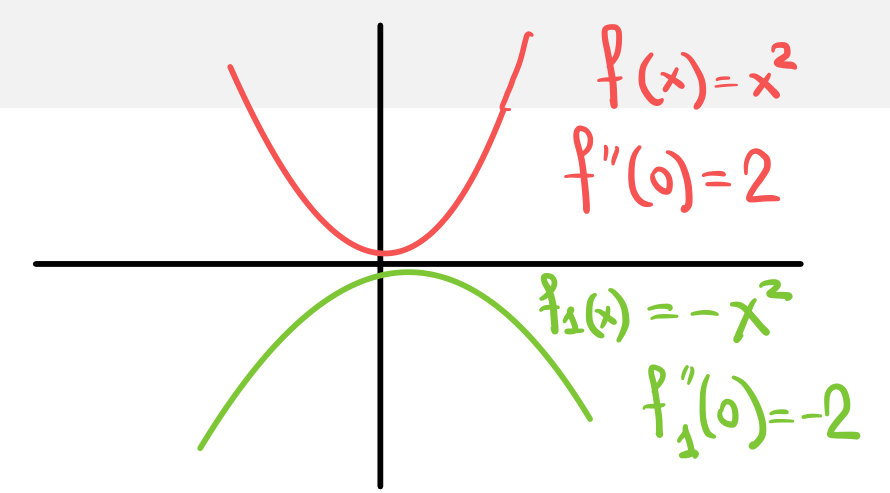
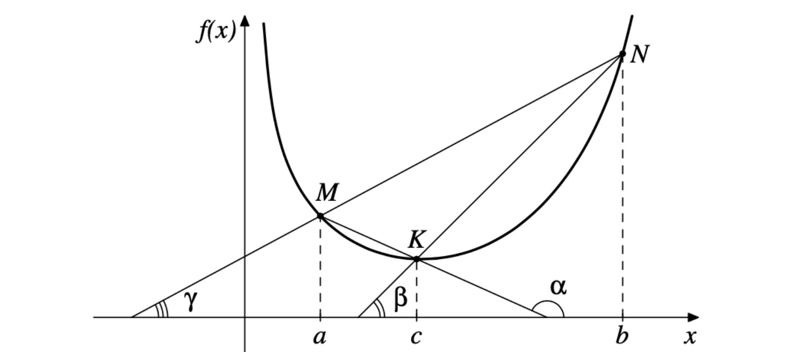
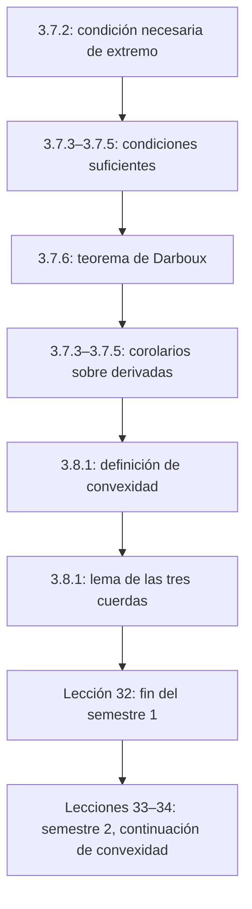

# Lecciones 31–32 — Extremos, teorema de Darboux y funciones convexas

[[es/lectures-2025-26/lecture-29-30|← Lecciones 29–30]] · [[es/lectures-2025-26/index|Índice de lecciones]] · [[es/lectures-2025-26/lecture-33-34|Lecciones 33–34 →]] · [[es/term-index|Términos y teoremas]] · [[ru/lectures-2025-26/lecture-31-32|Русский]] · [[en/lectures-2025-26/lecture-31-32|English]]

> [!info] Fuente
> `ma25_26-lectures_31-32_notes.pdf` — 29 páginas, 20 diapositivas impresas. Páginas manuscritas: 6, 10, 12, 15, 17–19, 27–28; también se transcriben las anotaciones manuscritas sobre las diapositivas. El número de diapositiva difiere del número de página del PDF. Fecha de la portada y los pies: 18 de diciembre de 2025.
>
> **Límite entre semestres. El semestre 1 termina con la lección 32.** El semestre 2 abarca las **lecciones 33–64**. El §3.8, iniciado aquí, se repite y continúa en las [[es/lectures-2025-26/lecture-33-34|lecciones 33–34]]. Ya existe material duplicado del semestre 2 en la [[ru/lectures/index|carpeta rusa `ru/lectures/`]], empezando por la [[ru/lectures/01-convexity-3-8|sección de convexidad]].
>
> **Convenciones.** $I=\langle A,B\rangle$ es un intervalo con cualquier inclusión admisible de sus extremos. El ruso «creciente» no estricto se traduce como «no decreciente». Las correcciones de erratas y las explicaciones añadidas se señalan explícitamente como editoriales.

## Diapositivas impresas 1–3 (pp. PDF 1–3). Introducción

**Cita del día:** «Quedan 2 lecciones».

**Objetivos:** investigar la monotonía y los extremos de las funciones; hablar de [[#^def-3-8-1|funciones convexas]].

## Capítulo 3, §7. Monotonía y extremos de funciones — continuación

### Diapositivas impresas 4–5 (pp. PDF 4–5). Condición necesaria de extremo

> [!theorem] Teorema 3.7.2
> Sean $f:I\to\mathbb R$, $a\in(A,B)$ y $f$ diferenciable en $a$. Si $a$ es un punto de extremo de $f$, entonces
>
> $$
> f'(a)=0.
> $$

^thm-3-7-2

Un punto en el que $f'(a)=0$ se llama **estacionario** para $f$.

**Observaciones y ejemplos manuscritos (p. 5).**

1. Ser estacionario no garantiza un extremo: $f(x)=x^3$ no tiene extremo en cero, aunque $f'(0)=0$.
2. Puede haber un extremo en un punto de no diferenciabilidad: $f(x)=\sqrt[3]{x^2}=|x|^{2/3}$ tiene un mínimo en cero, pero no tiene [[es/lectures-2025-26/lecture-22-23#^def-3-1-1|derivada]] finita allí.
3. El teorema no es válido para los extremos en los bordes: $f(x)=x$ en $[0,1]$ tiene un mínimo en cero, pero $f'(0)=1$ (derivada lateral).
4. Un punto $a\in(A,B)$ se llama **crítico**, o candidato a extremo, si $f'(a)=0$ o $f$ no es [[es/lectures-2025-26/lecture-22-23#^def-3-2-1|diferenciable]] en $a$. Todo punto interior de extremo es crítico, pero no todo punto crítico es un punto de extremo.

### Página manuscrita (p. PDF 6). Demostración del teorema 3.7.2

Para fijar ideas, supongamos que $a$ es un punto de mínimo. Existe $\delta>0$ tal que $[a-\delta,a+\delta]\subset(A,B)$ y

$$
f(x)\ge f(a)\qquad(x\in[a-\delta,a+\delta]).
$$

Restringimos $f$ a este segmento. La restricción alcanza su menor valor en $a$ y es diferenciable allí. Por el [[es/lectures-2025-26/lecture-24-25-26#^thm-3-4-1|teorema de Fermat]], $f'(a)=0$. El caso del máximo es análogo. $\blacksquare$

### Diapositiva impresa 6 (p. PDF 7). Mayor y menor valor en un segmento

Una función continua en $[A,B]$ alcanza su mayor y su menor valor por el [[es/05-limits-continuity#^extreme-value-theorem|teorema de Weierstrass]].

1. Hallar el conjunto $C$ de puntos críticos interiores: $f'=0$ o la derivada no existe.
2. Comparar los valores en esos puntos y en los extremos del segmento.

En la diapositiva se escribe

$$
M=\max\{f(A),f(B),\max_C f\},\qquad
m=\min\{f(A),f(B),\min_C f\},
$$

y entonces $M=\max_{[A,B]}f$, $m=\min_{[A,B]}f$.

> [!remark] Nota del editor
> Si $C$ es vacío o no existen por separado $\max_C f$, $\min_C f$, los máximos internos de esta notación no pueden tomarse literalmente. Una formulación siempre válida consiste en tomar el máximo y el mínimo de $f$ en $\{A,B\}\cup C$. Este conjunto contiene todos los puntos de extremo global; si $C=\varnothing$, solo quedan los extremos del segmento.

### Diapositiva impresa 7 (p. PDF 8). Condición suficiente mediante la primera derivada

> [!theorem] Teorema 3.7.3
> Sean $f:I\to\mathbb R$, $a\in(A,B)$ y $(a-\delta,a+\delta)\subset I$. Supongamos que $f$ es continua en $a$ y diferenciable en $(a-\delta,a)\cup(a,a+\delta)$.
>
> 1. Si $f'(x)<0$ a la izquierda de $a$ y $f'(x)>0$ a la derecha, entonces $a$ es un punto de **mínimo estricto**.
> 2. Si $f'(x)>0$ a la izquierda de $a$ y $f'(x)<0$ a la derecha, entonces $a$ es un punto de **máximo estricto**.

^thm-3-7-3

### Diapositiva impresa 8 y página manuscrita (pp. PDF 9–10). La condición no es necesaria

La diapositiva dice: «Si $f'$ no cambia de signo en $(a-\delta,a)\cup(a,a+\delta)$, entonces $f$ no tiene extremo en $a$». La ilustración manuscrita es $f(x)=x^3$: $f'(x)=3x^2>0$ para $x\ne0$ y no hay extremo en cero.

> [!remark] Nota del editor
> La observación sobre el signo constante presupone **el mismo signo estricto** a ambos lados y continuidad de $f$ en $a$. Una derivada meramente no negativa permite extremos no estrictos en tramos constantes; una función constante es el contraejemplo más sencillo a una lectura literal.

El [[#^thm-3-7-3|teorema 3.7.3]] da una condición suficiente, pero no necesaria. El ejemplo manuscrito es

$$
f(x)=
\begin{cases}
x^2\left(2+\sin\dfrac1x\right),&x\ne0,\\
0,&x=0.
\end{cases}
$$

La función es diferenciable en $\mathbb R$, con $f'(0)=0$. Como $f(x)\ge x^2>0$ para $x\ne0$, cero es un punto de mínimo estricto. Sin embargo (p. 10),

$$
f'(x)=2x\left(2+\sin\frac1x\right)-\cos\frac1x\qquad(x\ne0).
$$

El primer sumando tiende a cero, mientras que el coseno toma los valores $\pm1$ arbitrariamente cerca de cero por ambos lados. Por tanto, $f'$ no conserva un signo fijo en ningún [[es/lectures-2025-26/lecture-14#^def-2-4-2|entorno perforado]] de cero.

### Diapositiva impresa 9 (p. PDF 11). Condición suficiente mediante la segunda derivada

> [!theorem] Teorema 3.7.4
> Sean $f:I\to\mathbb R$, $a\in(A,B)$ y $f$ dos veces diferenciable en $a$, con $f'(a)=0$.
>
> 1. Si $f''(a)>0$, entonces $a$ es un punto de mínimo estricto.
> 2. Si $f''(a)<0$, entonces $a$ es un punto de máximo estricto.

^thm-3-7-4

Si $f''(a)=0$, el teorema no da respuesta. Ejemplos manuscritos: $x^4$ tiene un mínimo en cero, mientras que $x^3$ no tiene extremo allí; ambas segundas derivadas se anulan en cero. Se ha omitido un paréntesis sobrante después de $f''(a)>0$ en el texto impreso.

### Página manuscrita (p. PDF 12). Demostración del teorema 3.7.4

Se demuestra la primera afirmación. Por la [[es/lectures-2025-26/lecture-27-28#^thm-3-6-3|fórmula de Taylor]]–Peano,

$$
\begin{aligned}
f(x)-f(a)
&=f'(a)(x-a)+\frac{f''(a)}2(x-a)^2+o((x-a)^2)\\
&=\frac{f''(a)}2(x-a)^2\bigl(1+o(1)\bigr),\qquad x\to a.
\end{aligned}
$$

Como $1+o(1)\to1$, este factor es positivo en un entorno suficientemente pequeño. Para $x\ne a$, todos los factores son positivos, de modo que $f(x)>f(a)$. Es un mínimo estricto. El caso $f''(a)<0$ es análogo. $\blacksquare$

### Diapositiva impresa 10 (p. PDF 13). Extremos y derivadas superiores

> [!theorem] Teorema 3.7.5
> Sean $f:I\to\mathbb R$, $a\in(A,B)$ y $n\in\mathbb N$. Supongamos que $f$ es $n$ veces diferenciable en $a$,
>
> $$
> f'(a)=\cdots=f^{(n-1)}(a)=0,\qquad f^{(n)}(a)\ne0.
> $$
>
> 1. Si $n$ es impar, no hay extremo en $a$.
> 2. Si $n$ es par, $f^{(n)}(a)>0$ da un mínimo estricto y $f^{(n)}(a)<0$ un máximo estricto.

^thm-3-7-5

**Ejemplo manuscrito:** $f(x)=x^3$, $a=0$; $f'(x)=3x^2$, $f''(x)=6x$, $f'''(x)=6$. Las dos primeras derivadas se anulan en cero y la tercera no; $n=3$, por lo que no hay extremo.

> [!remark] Explicación editorial
> La misma fórmula de Taylor–Peano da $f(x)-f(a)=\dfrac{f^{(n)}(a)}{n!}(x-a)^n(1+o(1))$. La paridad de $n$ determina si el signo cambia al pasar por $a$. No hay una demostración manuscrita separada del [[#^thm-3-7-5|teorema 3.7.5]] en el PDF.

### Diapositiva impresa 11 (p. PDF 14). Teorema sobre los ceros de la derivada

> [!theorem] Teorema 3.7.6 (G. Darboux)
> Sean $f$ diferenciable en $I$ y $a,b\in I$, con
>
> $$
> f'(a)<0,\qquad f'(b)>0.
> $$

^thm-3-7-6

Entonces existe un punto $c$ entre $a$ y $b$ tal que $f'(c)=0$.

### Página manuscrita (p. PDF 15). Demostración del teorema 3.7.6

Supongamos $a<b$. La función $f$ es continua en $[a,b]$ y, por el teorema de Weierstrass, alcanza su mínimo en algún $c\in[a,b]$.

De

$$
f'(a)=\lim_{x\to a+}\frac{f(x)-f(a)}{x-a}<0
$$

se deduce que $f(x)<f(a)$ para todo $x>a$ suficientemente cercano, luego $c\ne a$. Análogamente, $f'(b)>0$ da $f(x)<f(b)$ para $x<b$ cercano, luego $c\ne b$.

Así, $c\in(a,b)$ y el teorema de Fermat da $f'(c)=0$. $\blacksquare$

> [!remark] Nota del editor
> La página manuscrita trata el caso $a<b$. Si $b<a$, el mismo argumento se aplica a un máximo en $[b,a]$.

### Diapositiva impresa 12 (p. PDF 16). Corolarios del teorema de Darboux

> [!corollary] Corolario 3.7.3 (monotonía con derivada no nula)
> Si $f$ es diferenciable en $I$ y $f'(x)\ne0$ en todo $I$, entonces $f$ es estrictamente monótona en $I$.

^cor-3-7-3

> [!corollary] Corolario 3.7.4 (conservación de intervalos)
> Si $f$ es diferenciable en $I$, la imagen $f'(I)$ es un intervalo.

^cor-3-7-4

> [!corollary] Corolario 3.7.5 (saltos de la derivada)
> Si $f$ es diferenciable en $I$ y $a\in I$, entonces $f'$ no puede tener un salto en $a$ ni por la izquierda ni por la derecha.

^cor-3-7-5

### Página manuscrita (p. PDF 17). Demostración del corolario 3.7.3

Si la derivada tomara valores positivos y negativos, el [[#^thm-3-7-6|teorema de Darboux]] obligaría a que se anulara entre los puntos correspondientes, contradiciendo la hipótesis. Por tanto, $f'$ tiene signo estricto constante en $I$. Por el [[es/lectures-2025-26/lecture-29-30#^thm-3-7-1|teorema 3.7.1]], $f$ es estrictamente creciente si $f'>0$ y estrictamente decreciente si $f'<0$. $\blacksquare$

### Página manuscrita (p. PDF 18). Demostración del corolario 3.7.4

Tomemos $a,b\in I$; para fijar ideas, $f'(a)\le f'(b)$. Mostraremos que $[f'(a),f'(b)]\subset f'(I)$. Para $\gamma\in(f'(a),f'(b))$, sea

$$
F(x)=f(x)-\gamma x.
$$

Entonces $F'(a)=f'(a)-\gamma<0$ y $F'(b)=f'(b)-\gamma>0$. Por el teorema de Darboux hay un punto $c$ entre $a$ y $b$ con $F'(c)=0$, es decir, $f'(c)=\gamma$. Los extremos ya pertenecen a la imagen. $\blacksquare$

### Página manuscrita (p. PDF 19). Demostración del corolario 3.7.5

Supongamos que $f'$ tiene un salto por la derecha en $a$: el límite finito $L=\lim_{x\to a+}f'(x)$ es distinto de $f'(a)$. Supongamos, por ejemplo, $L<f'(a)$. Elegimos $\gamma\in(L,f'(a))$. Para algún $\delta>0$,

$$
f'(x)<\gamma\quad(x\in(a,a+\delta)),\qquad f'(a)>\gamma.
$$

La imagen de $f'$ en $[a,a+\delta)$ contiene valores a ambos lados de $\gamma$, pero no contiene $\gamma$. No es un intervalo, en contradicción con el [[#^cor-3-7-4|corolario 3.7.4]]. El otro orden entre $L$ y $f'(a)$ y el salto por la izquierda se tratan análogamente. $\blacksquare$

> [!remark] Nota del editor
> Una derivada no tiene por qué ser continua: son posibles las discontinuidades oscilatorias de segunda especie. La propiedad de Darboux no exige continuidad de la derivada.

## Capítulo 3, §8. Funciones convexas

### Diapositiva impresa 13 (p. PDF 20). Definición de convexidad

> [!definition] Definición 3.8.1
> Sea $f:I\to\mathbb R$.
>
> 1. La función es **convexa** en $I$ si para cualesquiera $a,b\in I$ y $\lambda\in(0,1)$,
>
> $$
> f(\lambda a+(1-\lambda)b)\le\lambda f(a)+(1-\lambda)f(b).
> $$
>
> 2. La función es **estrictamente convexa** si para cualesquiera $a,b\in I$ distintos y $\lambda\in(0,1)$,
>
> $$
> f(\lambda a+(1-\lambda)b)<\lambda f(a)+(1-\lambda)f(b).
> $$

^def-3-8-1

### Diapositiva impresa 14 (p. PDF 21). Observaciones y operaciones aritméticas

1. Se pueden intercambiar $a,b$ y suponer $a<b$.
2. Si $a=b$, la desigualdad no estricta se convierte en igualdad.
3. Al invertir las desigualdades se obtienen la **concavidad** y la **concavidad estricta**. En la terminología rusa usada aquí, «convexidad hacia abajo» y «convexidad hacia arriba» son sinónimos de convexidad y concavidad, respectivamente.
4. Si $f,g$ son convexas en $I$, entonces $f+g$ es convexa; $\alpha f$ es convexa para $\alpha>0$ y **cóncava** para $\alpha<0$.

> [!note] Corrección editorial
> El último punto impreso dice erróneamente «convexa» también para $\alpha<0$. Una anotación manuscrita roja lo cambia por «cóncava»; aquí se da el enunciado corregido.

### Diapositivas impresas 15–16 (pp. PDF 22–23). Interpretación geométrica

Sean $a<b$ y $x=\lambda a+(1-\lambda)b$. Entonces

$$
\lambda=\frac{b-x}{b-a},\qquad 1-\lambda=\frac{x-a}{b-a}.
$$

La convexidad estricta equivale a

$$
f(x)<\frac{b-x}{b-a}f(a)+\frac{x-a}{b-a}f(b),\qquad a<x<b. \tag{3.8.1}
$$

El miembro derecho define la cuerda entre $(a,f(a))$ y $(b,f(b))$. Para la convexidad estricta, cada cuerda queda estrictamente por encima de la gráfica salvo en sus extremos; para la convexidad, no queda por debajo de ella.

### Diapositiva impresa 17 (p. PDF 24). Lema de las tres cuerdas

> [!lemma] Lema 3.8.1
> Para $f:I\to\mathbb R$, son equivalentes:
>
> 1. $f$ es estrictamente convexa en $I$.
> 2. Para cualesquiera $a<c<b$ de $I$,
>
> $$
> \frac{f(c)-f(a)}{c-a}<\frac{f(b)-f(c)}{b-c}.
> $$
>
> 3. Para cualesquiera $a<c<b$ de $I$,
>
> $$
> \frac{f(c)-f(a)}{c-a}
> <\frac{f(b)-f(a)}{b-a}
> <\frac{f(b)-f(c)}{b-c}.
> $$

^lem-3-8-1

### Diapositivas impresas 18–19 (pp. PDF 25–26). Geometría de las tres cuerdas

Sean $M=(a,f(a))$, $K=(c,f(c))$ y $N=(b,f(b))$. Si las cuerdas $MK$, $KN$, $MN$ forman ángulos $\alpha$, $\beta$, $\gamma$ con el eje $OX$, la afirmación 3 significa

$$
\tan\alpha<\tan\gamma<\tan\beta.
$$

Sustituyendo las desigualdades estrictas de las afirmaciones 2 y 3 por no estrictas se obtiene un criterio de convexidad ordinaria. La demostración se obtiene haciendo las mismas sustituciones.

### Páginas manuscritas (pp. PDF 27–28). Demostración del lema 3.8.1

Basta demostrar $1\Rightarrow3\Rightarrow2\Rightarrow1$. La implicación $3\Rightarrow2$ es inmediata.

**$1\Rightarrow3$.** Para $a<c<b$, sea $\lambda=(b-c)/(b-a)$; entonces $c=\lambda a+(1-\lambda)b$. Por convexidad estricta,

$$
f(c)<\lambda f(a)+(1-\lambda)f(b).
$$

Restando $f(b)$, obtenemos

$$
f(b)-f(c)>\lambda(f(b)-f(a))
\quad\Longrightarrow\quad
\frac{f(b)-f(c)}{b-c}>\frac{f(b)-f(a)}{b-a}.
$$

Por otra parte,

$$
f(c)-f(a)<(1-\lambda)(f(b)-f(a))
\quad\Longrightarrow\quad
\frac{f(c)-f(a)}{c-a}<\frac{f(b)-f(a)}{b-a}.
$$

**$2\Rightarrow1$.** Sean $a<b$, $0<\lambda<1$ y $c=\lambda a+(1-\lambda)b$. Entonces

$$
b-c=\frac{\lambda(c-a)}{1-\lambda}.
$$

Sustituyendo en la afirmación 2 y multiplicando por los denominadores positivos,

$$
\lambda(f(c)-f(a))<(1-\lambda)(f(b)-f(c)).
$$

Por consiguiente,

$$
f(c)=\lambda f(c)+(1-\lambda)f(c)
<\lambda f(a)+(1-\lambda)f(b).
$$

Es la convexidad estricta. $\blacksquare$

### Diapositiva impresa 20 (p. PDF 29). The last but not least

La broma algebraica navideña de la diapositiva:

$$
y=\frac{\ln(x/m-sa)}{r^2}
\quad\Longrightarrow\quad
yr^2=\ln(x/m-sa)
\quad\Longrightarrow\quad
e^{yr^2}=\frac{x}{m}-sa,
$$

$$
m e^{yr^2}=x-sam
\quad\Longrightarrow\quad
m e^{r r y}=x-mas.
$$

La última línea juega visualmente con «merry = x-mas»; no es un nuevo teorema.

## Estructura de la lección

---

Anteriores: [[es/lectures-2025-26/lecture-29-30|lecciones 29–30]] · Siguientes: [[es/lectures-2025-26/lecture-33-34|lecciones 33–34 — inicio del semestre 2]].
