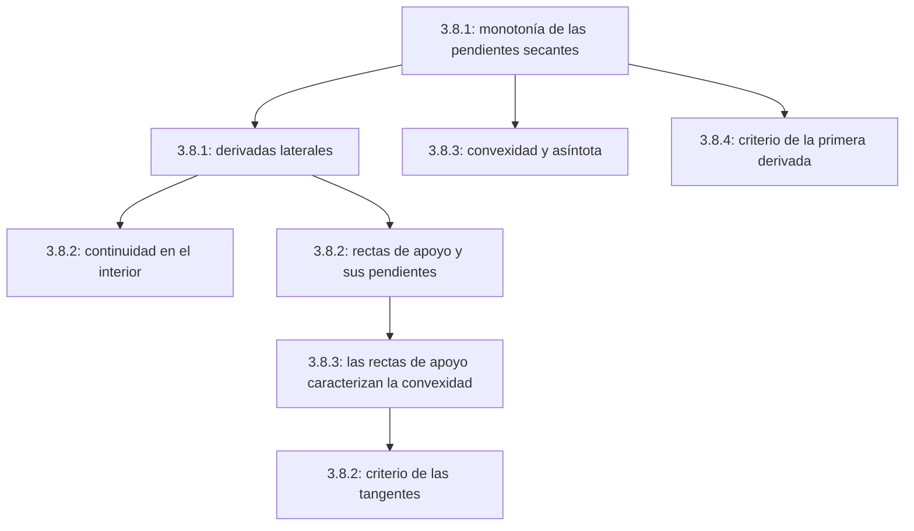

# Lecciones 33–34 — Convexidad, rectas de apoyo y criterios de convexidad

[[es/lectures-2025-26/lecture-31-32|← Lecciones 31–32]] · [[es/lectures-2025-26/index|Índice de lecciones]] · [[es/lectures-2025-26/lecture-35|Lección 35 →]] · [[es/term-index|Términos y teoremas]] · [[ru/lectures-2025-26/lecture-33-34|Русский]] · [[en/lectures-2025-26/lecture-33-34|English]]

> [!info] Fuente
> `ma25_26-lectures_33-34_notes.pdf` — 28 páginas, 16 diapositivas impresas. Páginas manuscritas: 6–7, 9–10, 12, 17–18, 22, 24–25, 27–28. Algunas páginas manuscritas tienen una capa de texto sin sentido: se han transcrito de las imágenes, no de esa capa. Fecha de las diapositivas: 12 de febrero de 2026.
>
> **Semestre 2, lecciones 33–64.** El semestre 1 terminó con la lección 32. **A partir de la lección 33 ya existe material duplicado** en otra carpeta: el [[ru/lectures/index|registro ruso `ru/lectures/`]], [[ru/lectures/01-convexity-3-8|§3.8 «Convexidad»]]. También se conservan los [apuntes archivados «Lección 33-34»](https://github.com/NikiHunter/matan/blob/main/source/MathInMind/%D0%9C%D0%90%D0%A2%D0%90%D0%9D_%D0%9B/%D0%9B%D0%B5%D0%BA%D1%86%D0%B8%D1%8F%2033-34.md). Este archivo es una transcripción ilustrada completa e independiente del nuevo PDF, no una mera remisión al material antiguo.
>
> **Notación.** $I=\langle A,B\rangle$; $f'_-(a)$ y $f'_+(a)$ son las [[es/lectures-2025-26/lecture-22-23#^def-3-1-1|derivadas]] izquierda y derecha. «Creciente» no estricto en ruso significa «no decreciente». Los signos estrictos accidentales de la demostración manuscrita para la [[es/lectures-2025-26/lecture-31-32#^def-3-8-1|convexidad]] ordinaria se sustituyen por no estrictos, con explicación; se conservan los enunciados impresos.

## Diapositivas impresas 1–3 (pp. PDF 1–3). Introducción

**Cita del día:** «La verdad absoluta es que la mayoría de las personas no sabe hacer nada bien». G. H. Hardy, *Apología de un matemático* — atribución de la diapositiva; traducida de su versión rusa.

**Objetivo:** continuar con las funciones convexas, la relación entre convexidad y monotonía y diversos criterios de convexidad.

## Capítulo 3, §8. Funciones convexas — continuación

### Diapositiva impresa 4 (p. PDF 4). Recordatorio de la definición

La **definición 3.8.1** se repite de las [[es/lectures-2025-26/lecture-31-32|lecciones 31–32]]. Para $f:I\to\mathbb R$,

$$
f(\lambda a+(1-\lambda)b)\le\lambda f(a)+(1-\lambda)f(b)
\qquad(a,b\in I,\ 0<\lambda<1)
$$

significa convexidad; la desigualdad estricta para $a\ne b$ significa convexidad estricta. Anotación manuscrita: «Recordamos la definición de convexidad».

### Diapositiva impresa 5 (p. PDF 5). Convexidad y monotonía de las pendientes secantes

> [!corollary] Corolario 3.8.1
> Sean $f:I\to\mathbb R$, $a\in I$ y
>
> $$
> F(x)=\frac{f(x)-f(a)}{x-a},\qquad x\in I\setminus\{a\}.
> $$
>
> 1. Si $f$ es convexa en $I$, entonces $F$ es no decreciente en $I\setminus\{a\}$.
> 2. Si $f$ es estrictamente convexa, entonces $F$ es estrictamente creciente en ese conjunto.

^cor-3-8-1

### Página manuscrita (p. PDF 6). Demostración del corolario 3.8.1

Se demuestra la afirmación 2. Para $x<y$, $x,y\ne a$, el lema de las tres cuerdas da, respectivamente,

$$
\begin{array}{ll}
\dfrac{f(x)-f(a)}{x-a}<\dfrac{f(y)-f(a)}{y-a},&a<x<y,\\[6pt]
\dfrac{f(a)-f(x)}{a-x}<\dfrac{f(a)-f(y)}{a-y},&x<y<a,\\[6pt]
\dfrac{f(a)-f(x)}{a-x}<\dfrac{f(y)-f(a)}{y-a},&x<a<y.
\end{array}
$$

En cada caso es $F(x)<F(y)$. Para la afirmación 1 se usan desigualdades no estrictas. $\blacksquare$

### Página manuscrita (p. PDF 7). Ejemplo de convexidad estricta

La función $f(x)=x^2$ es estrictamente convexa en $\mathbb R$. En efecto, para $a<c<b$,

$$
\frac{f(c)-f(a)}{c-a}-\frac{f(b)-f(c)}{b-c}
=\frac{c^2-a^2}{c-a}-\frac{b^2-c^2}{b-c}
=c+a-(b+c)=a-b<0.
$$

Se aplica el [[es/lectures-2025-26/lecture-31-32#^lem-3-8-1|lema 3.8.1]].

### Diapositiva impresa 6 (p. PDF 8). Derivadas laterales

Hasta ahora no se había supuesto continuidad ni diferenciabilidad. La convexidad por sí misma garantiza cierta regularidad.

> [!theorem] Teorema 3.8.1
> Sean $f$ convexa en $I$ y $a\in I$.
>
> 1. Si $a<B$, existe $f'_+(a)\in[-\infty,+\infty)$; si $a>A$, existe $f'_-(a)\in(-\infty,+\infty]$.
> 2. Si $a\in(A,B)$, ambas derivadas son finitas y
>
> $$
> f'_-(a)\le f'_+(a).
> $$

^thm-3-8-1

### Páginas manuscritas (pp. PDF 9–10). Demostración del teorema 3.8.1

Volvemos a considerar $F(x)=(f(x)-f(a))/(x-a)$. Por el [[#^cor-3-8-1|corolario 3.8.1]] es no decreciente. Si $a<B$, el teorema sobre límites de funciones monótonas da

$$
f'_+(a)=\lim_{x\to a+}F(x)=\inf_{x>a}F(x)\in[-\infty,+\infty).
$$

Análogamente,

$$
f'_-(a)=\lim_{x\to a-}F(x)=\sup_{x<a}F(x)\in(-\infty,+\infty].
$$

En un punto interior, pasando a los [[es/lectures-2025-26/lecture-15#^def-2-4-5|límites laterales]] en $F(x)\le F(y)$ para $x<a<y$, se obtiene $f'_-(a)\le f'_+(a)$. Fijando $u<a<v$ en $I$, también tenemos

$$
F(u)\le f'_-(a)\le f'_+(a)\le F(v).
$$

Los valores exteriores son finitos, luego ambas derivadas son finitas. $\blacksquare$

> [!remark] Nota del editor
> En las pp. manuscritas 9–10 aparecen «estrictamente creciente» y desigualdades estrictas, aunque el teorema solo supone convexidad. Aquí se necesitan y son válidas las desigualdades no estrictas. La desigualdad límite tampoco es estricta en general, incluso para convexidad estricta: las [[es/06-derivatives#6.1 Definición y aproximación lineal|derivadas laterales]] de $x^2$ coinciden.

### Diapositiva impresa 7 (p. PDF 11). Continuidad en el interior

> [!corollary] Corolario 3.8.2
> Una función convexa en $I$ es continua en $(A,B)$.

^cor-3-8-2

**Demostración manuscrita sobre la diapositiva.** En cada punto interior existen las derivadas finitas izquierda y derecha. Esto implica continuidad por ambos lados y, por tanto, continuidad en el punto. $\blacksquare$

### Página manuscrita (p. PDF 12). Peor comportamiento en los extremos

Ejemplo:

$$
f(x)=-\sqrt{1-x^2}\quad(-1<x\le1),\qquad f(-1)=1.
$$

La función es convexa en $[-1,1]$: su gráfica en $(-1,1]$ es la semicircunferencia inferior y elevar el valor en el extremo izquierdo no viola la convexidad. Sin embargo,

$$
f'_+(-1)=-\infty,\qquad f'_-(1)=+\infty,
$$

y la función es discontinua en $-1$. Una función convexa puede ser menos regular en los extremos que en el interior del intervalo.

### Diapositiva impresa 8 (p. PDF 13). Recta de apoyo

> [!definition] Definición 3.8.2
> Sean $f:I\to\mathbb R$, $a\in I$, $k\in\mathbb R$ y $g(x)=f(a)+k(x-a)$.
>
> 1. La recta $y=g(x)$ es **de apoyo** para $f$ en $a$ si $f(x)\ge g(x)$ para todo $x\in I$.
> 2. Es **estrictamente de apoyo** si $f(x)>g(x)$ para todo $x\in I\setminus\{a\}$.

^def-3-8-2

Una recta de apoyo pasa por $(a,f(a))$ y no queda por encima de la gráfica; una recta estrictamente de apoyo solo la corta en ese punto.

### Diapositivas impresas 9–10 (pp. PDF 14–15). Todas las rectas de apoyo

> [!lemma] Lema 3.8.2
> Sean $f:I\to\mathbb R$, $a\in(A,B)$, $k\in\mathbb R$ y $\ell:\ y=f(a)+k(x-a)$.
>
> 1. Si $f$ es convexa en $I$, entonces $\ell$ es de apoyo en $a$ si y solo si
>
> $$
> k\in[f'_-(a),f'_+(a)].
> $$
>
> 2. Si $f$ es estrictamente convexa, entonces $\ell$ es estrictamente de apoyo si y solo si se cumple la misma condición sobre $k$.

^lem-3-8-2

### Diapositiva impresa 11 (p. PDF 16). Existencia y unicidad

1. Por el [[#^thm-3-8-1|teorema 3.8.1]], $[f'_-(a),f'_+(a)]$ es un intervalo finito no vacío en un punto interior. Por tanto, una función convexa tiene recta de apoyo en cada punto interior, y una estrictamente convexa tiene una estrictamente de apoyo. En un extremo basta exigir una derivada lateral finita.
2. Si $f$ es [[es/lectures-2025-26/lecture-22-23#^def-3-2-1|diferenciable]] en $a\in(A,B)$, la recta de apoyo es única y coincide con la tangente.

Anotación manuscrita:

$$
f'_-(a)=f'_+(a)=f'(a)\quad\Longrightarrow\quad k=f'(a).
$$

### Páginas manuscritas (pp. PDF 17–18). Demostración del lema 3.8.2

El manuscrito trata el caso estrictamente convexo, afirmación 2.

**Necesidad.** Si $\ell$ es estrictamente de apoyo, entonces para $x\to a+$,

$$
0<f(x)-f(a)-k(x-a)
=(x-a)\bigl(f'_+(a)-k+o(1)\bigr).
$$

Dividimos por $x-a>0$ y pasamos al límite para obtener $k\le f'_+(a)$. Análogamente por la izquierda, donde $x-a<0$, se obtiene $f'_-(a)\le k$.

**Suficiencia.** Supongamos $f'_-(a)\le k\le f'_+(a)$. Para $x>a$, la monotonía estricta de las pendientes secantes da

$$
F(x)>\inf_{t>a}F(t)=f'_+(a)\ge k.
$$

Por tanto, $f(x)-f(a)>k(x-a)$. Para $x<a$, tenemos $F(x)<\sup_{t<a}F(t)=f'_-(a)\le k$; al multiplicar por el número negativo $x-a$ se obtiene de nuevo la misma desigualdad estricta de apoyo. Así, la gráfica fuera de $a$ queda por encima de $\ell$. Para la convexidad ordinaria se usan las desigualdades no estrictas correspondientes. $\blacksquare$

### Diapositiva impresa 12 (p. PDF 19). Las rectas de apoyo caracterizan la convexidad

> [!lemma] Lema 3.8.3
> Sea $f:I\to\mathbb R$.
>
> 1. Si hay una recta de apoyo en cada $a\in I$, entonces $f$ es convexa en $I$.
> 2. Si hay una recta estrictamente de apoyo en cada punto, entonces $f$ es estrictamente convexa.

^lem-3-8-3

> [!remark] Explicación editorial
> El PDF no contiene una demostración separada de este lema. Para $c=\lambda a+(1-\lambda)b$, se toma una recta de apoyo en $c$, se multiplican $f(a)\ge f(c)+k(a-c)$ y $f(b)\ge f(c)+k(b-c)$ por $\lambda$ y $1-\lambda$, y se suman. Los términos con $k$ se cancelan; con apoyo estricto y $a\ne b$, la desigualdad es estricta.

### Diapositivas impresas 13–14 (pp. PDF 20–21). Criterio de las tangentes

Sea $T_{a,1}f(x)=f(a)+f'(a)(x-a)$.

> [!theorem] Teorema 3.8.2
> Sea $f:I\to\mathbb R$ diferenciable en $I$.
>
> 1. $f$ es convexa en $I$ si y solo si para cualesquiera $a,x\in I$,
>
> $$
> f(x)\ge T_{a,1}f(x).
> $$
>
> 2. $f$ es estrictamente convexa en $I$ si y solo si para cualesquiera $a,x\in(A,B)$ distintos,
>
> $$
> f(x)>T_{a,1}f(x).
> $$

^thm-3-8-2

La gráfica de una función convexa es la envolvente superior de sus tangentes. Para convexidad estricta, cada tangente tiene un solo punto común con la gráfica.

### Página manuscrita (p. PDF 22). Demostración del teorema 3.8.2

Se demuestra el caso estricto. Bajo diferenciabilidad, la recta de apoyo coincide con la tangente, y el hecho necesario ya se demostró para las rectas de apoyo. Recíprocamente, si $f(x)>T_{a,1}f(x)$ para $x\ne a$, la tangente es estrictamente de apoyo; el [[#^lem-3-8-3|lema 3.8.3]] da la convexidad estricta. $\blacksquare$

> [!remark] Nota del editor
> La diapositiva enuncia la condición estricta para $a,x$ interiores. Esto da convexidad estricta en el interior; la continuidad en los extremos incluidos, consecuencia de la diferenciabilidad supuesta en el teorema, la extiende a todo $I$.

### Diapositiva impresa 15 (p. PDF 23). Convexidad y asíntota

> [!theorem] Teorema 3.8.3
> Sea $f:(A,+\infty)\to\mathbb R$ con asíntota $y=kx+b$ cuando $x\to+\infty$.
>
> 1. Si $f$ es convexa, entonces $f(x)\ge kx+b$ para todo $x>A$.
> 2. Si $f$ es estrictamente convexa, entonces $f(x)>kx+b$ para todo $x>A$.

^thm-3-8-3

Las afirmaciones también son válidas para [[es/lectures-2025-26/lecture-21#^thm-2-6-2|asíntotas]] cuando $x\to-\infty$. Una asíntota puede entenderse como una «recta de apoyo en el infinito».

> [!note] Corrección editorial
> La observación de la diapositiva 15 imprime $f(x)=kx-b\to0$. La condición de asíntota es $f(x)-kx-b\to0$. Cada rama del dibujo se considera en su propio intervalo; no se afirma que la función sea convexa en toda la recta atravesando una asíntota vertical.

### Páginas manuscritas (pp. PDF 24–25). Demostración del teorema 3.8.3

Se demuestra la afirmación estricta. Sea $g(x)=f(x)-kx$. Por la definición de asíntota, $g(x)\to b$. Mostraremos que $g$ es estrictamente decreciente.

Para $A<x<y$, consideremos

$$
F(t)=\frac{f(t)-f(x)}{t-x},\qquad t>x.
$$

La convexidad estricta hace que $F$ sea estrictamente creciente. Además,

$$
\lim_{t\to+\infty}F(t)
=\lim_{t\to+\infty}\frac{kt+b+o(1)-f(x)}{t-x}=k.
$$

Así, $F(y)<k$, es decir,

$$
f(y)-f(x)<k(y-x)
\quad\Longleftrightarrow\quad
g(y)<g(x).
$$

Una función estrictamente decreciente con límite $b$ satisface $g(x)>b$. Por tanto, $f(x)>kx+b$. En el caso no estricto se obtienen $g(y)\le g(x)$ y $g(x)\ge b$. $\blacksquare$

> [!remark] Nota del editor
> El cálculo del límite usa la definición de asíntota. La p. manuscrita 24 solo menciona $f(t)\to+\infty$ para $k\ne0$; si $k<0$, el límite es $-\infty$, pero el cálculo anterior funciona para cualquier $k$.

### Diapositiva impresa 16 (p. PDF 26). Criterio mediante la primera derivada

> [!theorem] Teorema 3.8.4
> Sea $f:I\to\mathbb R$ continua en $I$ y diferenciable en $(A,B)$.
>
> 1. $f$ es convexa en $I$ si y solo si $f'$ es no decreciente en $(A,B)$.
> 2. $f$ es estrictamente convexa en $I$ si y solo si $f'$ es estrictamente creciente en $(A,B)$.

^thm-3-8-4

### Páginas manuscritas (pp. PDF 27–28). Demostración del teorema 3.8.4

Se demuestra la afirmación 2.

**Necesidad.** Para $x<y$ de $(A,B)$, mostraremos que

$$
f'(x)<\frac{f(y)-f(x)}{y-x}<f'(y).
$$

La función $F(t)=(f(t)-f(x))/(t-x)$ es estrictamente creciente en $(x,y]$. Por tanto,

$$
f'(x)=\lim_{t\to x+}F(t)=\inf_{t\in(x,y]}F(t)<F(y).
$$

La desigualdad derecha se demuestra análogamente con secantes desde $y$. En particular, $f'(x)<f'(y)$.

**Suficiencia.** Sean $a<c<b$ de $I$. Por el [[es/lectures-2025-26/lecture-24-25-26#^thm-3-4-3|teorema de Lagrange]] existen $\alpha\in(a,c)$ y $\beta\in(c,b)$ tales que

$$
\frac{f(c)-f(a)}{c-a}=f'(\alpha)
<f'(\beta)=\frac{f(b)-f(c)}{b-c},
$$

porque $\alpha<\beta$ y $f'$ es estrictamente creciente. El lema de las tres cuerdas da la convexidad estricta. El caso no estricto se demuestra sustituyendo las desigualdades correspondientes. $\blacksquare$

## Estructura de la lección

---

Anteriores: [[es/lectures-2025-26/lecture-31-32|lecciones 31–32 — fin del semestre 1]] · Siguiente: [[es/lectures-2025-26/lecture-35|lección 35]] · Sección duplicada: [[ru/lectures/01-convexity-3-8|§3.8 en `ru/lectures/`]].
