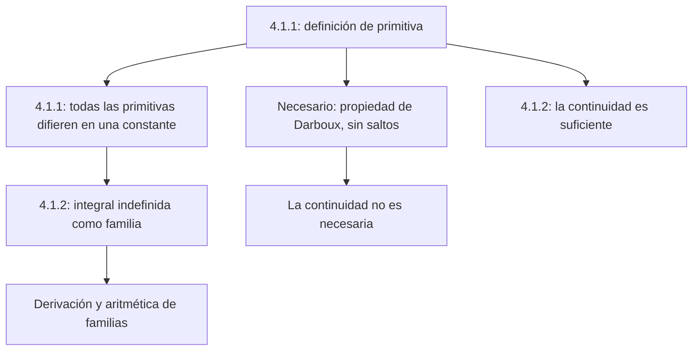

# Lección 36 — Primitivas e integral indefinida

[[es/lectures-2025-26/lecture-35|← Lección 35]] · [[es/lectures-2025-26/index|Índice de lecciones]] · [[es/lectures-2025-26/lecture-37-38|Lecciones 37–38 →]] · [[es/term-index|Términos y teoremas]] · [[ru/lectures-2025-26/lecture-36|Русский]] · [[en/lectures-2025-26/lecture-36|English]]

> [!info] Fuente
> `ma25_26_lecture_36_notes.pdf` — 20 páginas, 14 diapositivas impresas. Páginas manuscritas: 8, 10–12, 18–19; también se transcribe el esquema de la p. PDF 4 impresa. Fecha: 19 de febrero de 2026.
>
> **Semestre 2: lecciones 33–64; el semestre 1 termina con la lección 32. A partir de la lección 33 existe material duplicado** en la [[ru/lectures/index|carpeta rusa `ru/lectures/`]]. Para esta lección, véanse [[ru/lectures/02-antiderivatives-4-1|§4.1 «Primitivas e integral indefinida»]] y la [«Lección 36» archivada](https://github.com/NikiHunter/matan/blob/main/source/MathInMind/%D0%9C%D0%90%D0%A2%D0%90%D0%9D_%D0%9B/%D0%9B%D0%B5%D0%BA%D1%86%D0%B8%D1%8F%2036.md). Aquí se da una transcripción ilustrada completa del nuevo PDF, no una remisión abreviada a los apuntes antiguos.
>
> **Notación.** $I=\langle A,B\rangle$ es un intervalo y $\mathcal P_f(I)$ es el conjunto de todas las [[#^def-4-1-1|primitivas]] de $f$ en él. En los extremos incluidos, las [[es/lectures-2025-26/lecture-22-23#^def-3-1-1|derivadas]] se interpretan lateralmente, como en las lecciones anteriores.

## Diapositivas impresas 1–3 (pp. PDF 1–3). Introducción

**Cita del día:** «¡Mañana, hoy se convertirá en ayer!»

**Objetivos:**

- Tras estudiar la diferenciación, considerar el problema inverso: se conoce la derivada y se busca la función.
- Definir una primitiva y describir todas las primitivas en un intervalo.
- Discutir operaciones con integrales indefinidas.
- Enunciar condiciones necesarias y suficientes para la existencia de primitivas.

## Capítulo 4. Cálculo integral de funciones de una variable real

### Diapositiva impresa 4 (p. PDF 4). El problema inverso

Esquema manuscrito: la diferenciación lleva $f$ a $f'$, mientras que el problema inverso consiste en recuperar $f$ a partir de su derivada.

## §1. Primitivas e integral indefinida

### Diapositiva impresa 5 (p. PDF 5). Primitiva en un intervalo

> [!definition] Definición 4.1.1
> Sea $f:I\to\mathbb R$. Una función $F:I\to\mathbb R$ es una **primitiva** de $f$ en $I$ si
>
> 1. $F$ es [[es/lectures-2025-26/lecture-22-23#^def-3-2-1|diferenciable]] en $I$;
> 2. $F'(x)=f(x)$ para todo $x\in I$.

^def-4-1-1

Notación:

$$
\mathcal P_f(I)=\{F:I\to\mathbb R:\ F\text{ es diferenciable en }I,\ F'=f\}.
$$

### Diapositiva impresa 6 (p. PDF 6). Tres preguntas

1. ¿Para qué $f$ es no vacío $\mathcal P_f(I)$?
2. ¿Cómo describir $\mathcal P_f(I)$ cuando no es vacío?
3. ¿Cómo calcular primitivas cuando existen?

Empezamos por la segunda: en un intervalo, la primitiva es única salvo una constante aditiva.

### Diapositiva impresa 7 (p. PDF 7). Descripción de todas las primitivas

> [!theorem] Teorema 4.1.1
> Sean $f,F,G$ definidas en $I$, con $F\in\mathcal P_f(I)$. Son equivalentes:
>
> 1. $G\in\mathcal P_f(I)$.
> 2. Existe $c\in\mathbb R$ tal que $G(x)=F(x)+c$ para todo $x\in I$.

^thm-4-1-1

En otras palabras,

$$
\mathcal P_f(I)=\{F+c:\ c\in\mathbb R\}.
$$

Por tanto, basta hallar una primitiva.

### Página manuscrita (p. PDF 8). Demostración del teorema 4.1.1

**$1\Rightarrow2$.** Sea $H(x)=G(x)-F(x)$. Entonces

$$
H'(x)=G'(x)-F'(x)=f(x)-f(x)=0\qquad(x\in I).
$$

Por el criterio de constancia, $H$ es constante en el intervalo $I$, de modo que $G=F+c$.

**$2\Rightarrow1$.** Si $G=F+c$, las dos funciones del miembro derecho son diferenciables, luego $G$ es diferenciable y

$$
G'(x)=F'(x)+0=f(x)\qquad(x\in I).
$$

Así, $G\in\mathcal P_f(I)$. $\blacksquare$

### Diapositiva impresa 8 (p. PDF 9). Integral indefinida

> [!definition] Definición 4.1.2
> Sean $f:I\to\mathbb R$ y $F\in\mathcal P_f(I)$. El conjunto de funciones
>
> $$
> \{F(x)+c:\ c\in\mathbb R\}
> $$

^def-4-1-2

se llama **integral indefinida** de $f$ en $I$ y se denota por

$$
\int f(x)\,dx.
$$

Es simplemente $\mathcal P_f(I)$ expresado mediante una primitiva elegida.

> [!note] Corrección editorial
> En la hipótesis de la diapositiva, después de $f:I\to\mathbb R$, falta $F\in$ delante de $\mathcal P_f(I)$. Se restituye la elección de una primitiva $F$ porque se usa en la línea siguiente.

### Páginas manuscritas (pp. PDF 10–12). Significado de la notación

Por brevedad se escribe

$$
\int f(x)\,dx=F(x)+c,
$$

omitiendo las llaves y entendiendo $c$ como un número real arbitrario. Es una **familia de funciones**, no una función con una constante ya fijada.

La notación es análoga a la de la [[es/lectures-2025-26/lecture-39-40#^def-4-2-6|integral definida]]. En la p. 10 se da la imagen informal

$$
\text{integral definida}\ \sim\
\lim_{\Delta x_k\to0}\sum_k f(x_k)\Delta x_k.
$$

En la p. 11 se relaciona $f(x)\,dx$ con $f(x_k)\Delta x_k$, y $\int$ con una letra $S$ alargada (sumación).

> [!remark] Nota del editor
> Es una motivación intuitiva, no una definición del límite de [[es/lectures-2025-26/lecture-37-38#^def-4-2-4|sumas integrales]]: las [[es/lectures-2025-26/lecture-37-38#^def-4-2-2|particiones]], las etiquetas y la malla se introducen en las [[es/lectures-2025-26/lecture-37-38|lecciones 37–38]].

En principio, la integral indefinida podría denotarse simplemente por $\int f$, pero escribir $dx$ es útil:

1. Indica la variable de integración. En el ejemplo de la p. 11:

$$
\int x^y\,dx:\quad x\mapsto x^y,\quad y\text{ es un parámetro};
$$

$$
\int x^y\,dy:\quad y\mapsto x^y,\quad x\text{ es un parámetro}.
$$

2. Interpretar $dx$ como [[es/lectures-2025-26/lecture-24-25-26#^def-3-3-1|diferencial]] permite formular cómodamente las reglas de integración (p. 12).

### Diapositivas impresas 9–10 (pp. PDF 13–14). Derivación de la integral

Una integral indefinida es un **conjunto de funciones**, pero algunas operaciones sobre funciones se extienden a estos conjuntos.

Supongamos que $f$ tiene primitiva en $I$. Todos los miembros de la familia tienen la misma derivada, por lo que convenimos en escribir

$$
\left(\int f(x)\,dx\right)'=f(x),\qquad x\in I.
$$

### Diapositiva impresa 11 (p. PDF 15). Aritmética de conjuntos de funciones

Sean $D,E$ conjuntos de funciones en $I$, $h:I\to\mathbb R$ y $\lambda\in\mathbb R$ fijo. Definimos

$$
D+E=\{f+g:\ f\in D,\ g\in E\},
$$

$$
E+h=\{g+h:\ g\in E\},\qquad
\lambda E=\{\lambda g:\ g\in E\}.
$$

> [!remark] Nota del editor
> La última fórmula de la diapositiva pone $\lambda\in\mathbb R$ dentro del conjunto. Al multiplicar por un escalar **fijo** $\lambda$, solo varía $g\in E$, no todos los posibles factores $\lambda$.

### Diapositiva impresa 12 (p. PDF 16). Operaciones con integrales indefinidas

Sean $F,G$ primitivas de $f,g$ en $I$, y $H:I\to\mathbb R$. Entonces

$$
\int f(x)\,dx+\int g(x)\,dx
=\{F(x)+G(x)+c:\ c\in\mathbb R\},
$$

$$
\int f(x)\,dx+H(x)
=\{F(x)+H(x)+c:\ c\in\mathbb R\},
$$

$$
\lambda\int f(x)\,dx
=\{\lambda F(x)+c:\ c\in\mathbb R\},\qquad\lambda\ne0.
$$

> [!remark] Explicación editorial
> La restricción $\lambda\ne0$ es importante para la igualdad de **conjuntos**: $0\cdot\mathcal P_f(I)=\{0\}$, mientras que las primitivas de la función nula son todas las funciones constantes. En la segunda fórmula, $H$ es arbitraria: se afirma una igualdad de conjuntos de sumas, no la diferenciabilidad de $H$.

### Diapositiva impresa 13 (p. PDF 17). Condiciones necesarias de existencia

Describir por completo las funciones que tienen primitiva es difícil; se consideran por separado condiciones necesarias y suficientes. **La continuidad no es una condición necesaria.**

### Página manuscrita (p. PDF 18). Consecuencia del teorema de Darboux

Si $f$ tiene una primitiva $F$, entonces $f=F'$. Por tanto, $f$ tiene la [[es/lectures-2025-26/lecture-31-32#^thm-3-7-6|propiedad de Darboux]]: la imagen de cada intervalo de su dominio es un intervalo. En particular, no puede tener saltos; puede haber [[es/lectures-2025-26/lecture-16#^def-2-5-4|discontinuidades de segunda especie]].

> [!remark] Explicación editorial
> La propiedad de Darboux no debe sustituirse por la mera ausencia de saltos: no tener saltos por sí solo no garantiza una primitiva. El argumento sobre las derivadas aparece en las [[es/lectures-2025-26/lecture-31-32|lecciones 31–32]].

### Página manuscrita (p. PDF 19). Función sin primitiva

$$
f(x)=
\begin{cases}
1,&x\ge0,\\
-1,&x<0.
\end{cases}
$$

En cero, $f$ tiene un salto — una discontinuidad de primera especie. Por tanto, **no tiene primitiva en un intervalo que contenga cero como punto interior**.

Las derivadas admiten discontinuidades de segunda especie, de modo que la continuidad no es necesaria.

> [!example] Ejemplo editorial para la última afirmación
> Las lecciones 31–32 construyen una función diferenciable $u(x)=x^2(2+\sin(1/x))$ para $x\ne0$, $u(0)=0$. Su derivada es discontinua en cero, pero tiene primitiva $u$. Es un ejemplo de discontinuidad oscilatoria admisible; no afirma que toda función con discontinuidad de segunda especie tenga primitiva.

### Diapositiva impresa 14 (p. PDF 20). Condición suficiente de existencia

> [!theorem] Teorema 4.1.2
> Si $f$ es continua en $I$, entonces tiene una primitiva en $I$.

^thm-4-1-2

El PDF enuncia el teorema sin demostración. Su relación con la integral de extremo superior variable se trata al estudiar la integral definida; véase también el [[es/08-riemann-integration|capítulo general sobre la integral de Riemann]].

## Estructura de la lección

---

Anterior: [[es/lectures-2025-26/lecture-35|lección 35]] · Siguientes: [[es/lectures-2025-26/lecture-37-38|lecciones 37–38]] · Sección duplicada: [[ru/lectures/02-antiderivatives-4-1|§4.1 en `ru/lectures/`]].
