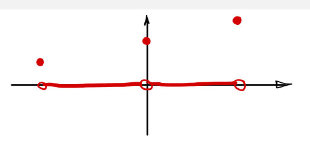
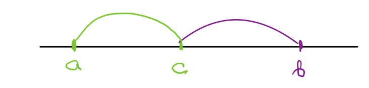
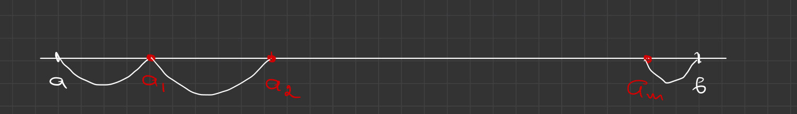
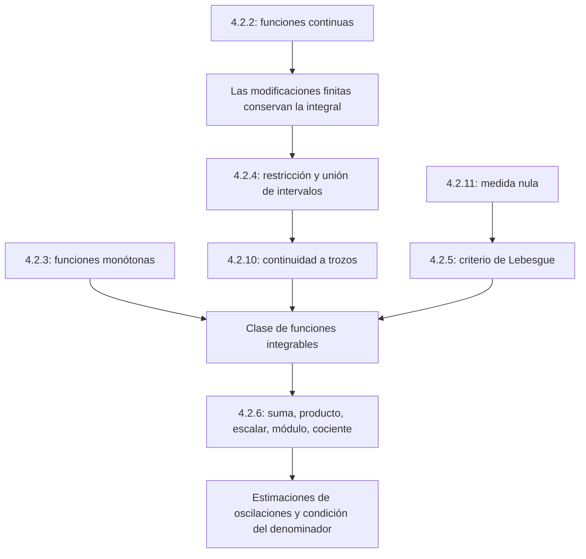

# Lecciones 41–42 — Clases de funciones integrables

[[es/lectures-2025-26/lecture-39-40|← Lecciones 39–40]] · [[es/lectures-2025-26/index|Índice de lecciones]] · [[es/lectures-2025-26/lecture-43-44|Lecciones 43–44 →]] · [[es/term-index|Términos y teoremas]] · [[ru/lectures-2025-26/lecture-41-42|Русский]] · [[en/lectures-2025-26/lecture-41-42|English]]

> [!info] Fuente
> `ma25_26-lectures_41-42_notes.pdf` — 25 páginas, 11 diapositivas impresas. Páginas manuscritas: 5–6, 8–9, 11, 13–15, 17–18, 22–25. Se incluyen los dibujos y las anotaciones sobre las diapositivas. Fecha: 12 de marzo de 2026. Las siete ilustraciones se han extraído del PDF y comprobado individualmente.
>
> **Semestre 2: lecciones 33–64; el semestre 1 terminó con la lección 32. Existe material duplicado a partir de la lección 33** en la [[ru/lectures/index|carpeta rusa `ru/lectures/`]]. Esta lección se solapa con [[ru/lectures/03-riemann-integral-4-2|§4.2 «Integral de Riemann»]]; se conserva la [«Lección 41-42» archivada](https://github.com/NikiHunter/matan/blob/main/source/MathInMind/%D0%9C%D0%90%D0%A2%D0%90%D0%9D_%D0%9B/%D0%9B%D0%B5%D0%BA%D1%86%D0%B8%D1%8F%2041-42.md). Aquí se ofrece una transcripción ilustrada completa e independiente del nuevo PDF, incluidas las demostraciones manuscritas.
>
> **Notación.** $a<b$; $\mathcal R[a,b]$ designa las funciones [[es/lectures-2025-26/lecture-39-40#^def-4-2-6|integrables según Riemann]]; $C[a,b]$ las funciones continuas; $\lambda_\tau$ es la norma de una [[es/lectures-2025-26/lecture-37-38#^def-4-2-2|partición]]; $\omega_k(f)$ es la [[es/lectures-2025-26/lecture-39-40#^def-4-2-9|oscilación]] en su subintervalo. El criterio mediante sumas de oscilaciones y las definiciones están en las [[es/lectures-2025-26/lecture-39-40|lecciones 39–40]].

## Diapositivas impresas 1–3 (pp. PDF 1–3). Introducción

**Cita del día:**

> — Tome esta integral.
>
> — No, gracias, no puedo con ella…
>
> — Tómela a crédito, a plazos, con hipoteca si hace falta: es buena.

**Objetivos:** continuar los criterios de integrabilidad; estudiar restricciones y funciones continuas a trozos; definir los conjuntos de [[#^def-4-2-11|medida nula]] y enunciar el [[#^thm-4-2-5|criterio de Lebesgue]]; considerar operaciones aritméticas con funciones integrables.

## Capítulo 4, §2. Integral de Riemann — continuación

### Diapositiva impresa 4 (p. PDF 4). Funciones continuas

> [!theorem] Teorema 4.2.2
> Una función continua en un intervalo cerrado es integrable en él:
>
> $$
> C[a,b]\subset\mathcal R[a,b].
> $$

^thm-4-2-2

### Páginas manuscritas (pp. PDF 5–6). Demostración del teorema 4.2.2

Por el [[es/lectures-2025-26/lecture-17-18#^thm-2-5-4|teorema de Heine–Cantor]], $f$ es [[es/lectures-2025-26/lecture-17-18#^def-2-5-7|uniformemente continua]] en $[a,b]$. Para cada $\varepsilon>0$, existe $\delta>0$ tal que

$$
x,y\in[a,b],\quad |x-y|<\delta
\quad\Longrightarrow\quad
|f(x)-f(y)|<\frac{\varepsilon}{b-a}.
$$

En cualquier subintervalo de longitud menor que $\delta$, la oscilación es menor que $\varepsilon/(b-a)$: el máximo y el mínimo se alcanzan. Para toda partición con $\lambda_\tau<\delta$,

$$
\sum_{k=0}^{n-1}\omega_k(f)\Delta x_k
<\sum_{k=0}^{n-1}\frac{\varepsilon}{b-a}\Delta x_k
=\frac{\varepsilon}{b-a}(b-a)=\varepsilon.
$$

El [[es/lectures-2025-26/lecture-39-40#^thm-4-2-1|teorema 4.2.1]] da la integrabilidad. $\blacksquare$

### Diapositiva impresa 5 (p. PDF 7). Funciones monótonas

> [!theorem] Teorema 4.2.3
> Una función monótona en un intervalo cerrado es integrable en él.

^thm-4-2-3

### Páginas manuscritas (pp. PDF 8–9). Demostración del teorema 4.2.3

Para fijar ideas, supongamos que $f$ no decrece. Entonces $f(a)\le f(x)\le f(b)$.

1. Si $f(a)=f(b)$, la función es constante, luego continua e integrable por el [[#^thm-4-2-2|teorema 4.2.2]].
2. Si $f(a)<f(b)$, dado $\varepsilon>0$, ponemos

$$
\delta=\frac{\varepsilon}{f(b)-f(a)}>0.
$$

Para toda partición con $\lambda_\tau<\delta$, la monotonía da

$$
\omega_k(f)=f(x_{k+1})-f(x_k).
$$

Por tanto,

$$
\begin{aligned}
\sum_{k=0}^{n-1}\omega_k(f)\Delta x_k
&\le\lambda_\tau\sum_{k=0}^{n-1}\bigl(f(x_{k+1})-f(x_k)\bigr)\\
&=\lambda_\tau\bigl(f(b)-f(a)\bigr)
<\delta\bigl(f(b)-f(a)\bigr)=\varepsilon.
\end{aligned}
$$

La suma de diferencias es telescópica. Se cumple el [[es/lectures-2025-26/lecture-39-40#^thm-4-2-1|criterio de integrabilidad]]. Para una función no creciente, la demostración es análoga, invirtiendo las diferencias. $\blacksquare$

### Diapositiva impresa 6 (p. PDF 10). Cambio de un número finito de valores

**Observación.** Cambiar los valores de una función integrable en un número finito de puntos conserva tanto su integrabilidad como su integral.

### Página manuscrita (p. PDF 11). Demostración de la observación

Sea $f\in\mathcal R[a,b]$, y sea $\widetilde f:[a,b]\to\mathbb R$ distinta de ella solo en $t_1,\ldots,t_m$. La acotación de $f$ da $|f|\le A$, y entonces

$$
|\widetilde f|\le\widetilde A
=\max\{A,|\widetilde f(t_1)|,\ldots,|\widetilde f(t_m)|\}.
$$

Para una misma partición etiquetada, pueden diferir como máximo $2m$ sumandos: cada punto modificado puede pertenecer a dos subintervalos adyacentes. Por ello,

$$
|\sigma_\tau(f,\xi)-\sigma_\tau(\widetilde f,\xi)|
\le2m(A+\widetilde A)\lambda_\tau
\xrightarrow[\lambda_\tau\to0]{}0.
$$

Como las sumas para $f$ convergen a su integral, resulta

$$
\lim_{\lambda_\tau\to0}\sigma_\tau(\widetilde f,\xi)
=\int_a^b f,
\qquad
\int_a^b\widetilde f=\int_a^b f.
$$

Esto demuestra a la vez la integrabilidad de la función modificada y la igualdad de las integrales. $\blacksquare$

> [!note] Corrección del manuscrito
> En la última línea de la p. 11 se indica por error, bajo la flecha, que la norma tiende a infinito. Debe tender a cero. La conclusión rigurosa es que la diferencia de sumas tiende a cero y ambas tienen un mismo límite fijo; la suma variable de la función original no es, por sí misma, un número límite.

### Diapositiva impresa 7 (p. PDF 12). Restricción y unión de intervalos

> [!theorem] Teorema 4.2.4
>
> 1. Si $f\in\mathcal R[a,b]$ y $[\alpha,\beta]\subset[a,b]$, entonces $f\in\mathcal R[\alpha,\beta]$.
> 2. Si $a<c<b$ y $f:[a,b]\to\mathbb R$ es integrable en $[a,c]$ y en $[c,b]$, entonces $f\in\mathcal R[a,b]$.

^thm-4-2-4

> [!note] Alcance del enunciado
> Se trata de la **integrabilidad**, no de la fórmula de aditividad de la integral. La igualdad entre la integral y la suma de las integrales sobre las partes aparece en las [[es/lectures-2025-26/lecture-43-44|lecciones 43–44]].

### Página manuscrita (p. PDF 13). Demostración de la parte 1

Sean $\alpha<\beta$. Dado $\varepsilon>0$, elegimos $\delta>0$ mediante el criterio de integrabilidad de $f$ en $[a,b]$. Tomamos **cualquier** partición $\tau_0$ de $[\alpha,\beta]$ con norma menor que $\delta$. Añadimos puntos en las partes exteriores hasta obtener una partición $\tau$ de todo el intervalo con $\lambda_\tau<\delta$.

Todos los términos de una suma de oscilaciones son no negativos. Los términos del subintervalo están incluidos en la suma de la partición completa, de modo que

$$
\sum_{[x_k,x_{k+1}]\subset[\alpha,\beta]}\omega_k(f)\Delta x_k
\le\sum_{k=0}^{n-1}\omega_k(f)\Delta x_k<\varepsilon.
$$

El criterio se cumple para todas las particiones suficientemente finas del subintervalo. $\blacksquare$

> [!remark] Explicación editorial
> Si coinciden los extremos exteriores, se omiten simplemente las partes exteriores vacías. Un subintervalo degenerado queda cubierto por la convención de integral nula introducida en las lecciones 43–44.

### Páginas manuscritas (pp. PDF 14–15). Demostración de la parte 2

La integrabilidad en ambas partes da la acotación en todo el intervalo. Denotemos su oscilación total por $\omega=\omega(f)_{[a,b]}$. Si $\omega=0$, la función es constante y el resultado ya está demostrado. Supongamos $\omega>0$.

Dado $\varepsilon>0$, elegimos $\delta_1,\delta_2>0$ para que las sumas de oscilaciones en las partes respectivas sean menores que $\varepsilon/3$, y ponemos

$$
\delta=\min\left\{\delta_1,\delta_2,\frac{\varepsilon}{3\omega}\right\}.
$$

Consideremos cualquier partición $\tau$ con $\lambda_\tau<\delta$. Si $c$ es un nodo, la suma se divide directamente en dos partes. Pero $c$ **no tiene por qué** ser un nodo: en tal caso hay un único subintervalo $[x_\nu,x_{\nu+1}]$ que lo atraviesa.

La contribución de ese subintervalo es como máximo $\omega\lambda_\tau$. Los términos restantes se acotan por las sumas de particiones de ambas partes, obtenidas añadiendo el punto de unión:

$$
\sum_{k=0}^{n-1}\omega_k(f)\Delta x_k
<\frac{\varepsilon}{3}+\frac{\varepsilon}{3}
+\omega\lambda_\tau<\varepsilon.
$$

Si el punto de unión ya es un nodo, no hace falta el tercer término. Volvemos a aplicar el criterio de integrabilidad. $\blacksquare$

### Diapositiva impresa 8 (p. PDF 16). Funciones continuas a trozos

> [!definition] Definición 4.2.10
> Una función $f:[a,b]\to\mathbb R$ es **continua a trozos** si su conjunto de discontinuidades es vacío o finito y todas sus discontinuidades son de primera especie.

^def-4-2-10

**Corolario (sin número).** Una función continua a trozos en un intervalo cerrado es integrable en él.

### Páginas manuscritas (pp. PDF 17–18). Demostración del corolario y observaciones

Si no hay discontinuidades, aplicamos el [[#^thm-4-2-2|teorema 4.2.2]]. En caso contrario, enumeramos los finitos [[es/lectures-2025-26/lecture-16#^def-2-5-4|puntos de discontinuidad]] interiores $a_1<\cdots<a_m$, y ponemos $a_0=a$, $a_{m+1}=b$.

En cada intervalo abierto la función es continua y tiene [[es/lectures-2025-26/lecture-15#^def-2-4-5|límites laterales]] finitos en sus extremos. La extendemos continuamente al intervalo cerrado correspondiente:

$$
g_i(x)=
\begin{cases}
f(x),&a_i<x<a_{i+1},\\
f(a_i+0),&x=a_i,\\
f(a_{i+1}-0),&x=a_{i+1},
\end{cases}
\qquad i=0,\ldots,m.
$$

Entonces $g_i\in C[a_i,a_{i+1}]\subset\mathcal R[a_i,a_{i+1}]$. La función original puede diferir de la extensión en los extremos, pero son como máximo dos puntos; la observación sobre modificaciones finitas da la integrabilidad de la función original en cada parte. Aplicando repetidamente la parte 2 del [[#^thm-4-2-4|teorema 4.2.4]], obtenemos la integrabilidad en todo el intervalo. $\blacksquare$

Observación manuscrita: la integrabilidad **no implica** continuidad ni la existencia de solo un número finito de discontinuidades. La inclusión de clases va en un único sentido.

### Diapositiva impresa 9 (p. PDF 19). Conjuntos de medida nula

> [!definition] Definición 4.2.11
> Un conjunto $E\subset\mathbb R$ tiene **medida nula** si, para todo $\varepsilon>0$, puede cubrirse con una unión a lo sumo numerable de intervalos abiertos cuya longitud total sea menor que $\varepsilon$:
>
> $$
> E\subset\bigcup_j(\alpha_j,\beta_j),\qquad
> \sum_j(\beta_j-\alpha_j)<\varepsilon.
> $$

^def-4-2-11

La familia de intervalos de la cubierta puede ser finita o [[es/lectures-2025-26/lecture-01-02#^def-1-2-5|numerable]].

### Diapositiva impresa 10 (p. PDF 20). Criterio de Lebesgue

> [!theorem] Teorema 4.2.5
> Una función $f:[a,b]\to\mathbb R$ es integrable según Riemann si y solo si está acotada en el intervalo y su conjunto de discontinuidades tiene medida nula.

^thm-4-2-5

Este PDF enuncia el criterio **sin demostración**. No afirma que una función integrable deba tener un conjunto finito o numerable de discontinuidades: la condición es precisamente la medida nula.

### Diapositiva impresa 11 (p. PDF 21). Operaciones aritméticas

> [!theorem] Teorema 4.2.6
> Sean $f,g\in\mathcal R[a,b]$. Entonces:
>
> 1. $f+g\in\mathcal R[a,b]$;
> 2. $fg\in\mathcal R[a,b]$;
> 3. $\alpha f\in\mathcal R[a,b]$ para todo $\alpha\in\mathbb R$;
> 4. $|f|\in\mathcal R[a,b]$;
> 5. si $\inf_{x\in[a,b]}|g(x)|>0$, entonces $f/g\in\mathcal R[a,b]$.

^thm-4-2-6

Aquí se establece la estabilidad de la clase de funciones integrables; las fórmulas para los valores de las integrales se estudian en la lección siguiente.

### Páginas manuscritas (pp. PDF 22–23). Demostración del punto 1: suma

Para cualquier conjunto no vacío $E\subset[a,b]$ y $x,y\in E$, la desigualdad triangular da

$$
\begin{aligned}
|(f+g)(x)-(f+g)(y)|
&\le |f(x)-f(y)|+|g(x)-g(y)|\\
&\le\omega(f)_E+\omega(g)_E.
\end{aligned}
$$

Tomando el [[es/lectures-2025-26/lecture-11-12#^def-2-3-1|supremo]], obtenemos

$$
\omega(f+g)_E\le\omega(f)_E+\omega(g)_E,
\qquad
\omega_k(f+g)\le\omega_k(f)+\omega_k(g).
$$

Multiplicamos por las longitudes de los subintervalos y sumamos:

$$
0\le\sum_{k=0}^{n-1}\omega_k(f+g)\Delta x_k
\le\sum_{k=0}^{n-1}\omega_k(f)\Delta x_k
+\sum_{k=0}^{n-1}\omega_k(g)\Delta x_k
\xrightarrow[\lambda_\tau\to0]{}0.
$$

Las dos sumas de la derecha tienden a cero por la integrabilidad de las funciones originales. El criterio demuestra la integrabilidad de su suma. $\blacksquare$

### Página manuscrita (p. PDF 24). Demostración del punto 2: producto

Por el [[es/lectures-2025-26/lecture-39-40#^lem-4-2-1|lema 4.2.1]], existen constantes finitas $K,L\ge0$ con $|f|\le K$, $|g|\le L$. Sumando y restando un producto mixto, obtenemos

$$
\begin{aligned}
|f(x)g(x)-f(y)g(y)|
&=|[f(x)-f(y)]g(x)+f(y)[g(x)-g(y)]|\\
&\le L|f(x)-f(y)|+K|g(x)-g(y)|.
\end{aligned}
$$

Así,

$$
\omega_k(fg)\le L\omega_k(f)+K\omega_k(g).
$$

Después de multiplicar por las longitudes y sumar, el miembro derecho tiende a cero como en el punto 1. Por tanto, el producto es integrable. $\blacksquare$

> [!note] Corrección del manuscrito
> La última estimación de la p. 24 escribe por error $\omega_k(f+g)$ en lugar de $\omega_k(fg)$. Todo el cálculo anterior y el punto demostrado se refieren al producto.

### Página manuscrita (p. PDF 25). Demostraciones de los puntos 3–5

**3. Multiplicación por un escalar.** Es el punto 2 con la función constante $g\equiv\alpha$, que es continua y, por tanto, integrable. También se admite un coeficiente nulo.

**4. Valor absoluto.** La desigualdad triangular inversa da

$$
\bigl||f(x)|-|f(y)|\bigr|\le|f(x)-f(y)|
\quad\Longrightarrow\quad
\omega_k(|f|)\le\omega_k(f).
$$

El criterio de oscilaciones completa la demostración.

**5. Cociente.** Escribimos $f/g=f\cdot(1/g)$. Basta demostrar la integrabilidad de la recíproca y aplicar el punto 2. Sea

$$
m=\inf_{x\in[a,b]}|g(x)|>0.
$$

La función recíproca está acotada y, para cualesquiera dos puntos,

$$
\left|\frac1{g(x)}-\frac1{g(y)}\right|
=\left|\frac{g(y)-g(x)}{g(x)g(y)}\right|
\le\frac{|g(y)-g(x)|}{m^2}.
$$

En consecuencia,

$$
\omega_k\!\left(\frac1g\right)\le\frac{\omega_k(g)}{m^2}.
$$

La suma de oscilaciones de la recíproca tiende a cero; esta es integrable y, por tanto, el cociente también lo es. $\blacksquare$

> [!remark] Explicación editorial
> Para una función integrable arbitraria no basta con que no tenga ceros: el teorema exige que el denominador esté **separado de cero**. Si es continuo y no se anula en el intervalo cerrado, la [[es/02-real-numbers#2.2 Supremo e ínfimo|cota inferior]] positiva se deduce del [[es/05-limits-continuity#^extreme-value-theorem|teorema de Weierstrass]].

## Estructura de la lección

---

Anteriores: [[es/lectures-2025-26/lecture-39-40|lecciones 39–40]] · Siguientes: [[es/lectures-2025-26/lecture-43-44|lecciones 43–44]] · [[assets/lectures-2025-26/provenance-39-44|Procedencia de las ilustraciones]].
