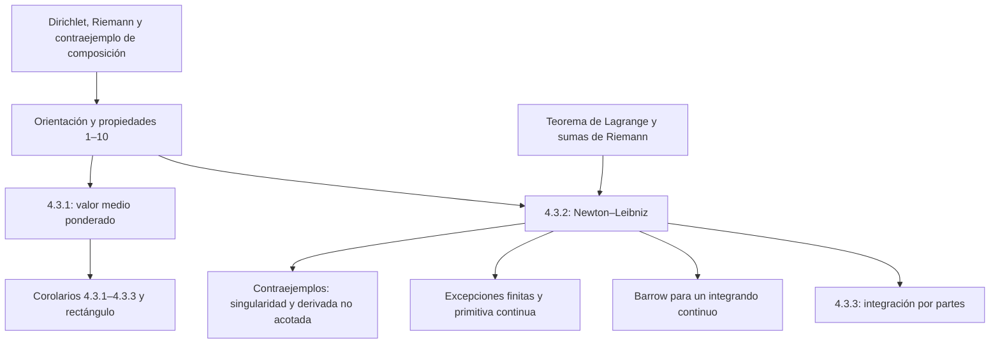

# Lecciones 43–44 — Propiedades de la integral de Riemann y fórmula de Newton–Leibniz

[[es/lectures-2025-26/lecture-41-42|← Lecciones 41–42]] · [[es/lectures-2025-26/index|Índice de lecciones]] · [[es/lectures-2025-26/lecture-45-46|Lecciones 45–46 →]] · [[es/term-index|Términos y teoremas]] · [[ru/lectures-2025-26/lecture-43-44|Русский]] · [[en/lectures-2025-26/lecture-43-44|English]]

> [!info] Fuente
> `ma25_26-lectures_43-44_notes.pdf` — 38 páginas, 16 diapositivas impresas. Páginas manuscritas: 4–8, 11–13, 15–16, 18–19, 21, 26–27, 29, 31–32, 34–36, 38. Se incluyen las anotaciones manuscritas sobre las diapositivas. Fecha: 19 de marzo de 2026. Cinco ilustraciones se han extraído de sus páginas correspondientes del PDF y comprobado una por una.
>
> **Semestre 2: lecciones 33–64; el semestre 1 terminó con la lección 32. Existe material duplicado a partir de la lección 33** en la [[ru/lectures/index|carpeta rusa `ru/lectures/`]]. Los ejemplos iniciales se solapan con [[ru/lectures/03-riemann-integral-4-2|§4.2 «Integral de Riemann»]], y la parte principal con [[ru/lectures/04-riemann-properties-4-3|§4.3 «Propiedades de la integral de Riemann»]]; se conserva la [«Lección 43-44 1» archivada](https://github.com/NikiHunter/matan/blob/main/source/MathInMind/%D0%9C%D0%90%D0%A2%D0%90%D0%9D_%D0%9B/%D0%9B%D0%B5%D0%BA%D1%86%D0%B8%D1%8F%2043-44%201.md). A continuación se ofrece una versión ilustrada completa e independiente de la nueva fuente, no enlaces que sustituyan su contenido.
>
> **Convenciones.** Salvo indicación explícita en contrario, $a<b$; los convenios para intervalos degenerados y límites invertidos se introducen aparte. $\mathcal R[a,b]$ y $C[a,b]$ son las clases de funciones [[es/lectures-2025-26/lecture-39-40#^def-4-2-6|integrables según Riemann]] y continuas. Las definiciones de sumas, [[es/lectures-2025-26/lecture-39-40#^def-4-2-9|oscilaciones]] y criterios están en las [[es/lectures-2025-26/lecture-39-40|lecciones 39–40]]; las clases de funciones integrables, en las [[es/lectures-2025-26/lecture-41-42|lecciones 41–42]]. Todas las integrales son integrales de Riemann propias. Las condiciones de continuidad esenciales para las propiedades 9–10 se indican explícitamente.

## Diapositivas impresas 1–3 (pp. PDF 1–3). Introducción y límites de la fuente

**Cita del día:** «¡Todo es posible! ¡Lo imposible solo requiere más tiempo!»

**Objetivos de la diapositiva:** propiedades de la integral y teorema de Barrow; teoremas del valor medio y corolarios; [[#^thm-4-3-2|fórmula de Newton–Leibniz]] y observaciones; [[es/lectures-2025-26/lecture-37-38#^thm-4-1-4|integración por partes]] y cambio de variable en integrales definidas; [[es/lectures-2025-26/lecture-27-28#^thm-3-6-3|fórmula de Taylor]] con resto integral.

> [!note] Límite del PDF
> Este archivo termina con la demostración de la integración por partes, [[#^thm-4-3-3|teorema 4.3.3]]. El cambio de variable y el resto integral de Taylor **se mencionan en los objetivos, pero no se desarrollan aquí**; sus fórmulas y demostraciones no se atribuyen a esta fuente.

## Ejemplos manuscritos antes del §3

### Página manuscrita (p. PDF 4). Función de Dirichlet

$$
\chi(x)=
\begin{cases}
1,&x\in\mathbb Q,\\
0,&x\notin\mathbb Q.
\end{cases}
$$

Todo subintervalo no degenerado contiene puntos racionales e irracionales. Por tanto, para cualquier [[es/lectures-2025-26/lecture-37-38#^def-4-2-2|partición]],

$$
M_k=1,\quad m_k=0,\quad\omega_k(\chi)=1,
\qquad
\sum_{k=0}^{n-1}\omega_k(\chi)\Delta x_k=b-a\ne0.
$$

No se cumple el [[es/lectures-2025-26/lecture-39-40#^thm-4-2-1|criterio de integrabilidad]]: $\chi\notin\mathcal R[a,b]$.

### Páginas manuscritas (pp. PDF 5–7). Función de Riemann (de Thomae)

$$
\psi(x)=
\begin{cases}
1/q,&x=p/q\in\mathbb Q,\ p\in\mathbb Z,\ q\in\mathbb N,\ \gcd(p,q)=1,\\
0,&x\notin\mathbb Q.
\end{cases}
$$

Afirmación: la función es integrable en cualquier intervalo cerrado y su integral es cero. La demostración manuscrita considera $[0,1]$.

**1. Sumas inferiores.** Cada subintervalo contiene puntos irracionales y la función es no negativa, luego $s_\tau(\psi)=0$.

**2. Sumas superiores.** Dado $\varepsilon>0$, elegimos un número natural

$$
N>\frac2\varepsilon,\qquad\frac1N<\frac\varepsilon2.
$$

El conjunto de puntos racionales con denominadores pequeños,

$$
A=\{p/q\in\mathbb Q\cap[0,1]:\ \gcd(p,q)=1,\ q\le N\}
$$

es finito. Sea $C_N$ su número de elementos. El dibujo agrupa las fracciones por denominadores; las posibles repeticiones tras reducirlas no afectan a la finitud.

Ponemos $\delta=\varepsilon/(4C_N)$ y consideramos cualquier partición con $\lambda_\tau<\delta$. Dividimos los subintervalos en dos grupos:

- «altos»: $M_k\ge1/N$; cada uno contiene un punto de $A$;
- los demás: $M_k<1/N$.

> [!note] Precisión editorial de la estimación del supremo
> Si un subintervalo no contiene puntos de $A$, todos los valores no nulos de $\psi$ en él son como máximo $1/(N+1)$. Por tanto, $M_k\le1/(N+1)<1/N$. Esto justifica la existencia de un punto de denominador pequeño en cada subintervalo «alto»; no se está suponiendo que un [[es/lectures-2025-26/lecture-11-12#^def-2-3-1|supremo]] arbitrario se alcance.

Cada punto del conjunto pertenece como máximo a dos subintervalos adyacentes, así que hay como máximo $2C_N$ subintervalos altos. Como $0\le\psi\le1$,

$$
S_\tau(\psi)
\le 2C_N\lambda_\tau+\frac1N\sum_{k=0}^{n-1}\Delta x_k
<2C_N\delta+\frac1N
<\frac\varepsilon2+\frac\varepsilon2=\varepsilon.
$$

Por tanto, $S_\tau(\psi)-s_\tau(\psi)\to0$ cuando $\lambda_\tau\to0$. El criterio y el corolario sobre límites de sumas dan

$$
\psi\in\mathcal R[0,1],\qquad\int_0^1\psi=0.
$$

$\blacksquare$

> [!remark] Explicación editorial para un intervalo general
> En un intervalo arbitrario, la contribución baja se acota por $(b-a)/N$ en lugar de $1/N$; el número de puntos racionales con denominadores acotados sigue siendo finito, y los parámetros se eligen de forma correspondiente. Si no hay puntos altos de ese tipo, la contribución alta simplemente desaparece. Esto explica la afirmación del manuscrito para cualquier intervalo cerrado.

### Página manuscrita (p. PDF 8). Composición de funciones integrables

El contraejemplo comienza al pie de la p. 7. Sea la función exterior en $[0,1]$

$$
f(y)=
\begin{cases}
1,&0<y\le1,\\
0,&y=0.
\end{cases}
$$

Es integrable porque difiere de una constante en un solo punto. La función interior de Riemann también es integrable, pero

$$
f\circ\psi=\chi\notin\mathcal R[a,b].
$$

**Conclusión:** la composición de dos funciones integrables no tiene por qué ser integrable.

**Precisión manuscrita (sin demostración).** Si se exige continuidad de la función exterior en un **intervalo cerrado** que contenga la imagen de la función interior, la afirmación es válida:

$$
\varphi:[\alpha,\beta]\to[a,b],\qquad
\varphi\in\mathcal R[\alpha,\beta],\qquad f\in C[a,b]
\quad\Longrightarrow\quad
f\circ\varphi\in\mathcal R[\alpha,\beta].
$$

## Capítulo 4, §3. Propiedades de la integral de Riemann

### Diapositiva impresa 4 (p. PDF 9). Orientación e intervalo degenerado

Ampliamos la definición mediante convenios. Si $b<a$ y $f\in\mathcal R[b,a]$, ponemos

$$
\int_a^b f=-\int_b^a f.
$$

Toda función en un intervalo degenerado se considera integrable, con

$$
\int_a^a f=0.
$$

> [!note] Corrección de la diapositiva
> La condición para extremos invertidos escribe $\mathcal R[a,b]$; el intervalo ordinario donde se exige integrabilidad es $[b,a]$. Solo se corrige el orden de los extremos en la hipótesis, no el signo de la fórmula.

### Diapositiva impresa 5 (p. PDF 10). Propiedades 1–6

Se supone que los integrandos son integrables en los intervalos correspondientes.

**1. Inversión de los límites:**

$$
\int_b^a f(x)\,dx=-\int_a^b f(x)\,dx.
$$

**2. Aditividad respecto al intervalo:** si $a<c<b$,

$$
\int_a^b f(x)\,dx
=\int_a^c f(x)\,dx+\int_c^b f(x)\,dx.
$$

**3. Factor constante:** para $\alpha\in\mathbb R$,

$$
\int_a^b\alpha f(x)\,dx=\alpha\int_a^b f(x)\,dx.
$$

**4. Suma y diferencia:**

$$
\int_a^b(f(x)\pm g(x))\,dx
=\int_a^b f(x)\,dx\pm\int_a^b g(x)\,dx.
$$

**5. No negatividad:**

$$
f\ge0\quad\Longrightarrow\quad\int_a^b f(x)\,dx\ge0.
$$

**6. Monotonía:**

$$
f\le g\quad\Longrightarrow\quad
\int_a^b f(x)\,dx\le\int_a^b g(x)\,dx.
$$

En las propiedades 5–6 se conservan las desigualdades **no estrictas** de la diapositiva.

### Páginas manuscritas (pp. PDF 11–13). Demostraciones de las propiedades 1–6

**1.** Se deduce del convenio adoptado.

**2.** La integrabilidad en las partes se deduce del [[es/lectures-2025-26/lecture-41-42#^thm-4-2-4|teorema 4.2.4]]. Dividimos $[a,c]$ y $[c,b]$ cada uno en $n$ partes iguales. Elegimos etiquetas y denotamos las sumas correspondientes por $\sigma_n^1,\sigma_n^2$. Su unión es una partición etiquetada de todo el intervalo.

Su norma tiende a cero y la suma conjunta satisface

$$
\sigma_n=\sigma_n^1+\sigma_n^2,
\qquad
\lambda_{\tau_n}=\max\left\{\frac{c-a}{n},\frac{b-c}{n}\right\}\to0.
$$

Pasando al límite se obtiene la aditividad.

**3–4.** Para las mismas etiquetas se cumplen las identidades

$$
\sigma_\tau(\alpha f,\xi)=\alpha\sigma_\tau(f,\xi),
\qquad
\sigma_\tau(f\pm g,\xi)=\sigma_\tau(f,\xi)\pm\sigma_\tau(g,\xi).
$$

Las operaciones aritméticas con límites dan las igualdades necesarias; la integrabilidad de las funciones ya está garantizada por el [[es/lectures-2025-26/lecture-41-42#^thm-4-2-6|teorema 4.2.6]].

**6.** La comparación punto a punto con las mismas etiquetas da

$$
f\le g\quad\Longrightarrow\quad
\sigma_\tau(f,\xi)\le\sigma_\tau(g,\xi).
$$

Pasamos al límite conservando la desigualdad no estricta.

**5.** Aplicamos la propiedad 6 a la función nula y a una función no negativa. $\blacksquare$

### Diapositiva impresa 6 (p. PDF 14). Propiedades 7–10

**7. Estimación del valor absoluto de la integral:**

$$
\left|\int_a^b f(x)\,dx\right|\le\int_a^b|f(x)|\,dx.
$$

**8. Estimación por la longitud:** si $|f(x)|\le M$ en el intervalo, entonces

$$
\left|\int_a^b f(x)\,dx\right|\le M(b-a).
$$

**9. Integral nula de una función continua no negativa:**

$$
f\in C[a,b],\qquad f\ge0,\qquad \int_a^b f(x)\,dx=0
\quad\Longrightarrow\quad f\equiv0\text{ en }[a,b].
$$

**10. Teorema de Barrow.** Para $f\in C[a,b]$, la función

$$
\varphi(x)=\int_a^x f(y)\,dy,\qquad a\le x\le b,
$$

es [[es/lectures-2025-26/lecture-22-23#^def-3-2-1|diferenciable]] en los [[es/lectures-2025-26/lecture-57-58#Diapositiva impresa 4 (pp. PDF 4) — El interior de un conjunto — definición 5.3.3|puntos interiores]] y

$$
\varphi'(x)=f(x).
$$

En los extremos se entienden las [[es/06-derivatives#6.1 Definición y aproximación lineal|derivadas laterales]] correspondientes. La fuente aplaza la demostración hasta la p. 36.

> [!note] Hipótesis esenciales
> La continuidad de la propiedad 9 está **añadida a mano** en la diapositiva. Para la propiedad 10 se restaura explícitamente aquí: el enunciado impreso es demasiado general sin una hipótesis adicional sobre la función, y la demostración de la p. 36 usa la existencia de una [[es/lectures-2025-26/lecture-36#^def-4-1-1|primitiva]]. La integrabilidad por sí sola no permite concluir la diferenciabilidad de la integral de límite variable en todos los puntos. Sin continuidad también falla la propiedad 9: una función que vale uno en un punto y cero en los demás tiene integral nula, pero no es idénticamente nula. Este último ejemplo es una explicación editorial basada en las lecciones 41–42.

### Páginas manuscritas (pp. PDF 15–16). Demostraciones de las propiedades 7–9

**7.** De $-|f|\le f\le|f|$, la monotonía y la linealidad dan

$$
-\int_a^b|f|\le\int_a^b f\le\int_a^b|f|.
$$

Esta es la estimación del valor absoluto.

**8.** Por la propiedad 7 y la comparación con una constante,

$$
\left|\int_a^b f\right|\le\int_a^b|f|
\le\int_a^b M=M(b-a).
$$

**9.** Si la función no es idénticamente nula, la no negatividad proporciona un punto $x_0\in[a,b]$ con $f(x_0)>0$. Por continuidad existe un subintervalo $[\alpha,\beta]\subset[a,b]$ de longitud positiva donde $f(x)\ge f(x_0)/2$. La aditividad y la no negatividad en las partes restantes implican

$$
\int_a^b f\ge\int_\alpha^\beta f
\ge\frac{f(x_0)}2(\beta-\alpha)>0,
$$

en contradicción con la hipótesis. $\blacksquare$

> [!proof] Precisión de la demostración
> Si el valor positivo se alcanza en un extremo, se toma un subintervalo **unilateral** dentro del dominio, no un entorno simétrico que salga de él.

### Diapositiva impresa 7 (p. PDF 17). Primer teorema del valor medio

> [!theorem] Teorema 4.3.1
> Sean $f,g\in\mathcal R[a,b]$, sea $g\ge0$ o $g\le0$, y sean $m,M\in\mathbb R$ tales que $m\le f\le M$. Entonces existe $\mu\in[m,M]$ tal que
>
> $$
> \int_a^b fg=\mu\int_a^b g.
> $$

^thm-4-3-1

### Páginas manuscritas (pp. PDF 18–19). Demostración del teorema 4.3.1

Supongamos primero $g\ge0$. Entonces $\int_a^b g\ge0$, y $m\le f\le M$ implica $mg\le fg\le Mg$. Las propiedades de la integral dan

$$
m\int_a^b g\le\int_a^b fg\le M\int_a^b g.
$$

- Si $\int_a^b g=0$, ambas cotas son cero, luego $\int_a^b fg=0$. Sirve cualquier $\mu\in[m,M]$; no se puede dividir por una integral nula.
- Si $\int_a^b g>0$, dividimos la desigualdad y ponemos

$$
\mu=\frac{\int_a^b fg}{\int_a^b g}\in[m,M].
$$

Para $g\le0$, aplicamos lo demostrado a $-g\ge0$ y cambiamos el signo de la igualdad obtenida. $\blacksquare$

### Diapositiva impresa 8 (p. PDF 20). Función continua en la fórmula del valor medio

> [!corollary] Corolario 4.3.1
> Sean $f\in C[a,b]$, $g\in\mathcal R[a,b]$, y sea $g\ge0$ o $g\le0$. Entonces existe $c\in[a,b]$ tal que
>
> $$
> \int_a^b fg=f(c)\int_a^b g.
> $$

^cor-4-3-1

### Página manuscrita (p. PDF 21). Demostración del corolario 4.3.1

Por el [[es/05-limits-continuity#^extreme-value-theorem|teorema de Weierstrass]] existen $m=\min_{[a,b]}f$ y $M=\max_{[a,b]}f$. El [[#^thm-4-3-1|teorema 4.3.1]] da $\mu\in[m,M]$. Por el [[es/lectures-2025-26/lecture-17-18#^thm-2-5-5|teorema del valor intermedio]], la función continua alcanza ese valor: $f(c)=\mu$ para algún $c\in[a,b]$. Lo sustituimos en la igualdad del teorema. $\blacksquare$

### Diapositiva impresa 9 (p. PDF 22). Valor medio de una función integrable acotada

> [!corollary] Corolario 4.3.2
> Sean $f\in\mathcal R[a,b]$ y $m\le f\le M$, donde $m,M\in\mathbb R$. Entonces existe $\mu\in[m,M]$ tal que
>
> $$
> \int_a^b f=\mu(b-a).
> $$

^cor-4-3-2

**Demostración manuscrita en la diapositiva:** tomar $g\equiv1$ en el [[#^thm-4-3-1|teorema 4.3.1]]:

$$
\int_a^b f=\int_a^b f\cdot1=\mu\int_a^b1=\mu(b-a).
$$

$\blacksquare$

### Diapositiva impresa 10 (p. PDF 23). Valor medio de una función continua

> [!corollary] Corolario 4.3.3
> Para $f\in C[a,b]$, existe $c\in[a,b]$ tal que
>
> $$
> \int_a^b f=f(c)(b-a).
> $$

^cor-4-3-3

**Demostración manuscrita en la diapositiva:** tomar $g\equiv1$ en el [[#^cor-4-3-1|corolario 4.3.1]]. $\blacksquare$

### Diapositiva impresa 11 (p. PDF 24). Terminología y geometría

1. Los [[#^cor-4-3-2|corolarios 4.3.2]] y [[#^cor-4-3-3|4.3.3]] suelen llamarse **primer teorema del valor medio**, mientras que el [[#^thm-4-3-1|teorema 4.3.1]] y el [[#^cor-4-3-1|corolario 4.3.1]] se llaman **primer teorema del valor medio reforzado**, o **generalizado**.
2. El [[#^cor-4-3-3|corolario 4.3.3]] dice que la integral de una función continua coincide con alguna [[es/lectures-2025-26/lecture-37-38#^def-4-2-4|suma de Riemann]] de **un solo** término. Para la función no negativa dibujada, el área bajo el gráfico coincide con la de un rectángulo de altura $f(c)$ y anchura $b-a$.

### Diapositiva impresa 12 (p. PDF 25). Fórmula de Newton–Leibniz

> [!theorem] Teorema 4.3.2
> Sea $f\in\mathcal R[a,b]$, y sea $F$ una primitiva de $f$ en $[a,b]$. Entonces
>
> $$
> \int_a^b f=F(b)-F(a).
> $$

^thm-4-3-2

### Páginas manuscritas (pp. PDF 26–27). Demostración del teorema 4.3.2

Para cada número natural $n$, tomamos la partición uniforme $\tau_n$:

$$
x_k=a+\frac{k(b-a)}n,\qquad k=0,\ldots,n,
\qquad\lambda_{\tau_n}=\frac{b-a}{n}\to0.
$$

En cada subintervalo, el [[es/lectures-2025-26/lecture-24-25-26#^thm-3-4-3|teorema de Lagrange]] proporciona $\xi_k\in(x_k,x_{k+1})$ tal que

$$
F(x_{k+1})-F(x_k)=F'(\xi_k)\Delta x_k=f(\xi_k)\Delta x_k.
$$

Sumamos telescópicamente:

$$
\begin{aligned}
F(b)-F(a)
&=\sum_{k=0}^{n-1}\bigl(F(x_{k+1})-F(x_k)\bigr)\\
&=\sum_{k=0}^{n-1}f(\xi_k)\Delta x_k
=\sigma_{\tau_n}(f,\xi).
\end{aligned}
$$

El miembro izquierdo no depende del número de partes. El derecho tiende a la integral por la integrabilidad de $f$, de modo que $\int_a^b f=F(b)-F(a)$. $\blacksquare$

### Diapositiva impresa 13 (p. PDF 28). Evaluación en los extremos

**Observación 1.** La diferencia de los valores en los extremos se llama **evaluación en los extremos** («doble sustitución» en la fuente). Las notaciones de la diapositiva son

$$
\left.F\right|_a^b
=\left.F(x)\right|_a^b
=\left.F(x)\right|_{x=a}^{b}
=\left.[F(x)]\right|_{x=a}^{b}
=F(b)-F(a).
$$

**Observación 2.** La evaluación en los extremos no depende de la primitiva elegida. Si $\Phi=F+C$, entonces

$$
\Phi(b)-\Phi(a)=F(b)+C-(F(a)+C)=F(b)-F(a).
$$

### Página manuscrita (p. PDF 29). La fórmula no puede aplicarse atravesando una singularidad

La fuente presenta el siguiente razonamiento **incorrecto**:

$$
\int_{-1}^{1}\frac{dx}{x^2}
\overset{\text{incorrecto}}{=}\left.-\frac1x\right|_{-1}^{1}=-2.
$$

El integrando es positivo fuera de cero, pero se obtiene un resultado negativo. El error no es aritmético: la función no está definida en cero y no está acotada cerca de él. Ni siquiera asignarle un valor arbitrario en cero la hace integrable según Riemann. La función $-1/x$ tampoco es una primitiva **en todo el intervalo** $[-1,1]$. No se cumplen las hipótesis del [[#^thm-4-3-2|teorema 4.3.2]]; la integral propia escrita no existe.

### Diapositiva impresa 14 (p. PDF 30). No se pueden omitir las hipótesis

**Observación 3.** Si $F$ es diferenciable en el intervalo y $F'\in\mathcal R[a,b]$, entonces

$$
\int_a^b F'=F(b)-F(a).
$$

**Observación 4.** Una [[es/lectures-2025-26/lecture-22-23#^def-3-1-1|derivada]] puede no ser integrable, por lo que su integrabilidad es una hipótesis esencial.

**Observación 5.** La integrabilidad de una función y la existencia de una primitiva son condiciones independientes.

> [!note] Corrección de la diapositiva
> En la hipótesis impresa de la observación 3 sobra una letra: $FF'$ en lugar de $F'$. La condición necesaria de integrabilidad de la derivada se restaura separadamente en la anotación manuscrita de la observación 4.

### Página manuscrita (p. PDF 31). Una derivada no integrable según Riemann

$$
F(x)=
\begin{cases}
x^2\sin(1/x^2),&x\ne0,\\
0,&x=0.
\end{cases}
$$

Derivando fuera de cero y usando la definición de derivada en cero, se obtiene

$$
F'(x)=
\begin{cases}
2x\sin(1/x^2)-\dfrac2x\cos(1/x^2),&x\ne0,\\
0,&x=0.
\end{cases}
$$

En efecto, en cero se calcula el límite del cociente incremental:

$$
F'(0)=\lim_{h\to0}\frac{F(h)-F(0)}h
=\lim_{h\to0}h\sin(1/h^2)=0.
$$

La comprobación manuscrita de la falta de acotación usa la sucesión

$$
F'\!\left(\frac1{\sqrt{2k\pi}}\right)
=-2\sqrt{2k\pi}\xrightarrow[k\to\infty]{}-\infty.
$$

Por tanto, $F'\notin\mathcal R[-1,1]$ por el lema de acotación, aunque sí tiene una primitiva: la propia $F$.

### Página manuscrita (p. PDF 32). Independencia de las dos condiciones

El ejemplo recíproco es $\operatorname{sgn}x$ en $[-1,1]$. Es integrable, por ejemplo por ser continua a trozos, pero no tiene una primitiva en todo el intervalo: su salto en cero es incompatible con la propiedad del valor intermedio de las derivadas. Junto con el ejemplo anterior, esto demuestra la independencia:

- la existencia de una primitiva no garantiza la integrabilidad;
- la integrabilidad no garantiza la existencia de una primitiva.

### Diapositiva impresa 15 (p. PDF 33). Un número finito de puntos excepcionales

**Observación 6.** Sean $f\in\mathcal R[a,b]$, $F\in C[a,b]$, y supongamos que $F'=f$ se cumple en el intervalo salvo en un número finito de puntos. Entonces sigue siendo válida

$$
\int_a^b f=F(b)-F(a).
$$

La continuidad de $F$ en los puntos excepcionales sigue formando parte de la hipótesis.

### Páginas manuscritas (pp. PDF 34–35). Demostración de la observación 6

Enumeramos los puntos excepcionales interiores $\alpha_1<\cdots<\alpha_{m-1}$ y ponemos $\alpha_0=a$, $\alpha_m=b$.

Para $\varepsilon>0$ suficientemente pequeño, el [[#^thm-4-3-2|teorema 4.3.2]] es aplicable en $[\alpha_k+\varepsilon,\alpha_{k+1}-\varepsilon]$. Por tanto,

$$
\begin{aligned}
\int_{\alpha_k}^{\alpha_{k+1}}f
&=\lim_{\varepsilon\to0+}\int_{\alpha_k+\varepsilon}^{\alpha_{k+1}-\varepsilon}f\\
&=\lim_{\varepsilon\to0+}
\bigl(F(\alpha_{k+1}-\varepsilon)-F(\alpha_k+\varepsilon)\bigr)\\
&=F(\alpha_{k+1})-F(\alpha_k).
\end{aligned}
$$

El primer paso usa la continuidad de la integral respecto a sus límites variables; el último, la continuidad de $F$.

> [!remark] Explicación del primer paso
> La acotación $|f|\le M$ y la propiedad 8 dan $|\int_u^v f|\le M|v-u|$. Las integrales sobre los dos tramos eliminados tienden a cero. Aquí no se supone continuidad del integrando.

Por aditividad y cancelación telescópica,

$$
\int_a^b f
=\sum_{k=0}^{m-1}\int_{\alpha_k}^{\alpha_{k+1}}f
=\sum_{k=0}^{m-1}\bigl(F(\alpha_{k+1})-F(\alpha_k)\bigr)
=F(b)-F(a).
$$

$\blacksquare$

### Página manuscrita (p. PDF 36). Demostración aplazada del teorema de Barrow

Sea $f\in C[a,b]$. La existencia de una primitiva $F$ está garantizada por el [[es/lectures-2025-26/lecture-36#^thm-4-1-2|teorema 4.1.2]] de la [[es/lectures-2025-26/lecture-36|lección 36]]. El manuscrito comienza eligiendo tal primitiva. Por la fórmula de Newton–Leibniz,

$$
\varphi(x)=\int_a^x f(y)\,dy=F(x)-F(a).
$$

Derivamos:

$$
\varphi'(x)=F'(x)-0=f(x).
$$

$\blacksquare$

La hipótesis explícita de continuidad garantiza la existencia de la primitiva utilizada; esta demostración no la deduce de la mera integrabilidad.

### Diapositiva impresa 16 (p. PDF 37). Integración por partes

> [!theorem] Teorema 4.3.3
> Sean $f,g$ diferenciables en $[a,b]$ y sean $f',g'\in\mathcal R[a,b]$. Entonces
>
> $$
> \int_a^b fg'
> =\left.fg\right|_a^b-\int_a^b f'g.
> $$

^thm-4-3-3

### Página manuscrita (p. PDF 38). Demostración del teorema 4.3.3

1. Las funciones diferenciables $f,g$ son continuas y, por tanto, integrables por el [[es/lectures-2025-26/lecture-41-42#^thm-4-2-2|teorema 4.2.2]].
2. Por el [[es/lectures-2025-26/lecture-41-42#^thm-4-2-6|teorema 4.2.6]], los productos $fg'$ y $f'g$ son integrables. Por la regla del producto, su suma es la derivada del producto:

$$
(fg)'=fg'+f'g\in\mathcal R[a,b].
$$

3. Aplicamos la linealidad y la fórmula de Newton–Leibniz:

$$
\int_a^b fg'+\int_a^b f'g
=\int_a^b(fg)'
=\left.fg\right|_a^b.
$$

Trasladando el segundo término se obtiene la fórmula de integración por partes. $\blacksquare$

Aquí termina el contenido efectivo del PDF; después no hay fórmulas de cambio de variable ni del resto integral de Taylor.

## Estructura de la lección

---

Anteriores: [[es/lectures-2025-26/lecture-41-42|lecciones 41–42]] · [[es/lectures-2025-26/index|Índice de lecciones]] · [[assets/lectures-2025-26/provenance-39-44|Procedencia de las ilustraciones]] · Siguientes: [[es/lectures-2025-26/lecture-45-46|lecciones 45–46]].
