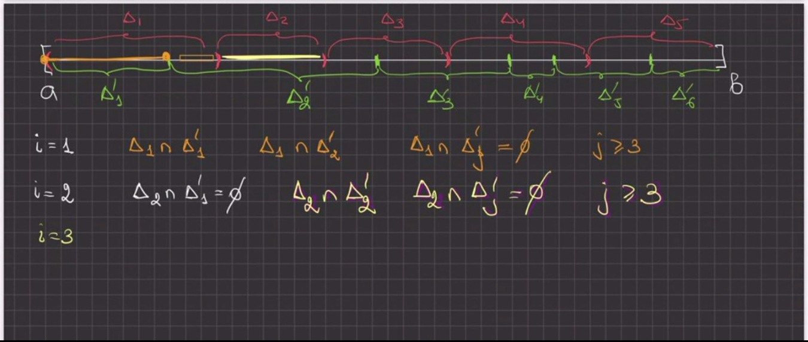
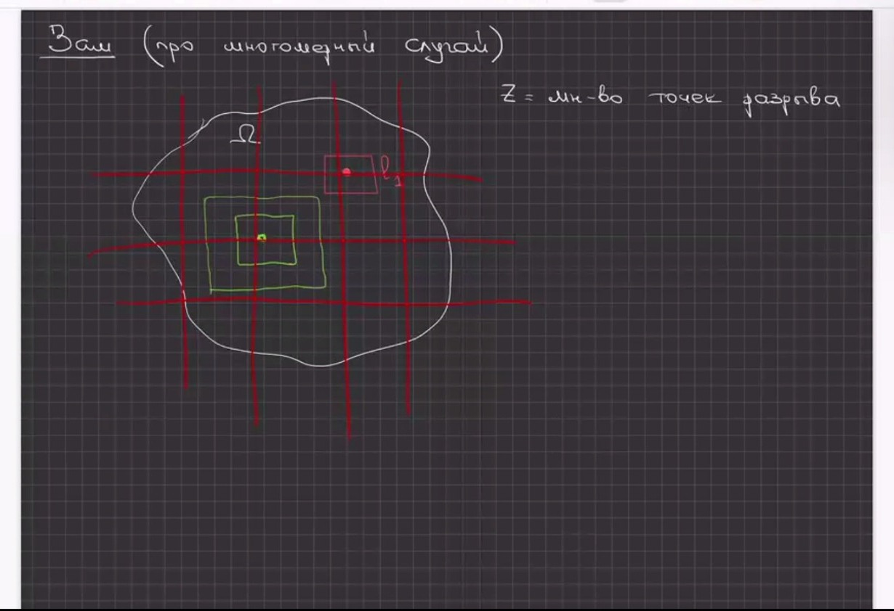
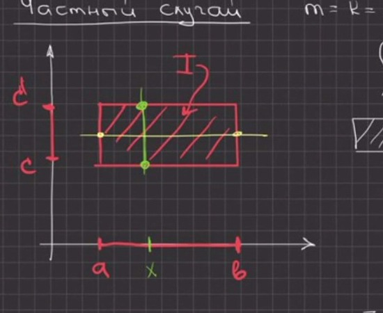

# Lecciones 83–84 — propiedades de la integral sobre un conjunto, suficiencia del criterio de Lebesgue, teorema de Fubini

[[es/lectures-2025-26/lecture-81-82|← Lecciones 81–82]] · [[es/lectures-2025-26/index|Índice de lecciones]] · [[es/term-index|Términos y teoremas]] · [[ru/lectures-2025-26/lecture-83-84|Русский]] · [[en/lectures-2025-26/lecture-83-84|English]]

> [!info] Fuente y numeración
> Los apuntes se elaboraron a partir de 42 fotogramas de vídeo de las lecciones de Zoom 83–84 del 31 de octubre de 2026 (fotogramas p083–p124; el texto bruto de los fotogramas está en [`ocr/raw/`](https://github.com/NikiHunter/matan/blob/main/ocr/raw/p083.md)): son las diapositivas impresas «k / 10» (fotogramas p083–p090, diapositivas 1–8) y la pizarra manuscrita (fotogramas p091–p124). Las diapositivas 9 / 10 y 10 / 10 no están en el archivo, y el principio de Cavalieri, anunciado entre los objetivos de la lección, no se enuncia en los fotogramas recibidos: el [[#^thm-10-4-2|teorema 10.4.2]] y el [[#^cor-10-4-3|corolario 10.4.3]], que lo precede, se restauran a partir de las diapositivas del curso 2024/25 (FS p101–p102) y se marcan con bloques «Restaurado»; su texto no está en los fotogramas de la lección de 2026. Faltan en el archivo los fotogramas de las tres primeras páginas de la pizarra (de 11); los fotogramas de la pizarra llevan las marcas «4 of 11» (p091), «10 of 16» (p103) y «20 of 24» (p116): el número de páginas de la pizarra creció durante la lección. Los fotogramas contiguos de la pizarra se solapan (la misma hoja se captura varias veces con un pequeño desplazamiento, por ejemplo p091–p093, p097–p101, p119–p121, p122–p124); el texto repetido se da una sola vez, y los números de todos los fotogramas se conservan como anclas de página. El orden de los fotogramas en el archivo no es cronológico: a juzgar por las marcas de tiempo de los nombres de archivo (10:37, 11:19, 12:55), el profesor primero demostró en la pizarra la suficiencia del [[es/lectures-2025-26/lecture-41-42#^thm-4-2-5|criterio de Lebesgue]] (p091–p102), luego mostró las diapositivas 4–5 / 10 con las propiedades de la integral y demostró las propiedades 1–3 (p103–p105), y solo después pasó al teorema de Fubini (p106–p124; las diapositivas 6–8 / 10 se mostraron durante esta parte). En el texto los fotogramas van en orden creciente de número, así que los enunciados de las diapositivas (p086–p090) aparecen antes que las demostraciones en la pizarra. La numeración de definiciones y teoremas es la del profesor; la abreviatura «Zash» de los fotogramas p102, p108, p114 y p124 es «Obs.» (observación). Los lapsus de los apuntes se corrigen y se marcan con bloques «Corrección de la fuente»; los pasajes perdidos se restauran y se marcan con bloques «Restaurado»; las etiquetas corresponden a [`ocr/RESOLVED.md`](https://github.com/NikiHunter/matan/blob/main/ocr/RESOLVED.md). Los lugares que aún hay que cotejar con la grabación de vídeo se enumeran en [`ocr/ISSUES.md`](https://github.com/NikiHunter/matan/blob/main/ocr/ISSUES.md).

## Objetivos de las lecciones

Las lecciones 83–84 se impartieron el 31 de octubre de 2026 (diapositiva de título 1 / 10: «Análisis matemático, lecciones 83–84, 31 de octubre de 2026»). ^p083

**Cita del día** (diapositiva 2 / 10): «Se vende leña: hace poco partí un montón.» (Juego de palabras con la expresión rusa «partir mucha leña», es decir, meter la pata a lo grande.)

^p084

**Objetivos de las lecciones** (diapositiva 3 / 10):

^p085

- demostrar la suficiencia del criterio de Lebesgue de integrabilidad según Riemann;
- continuar el estudio de las propiedades de la integral múltiple;
- estudiar el teorema de Fubini y algunos de sus corolarios;
- enunciar el principio de Cavalieri.

El último punto no figura en los fotogramas recibidos (faltan en el archivo las diapositivas 9 / 10 y 10 / 10). El enunciado del principio de Cavalieri ([[#^thm-10-4-2|teorema 10.4.2]]) se restaura según las diapositivas de 2024/25 al final del archivo; allí se restaura también el [[#^cor-10-4-3|corolario 10.4.3]], que lo precede en las diapositivas de 2024/25. De los corolarios del teorema de Fubini, los fotogramas contienen los [[#^cor-10-4-1|corolarios 10.4.1]] y [[#^cor-10-4-2|10.4.2]].

## §10.3. Propiedades generales de la integral (conclusión)

Recordemos: la integral sobre un conjunto admisible $\Omega$ se define mediante la igualdad $\int_\Omega f\,dx=\int_If\chi_\Omega\,dx$, donde $I\supset\Omega$ es un paralelepípedo ([[es/lectures-2025-26/lecture-81-82#^def-10-2-4|definición 10.2.4]]), y $\mu(\Omega)=\int_\Omega1\,dx$ es la medida de Jordan ([[es/lectures-2025-26/lecture-81-82#^def-10-2-5|definición 10.2.5]]). Las diapositivas 4 y 5 / 10 («Propiedades de la integral») enumeran las propiedades principales de esta integral. ^p086

**Propiedades.** Sean $\Omega\subset\mathbb R^n$ un conjunto admisible y $f,g\in R(\Omega)$. Entonces:

1. si $f(x)\ge0$ para todo $x\in\Omega$, entonces $\int_\Omega f(x)\,dx\ge0$;
2. si $f(x)\le g(x)$ para todo $x\in\Omega$, entonces $\int_\Omega f(x)\,dx\le\int_\Omega g(x)\,dx$;
3. si $m\le f(x)\le M$ para todo $x\in\Omega$, entonces $m\,\mu(\Omega)\le\int_\Omega f(x)\,dx\le M\,\mu(\Omega)$.

Continuación (diapositiva 5 / 10): ^p087

4. si $m=\inf_{x\in\Omega}f(x)$ y $M=\sup_{x\in\Omega}f(x)$, entonces existe $\theta\in[m,M]$ tal que $\int_\Omega f(x)\,dx=\theta\,\mu(\Omega)$;
5. si $\Omega$ es un conjunto admisible conexo y $f:\Omega\to\mathbb R$ es continua, entonces existe $\xi\in\Omega$ tal que $\int_\Omega f(x)\,dx=f(\xi)\,\mu(\Omega)$;
6. si $m\le f(x)\le M$ y $g(x)\ge0$ para todo $x\in\Omega$, entonces $m\int_\Omega g(x)\,dx\le\int_\Omega f(x)g(x)\,dx\le M\int_\Omega g(x)\,dx$.

> [!info] Corrección de la fuente
> (M539). En los apuntes (diapositivas 4–5 / 10; también en la diapositiva FS p98 del curso 2024/25): «Sean las funciones $f,g\in\mathcal R(\Omega)$», sin indicar que $\Omega$ es admisible. Se ha añadido «$\Omega$ es un conjunto admisible»: de lo contrario la medida $\mu(\Omega)$ de las propiedades 3–5 no está definida ([[es/lectures-2025-26/lecture-81-82#^def-10-2-5|definición 10.2.5]]); en la propiedad 5 la admisibilidad de $\Omega$ figura explícitamente en la diapositiva. La clase de las funciones integrables se denota $R(\Omega)$, como en las lecciones 81–82 (en las diapositivas, una $\mathcal R$ caligráfica).

En la diapositiva 5 / 10 hay escrita con tinta azul una pista para la propiedad 6: las desigualdades $m\le f(x)\le M$ se multiplican por $g(x)\ge0$.

> [!info] Corrección de la fuente
> (S440, T441). En los apuntes: la pista «$[mg(x)\le f(x)\le Mg(x)]$» y el producto «$fg(x)$» en el miembro derecho de la propiedad 6. En la pista falta en la parte central el factor $g(x)$: de $m\le f(x)\le M$ y $g(x)\ge0$ se deduce $mg(x)\le f(x)g(x)\le Mg(x)$ (así en la diapositiva FS p98: «$mg(x)\le f(x)g(x)\le Mg(x)$»); el integrando de la propiedad 6 es el producto $f(x)g(x)$.

Las propiedades 1–3 las demostró el profesor en la pizarra (fotogramas p103–p105, véase más abajo); las propiedades 4–6 solo se enuncian en la diapositiva, y sus demostraciones se restauran allí mismo.

## §10.4. Teorema de Fubini

Sean $\mathbb R^n=\mathbb R^m\times\mathbb R^k$, $m+k=n$; escribimos los puntos del espacio $\mathbb R^n$ en la forma $(x,y)$, donde $x\in\mathbb R^m$, $y\in\mathbb R^k$ (diapositiva 6 / 10, nota con tinta azul). ^p088

> [!theorem] Teorema 10.4.1 (Fubini)
> Sean $I=I_x\times I_y\subset\mathbb R^n$, donde $I_x$ es un paralelepípedo en $\mathbb R^m$, $I_y$ es un paralelepípedo en $\mathbb R^k$, $m+k=n$. Si la función $f$ es integrable en $I$ y, además,

^thm-10-4-1

$(\ast)$ para cada $x\in I_x$ la función $y\mapsto f(x,y)$ es integrable en $I_y$,

entonces la función $F(x)=\int_{I_y}f(x,y)\,dy$ es integrable en $I_x$ y
$$
\int_If(x,y)\,dx\,dy=\int_{I_x}\Bigl(\int_{I_y}f(x,y)\,dy\Bigr)dx .
$$

*Figura de la diapositiva (pág. p088): el rectángulo $I=I_x\times I_y$ (sombreado); el paralelepípedo $I_x\subset\mathbb R^m$ se representa en el eje horizontal, $I_y\subset\mathbb R^k$ en el vertical. La condición $(\ast)$ está enmarcada en rojo en la diapositiva.*

Diapositiva 7 / 10, «Reducción de una integral múltiple a integrales iteradas». ^p089

> [!corollary] Corolario 10.4.1
> Sean $I=I_1\times I_2\times\dots\times I_n\subset\mathbb R^n$, $I_i=[a_i,b_i]\subset\mathbb R$, la función $f$ integrable en $I$, y supongamos que en cada paso de la deducción a partir del teorema 10.4.1 se cumple la condición $(\ast)$, es decir, existen todas las integrales interiores de la derecha (así ocurre, por ejemplo, si $f$ es continua en $I$). Entonces
> $$
> \int_If(x)\,dx=\int_{a_n}^{b_n}dx_n\int_{a_{n-1}}^{b_{n-1}}dx_{n-1}\dots\int_{a_1}^{b_1}f(x_1,x_2,\dots,x_n)\,dx_1 .
> $$
> El miembro derecho se lee como integrales anidadas: primero, para $x_2,\dots,x_n$ fijos, se calcula la integral respecto de $x_1$ de $a_1$ a $b_1$, después el resultado se integra respecto de $x_2$, y así sucesivamente hasta $x_n$.

^cor-10-4-1

> [!info] Corrección de la fuente
> (M540, S444). En los apuntes (diapositiva 7 / 10; también en la diapositiva FS p100) no se indican las condiciones sobre $f$, y las integrales se escriben en orden decreciente de índices sin explicación. Se añade: $f\in R(I)$ y se cumple la condición $(\ast)$ en cada paso (sin ella no está garantizada la existencia de las integrales interiores, véase más abajo la observación sobre el papel de la condición $(\ast)$); para $f$ continua se cumple automáticamente, ya que las secciones de una función continua son continuas, y la integral de una función continua respecto de una de las variables es continua en las demás (§9.1 «Integrales propias dependientes de un parámetro»). Se explica el orden de escritura: la integral más interior es la de más a la derecha, respecto de $x_1$.

> [!note] Restaurado
> (deducción según el esquema estándar; en la diapositiva el corolario se da sin demostración). [[es/01-logic-sets-functions#^example-induction|Inducción]] sobre $n$. Para $n=1$ la fórmula es trivial. Sea $n\ge2$; pongamos $I_x=I_n=[a_n,b_n]$ y $I_y=I_1\times\dots\times I_{n-1}$ (salvo una permutación de coordenadas, que no afecta a la integral). La condición $(\ast)$ significa que para cada $x_n\in[a_n,b_n]$ la función $(x_1,\dots,x_{n-1})\mapsto f(x_1,\dots,x_n)$ es integrable en $I_y$, y por el [[#^thm-10-4-1|teorema 10.4.1]]
> $$
> \int_If\,dx=\int_{a_n}^{b_n}\Bigl(\int_{I_y}f(x_1,\dots,x_n)\,dx_1\dots dx_{n-1}\Bigr)dx_n ;
> $$
> a la integral interior $(n-1)$-múltiple se le aplica la hipótesis de inducción.

Diapositiva 8 / 10. ^p090

> [!corollary] Corolario 10.4.2
> Sean $D\subset\mathbb R^{n-1}$ un conjunto admisible, las funciones $\varphi_1,\varphi_2$ continuas en $\overline D$ con $\varphi_1(x)\le\varphi_2(x)$ para todo $x\in\overline D$, y sea
> $$
> E=\{(x,y)\in\mathbb R^n:\ x\in D,\ \varphi_1(x)\le y\le\varphi_2(x)\}
> $$
> (aquí $x\in\mathbb R^{n-1}$, $y\in\mathbb R$). Si $f\in R(E)$ y para cada $x\in D$ existe la integral $\int_{\varphi_1(x)}^{\varphi_2(x)}f(x,y)\,dy$, entonces
> $$
> \int_Ef(x,y)\,dx\,dy=\int_Ddx\int_{\varphi_1(x)}^{\varphi_2(x)}f(x,y)\,dy .
> $$
> Con tinta azul, bajo la fórmula, se escribe el mismo miembro derecho en otra notación: $\int_D\Bigl(\int_{\varphi_1(x)}^{\varphi_2(x)}f(x,y)\,dy\Bigr)dx$; la integral exterior se toma sobre el conjunto $D$ en el sentido de la [[es/lectures-2025-26/lecture-81-82#^def-10-2-4|definición 10.2.4]].

^cor-10-4-2

> [!info] Corrección de la fuente
> (M541, S445). En los apuntes (diapositiva 8 / 10): «Sean $\mathcal D$ un conjunto acotado en $\mathbb R^{n-1}$ y $\mathcal E=\{\dots\}$. Si $f\in\mathcal R(\mathcal E)$, entonces …», sin condiciones sobre $\varphi_1$, $\varphi_2$ y sin exigir la existencia de la integral interior. Se añade: $D$ es admisible, $\varphi_1,\varphi_2$ son continuas en $\overline D$, $\varphi_1\le\varphi_2$ (entonces $E$ está acotado, y su frontera está contenida en la unión de las gráficas de $\varphi_1$, $\varphi_2$ sobre $\overline D$ y del cilindro $\partial D\times[\min\varphi_1,\max\varphi_2]$, conjuntos de medida nula; es decir, $E$ es admisible), y la existencia de la integral interior para cada $x\in D$: es la condición $(\ast)$ del [[#^thm-10-4-1|teorema 10.4.1]] para la función $f\chi_E$ (véanse la demostración de abajo y la observación de su final). Lo escrito a la derecha del signo igual en la diapositiva y en la nota con tinta es una misma fórmula.

## §10.1. Integral de Riemann sobre un paralelepípedo n-dimensional (conclusión)

### Suficiencia del criterio de Lebesgue (caso unidimensional)

En las lecciones 81–82, para el [[es/lectures-2025-26/lecture-81-82#^thm-10-1-2|teorema 10.1.2]] (criterio de Lebesgue), se demostró la necesidad y se dio una demostración $n$-dimensional de la suficiencia según el esquema de Zorich. En la pizarra el profesor demuestra la suficiencia en el caso unidimensional, en el segmento $[a,b]$ (para $n=1$ el criterio de Lebesgue, [[es/lectures-2025-26/lecture-41-42#^thm-4-2-5|teorema 4.2.5]], se enunció en las lecciones 41–42 sin demostración). Se usa el criterio de Cauchy. ^p091

**Proposición (suficiencia del criterio de Lebesgue, caso unidimensional).** Sea la función $f$ definida y acotada en $[a,b]$ y continua [[es/19-measure-theory#19.4 Funciones medibles|en casi todo punto]] de $[a,b]$. Entonces $f\in R([a,b])$.

**Demostración.** Pongamos $M=\sup_{[a,b]}|f|<\infty$. Recordemos el criterio de Cauchy: $f\in R([a,b])$ si para todo $\varepsilon'>0$ existe $\delta>0$ tal que para cualesquiera dos particiones $\Delta=\{\Delta_i\}$ y $\Delta'=\{\Delta'_j\}$ del segmento $[a,b]$ de finura (en la pizarra, «rango de la partición») menor que $\delta$ y cualesquiera conjuntos de puntos marcados ([[es/lectures-2025-26/lecture-37-38#^def-4-2-4|marcados]]) $\xi=\{\xi_i\}$, $\xi'=\{\xi'_j\}$ se cumple
$$
\bigl|\sigma(f,\Delta,\xi)-\sigma(f,\Delta',\xi')\bigr|<\varepsilon',\qquad\sigma(f,\Delta,\xi)=\sum_if(\xi_i)\,\mu(\Delta_i),
$$
donde $\mu(\Delta_i)$ es la longitud del segmento $\Delta_i$.

*Paso 1 (recubrimiento de los puntos de discontinuidad).* Sea $Z$ el conjunto de los puntos de discontinuidad de $f$ en $[a,b]$. Por hipótesis $\mu(Z)=0$, es decir (por la definición de conjunto de medida nula), para todo $\varepsilon>0$ existe un sistema a lo sumo [[es/lectures-2025-26/lecture-01-02#^def-1-2-5|numerable]] de intervalos $\{l_i\}$ que cubre $Z$ y tal que $\sum_i\mu(l_i)<\varepsilon$ ($\mu(l_i)$ es la longitud del intervalo). Fijemos un tal $\varepsilon>0$.

*Paso 2 (entornos de los puntos de continuidad).* Sea $x\in[a,b]\setminus Z$ un punto de continuidad de $f$. Entonces existe $\delta(x)>0$ tal que
$$
f\bigl(B_{3\delta(x)}(x)\cap[a,b]\bigr)\subset B_\varepsilon\bigl(f(x)\bigr),
$$
donde $B_r(c)=(c-r,c+r)$.

Dicho de otro modo, para todo $\tilde x\in[a,b]$
$$
|\tilde x-x|<3\delta(x)\ \Longrightarrow\ |f(\tilde x)-f(x)|<\varepsilon .\tag{1}
$$
El número $\varepsilon$ es aquí el mismo que en el paso 1. En la pizarra se dibuja un segmento con los puntos $x-3\delta$, $x$, $\tilde x$, $x+3\delta$. ^p092

*Paso 3 (recubrimiento del segmento).* Todo el segmento $[a,b]$ está cubierto por un sistema de [[es/lectures-2025-26/lecture-55-56#^def-5-3-1|conjuntos abiertos]] formado por los intervalos $\{l_i\}$ (cubren $Z$) y los entornos $B_{\delta(x)}(x)$ de los puntos de continuidad:
$$
[a,b]\subset\bigcup_il_i\ \cup\bigcup_{x\in[a,b]\setminus Z}B_{\delta(x)}(x).
$$

^p093

> [!info] Corrección de la fuente
> (M450). En los apuntes: «todo el segmento $[a,b]$ quedará cubierto por el sistema de intervalos $\{l_i\}$ y $\bigcup_{x\in Z}B_{3\delta(x)}(x)$». Los entornos se construyen para los puntos de continuidad, es decir, para $x\in[a,b]\setminus Z$ (para $x\in Z$ los números $\delta(x)$ no están definidos); además, en el fotograma siguiente el [[es/lectures-2025-26/lecture-57-58#^def-5-3-7|subrecubrimiento finito]] incluye entornos $B_{\delta(x_j)}(x_j)$ de radio $\delta(x_j)$, y no $3\delta(x_j)$: el radio $3\delta(x)$ solo hace falta en la condición de continuidad (1).

El segmento $[a,b]$ es compacto, por lo que de todo recubrimiento suyo por conjuntos abiertos puede extraerse un subrecubrimiento finito. Tiene la forma
$$
l_{i_1},\ l_{i_2},\ \dots,\ l_{i_p},\quad B_{\delta(x_1)}(x_1),\ B_{\delta(x_2)}(x_2),\ \dots,\ B_{\delta(x_q)}(x_q),
$$
es decir, consta de $p$ intervalos del recubrimiento $Z$ y $q$ entornos de puntos de continuidad $x_1,\dots,x_q$. Renombremos los intervalos elegidos $l_1,\dots,l_p$, $l_k=(\alpha_k,\beta_k)$; entonces $\sum_{k=1}^p\mu(l_k)<\varepsilon$. Elijamos un número $\delta>0$ de modo que
$$
\delta<\min_{1\le j\le q}\delta(x_j),\qquad2\delta p<\varepsilon .\tag{2}
$$

^p094

*Paso 4 (dos particiones).* Consideremos dos particiones $\Delta=\{\Delta_i\}$ y $\Delta'=\{\Delta'_j\}$ del segmento $[a,b]$, cada una de finura menor que $\delta$, y sean $\xi=\{\xi_i\}$, $\xi'=\{\xi'_j\}$ sus marcados ($\xi_i\in\Delta_i$, $\xi'_j\in\Delta'_j$). Los segmentos de cada partición cubren $[a,b]$ y solo se cortan en los extremos, por lo que $\mu(\Delta_i)=\sum_j\mu(\Delta_i\cap\Delta'_j)$ y $\mu(\Delta'_j)=\sum_i\mu(\Delta_i\cap\Delta'_j)$ (la intersección $\Delta_i\cap\Delta'_j$ es un segmento, un punto o el conjunto vacío; la longitud de un punto y del conjunto vacío es cero). En consecuencia,
$$
\sigma(f,\Delta,\xi)-\sigma(f,\Delta',\xi')=\sum_if(\xi_i)\mu(\Delta_i)-\sum_jf(\xi'_j)\mu(\Delta'_j)=\sum_i\sum_j\bigl(f(\xi_i)-f(\xi'_j)\bigr)\mu(\Delta_i\cap\Delta'_j).\tag{3}
$$

^p095

Para visualizar la suma sobre $i$ y $j$, el profesor dibuja ambas particiones sobre el mismo segmento: intervalos rojos $\Delta_1,\dots,\Delta_5$ encima del segmento y verdes $\Delta'_1,\dots,\Delta'_6$ debajo, con extremos $a$ y $b$ (fotogramas p096–p097; la figura se reproduce más abajo). ^p096

 ^p097

Para cada $i$ solo unos pocos $\Delta'_j$ cortan a $\Delta_i$: para $i=1$ son no vacías las intersecciones $\Delta_1\cap\Delta'_1$ y $\Delta_1\cap\Delta'_2$, y $\Delta_1\cap\Delta'_j=\varnothing$ para $j\ge3$; para $i=2$ se tiene $\Delta_2\cap\Delta'_1=\varnothing$, solo es no vacía $\Delta_2\cap\Delta'_2$ (de modo que $\Delta_2$ está entero en $\Delta'_2$), y $\Delta_2\cap\Delta'_j=\varnothing$ para $j\ge3$; la fila $i=3$ de la pizarra está sin terminar. Para lo que sigue solo importa que los sumandos de la suma (3) con intersección vacía son nulos y que $\sum_j\mu(\Delta_i\cap\Delta'_j)=\mu(\Delta_i)$.

*Paso 5 (estimación de la suma (3)).* Dividamos los sumandos en dos grupos:
$$
\bigl|\sigma(f,\Delta,\xi)-\sigma(f,\Delta',\xi')\bigr|\le\Sigma_1+\Sigma_2,
$$
donde $\Sigma_1$ es la suma de $\sum_j\bigl|f(\xi_i)-f(\xi'_j)\bigr|\mu(\Delta_i\cap\Delta'_j)$ sobre todos los $i$ para los que $\xi_i\in\bigcup_{k=1}^pl_k$, y $\Sigma_2$ es la misma suma sobre los $i$ restantes. ^p098

*Caso 1: $\xi_i\in l_k=(\alpha_k,\beta_k)$ para algún $k\le p$.* Como $\xi_i\in\Delta_i$ y $\mu(\Delta_i)<\delta$, se tiene $\Delta_i\subset(\alpha_k-\delta,\beta_k+\delta)$. Asignemos cada tal $\Delta_i$ a uno de los intervalos $l_k$ que contienen $\xi_i$. Los segmentos $\Delta_i$ no se solapan, por lo que la suma de las longitudes de los segmentos asignados a $l_k$ no supera $\mu(l_k)+2\delta$. Como $|f(\xi_i)-f(\xi'_j)|\le2M$ y $\sum_j\mu(\Delta_i\cap\Delta'_j)=\mu(\Delta_i)$, obtenemos (teniendo en cuenta $\sum_k\mu(l_k)<\varepsilon$ y $2\delta p<\varepsilon$)
$$
\Sigma_1\le2M\sum_{i:\ \xi_i\in\bigcup_kl_k}\mu(\Delta_i)\le2M\Bigl(\sum_{k=1}^p\mu(l_k)+2\delta p\Bigr)\le4M\varepsilon .\tag{4}
$$

*Caso 2: $\xi_i\notin\bigcup_{k=1}^pl_k$.* Entonces el punto $\xi_i\in[a,b]$ está cubierto por uno de los entornos del subrecubrimiento finito: $\xi_i\in B_{\delta(x_s)}(x_s)$ para algún $s\le q$; pongamos $\delta_s=\delta(x_s)$. Sean $\Delta_i\cap\Delta'_j\ne\varnothing$ y $t$ un punto común de estos segmentos. Para todo punto $u\in\Delta'_j$, usando la finura de las particiones y $\delta<\delta_s$ de (2),
$$
|u-x_s|\le|u-t|+|t-\xi_i|+|\xi_i-x_s|<\delta+\delta+\delta_s<3\delta_s .
$$
Por tanto, $\Delta'_j\subset B_{3\delta_s}(x_s)$ y, en particular, $\xi'_j\in B_{3\delta_s}(x_s)\cap[a,b]$; además, $\xi_i\in B_{\delta_s}(x_s)\subset B_{3\delta_s}(x_s)$. ^p099

Por la condición (1) para $x=x_s$ obtenemos $|f(\xi_i)-f(x_s)|<\varepsilon$ y $|f(\xi'_j)-f(x_s)|<\varepsilon$, de donde
$$
\Delta_i\cap\Delta'_j\ne\varnothing\ \Longrightarrow\ |f(\xi_i)-f(\xi'_j)|<2\varepsilon ,
$$
es decir, el punto $\xi'_j$ está cerca del centro $x_s$ del mismo entorno de un punto de continuidad que $\xi_i$. Los sumandos con intersección vacía son nulos, y todos los sumandos son no negativos, por lo que la suma sobre un subconjunto de índices $i$ puede acotarse por la suma sobre todos los $i$:
$$
\Sigma_2\le2\varepsilon\sum_i\sum_j\mu(\Delta_i\cap\Delta'_j)=2\varepsilon(b-a).\tag{5}
$$

^p100

> [!info] Corrección de la fuente
> (M462, A461, S463, S464, M542). En los apuntes: «si $\xi_i\notin\bigcup_{k=1}^pl_k$, entonces $\Delta_i\subset B_{\delta(\xi_i)}(\xi_i)$; si $\Delta_i\cap\Delta'_j\ne\varnothing$, entonces $\Delta'_j\subset B_{2\delta(\xi_i)}(\xi_i)$ (… $\mu(\Delta'_j)<\delta<\delta(\xi_i)$ …) $\Rightarrow f(\xi'_j)\in B_\varepsilon(f(\xi_i))$», después «en este caso $\xi_i$ es un punto de continuidad, y $\xi'_j$ está cerca de $\xi_i$» y la estimación $\varepsilon(b-a)$ en lugar de (5). El número $\delta(\xi_i)$ solo está definido para puntos de continuidad, y la desigualdad $\delta<\delta(\xi_i)$ no se deduce de $\delta<\min_j\delta(x_j)$, ya que $\xi_i$ no tiene por qué ser uno de los puntos $x_1,\dots,x_q$; más aún, $\xi_i\notin\bigcup_{k\le p}l_k$ no significa que $\xi_i$ sea un punto de continuidad (puede estar en un intervalo $l_m$ que no entró en el subrecubrimiento finito y estar cubierto por un entorno $B_{\delta(x_s)}(x_s)$ de un punto de continuidad $x_s$). El razonamiento se reescribe mediante el centro $x_s$ del entorno que contiene a $\xi_i$; el radio $3\delta(x)$ de la condición (1) hace falta precisamente para que $\Delta'_j$ quepa en $B_{3\delta_s}(x_s)$; la estimación sale con el factor $2\varepsilon$ en lugar de $\varepsilon$ (la diferencia $f(\xi_i)-f(\xi'_j)$ se acota mediante $f(x_s)$ por ambos lados). El paso de la suma sobre un subconjunto de índices a la suma sobre todos los $i$ (S463) es legítimo, ya que los sumandos son no negativos y $\sum_{i,j}\mu(\Delta_i\cap\Delta'_j)=b-a$.

*Paso 6 (conclusión).* De (4) y (5) se deduce que para cualesquiera dos particiones de finura menor que $\delta$ y cualesquiera de sus marcados
$$
\bigl|\sigma(f,\Delta,\xi)-\sigma(f,\Delta',\xi')\bigr|\le4M\varepsilon+2(b-a)\varepsilon=C\varepsilon,\qquad C=4M+2(b-a),
$$
donde la constante $C$ no depende de $\varepsilon$ (en la pizarra: $\mathrm{const}\cdot\varepsilon$). Sea dado $\varepsilon'>0$. Tomemos $\varepsilon=\varepsilon'/(2C)$ y construyamos a partir de él $\delta$ como se describe en los pasos 1–3; entonces, para cualesquiera dos particiones de finura menor que $\delta$ con cualesquiera marcados, $\bigl|\sigma(f,\Delta,\xi)-\sigma(f,\Delta',\xi')\bigr|\le\varepsilon'/2<\varepsilon'$. Por el criterio de Cauchy las sumas integrales tienen límite cuando la finura tiende a cero, es decir, $f\in R([a,b])$. $\square$ ^p101

> [!info] Corrección de la fuente
> (T465, S466). En los apuntes el resultado se escribe «$\bigl|\sigma(f,\xi,\Delta)-\sigma(f,\xi',\Delta')\bigr|\le4\varepsilon\sup|f|+\varepsilon(b-a)=\mathrm{const}\cdot\varepsilon$» sin remitir explícitamente al criterio de Cauchy. Aquí se escribe la constante ($C=4M+2(b-a)$; el segundo sumando se duplica por la razón explicada arriba) y se añade el paso de la estimación al criterio de Cauchy (paso 6).

**Observación (sobre el caso multidimensional).** En la pizarra solo figuran el título de la observación, «Obs. (sobre el caso multidimensional)», y una figura; no hay texto escrito.

^p102

La figura muestra una región $\Omega$ con la leyenda «$Z$ es el conjunto de los puntos de discontinuidad», una malla de rectas rojas (una partición), un cuadrado rojo $l_1$ con un [[es/lectures-2025-26/lecture-16#^def-2-5-4|punto de discontinuidad]] dentro y cuadrados verdes encajados alrededor de un punto de continuidad. Al parecer se trata de que en $\mathbb R^n$ el mismo esquema funciona con paralelepípedos en lugar de segmentos: el conjunto $Z$ se cubre con paralelepípedos $l_i$ de volumen total pequeño, en cada punto de continuidad se toman entornos cúbicos, y las particiones se representan como una malla. La demostración completa de la suficiencia en $\mathbb R^n$ (con dilataciones del recubrimiento por los factores $2$ y $3$) se da en las lecciones 81–82 tras el [[es/lectures-2025-26/lecture-81-82#^thm-10-1-2|teorema 10.1.2]].

## §10.3. Propiedades generales de la integral (demostraciones de las propiedades 1–6)

*Marca de la pizarra «10 of 16».*

^p103

**Demostración de la propiedad 1.** Sea $f(x)\ge0$ para todo $x\in\Omega$. Por la definición de integral sobre un conjunto
$$
\int_\Omega f(x)\,dx=\int_{I\supset\Omega}f\chi_\Omega(x)\,dx,\qquad\chi_\Omega(x)=\begin{cases}1,&x\in\Omega,\\0,&x\notin\Omega\end{cases}
$$
(la función característica de la [[es/lectures-2025-26/lecture-81-82#^def-10-2-2|definición 10.2.2]]). Como $f\ge0$ en $\Omega$, y fuera de $\Omega$ la función $f\chi_\Omega$ es nula, se tiene $f\chi_\Omega(x)\ge0$ para todo $x\in I$ (e incluso para todo $x\in\mathbb R^n$).

La integral $\int_If\chi_\Omega\,dx$ es el límite de las sumas integrales $\sigma(f\chi_\Omega,P,\xi)$ cuando $\lambda(P)\to0$ (aquí $\lambda(P)$ es la finura de la partición $P$ del paralelepípedo $I$). Todas estas sumas son no negativas (cada sumando $f\chi_\Omega(\xi_i)\mu(I_i)\ge0$), por lo que el límite también es no negativo: $\int_If\chi_\Omega\,dx\ge0$, es decir, $\int_\Omega f\,dx\ge0$. $\square$ ^p104

**Demostración de la propiedad 2.** Pongamos $\psi(x)=g(x)-f(x)$. Por hipótesis $\psi(x)\ge0$ para todo $x\in\Omega$, y $\psi\in R(\Omega)$ como diferencia de funciones integrables. Por la propiedad 1 $\int_\Omega\psi(x)\,dx\ge0$, y por la linealidad de la integral $\int_\Omega\psi\,dx=\int_\Omega g\,dx-\int_\Omega f\,dx$ (la linealidad se deduce de la linealidad de las sumas integrales). Por tanto, $\int_\Omega f\,dx\le\int_\Omega g\,dx$. $\square$

^p105

**Demostración de la propiedad 3.** Sea $f(x)\ge m$ para todo $x\in\Omega$. Por la propiedad 2 (para las funciones $m$ y $f$) $\int_\Omega m\,dx\le\int_\Omega f\,dx$. La integral de una constante es $\int_\Omega m\,dx=m\int_\Omega1\,dx=m\,\mu(\Omega)$ ([[es/lectures-2025-26/lecture-81-82#^def-10-2-5|definición 10.2.5]]), así que $m\,\mu(\Omega)\le\int_\Omega f\,dx$. De $f(x)\le M$ se obtiene igualmente $\int_\Omega f\,dx\le M\,\mu(\Omega)$. $\square$

> [!note] Restaurado
> (según la demostración estándar; en la diapositiva 5 / 10 las propiedades 4–6 solo se enuncian, y en la diapositiva FS p98 del curso 2024/25 solo se da para la propiedad 6 la pista $mg(x)\le f(x)g(x)\le Mg(x)$).
>
> *Propiedad 4.* La función $f\in R(\Omega)$ está acotada ([[es/lectures-2025-26/lecture-81-82#^thm-10-2-1|teorema 10.2.1]]), así que $m$ y $M$ son finitos, y por la propiedad 3 $m\,\mu(\Omega)\le\int_\Omega f\,dx\le M\,\mu(\Omega)$. Si $\mu(\Omega)>0$, el número $\theta=\frac1{\mu(\Omega)}\int_\Omega f\,dx$ está en $[m,M]$ y $\int_\Omega f\,dx=\theta\,\mu(\Omega)$. Si $\mu(\Omega)=0$, entonces $\int_\Omega f\,dx=0$, y la igualdad vale para todo $\theta\in[m,M]$.
>
> *Propiedad 5.* Si $\mu(\Omega)=0$, ambos miembros son nulos para todo $\xi\in\Omega$. Sean $\mu(\Omega)>0$ y $\theta=\frac1{\mu(\Omega)}\int_\Omega f\,dx\in[m,M]$ el número de la propiedad 4. La imagen $f(\Omega)$ de un conjunto conexo por una aplicación continua es conexa, es decir, es un intervalo de extremos $m$ y $M$, por lo que cada $\theta\in(m,M)$ es un valor de $f$ en algún punto $\xi\in\Omega$. Queda el caso $\theta=m$ (el caso $\theta=M$ es análogo), en el que el valor $m$ puede no alcanzarse. Aquí $\int_\Omega(f-m)\,dx=0$. Supongamos que $f>m$ en todo $\Omega$. Como $\mu(\Omega)>0$, $\Omega$ tiene un [[es/lectures-2025-26/lecture-57-58#Diapositiva impresa 4 (pp. PDF 4) — El interior de un conjunto — definición 5.3.3|punto interior]] (de lo contrario $\Omega\subset\partial\Omega$ y $\mu(\Omega)=0$); tomemos una bola cerrada $K\subset\Omega$ de radio positivo. En el compacto $K$ la función continua positiva $f-m$ tiene un mínimo positivo $c$, y $f-m\ge c\chi_K$ en $\Omega$, de donde, por la propiedad 2, $\int_\Omega(f-m)\,dx\ge c\,\mu(K)>0$, lo cual es una contradicción. Por tanto, $f(\xi)=m=\theta$ para algún punto $\xi\in\Omega$.
>
> *Propiedad 6.* Por la [[es/lectures-2025-26/lecture-81-82#^def-10-2-4|definición 10.2.4]] y el criterio de Lebesgue, las funciones $f\chi_\Omega$ y $g\chi_\Omega$ están acotadas y son continuas en casi todo punto de $I$, por lo que también $(fg)\chi_\Omega=(f\chi_\Omega)(g\chi_\Omega)$ está acotada y es continua en casi todo punto, es decir, $fg\in R(\Omega)$. Multiplicando $m\le f(x)\le M$ por $g(x)\ge0$, obtenemos $mg(x)\le f(x)g(x)\le Mg(x)$ para todo $x\in\Omega$. Por la propiedad 2 y la linealidad de la integral $m\int_\Omega g\,dx\le\int_\Omega fg\,dx\le M\int_\Omega g\,dx$. $\square$

## §10.4. Teorema de Fubini (continuación)

### Integrales múltiples e iteradas

La integral $\int_If(x,y)\,dx\,dy$ es una integral multidimensional (múltiple) sobre el paralelepípedo $I$. La integral
$$
\int_{I_x}\Bigl(\int_{I_y}f(x,y)\,dy\Bigr)dx=\int_{I_x}dx\int_{I_y}f(x,y)\,dy
$$
(la segunda notación es una variante de la primera) se llama integral iterada. ¿Cómo debe entenderse? Para cada $x\in I_x$ fijo calculamos $F(x)=\int_{I_y}f(x,y)\,dy$; obtenemos una función $F:I_x\to\mathbb R$; después integramos $F$ respecto de $I_x$. ^p106

El fotograma p107 captura la misma hoja de la pizarra con un encuadre algo más amplio; no contiene anotaciones nuevas. ^p107

**Observación (sobre el papel de la condición $(\ast)$).** ¿Qué ocurre si se suprime de las hipótesis del teorema de Fubini la exigencia

^p108

$(\ast)$ para cada $x\in I_x$ la función $y\mapsto f(x,y)$ es integrable en $I_y$?

Sin la condición $(\ast)$ puede ocurrir que $F(x)$ no exista para algunos $x\in I_x$.

En tal caso hay que definir $F(x)$ para esos $x$. Puede hacerse así: tomar como $F(x)$ cualquier número del segmento $\bigl[\underline J(x),\overline J(x)\bigr]$, donde $\underline J(x)$ y $\overline J(x)$ son las integrales inferior y [[es/lectures-2025-26/lecture-39-40#^def-4-2-8|superior de Darboux]] de la función $y\mapsto f(x,y)$ en $I_y$ ([[es/lectures-2025-26/lecture-81-82#^def-10-1-10|definición 10.1.10]]). Pero luego hay que probar que el conjunto de tales $x$ tiene medida nula; entonces $F\in R(I_x)$. La demostración de esta afirmación se da más abajo, tras la demostración del [[#^thm-10-4-1|teorema 10.4.1]]. ^p109

### Demostración del teorema de Fubini

**Demostración del [[#^thm-10-4-1|teorema 10.4.1]].** Sea $|f|\le M$ en $I$ (una función integrable está acotada, [[es/lectures-2025-26/lecture-79-80#^thm-10-1-1|teorema 10.1.1]]). Una partición $P$ del paralelepípedo $I=I_x\times I_y$ se obtiene a partir de particiones de sus segmentos coordenados ([[es/lectures-2025-26/lecture-79-80#^def-10-1-3|definición 10.1.3]]), por lo que tiene la forma $P=P_x\times P_y$, donde $P_x=\{I_{x_i}\}$ es una partición del paralelepípedo $I_x$, y $P_y=\{I_{y_j}\}$ una partición del paralelepípedo $I_y$; recíprocamente, cualquier par de particiones $P_x$, $P_y$ define una partición $P$ con celdas $I_{x_i}\times I_{y_j}$. Además, $\mu_n(I_{x_i}\times I_{y_j})=\mu_m(I_{x_i})\,\mu_k(I_{y_j})$ (el índice de $\mu$ es la dimensión del espacio).

^p110

*Figura de los apuntes (pág. p110): el rectángulo $I=I_x\times I_y$ con los ejes $x$ y $y$; el paralelepípedo $I_x$ se representa en el eje horizontal, $I_y$ en el vertical; está sombreada una celda $I_{x_i}\times I_{y_j}$ de la partición $P_x\times P_y$.*

Para $x\in I_x$ pongamos $f_x(y)=f(x,y)$ y $F(x)=\int_{I_y}f(x,y)\,dy$ (la integral existe por la condición $(\ast)$); $|F(x)|\le M\mu_k(I_y)$. Denotemos por $s(F,P_x)=\sum_i\inf_{x\in I_{x_i}}F(x)\,\mu_m(I_{x_i})$ y $S(F,P_x)=\sum_i\sup_{x\in I_{x_i}}F(x)\,\mu_m(I_{x_i})$ las sumas de Darboux de la función $F$ para la partición $P_x$, y por $\underline J_F=\sup_{P_x}s(F,P_x)$ y $\overline J_F=\inf_{P_x}S(F,P_x)$ sus integrales inferior y superior de Darboux (en la pizarra: $\underline{\int_{I_x}}F\,dx$ y $\overline{\int_{I_x}}F\,dx$). Probemos que
$$
s(f,P)\le s(F,P_x)\le\underline J_F\le\overline J_F\le S(F,P_x)\le S(f,P).\tag{6}
$$

*La suma inferior.* Por definición
$$
s(f,P)=\sum_{i,j}\inf_{\substack{x\in I_{x_i}\\y\in I_{y_j}}}f(x,y)\,\mu_n(I_{x_i}\times I_{y_j})=\sum_{i,j}\inf_{\substack{x\in I_{x_i}\\y\in I_{y_j}}}f(x,y)\,\mu_m(I_{x_i})\,\mu_k(I_{y_j}).
$$

Por la propiedad del ínfimo, $\inf_{x\in I_{x_i},\,y\in I_{y_j}}f(x,y)\le\inf_{x\in I_{x_i}}\bigl(\inf_{y\in I_{y_j}}f(x,y)\bigr)$ (en realidad aquí hay igualdad, pero solo hace falta la desigualdad). Por tanto,
$$
s(f,P)\le\sum_{i,j}\inf_{x\in I_{x_i}}\Bigl(\inf_{y\in I_{y_j}}f(x,y)\Bigr)\mu_k(I_{y_j})\,\mu_m(I_{x_i})=\sum_{i,j}\inf_{x\in I_{x_i}}\Bigl(\inf_{y\in I_{y_j}}f(x,y)\cdot\mu_k(I_{y_j})\Bigr)\mu_m(I_{x_i});
$$
el factor $\mu_k(I_{y_j})\ge0$ puede introducirse bajo el [[es/lectures-2025-26/lecture-11-12#^def-2-3-2|ínfimo]] respecto de $x$. ^p111

La suma de los ínfimos no supera el ínfimo de la suma, por lo que
$$
s(f,P)\le\sum_i\inf_{x\in I_{x_i}}\Bigl(\sum_j\inf_{y\in I_{y_j}}f(x,y)\,\mu_k(I_{y_j})\Bigr)\mu_m(I_{x_i}).
$$
La expresión entre paréntesis es la suma inferior de Darboux $s(f_x,P_y)$ de la función $f_x$ para la partición $P_y$ (depende de $x$ a través de $f_x$). Así,
$$
s(f,P)\le\sum_i\inf_{x\in I_{x_i}}s(f_x,P_y)\,\mu_m(I_{x_i})\le\sum_i\inf_{x\in I_{x_i}}\Bigl(\sup_{P_y}s(f_x,P_y)\Bigr)\mu_m(I_{x_i}),
$$
donde el [[es/lectures-2025-26/lecture-11-12#^def-2-3-1|supremo]] se toma sobre todas las particiones $P_y$ del paralelepípedo $I_y$. ^p112

Pero $\sup_{P_y}s(f_x,P_y)=\underline J(x)$ es la integral inferior de Darboux de la función $f_x$, y $\underline J(x)\le F(x)$. Por tanto,
$$
s(f,P)\le\sum_i\inf_{x\in I_{x_i}}\underline J(x)\,\mu_m(I_{x_i})\le\sum_i\inf_{x\in I_{x_i}}F(x)\,\mu_m(I_{x_i})=s(F,P_x).
$$

^p113

> [!info] Corrección de la fuente
> (T484, A485). En los apuntes: «$\le\sum_i\inf_{x\in I_{x_i}}\bigl(\int_{I_y}f(x,y)\,dy\bigr)\mu_m(I_{x_i})$», con la nota naranja del profesor «en realidad aquí está la integral inferior de Darboux» ($\underline I$ en el fotograma, $\underline J$ en los fotogramas p109 y p114 y en la diapositiva FS p99). Se escribe la integral inferior de Darboux $\underline J(x)$: es lo que resulta de $\sup_{P_y}s(f_x,P_y)$; bajo la condición $(\ast)$ es igual a $F(x)$ ([[es/lectures-2025-26/lecture-81-82#^thm-10-1-3|teorema 10.1.3]]), pero la demostración solo usa la desigualdad $\underline J(x)\le F(x)$.

Para la función $F$ se cumplen las desigualdades $s(F,P_x)\le\underline J_F\le\overline J_F\le S(F,P_x)$ (el ejercicio tras la [[es/lectures-2025-26/lecture-81-82#^def-10-1-10|definición 10.1.10]] de las lecciones 81–82). Observación del profesor: para cada $x$
$$
\underline J(x)\le F(x)=\int_{I_y}f(x,y)\,dy\le\overline J(x)
$$
(para una función integrable $f_x$ los tres números coinciden). De aquí y de la definición de la suma superior de Darboux,
$$
S(F,P_x)=\sum_i\sup_{x\in I_{x_i}}F(x)\,\mu_m(I_{x_i})\le\sum_i\sup_{x\in I_{x_i}}\overline J(x)\,\mu_m(I_{x_i})\le\sum_i\sup_{x\in I_{x_i}}\Bigl(\sum_j\sup_{y\in I_{y_j}}f(x,y)\,\mu_k(I_{y_j})\Bigr)\mu_m(I_{x_i}),
$$
porque $\overline J(x)=\inf_{P'_y}S(f_x,P'_y)\le S(f_x,P_y)=\sum_j\sup_{y\in I_{y_j}}f(x,y)\,\mu_k(I_{y_j})$. ^p114

Por la propiedad del supremo, $\sup_{x\in I_{x_i}}\bigl(\sup_{y\in I_{y_j}}f(x,y)\bigr)\le\sup_{x\in I_{x_i},\,y\in I_{y_j}}f(x,y)$ (de nuevo, en realidad, igualdad). La suma de los supremos no es menor que el supremo de la suma, por lo que
$$
S(F,P_x)\le\sum_{i,j}\sup_{\substack{x\in I_{x_i}\\y\in I_{y_j}}}f(x,y)\,\mu_k(I_{y_j})\,\mu_m(I_{x_i})=S(f,P),
$$
ya que $\mu_k(I_{y_j})\mu_m(I_{x_i})=\mu_n(I_{x_i}\times I_{y_j})$. ^p115

> [!info] Corrección de la fuente
> (M486, T488). En los apuntes: «$\underline J\le F(x)=\int_{I_y}f(x,y)\,dy\le\overline J$» y «$=S(x,P)$». La [[es/02-real-numbers#2.2 Supremo e ínfimo|cota superior]] es $\overline J(x)$, que depende de $x$ (no es una constante); la suma superior de Darboux de la partición $P$ es $S(f,P)$, y no $S(x,P)$.

Con esto quedan probadas las desigualdades (6). Como $f\in R(I)$, cuando $\lambda(P)\to0$ ambas sumas $s(f,P)$ y $S(f,P)$ tienden a $\int_If\,dx\,dy$: la suma integral, para cualquier elección de los puntos marcados, está entre ellas, y ellas mismas son el ínfimo y el supremo de las sumas integrales respecto de la elección de los puntos marcados. Las magnitudes $\underline J_F$, $\overline J_F$ no dependen de la partición $P$. Pasando al límite en (6) cuando $\lambda(P)\to0$ (existen particiones de la forma $P_x\times P_y$ de finura pequeña), obtenemos
$$
\int_If\,dx\,dy\le\underline J_F\le\overline J_F\le\int_If\,dx\,dy ,
$$
de donde $\underline J_F=\overline J_F=\int_If\,dx\,dy$. Por el [[es/lectures-2025-26/lecture-39-40#^thm-4-2-1|criterio de Darboux]] ([[es/lectures-2025-26/lecture-81-82#^thm-10-1-3|teorema 10.1.3]]; $F$ está acotada), la función $F$ es integrable en $I_x$, y
$$
\int_If(x,y)\,dx\,dy=\underline J_F=\overline J_F=\int_{I_x}F(x)\,dx=\int_{I_x}\Bigl(\int_{I_y}f(x,y)\,dy\Bigr)dx .\ \square
$$

^p116

> [!note] Restaurado
> (según la demostración estándar; el profesor solo señaló que hay que probar que el conjunto de los $x$ para los que falla la condición $(\ast)$ tiene medida nula). Sea $f\in R(I)$, sin suponer la condición $(\ast)$; $\underline J(x)\le\overline J(x)$ son las integrales inferior y superior de Darboux de la función $f_x$ (finitas, ya que $f$ está acotada). La demostración anterior solo usó las desigualdades $\underline J(x)\le F(x)\le\overline J(x)$, por lo que vale para $F=\underline J$, para $F=\overline J$ y para cualquier función $F$ con valores entre ellas. Obtenemos: $\underline J,\overline J\in R(I_x)$ y $\int_{I_x}\underline J\,dx=\int_{I_x}\overline J\,dx=\int_If\,dx\,dy$. Por tanto, la función no negativa $\varphi=\overline J-\underline J\in R(I_x)$ tiene integral nula y, en consecuencia, es nula fuera de un conjunto de medida nula: para $\eta>0$ y $\varepsilon>0$ elijamos una partición $P_x$ con $S(\varphi,P_x)<\eta\varepsilon$ (existe, ya que $\inf_{P_x}S(\varphi,P_x)=\int_{I_x}\varphi\,dx=0$); las celdas que contienen puntos del conjunto $N_\eta=\{x:\ \varphi(x)\ge\eta\}$ cubren $N_\eta$, y en cada una de ellas $\sup\varphi\ge\eta$, por lo que su medida total es menor que $\varepsilon$; así, $\mu(N_\eta)=0$; el conjunto $\{\varphi>0\}=\bigcup_kN_{1/k}$ tiene medida nula por la propiedad ④ de los conjuntos de medida nula (lecciones 81–82). Para $x\notin\{\varphi>0\}$ la función $f_x$ es integrable ([[es/lectures-2025-26/lecture-81-82#^thm-10-1-3|teorema 10.1.3]]), es decir, la condición $(\ast)$ solo falla en un conjunto de medida nula; en él $F(x)$ puede definirse como cualquier número de $[\underline J(x),\overline J(x)]$, y la igualdad $\int_{I_x}F\,dx=\int_If\,dx\,dy$ se conserva.

### El caso particular $n=2$ y notación

*El caso particular* $m=k=1$, es decir, $n=m+k=2$. Sea $I=[a,b]\times[c,d]$. Entonces
$$
\int_If(x,y)\,dx\,dy=\int_a^b\Bigl(\int_c^df(x,y)\,dy\Bigr)dx=\int_c^d\Bigl(\int_a^bf(x,y)\,dx\Bigr)dy .
$$
La primera igualdad es el [[#^thm-10-4-1|teorema 10.4.1]] (condición $(\ast)$: para cada $x\in[a,b]$ la función $y\mapsto f(x,y)$ es integrable en $[c,d]$), la segunda es el mismo teorema con los papeles de $x$ y $y$ intercambiados (para cada $y\in[c,d]$ la función $x\mapsto f(x,y)$ es integrable en $[a,b]$); ambos pares de condiciones se cumplen, por ejemplo, para $f$ continua. ^p117

**Notación.** Para $n=2$ la integral múltiple sobre el paralelepípedo $I=I_x\times I_y$ se llama integral doble y se escribe
$$
\int_If(x,y)\,dx\,dy=\iint_If(x,y)\,dx\,dy ;
$$
para $n=3$, integral triple:
$$
\int_If(x,y,z)\,dx\,dy\,dz=\iiint_If(x,y,z)\,dx\,dy\,dz .
$$
Los signos $\iint$ y $\iiint$ son solo una notación de la integral múltiple; una integral iterada se escribe con signos integrales anidados. ^p118

### Ejemplo

**Ejemplo.** Calcular $\iiint_If(x,y,z)\,dx\,dy\,dz$ para $f(x,y,z)=z\sin(x+y)$ sobre el paralelepípedo
$$
I=\{(x,y,z):\ 0\le x\le\pi,\ |y|\le\pi/2,\ 0\le z\le1\}=I_x\times I_y\times I_z,
$$
donde $I_x=[0,\pi]$, $I_y=[-\pi/2,\pi/2]$, $I_z=[0,1]$, $I\subset\mathbb R^3$. La función $f$ es continua en $I$, por lo que, por el [[#^cor-10-4-1|corolario 10.4.1]],
$$
\iiint_If(x,y,z)\,dx\,dy\,dz=\int_0^1dz\int_{-\pi/2}^{\pi/2}dy\int_0^\pi z\sin(x+y)\,dx .
$$
(El orden de las diferenciales $dz$, $dy$, $dx$ es el orden de las integrales anidadas; no tiene por qué coincidir con el orden $dx\,dy\,dz$ de la notación de la integral triple.) ^p119

Calculamos la integral interior usando $\cos(\pi+y)=-\cos y$:
$$
\int_0^\pi z\sin(x+y)\,dx=z\int_0^\pi\sin(x+y)\,dx=-z\cos(x+y)\Big|_{x=0}^{x=\pi}=-z\cos(\pi+y)+z\cos y=2z\cos y .
$$
Entonces
$$
\int_0^1dz\int_{-\pi/2}^{\pi/2}dy\int_0^\pi z\sin(x+y)\,dx=\int_0^1dz\int_{-\pi/2}^{\pi/2}2z\cos y\,dy,
$$
y
$$
\int_{-\pi/2}^{\pi/2}2z\cos y\,dy=2z\int_{-\pi/2}^{\pi/2}\cos y\,dy=2z\sin y\Big|_{-\pi/2}^{\pi/2}=4z .
$$

^p120

Queda la integral exterior:
$$
\int_0^14z\,dz=4\,\frac{z^2}{2}\Big|_0^1=2 .
$$
Así, $\iiint_If\,dx\,dy\,dz=2$ (la respuesta está enmarcada). ^p121

### Demostración del corolario 10.4.2

**Demostración del [[#^cor-10-4-2|corolario 10.4.2]] (idea de la demostración según la anotación del profesor).** Elijamos un paralelepípedo $I=I_x\times I_y\supset E$, donde $I_x\subset\mathbb R^{n-1}$ es un paralelepípedo que contiene a $D$, y el segmento $I_y\subset\mathbb R$ contiene todas las secciones
$$
E_x=\{y\in\mathbb R:\ \varphi_1(x)\le y\le\varphi_2(x)\},\qquad x\in D
$$
(existe, ya que $E$ está acotado). Por la definición de integral sobre un conjunto ([[es/lectures-2025-26/lecture-81-82#^def-10-2-4|definición 10.2.4]]) y por el teorema de Fubini ([[#^thm-10-4-1|teorema 10.4.1]], aplicado a la función $f\chi_E$ en $I$)
$$
\int_Ef(x,y)\,dx\,dy=\int_{I\supset E}f\chi_E(x,y)\,dx\,dy=\int_{I_x}dx\int_{I_y}f\chi_E(x,y)\,dy .
$$
La función característica del conjunto $E$:
$$
\chi_E(x,y)=\begin{cases}1,&(x,y)\in E,\\0,&(x,y)\notin E.\end{cases}
$$
Como $E$ consta de los puntos $(x,y)$ con $x\in D$ y $y\in E_x$ (el profesor escribe $E=D\times\{\varphi_1(x)\le y\le\varphi_2(x)\}$),
$$
\chi_E(x,y)=\chi_D(x)\cdot\chi_{E_x}(y),\qquad\chi_{E_x}(y)=\begin{cases}1,&y\in E_x,\\0,&y\notin E_x,\end{cases}
$$
es decir, $\chi_{E_x}(y)=1$ para $\varphi_1(x)\le y\le\varphi_2(x)$ y $0$ en otro caso. ^p122

La sección $E_x$ puede entenderse también así: $E_x=\varnothing$ para $x\notin D$, es decir, $E_x$ está definido para todo $x\in\mathbb R^{n-1}$ y $E=\{(x,y):\ y\in E_x\}$. ^p123

> [!info] Corrección de la fuente
> (M498, T500, A499). En los apuntes: «$E=D\times\{\varphi_1(x)\le y\le\varphi_2(x)\}$» y «$E_x=\varnothing$ para $x\notin D\Rightarrow E=D\cap E_x$». El conjunto $E$ no es un producto cartesiano (la sección depende de $x$), así que «$\times$» se usa en un sentido «fibrado»: $E=\bigcup_{x\in D}\{x\}\times E_x$. La anotación «$D\cap E_x$» carece de sentido ($D\subset\mathbb R^{n-1}$, $E_x\subset\mathbb R$); en las diapositivas de 2024/25 (FS p100) en este lugar figura «$E=D\times E_x$» (el signo «$\times$» pudo leerse como «$\cap$»). Solo se usa la igualdad $\chi_E(x,y)=\chi_D(x)\chi_{E_x}(y)$, cierta en ambas descripciones. La notación $E_x$ es la sección para $x$ fijo.

De aquí, sacando $\chi_D(x)$ de la integral interior respecto de $y$ (los paralelepípedos $I_x\supset D$ y $I_y\supset E_x$ se eligen de antemano y no dependen de $x$),
$$
\int_{I_x}dx\int_{I_y}f\chi_E(x,y)\,dy=\int_{I_x}\Bigl(\int_{I_y}f(x,y)\chi_{E_x}(y)\,dy\Bigr)\chi_D(x)\,dx .
$$

> [!note] Restaurado
> (comprobación de las hipótesis del teorema de Fubini; el profesor llama a la demostración «idea» y no comprueba la condición $(\ast)$ para $f\chi_E$). La aplicación del [[#^thm-10-4-1|teorema 10.4.1]] a $f\chi_E\in R(I)$ es legítima: para $x\notin D$ la función $y\mapsto f\chi_E(x,y)$ es idénticamente nula, y para $x\in D$ es igual a $f(x,y)$ en el segmento $[\varphi_1(x),\varphi_2(x)]$ y nula fuera de él, es decir, es integrable en $I_y$ por la hipótesis del corolario, y su integral sobre $I_y$ vale $\int_{\varphi_1(x)}^{\varphi_2(x)}f(x,y)\,dy$.

La integral interior respecto de $I_y$ vale cero para $x\notin D$ y $\int_{\varphi_1(x)}^{\varphi_2(x)}f(x,y)\,dy$ para $x\in D$, por lo que
$$
\int_{I_x}\Bigl(\int_{I_y}f(x,y)\chi_{E_x}(y)\,dy\Bigr)\chi_D(x)\,dx=\int_{I_x}\Bigl(\int_{\varphi_1(x)}^{\varphi_2(x)}f(x,y)\,dy\Bigr)\chi_D(x)\,dx=\int_D\Bigl(\int_{\varphi_1(x)}^{\varphi_2(x)}f(x,y)\,dy\Bigr)dx ,
$$
donde $\chi_D(x)=1$ para $x\in D$ y $\chi_D(x)=0$ en otro caso, y la última igualdad es la definición de la integral sobre el conjunto $D$ ([[es/lectures-2025-26/lecture-81-82#^def-10-2-4|definición 10.2.4]]). $\square$ ^p124

**Observación.** La integral $\int_{\varphi_1(x)}^{\varphi_2(x)}f(x,y)\,dy$ puede aquí también no existir en algún conjunto de puntos $x\in D$ de medida nula. Como en la observación sobre el papel de la condición $(\ast)$ de más arriba, en ese conjunto la integral interior se define como cualquier número entre las integrales inferior y superior de Darboux; el valor de la integral exterior no cambia. Que tal conjunto tiene medida nula se obtiene con el mismo razonamiento aplicado a la función $f\chi_E$ en $I$ (para $x\notin D$ la integral de $f\chi_E$ sobre $I_y$ existe). Lo mismo en la anotación de la lección de 2024/25, FS p100.

### Principio de Cavalieri (restaurado según las diapositivas de 2024/25)

El principio de Cavalieri no aparece en los fotogramas de las lecciones 83–84: las diapositivas 9 / 10 y 10 / 10 no están en el archivo, aunque el último objetivo de la lección es «enunciar el principio de Cavalieri». A continuación se reproducen las diapositivas correspondientes del curso 2024/25 (el mismo profesor, la misma numeración).

> [!note] Restaurado
> (según las diapositivas del curso 2024/25, FS p101; esta diapositiva no está en los fotogramas de las lecciones 83–84; en el orden de las diapositivas de 2024/25 va justo después del [[#^cor-10-4-2|corolario 10.4.2]], así que probablemente estaba en la diapositiva 9 / 10 que falta).
>
> **Corolario 10.4.3.** Bajo las hipótesis del [[#^cor-10-4-2|corolario 10.4.2]] (el conjunto $D$ es admisible, $\varphi_1,\varphi_2$ son continuas en $\overline D$, $\varphi_1\le\varphi_2$) el conjunto $E$ es admisible y su volumen se calcula por la fórmula
> $$
> \mu(E)=\int_D\bigl(\varphi_2(x)-\varphi_1(x)\bigr)\,dx .
> $$
> La admisibilidad de $E$ se justifica en la corrección al [[#^cor-10-4-2|corolario 10.4.2]]; la fórmula se obtiene del [[#^cor-10-4-2|corolario 10.4.2]] para $f\equiv1$ (la función $1$ es integrable en el conjunto admisible $E$, la integral interior $\int_{\varphi_1(x)}^{\varphi_2(x)}1\,dy=\varphi_2(x)-\varphi_1(x)$ existe para cada $x\in D$, y $\mu(E)=\int_E1\,dx\,dy$ por la [[es/lectures-2025-26/lecture-81-82#^def-10-2-5|definición 10.2.5]]). En la diapositiva FS p101 las hipótesis se enuncian así: «el conjunto $D$ es medible según Jordan, las funciones $\varphi_i:D\to\mathbb R$, $i=1,2$, son continuas».

^cor-10-4-3

> [!note] Restaurado
> (según la diapositiva del curso 2024/25, FS p102, «Principio de Cavalieri»; esta diapositiva no está en los fotogramas de las lecciones 83–84; probablemente estaba en la diapositiva 10 / 10 que falta).
>
> **Teorema 10.4.2 (principio de Cavalieri).** Sean $A$ y $B$ dos cuerpos del espacio $\mathbb R^3$ que tienen volumen (es decir, son medibles según Jordan). Sean $A_c=\{(x,y,z)\in A:\ z=c\}$ y $B_c=\{(x,y,z)\in B:\ z=c\}$ las secciones de los cuerpos $A$ y $B$ por el plano $z=c$. Si para cada $c\in\mathbb R$ los conjuntos $A_c$, $B_c$ son medibles y tienen la misma área, entonces los cuerpos $A$ y $B$ tienen el mismo volumen.
>
> **Demostración** (no figura en la diapositiva; por el teorema de Fubini). Elijamos un paralelepípedo $I=I_{xy}\times[z_0,z_1]\supset A\cup B$ ($I_{xy}$ un rectángulo del plano $(x,y)$). Entonces $\mu_3(A)=\int_I\chi_A\,dx\,dy\,dz$. Para cada $c\in[z_0,z_1]$ la función $(x,y)\mapsto\chi_A(x,y,c)$ es la función característica de la sección $A_c$; es integrable en $I_{xy}$, ya que $A_c$ es medible, y su integral es igual al área $\mu_2(A_c)$. Es la condición $(\ast)$ del [[#^thm-10-4-1|teorema 10.4.1]] (con $z$ en el papel de variable «exterior»), por lo que $\mu_3(A)=\int_{z_0}^{z_1}\mu_2(A_c)\,dc$. Igualmente, $\mu_3(B)=\int_{z_0}^{z_1}\mu_2(B_c)\,dc$. Como $\mu_2(A_c)=\mu_2(B_c)$ para todo $c$, obtenemos $\mu_3(A)=\mu_3(B)$. $\square$
>
> En la misma página FS p102 del curso 2024/25 siguen una observación de que el principio de Cavalieri se enuncia también para $\mathbb R^n$ de cualquier dimensión y un ejemplo: el cálculo del volumen de la bola $n$-dimensional; esto no está en los fotogramas de las lecciones 83–84.

^thm-10-4-2

## Referencias cruzadas

- Tema en el curso: [[es/17-multiple-integrals|capítulo 17 «Integrales múltiples y cambio de variables»]] — [[es/17-multiple-integrals#17.1 Definición e integrales iteradas|§17.1 «Definición e integrales iteradas»]] (teorema de Fubini e integrales iteradas).
- El caso unidimensional: conjunto de medida nula ([[es/lectures-2025-26/lecture-41-42#^def-4-2-11|definición 4.2.11]]) y criterio de Lebesgue ([[es/lectures-2025-26/lecture-41-42#^thm-4-2-5|teorema 4.2.5]]) — [[es/lectures-2025-26/lecture-41-42|lecciones 41–42]]; el criterio de Lebesgue $n$-dimensional ([[es/lectures-2025-26/lecture-81-82#^thm-10-1-2|teorema 10.1.2]]), la necesidad y la demostración $n$-dimensional de la suficiencia — [[es/lectures-2025-26/lecture-81-82|lecciones 81–82]].
- Integral sobre un conjunto, conjuntos admisibles, medida de Jordan, el [[es/lectures-2025-26/lecture-81-82#^thm-10-3-1|teorema 10.3.1]] y la [[es/lectures-2025-26/lecture-81-82#^prop-10-3-1|proposición 10.3.1]] — [[es/lectures-2025-26/lecture-81-82|lecciones 81–82]]; comienzo de §10.1 (paralelepípedo, particiones, sumas integrales) — [[es/lectures-2025-26/lecture-79-80|lecciones 79–80]].

---

[[es/lectures-2025-26/lecture-81-82|← Lecciones 81–82]] · [[es/lectures-2025-26/index|Índice de lecciones]] · [[es/term-index|Términos y teoremas]] · [[ru/lectures-2025-26/lecture-83-84|Русский]] · [[en/lectures-2025-26/lecture-83-84|English]]
