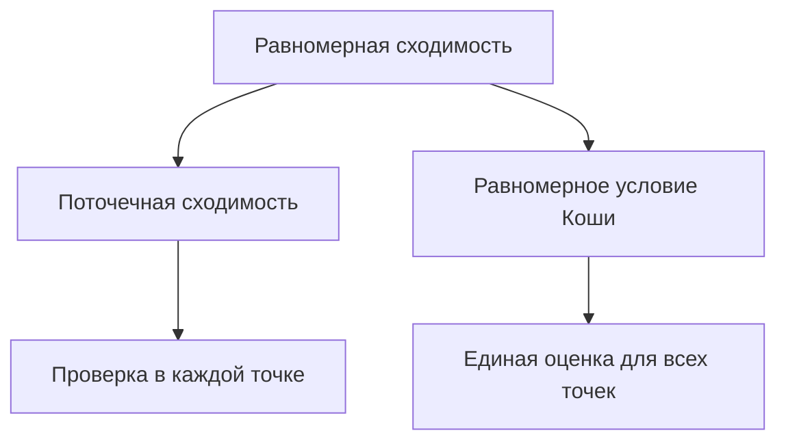

# 10. Последовательности и ряды функций

[[ru/09-improper-integrals-applications|← 9. Несобственные интегралы и приложения]] · [[ru/index|Оглавление]] · [[ru/term-index|Термины и теоремы]] · [[ru/11-power-series|11. Степенные ряды и аналитические функции →]]

> [!abstract] Цель
> Различать поточечную и [[#10.1 Два вида сходимости|равномерную сходимость]] и знать, когда предел можно менять местами с операциями анализа.

## 10.1 Два вида сходимости

Пусть $f_n,f:E\to\mathbb R$. Последовательность **сходится поточечно**, если

$$
\forall x\in E\;\forall\varepsilon>0\;\exists N\;\forall n\ge N:
|f_n(x)-f(x)|<\varepsilon.
$$

Она **сходится равномерно**, если

$$
\forall\varepsilon>0\;\exists N\;\forall n\ge N\;\forall x\in E:
|f_n(x)-f(x)|<\varepsilon.
$$

Равносильно, $\sup_{x\in E}|f_n(x)-f(x)|\to0$. При поточечной сходимости $N$ может зависеть от $x$, при равномерной — нет.

На $[0,1]$ функции $f_n(x)=x^n$ поточечно стремятся к $0$ при $x<1$ и к $1$ при $x=1$. Предел разрывен, поэтому сходимость не равномерна. На $[0,r]$ при $r<1$ она равномерна, поскольку $\sup|f_n|=r^n\to0$.

## 10.2 Равномерный критерий Коши

Последовательность равномерно фундаментальна, если для любого $\varepsilon>0$ найдётся $N$ такое, что

$$
m,n\ge N\implies \sup_{x\in E}|f_n(x)-f_m(x)|<\varepsilon.
$$

Для действительных функций равномерная сходимость равносильна равномерному условию Коши. Это основной инструмент, когда предел неизвестен.

Для ряда $\sum f_n$ определения применяются к [[ru/04-numeric-series#4.1 Частичные суммы|частичным суммам]] $s_N=\sum_{n=1}^N f_n$.

> [!theorem] Признак Вейерштрасса
> Если $|f_n(x)|\le M_n$ на $E$ и $\sum M_n<\infty$, то $\sum f_n$ сходится абсолютно и равномерно на $E$.

^weierstrass-m-test

Это следует из $|f_n(x)+\cdots+f_m(x)|\le M_n+\cdots+M_m$.

## 10.3 Непрерывность и интегрирование

> [!theorem] Теорема о непрерывности
> Если все $f_n$ непрерывны и $f_n\to f$ равномерно, то $f$ непрерывна.

^uniform-limit-continuity

В доказательстве на $3\varepsilon$ выбирают $n$ с равномерно малым $|f_n-f|$, а затем используют непрерывность одной функции $f_n$.

> [!theorem] Теорема об интегрировании
> Если $f_n$ интегрируемы на $[a,b]$ и равномерно сходятся к $f$, то $f$ интегрируема и
> $$
> \lim_{n\to\infty}\int_a^b f_n=\int_a^b f.
> $$

^uniform-limit-integration

Разность интегралов не превосходит $(b-a)\sup|f_n-f|$. Поточечной сходимости мало: движущиеся треугольные «шапочки» на $[0,1]$ могут поточечно стремиться к нулю, а их интегралы оставаться равными единице.

## 10.4 Дифференцирование

Равномерной сходимости $f_n$ недостаточно для дифференцирования предела. Достаточная теорема:

> Если $f_n$ [[ru/15-multivariable-differentiation#15.1 Полная производная|непрерывно дифференцируемы]] на ограниченном отрезке $[a,b]$, $f_n(x_0)$ сходится хотя бы в одной точке, а $f_n'\to g$ равномерно, то $f_n$ равномерно сходится на $[a,b]$ к [[ru/06-derivatives#6.1 Определение и линейное приближение|дифференцируемой]] $f$ и $f'=g$.

На ограниченном промежутке ряд дифференцируют почленно, если ряд производных сходится равномерно, а исходный ряд сходится хотя бы в одной точке.

Теорема Дини: на [[ru/13-metric-spaces#13.4 Компактность|компакте]] [[ru/03-sequences#3.3 Монотонные последовательности|монотонная последовательность]] непрерывных функций, поточечно сходящаяся к непрерывному пределу, сходится равномерно.

## Разобранный пример

При $|x|\le r<1$

$$
\sum_{n=0}^{\infty}x^n=\frac1{1-x}
$$

равномерно по [[#^weierstrass-m-test|признаку Вейерштрасса]] с $M_n=r^n$. Почленное дифференцирование законно на $|x|\le r$, поскольку $\sum nx^{n-1}$ также сходится равномерно. Поэтому

$$
\sum_{n=1}^{\infty}nx^{n-1}=\frac1{(1-x)^2}.
$$

Так как $r<1$ произвольно, тождество верно для всех $|x|<1$.

## Типичные ошибки

1. Поточечная сходимость не сохраняет непрерывность.
2. Признак Вейерштрасса доказывает равномерную [[ru/04-numeric-series#4.3 Абсолютная и условная сходимость|абсолютную сходимость]], а не только сходимость в отдельных точках.
3. Для перестановки производной и предела нужно контролировать ещё и производные.

## Упражнения

1. Докажите, что $f_n(x)=x/(1+nx^2)$ равномерно стремится к нулю на $\mathbb R$.
2. Сходится ли $\sum\sin(nx)/n^2$ равномерно на $\mathbb R$?
3. Приведите пример, показывающий, что поточечная сходимость не сохраняет интеграл.

> [!answer]- Краткие ответы
> 1. Максимум $|x|/(1+nx^2)$ равен $1/(2\sqrt n)$.
> 2. Да, по признаку Вейерштрасса с $M_n=1/n^2$.
> 3. Возьмите треугольный импульс на $(0,1/n)$ высоты $2n$ и площади $1$; он поточечно стремится к нулю.

---

[[ru/09-improper-integrals-applications|← 9. Несобственные интегралы и приложения]] · [[ru/index|Оглавление]] · [[ru/term-index|Термины и теоремы]] · [[ru/11-power-series|11. Степенные ряды и аналитические функции →]]
