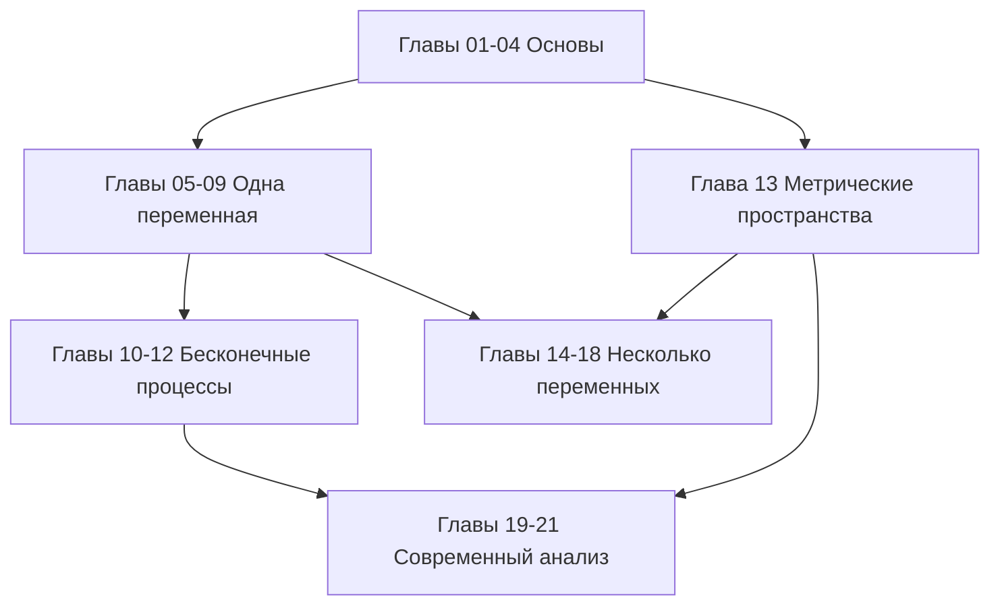

# Математический анализ

[[en/index|English]] · **Русский** · [[es/index|Español]]

Строгий курс от основ до современной теории интегрирования в 21 главе. Читайте его прямо на GitHub или откройте `MathInMind-Obsidian/` как хранилище Obsidian — там есть вики-ссылки, предпросмотр при наведении и выноски с теоремами; чем отличаются представления, объясняет [[ru/00-notation|руководство]].

## Справочные материалы

- [[ru/term-index|Указатель терминов и теорем]] — любое определение и утверждение в одном щелчке от формулировки.
- [[ru/00-notation|Как читать курс: представления и обозначения]]
- [[ru/formula-sheet|Формульная шпаргалка]]
- [[ru/glossary|Трёхъязычный глоссарий]]
- [Рекомендуемые книги и задачники](https://github.com/NikiHunter/matan/blob/main/REFERENCES.md)

## Иллюстрированные лекции 2025/26

- [[ru/lectures-2025-26/index|Указатель всех лекций 0–64]]: полные конспекты лекций 2025/26 — русский оригинал, английский и испанский переводы, с рукописными доказательствами и рисунками.
- **Семестр 1:** лекции 0–32. **Семестр 2:** лекции 33–64. Семестр 2 пересекается с экзаменационным [[ru/lectures/index|реестром `ru/lectures/`]]; каждая лекция ссылается на соответствующий раздел реестра.
- Происхождение каждого рисунка (PDF, страница, кадрирование) записано по партиям в [`assets/lectures-2025-26/`](https://github.com/NikiHunter/matan/tree/main/MathInMind/assets/lectures-2025-26).

## Лекционный и экзаменационный трек

Материалы ниже построены непосредственно по `МАТАН_Л`, `МАТАН_Б` и сканам `опрМат`, с сохранением лекционной нумерации:

- [[ru/lectures/index|Лекционный регистр: 17 разделов и 148 исходных номеров]]
- [[ru/exam/index|72 экзаменационных билета с ответами и примерами]]
- [[ru/purgatory/definitions|Чистилище: 54 определения и теоремы с исходными сканами]]
- [[ru/purgatory/questions|300 возможных вопросов Чистилища]]
- [[ru/lectures/terms|Термины с лекционными ссылками]]

## Карта курса

## Часть I — Основы

1. [[ru/01-logic-sets-functions|Логика, множества и функции]] — кванторы, доказательства, мощность.
2. [[ru/02-real-numbers|Действительные числа и полнота]] — супремум, архимедовость, плотность.
3. [[ru/03-sequences|Последовательности и пределы]] — монотонный и кошиевский критерии, подпоследовательности.
4. [[ru/04-numeric-series|Числовые ряды]] — признаки, абсолютная и условная сходимость.

## Часть II — Анализ функций одной переменной

5. [[ru/05-limits-continuity|Предел и непрерывность]] — пределы функций, промежуточные значения, равномерная непрерывность.
6. [[ru/06-derivatives|Дифференцирование]] — линейное приближение, правило цепочки, обратные функции.
7. [[ru/07-taylor-convexity|Теоремы о среднем, формула Тейлора и выпуклость]].
8. [[ru/08-riemann-integration|Интеграл Римана]] — суммы Дарбу, основная теорема, методы вычисления.
9. [[ru/09-improper-integrals-applications|Несобственные интегралы и приложения]] — сходимость, площадь, длина, объём, работа.

## Часть III — Бесконечные процессы

10. [[ru/10-function-sequences-series|Последовательности и ряды функций]] — равномерная сходимость и предельные переходы.
11. [[ru/11-power-series|Степенные ряды и аналитические функции]] — радиус, почленные операции, ряды Тейлора.
12. [[ru/12-fourier-series|Ряды Фурье]] — ортогональность, поточечная и среднеквадратичная сходимость.

## Часть IV — Несколько переменных и топология

13. [[ru/13-metric-spaces|Метрические пространства, компактность и полнота]].
14. [[ru/14-several-variables|Функции нескольких переменных]] — совместные пределы, непрерывность, компактные области.
15. [[ru/15-multivariable-differentiation|Многомерное дифференцирование]] — матрица Якоби, градиент, гессиан.
16. [[ru/16-implicit-functions-extrema|Обратные и неявные функции; экстремумы]] — локальные теоремы и множители Лагранжа.

## Часть V — Интегрирование в нескольких переменных

17. [[ru/17-multiple-integrals|Кратные интегралы и замена переменных]] — Фубини, полярные и сферические координаты.
18. [[ru/18-vector-calculus|Векторный анализ и интегральные теоремы]] — криволинейные и поверхностные интегралы, Грин, Стокс, Гаусс.

## Часть VI — Современный анализ

19. [[ru/19-measure-theory|Теория меры и измеримые функции]].
20. [[ru/20-lebesgue-integration|Интеграл Лебега и предельные теоремы]].
21. [[ru/21-lp-spaces|Пространства $L^p$ и виды сходимости]] — Гёльдер, полнота, геометрия гильбертова пространства.

## Рекомендуемый порядок работы

1. Прочитайте цели и воспроизведите каждое определение без подсказки.
2. Разберите примеры и отметьте, где именно используется каждое условие теоремы.
3. Решайте упражнения до открытия кратких ответов.
4. Ведите журнал ошибок и связывайте его с соответствующими главами.
5. Повторяйте по формульной шпаргалке только после понимания выводов; она не заменяет теорию.

Для первого курса изучайте главы 1–12 и 14–18, обращаясь к главе 13 по необходимости. Для второго курса повторите краткие выводы и сосредоточьтесь на главах 13 и 19–21. Исходный архив лекций описан отдельно в [примечании к источникам](https://github.com/NikiHunter/matan/blob/main/source/README.md).
