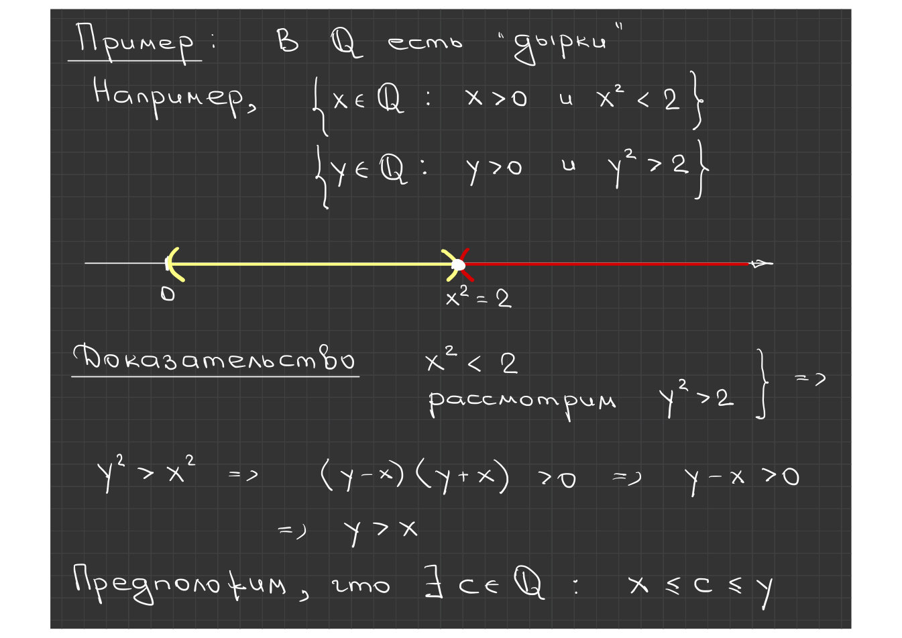
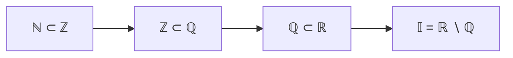

# Лекции 5–6 — Промежутки, аксиомы полноты, индукция, бином Ньютона, точные границы

[[ru/lectures-2025-26/lecture-04|← Лекция 4]] · [[ru/lectures-2025-26/index|Указатель лекций]] · [[ru/lectures-2025-26/lecture-07|Лекция 7 →]] · [[ru/term-index|Термины и теоремы]] · [[en/lectures-2025-26/lecture-05-06|English]] · [[es/lectures-2025-26/lecture-05-06|Español]]

> [!info] Источник
> `ma25_26-lectures_5-6_notes.pdf` — 32 страницы: печатные слайды с текстовым слоем и рукописные страницы без текстового слоя (или с нечитаемым текстовым слоем). Рукописные страницы переписаны по изображению; рисунок со страницы 12 вставлен как иллюстрация. Номера PDF-страниц указаны в заголовках.
>
> **Примечание редактора о нумерации.** В исходных слайдах номер «[[#^def-1-3-5|Определение 1.3.5]]» повторяется трижды: для упорядоченного архимедова поля (стр. 10), для индуктивного множества и для множества натуральных чисел (стр. 18). Номера сохранены как в источнике, повтор не исправлялся. Аналогично, номер «[[#^def-1-3-2|Определение 1.3.2]]» относится к лучам, а «[[#^def-1-3-3|Определение 1.3.3]]» — к точке, лежащей между двумя числами.

## Слайд 2. Цитата дня

> Несколько учёных попросили доказать, что все нечётные целые числа, большие 2, являются простыми.
>
> Математик: 3 простое, 5 простое, 7 простое, и [[ru/01-logic-sets-functions#^example-induction|индукцией]] — каждое нечётное целое число, большее 2, — простое.
>
> Физик: 3 простое, 5 простое, 7 простое, 9 — экспериментальная ошибка, 11 простое. Чтобы убедиться, проверим несколько случайно выбранных чисел: 17 простое, 23 простое.
>
> Инженер: 3 простое, 5 простое, 7 простое, 9 — приближение к простому, 11 простое.

## Слайд 3. Цель лекции

- Продолжить знакомство с аксиомами поля вещественных чисел ([[#^def-1-3-5|аксиома Архимеда]] и аксиома Кантора о [[ru/lectures-2025-26/lecture-11-12#^thm-2-3-1|вложенных отрезках]]).
- Сформулировать принцип математической индукции.
- Доказать утверждение о биноме Ньютона.
- Обсудить ряд следствий из [[ru/02-real-numbers#^completeness-axiom|аксиом полноты]].
- Доказать утверждения о максимуме и минимуме конечного множества.
- Поговорить о плотности множества рациональных чисел.

## §3. Вещественные числа

### Слайд 4. Отрезки и интервалы

Наличие порядка позволяет определить промежутки в множестве $\mathbb{R}$.

> [!definition] Определение 1.3.1
> Пусть $a, b \in \mathbb{R}$. Если $a \le b$, то множество
>
> $$
> [a, b] = \{ x \in \mathbb{R} : a \le x \le b \}
> $$

^def-1-3-1

называется **отрезком** или **сегментом**.

Если $a < b$, то множество

$$
(a, b) = \{ x \in \mathbb{R} : a < x < b \}
$$

называется **интервалом**, а множества

$$
[a, b) = \{ x \in \mathbb{R} : a \le x < b \}, \qquad (a, b] = \{ x \in \mathbb{R} : a < x \le b \}
$$

— **полуинтервалами**.

### Рукописная страница 6 (PDF-стр. 6). Обозначение ⟨a, b⟩

$\langle a, b\rangle$ обозначает промежуток любого из четырёх типов: $[a,b]$, $(a,b)$, $[a,b)$ или $(a,b]$. Такое обозначение используется, когда нам безразлично, принадлежат ли концы $a, b$ промежутку или нет. Аналогично пишут $\langle a, b]$, $[a, b\rangle$, $\langle a, +\infty)$ и т.д.

### Слайд 5. Ещё определения

При $a = b$ отрезок $[a,a]$ состоит из одной точки и называется **вырожденным**.

> [!definition] Определение 1.3.2
> Множества
>
> $$
> [a, +\infty) = \{ x \in \mathbb{R} : a \le x \},\qquad (a, +\infty) = \{ x \in \mathbb{R} : a < x \},
> $$
> $$
> (-\infty, b] = \{ x \in \mathbb{R} : x \le b \},\qquad (-\infty, b) = \{ x \in \mathbb{R} : x < b \}
> $$

^def-1-3-2

называются **лучами** (первое и третье — замкнутыми лучами, второе и четвёртое — открытыми).

Всё множество $\mathbb{R}$ обозначается также $(-\infty, +\infty)$. Символам $-\infty$ и $+\infty$ в этих обозначениях самостоятельного значения не приписывается.

### Слайд 7. Ещё немного

> [!definition] Определение 1.3.3
> Если $a, b \in \mathbb{R}$, а точка $c$ принадлежит интервалу с концами $a$ и $b$, то говорят, что $c$ лежит между $a$ и $b$.

^def-1-3-3

Обозначим ещё через $\mathbb{R}_+$ множество неотрицательных чисел: $\mathbb{R}_+ = [0, +\infty)$.

> [!definition] Определение 1.3.4
> Множество $\overline{\mathbb{R}} = \mathbb{R} \cup \{-\infty, +\infty\}$ называется **расширенной числовой прямой**.

^def-1-3-4

### Слайд 8. Несобственные элементы $+\infty$ и $-\infty$

С несобственными элементами можно совершать некоторые операции. Полагают:

$$
x + (+\infty) = (+\infty) + x = +\infty, \quad x \in \mathbb{R},
$$
$$
x + (-\infty) = (-\infty) + x = -\infty, \quad x \in \mathbb{R},
$$
$$
x \cdot (+\infty) = (+\infty) \cdot x = \begin{cases} +\infty, & x > 0, \\ -\infty, & x < 0, \end{cases}
\qquad
x \cdot (-\infty) = (-\infty) \cdot x = \begin{cases} -\infty, & x > 0, \\ +\infty, & x < 0, \end{cases}
$$
$$
(+\infty) + (+\infty) = +\infty, \quad (-\infty) + (-\infty) = -\infty,
$$
$$
(+\infty) \cdot (+\infty) = (-\infty) \cdot (-\infty) = +\infty, \quad (+\infty) \cdot (-\infty) = (-\infty) \cdot (+\infty) = -\infty.
$$

### Рукописная страница 9 (PDF-стр. 9). Неопределённости

Выражениям

$$
(+\infty) + (-\infty),\quad (+\infty) - (+\infty),\quad (-\infty) - (-\infty),\quad 0 \cdot (\pm\infty),\quad (\pm\infty)\cdot 0
$$

не приписывается никакого значения!

Пометка на полях: «Будущее: $0 \cdot (+\infty) = 0 \cdot \frac{1}{0} = \frac{0}{0}$ — это будет разрешено в теории пределов (скоро будет!)».

### Слайд 10. III. Аксиома Архимеда

**III.1.** Каковы бы ни были положительные числа $x, y \in \mathbb{R}$, существует такое натуральное число $n$, что $nx > y$.

> [!definition] Определение 1.3.5
> Упорядоченное поле, в котором выполняется аксиома Архимеда, называется **архимедовым**.

^def-1-3-5

Из аксиомы Архимеда следует, что существуют сколь угодно большие натуральные числа.

### Слайд 11. IV. Аксиома Кантора о вложенных отрезках

Сформулированные 15 аксиом ещё не определяют множество $\mathbb{R}$ полностью: этим аксиомам удовлетворяет, например, и множество $\mathbb{Q}$. Поэтому необходимо ввести ещё какие-то аксиомы, которые позволили бы различить множества $\mathbb{R}$ и $\mathbb{Q}$.

**IV.1.** Пусть $\{[a_n, b_n]\}_{n=1}^{\infty}$ — последовательность вложенных отрезков, то есть

$$
a_n \le a_{n+1} \le b_{n+1} \le b_n, \qquad \forall n \in \mathbb{N}.
$$

Тогда существует точка, принадлежащая одновременно всем отрезкам $[a_n, b_n]$, то есть

$$
\bigcap_{n=1}^{\infty} [a_n, b_n] \ne \varnothing.
$$

В множестве $\mathbb{Q}$ это утверждение не выполняется.

### Рукописная страница 12 (PDF-стр. 12). Пример: в $\mathbb{Q}$ есть «дырки»

Например, рассмотрим множества

$$
\{ x \in \mathbb{Q} : x > 0 \text{ и } x^2 < 2 \}, \qquad \{ y \in \mathbb{Q} : y > 0 \text{ и } y^2 > 2 \}.
$$

Пусть $x^2 < 2$ и $y^2 > 2$. Тогда $y^2 > x^2 \Rightarrow (y - x)(y + x) > 0 \Rightarrow y - x > 0 \Rightarrow y > x$.

Предположим, что существует $c \in \mathbb{Q}$ такое, что $x \le c \le y$.

### Рукописная страница 13 (PDF-стр. 13). Доказательство: $c^2 \neq 2$

Возможны три варианта: ① $c^2 > 2$; ② $c^2 < 2$; ③ $c^2 = 2$. Покажем, что ни один из них не может реализоваться.

**③** Пусть $c^2 = 2$, $c \in \mathbb{Q}$. Тогда $c = \frac{p}{q}$ — несократимая дробь, $\gcd(p, q) = 1$. Из $\frac{p^2}{q^2} = 2$ получаем $p^2 = 2q^2$ ⇒ $p = 2k$ ⇒ $4k^2 = 2q^2$ ⇒ $2k^2 = q^2$ ⇒ $q = 2m$. Значит, $p$ и $q$ делятся на $2$, что противоречит $\gcd(p, q) = 1$. Следовательно, $c^2 \ne 2$ (вариант ③ невозможен).

### Рукописная страница 14 (PDF-стр. 14). Вариант ②: $c^2 < 2$

**②** $c^2 < 2$. Найдём $\varepsilon > 0$, $\varepsilon \in \mathbb{Q}$, такое что $(c+\varepsilon)^2 < 2$:

$$
c^2 + 2c\varepsilon + \varepsilon^2 < 2 \ \Rightarrow\ 2c\varepsilon + \varepsilon^2 < 2 - c^2 \ \Rightarrow\ \varepsilon(2c + \varepsilon) < 2 - c^2.
$$

Будем рассматривать $\varepsilon$ с условием $0 < \varepsilon < 1$. Достаточно найти $\varepsilon$, такое что $\varepsilon(2c+1) < 2 - c^2$, так как $\varepsilon(2c+\varepsilon) < \varepsilon(2c+1)$.

Положим $\varepsilon = \dfrac{2 - c^2}{(2c+1)\cdot 2025}$. Тогда $c + \varepsilon > c$ и $(c+\varepsilon)^2 < 2$ — противоречие (отмечено зигзагом на рукописи).

**①** Аналогично случаю ②.

### Рукописная страница 15 (PDF-стр. 15). Иррациональные числа и замечание об аксиоме Кантора

$$
\mathbb{R} = \mathbb{Q} \cup \mathbb{I},
$$

где $\mathbb{Q}$ — рациональные числа, $\mathbb{I}$ — иррациональные числа: $\sqrt{2}, \sqrt{3}, \dots$; $\pi \approx 3.14\dots$; $e \approx 2.718\dots$

**Замечание.** В аксиоме Кантора существенно, что речь идёт именно об отрезках, то есть о $[a_n, b_n]$ (на рукописи выделено рамкой и восклицательным знаком). Пересечение вложенных промежутков другого типа может оказаться пустым. Например,

$$
\bigcap_{n=1}^{\infty} \left(0, \frac{1}{n}\right] = \varnothing \qquad \text{или} \qquad \bigcap_{n=1}^{\infty} [n, +\infty) = \varnothing.
$$

### Слайд 16. Принцип математической индукции

**Принцип математической индукции.** Пусть $\{P_n\}$ — последовательность утверждений. Если

1. $P_1$ верно;
2. $\forall n \in \mathbb{N}$ из $P_n$ следует $P_{n+1}$,

то $P_n$ верно $\forall n \in \mathbb{N}$.

Утверждение 1) называется **базой индукции**, а утверждение 2) — **индукционным переходом**; при этом $P_n$ называют **индукционным предположением**.

Подчеркнём, что при проверке утверждения 2) нужно доказывать не истинность $P_n$, а тот факт, что из $P_n$ следует $P_{n+1}$.

### Рукописная страница 17 (PDF-стр. 17). Модификация принципа индукции

Иногда используется **модификация** принципа математической индукции: $\{P_n\}_{n=m}^{\infty}$, где $m$ — целое число. В этом случае базой индукции будет утверждение $P_m$, а индукционный переход будет проводиться для всех $n \ge m$.

### Слайд 18. Множество $\mathbb{N}$

При аксиоматическом определении множества натуральных чисел принцип математической индукции (или какое-нибудь близкое утверждение) принимается за аксиому. Мы не будем приводить аксиоматику $\mathbb{N}$, а определим $\mathbb{N}$ как подмножество $\mathbb{R}$.

> [!definition] Определение 1.3.5
> (индуктивное множество). Множество $M \subset \mathbb{R}$ называется **индуктивным**, если $1 \in M$ и вместе с каждым своим элементом $x$ множество $M$ содержит и элемент $x + 1$.

> [!definition] Определение 1.3.5
> (натуральные числа). Множеством натуральных чисел называется минимальное по включению индуктивное подмножество $\mathbb{R}$.

> [!remark] Примечание редактора
> Номер «1.3.5» повторён, см. примечание в начале файла.

### Слайд 19. Ещё немного определений и обозначений

1. Если $m, n \in \mathbb{Z}$, $m \le n$, то полагают

$$
\sum_{k=m}^{n} a_k = a_m + \dots + a_n, \qquad \prod_{k=m}^{n} a_k = a_m \cdot \dots \cdot a_n.
$$

2. Если $m > n$, то сумма $\sum_{k=m}^{n} a_k$ считается равной $0$, а произведение $\prod_{k=m}^{n} a_k$ — равным $1$.

3. Следующее преобразование называют **сдвигом индекса суммирования**: если $p \in \mathbb{Z}$, то

$$
\sum_{k=m}^{n} a_k = \sum_{j=m+p}^{n+p} a_{j-p}.
$$

### Слайд 20. Факториал и биномиальные коэффициенты

Если $n \in \mathbb{Z}_+$, то произведение $n! = \prod_{k=1}^{n} k$ называется **факториалом** числа $n$; по общему соглашению $0! = 1$.

Числа

$$
C_n^k = \frac{n!}{k!\,(n-k)!}
$$

называются **биномиальными коэффициентами**.

Отметим, что

$$
C_n^0 = C_n^n = 1, \qquad C_n^1 = C_n^{n-1} = n, \qquad C_{n+1}^k = C_n^{k-1} + C_n^k.
$$

Договоримся считать при всех $x$, что $x^0 = 1$, в том числе при $x = 0$.

### Слайд 21. Бином Ньютона

> [!theorem] Теорема 1.3.1
> Если $n \in \mathbb{Z}_+$, $x, y \in \mathbb{R}$, то
>
> $$
> (x + y)^n = \sum_{k=0}^{n} C_n^k\, x^k y^{n-k}.
> $$

^thm-1-3-1

### Рукописные страницы 22–25. Доказательство теоремы 1.3.1

**Доказательство ([[#^thm-1-3-1|теорема 1.3.1]]).**

**① База индукции ($n = 1$).**

$$
(x+y) = C_1^0 x^0 y^1 + C_1^1 x^1 y^0 = y + x,
$$

где $C_1^0 = \dfrac{1!}{0!\,(1-0)!} = 1$, $C_1^1 = \dfrac{1!}{1!\,(1-1)!} = 1$, $x^0 = y^0 = 1$. Утверждение верно для $n = 1$ ⇒ база индукции верна ✓.

**② Индукционное предположение.** Пусть формула верна для $n = m$:

$$
(x+y)^m = \sum_{k=0}^{m} C_m^k x^k y^{m-k}.
$$

**③ Индукционный переход.** Надо доказать, что формула верна для $n = m+1$.

$$
(x+y)^{m+1} = (x+y)(x+y)^m = (x+y) \sum_{k=0}^{m} C_m^k x^k y^{m-k}
= \sum_{k=0}^{m} C_m^k x^{k+1} y^{m-k} + \sum_{k=0}^{m} C_m^k x^k y^{m+1-k}.
$$

Вспомним про возможность сдвинуть индекс суммирования (было раньше в лекциях): $\sum_{k=m}^{n} a_k = \sum_{j=m+p}^{n+p} a_{j-p}$. В первой сумме сделаем сдвиг $j = k+1$:

$$
= \sum_{j=1}^{m+1} C_m^{j-1} x^{j} y^{m+1-j} + \sum_{k=0}^{m} C_m^k x^k y^{m+1-k}
$$
$$
= C_m^m x^{m+1} y^0 + \sum_{k=1}^{m} C_m^{k-1} x^k y^{m+1-k} + C_m^0 x^0 y^{m+1} + \sum_{k=1}^{m} C_m^k x^k y^{m+1-k}.
$$

Соберём суммы по $k$ (сумма $\sum_{k=1}^m$):

$$
= C_m^m x^{m+1} y^0 + \sum_{k=1}^{m} \left( C_m^{k-1} + C_m^k \right) x^k y^{m+1-k} + C_m^0 x^0 y^{m+1}.
$$

Используем тождество Паскаля $C_m^{k-1} + C_m^k = C_{m+1}^k$. Проверим его:

$$
C_m^{k-1} + C_m^k = \frac{m!}{(k-1)!\,(m+1-k)!} + \frac{m!}{k!\,(m-k)!}
= \frac{m!}{(k-1)!\,(m-k)!}\left[\frac{1}{m-k+1} + \frac{1}{k}\right]
$$
$$
= \frac{m!}{(k-1)!\,(m-k)!}\cdot\frac{k + m - k + 1}{(m-k+1)\,k} = \frac{(m+1)!}{k!\,(m+1-k)!} = C_{m+1}^k.
$$

(На рукописи над числителем подписано «$m+1$».)

Поскольку $C_m^m = \dfrac{m!}{m!\,0!} = 1 = C_{m+1}^{m+1} = \dfrac{(m+1)!}{(m+1)!\,0!}$ и $C_m^0 = \dfrac{m!}{0!\,m!} = 1 = C_{m+1}^0$, получаем

$$
C_{m+1}^{m+1} x^{m+1} y^0 + \sum_{k=1}^{m} C_{m+1}^k x^k y^{m+1-k} + C_{m+1}^0 x^0 y^{m+1} = \sum_{k=0}^{m+1} C_{m+1}^k x^k y^{m+1-k}.
$$

Это и есть формула для $n = m+1$. ∎

> [!remark] Примечание редактора
> На последней строке рукописной страницы 25 записано $C_m^k$; по смыслу должно быть $C_{m+1}^k$ — это опечатка рукописи, исправлено в тексте.

### Рукописная страница 26 (PDF-стр. 26). Пример: неравенство Бернулли

**Пример.** Докажем с помощью принципа математической индукции **неравенство Бернулли**: $\forall n \in \mathbb{N}$ и $\forall x \in \mathbb{R}$, $x \ge -1$:

$$
(1+x)^n \ge 1 + nx.
$$

**База индукции** ($n = 1$): $1 + x \ge 1 + x$ при $\forall x \ge -1$ ✓.

**Индукционное предположение** ($n = m$): $\forall x \in \mathbb{R}$, $x \ge -1$: $(1+x)^m \ge 1 + mx$.

**Индукционный переход** ($m \mapsto m+1$). Пусть $x \ge -1$. Тогда

$$
(1+x)^{m+1} = (1+x)^m (1+x) \ \overset{\text{(по инд. предп.)}}{\ge}\ (1+mx)(1+x)
$$

(здесь использовано, что $1 + x \ge 0$ — **на рукописи отмечено красным: «Здесь использовалось условие $x \ge -1$»**).

$$
= 1 + mx + x + mx^2 = 1 + (m+1)x + mx^2 \ \ge\ 1 + (m+1)x,
$$

так как $mx^2 \ge 0$, поскольку $m \in \mathbb{N}$, а $x^2 \ge 0$ для всех $x \in \mathbb{R}$. ∎

### Рукописная страница 27 (PDF-стр. 27). Шаг индукции для неравенства Бернулли

Пусть $x \ge -1$.

$$
(1+x)^{m+1} = (1+x)^m (1+x) \ge (1+mx)(1+x)
\quad\text{(по индукционному предположению; множитель } 1+x \ge 0\text{)}.
$$

$$
= 1 + mx + x + mx^2 = 1 + (m+1)x + mx^2 \ge 1 + (m+1)x,
$$

т.к. $mx^2 \ge 0$, поскольку $m \in \mathbb{N}$, а $x^2 \ge 0$ для всех $x \in \mathbb{R}$. Здесь использовалось условие $x \ge -1$.

### Слайд 28. Ограниченные множества

> [!definition] Определение 1.3.7
> Множество $A \subset \mathbb{R}$ называется **ограниченным сверху**, если
>
> $$
> \exists c \in \mathbb{R}:\ \forall x \in A\ \ x \le c.
> $$

^def-1-3-7

Число $c$ при этом называется **верхней границей** множества $A$.

> [!definition] Определение 1.3.8
> Множество $A \subset \mathbb{R}$ называется **ограниченным снизу**, если
>
> $$
> \exists c \in \mathbb{R}:\ \forall x \in A\ \ x \ge c.
> $$

^def-1-3-8

Число $c$ при этом называется **нижней границей** множества $A$.

### Слайд 29. Ограниченное множество

> [!definition] Определение 1.3.9
> Множество $A \subset \mathbb{R}$ называется **ограниченным**, если оно ограничено и сверху, и снизу.

^def-1-3-9

**Замечание.** Если $M$ — [[ru/02-real-numbers#2.2 Супремум и инфимум|верхняя граница]] множества $A$, то всякое число, большее $M$, — тоже верхняя граница $A$. Если $m$ — нижняя граница множества $A$, то всякое число, меньшее $m$, — тоже нижняя граница $A$.

### Слайд 30. Supremum и maximum

> [!definition] Определение 1.3.10
> Число $a$ называется **точной верхней границей** (супремумом) множества $A \subset \mathbb{R}$, если
>
> 1. $a$ — верхняя граница множества $A$;
> 2. $\forall \tilde a \in A$: $\tilde a < a$ и $\tilde a$ не является верхней границей множества $A$ — иначе говоря, любое число, меньшее $a$, не является верхней границей $A$.

^def-1-3-10

> [!remark] Примечание редактора
> В слайде условие записано как «$\forall \tilde a \in A$»; по смыслу оно относится к любому числу $\tilde a < a$, а не только к элементам $A$. Текст передан по слайду, формулировка уточнена в описании.

[[ru/lectures-2025-26/lecture-11-12#^def-2-3-1|Точная верхняя граница]] — наименьшая из всех верхних границ. Обозначение: $\sup A$.

> [!definition] Определение 1.3.11
> Число $M$ называется **максимумом** (или наибольшим элементом) множества $A \subset \mathbb{R}$, если $M \in A$ и $x \le M$ для всех $x \in A$. Обозначение: $\max A$.

^def-1-3-11

### Рукописная страница 31 (PDF-стр. 31). Пример: sup, max, inf, min для промежутков

**Пример.**

- **⟨1⟩** $[a, b]$: $\sup [a,b] = b$; $\max [a,b] = b$.
- **⟨2⟩** $[a, b)$: $\sup [a,b) = b$; $\max [a,b)$ не существует.
- **⟨3⟩** $[a, +\infty)$: $\sup [a,+\infty)$ нет; $\max [a,+\infty)$ нет; $\inf [a,+\infty) = a$; $\min [a,+\infty) = a$.
- **⟨4⟩** $(a, b]$: $\inf (a,b] = a$; $\min (a,b]$ не существует.

> [!remark] Примечание редактора
> В блоке ⟨3⟩ рукопись в последней строке читается как «$\max [a,+\infty) = a$»; по смыслу это $\min$, так как $a$ — наименьший элемент $[a,+\infty)$. В блоке ⟨4⟩ правый конец записан как «$>$» — по смыслу это «$]$». Исправлено в тексте.

### Слайд 32. Infimum и minimum

> [!definition] Определение 1.3.12
> Число $a$ называется **точной нижней границей** (инфимумом) множества $A \subset \mathbb{R}$, если
>
> 1. $a$ — нижняя граница множества $A$;
> 2. любое число, большее $a$, не является нижней границей $A$.

^def-1-3-12

[[ru/lectures-2025-26/lecture-11-12#^def-2-3-2|Точная нижняя граница]] — наибольшая из всех нижних границ. Обозначение: $\inf A$.

> [!definition] Определение 1.3.13
> Число $m$ называется **минимумом** (или наименьшим элементом) множества $A \subset \mathbb{R}$, если $m \in A$ и $x \ge m$ для всех $x \in A$. Обозначение: $\min A$.

^def-1-3-13

## Служебные страницы

- Страница 1 — титульная; страница 2 — цитата дня (переведена выше).
- Страницы 33 в PDF нет; все рукописные страницы 6–31 учтены в разделах выше.
