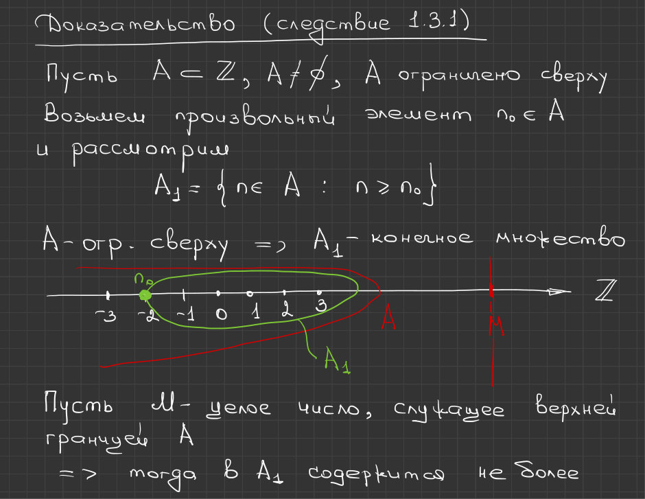
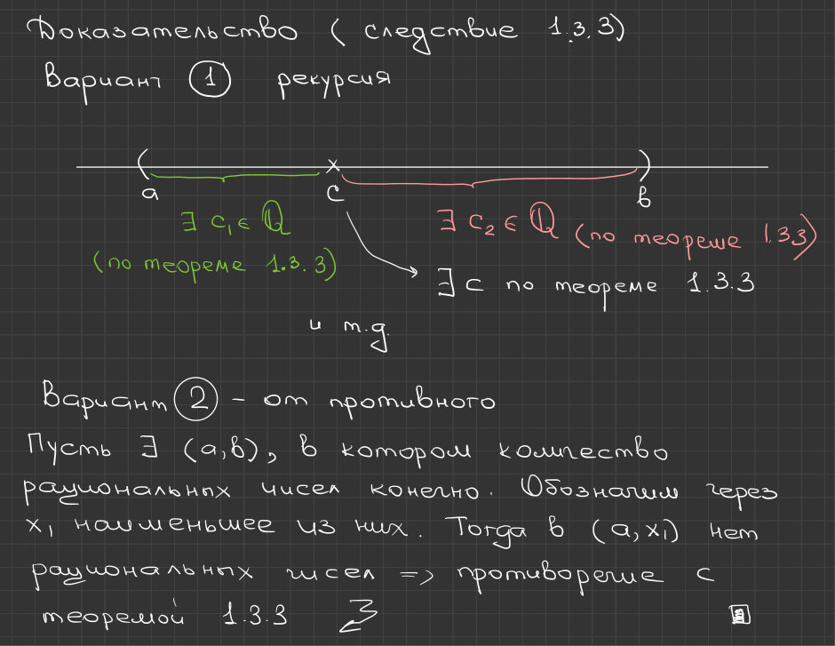

# Лекция 7 — Максимум и минимум, целая часть, плотность $\mathbb{Q}$ в $\mathbb{R}$

[[ru/lectures-2025-26/lecture-05-06|← Лекции 5–6]] · [[ru/lectures-2025-26/index|Указатель лекций]] · [[ru/lectures-2025-26/lecture-08|Лекция 8 →]] · [[ru/term-index|Термины и теоремы]] · [[en/lectures-2025-26/lecture-07|English]] · [[es/lectures-2025-26/lecture-07|Español]]

> [!info] Источник
> `ma25_26_лекция_7_notes.pdf` — 13 страниц: печатные слайды с текстовым слоем (стр. 1–4, 9) и рукописные страницы, в которых текстовый слой испорчен (стр. 5–8, 10–13). Рукописные страницы переписаны по изображению. Рисунки со страниц 6, 11 и 12 вставлены как иллюстрации.
>
> **Примечание редактора о нумерации.** В слайде 4 теорема о максимуме и минимуме конечного множества имеет номер 1.3.2; в рукописном доказательстве [[#^cor-1-3-1|следствия 1.3.1]] (стр. 7) сослано на «теорему 1.4.2» — сохранено как в рукописи. Номера определений и теорем не менялись.

## Слайд 2. Цитата дня

> Всё, что ни делается, всё к лучшему. Просто не всегда к вашему.

## Слайд 3. Цель лекции

- Доказать следствия из утверждений о максимуме и минимуме конечного множества.
- Поговорить о плотности множества рациональных чисел.

## §3. Вещественные числа

### Слайд 4. Существование максимума и минимума конечного множества

> [!theorem] Теорема 1.3.2
> Во всяком конечном подмножестве $\mathbb{R}$ есть наибольший и наименьший элемент.

^thm-1-3-2

> [!corollary] Следствие 1.3.1
> Во всяком непустом ограниченном сверху (снизу) подмножестве $\mathbb{Z}$ есть наибольший (наименьший) элемент.

^cor-1-3-1

> [!corollary] Следствие 1.3.2
> Во всяком непустом подмножестве $\mathbb{N}$ есть наименьший элемент.

^cor-1-3-2

### Рукописная страница 5 (PDF-стр. 5). Доказательство теоремы 1.3.2

**Доказательство ([[#^thm-1-3-2|теорема 1.3.2]]).** Проведём [[ru/01-logic-sets-functions#^example-induction|индукцию]] по числу $n$ элементов множества.

**База индукции** $n = 1$: $A = \{a_1\}$ ⇒ $a_1$ — наибольший и наименьший элемент одновременно ✓.

Для определённости проведём дальнейшее рассуждение для max.

**Индукционное предположение.** Пусть множество $A = \{x_1, x_2, \dots, x_n\}$ имеет max.

Обозначим $c = \max\{x_1, x_2, \dots, x_n\}$.

**Индукционный переход**: $n \mapsto n+1$, $A = \{x_1, x_2, \dots, x_n, x_{n+1}\}$.

- Если $c \le x_{n+1}$ ⇒ $x_{n+1} = \max A$;
- если $c > x_{n+1}$ ⇒ $c = \max A$.

### Рукописные страницы 6–7 (PDF-стр. 6–7). Следствие 1.3.1 (целые числа)

**Доказательство ([[#^cor-1-3-1|следствие 1.3.1]]).** Пусть $A \subset \mathbb{Z}$, $A \ne \varnothing$, $A$ [[ru/lectures-2025-26/lecture-05-06#^def-1-3-7|ограничено сверху]].

Возьмём произвольный элемент $n_0 \in A$ и рассмотрим

$$
A_1 = \{ n \in A : n \ge n_0 \}.
$$

Так как $A$ ограничено сверху, $A_1$ — **конечное** множество.

Пусть $M$ — целое число, служащее [[ru/02-real-numbers#2.2 Супремум и инфимум|верхней границей]] $A$ ⇒ тогда в $A_1$ содержится не более [фраза обрывается на краю страницы 6; её продолжение не восстанавливается по снимку].

Далее (стр. 7): $A_1 \subset A \subset \mathbb{Z} \subset \mathbb{R}$; в $A_1$ — конечное число элементов ⇒ по теореме 1.4.2 в $A_1$ есть наибольший элемент. Этот наибольший элемент из $A_1$ и будет наибольшим элементом $A$.

Случай ограниченного снизу множества $A$ разбирается аналогично.

### Рукописная страница 7 (PDF-стр. 7). Следствие 1.3.2 (натуральные числа)

**Доказательство ([[#^cor-1-3-2|следствие 1.3.2]]).** $A \subset \mathbb{N} \subset \mathbb{Z}$, $A \ne \varnothing$; $\mathbb{N}$ ограничено снизу (на рукописи записано «0» — согласуется ли это с соглашением курса о $\mathbb{N}$, нужно проверить). ⇒ Результат следует из [[#^cor-1-3-1|следствия 1.3.1]].

### Рукописная страница 8 (PDF-стр. 8). Определение целой части

**Определение.** Пусть $x \in \mathbb{R}$. Наибольшее целое число, не превосходящее $x$, называется **целой частью** $x$ и обозначается $[x]$.

**Замечание.** Существование целой части обеспечивается следствием 1.4.1 ⇒ определение целой части корректно.

**Замечание.**

$$
[x] \le x < [x] + 1, \qquad x - 1 < [x] \le x.
$$

Обратно, если $y \in \mathbb{Z}$ и $x - 1 < y \le x$, то $y = [x]$.

На полях (зелёным): $x - [x] = \{x\}$ — **дробная часть** $x$, $0 \le \{x\} < 1$.

### Слайд 9. Плотность множества рациональных чисел (печатный слайд с рукописной пометкой)

> [!theorem] Теорема 1.3.3
> Во всяком интервале есть рациональное число.

^thm-1-3-3

> [!corollary] Следствие 1.3.3
> Во всяком интервале бесконечно много рациональных чисел.

^cor-1-3-3

**Рукописная пометка** (стрелка к [[#^thm-1-3-3|теореме 1.3.3]]): «Свойство, описанное в [[#^thm-1-3-3|теореме 1.3.3]], называется **плотностью** множества $\mathbb{Q}$ в множестве $\mathbb{R}$».

### Рукописная страница 10 (PDF-стр. 10). Доказательство теоремы 1.3.3

**Доказательство ([[#^thm-1-3-3|теорема 1.3.3]]).** Пусть $a, b \in \mathbb{R}$, $a < b$ ⇒ $\dfrac{1}{b-a} > 0$.

Положим в [[ru/lectures-2025-26/lecture-05-06#^def-1-3-5|аксиоме Архимеда]] $x = 1$, $y = \dfrac{1}{b-a}$ ⇒ по аксиоме Архимеда существует $n \in \mathbb{N}$ такое, что $n > \dfrac{1}{b-a}$ ⇒

$$
\frac{1}{n} < b - a.
$$

Положим

$$
c = \frac{[na] + 1}{n} \in \mathbb{Q}.
$$

Тогда

$$
c = \frac{[na] + 1}{n} \le \frac{na + 1}{n} = a + \frac{1}{n} < a + b - a = b,
$$

$$
c = \frac{[na] + 1}{n} > \frac{na - 1 + 1}{n} = a.
$$

Следовательно, $c \in (a, b)$. ∎

### Рукописная страница 11 (PDF-стр. 11). Следствие 1.3.3: два способа

**Доказательство ([[#^cor-1-3-3|следствие 1.3.3]]).**

**Вариант ① — рекурсия.** Берём интервал $(a, b)$. По [[#^thm-1-3-3|теореме 1.3.3]] существует $c_1 \in \mathbb{Q}$ в интервале $(a, c)$ [на рисунке — зелёным]; по [[#^thm-1-3-3|теореме 1.3.3]] существует $c_2 \in \mathbb{Q}$ в интервале $(c, b)$ [красным]; к точке $c$ (отмечена на рисунке) снова применяется [[#^thm-1-3-3|теорема 1.3.3]]; «и т.д.» — на рукописи, построение продолжается рекурсивно.

**Вариант ② — от противного.** Пусть существует интервал $(a, b)$, в котором количество рациональных чисел конечно. Обозначим через $x_1$ наименьшее из них. Тогда в $(a, x_1)$ нет рациональных чисел ⇒ противоречие с [[#^thm-1-3-3|теоремой 1.3.3]].

### Рукописная страница 12 (PDF-стр. 12). «Отдача долгов»: $[0,1]$ несчётно

**Докажем, что $[0,1]$ несчётен.**

**Доказательство.** Предположим противное: пусть $[0,1]$ счётен ⇒ все элементы $[0,1]$ можно расположить в виде

$$
[0,1] = \{ x_1, x_2, \dots, x_{100}, \dots \}.
$$

![Рукописная стр. 12: отрезки [0, 1/3], [1/3, 2/3], [2/3, 1] и отбор [a₁, b₁]](../../assets/lectures-2025-26/lec07-p12-uncountable-interval.jpg)

Разобьём $[0,1]$ на три части: $[0, \tfrac13]$, $[\tfrac13, \tfrac23]$, $[\tfrac23, 1]$. Обозначим через $[a_1, b_1]$ тот, который не содержит $x_1$.

### Рукописная страница 13 (PDF-стр. 13). Продолжение

Разобьём $[a_1, b_1]$ на 3 равные части и обозначим $[a_2, b_2]$ ту из них, которая не содержит $x_2$, и т.д.

В результате имеем последовательность [[ru/lectures-2025-26/lecture-11-12#^thm-2-3-1|вложенных отрезков]] $\{[a_n, b_n]\}_{n=1}^{\infty}$, причём для всех $n$: $x_n \notin [a_n, b_n]$.

По **аксиоме Кантора о вложенных отрезках** существует $x^* \in [0,1]$, принадлежащее всем $[a_n, b_n]$. Но тогда $x^* = x_m$ для некоторого $m \in \mathbb{N}$. Однако по построению $x_m \notin [a_m, b_m]$ — противоречие. ∎

> [!remark] Примечание редактора
> Рукописный заголовок «Отдача долгов» в начале страницы 12 сохранён как есть; смысл пометки по скану не ясен. Сам пример — о [[ru/lectures-2025-26/lecture-03#^thm-1-2-5|несчётности]] $[0,1]$.

## Служебные страницы

- Страница 1 — титульная; страница 2 — цитата дня (переведена выше).
- Страницы 5–8 и 10–13 — рукописные, переписаны выше; страница 9 — печатный слайд с рукописной пометкой.
