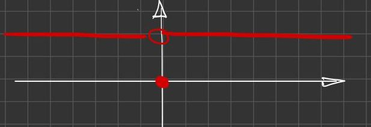
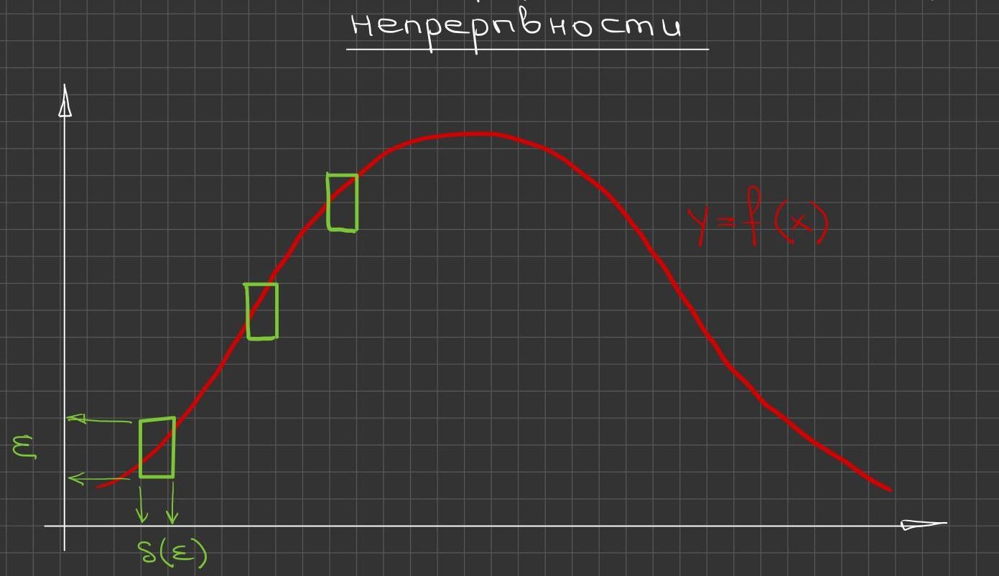
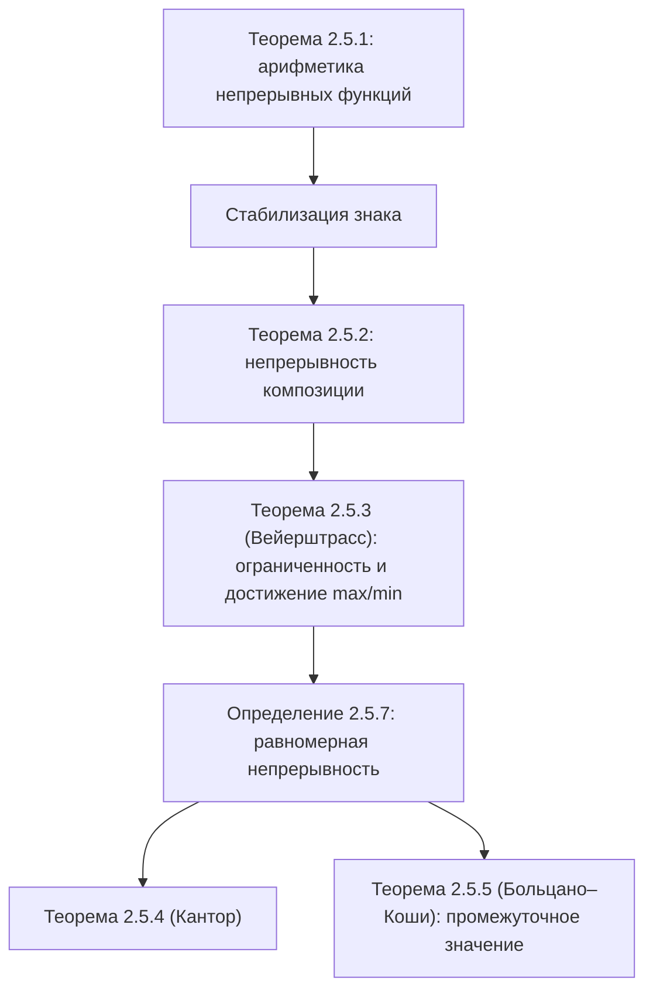

# Лекции 17–18 — Свойства непрерывных функций на отрезке

[[ru/lectures-2025-26/lecture-16|← Лекция 16]] · [[ru/lectures-2025-26/index|Указатель лекций]] · [[ru/lectures-2025-26/lecture-19-20|Лекции 19–20 →]] · [[ru/term-index|Термины и теоремы]] · [[en/lectures-2025-26/lecture-17-18|English]] · [[es/lectures-2025-26/lecture-17-18|Español]]

> [!info] Источник
> `ma25_26-lectures_17-18_notes.pdf` — 22 страницы: печатные слайды с текстовым слоем (страницы 1–4, 6, 8, 11, 15, 18), рукописные страницы без текстового слоя (5, 7, 9, 10, 12–14, 16, 17, 19–22). Рукописные страницы переписаны по изображению. Номера страниц PDF указаны в заголовках; печатные слайды пронумерованы в PDF как «1/9»–«9/9».
>
> **Примечание редактора.** Дата лекции взята из нижнего колонтитула слайдов («30 октября 2025»).

## Печатные слайды 1–3. Вступление

**Цитата дня (слайд 2).** Вопрос: что получится, если длину окружности фонаря из тыквы разделить на диаметр фонаря? Ответ: тыквенный Пи!

**Цель лекции.** Докажем серию утверждений о непрерывных функциях (арифметические действия над непрерывными функциями, стабилизация знака непрерывной функции, непрерывность композиции, теорема Вейерштрасса). Введём понятие [[#^def-2-5-7|равномерной непрерывности]] и докажем теорему Кантора и [[#^thm-2-5-5|теорему Больцано–Коши]].

## §5. Непрерывные функции (продолжение)

### Печатный слайд 4 (PDF-стр. 4). Арифметические действия над непрерывными функциями

> [!theorem] Теорема 2.5.1
> Пусть функции $f, g : D \subset \mathbb{R} \to \mathbb{R}$ непрерывны в точке $x_0 \in D$. Тогда функции $f \pm g$, $fg$, $|f|$ непрерывны в точке $x_0$, а если $g(x_0) \ne 0$, то и $\dfrac{f}{g}$ непрерывна в точке $x_0$.

^thm-2-5-1

### Рукописная страница 5 (PDF-стр. 5). Доказательство теоремы 2.5.1

**Доказательство ([[#^thm-2-5-1|теорема 2.5.1]]).** Если $x_0$ — изолированная точка $D$, то утверждение тривиально!

Если $x_0$ — [[ru/lectures-2025-26/lecture-14#^def-2-4-1|предельная точка]] $D$, то $f(x) \xrightarrow[x \to x_0]{} f(x_0)$, $g(x) \xrightarrow[x \to x_0]{} g(x_0)$. Но тогда $f(x) + g(x) \xrightarrow[x \to x_0]{} f(x_0) + g(x_0)$, что и означает непрерывность суммы $f$ и $g$ в точке $x_0$.

Другие операции — аналогично. $\blacksquare$

### Печатный слайд 6 (PDF-стр. 6). О стабилизации знака непрерывной функции

Если функция $g : D \subset \mathbb{R} \to \mathbb{R}$ [[ru/lectures-2025-26/lecture-16#^def-2-5-1|непрерывна в точке]] $x_0 \in D$, $g(x_0) \ne 0$, то существует такая окрестность $V(x_0)$, что знак $g(x)$ совпадает со знаком $g(x_0)$ для всех $x \in V(x_0) \cap D$.

### Рукописная страница 7 (PDF-стр. 7). Обоснование стабилизации знака

Для изолированной точки $x_0$ это утверждение тривиально, а для предельной точки следует из теоремы о стабилизации знака функции, имеющей предел ([[ru/lectures-2025-26/lecture-15#^thm-2-4-4|теорема 2.4.4]] из лекции 15).

### Печатный слайд 8 (PDF-стр. 8). Непрерывность композиции

> [!theorem] Теорема 2.5.2
> Пусть $f : D \subset \mathbb{R} \to \mathbb{R}$, $g : E \subset \mathbb{R} \to \mathbb{R}$, $f(D) \subset E$, $f$ непрерывна в точке $x_0 \in D$, $g$ непрерывна в точке $f(x_0)$. Тогда $g \circ f$ непрерывна в точке $x_0$.

^thm-2-5-2

### Рукописная страница 9 (PDF-стр. 9). Доказательство теоремы 2.5.2

**Доказательство ([[#^thm-2-5-2|теорема 2.5.2]]).** Пусть $\{x_n\} : x_n \in D$, $x_n \xrightarrow[n \to \infty]{} x_0$.

Обозначим $\begin{cases} f(x_n) =: y_n \\ f(x_0) =: y_0 \end{cases} \Rightarrow y_n, y_0 \in E$.

$g$ непрерывна в точке $f(x_0)$ $\Rightarrow$ $g(y_n) \xrightarrow[n \to \infty]{} g(y_0)$. (На рукописи шаг «$y_n \to y_0$ в силу непрерывности $f$ в точке $x_0$» отдельно не выписан.)

А теперь вспомним, что $\begin{cases} g(y_n) = g(f(x_n)) = g \circ f\,(x_n) \\ g(y_0) = g(f(x_0)) = g \circ f\,(x_0) \end{cases} \Rightarrow g \circ f\,(x_n) \xrightarrow[n \to \infty]{} g \circ f\,(x_0)$.

В силу произвольности выбора $\{x_n\}$ получаем непрерывность $g \circ f$. $\blacksquare$

### Рукописная страница 10 (PDF-стр. 10). Замечание: предел композиции без непрерывности

**Замечание (рукопись).** Пусть $f(x) = x \sin \dfrac1x$, $g(y) = |\operatorname{sign} y|$ (в правом верхнем углу нарисован красным график $g$: прямая $y = 1$ при $y \ne 0$ с пустым кружком в точке $(0, 1)$ и закрашенная точка $(0, 0)$).

$f(x) \xrightarrow[x \to 0]{} 0$, $g(y) \xrightarrow[y \to 0]{} 1$, а $\lim\limits_{x \to 0} (g \circ f) = g(f(x))$ не существует.

1) Почему нет предела: $(g \circ f)\left(\dfrac{1}{\pi n}\right) = 0 \to 0$; $(g \circ f)\left(\dfrac{1}{\pi n + \pi/2}\right) = 1 \to 1$.

Красным: этот пример показывает, что если $f(x) \xrightarrow[x \to a]{} A$, $g(x) \xrightarrow[x \to A]{} B$, то $(g \circ f)(x) \xrightarrow[x \to a]{} B$ может не выполняться!

> [!remark] Примечание редактора
> Ср. с [[ru/lectures-2025-26/lecture-15#^thm-2-4-6|теоремой 2.4.6]] о пределе композиции (лекция 15): здесь нарушено её условие 3 — в любой [[ru/lectures-2025-26/lecture-14#^def-2-4-2|проколотой окрестности]] нуля $f$ принимает значение $A = 0$.

### Печатный слайд 11 (PDF-стр. 11). Теорема Вейерштрасса о непрерывных функциях

> [!theorem] Теорема 2.5.3
>
> 1. Непрерывная на отрезке функция ограничена.
> 2. Непрерывная на отрезке функция принимает наибольшее и наименьшее значение.

^thm-2-5-3

**Замечание.** Оба условия — и непрерывность функции, и то, что её область определения есть отрезок, — существенны.

### Рукописная страница 12 (PDF-стр. 12). Примеры к замечанию

**Примеры к замечанию.**

① $f_1(x) = x$ непрерывна на $\mathbb{R}$, но не ограничена на $\mathbb{R}$.

② $f_2(x) = \dfrac1x$ непрерывна на $(0, 1]$, но не ограничена на $(0, 1]$.

③ $f_1(x) = x$ на $[0, 1)$: $f_1$ непрерывна на $[0, 1)$, ограничена на $[0, 1)$, но не имеет наибольшего значения на $[0, 1)$ ($\sup\limits_{[0,1)}$ есть, $\max\limits_{[0,1)}$ нет).

④ $f_3(x) = \begin{cases} \dfrac1x, & x \in (0, 1], \\ 0, & x = 0. \end{cases}$

$f_3$ разрывна в точке $0$, не ограничена и не имеет наибольшего значения на $[0, 1]$ (конечного $\sup\limits_{[0,1]}$ нет, $\max\limits_{[0,1]}$ тоже нет).

### Рукописные страницы 13–14 (PDF-стр. 13–14). Доказательство теоремы Вейерштрасса

**Доказательство (теорема Вейерштрасса — [[#^thm-2-5-3|теорема 2.5.3]]).** Пусть $f \in C[a, b]$ — $f$ непрерывна на $[a, b]$.

① Пусть $f$ не ограничена $\Rightarrow$ $\forall n \in \mathbb{N}$ существует точка $x_n \in [a, b]$: $|f(x_n)| > n$ $\Rightarrow$ получили последовательность $\{x_n\}$ $\Rightarrow$ по [[ru/lectures-2025-26/lecture-11-12#^thm-2-3-4|принципу Больцано–Вейерштрасса]] существует [[ru/lectures-2025-26/lecture-11-12#^def-2-3-7|подпоследовательность]] $\{x_{n_k}\}$: $x_{n_k} \to c \in [a, b]$ (по свойству замкнутости отрезка).

$\begin{cases} c \in [a, b] \\ x_{n_k} \xrightarrow[k \to \infty]{} c \\ f \in C[a, b] \end{cases} \Rightarrow$ по определению непрерывности $f(x_{n_k}) \xrightarrow[k \to \infty]{} f(c)$.

По построению: $|f(x_{n_k})| > n_k \ge k$ $\forall k \in \mathbb{N}$ — противоречие (зелёная молния).

② Докажем для определённости, что $f$ принимает наибольшее значение.

$M := \sup\limits_{x \in [a,b]} f(x)$ $\Rightarrow$ по пункту ① $f$ ограничена на $[a, b]$ $\Rightarrow$ $M \in \mathbb{R}$ (на рукописи здесь написано $\mu \in \mathbb{R}$; по смыслу — $M$).

Пусть $M$ не является значением функции $f$ $\Rightarrow$ $f(x) < M$ $\forall x \in [a, b]$ $\Rightarrow$ $\varphi(x) = \dfrac{1}{M - f(x)}$ непрерывна на $[a, b]$ $\Rightarrow$ по пункту ① $\varphi$ [[ru/lectures-2025-26/lecture-05-06#^def-1-3-7|ограничена сверху]] на $[a, b]$ $\Rightarrow$ $\exists \mu > 0 : \varphi(x) \le \mu$ $\forall x \in [a, b]$ $\Rightarrow$

$$
\frac{1}{M - f(x)} \le \mu \iff M - f(x) \ge \frac1\mu \Rightarrow f(x) \le M - \frac1\mu.
$$

$\begin{cases} M := \sup\limits_{x \in [a,b]} f(x) \\ f(x) \le M - \dfrac1\mu \end{cases} \Rightarrow$ получили противоречие с тем, что $M = \sup\limits_{[a,b]} f$ = **точная** верхняя грань. $\blacksquare$

### Печатный слайд 15 (PDF-стр. 15). Равномерная непрерывность

Непрерывность функции $f : D \subset \mathbb{R} \to \mathbb{R}$ на множестве $D$ означает, что $f$ непрерывна в каждой точке $\bar x \in D$. Запишем это на «$\varepsilon$-языке»:

$$
\forall \bar x \in D\ \forall \varepsilon > 0\ \exists \delta > 0\ \forall \bar{\bar x} \in D : |\bar x - \bar{\bar x}| < \delta \Rightarrow |f(\bar x) - f(\bar{\bar x})| < \varepsilon.
$$

В этой формуле число $\delta$ зависит и от $\varepsilon$, и от точки $\bar x$. Возникает вопрос: можно ли в определении непрерывности подобрать число $\delta$, зависящее только от $\varepsilon$ и обслуживающее одновременно все точки $\bar x$ множества $D$?

> [!definition] Определение 2.5.7
> Функция $f : D \subset \mathbb{R} \to \mathbb{R}$ называется **равномерно непрерывной** на множестве $D$, если
>
> $$
> \forall \varepsilon > 0\ \exists \delta = \delta(\varepsilon) > 0\ \forall \bar x, \bar{\bar x} \in D : |\bar x - \bar{\bar x}| < \delta \Rightarrow |f(\bar x) - f(\bar{\bar x})| < \varepsilon.
> $$

^def-2-5-7

### Рукописная страница 16 (PDF-стр. 16). Пример: $x^2$ на $\mathbb{R}$

$f$ равномерно непрерывна $\Rightarrow$ $f$ непрерывна; обратное неверно (красная перечёркнутая стрелка $\Leftarrow$).

**Пример.** $f(x) = x^2$ является непрерывной на $\mathbb{R}$, но не является равномерно непрерывной на $\mathbb{R}$.

Чтобы это показать, напишем отрицание определения равномерной непрерывности:

$$
\exists \varepsilon^* > 0\ \forall \delta > 0\ \exists \bar x_\delta, \bar{\bar x}_\delta \in D : |\bar x_\delta - \bar{\bar x}_\delta| < \delta,\quad |f(\bar x_\delta) - f(\bar{\bar x}_\delta)| \ge \varepsilon^*.
$$

(Зелёным:) Положим $\varepsilon^* = 1$, возьмём $\delta > 0$, пусть $\bar x_\delta = \dfrac1\delta$, $\bar{\bar x}_\delta = \dfrac1\delta + \dfrac\delta2$ $\Rightarrow$ $|\bar x_\delta - \bar{\bar x}_\delta| = \dfrac\delta2 < \delta$,

$$
|f(\bar x_\delta) - f(\bar{\bar x}_\delta)| = |\bar x_\delta^2 - \bar{\bar x}_\delta^2| = \left|\left(\frac1\delta\right)^2 - \left(\frac1\delta + \frac\delta2\right)^2\right| = \frac\delta2\left(\frac2\delta + \frac\delta2\right) = 1 + \frac{\delta^2}{4} > 1 = \varepsilon^*.
$$

### Рукописная страница 17 (PDF-стр. 17). Геометрическая интерпретация равномерной непрерывности

На рисунке — график $y = f(x)$ (красный «холм») и три одинаковых зелёных прямоугольника шириной $\delta(\varepsilon)$ и высотой $\varepsilon$ (так подписано на рукописи), через которые график проходит в разных местах: одно и то же $\delta$ «обслуживает» все точки.

(Зелёным:) $f(x) = \dfrac1x$ равномерно непрерывна на $[1, +\infty)$, но не будет равномерно непрерывной на $(0, 1)$; $f(x) = e^x$ равномерно непрерывна на $(0, 1)$.

### Печатный слайд 18 (PDF-стр. 18). Теоремы Кантора и Больцано-Коши

> [!theorem] Теорема 2.5.4 (Кантора)
> Непрерывная на отрезке функция равномерно непрерывна.

^thm-2-5-4

> [!theorem] Теорема 2.5.5 (Больцано-Коши)
> Пусть функция $f$ непрерывна на $[a, b]$. Тогда для любого числа $C$, лежащего между $f(a)$ и $f(b)$, найдётся такое $c \in (a, b)$, что $f(c) = C$.

^thm-2-5-5

**Замечание.** Теорему Больцано-Коши можно сформулировать и так: если непрерывная на промежутке функция принимает какие-то два значения, то она принимает все значения, лежащие между ними.

### Рукописная страница 19 (PDF-стр. 19). Доказательство теоремы Кантора

**Доказательство ([[#^thm-2-5-4|теорема 2.5.4]]).** Пусть $f \in C[a, b]$. Предположим, что $f$ не является равномерно непрерывной $\Rightarrow$ $\exists \varepsilon^* > 0$ $\forall n \in \mathbb{N}$ $\exists \bar x_n, \bar{\bar x}_n \in [a, b]$: $|\bar x_n - \bar{\bar x}_n| < \dfrac1n$, $|f(\bar x_n) - f(\bar{\bar x}_n)| > \varepsilon^*$ (подчёркнуто жёлтым; в отрицании определения на стр. 16 было $\ge \varepsilon^*$).

$\{\bar x_n\}$ $\Rightarrow$ по принципу выбора Больцано–Вейерштрасса $\exists \{\bar x_{n_k}\}$: $\bar x_{n_k} \to c \in [a, b]$.

Но тогда $\bar{\bar x}_{n_k} \xrightarrow[k \to \infty]{} c$, поскольку

$$
|\bar{\bar x}_{n_k} - c| = |\bar{\bar x}_{n_k} - \bar x_{n_k} + \bar x_{n_k} - c| \le \underbrace{|\bar{\bar x}_{n_k} - \bar x_{n_k}|}_{<\, 1/n_k} + |\bar x_{n_k} - c| < \frac{1}{n_k} + |\bar x_{n_k} - c| \to 0.
$$

$\begin{cases} f \in C[a, b] \\ \bar x_{n_k} \to c \\ \bar{\bar x}_{n_k} \to c \end{cases} \Rightarrow f(\bar x_{n_k}) - f(\bar{\bar x}_{n_k}) \xrightarrow[k \to \infty]{} 0$ $\Rightarrow$ начиная с некоторого номера $|f(\bar x_{n_k}) - f(\bar{\bar x}_{n_k})| < \varepsilon^*$ — противоречие (жёлтая молния). $\blacksquare$

### Рукописная страница 20 (PDF-стр. 20). Замечание к теореме Больцано-Коши

Здесь существенно и то, что функция непрерывна, и то, что она задана на промежутке $[a, b]$!

Функция $\operatorname{sign}(x) = \begin{cases} 1, & x > 0, \\ 0, & x = 0, \\ -1, & x < 0 \end{cases}$ разрывна в $0$. Она принимает значения $-1$ и $1$, но из чисел между $-1$ и $1$ только $0$ является значением функции.

Сужение функции $\operatorname{sign}$ на $\mathbb{R} \setminus \{0\}$ непрерывно, но не принимает значений между $-1$ и $1$.

### Рукописные страницы 21–22 (PDF-стр. 21–22). Доказательство теоремы Больцано-Коши

**Доказательство ([[#^thm-2-5-5|теорема 2.5.5]]).**

① Пусть числа $f(a)$ и $f(b)$ разных знаков: $f(a) \cdot f(b) < 0$. Докажем, что существует такая точка $c \in (a, b)$, что $f(c) = 0$.

Не умаляя общности, будем считать, что $f(a) < 0 < f(b)$. Второй случай рассматривается аналогично.

Рассмотрим середину отрезка $[a, b]$, точку $c = \dfrac{a+b}{2}$. Если $f\left(\dfrac{a+b}{2}\right) = 0$, то теорема доказана $\Rightarrow$ можно положить $c = \dfrac{a+b}{2}$.

Иначе положим $[a_1, b_1] = \begin{cases} \left[\dfrac{a+b}{2}, b\right], & \text{если } f\left(\dfrac{a+b}{2}\right) < 0, \\ \left[a, \dfrac{a+b}{2}\right], & \text{если } f\left(\dfrac{a+b}{2}\right) > 0. \end{cases}$

В обоих случаях $f(a_1) < 0 < f(b_1)$. Продолжим процесс построения промежутков. Если на некотором шаге $f$ обратится в $0$ в середине отрезка, то доказательство на этом закончится.

Иначе будет построена последовательность [[ru/lectures-2025-26/lecture-11-12#^thm-2-3-1|вложенных отрезков]] $\{[a_n, b_n]\}$ таких, что $f(a_n) < 0 < f(b_n)$. При этом отрезки стягивающиеся, т.к. $b_n - a_n = \dfrac{b-a}{2^n} \to 0$. По теореме о стягивающихся отрезках существует единственная $c \in \bigcap\limits_{n=1}^{\infty} [a_n, b_n]$.

При этом $a_n \to c$, $b_n \to c$. По теореме о предельном переходе в неравенстве имеем $f(a_n) < 0 < f(b_n)$, где $f(a_n) \to f(c)$ и $f(b_n) \to f(c)$ (стрелки вниз на рукописи), т.е. $f(c) \le 0 \le f(c)$ $\Rightarrow$ $f(c) = 0$, и $c$ — требуемая точка.

② Докажем теорему в общем случае. Пусть $\varphi = f - C$. Тогда $\varphi \in C[a, b]$ как разность непрерывных функций. $\varphi(a) \cdot \varphi(b) < 0$ $\Rightarrow$ $\exists c : \varphi(c) = 0$, т.е. $f(c) = C$. $\blacksquare$

> [!remark] Примечание редактора
> На рукописи в последней строке написано «$\exists! c$»; единственность точки $c$ в общем случае не утверждается, поэтому здесь оставлено $\exists c$.

## Структура лекции

## Служебные страницы

- Страница 1 — титульная; страница 2 — «цитата дня» (фото тыквенного фонаря вставлено выше); страница 3 — цель лекции.
- В доказательстве [[#^thm-2-5-3|теоремы 2.5.3]] пункт ① находится на PDF-стр. 13, пункт ② — на PDF-стр. 14.
