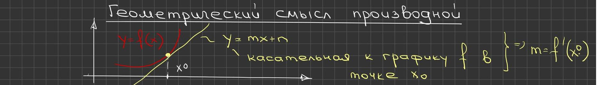
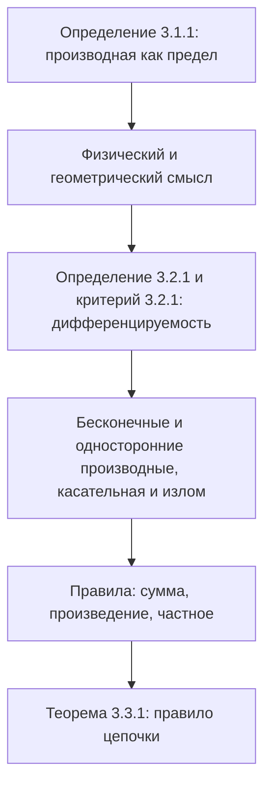

# Лекции 22–23 — Производная, дифференцируемость и правила дифференцирования

[[ru/lectures-2025-26/lecture-21|← Лекция 21]] · [[ru/lectures-2025-26/index|Указатель лекций]] · [[ru/lectures-2025-26/lecture-24-25-26|Лекции 24–26 →]] · [[ru/term-index|Термины и теоремы]] · [[en/lectures-2025-26/lecture-22-23|English]] · [[es/lectures-2025-26/lecture-22-23|Español]]

> [!info] Источник
> `ma25_26_lectures_22-23_notes.pdf` — 27 страниц: печатные слайды с текстовым слоем (страницы 1–5, 7–9, 12–14, 16, 19–21, 24, 25), рукописные страницы без текстового слоя (6, 10, 11, 15, 17, 18, 22, 23, 26, 27). Рукописные страницы переписаны по изображению. Номера страниц PDF указаны в заголовках; печатные слайды пронумерованы в PDF как «1/17»–«17/17».
>
> **Примечание редактора.** Дата лекции взята из нижнего колонтитула слайдов («13 ноября 2025»). Обозначение $\langle a, b\rangle$ — промежуток любого типа.

## Печатные слайды 1–4. Вступление

**Цитата дня (слайд 2).** «ТИПИЧНЫЕ МЕТОДЫ ДОКАЗАТЕЛЬСТВА — 3»:

- *Доказательство убаюкиванием:* «Подробное обоснование будет приведено в главе 7 после развития соответствующей теории … Глава 7: ради простоты предположим, что $z = 0$ (общий случай рассмотрен в Приложении 2) … Приложение 2: Формальное доказательство выходит за рамки данной монографии …»
- *Доказательство древних индусов:* рисунок и надпись «СМОТРИ!»
- *Доказательство в стиле Теренса Тао* (на слайде: «в силе»): «Теорема 3.3.8. Доказательство: см. упражнение 3.4.2. Упражнение 3.4.2: Докажите теорему 3.3.8.»

**Цель лекции.** Определим [[#^def-3-1-1|производную]] и её механический и геометрический смысл. Обсудим [[#^def-3-2-1|дифференцируемость]] и её критерии. Введём понятия бесконечных и [[ru/06-derivatives#6.1 Определение и линейное приближение|односторонних производных]]. Рассмотрим касательную как предел секущих. Обсудим правила дифференцирования, в том числе дифференцирование композиции.

**Глава 3. Дифференциальное исчисление функций одной вещественной переменной** (титульный слайд 4).

## Глава 3, §1. Производная

### Печатный слайд 5 (PDF-стр. 5). Определение производной

> [!definition] Определение 3.1.1
> Пусть $f : \langle a, b\rangle \to \mathbb{R}$, $x_0 \in \langle a, b\rangle$.
>
> $$
> f'(x_0) = \lim_{h \to 0} \frac{f(x_0 + h) - f(x_0)}{h}, \qquad x_0 + h \in \langle a, b\rangle.
> $$

^def-3-1-1

$f'(x_0)$ называется **производной** функции $f$ в точке $x_0$.

### Рукописная страница 6 (PDF-стр. 6). Физический и геометрический смысл производной

**Физический смысл производной.** $f = f(t)$, $t_0$, $t_0 + h$ $\Rightarrow$ $\dfrac{f(t_0 + h) - f(t_0)}{h}$ — средняя скорость изменения функции $f$ на $[t_0, t_0 + h]$; $h \to 0$ $\Rightarrow$ $v_{\text{ср}} \to v_{\text{мгн}}(t_0)$.

| $f(t)$ | $f'(t)$ |
|---|---|
| ① пройденный путь | ① скорость |
| ② скорость | ② ускорение |
| ③ работа | ③ мощность |
| ④ температура | ④ теплопроводность |
| ⑤ импульс | ⑤ сила |

**Геометрический смысл производной** (внизу страницы, жёлтым): на рисунке красная кривая $y = f(x)$ и прямая $y = mx + n$ — касательная к графику $f$ в точке $x_0$ $\Rightarrow$ $m = f'(x_0)$.

## Глава 3, §2. Дифференцируемость функции

### Печатный слайд 7 (PDF-стр. 7). Определение дифференцируемости

> [!definition] Определение 3.2.1
> Пусть $f : \langle a, b\rangle \to \mathbb{R}$, $x_0 \in \langle a, b\rangle$. Функция $f$ называется **дифференцируемой в точке $x_0$**, если существует такое число $k$, что
>
> $$
> f(x) = f(x_0) + k(x - x_0) + o(x - x_0), \qquad (x \to x_0).
> $$

^def-3-2-1

### Печатный слайд 8 (PDF-стр. 8). Критерий дифференцируемости функции в точке

> [!theorem] Теорема 3.2.1
> Предположим, что $f : \langle a, b\rangle \to \mathbb{R}$, $x_0 \in \langle a, b\rangle$, $k \in \mathbb{R}$. Тогда равносильны следующие утверждения:
>
> 1. $f$ дифференцируема в точке $x_0$ и $f'(x_0) = k$.
> 2. Предел $\lim\limits_{x \to x_0} \dfrac{f(x) - f(x_0)}{x - x_0}$ существует и равен $k$.
> 3. Существует функция $F : \langle a, b\rangle \to \mathbb{R}$, [[ru/lectures-2025-26/lecture-16#^def-2-5-1|непрерывная в точке]] $x_0$, для которой $F(x_0) = k$ и $f(x) - f(x_0) = F(x)(x - x_0)$ при $x \in \langle a, b\rangle$.

^thm-3-2-1

### Печатный слайд 9 (PDF-стр. 9). Замечания о характеристиках дифференцируемости

Утверждение 2 удобно тем, что оно даёт способ вычисления производной. Кроме того, представление производной как предела позволяет определить бесконечные производные и односторонние производные.

Утверждение 3, дающее явное выражение приращения функции через приращение аргумента, будет использоваться при выводе правил дифференцирования.

Характеристики дифференцируемости, сформулированные в утверждениях 2 и 3, нельзя перенести на случай функции нескольких переменных, тогда как [[#^def-3-2-1|определение 3.2.1]] имеет многомерный аналог (на слайде: «много мерный»). Именно поэтому мы не использовали утверждение 2 в качестве определения дифференцируемости (на слайде: «определение»), хотя для практических целей оно удобнее.

### Рукописные страницы 10–11 (PDF-стр. 10–11). Доказательство теоремы 3.2.1

**Доказательство ([[#^thm-3-2-1|теорема 3.2.1]]).** Схема на рукописи: ① $\Rightarrow$ ② $\Rightarrow$ ③ $\Rightarrow$ ①.

① $\Rightarrow$ ②: ① означает, что $f(x) - f(x_0) = k(x - x_0) + o(x - x_0)$ при $x \to x_0$, откуда $\dfrac{f(x) - f(x_0)}{x - x_0} = k + \dfrac{o(x - x_0)}{x - x_0} \xrightarrow[x \to x_0]{} k$, где обведённый зелёным член стремится к $0$ при $x \to x_0$ по определению [[ru/lectures-2025-26/lecture-09-10#^def-2-2-1|бесконечно малой]] по сравнению с $(x - x_0)$ («по опр. б.м.»).

② $\Rightarrow$ ③: положим $F(x) = \begin{cases} \dfrac{f(x) - f(x_0)}{x - x_0}, & x \ne x_0, \\ k, & x = x_0. \end{cases}$ В силу ② $\lim\limits_{x \to x_0} \dfrac{f(x) - f(x_0)}{x - x_0} = k = F(x_0)$, т.е. $\lim\limits_{x \to x_0} F(x) = F(x_0)$, т.е. $F$ непрерывна в точке $x_0$, и

$$
F(x)(x - x_0) = \begin{cases} f(x) - f(x_0), & x \ne x_0, \\ k(x - x_0), & x = x_0 \end{cases} = f(x) - f(x_0) \quad \forall x \in \langle a, b\rangle.
$$

③ $\Rightarrow$ ①: в силу ③ $f(x) - f(x_0) = F(x) \cdot (x - x_0)$ $\Rightarrow$

$$
f(x) = f(x_0) + F(x) \cdot (x - x_0) \pm k(x - x_0) = f(x_0) + k(x - x_0) + \underbrace{(F(x) - k)(x - x_0)}_{o(x - x_0)},
$$

(жёлтым:) $F$ непрерывна в точке $x_0$ $\Rightarrow$ $F(x) \xrightarrow[x \to x_0]{} F(x_0) = k$, и мы получаем ①. $\blacksquare$

> [!remark] Примечание редактора
> На рукописи (PDF-стр. 11) в равенстве для $F(x)(x - x_0)$ правая часть записана как «$f(x - x_0)$», а под скобкой $o(x - x_0)$ написано $O(x - x_0)$; выше приведены правильные выражения $f(x) - f(x_0)$ и $o(x - x_0)$.

### Печатный слайд 12 (PDF-стр. 12). Разностное отношение

Дробь $\dfrac{f(x) - f(x_0)}{x - x_0}$ называется **разностным отношением**. Оно имеет следующий физический смысл. Если функция $f$ описывает зависимость координаты движущейся материальной точки от времени, то разностное отношение даёт среднюю скорость точки на отрезке времени между моментами $x_0$ и $x$. Тогда $f'(x_0)$ можно понимать как мгновенную скорость в момент времени $x_0$.

### Печатный слайд 13 (PDF-стр. 13). Бесконечные и односторонние производные

1. **Бесконечные производные.** Будем говорить, что $f'(x_0) = \pm\infty$, если $\lim\limits_{x \to x_0} \dfrac{f(x) - f(x_0)}{x - x_0} = \pm\infty$. Аналогично определяется равенство $f'(x_0) = \infty$. Отметим, что если функция $f$ имеет бесконечную производную в точке $x_0$, то она **не** дифференцируема в этой точке.
2. **Односторонние производные.** Обозначим $f'_{\pm}(x_0) = \lim\limits_{x \to x_0^{\pm}} \dfrac{f(x) - f(x_0)}{x - x_0}$. Если $f'_-(x_0)$ и $f'_+(x_0)$ существуют, то они называются соответственно **левой** и **правой** производными $f$ в точке $x_0$. Дифференцируемость $f$ в точке $x_0 \in (a, b)$ означает, что $f'_-(x_0)$ и $f'_+(x_0)$ конечны и равны между собой. Их общее значение в этом случае есть $f'(x_0)$.

### Печатный слайд 14 (PDF-стр. 14). Касательная как предел секущих

Пусть $x_1 \in \langle a, b\rangle$. Рассмотрим прямую, проходящую через точки $(x_0, f(x_0))$ и $(x_1, f(x_1))$ (назовём её **секущей**). Она задаётся уравнением $y = f(x_0) + k(x_1)(x - x_0)$, где $k(x_1) = \dfrac{f(x_1) - f(x_0)}{x_1 - x_0}$.

Если $f$ дифференцируема в точке $x_0$, то $\lim\limits_{x_1 \to x_0} k(x_1) = f'(x_0)$. Поэтому при $x_1 \to x_0$ секущая, вращаясь вокруг точки $(x_0, f(x_0))$, приближается к прямой $y = f(x_0) + f'(x_0)(x - x_0)$, то есть к **касательной**.

В случае $f'(x_0) = \pm\infty$ угол наклона секущей стремится к $\dfrac\pi2$ соответственно справа или слева, а она сама — к вертикальному положению.

### Рукописная страница 15 (PDF-стр. 15). Рисунки: секущие, касательная, излом

Верхний рисунок: жёлтая кривая-график на $[a, b]$, точки $(x_0, f(x_0))$ и $(x_1, f(x_1))$ (пунктиры к осям), красная и зелёная секущие через эти точки и синяя касательная в точке $x_0$. Внизу слева: зелёный «холм» с синей горизонтальной касательной в вершине (синяя точка). Внизу справа (красным): график $f(x) = |x| = \begin{cases} x, & x \ge 0, \\ -x, & x < 0 \end{cases}$ (на рукописи функция обозначена $Y(x)$) с подписями $f'_+(0) = 1$, $f'_-(0) = -1$.

### Печатный слайд 16 (PDF-стр. 16). Касательная как предел секущих-2

Наконец, если $f'_-(x_0)$ и $f'_+(x_0)$ существуют и различны, то предельное положение секущей зависит от того, с какой стороны $x_1$ приближается к $x_0$ (слева или справа). В этом случае график $f$ имеет **излом**.

На печатном рисунке слайда (подпись точки — $a$ вместо $x_0$): слева — секущие и вертикальная пунктирная прямая $x = a$ с прямым углом (случай бесконечной производной), справа — график с изломом в точке $a$ и два пунктирных предельных положения секущей с отмеченными углами наклона.

### Рукописные страницы 17–18 (PDF-стр. 17–18). Примеры вычисления производной по определению

**Примеры.**

① $f(x) = x^2$, $f : \mathbb{R} \to \mathbb{R}$:

$$
\lim_{x \to a} \frac{f(x) - f(a)}{x - a} = \lim_{x \to a} \frac{x^2 - a^2}{x - a} = \lim_{x \to a} \frac{(x - a)(x + a)}{x - a} = \lim_{x \to a} (x + a) = 2a \Rightarrow f'(a) = 2a
$$

(сомножитель $(x - a)$ на рукописи перечёркнут красным). $\Rightarrow$ $f(x) = x^2$ дифференцируема в любой точке $a \in \mathbb{R}$ и $f'(a) = 2a$.

② $f(x) = \sqrt[3]{x}$, $f : \mathbb{R} \to \mathbb{R}$:

$$
\lim_{x \to 0} \frac{f(x) - f(0)}{x - 0} = \lim_{x \to 0} \frac{x^{1/3}}{x} = \lim_{x \to 0} x^{-2/3} = +\infty
$$

$\Rightarrow$ $f(x) = \sqrt[3]{x}$ не дифференцируема в точке $0$, но $f'(0) = +\infty$.

③ $f(x) = \begin{cases} x^2 \sin\dfrac1x, & x \ne 0, \\ 0, & x = 0: \end{cases}$

$$
\lim_{x \to 0} \frac{f(x) - f(0)}{x - 0} = \lim_{x \to 0} \frac{f(x)}{x} = \lim_{x \to 0} \frac{x^2 \sin\frac1x}{x} = \lim_{x \to 0} x \cdot \sin\frac1x = 0,
$$

где $x$ — бесконечно малая («б.м.», жёлтым), а $\sin\dfrac1x$ — ограниченная функция, т.к. $|\sin t| \le 1$ $\forall t \in \mathbb{R}$ (зелёным). $\Rightarrow$ $f$ дифференцируема в точке $0$ и $f'(0) = 0$.

④ $f(x) = \begin{cases} x \sin\dfrac1x, & x \ne 0, \\ 0, & x = 0: \end{cases}$

$$
\lim_{x \to 0} \frac{f(x) - f(0)}{x - 0} = \lim_{x \to 0} \frac{x \sin\frac1x}{x} = \lim_{x \to 0} \sin\frac1x \text{ — предела нет.}
$$

$f(x)$ не имеет в точке $0$ даже односторонних производных!

### Печатный слайд 19 (PDF-стр. 19). Замечания: дифференцируемость и непрерывность

1. Если функция $f$ дифференцируема в точке $x_0$, то она непрерывна в точке $x_0$. Действительно, $f(x) - f(x_0) = f'(x_0)(x - x_0) + o(x - x_0) \to 0$ ($x \to x_0$).
2. Обратить замечание 1 нельзя. Более того, справедлив более сильный факт, впервые установленный Вейерштрассом: существует непрерывная на $\mathbb{R}$ функция, не дифференцируемая ни в одной точке.

## Глава 3, §3. Правила дифференцирования

### Печатный слайд 20 (PDF-стр. 20). Вступление к правилам дифференцирования

Производную дифференцируемой функции можно находить, вычисляя предел её разностного отношения. Указанный способ даёт принципиальную возможность продифференцировать функцию, однако для практического применения он неудобен. Далее мы установим связь операции дифференцирования с другими операциями, производимыми над функциями, — композициями и арифметическими действиями.

### Печатный слайд 21 (PDF-стр. 21). Правила дифференцирования

1. $f$ дифференцируема в точке $x$, $\lambda \in \mathbb{R}$. Тогда $g(x) = \lambda f(x)$ дифференцируема в точке $x$ и $g'(x) = \lambda f'(x)$.
2. $f$ и $g$ дифференцируемы в точке $x$. Тогда $f \pm g$ и $fg$ дифференцируемы в той же точке и $(f \pm g)'(x) = f'(x) \pm g'(x)$, $(fg)'(x) = f'(x) g(x) + f(x) g'(x)$.
3. $f$ и $g$ дифференцируемы в точке $x$, $g(x) \ne 0$. Тогда $\dfrac{f}{g}$ дифференцируема в той же точке и $\left(\dfrac{f}{g}\right)'(x) = \dfrac{f'(x) g(x) - f(x) g'(x)}{(g(x))^2}$.

### Рукописные страницы 22–23 (PDF-стр. 22–23). Доказательство правил для произведения и частного

**Доказательство: ②** (произведение; жёлтым в числителе приписано и отнято $f(x_0) g(x)$):

$$
\lim_{x \to x_0} \frac{f(x) g(x) - f(x_0) g(x_0) \mp f(x_0) g(x)}{x - x_0} = \lim_{x \to x_0} \frac{f(x) g(x) - f(x_0) g(x)}{x - x_0} + \lim_{x \to x_0} \frac{f(x_0) g(x) - f(x_0) g(x_0)}{x - x_0}
$$

$$
= \lim_{x \to x_0} \frac{f(x) - f(x_0)}{x - x_0} \cdot g(x) + \lim_{x \to x_0} f(x_0) \cdot \frac{g(x) - g(x_0)}{x - x_0} = \lim_{x \to x_0} \frac{f(x) - f(x_0)}{x - x_0} \cdot \lim_{x \to x_0} g(x) + \lim_{x \to x_0} f(x_0) \cdot \lim_{x \to x_0} \frac{g(x) - g(x_0)}{x - x_0},
$$

где (подписи на рукописи): первый предел $= f'(x_0)$, т.к. $f$ дифференцируема в точке $x_0$ (красная рамка); $\lim\limits_{x \to x_0} g(x) = g(x_0)$, т.к. $g$ дифференцируема в точке $x_0$ $\Rightarrow$ $g$ непрерывна в точке $x_0$ $\Rightarrow$ а для непрерывной функции $\lim\limits_{x \to x_0} g(x) = g(x_0)$ (зелёный овал); $\lim\limits_{x \to x_0} f(x_0) = f(x_0)$, т.к. $f(x_0) = \mathrm{const}$ (жёлтый овал); последний предел $= g'(x_0)$, т.к. $g$ дифференцируема в точке $x_0$ (красная рамка).

Итак, $(f \cdot g)'(x_0) = \lim\limits_{x \to x_0} \dfrac{f(x) g(x) - f(x_0) g(x_0)}{x - x_0} = f'(x_0) g(x_0) + f(x_0) g'(x_0)$. ✓

③ (частное):

$$
\lim_{x \to x_0} \frac{\left(\frac{f}{g}\right)(x) - \left(\frac{f}{g}\right)(x_0)}{x - x_0} = \lim_{x \to x_0} \frac{f(x) g(x_0) - f(x_0) g(x)}{(x - x_0) g(x) g(x_0)} = \frac{\lim\limits_{x \to x_0} \dfrac{f(x) g(x_0) - f(x_0) g(x)}{x - x_0}}{\lim\limits_{x \to x_0} g(x) g(x_0)} = \frac{f'(x_0) g(x_0) - f(x_0) g'(x_0)}{g^2(x_0)}. \quad \checkmark
$$

Здесь знаменатель: $\lim\limits_{x \to x_0} g(x) \cdot g(x_0) = g(x_0) g(x_0) = g^2(x_0)$ (зелёная рамка), а числитель (жёлтым и синим внизу страницы): приписав и отняв $f(x_0) g(x_0)$ (розовым),

$$
\lim_{x \to x_0} \frac{f(x) g(x_0) - f(x_0) g(x) \mp f(x_0) g(x_0)}{x - x_0} = \underbrace{\lim_{x \to x_0} \frac{f(x) g(x_0) - f(x_0) g(x_0)}{x - x_0}}_{=\, f'(x_0) \cdot g(x_0)} - \underbrace{\lim_{x \to x_0} \frac{f(x_0) g(x) - f(x_0) g(x_0)}{x - x_0}}_{=\, f(x_0) \cdot g'(x_0)}.
$$

(На рукописи разбираются произведение и частное; сумма/разность и умножение на постоянную аналогичны.)

### Печатный слайд 24 (PDF-стр. 24). Дифференцирование композиции

> [!theorem] Теорема 3.3.1
> Пусть $f : \langle A, B\rangle \to \langle C, D\rangle$, $g : \langle C, D\rangle \to \mathbb{R}$, $a \in \langle A, B\rangle$. Если $f$ дифференцируема в точке $a$ и $g$ дифференцируема в точке $f(a)$, то $g \circ f$ дифференцируема в точке $a$ и $(g \circ f)'(a) = g'(f(a)) \cdot f'(a)$.

^thm-3-3-1

### Печатный слайд 25 (PDF-стр. 25). Замечания: правило цепочки

1. Для линейных функций $f$ и $g$ утверждение [[#^thm-3-3-1|теоремы 3.3.1]] очевидно, поскольку их композиция будет снова линейной функцией, угловой коэффициент которой есть произведение угловых коэффициентов $f$ и $g$, то есть их производных.
2. Правило дифференцирования композиции легко обобщается на случай нескольких функций: [[#^thm-3-3-1|производная композиции]] равна произведению производных всех функций в соответствующих точках. Например, для трёх функций формула примет вид $(h \circ g \circ f)'(a) = h'((g \circ f)(a)) \cdot g'(f(a)) \cdot f'(a)$. Поэтому [[#^thm-3-3-1|теорему 3.3.1]] называют ещё **правилом цепочки**.

### Рукописные страницы 26–27 (PDF-стр. 26–27). Линейный случай и доказательство теоремы 3.3.1

(Верх страницы 26 — иллюстрация замечания 1:) $f(x) = mx + n$, $g(y) = \alpha y + \beta$; $(g \circ f)(x) = g(f(x)) = \alpha(mx + n) + \beta = \alpha m x + \alpha n + \beta$; $(g \circ f)'(x) = \alpha \cdot m = \underbrace{g'(f(x))}_{= \alpha} \cdot \underbrace{f'(x)}_{= m}$. ✓

**Доказательство ([[#^thm-3-3-1|теорема 3.3.1]]).** Воспользуемся третьим утверждением из критерия дифференцируемости ([[#^thm-3-2-1|теорема 3.2.1]]).

$f$ дифференцируема в точке $a$ $\iff$ $\exists F : \langle A, B\rangle \to \mathbb{R}$: $F$ непрерывна в точке $a$, $F(a) = f'(a)$, $f(x) - f(a) = F(x) \cdot (x - a)$ $\forall x \in \langle A, B\rangle$.

$g$ дифференцируема в точке $f(a)$ $\iff$ $\exists G : \langle C, D\rangle \to \mathbb{R}$: $G$ непрерывна в точке $b = f(a)$, $G(b) = g'(b)$, $g(y) - g(b) = G(y) \cdot (y - b)$ $\forall y \in \langle C, D\rangle$.

Тогда при $y = f(x)$:

$$
(g \circ f)(x) - (g \circ f)(a) = g(f(x)) - g(f(a)) = G(f(x)) \cdot (f(x) - f(a)) = \underbrace{G(f(x)) \cdot F(x)}_{=\, H(x)} \cdot (x - a).
$$

$\begin{cases} F \text{ непрерывна в точке } a \\ G \text{ непрерывна в точке } f(a) \end{cases} \Rightarrow$ $H$ непрерывна в точке $a$.

Итак, мы имеем: существует $H : \langle A, B\rangle \to \mathbb{R}$ такая, что $H$ непрерывна в точке $a$, $(g \circ f)(x) - (g \circ f)(a) = H(x) \cdot (x - a)$ и

$$
H(a) = \underbrace{G(f(a))}_{g'(f(a))} \cdot \underbrace{F(a)}_{f'(a)} = g'(f(a)) \cdot f'(a).
$$

С другой стороны, $H(a) = (g \circ f)'(a)$. $\blacksquare$

## Структура лекции

## Служебные страницы

- Страница 1 — титульная; страница 2 — «цитата дня»; страница 3 — цель лекции; страница 4 — титульный слайд главы 3.
- Доказательство [[#^thm-3-2-1|теоремы 3.2.1]]: PDF-стр. 10 (① ⇒ ② и ② ⇒ ③) и 11 (③ ⇒ ①).
