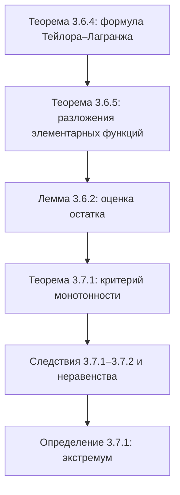

# Лекции 29–30 — Формула Тейлора–Лагранжа, монотонность и экстремумы функций

[[ru/lectures-2025-26/lecture-27-28|← Лекции 27–28]] · [[ru/lectures-2025-26/index|Указатель лекций]] · [[ru/lectures-2025-26/lecture-31-32|Лекции 31–32 →]] · [[ru/term-index|Термины и теоремы]] · [[en/lectures-2025-26/lecture-29-30|English]] · [[es/lectures-2025-26/lecture-29-30|Español]]

> [!info] Источник
> `ma25_26-lectures_29-30_notes.pdf` — 29 страниц: печатные слайды с текстовым слоем (стр. 1–5, 9–12, 14, 17–19, 22, 24, 27–29) и рукописные страницы без текстового слоя (6–8, 13, 15, 16, 20, 21, 23, 25, 26). Рукописные страницы расшифрованы по изображению. В заголовках указаны номер печатного слайда (всего 18) и номер страницы PDF.
>
> **Примечание редактора.** Дата лекции взята из подвала слайдов («11 декабря 2025»). [[ru/lectures-2025-26/lecture-27-28#^thm-3-6-3|Остаточный член]]: $R_{a,n}f(x) = f(x) - \sum\limits_{k=0}^{n} \dfrac{f^{(k)}(a)}{k!} (x - a)^k$ (см. замечание 2 в лекциях 27–28).

## Печатные слайды 1–3 (стр. PDF 1–3). Введение

**Цитата дня (слайд 2).** Фото Чеширского кота с подписью внутри изображения: «Жизнь у нас интересная, но нервная. Поэтому мы весёлые, но злые. 😊»

**Цель лекции (слайд 3).**

- Продолжим обсуждение формулы Тейлора (формула Тейлора-Лагранжа и оценка остатка).
- Найдем ражложения (так на слайде) Тейлора-Пеано для элементарных функций.
- Исследуем геометрические свойства функций: монотонность и экстремумы.

## Глава 3, §6. Формула Тейлора (продолжение)

### Печатный слайд 4 (стр. PDF 4). Формула Тейлора-Лагранжа

Пусть $a, x \in \mathbb{R}$, $a \ne x$. Обозначим через $\Delta_{a,x}$ отрезок с концами $a$ и $x$, а через $\widetilde{\Delta}_{a,x}$ — интервал с концами $a$ и $x$.

> [!theorem] Теорема 3.6.4
> Пусть $n \in \mathbb{Z}_+$, функция $f$ $n + 1$ раз дифференцируема на $\langle A, B\rangle$, $a, x \in \langle A, B\rangle$. Тогда найдется точка $c \in \widetilde{\Delta}_{a,x}$, для которой
>
> $$
> f(x) = \sum_{k=0}^{n} \frac{f^{(k)}(a)}{k!} (x - a)^k + \frac{f^{(n+1)}(c)}{(n+1)!} (x - a)^{n+1}.
> $$

^thm-3-6-4

### Печатный слайд 5 (стр. PDF 5). Замечания

- Утверждение [[#^thm-3-6-4|теоремы 3.6.4]] можно переписать в следующем виде: $\exists \theta \in (0, 1)$ такое, что

$$
f(x) = \sum_{k=0}^{n} \frac{f^{(k)}(a)}{k!} (x - a)^k + \frac{f^{(n+1)}(a + \theta(x - a))}{(n+1)!} (x - a)^{n+1}.
$$

- Условия [[#^thm-3-6-4|теоремы 3.6.4]] можно ослабить. Достаточно было бы предположить, что $f \in C^n(\Delta_{a,x})$ и $f^{(n)}$ [[ru/lectures-2025-26/lecture-22-23#^def-3-2-1|дифференцируема]] на $\widetilde{\Delta}_{a,x}$.
- [[ru/lectures-2025-26/lecture-27-28#^thm-3-6-3|Теорема 3.6.3]] будет следовать из формулы Тейлора-Лагранжа, если в формулировке теоремы наложить на функцию следующее более сильное условие: $\exists \delta > 0$ такое, что $f$ $n$ раз дифференцируема на $E \cap (a - \delta, a + \delta)$ и $f^{(n)}$ [[ru/lectures-2025-26/lecture-16#^def-2-5-1|непрерывна в точке]] $a$.

### Рукописные страницы (стр. PDF 6–8). Доказательство теоремы 3.6.4

**Доказательство ([[#^thm-3-6-4|теорема 3.6.4]]).** Для $t \in \Delta_{a,x}$ положим

$$
\varphi(t) = (x - t)^{n+1}, \qquad F(t) = R_{t,n}f(x) = f(x) - f(t) - \sum_{k=1}^{n} \frac{f^{(k)}(t)}{k!} (x - t)^k.
$$

Тогда при $t \in \widetilde{\Delta}_{a,x}$

$$
\begin{aligned}
F'(t) &= -f'(t) - \sum_{k=1}^{n} \left( \frac{f^{(k+1)}(t)}{k!} (x - t)^k - \frac{f^{(k)}(t)}{k!} k (x - t)^{k-1} \right) \\
&= -f'(t) + \sum_{k=1}^{n} \frac{f^{(k)}(t)}{(k-1)!} (x - t)^{k-1} - \sum_{k=1}^{n} \frac{f^{(k+1)}(t)}{k!} (x - t)^k.
\end{aligned}
$$

Переиндексируя первую сумму заменой $m = k - 1$ (подпись розовым), получаем

$$
F'(t) = -f'(t) + \sum_{m=0}^{n-1} \frac{f^{(m+1)}(t)}{m!} (x - t)^m - \sum_{k=1}^{n} \frac{f^{(k+1)}(t)}{k!} (x - t)^k,
$$

где под суммами подписаны первые слагаемые: $\dfrac{f^{(1)}(t)}{1} (x - t)^0 + \dfrac{f''(t)}{1} (x - t) + \ldots$ и $\dfrac{f''(t)}{1} (x - t) + \dfrac{f'''(t)}{2!} (x - t)^2 + \ldots$; совпадающие слагаемые зачёркнуты красным. Итого всё сокращается, кроме крайних членов:

$$
F'(t) = -f'(t) + f'(t) - \frac{f^{(n+1)}(t)}{n!} (x - t)^n = -\frac{f^{(n+1)}(t)}{n!} (x - t)^n.
$$

Заметим, что $F(x) = 0$ (и $\varphi(x) = 0$, $\varphi(a) = (x - a)^{n+1}$) $\Rightarrow$ по теореме Коши $\exists c \in \widetilde{\Delta}_{a,x}$ такое, что

$$
\frac{F(a)}{(x - a)^{n+1}} = \frac{F(a) - F(x)}{\varphi(a) - \varphi(x)} = \frac{F'(c)}{\varphi'(c)} \Rightarrow \frac{F(a)}{(x - a)^{n+1}} = \frac{-\dfrac{f^{(n+1)}(c)}{n!} (x - c)^n}{-(n+1) (x - c)^n} = \frac{f^{(n+1)}(c)}{n! \, (n+1)} = \frac{f^{(n+1)}(c)}{(n+1)!},
$$

где (выкладка на той же странице) $\varphi(t) = (x - t)^{n+1}$ $\Rightarrow$ $\varphi'(t) = (n+1)(x - t)^n (-1)$ $\Rightarrow$ $\varphi'(c) = -(n+1)(x - c)^n$, а множители $(x - c)^n$ зачёркнуты красным. Значит,

$$
F(a) = \frac{f^{(n+1)}(c)}{(n+1)!} (x - a)^{n+1}.
$$

С другой стороны, $F(t) = f(x) - f(t) - \sum\limits_{k=1}^{n} \dfrac{f^{(k)}(t)}{k!} (x - t)^k$ $\Rightarrow$ $F(a) = f(x) - f(a) - \sum\limits_{k=1}^{n} \dfrac{f^{(k)}(a)}{k!} (x - a)^k$. Сравнивая, получаем (стр. PDF 8)

$$
f(x) = f(a) + \sum_{k=1}^{n} \frac{f^{(k)}(a)}{k!} (x - a)^k + \frac{f^{(n+1)}(c)}{(n+1)!} (x - a)^{n+1}. \qquad \blacksquare
$$

### Печатные слайды 6–8 (стр. PDF 9–11). Разложения Тейлора-Пеано для элементарных функций

> [!theorem] Теорема 3.6.5
> Пусть $n \in \mathbb{Z}_+$. При $x \mapsto 0$ справедливы следующие утверждения:
>
> 1. $e^x = \sum\limits_{k=0}^{n} \dfrac{x^k}{k!} + o(x^n) = 1 + \dfrac{x}{1!} + \dfrac{x^2}{2!} + \cdots + \dfrac{x^n}{n!} + o(x^n)$.
> 2. $\sin x = \sum\limits_{k=0}^{n} \dfrac{(-1)^k x^{2k+1}}{(2k+1)!} + o\big(x^{2n+2}\big) = x - \dfrac{x^3}{3!} + \dfrac{x^5}{5!} - \cdots + (-1)^n \dfrac{x^{2n+1}}{(2n+1)!} + o\big(x^{2n+2}\big)$.
> 3. $\cos x = \sum\limits_{k=0}^{n} \dfrac{(-1)^k x^{2k}}{(2k)!} + o\big(x^{2n+1}\big) = 1 - \dfrac{x^2}{2!} + \dfrac{x^4}{4!} - \cdots + (-1)^n \dfrac{x^{2n}}{(2n)!} + o\big(x^{2n+1}\big)$.
> 4. $\ln(1 + x) = \sum\limits_{k=1}^{n} \dfrac{(-1)^{k+1} x^k}{k} + o(x^n) = x - \dfrac{x^2}{2} + \dfrac{x^3}{3} - \cdots + (-1)^{n+1} \dfrac{x^n}{n} + o(x^n)$.
> 5. Пусть $\alpha \in \mathbb{R}$. Положим $C^k_{\alpha} = \dfrac{\alpha(\alpha - 1) \cdots (\alpha - k + 1)}{k!}$ при $k \in \mathbb{Z}_+$. Тогда
>
> $$
> (1 + x)^{\alpha} = \sum_{k=0}^{n} C^k_{\alpha} x^k + o(x^n) = 1 + \frac{\alpha}{1!} x + \frac{\alpha(\alpha - 1)}{2!} x^2 + \cdots + \frac{\alpha(\alpha - 1) \cdots (\alpha - n + 1)}{n!} x^n + o(x^n).
> $$

^thm-3-6-5

### Печатный слайд 9 (стр. PDF 12). Замечания

- Если $\alpha \in \mathbb{Z}_+$ и $\alpha > k$, то $C^k_{\alpha}$ является биномиальным коэффициентом, что и оправдывает выбранное обозначение. Величины $C^k_{\alpha}$ определены при любых $\alpha \in \mathbb{R}$ и называются обобщенными биномиальными коэффициентами.
- При $\alpha \in \mathbb{N}$ функция $f(x) = (1 + x)^{\alpha}$ является многочленом степени $\alpha$, поэтому $f \equiv T_{0,\alpha} f$. В силу предыдущего замечания это тождество есть не что иное, как бином Ньютона. Поэтому формулу Тейлора-Пеано для $(1 + x)^{\alpha}$ называют биномиальным разложением.

### Рукописная страница (стр. PDF 13). Доказательство пунктов 1–2 теоремы 3.6.5

**Доказательство.**

① $f(x) = e^x$: $f^{(k)}(x) = e^x$ и $f^{(k)}(0) = e^0 = 1$ $\forall k \in \mathbb{N}$, $\forall x \in \mathbb{R}$ $\Rightarrow$ $T_{0,n} f(x) = \sum\limits_{k=0}^{n} \dfrac{x^k}{k!}$.

② Пусть $f(x) = \sin x$. Докажем сначала, что $f^{(m)}(x) = \sin\left(x + \dfrac{\pi m}{2}\right)$ $\forall m \in \mathbb{Z}_+$ (по [[ru/01-logic-sets-functions#^example-induction|индукции]]). Тогда

$$
f^{(m)}(0) = \sin\left(\frac{\pi m}{2}\right) = \begin{cases} 0, & m = 2k, \\ (-1)^k, & m = 2k + 1. \end{cases} \qquad \blacksquare
$$

### Печатный слайд 10 (стр. PDF 14). Оценка остатка в формуле Тейлора

> [!lemma] Лемма 3.6.2
> Пусть функция $f$ удовлетворяет условиям теоремы 3.6.4. Предположим, что существует такое число $M > 0$, что $|f^{(n+1)}(t)| \le M$ для любого $t \in \widetilde{\Delta}_{a,x}$. Тогда
>
> $$
> \left| R_{a,n}f(x) \right| \le \frac{M |x - a|^{n+1}}{(n+1)!}.
> $$

^lem-3-6-2

### Рукописная страница (стр. PDF 15). Доказательство леммы 3.6.2

**Доказательство ([[#^lem-3-6-2|лемма 3.6.2]]).** По формуле Тейлора-Лагранжа $R_{a,n}f(x) = \dfrac{f^{(n+1)}(c)}{(n+1)!} (x - a)^{n+1}$ при некотором $c \in \widetilde{\Delta}_{a,x}$. Тогда

$$
\left| R_{a,n}f(x) \right| = \left| \frac{f^{(n+1)}(c)}{(n+1)!} (x - a)^{n+1} \right| = \frac{|f^{(n+1)}(c)|}{(n+1)!} |x - a|^{n+1} \le \frac{M}{(n+1)!} |x - a|^{n+1},
$$

где (зелёным) по условию $|f^{(n+1)}(c)| \le M$. $\blacksquare$

### Рукописная страница (стр. PDF 16). Примеры оценки остатка

**Примеры.** Пусть $n \in \mathbb{Z}_+$ и $x \in \mathbb{R}$.

① $f(t) = e^t$ $\Rightarrow$ $\left| R_{0,n}f(x) \right| \le \dfrac{e^{\max\{x, 0\}} \cdot |x|^{n+1}}{(n+1)!}$, так как $\sup\limits_{t \in \widetilde{\Delta}_{0,x}} \left| f^{(n+1)}(t) \right| = \sup\limits_{t \in \widetilde{\Delta}_{0,x}} e^t = e^{\max\{x, 0\}}$ (обведено зелёным).

② Если $f(t) = \sin t$ $\Rightarrow$ $\left| f^{(n+1)}(t) \right| = \left| \cos\left(t + \dfrac{\pi n}{2}\right) \right| \le 1$ $\forall t \in \mathbb{R}$ $\Rightarrow$ $\left| R_{0,n}f(x) \right| \le \dfrac{|x|^{n+1}}{(n+1)!}$.

## Глава 3, §7. Монотонность и экстремумы функций

### Печатный слайд 11 (стр. PDF 17). §7. Монотонность и экстремумы функций

Важным приложением [[ru/lectures-2025-26/lecture-24-25-26#^def-3-3-1|дифференциального]] исчисления является исследование функций и построение их графиков. Вначале мы разберем понятия монотонности и экстремума функции, тесно связанные с первой [[ru/lectures-2025-26/lecture-22-23#^def-3-1-1|производной]].

### Печатный слайд 12 (стр. PDF 18). Условия монотонности функции на промежутке

> [!theorem] Теорема 3.7.1
> Пусть функция $f$ непрерывна на $\langle A, B\rangle$ и дифференцируема на $(A, B)$. Справедливы следующие утверждения:
>
> 1. Функция $f$ возрастает на $\langle A, B\rangle$ тогда и только тогда, когда $f'(x) \ge 0$ для любого $x \in (A, B)$.
> 2. Если $f'(x) > 0$ при всех $x \in (A, B)$, то $f$ строго возрастает на $\langle A, B\rangle$.

^thm-3-7-1

### Печатный слайд 13 (стр. PDF 19). Замечания

1. Первое утверждение [[#^thm-3-7-1|теоремы 3.7.1]] называется критерием возрастания $f$ на $\langle A, B\rangle$. Второе утверждение дает лишь достаточное условие строгого возрастания на $\langle A, B\rangle$. Необходимым оно не является.
2. Поменяв в формулировке теоремы знаки неравенств на противоположные, мы получим соответственно критерий убывания и достаточное условие строгого убывания $f$ на $\langle A, B\rangle$. Для их доказательства достаточно применить [[#^thm-3-7-1|теорему 3.7.1]] к функции $(-f)$.

### Рукописные страницы (стр. PDF 20–21). Доказательство теоремы 3.7.1

**Доказательство ([[#^thm-3-7-1|теорема 3.7.1]]), утв. 1.**

*Необходимость* ($\Rightarrow$; на доске — кружок «Н»). Пусть $x, a \in (A, B)$, $x \ne a$.

Если $x > a$ $\Rightarrow$ $f(x) \ge f(a)$ [т.к. $f \nearrow$ — зелёным] $\Rightarrow$ $\dfrac{f(x) - f(a)}{x - a} \ge 0$.

Если $x < a$ $\Rightarrow$ $f(x) \le f(a)$ $\Rightarrow$ $\dfrac{f(x) - f(a)}{x - a} \ge 0$.

Поэтому $f'(a) = \lim\limits_{x \mapsto a} \dfrac{f(x) - f(a)}{x - a} \ge 0$ $\forall a \in (A, B)$.

*Достаточность* ($\Leftarrow$; на доске — кружок «Д», «Утв. 1 + Утв. 2» в рамке). Справа розовым схема: ① $f'(x) \ge 0$ $\forall x \in (A, B)$ $\Rightarrow$ $f \nearrow$; ② $f'(x) > 0$ $\forall x \in (A, B)$ $\Rightarrow$ $f$ строго $\nearrow$.

Пусть $a, b \in \langle A, B\rangle$, $b > a$ (подчёркнуто бирюзовым). Воспользуемся [[ru/lectures-2025-26/lecture-24-25-26#^thm-3-4-3|формулой конечных приращений]]: $\exists c \in (a, b)$: $f(b) - f(a) = f'(c)(b - a)$.

(Стр. PDF 21.) **Утв. 1** $\Rightarrow$ мы знаем, что $f'(c) \ge 0$ и $b - a > 0$ (выбрали $b > a$) $\Rightarrow$ $f(b) - f(a) = \underbrace{f'(c)}_{\ge 0} \cdot \underbrace{(b - a)}_{> 0} \ge 0$ $\Rightarrow$ $f(b) \ge f(a)$ (подчёркнуто бирюзовым) $\Rightarrow$ $f \nearrow$ на $\langle A, B\rangle$.

**Утв. 2** $\Rightarrow$ мы знаем, что $f'(c) > 0$ и $b - a > 0$ $\Rightarrow$ $f(b) - f(a) = \underbrace{f'(c)}_{> 0} \underbrace{(b - a)}_{> 0} > 0$ $\Rightarrow$ $f(b) > f(a)$ (подчёркнуто бирюзовым) $\Rightarrow$ $f$ строго возрастает на $\langle A, B\rangle$. $\blacksquare$

### Печатный слайд 14 (стр. PDF 22). Критерий постоянства функции

> [!corollary] Следствие 3.7.1
> Пусть функция $f$ непрерывна на $\langle A, B\rangle$ и дифференцируема на $(A, B)$. Тогда равносильны следующие утверждения:
>
> 1. $f$ постоянна на $\langle A, B\rangle$.
> 2. $f'(x) = 0$ при всех $x \in (A, B)$.

^cor-3-7-1

### Рукописная страница (стр. PDF 23). Доказательство следствия 3.7.1

**Доказательство ([[#^cor-3-7-1|следствие 3.7.1]]).** ① $\Rightarrow$ ② — очевидно!

② $\Rightarrow$ ①: Пусть $f'(x) = 0$ $\forall x \in (A, B)$. Можно сказать, что $f'(x) \ge 0$ $\forall x \in (A, B)$ (зелёным) $\Rightarrow$ по [[#^thm-3-7-1|теореме 3.7.1]] $f \nearrow$ на $\langle A, B\rangle$ $\Rightarrow$ $\left. \begin{aligned} x_1, x_2 &\in \langle A, B\rangle \\ x_1 &< x_2 \end{aligned} \right\} \Rightarrow f(x_1) \le f(x_2)$.

Но можно также сказать, что $f'(x) \le 0$ $\forall x \in (A, B)$ (жёлто-зелёным) $\Rightarrow$ $f \searrow$ на $\langle A, B\rangle$ $\Rightarrow$ $\left. \begin{aligned} x_1, x_2 &\in \langle A, B\rangle \\ x_1 &< x_2 \end{aligned} \right\} \Rightarrow f(x_1) \ge f(x_2)$.

Итак, мы имеем

$$
\left. \begin{aligned} x_1, x_2 \in \langle A, B\rangle \\ x_1 < x_2 \end{aligned} \right\} \Rightarrow \left\{ \begin{aligned} f(x_1) &\le f(x_2) \\ f(x_1) &\ge f(x_2) \end{aligned} \right\} \Rightarrow f(x_1) = f(x_2). \qquad \blacksquare
$$

### Печатный слайд 15 (стр. PDF 24). О сравнении функций на отрезке

> [!corollary] Следствие 3.7.2
> Пусть функции $f$ и $g$ непрерывны на $[A, B]$ и дифференцируемы на $(A, B)$. Если $f(A) = g(A)$ и $f'(x) > g'(x)$ при всех $x \in (A, B)$, то $f(x) > g(x)$ при любом $x \in (A, B]$.

^cor-3-7-2

### Рукописная страница (стр. PDF 25). Доказательство следствия 3.7.2 и упражнение

**Доказательство ([[#^cor-3-7-2|следствие 3.7.2]]).** Пусть $h = f - g$ $\Rightarrow$ $h'(x) > 0$ $\forall x \in (A, B)$ $\Rightarrow$ по утв. 2 [[#^thm-3-7-1|теоремы 3.7.1]] $h$ строго возрастает на $[A, B]$ $\Rightarrow$ $\forall x \in (A, B)$ имеем $h(x) > h(A) = 0$ $\Rightarrow$ $\forall x \in (A, B)$ $f(x) > g(x)$. $\blacksquare$

**Упр.** Сформулировать утв., если $f(B) = g(B)$.

[[#^cor-3-7-2|Следствие 3.7.2]] полезно при доказательстве неравенств.

### Рукописная страница (стр. PDF 26). Примеры: доказательство неравенств

**Примеры.**

1 (в рамке) $\cos x > 1 - \dfrac{x^2}{2}$ $\forall x > 0$. Положим $f(x) = \cos x$, $g(x) = 1 - \dfrac{x^2}{2}$. Тогда $f'(x) - g'(x) = -\sin x - \left(-\dfrac{2x}{2}\right) = x - \sin x > 0$ при $x > 0$ и $f(0) = g(0) = 1$; применяем [[#^cor-3-7-2|следствие 3.7.2]].

2 (в рамке) $\sin x > x - \dfrac{x^3}{6}$ $\forall x > 0$. Положим $f(x) = \sin x$, $g(x) = x - \dfrac{x^3}{6}$. Тогда $f'(x) - g'(x) = \cos x - 1 + \dfrac{x^2}{2} > 0$ $\forall x > 0$ (зелёной скобкой подписано: «в силу примера 1»), и применяем [[#^cor-3-7-2|следствие 3.7.2]].

### Печатный слайд 16 (стр. PDF 27). Экстремум функции

> [!definition] Определение 3.7.1
> Предположим, что $E \subset \mathbb{R}$, $f : E \to \mathbb{R}$, $a \in E$.
>
> 1. Пусть существует $\delta > 0$: при всех $x \in (a - \delta, a + \delta) \cap E$ выполняется неравенство $f(x) \ge f(a)$. Тогда $a$ называется точкой минимума $f$. Если же $f(x) \le f(a)$ при всех $x \in (a - \delta, a + \delta) \cap E$, то $a$ называется точкой максимума $f$.
> 2. Пусть существует $\delta > 0$: при всех $x \in (a - \delta, a + \delta) \cap E \setminus \{a\}$ выполняется неравенство $f(x) > f(a)$. Тогда $a$ называется точкой строгого минимума $f$. Если же $f(x) < f(a)$ при всех $x \in (a - \delta, a + \delta) \cap E \setminus \{a\}$, то $a$ называется точкой строгого максимума $f$.
> 3. Если $a$ является точкой минимума или максимума функции $f$, то $a$ называется точкой экстремума $f$.

^def-3-7-1

### Печатный слайд 17 (стр. PDF 28). Замечания

- Не следует думать, что в точке минимума реализуется наименьшее значение функции. Оно будет наименьшим лишь локально, то есть в некоторой окрестности точки минимума. Аналогичное замечание справедливо и для точек максимума.
- В [[#^def-3-7-1|определении 3.7.1]] на функцию $f$ не накладывалось никаких ограничений. В дальнейшем мы обычно будем предполагать, что $f$ дифференцируема в точке $a$.
- Поскольку понятие экстремума является локальным, мы можем ограничиться рассмотрением функций, заданных на промежутке.

### Печатный слайд 18 (стр. PDF 29). Задача поиска точек экстремума

Решение этой задачи производится в два этапа.

1. С помощью необходимого условия экстремума мы отбрасываем точки, в которых экстремума заведомо не может быть.
2. Оставшиеся точки исследуются с помощью достаточного условия экстремума.

## Структура лекции

## Служебные страницы

- Стр. PDF 1 — титульная; стр. 2 — цитата дня (фото вставлено выше); стр. 3 — цель лекции.
- Доказательство [[#^thm-3-6-4|теоремы 3.6.4]] занимает стр. 6–8; доказательство [[#^thm-3-7-1|теоремы 3.7.1]] — стр. 20–21.
