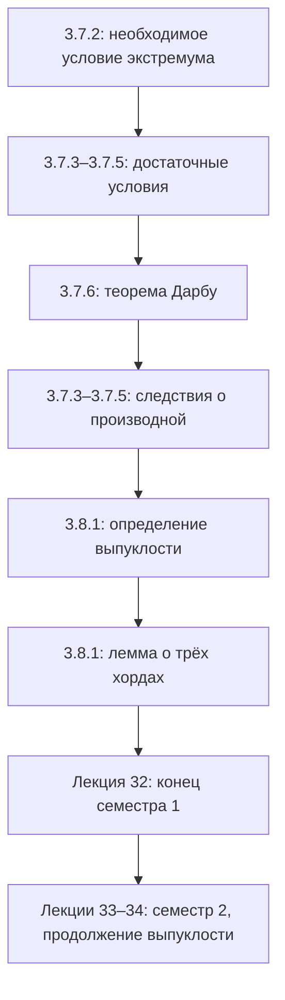

# Лекции 31–32 — Экстремумы, теорема Дарбу и выпуклые функции

[[ru/lectures-2025-26/lecture-29-30|← Лекции 29–30]] · [[ru/lectures-2025-26/index|Указатель лекций]] · [[ru/lectures-2025-26/lecture-33-34|Лекции 33–34 →]] · [[ru/term-index|Термины и теоремы]] · [[en/lectures-2025-26/lecture-31-32|English]] · [[es/lectures-2025-26/lecture-31-32|Español]]

> [!info] Источник
> `ma25_26-lectures_31-32_notes.pdf` — 29 страниц, 20 печатных слайдов. Рукописные страницы: 6, 10, 12, 15, 17–19, 27–28; расшифрованы также рукописные пометки на слайдах. Номер слайда и номер страницы PDF различаются. Дата — из титульного слайда и подвалов: 18 декабря 2025.
>
> **Граница семестров.** Лекцией **32 заканчивается семестр 1**. Семестр 2 — лекции **33–64**. Начатый здесь §3.8 повторяется и продолжается в [[ru/lectures-2025-26/lecture-33-34|лекциях 33–34]]; дублирующий материал семестра 2 уже есть в [[ru/lectures/index|папке `ru/lectures/`]], начиная с [[ru/lectures/01-convexity-3-8|раздела о выпуклости]].
>
> **Соглашения.** $I=\langle A,B\rangle$ — промежуток с любым допустимым включением концов. «Возрастает» в нестрогих утверждениях означает «не убывает». Исправления опечаток и дополнительные пояснения явно отмечены как редакторские.

## Печатные слайды 1–3 (стр. PDF 1–3). Введение

**Цитата дня:** «Осталось 2 лекции».

**Цели:** исследовать монотонность и экстремумы функций; поговорить о [[#^def-3-8-1|выпуклых функциях]].

## Глава 3, §7. Монотонность и экстремумы функций — продолжение

### Печатные слайды 4–5 (стр. PDF 4–5). Необходимое условие экстремума

> [!theorem] Теорема 3.7.2
> Пусть $f:I\to\mathbb R$, $a\in(A,B)$, $f$ дифференцируема в точке $a$. Если $a$ — точка экстремума $f$, то
>
> $$
> f'(a)=0.
> $$

^thm-3-7-2

Точка, в которой $f'(a)=0$, называется **стационарной** для $f$.

**Замечания и рукописные примеры (стр. 5).**

1. Стационарность не гарантирует экстремума: $f(x)=x^3$ не имеет экстремума в нуле, хотя $f'(0)=0$.
2. Экстремум возможен в точке недифференцируемости: $f(x)=\sqrt[3]{x^2}=|x|^{2/3}$ имеет минимум в нуле, но не имеет там конечной [[ru/lectures-2025-26/lecture-22-23#^def-3-1-1|производной]].
3. Теорема неверна для концевых экстремумов: $f(x)=x$ на $[0,1]$ имеет минимум в нуле, но $f'(0)=1$ ([[ru/06-derivatives#6.1 Определение и линейное приближение|односторонняя производная]]).
4. Точка $a\in(A,B)$ называется **критической**, или подозрительной на экстремум, если $f'(a)=0$ либо $f$ не [[ru/lectures-2025-26/lecture-22-23#^def-3-2-1|дифференцируема]] в $a$. Все [[ru/lectures-2025-26/lecture-57-58#Печатный слайд 4 (стр. PDF 4) — Внутренность множества — определение 5.3.3|внутренние точки]] экстремума критические, но не все критические точки — точки экстремума.

### Рукописная страница (стр. PDF 6). Доказательство теоремы 3.7.2

Для определённости пусть $a$ — точка минимума. Тогда найдётся $\delta>0$ такое, что $[a-\delta,a+\delta]\subset(A,B)$ и

$$
f(x)\ge f(a)\qquad(x\in[a-\delta,a+\delta]).
$$

Рассмотрим сужение $f$ на этот отрезок. В точке $a$ оно достигает своего наименьшего значения и дифференцируемо. По [[ru/lectures-2025-26/lecture-24-25-26#^thm-3-4-1|теореме Ферма]] $f'(a)=0$. Для максимума рассуждение аналогично. $\blacksquare$

### Печатный слайд 6 (стр. PDF 7). Наибольшее и наименьшее значения на отрезке

Непрерывная на $[A,B]$ функция достигает наибольшего и наименьшего значений по теореме Вейерштрасса.

1. Найти множество $C$ внутренних критических точек: $f'=0$ либо производная не существует.
2. Сравнить значения в этих точках и на концах отрезка.

На слайде это записано как

$$
M=\max\{f(A),f(B),\max_C f\},\qquad
m=\min\{f(A),f(B),\min_C f\},
$$

и тогда $M=\max_{[A,B]}f$, $m=\min_{[A,B]}f$.

> [!remark] Примечание редактора
> Если $C$ пусто или отдельные $\max_C f$, $\min_C f$ не существуют, внутренние максимумы в этой записи нельзя использовать буквально. Универсальная запись алгоритма: взять максимум и минимум $f$ на $\{A,B\}\cup C$. Это множество содержит все точки глобального экстремума; при $C=\varnothing$ остаются только концы.

### Печатный слайд 7 (стр. PDF 8). Достаточное условие по первой производной

> [!theorem] Теорема 3.7.3
> Пусть $f:I\to\mathbb R$, $a\in(A,B)$, $(a-\delta,a+\delta)\subset I$. Предположим, что $f$ непрерывна в $a$ и дифференцируема на $(a-\delta,a)\cup(a,a+\delta)$.
>
> 1. Если $f'(x)<0$ слева от $a$, а $f'(x)>0$ справа, то $a$ — точка **строгого минимума**.
> 2. Если $f'(x)>0$ слева от $a$, а $f'(x)<0$ справа, то $a$ — точка **строгого максимума**.

^thm-3-7-3

### Печатный слайд 8 и рукописная страница (стр. PDF 9–10). Условие не является необходимым

На слайде: «Если функция $f'$ не меняет знак на $(a-\delta,a)\cup(a,a+\delta)$, то $f$ не имеет экстремума в точке $a$». Рукописная иллюстрация — $f(x)=x^3$: $f'(x)=3x^2>0$ при $x\ne0$, экстремума в нуле нет.

> [!remark] Примечание редактора
> В замечании о неизменном знаке подразумевается **строго один и тот же знак** по обе стороны и непрерывность $f$ в $a$. Для лишь неотрицательной производной могут быть нестрогие экстремумы на участках постоянства; постоянная функция — простейший контрпример буквальному прочтению.

[[#^thm-3-7-3|Теорема 3.7.3]] даёт лишь достаточное, но не необходимое условие. Рукописный пример:

$$
f(x)=
\begin{cases}
x^2\left(2+\sin\dfrac1x\right),&x\ne0,\\
0,&x=0.
\end{cases}
$$

Функция дифференцируема на $\mathbb R$, $f'(0)=0$; поскольку $f(x)\ge x^2>0$ при $x\ne0$, ноль — точка строгого минимума. Однако (стр. 10)

$$
f'(x)=2x\left(2+\sin\frac1x\right)-\cos\frac1x\qquad(x\ne0).
$$

Первое слагаемое стремится к нулю, а косинус принимает значения $\pm1$ сколь угодно близко к нулю с обеих сторон. Поэтому $f'$ не сохраняет знак ни в одной [[ru/lectures-2025-26/lecture-14#^def-2-4-2|проколотой окрестности]] нуля.

### Печатный слайд 9 (стр. PDF 11). Достаточное условие по второй производной

> [!theorem] Теорема 3.7.4
> Пусть $f:I\to\mathbb R$, $a\in(A,B)$, $f$ дважды дифференцируема в $a$ и $f'(a)=0$.
>
> 1. Если $f''(a)>0$, то $a$ — точка строгого минимума.
> 2. Если $f''(a)<0$, то $a$ — точка строгого максимума.

^thm-3-7-4

При $f''(a)=0$ теорема не даёт ответа. Рукописные примеры: $x^4$ имеет минимум в нуле, а $x^3$ не имеет там экстремума; у обеих функций вторая производная в нуле равна нулю. Лишняя скобка после $f''(a)>0$ в печатном тексте опущена.

### Рукописная страница (стр. PDF 12). Доказательство теоремы 3.7.4

Доказывается первый пункт. По [[ru/lectures-2025-26/lecture-27-28#^thm-3-6-3|формуле Тейлора]]–Пеано

$$
\begin{aligned}
f(x)-f(a)
&=f'(a)(x-a)+\frac{f''(a)}2(x-a)^2+o((x-a)^2)\\
&=\frac{f''(a)}2(x-a)^2\bigl(1+o(1)\bigr),\qquad x\to a.
\end{aligned}
$$

Так как $1+o(1)\to1$, в достаточно малой окрестности этот множитель положителен. При $x\ne a$ все множители положительны, поэтому $f(x)>f(a)$. Это строгий минимум. Случай $f''(a)<0$ аналогичен. $\blacksquare$

### Печатный слайд 10 (стр. PDF 13). Экстремум и старшие производные

> [!theorem] Теорема 3.7.5
> Пусть $f:I\to\mathbb R$, $a\in(A,B)$, $n\in\mathbb N$. Предположим, что $f$ $n$ раз дифференцируема в $a$,
>
> $$
> f'(a)=\cdots=f^{(n-1)}(a)=0,\qquad f^{(n)}(a)\ne0.
> $$
>
> 1. Если $n$ нечётно, экстремума в $a$ нет.
> 2. Если $n$ чётно, то при $f^{(n)}(a)>0$ имеем строгий минимум, а при $f^{(n)}(a)<0$ — строгий максимум.

^thm-3-7-5

**Рукописный пример:** $f(x)=x^3$, $a=0$; $f'(x)=3x^2$, $f''(x)=6x$, $f'''(x)=6$. Первые две производные в нуле равны нулю, третья — нет; $n=3$, экстремума нет.

> [!remark] Пояснение редактора
> Та же формула Тейлора–Пеано даёт $f(x)-f(a)=\dfrac{f^{(n)}(a)}{n!}(x-a)^n(1+o(1))$. Чётность $n$ определяет, меняется ли знак при переходе через $a$. Отдельного рукописного доказательства [[#^thm-3-7-5|теоремы 3.7.5]] в PDF нет.

### Печатный слайд 11 (стр. PDF 14). Теорема о нулях производной

> [!theorem] Теорема 3.7.6 (Г. Дарбу)
> Пусть $f$ дифференцируема на $I$, $a,b\in I$ и
>
> $$
> f'(a)<0,\qquad f'(b)>0.
> $$

^thm-3-7-6

Тогда между $a$ и $b$ найдётся точка $c$, в которой $f'(c)=0$.

### Рукописная страница (стр. PDF 15). Доказательство теоремы 3.7.6

Пусть $a<b$. Функция $f$ непрерывна на $[a,b]$ и по теореме Вейерштрасса достигает минимума в некоторой точке $c\in[a,b]$.

Из

$$
f'(a)=\lim_{x\to a+}\frac{f(x)-f(a)}{x-a}<0
$$

следует, что при всех достаточно близких $x>a$ имеем $f(x)<f(a)$, поэтому $c\ne a$. Аналогично $f'(b)>0$ даёт $f(x)<f(b)$ при близких $x<b$, поэтому $c\ne b$.

Итак, $c\in(a,b)$, и по теореме Ферма $f'(c)=0$. $\blacksquare$

> [!remark] Примечание редактора
> На рукописной странице разобран случай $a<b$. При $b<a$ тот же аргумент применяется к максимуму на $[b,a]$.

### Печатный слайд 12 (стр. PDF 16). Следствия теоремы Дарбу

> [!corollary] Следствие 3.7.3 (монотонность функции с ненулевой производной)
> Если $f$ дифференцируема на $I$ и $f'(x)\ne0$ всюду на $I$, то $f$ строго монотонна на $I$.

^cor-3-7-3

> [!corollary] Следствие 3.7.4 (сохранение промежутка)
> Если $f$ дифференцируема на $I$, то образ $f'(I)$ — промежуток.

^cor-3-7-4

> [!corollary] Следствие 3.7.5 (о скачках производной)
> Если $f$ дифференцируема на $I$ и $a\in I$, то у $f'$ в точке $a$ не может быть скачка ни слева, ни справа.

^cor-3-7-5

### Рукописная страница (стр. PDF 17). Доказательство следствия 3.7.3

Если бы производная принимала и положительное, и отрицательное значения, по [[#^thm-3-7-6|теореме Дарбу]] она обращалась бы в ноль между соответствующими точками. Это противоречит условию. Значит, $f'$ сохраняет строгий знак на $I$. По [[ru/lectures-2025-26/lecture-29-30#^thm-3-7-1|теореме 3.7.1]] функция $f$ строго возрастает при $f'>0$ и строго убывает при $f'<0$. $\blacksquare$

### Рукописная страница (стр. PDF 18). Доказательство следствия 3.7.4

Возьмём $a,b\in I$; для определённости $f'(a)\le f'(b)$. Покажем, что $[f'(a),f'(b)]\subset f'(I)$. Для $\gamma\in(f'(a),f'(b))$ положим

$$
F(x)=f(x)-\gamma x.
$$

Тогда $F'(a)=f'(a)-\gamma<0$, $F'(b)=f'(b)-\gamma>0$. По теореме Дарбу между $a$ и $b$ найдётся $c$ с $F'(c)=0$, то есть $f'(c)=\gamma$. Концы отрезка уже принадлежат образу. $\blacksquare$

### Рукописная страница (стр. PDF 19). Доказательство следствия 3.7.5

Предположим, что у $f'$ в $a$ есть скачок справа: конечный предел $L=\lim_{x\to a+}f'(x)$ отличен от $f'(a)$. Пусть, например, $L<f'(a)$. Возьмём $\gamma\in(L,f'(a))$. Для некоторого $\delta>0$

$$
f'(x)<\gamma\quad(x\in(a,a+\delta)),\qquad f'(a)>\gamma.
$$

Образ $f'$ на $[a,a+\delta)$ содержит значения по обе стороны $\gamma$, но не содержит $\gamma$. Он не является промежутком — противоречие [[#^cor-3-7-4|следствию 3.7.4]]. Другой порядок $L$ и $f'(a)$, а также левый скачок разбираются аналогично. $\blacksquare$

> [!remark] Примечание редактора
> Производная не обязана быть непрерывной: осциллирующие [[ru/lectures-2025-26/lecture-16#^def-2-5-4|разрывы второго рода]] возможны. Свойство Дарбу не требует непрерывности производной.

## Глава 3, §8. Выпуклые функции

### Печатный слайд 13 (стр. PDF 20). Определение выпуклости

> [!definition] Определение 3.8.1
> Пусть $f:I\to\mathbb R$.
>
> 1. Функция называется **выпуклой** на $I$, если для любых $a,b\in I$ и $\lambda\in(0,1)$
>
> $$
> f(\lambda a+(1-\lambda)b)\le\lambda f(a)+(1-\lambda)f(b).
> $$
>
> 2. Функция называется **строго выпуклой**, если для любых различных $a,b\in I$ и $\lambda\in(0,1)$
>
> $$
> f(\lambda a+(1-\lambda)b)<\lambda f(a)+(1-\lambda)f(b).
> $$

^def-3-8-1

### Печатный слайд 14 (стр. PDF 21). Замечания и арифметические операции

1. Можно переставить $a,b$ и считать $a<b$.
2. При $a=b$ нестрогое неравенство превращается в равенство.
3. Замена знаков на противоположные даёт **вогнутость** и **строгую вогнутость**. «Выпуклость вниз» и «выпуклость вверх» — синонимы соответственно выпуклости и вогнутости в используемом здесь соглашении.
4. Если $f,g$ выпуклы на $I$, то $f+g$ выпукла; при $\alpha>0$ функция $\alpha f$ выпукла, а при $\alpha<0$ — **вогнута**.

> [!note] Исправление редактора
> В последнем печатном пункте ошибочно стоит «выпукла» и при $\alpha<0$. Рукописная красная пометка исправляет это на «вогнута»; здесь приведена исправленная формулировка.

### Печатные слайды 15–16 (стр. PDF 22–23). Геометрический смысл

Пусть $a<b$ и $x=\lambda a+(1-\lambda)b$. Тогда

$$
\lambda=\frac{b-x}{b-a},\qquad 1-\lambda=\frac{x-a}{b-a}.
$$

Строгая выпуклость эквивалентна неравенству

$$
f(x)<\frac{b-x}{b-a}f(a)+\frac{x-a}{b-a}f(b),\qquad a<x<b. \tag{3.8.1}
$$

Правая часть задаёт хорду между $(a,f(a))$ и $(b,f(b))$. При строгой выпуклости любая хорда лежит строго выше графика, кроме концов; при выпуклости — не ниже графика.

### Печатный слайд 17 (стр. PDF 24). Лемма о трёх хордах

> [!lemma] Лемма 3.8.1
> Для $f:I\to\mathbb R$ равносильны следующие утверждения:
>
> 1. $f$ строго выпукла на $I$.
> 2. Для любых $a<c<b$ из $I$
>
> $$
> \frac{f(c)-f(a)}{c-a}<\frac{f(b)-f(c)}{b-c}.
> $$
>
> 3. Для любых $a<c<b$ из $I$
>
> $$
> \frac{f(c)-f(a)}{c-a}
> <\frac{f(b)-f(a)}{b-a}
> <\frac{f(b)-f(c)}{b-c}.
> $$

^lem-3-8-1

### Печатные слайды 18–19 (стр. PDF 25–26). Геометрия трёх хорд

Пусть $M=(a,f(a))$, $K=(c,f(c))$, $N=(b,f(b))$. Если хорды $MK$, $KN$, $MN$ образуют с осью $OX$ углы $\alpha$, $\beta$, $\gamma$, то пункт 3 означает

$$
\tan\alpha<\tan\gamma<\tan\beta.
$$

Если заменить строгие неравенства в пунктах 2 и 3 нестрогими, получим критерий обычной выпуклости. Доказательство получается той же заменой знаков.

### Рукописные страницы (стр. PDF 27–28). Доказательство леммы 3.8.1

Достаточно доказать $1\Rightarrow3\Rightarrow2\Rightarrow1$. Переход $3\Rightarrow2$ очевиден.

**$1\Rightarrow3$.** Для $a<c<b$ положим $\lambda=(b-c)/(b-a)$, тогда $c=\lambda a+(1-\lambda)b$. Из строгой выпуклости

$$
f(c)<\lambda f(a)+(1-\lambda)f(b).
$$

Вычитая $f(b)$, получаем

$$
f(b)-f(c)>\lambda(f(b)-f(a))
\quad\Longrightarrow\quad
\frac{f(b)-f(c)}{b-c}>\frac{f(b)-f(a)}{b-a}.
$$

С другой стороны,

$$
f(c)-f(a)<(1-\lambda)(f(b)-f(a))
\quad\Longrightarrow\quad
\frac{f(c)-f(a)}{c-a}<\frac{f(b)-f(a)}{b-a}.
$$

**$2\Rightarrow1$.** Пусть $a<b$, $0<\lambda<1$, $c=\lambda a+(1-\lambda)b$. Тогда

$$
b-c=\frac{\lambda(c-a)}{1-\lambda}.
$$

Подставляя в пункт 2 и умножая на положительные знаменатели, имеем

$$
\lambda(f(c)-f(a))<(1-\lambda)(f(b)-f(c)).
$$

Следовательно,

$$
f(c)=\lambda f(c)+(1-\lambda)f(c)
<\lambda f(a)+(1-\lambda)f(b).
$$

Это строгая выпуклость. $\blacksquare$

### Печатный слайд 20 (стр. PDF 29). The last but not least

Новогодняя алгебраическая шутка со слайда:

$$
y=\frac{\ln(x/m-sa)}{r^2}
\quad\Longrightarrow\quad
yr^2=\ln(x/m-sa)
\quad\Longrightarrow\quad
e^{yr^2}=\frac{x}{m}-sa,
$$

$$
m e^{yr^2}=x-sam
\quad\Longrightarrow\quad
m e^{r r y}=x-mas.
$$

Последняя строка визуально обыгрывает «merry = x-mas»; это не новая теорема.

## Структура лекции

---

Предыдущие: [[ru/lectures-2025-26/lecture-29-30|лекции 29–30]] · Следующие: [[ru/lectures-2025-26/lecture-33-34|лекции 33–34 — начало семестра 2]].
