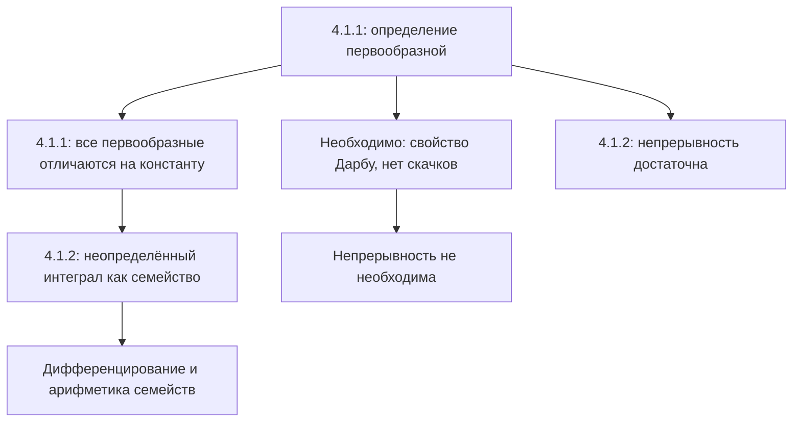

# Лекция 36 — Первообразная и неопределённый интеграл

[[ru/lectures-2025-26/lecture-35|← Лекция 35]] · [[ru/lectures-2025-26/index|Указатель лекций]] · [[ru/lectures-2025-26/lecture-37-38|Лекции 37–38 →]] · [[ru/term-index|Термины и теоремы]] · [[en/lectures-2025-26/lecture-36|English]] · [[es/lectures-2025-26/lecture-36|Español]]

> [!info] Источник
> `ma25_26_lecture_36_notes.pdf` — 20 страниц, 14 печатных слайдов. Рукописные страницы: 8, 10–12, 18–19; также расшифрована схема на печатной стр. PDF 4. Дата: 19 февраля 2026.
>
> **Семестр 2: лекции 33–64; семестр 1 заканчивается лекцией 32. Начиная с лекции 33 есть дублирующий материал** в [[ru/lectures/index|папке `ru/lectures/`]]. Для этой лекции см. [[ru/lectures/02-antiderivatives-4-1|§4.1 «Первообразная и неопределённый интеграл»]] и [архивную «Лекцию 36»](https://github.com/NikiHunter/matan/blob/main/source/MathInMind/%D0%9C%D0%90%D0%A2%D0%90%D0%9D_%D0%9B/%D0%9B%D0%B5%D0%BA%D1%86%D0%B8%D1%8F%2036.md). Здесь дан полный иллюстрированный конспект нового PDF, а не сокращённая ссылка на старые заметки.
>
> **Обозначения.** $I=\langle A,B\rangle$ — промежуток, $\mathcal P_f(I)$ — множество всех [[#^def-4-1-1|первообразных]] $f$ на нём. В включённых концах [[ru/lectures-2025-26/lecture-22-23#^def-3-1-1|производная]] понимается односторонне, как в предыдущих лекциях.

## Печатные слайды 1–3 (стр. PDF 1–3). Введение

**Цитата дня:** «Завтра сегодня станет вчера!»

**Цели:**

- После изучения дифференцирования рассмотреть обратную задачу: известна производная, требуется найти функцию.
- Определить первообразную и описать все первообразные на промежутке.
- Обсудить операции с неопределёнными интегралами.
- Сформулировать необходимые и достаточные условия существования первообразных.

## Глава 4. Интегральное исчисление функций одной вещественной переменной

### Печатный слайд 4 (стр. PDF 4). Обратная задача

Рукописная схема: дифференцирование переводит $f$ в $f'$, а обратная задача состоит в восстановлении $f$ по производной.

## §1. Первообразная функция и неопределённый интеграл

### Печатный слайд 5 (стр. PDF 5). Первообразная на промежутке

> [!definition] Определение 4.1.1
> Пусть $f:I\to\mathbb R$. Функция $F:I\to\mathbb R$ называется **первообразной** $f$ на $I$, если
>
> 1. $F$ [[ru/lectures-2025-26/lecture-22-23#^def-3-2-1|дифференцируема]] на $I$;
> 2. $F'(x)=f(x)$ для всех $x\in I$.

^def-4-1-1

Обозначение:

$$
\mathcal P_f(I)=\{F:I\to\mathbb R:\ F\text{ дифференцируема на }I,\ F'=f\}.
$$

### Печатный слайд 6 (стр. PDF 6). Три вопроса

1. Для каких $f$ множество $\mathcal P_f(I)$ непусто?
2. Как описать $\mathcal P_f(I)$, если оно непусто?
3. Как вычислять первообразные, если они существуют?

Начинаем со второго: на промежутке первообразная единственна с точностью до постоянного слагаемого.

### Печатный слайд 7 (стр. PDF 7). Описание всех первообразных

> [!theorem] Теорема 4.1.1
> Пусть $f,F,G$ заданы на $I$, причём $F\in\mathcal P_f(I)$. Равносильны утверждения:
>
> 1. $G\in\mathcal P_f(I)$.
> 2. Существует $c\in\mathbb R$ такое, что $G(x)=F(x)+c$ для всех $x\in I$.

^thm-4-1-1

Иными словами,

$$
\mathcal P_f(I)=\{F+c:\ c\in\mathbb R\}.
$$

Поэтому достаточно найти одну первообразную.

### Рукописная страница (стр. PDF 8). Доказательство теоремы 4.1.1

**$1\Rightarrow2$.** Пусть $H(x)=G(x)-F(x)$. Тогда

$$
H'(x)=G'(x)-F'(x)=f(x)-f(x)=0\qquad(x\in I).
$$

По критерию постоянства функции $H$ постоянна на промежутке $I$, то есть $G=F+c$.

**$2\Rightarrow1$.** Если $G=F+c$, обе функции в правой части дифференцируемы, поэтому $G$ тоже дифференцируема и

$$
G'(x)=F'(x)+0=f(x)\qquad(x\in I).
$$

Следовательно, $G\in\mathcal P_f(I)$. $\blacksquare$

### Печатный слайд 8 (стр. PDF 9). Неопределённый интеграл

> [!definition] Определение 4.1.2
> Пусть $f:I\to\mathbb R$, $F\in\mathcal P_f(I)$. Множество функций
>
> $$
> \{F(x)+c:\ c\in\mathbb R\}
> $$

^def-4-1-2

называется **неопределённым интегралом** $f$ на $I$ и обозначается

$$
\int f(x)\,dx.
$$

Фактически это $\mathcal P_f(I)$, записанное через одну выбранную первообразную.

> [!note] Исправление редактора
> В предпосылке определения на слайде после $f:I\to\mathbb R$ пропущено $F\in$ перед $\mathcal P_f(I)$. Выбор первообразной $F$ восстановлен, поскольку она используется в следующей строке.

### Рукописные страницы (стр. PDF 10–12). Смысл обозначений

Для краткости пишут

$$
\int f(x)\,dx=F(x)+c,
$$

опуская фигурные скобки и понимая под $c$ произвольное вещественное число. Это **семейство функций**, а не одна функция с заранее выбранной константой.

Обозначение дано по аналогии с [[ru/lectures-2025-26/lecture-39-40#^def-4-2-6|определённым интегралом]]. На стр. 10 приведена неформальная картина:

$$
\text{определённый интеграл}\ \sim\
\lim_{\Delta x_k\to0}\sum_k f(x_k)\Delta x_k.
$$

На стр. 11: $f(x)\,dx$ сопоставляется с $f(x_k)\Delta x_k$, а знак $\int$ — с вытянутой буквой $S$ (суммированием).

> [!remark] Примечание редактора
> Это мотивационная схема «на пальцах», а не определение предела [[ru/lectures-2025-26/lecture-37-38#^def-4-2-4|интегральных сумм]]: [[ru/lectures-2025-26/lecture-37-38#^def-4-2-2|разбиения]], оснащения и ранг вводятся в [[ru/lectures-2025-26/lecture-37-38|лекциях 37–38]].

Вообще можно было бы обозначать неопределённый интеграл просто $\int f$, но запись с $dx$ полезна:

1. Она указывает переменную интегрирования. В примере на стр. 11:

$$
\int x^y\,dx:\quad x\mapsto x^y,\quad y\text{ — параметр};
$$

$$
\int x^y\,dy:\quad y\mapsto x^y,\quad x\text{ — параметр}.
$$

2. Трактуя $dx$ как [[ru/lectures-2025-26/lecture-24-25-26#^def-3-3-1|дифференциал]], можно удобно формулировать правила вычисления интегралов (стр. 12).

### Печатные слайды 9–10 (стр. PDF 13–14). Дифференцирование интеграла

Неопределённый интеграл — **множество функций**, но некоторые операции над функциями переносятся на такие множества.

Пусть у $f$ есть первообразная на $I$. Все представители семейства имеют одну и ту же производную, поэтому условимся писать

$$
\left(\int f(x)\,dx\right)'=f(x),\qquad x\in I.
$$

### Печатный слайд 11 (стр. PDF 15). Арифметика множеств функций

Пусть $D,E$ — множества функций на $I$, $h:I\to\mathbb R$, $\lambda\in\mathbb R$ фиксировано. Определим

$$
D+E=\{f+g:\ f\in D,\ g\in E\},
$$

$$
E+h=\{g+h:\ g\in E\},\qquad
\lambda E=\{\lambda g:\ g\in E\}.
$$

> [!remark] Примечание редактора
> В последней формуле слайда $\lambda\in\mathbb R$ напечатано внутри множества. При умножении на **фиксированное** число $\lambda$ перебираются только $g\in E$, а не все возможные множители $\lambda$.

### Печатный слайд 12 (стр. PDF 16). Операции с неопределёнными интегралами

Пусть $F,G$ — первообразные $f,g$ на $I$, а $H:I\to\mathbb R$. Тогда

$$
\int f(x)\,dx+\int g(x)\,dx
=\{F(x)+G(x)+c:\ c\in\mathbb R\},
$$

$$
\int f(x)\,dx+H(x)
=\{F(x)+H(x)+c:\ c\in\mathbb R\},
$$

$$
\lambda\int f(x)\,dx
=\{\lambda F(x)+c:\ c\in\mathbb R\},\qquad\lambda\ne0.
$$

> [!remark] Пояснение редактора
> Ограничение $\lambda\ne0$ существенно для равенства **множеств**: $0\cdot\mathcal P_f(I)=\{0\}$, тогда как первообразные нулевой функции — все постоянные функции. Во второй формуле $H$ произвольна: утверждается равенство множеств сумм, а не дифференцируемость $H$.

### Печатный слайд 13 (стр. PDF 17). Необходимые условия существования

Полное описание функций, имеющих первообразную, сложно; рассматриваем отдельно необходимые и достаточные условия. **Непрерывность не является необходимым условием.**

### Рукописная страница (стр. PDF 18). Следствие теоремы Дарбу

Если у $f$ есть первообразная $F$, то $f=F'$. Поэтому $f$ обладает [[ru/lectures-2025-26/lecture-31-32#^thm-3-7-6|свойством Дарбу]]: образ каждого промежутка в области определения — промежуток. В частности, у неё не может быть скачков; [[ru/lectures-2025-26/lecture-16#^def-2-5-4|разрывы второго рода]] могут встречаться.

> [!remark] Пояснение редактора
> Нельзя заменять свойство Дарбу только отсутствием скачков: отсутствие скачка само по себе ещё не гарантирует существование первообразной. Рассуждение о производных дано в [[ru/lectures-2025-26/lecture-31-32|лекциях 31–32]].

### Рукописная страница (стр. PDF 19). Пример функции без первообразной

$$
f(x)=
\begin{cases}
1,&x\ge0,\\
-1,&x<0.
\end{cases}
$$

В нуле у $f$ скачок — разрыв первого рода. Следовательно, у неё **нет первообразной на промежутке, содержащем ноль как внутреннюю точку**.

Разрывы второго рода у производной допустимы, так что непрерывность не необходима.

> [!example] Редакторский пример к последней фразе
> В лекциях 31–32 построена дифференцируемая функция $u(x)=x^2(2+\sin(1/x))$ при $x\ne0$, $u(0)=0$. Её производная разрывна в нуле, но имеет первообразную $u$. Это пример допустимого осциллирующего разрыва, а не утверждение, что любая функция с разрывом второго рода имеет первообразную.

### Печатный слайд 14 (стр. PDF 20). Достаточное условие существования

> [!theorem] Теорема 4.1.2
> Если $f$ непрерывна на $I$, то у неё есть первообразная на $I$.

^thm-4-1-2

В этом PDF теорема сформулирована без доказательства. Её связь с [[ru/lectures-2025-26/lecture-43-44#^thm-4-3-2|интегралом с переменным верхним пределом]] рассматривается при изучении определённого интеграла; см. также [[ru/08-riemann-integration|общую главу об интеграле Римана]].

## Структура лекции

---

Предыдущая: [[ru/lectures-2025-26/lecture-35|лекция 35]] · Следующие: [[ru/lectures-2025-26/lecture-37-38|лекции 37–38]] · Дублирующий раздел: [[ru/lectures/02-antiderivatives-4-1|§4.1 в `ru/lectures/`]].
