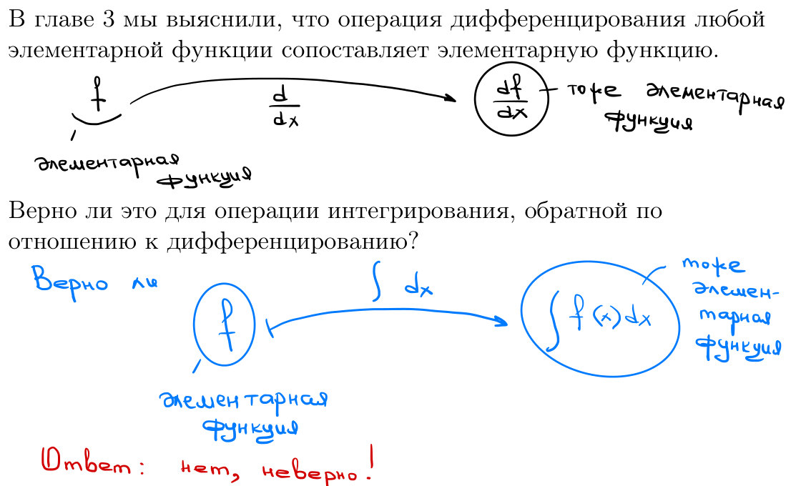
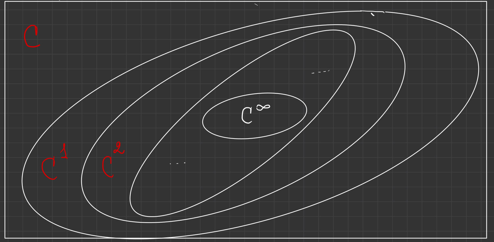
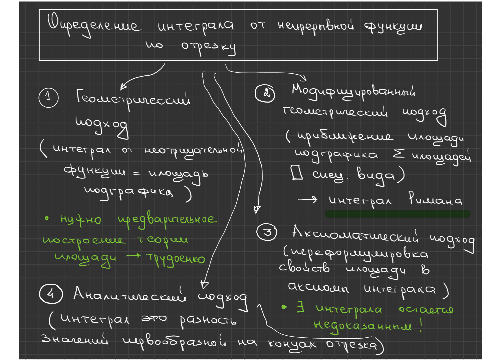
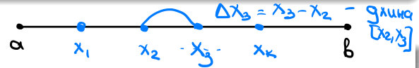
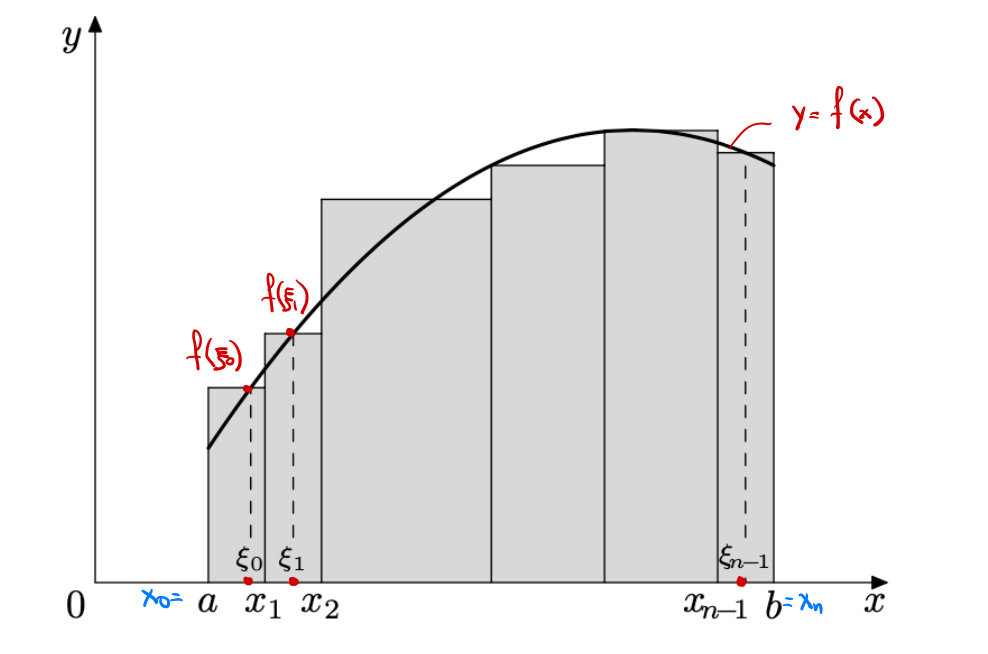
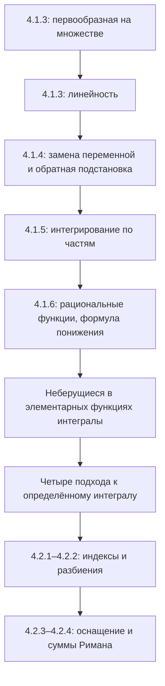

# Лекции 37–38 — Методы интегрирования и начало интеграла Римана

[[ru/lectures-2025-26/lecture-36|← Лекция 36]] · [[ru/lectures-2025-26/index|Указатель лекций]] · [[ru/lectures-2025-26/lecture-39-40|Лекции 39–40 →]] · [[ru/term-index|Термины и теоремы]] · [[en/lectures-2025-26/lecture-37-38|English]] · [[es/lectures-2025-26/lecture-37-38|Español]]

> [!info] Источник
> `ma25_26-lectures_37-38_notes.pdf` — 38 страниц, 21 печатный слайд. Рукописные страницы: 6, 8, 10, 12–13, 15–16, 19–21, 26–27, 29–32, 35. Расшифрованы и пометки на печатных слайдах; рисунки извлечены из соответствующих страниц, а не перерисованы. Дата: 26 февраля 2026.
>
> **Семестр 2: лекции 33–64; семестр 1 завершился лекцией 32. Дублирующий материал существует начиная с лекции 33** в [[ru/lectures/index|папке `ru/lectures/`]]. Эта лекция пересекается с [[ru/lectures/02-antiderivatives-4-1|§4.1 «Первообразная»]] и [[ru/lectures/03-riemann-integral-4-2|§4.2 «Интеграл Римана»]]; сохранён также [архивный конспект «Лекция 37-38»](https://github.com/NikiHunter/matan/blob/main/source/MathInMind/%D0%9C%D0%90%D0%A2%D0%90%D0%9D_%D0%9B/%D0%9B%D0%B5%D0%BA%D1%86%D0%B8%D1%8F%2037-38.md). Ниже — полная самостоятельная иллюстрированная версия нового PDF, включая все рукописные вычисления.
>
> **Соглашения.** $I=\langle A,B\rangle$, $J=\langle C,D\rangle$ — промежутки. [[ru/lectures-2025-26/lecture-36#^def-4-1-1|Неопределённые интегралы]] обозначают семейства первообразных; вычисления с выбранными представителями ведутся с точностью до произвольной постоянной. Ненумерованное следствие к [[#^thm-4-1-4|теореме 4.1.4]] оставлено без нового номера.

## Печатные слайды 1–3 (стр. PDF 1–3). Введение

**Цитата дня:** «Чтобы у тебя сыр сам в макароны падал» — «итальянское пожелание», как указано на слайде.

**Цели:** первообразная на множестве; замена переменной и [[#^thm-4-1-4|интегрирование по частям]]; рациональные функции; неберущиеся интегралы; [[#^def-4-2-4|суммы Римана]].

## Глава 4, §1. Первообразная и неопределённый интеграл — продолжение

### Печатный слайд 4 (стр. PDF 4). Первообразная на множестве

> [!definition] Определение 4.1.3
> Пусть $E\subset\mathbb R$, $f:E\to\mathbb R$. Если $F$ дифференцируема на $E$ и
>
> $$
> F'(x)=f(x)\qquad(x\in E),
> $$

^def-4-1-3

то $F$ называется первообразной $f$ на множестве $E$.

> [!remark] Пояснение редактора
> Используется принятое в курсе понятие [[ru/lectures-2025-26/lecture-22-23#^def-3-1-1|производной]] на области определения (в частности, в её [[ru/lectures-2025-26/lecture-14#^def-2-4-1|предельных точках]]). Утверждение «все первообразные отличаются одной константой» было доказано для **промежутка**, а не произвольного несвязного множества. Например, для $f=0$ на $(-\infty,0)\cup(0,+\infty)$ можно независимо выбирать две константы на двух компонентах.

### Печатный слайд 5 и рукописная страница (стр. PDF 5–6). Интегрирование элементарных функций

Производная элементарной функции там, где она существует, снова элементарна. Для обратной операции это неверно.

Пример на стр. 6:

$$
\int e^{-x^2}\,dx.
$$

Если $f$ имеет элементарную первообразную, интеграл называют **берущимся**, в противном случае — **неберущимся** (в элементарных функциях).

Рукописные замечания:

1. Не все интегралы от элементарных функций берутся.
2. Нет универсального рецепта, который для каждой подынтегральной функции выдавал бы элементарную первообразную.

> [!remark] Примечание редактора
> «Неберущийся» не означает «первообразной не существует»: у непрерывной $e^{-x^2}$ она существует по [[ru/lectures-2025-26/lecture-36#^thm-4-1-2|теореме 4.1.2]]. Речь об отсутствии **элементарного выражения**; фраза о рецепте не отрицает существование алгоритмов для отдельных классов функций.

### Печатный слайд 6 (стр. PDF 7). Линейность

> [!theorem] Теорема 4.1.3
> Пусть $f,g:I\to\mathbb R$ имеют первообразные на $I$. Для любых $\alpha,\beta\in\mathbb R\setminus\{0\}$
>
> $$
> \int\bigl(\alpha f(x)+\beta g(x)\bigr)\,dx
> =\alpha\int f(x)\,dx+\beta\int g(x)\,dx.
> $$

^thm-4-1-3

### Рукописная страница (стр. PDF 8). Доказательство теоремы 4.1.3

Пусть $F,G$ — первообразные $f,g$ на $I$. Правая часть — множество

$$
\{\alpha F(x)+\beta G(x)+c:\ c\in\mathbb R\}.
$$

Так как

$$
\bigl(\alpha F(x)+\beta G(x)+c\bigr)'
=\alpha F'(x)+\beta G'(x)
=\alpha f(x)+\beta g(x),
$$

по [[ru/lectures-2025-26/lecture-36#^thm-4-1-1|теореме 4.1.1]] это и есть всё семейство первообразных суммы. $\blacksquare$

> [!remark] Примечание редактора
> Ограничения на коэффициенты сохранены как на слайде: при умножении **множеств** первообразных на ноль теряется произвольная константа; см. [[ru/lectures-2025-26/lecture-36|лекцию 36]].

### Печатный слайд 7 (стр. PDF 9). Замена переменной

> [!theorem] Теорема 4.1.4
> Пусть $f:I\to\mathbb R$, $F$ — первообразная $f$ на $I$, $\varphi:J\to I$ дифференцируема на $J$. Тогда
>
> $$
> \int f(\varphi(x))\varphi'(x)\,dx=F(\varphi(x))+c.
> $$

^thm-4-1-4

### Рукописная страница (стр. PDF 10). Доказательство и дифференциальная запись

По [[ru/lectures-2025-26/lecture-22-23#^thm-3-3-1|правилу цепочки]]

$$
\bigl(F(\varphi(x))+c\bigr)'
=F'(\varphi(x))\varphi'(x)
=f(\varphi(x))\varphi'(x).
$$

[[ru/lectures-2025-26/lecture-36#^thm-4-1-1|Теорема 4.1.1]] описывает все первообразные. $\blacksquare$

**Замечание.** Если положить $y=\varphi(x)$, $dy=\varphi'(x)\,dx$, формальный переход имеет вид

$$
\int f(\varphi(x))\varphi'(x)\,dx
=\int f(y)\,dy=F(y)+c=F(\varphi(x))+c.
$$

### Печатный слайд 8 (стр. PDF 11). Следствие об обратной подстановке

**Следствие (без номера в источнике).** Пусть в условиях [[#^thm-4-1-4|теоремы 4.1.4]] функция $\varphi$ имеет обратную $\psi:I\to J$. Если $G$ — первообразная $(f\circ\varphi)\varphi'$ на $J$, то

$$
\int f(x)\,dx=G(\psi(x))+c.
$$

### Рукописные страницы (стр. PDF 12–13). Доказательство следствия

Пусть $F$ — первообразная $f$ на $I$. Тогда $F\circ\varphi$ и $G$ — две первообразные $(f\circ\varphi)\varphi'$ на $J$. По [[ru/lectures-2025-26/lecture-36#^thm-4-1-1|теореме 4.1.1]]

$$
F(\varphi(y))-G(y)=\mathrm{const},\qquad y\in J.
$$

Подставим $y=\psi(x)$:

$$
F(\varphi(\psi(x)))-G(\psi(x))
=F(x)-G(\psi(x))=\mathrm{const}.
$$

Следовательно, $G\circ\psi$ — первообразная $f$. $\blacksquare$

> [!remark] Пояснение редактора
> Здесь не требуется отдельно доказывать [[ru/lectures-2025-26/lecture-22-23#^def-3-2-1|дифференцируемость]] обратной $\psi$: композиция $G\circ\psi$ уже совпадает с дифференцируемой $F$ с точностью до константы.

### Печатный слайд 9 (стр. PDF 14). Второй вариант замены переменной

Полагая $x=\varphi(y)$, получаем $dx=\varphi'(y)\,dy$. Поэтому

$$
\int f(x)\,dx
=\int f(\varphi(y))\varphi'(y)\,dy
=G(y)+c=G(\psi(x))+c.
$$

### Рукописные страницы (стр. PDF 15–16). Примеры подстановок

**1. Интеграл котангенса.** На промежутке, где $\sin x\ne0$,

$$
\begin{aligned}
\int\cot x\,dx
&=\int\frac{\cos x}{\sin x}\,dx
=\int\frac{d(\sin x)}{\sin x}\\
&=\int\frac{dy}{y}
=\ln|y|+c=\ln|\sin x|+c,
\qquad y=\sin x.
\end{aligned}
$$

**2. Интеграл с квадратным корнем.** Положим $y=\sqrt x$, $x=y^2$, $dx=2y\,dy$ (при $x>0$):

$$
\begin{aligned}
\int\frac{dx}{1+\sqrt x}
&=\int\frac{2y}{1+y}\,dy
=2\int\left(1-\frac1{1+y}\right)\,dy\\
&=2\int dy-2\int\frac{d(y+1)}{y+1}\\
&=2y-2\ln|y+1|+c\\
&=2\sqrt x-\ln\bigl((\sqrt x+1)^2\bigr)+c.
\end{aligned}
$$

**Отдельная рукописная схема на стр. 16.** Внизу страницы нарисовано вложение классов гладкости, не являющееся частью вычисления интеграла:

$$
C^\infty\subset\cdots\subset C^2\subset C^1\subset C,\qquad C=C^0.
$$

### Печатный слайд 10 (стр. PDF 17). Интегрирование по частям

> [!theorem] Теорема 4.1.5
> Если $f,g\in C^1(I)$, то
>
> $$
> \int f(x)g'(x)\,dx
> =f(x)g(x)-\int g(x)f'(x)\,dx. \tag{4.1.1}
> $$

^thm-4-1-5

### Печатный слайд 11 (стр. PDF 18). Замечания

1. Правая часть (4.1.1) — множество

$$
\{f(x)g(x)-H(x)+c:\ c\in\mathbb R\},
$$

где $H$ — первообразная $g f'$.

2. Подынтегральные функции непрерывны и имеют первообразные по [[ru/lectures-2025-26/lecture-36#^thm-4-1-2|теореме 4.1.2]].
3. В [[ru/lectures-2025-26/lecture-24-25-26#^def-3-3-1|дифференциальной]] записи

$$
\int f\,dg=fg-\int g\,df.
$$

### Рукописная страница (стр. PDF 19). Доказательство теоремы 4.1.5

Пусть $H'=g f'$. Тогда

$$
\begin{aligned}
(fg-H+c)'
&=(fg)'-H'\\
&=f'g+fg'-gf'=fg'.
\end{aligned}
$$

По [[ru/lectures-2025-26/lecture-36#^thm-4-1-1|теореме 4.1.1]] семейство $\{fg-H+c\}$ совпадает с $\int fg'\,dx$. $\blacksquare$

### Рукописные страницы (стр. PDF 20–21). Пример: интеграл sin² x

$$
\begin{aligned}
\int\sin^2x\,dx
&=-\int\sin x\,(\cos x)'\,dx\\
&=-\sin x\cos x+\int\cos^2x\,dx\\
&=-\sin x\cos x+\int(1-\sin^2x)\,dx.
\end{aligned}
$$

Пишем $I=\int\sin^2x\,dx$ и получаем

$$
I=-\sin x\cos x+\int1\,dx-I,
\qquad 2I=-\sin x\cos x+x+c.
$$

Итак,

$$
\int\sin^2x\,dx=\frac x2-\frac{\sin x\cos x}{2}+c.
$$

> [!remark] Примечание редактора
> При переносе $I$ из одной части в другую выбираются представители первообразных, а константы затем поглощаются в $c$; это не буквальное сокращение множеств в арифметике Минковского.

### Печатные слайды 12–13 (стр. PDF 22–23). Какие интегралы берутся?

Для ряда классов элементарных функций доказана элементарность первообразных и разработаны методы вычисления.

Рукописное пояснение: **рациональная функция** — отношение двух многочленов.

> [!theorem] Теорема 4.1.6
> Любая рациональная функция имеет элементарную первообразную.

^thm-4-1-6

> [!remark] Пояснение редактора
> Первообразная рассматривается на промежутке, не содержащем полюсов рациональной функции. При нескольких компонентах области определения постоянные на них независимы.

### Печатный слайд 14 (стр. PDF 24). Простейшие дроби

Простейшие дроби двух видов:

$$
\frac{a}{(x+p)^n},\qquad n\in\mathbb N,\quad a,p\in\mathbb R;
$$

$$
\frac{ax+b}{(x^2+px+q)^n},\qquad
n\in\mathbb N,\quad a,b,p,q\in\mathbb R,\quad p^2<4q.
$$

По результату из алгебры любая рациональная функция — сумма многочлена и конечного числа таких дробей. Многочлены и дроби первого вида интегрируются по таблице; для второго вида нужен алгоритм.

> [!note] Редакторское напоминание табличных формул
> При $n=1$ первая дробь даёт $a\ln|x+p|+c$, при $n>1$ — $\dfrac{a}{1-n}(x+p)^{1-n}+c$; эти формулы применяются вне $x=-p$.

### Печатный слайд 15 и рукописные страницы (стр. PDF 25–27). Алгоритм для второго вида

**Шаг 1: полный квадрат.** Если $p\ne0$, заменим $y=x+p/2$. Тогда (выкладки на стр. 26)

$$
x=y-\frac p2,\qquad
ax+b=ay+\widetilde b,\quad \widetilde b=b-\frac{ap}{2},
$$

$$
x^2+px+q
=\left(y-\frac p2\right)^2+p\left(y-\frac p2\right)+q
=y^2+\widetilde q,\qquad
\widetilde q=q-\frac{p^2}{4}>0.
$$

Таким образом, достаточно случая $p=0$:

$$
\int\frac{ax+b}{(x^2+q)^n}\,dx
=a\int\frac{x\,dx}{(x^2+q)^n}
+b\int\frac{dx}{(x^2+q)^n}.
$$

**Шаг 2: числитель $x$.** Положим $y=x^2+q$, $dy=2x\,dx$:

$$
\int\frac{x\,dx}{(x^2+q)^n}
=\frac12\int y^{-n}\,dy
=\frac{(x^2+q)^{1-n}}{2(1-n)}+c,\qquad n>1.
$$

> [!note] Уточнение редактора
> На рукописной стр. 26 последняя формула записана без исключения $n=1$. При $n=1$ результат — $\tfrac12\ln|x^2+q|+c$, а не выражение с нулевым знаменателем. Стр. 27 повторяет ту же замену в виде $\tfrac12\int d\varphi(x)/(\varphi(x))^n$ при $\varphi(x)=x^2+q$.

### Печатный слайд 16 (стр. PDF 28). Формула понижения

**Шаги 3–4.** Пусть $q\in\mathbb R\setminus\{0\}$ и

$$
I_n=\int\frac{dx}{(x^2+q)^n},\qquad n\in\mathbb N.
$$

Тогда

$$
2nq I_{n+1}=(2n-1)I_n+\frac{x}{(x^2+q)^n}.
$$

Применив понижение $n-1$ раз, сведём $I_n$ к табличному $I_1$.

> [!note] Редакторская проверка формулы
> $\dfrac d{dx}\left(\dfrac{x}{(x^2+q)^n}\right)=\dfrac{2nq}{(x^2+q)^{n+1}}-\dfrac{2n-1}{(x^2+q)^n}$. После интегрирования получается формула с точностью до постоянной. В случае неприводимой квадратной дроби после полного квадрата $q>0$, и $I_1=\dfrac1{\sqrt q}\arctan\dfrac{x}{\sqrt q}+c$. При $q<0$, $q=-a^2$, $a>0$, базовый интеграл равен $\dfrac1{2a}\ln\left|\dfrac{x-a}{x+a}\right|+c$ на промежутках без полюсов.

### Рукописная страница (стр. PDF 29). Развёртывание понижения

При $n\ge2$

$$
I_n=\frac1{2(n-1)q}
\left[(2n-3)I_{n-1}+\frac{x}{(x^2+q)^{n-1}}\right].
$$

Для $n\ge3$ следующий шаг:

$$
I_n=\frac1{2(n-1)q}
\left[
\frac{2n-3}{2(n-2)q}
\left((2n-5)I_{n-2}+\frac{x}{(x^2+q)^{n-2}}\right)
+\frac{x}{(x^2+q)^{n-1}}
\right].
$$

Продолжая, получаем линейную комбинацию $I_1$ и рациональных выражений $x/(x^2+q)^m$, $1\le m\le n-1$.

### Рукописные страницы (стр. PDF 30–32). Полный пример рационального интеграла

Вычислим

$$
\int\frac{2x\,dx}{(x^2+2x+2)^2}.
$$

**1.** Положим $y=x+1$, $x=y-1$, $dx=dy$, $x^2+2x+2=y^2+1$. Тогда

$$
\int\frac{2x\,dx}{(x^2+2x+2)^2}
=2\int\frac{y\,dy}{(y^2+1)^2}
-2\int\frac{dy}{(y^2+1)^2}.
$$

**2.** В первом интеграле заменим $z=y^2+1$, $dz=2y\,dy$:

$$
2\int\frac{y\,dy}{(y^2+1)^2}
=\int\frac{dz}{z^2}
=-\frac1z+c
=-\frac1{x^2+2x+2}+c.
$$

**3–4.** Ко второму применим формулу понижения при $n=1$, $q=1$:

$$
2\int\frac{dy}{(y^2+1)^2}
=\int\frac{dy}{y^2+1}+\frac{y}{y^2+1}
=\arctan y+\frac{y}{y^2+1}+c.
$$

Возвращаясь к $x$ и вычитая, получаем

$$
\begin{aligned}
\int\frac{2x\,dx}{(x^2+2x+2)^2}
&=-\frac1{x^2+2x+2}-\arctan(x+1)
-\frac{x+1}{x^2+2x+2}+c\\
&=-\arctan(x+1)-\frac{x+2}{x^2+2x+2}+c.
\end{aligned}
$$

### Печатный слайд 17 (стр. PDF 33). Другие берущиеся интегралы

Другие классы обычно сводятся к рациональным функциям с помощью подходящих подстановок.

### Печатный слайд 18 (стр. PDF 34). Неберущиеся интегралы

Перечислены:

1. Интегральный синус: $\displaystyle\int\frac{\sin x}{x}\,dx$.
2. Интегральный косинус: $\displaystyle\int\frac{\cos x}{x}\,dx$.
3. Интегральный логарифм: $\displaystyle\int\frac{dx}{\ln x}$.
4. Интегральная показательная функция: $\displaystyle\int\frac{e^x}{x}\,dx$.
5. Интегралы Френеля: $\displaystyle\int\sin(x^2)\,dx$, $\displaystyle\int\cos(x^2)\,dx$.
6. Интеграл вероятностей: $\displaystyle\int e^{-x^2}\,dx$.

Доказательство неэлементарности требует алгебраической техники за рамками курса.

> [!remark] Примечание редактора
> Формулы рассматриваются на промежутках, где подынтегральные функции определены и непрерывны; например, для $1/\ln x$ нужны $x>0$, $x\ne1$. В пункте 5 стоят $\sin(x^2)$ и $\cos(x^2)$, а **не** $\sin^2x$ и $\cos^2x$: интеграл $\sin^2x$ был вычислен на стр. 20–21.

### Рукописная страница (стр. PDF 35). Четыре подхода к определённому интегралу

Заголовок схемы: «Определение интеграла от непрерывной функции по отрезку».

1. **Геометрический:** интеграл неотрицательной функции — площадь подграфика. Нужно предварительно построить теорию площади, что трудоёмко.
2. **Модифицированный геометрический:** приближать площадь подграфика суммами площадей прямоугольников; это ведёт к [[ru/lectures-2025-26/lecture-39-40#^def-4-2-6|интегралу Римана]].
3. **Аксиоматический:** переформулировать свойства площади в аксиомы интеграла.
4. **Аналитический:** интеграл — разность значений первообразной на концах отрезка.

Для двух последних подходов на схеме отмечено: существование интеграла ещё остаётся недоказанным. Это мотивация дальнейшей конструкции, а не доказательство существования для произвольной функции.

## Глава 4, §2. Определённый интеграл Римана и интегрируемые функции

### Печатный слайд 19 (стр. PDF 36). Разбиения и их ранг

> [!definition] Определение 4.2.1
> Обозначим множество целых чисел из $[p,q]$ через
>
> $$
> [p:q]=[p,q]\cap\mathbb Z.
> $$

^def-4-2-1

> [!definition] Определение 4.2.2
> Пусть $[a,b]$ — невырожденный отрезок. Набор
>
> $$
> \tau=\{x_k\}_{k=0}^{n},\qquad
> a=x_0<x_1<\cdots<x_n=b,
> $$

^def-4-2-2

называется **разбиением** $[a,b]$. Положим

$$
\Delta x_k=x_{k+1}-x_k\qquad(k\in[0:n-1]).
$$

Величина

$$
\lambda=\lambda_\tau=\max_{0\le k\le n-1}\Delta x_k
$$

называется **рангом разбиения** (его диаметром, или mesh).

> [!note] Исправление редактора
> На рукописном эскизе длина $[x_2,x_3]$ подписана $\Delta x_3=x_3-x_2$. В принятой печатной нумерации $\Delta x_k=x_{k+1}-x_k$ это **$\Delta x_2$**. Рисунок сохранён как в PDF, формулы следуют печатному определению.

### Печатный слайд 20 (стр. PDF 37). Оснащение и суммы Римана

> [!definition] Определение 4.2.3
> Набор
>
> $$
> \xi=\{\xi_k\}_{k=0}^{n-1},\qquad
> \xi_k\in[x_k,x_{k+1}]\quad(k\in[0:n-1]),
> $$

^def-4-2-3

называется **оснащением разбиения**. Пара $(\tau,\xi)$ называется **оснащённым разбиением**.

> [!remark] Примечание редактора
> В этом рукописном эскизе после $x_1$ подписаны $x_3,x_4$, то есть пропущен индекс $2$. Схема иллюстрирует выбор одной точки в каждом подотрезке; последовательная индексация задаётся определением выше. Точки оснащения могут совпадать с концами подотрезков.

> [!definition] Определение 4.2.4
> Для $f:[a,b]\to\mathbb R$ суммы
>
> $$
> \sigma=\sigma_\tau(f,\xi)
> =\sum_{k=0}^{n-1}f(\xi_k)\Delta x_k
> $$

^def-4-2-4

называются **интегральными суммами**, или **суммами Римана**, соответствующими оснащённому [[#^def-4-2-2|разбиению]] $(\tau,\xi)$.

### Печатный слайд 21 (стр. PDF 38). Геометрия суммы Римана

Для неотрицательной $f$ каждое слагаемое — площадь прямоугольника с основанием $[x_k,x_{k+1}]$ и высотой $f(\xi_k)$; сумма приближает площадь подграфика.

> [!remark] Пояснение редактора
> Если значения $f$ отрицательны, слагаемые учитываются со знаком. В этом PDF введены лишь разбиения, оснащения и суммы; определение самого интеграла как общего предела при $\lambda_\tau\to0$ здесь ещё не дано. Его не следует приписывать последнему слайду.

## Структура лекции

---

Предыдущая: [[ru/lectures-2025-26/lecture-36|лекция 36]] · Следующие: [[ru/lectures-2025-26/lecture-39-40|лекции 39–40]] · Продолжение темы в дублирующей папке: [[ru/lectures/03-riemann-integral-4-2|§4.2 «Интеграл Римана»]].
