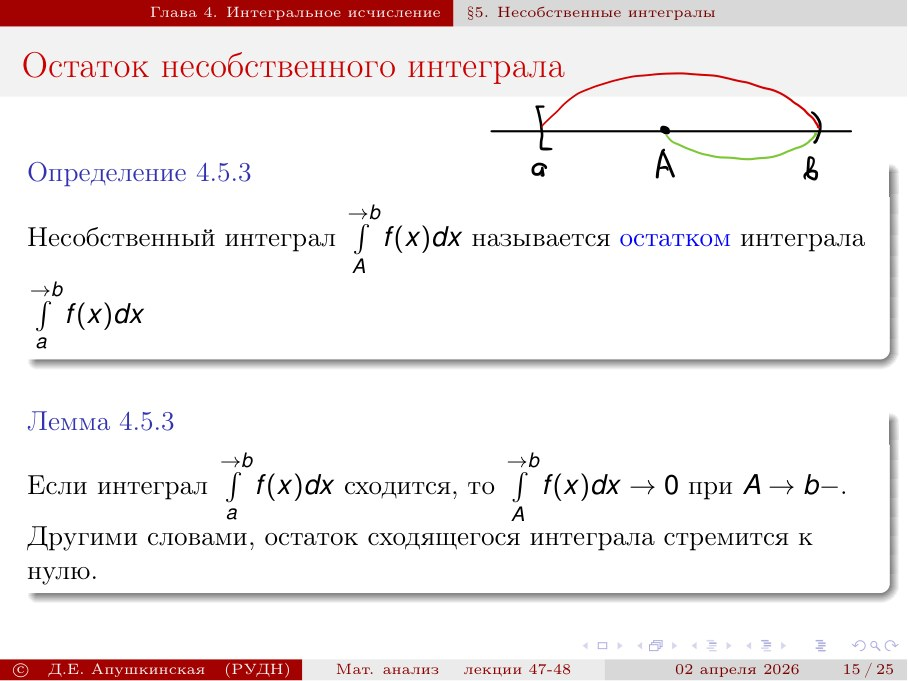
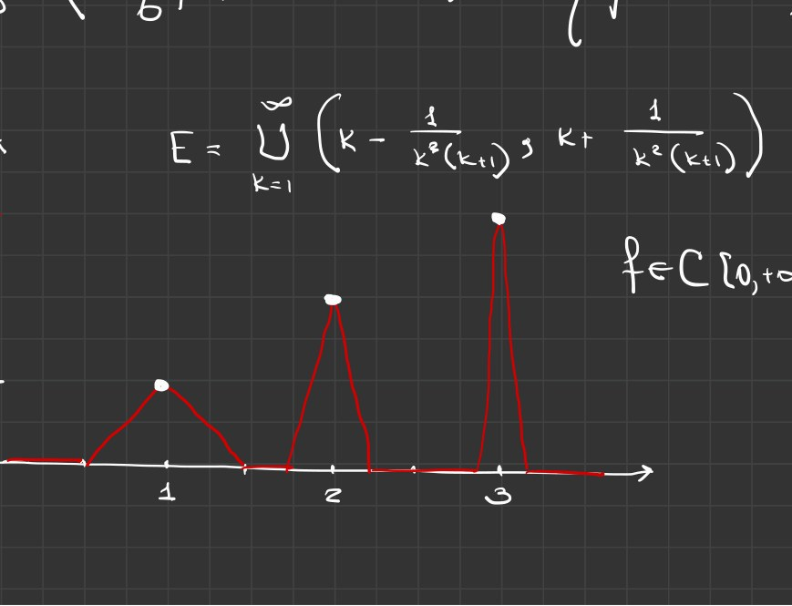

# Лекции 47–48 — Интегральные неравенства и несобственные интегралы

[[ru/lectures-2025-26/lecture-45-46|← Лекции 45–46]] · [[ru/lectures-2025-26/index|Указатель лекций]] · [[ru/lectures-2025-26/lecture-49-50|Лекции 49–50 →]] · [[ru/term-index|Термины и теоремы]] · [[en/lectures-2025-26/lecture-47-48|English]] · [[es/lectures-2025-26/lecture-47-48|Español]]

> [!info] Источник
> `ma25_26-lectures_47-48_notes.pdf` — 41 страница PDF, 25 печатных слайдов; дата на слайдах — 2 апреля 2026. Печатные страницы: 1–4, 7–13, 15, 17–18, 20–23, 25–26, 29, 31–32, 34, 36. Рукописные страницы: 5–6, 14, 16, 19, 24, 27–28, 30, 33, 35, 37–41. Каждая страница PDF учтена ровно один раз; номера слайдов и PDF-страниц различаются.
>
> **Дублирование семестра 2.** Семестр 1 заканчивается лекцией 32, семестр 2 охватывает лекции 33–64. Полный материал пересекается с [[ru/lectures/05-taylor-wallis-inequalities-4-4|§4.4 «Тейлор, Валлис и интегральные неравенства»]] и [[ru/lectures/06-improper-integrals-4-5|§4.5 «Несобственные интегралы»]], а также с [[ru/lectures/index|реестром семестра 2]]. Неизменённый архивный оригинал: [«Лекция 47-48 1.md»](https://github.com/NikiHunter/matan/blob/main/source/MathInMind/%D0%9C%D0%90%D0%A2%D0%90%D0%9D_%D0%9B/%D0%9B%D0%B5%D0%BA%D1%86%D0%B8%D1%8F%2047-48%201.md). Эта полная иллюстрированная расшифровка не заменяется ссылками на тематические заметки.
>
> **Важные уточнения.** [[#^def-4-5-2|Несобственный интеграл]] здесь означает обычный [[ru/lectures-2025-26/lecture-15#^def-2-4-5|односторонний предел]], а не [[ru/09-improper-integrals-applications#9.1 Определения|главное значение]] Коши. При нескольких особенностях каждую сторону проверяют отдельно. Сходимость означает конечный предел. Не применяем [[ru/lectures-2025-26/lecture-43-44#^thm-4-3-2|формулу Ньютона–Лейбница]] через точку особенности без подтверждения её условий.

## Печатный слайд 1 (стр. PDF 1). Титульный слайд

«Математический анализ», лекции 47–48, 2 апреля 2026; Д. Е. Апушкинская, РУДН.

## Печатный слайд 2 (стр. PDF 2). Цитата дня

На слайде сопоставлены знаки [[ru/lectures-2025-26/lecture-24-25-26#^def-3-3-1|дифференциала]] $\partial z/\partial x$ и интеграла $\int f(x)\,dx$.

**БРО.** «Эта няшка — дифференциал. Он весьма полезный, а вычислять его — одно удовольствие. Ты можешь продифференцировать любую функцию без труда — его формулы легки в запоминании и не раз тебя выручат. Однозначно, дифференциал — твой БРО!»

**НЕ БРО.** «Это концентрированное зло, прямиком из самых глубин ада будет троллить тебя всю жизнь. Вычисления занимают у тебя бесценные годы твоей жизни и километры бумаги. Один его знак похож на орудие пытки, коим он и является. Беги от него в страхе — он тебе не бро!»

## Печатный слайд 3 (стр. PDF 3). Цели лекции

Интегральные неравенства; несобственные интегралы; замена переменных и [[ru/lectures-2025-26/lecture-37-38#^thm-4-1-4|интегрирование по частям]] в несобственном интеграле; признаки сходимости несобственных интегралов.

## Глава 4, §4. Интегральные неравенства

### Печатный слайд 4 (стр. PDF 4). Неравенство Гёльдера

Сопряжённые показатели $p,q\in(1,+\infty)$ связаны соотношением $1/p+1/q=1$.

> [!theorem] Теорема 4.4.5
> Пусть $f,g\in C[a,b]$, а $p,q$ — сопряжённые показатели. Тогда
>
> $$
> \left|\int_a^b fg\right|
> \le\left(\int_a^b|f|^p\right)^{1/p}
> \left(\int_a^b|g|^q\right)^{1/q}.
> $$

^thm-4-4-5

На полях слайда от руки подписан частный случай $p=q=2$: [[#^thm-4-4-6|неравенство Коши–Буняковского]].

### Рукописная страница (стр. PDF 5). Доказательство Гёльдера для сумм и подготовка интегральных сумм

Используется [[#^thm-4-4-5|неравенство Гёльдера]] для сумм

$$
\left|\sum_{k=0}^{n-1}a_kb_k\right|
\le\left(\sum_{k=0}^{n-1}|a_k|^p\right)^{1/p}
\left(\sum_{k=0}^{n-1}|b_k|^q\right)^{1/q}.
$$

Берётся равномерное [[ru/lectures-2025-26/lecture-37-38#^def-4-2-2|разбиение]] $x_k=a+k(b-a)/n$, $\Delta x_k=(b-a)/n$, и полагаются $a_k=f(x_k)(\Delta x_k)^{1/p}$, $b_k=g(x_k)(\Delta x_k)^{1/q}$. Тогда $a_kb_k=f(x_k)g(x_k)\Delta x_k$; степени в правых суммах дают соответственно $|f(x_k)|^p\Delta x_k$ и $|g(x_k)|^q\Delta x_k$.

### Рукописная страница (стр. PDF 6). Предел сумм в доказательстве Гёльдера

Для выбранных $a_k,b_k$ неравенство сумм становится

$$
\left|\sum f(x_k)g(x_k)\Delta x_k\right|
\le\left(\sum |f(x_k)|^p\Delta x_k\right)^{1/p}
\left(\sum |g(x_k)|^q\Delta x_k\right)^{1/q}.
$$

При $n\to\infty$ все три суммы стремятся к соответствующим [[ru/lectures-2025-26/lecture-39-40#^def-4-2-6|интегралам Римана]]; непрерывность подынтегральных функций обеспечивает переход к пределу и даёт [[#^thm-4-4-5|теорему 4.4.5]].

### Печатный слайд 5 (стр. PDF 7). Неравенство Коши–Буняковского

> [!corollary] Следствие 4.4.1
> Если $f,g\in C[a,b]$, то
>
> $$
> \left|\int_a^bfg\right|
> \le\sqrt{\int_a^b f^2}\sqrt{\int_a^b g^2}.
> $$

^cor-4-4-1

### Печатный слайд 6 (стр. PDF 8). Неравенство Минковского

> [!theorem] Теорема 4.4.6
> Пусть $f,g\in C[a,b]$, $p\ge1$. Тогда
>
> $$
> \left(\int_a^b|f+g|^p\right)^{1/p}
> \le\left(\int_a^b|f|^p\right)^{1/p}
> +\left(\int_a^b|g|^p\right)^{1/p}.
> $$

^thm-4-4-6

От руки приведён случай $p=2$:

$$
\sqrt{\int_a^b|f+g|^2}\le\sqrt{\int_a^b f^2}+\sqrt{\int_a^b g^2}.
$$

## Глава 4, §5. Несобственные интегралы

### Печатный слайд 7 (стр. PDF 9). Заголовок §5

«§5. Несобственные интегралы».

### Печатный слайд 8 (стр. PDF 10). Локальная интегрируемость

Для $f\in C([a,b])$ интеграл Римана определён. Возникает вопрос, что меняется для $f\in C([a,b))$ или при $b=+\infty$.

> [!definition] Определение 4.5.1
> Функция $f$ локально интегрируема (по Риману) на промежутке $\langle a,b\rangle$, если она интегрируема на каждом замкнутом отрезке, содержащемся в этом промежутке. Класс таких функций обозначается $\mathcal R_{loc}(\langle a,b\rangle)$. Очевидно, $C(\langle a,b\rangle)\subset\mathcal R_{loc}(\langle a,b\rangle)$.

^def-4-5-1

### Печатный слайд 9 (стр. PDF 11). Несобственный интеграл у правого конца

> [!definition] Определение 4.5.2
> Пусть $-\infty<a<b\le+\infty$ и $f\in\mathcal R_{loc}([a,b))$. Определяют
>
> $$
> \int_a^{\to b}f(x)\,dx:=\lim_{B\to b-}\int_a^Bf(x)\,dx.
> $$

^def-4-5-2

Этот предел задаёт несобственный интеграл. Если он существует в $\mathbb R$ и равен $I$, интеграл сходится и ему приписывают значение $I$. Если предел бесконечен либо не существует, конечного значения интегралу не приписывают и он расходится.

### Печатный слайд 10 (стр. PDF 12). Особенность у левого конца

Симметрично, для $-\infty\le a<b<+\infty$ и $f\in\mathcal R_{loc}((a,b])$:

$$
\int_{\to a}^{b}f(x)\,dx:=\lim_{A\to a+}\int_A^b f(x)\,dx.
$$

Интеграл сходится, если предел конечен. Расходящимся называют интеграл с бесконечным значением или без предела.

### Печатный слайд 11 (стр. PDF 13). Степенные примеры

1. $\displaystyle\int_{\to0}^{1}\frac{dx}{x}=\lim_{t\to0+}\int_t^1\frac{dx}{x}=\lim_{t\to0+}[\ln x]_t^1=+\infty$.
2. $\displaystyle\int_{\to0}^{1}x^{-p}\,dx$ сходится при $p<1$ и расходится при $p\ge1$.
3. $\displaystyle\int_1^{\to+\infty}x^{-p}\,dx$ сходится при $p>1$ и расходится при $p\le1$.

### Рукописная страница (стр. PDF 14). Вычисление степенного интеграла

На доске вычисляется $\int_2^B x^{-p}\,dx$ для $p\ne1$:

$$
\int_2^B x^{-p}\,dx
=\left.\frac{x^{1-p}}{1-p}\right|_2^B
=\frac1{1-p}\left(B^{1-p}-2^{1-p}\right).
$$

При $p=1$ [[ru/lectures-2025-26/lecture-36#^def-4-1-1|первообразная]] — $\ln x$. Предел при $B\to+\infty$ конечен ровно при $p>1$; при $p=1$ логарифм растёт без границы, а при $p<1$ член $B^{1-p}$ также неограничен. У нуля аналогичная формула даёт порог $p<1$; равенство $p=1$ расходится логарифмически.

### Печатный слайд 12 (стр. PDF 15). Собственный интеграл как частный случай

> [!lemma] Лемма 4.5.1
> Если $f\in C([a,b])$, то
>
> $$
> \int_a^{\to b}f(x)\,dx=\int_a^bf(x)\,dx.
> $$

^lem-4-5-1

### Рукописная страница (стр. PDF 16). Доказательство леммы 4.5.1

Так как $f$ непрерывна, существует первообразная $F$, и $\int_a^bf=F(b)-F(a)$. С другой стороны,

$$
\int_a^{\to b}f=\lim_{t\to b-}(F(t)-F(a))=F(b)-F(a),
$$

по непрерывности $F$ в точке $b$.

### Печатный слайд 13 (стр. PDF 17). Когда возникает несобственность

Два случая: (a) $b=+\infty$; (b) $b<+\infty$, но $f\notin\mathcal R([a,b])$. Случай (b) реализуется тогда и только тогда, когда $f$ не ограничена ни в какой левой окрестности $b$.

### Печатный слайд 14 (стр. PDF 18). Аддитивность по промежутку

> [!lemma] Лемма 4.5.2
> Пусть $f\in C([a,b))$ и $a<c<b$. Тогда
>
> $$
> \int_a^{\to b}f(x)\,dx=\int_a^cf(x)\,dx+\int_c^{\to b}f(x)\,dx.\tag{4.5.1}
> $$

^lem-4-5-2

Сходимость интеграла от $a$ до $b$ равносильна сходимости хвоста от $c$ до $b$.

### Рукописная страница (стр. PDF 19). Доказательство леммы 4.5.2

Для каждого $B\in(c,b)$ по аддитивности собственного интеграла

$$
\int_a^Bf=\int_a^cf+\int_c^Bf.\tag{4.5.2}
$$

При $B\to b-$ первое слагаемое постоянно, поэтому конечный предел левой части существует тогда и только тогда, когда существует конечный предел последнего слагаемого. Переход к пределу в (4.5.2) даёт (4.5.1).

### Печатный слайд 15 (стр. PDF 20). Остаток сходящегося интеграла

> [!definition] Определение 4.5.3
> Интеграл $\int_A^{\to b}f(x)\,dx$ называется остатком интеграла $\int_a^{\to b}f(x)\,dx$.

^def-4-5-3

> [!lemma] Лемма 4.5.3
> Если $\int_a^{\to b}f$ сходится, то
>
> $$
> \int_A^{\to b}f(x)\,dx\longrightarrow0\quad(A\to b-).
> $$

^lem-4-5-3

Иными словами, остаток сходящегося интеграла стремится к нулю.

### Печатный слайд 16 (стр. PDF 21). Линейность несобственного интеграла

> [!lemma] Лемма 4.5.4
> Пусть $f,g\in C([a,b))$ и $\alpha,\beta\in\mathbb R$. На слайде записано
>
> $$
> \int_a^{\to b}(\alpha f+\beta g)
> =\alpha\int_a^{\to b}f+\beta\int_a^{\to b}g.
> $$

^lem-4-5-4

Там же сказано, что три интеграла сходятся и расходятся одновременно, а если сходятся — равны в смысле этой линейной формулы.

#### Рукописная пометка на том же печатном слайде. Уточнение линейности

Рукописная добавка говорит перейти к пределу при $B\to b-$ в равенстве для собственных интегралов на $[a,B]$. При конечных пределах это даёт линейность, когда обе исходные интегральные границы существуют. Соседнее утверждение печатного слайда о «одновременной» сходимости без оговорок неверно при произвольных $\alpha,\beta$: например, коэффициенты могут быть нулевыми, а члены могут взаимно сократиться. Корректная форма: если интегралы $\int_a^{\to b}f$ и $\int_a^{\to b}g$ сходятся, то интеграл линейной комбинации сходится и равен линейной комбинации значений; если один интеграл расходится, а другой сходится, их сумма расходится. Две расходящиеся части могут сократиться.

### Печатный слайд 17 (стр. PDF 22). Сумма расходящегося и сходящегося интегралов

Если $\int_a^{\to b}f$ расходится, а $\int_a^{\to b}g$ сходится, то $\int_a^{\to b}(f+g)$ расходится. Доказательство на слайде: если бы интеграл суммы сходился, то по линейности $f=(f+g)-g$ также имел бы сходящийся интеграл, противоречие.

### Печатный слайд 18 (стр. PDF 23). Замена переменной

> [!theorem] Теорема 4.5.1
> Пусть $f\in C([a,b))$, $\varphi\in C^1([\alpha,\beta))$, $\varphi$ монотонна, $\varphi(\alpha)=a$ и $\lim_{x\to\beta-0}\varphi(x)=b$. Тогда
>
> $$
> \int_\alpha^{\to\beta}f(\varphi(x))\varphi'(x)\,dx
> =\int_a^{\to b}f(t)\,dt.\tag{4.5.3}
> $$

^thm-4-5-1

Формулировка понимается так: если существует один из интегралов, существует и другой, и равенство выполняется.

### Рукописная страница (стр. PDF 24). Доказательство замены переменной

Для конечного $y<\beta$ применяем формулу замены переменной к собственному интегралу:

$$
\int_\alpha^y f(\varphi(x))\varphi'(x)\,dx
=\int_{\varphi(\alpha)}^{\varphi(y)}f(t)\,dt.
$$

При $y\to\beta-$ имеем $\varphi(y)\to b$; переход к пределу в обеих сторонах доказывает (4.5.3), если конечный предел существует. Монотонность обеспечивает движение конца отрезка к $b$ без перескоков.

### Печатный слайд 19 (стр. PDF 25). Замена, превращающая несобственный интеграл в собственный

Иногда замена превращает несобственный интеграл в собственный. Пример:

$$
\int_0^{+\infty}\frac{\arctan x}{1+x^2}\,dx
=\int_0^{\pi/2}t\,dt,
\qquad t=\arctan x,\quad dt=\frac{dx}{1+x^2}.
$$

При $x=0$ имеем $t=0$, а при $x\to+\infty$ — $t\to\pi/2$. Поэтому значение равно $\pi^2/8$.

### Печатный слайд 20 (стр. PDF 26). Интегрирование по частям

> [!theorem] Теорема 4.5.2
> Пусть $u,v\in C^1([a,b))$ и существует $\lim_{x\to b-0}u(x)v(x)$. Тогда
>
> $$
> \int_a^{\to b}u(x)v'(x)\,dx
> =\left.uv\right|_a^{\to b}-\int_a^{\to b}v(x)u'(x)\,dx,\tag{4.5.4}
> $$

^thm-4-5-2

где $\left.uv\right|_a^{\to b}=\lim_{x\to b-0}u(x)v(x)-u(a)v(a)$. Если правая часть (4.5.4) сходится, то сходится и левая.

### Рукописная страница (стр. PDF 27). Доказательство интегрирования по частям

Для всякого $B<b$ собственная формула даёт

$$
\int_a^B u(x)v'(x)\,dx=[u(x)v(x)]_a^B-\int_a^Bv(x)u'(x)\,dx.
$$

Переход $B\to b-$ с использованием существования предела $uv$ и сходимости правой части даёт (4.5.4). Важно, что сходимость правой стороны — условие, из которого выводится сходимость левой, а не автоматическое следствие существования предела $uv$.

### Рукописная страница (стр. PDF 28). Замена, устраняющая особенность на правом конце

Для $a<b$ рассмотрим $\int_a^b f(x)\,dx$ с особенностью при $x=b$. Положим

$$
x=b-\frac1t,\qquad dx=\frac{dt}{t^2}.
$$

Тогда $x=a$ соответствует $t=1/(b-a)$, а при $x\to b-$ имеем $t\to+\infty$. Поэтому замена переводит интеграл в

$$
\int_{1/(b-a)}^{+\infty} f\!\left(b-\frac1t\right)\frac{dt}{t^2}.
$$

### Печатный слайд 21 (стр. PDF 29). Интеграл неотрицательной функции

> [!lemma] Лемма 4.5.5
> Пусть $f\in\mathcal R_{loc}[a,b)$, $f\ge0$. Тогда сходимость $\int_a^{\to b}f$ равносильна ограниченности сверху функции
>
> $$
> F(A)=\int_a^A f
> $$

^lem-4-5-5

на $[a,b)$.

### Рукописная страница (стр. PDF 30). Доказательство леммы 4.5.5

Поскольку $f\ge0$, функция $F(A)=\int_a^A f$ не убывает: при $a\le A<B<b$

$$
F(B)-F(A)=\int_A^B f\ge0.
$$

Сходимость $\int_a^{\to b}f$ равносильна существованию конечного предела $F(A)$ при $A\to b-$. Если предел конечен, $F$ [[ru/lectures-2025-26/lecture-05-06#^def-1-3-7|ограничена сверху]]. Обратно, если возрастающая $F$ ограничена сверху, то по теореме о пределе монотонной функции существует её конечный предел при $A\to b-$; это и есть значение несобственного интеграла.

### Печатный слайд 22 (стр. PDF 31). Замечания к критерию

1. Для $f\ge0$ интеграл либо сходится, либо расходится к $+\infty$, причём

$$
\int_a^{\to b}f=\sup_{A\in[a,b)}\int_a^A f.
$$

2. Для ограниченности сверху возрастающей функции $F$ достаточно ограниченности последовательности $F(A_n)$, где $A_n\in[a,b)$ возрастают к $b$. Действительно,

$$
\sup_nF(A_n)=\lim_{n\to\infty}F(A_n)=\lim_{A\to b-}F(A)=\sup_{A\in[a,b)}F(A).
$$

### Печатный слайд 23 (стр. PDF 32). Признак сравнения

> [!theorem] Теорема 4.5.3
> Пусть $f,g\in\mathcal R_{loc}[a,b)$, $f,g\ge0$ и $f(x)=O(g(x))$ при $x\to b-$. Тогда:
>
> 1. Если $\int_a^{\to b}g$ сходится, то сходится $\int_a^{\to b}f$.
> 2. Если $\int_a^{\to b}f$ расходится, то расходится $\int_a^{\to b}g$.

^thm-4-5-3

### Рукописная страница (стр. PDF 33). Доказательство сравнения

Из $f=O(g)$ у правого конца существуют $\Delta<b$ и $K>0$ такие, что $f(x)\le Kg(x)$ при $x\in[\Delta,b)$. Если $\int_a^{\to b}g$ сходится, то её хвост конечен; для $B\ge\Delta$:

$$
\int_a^Bf=\int_a^\Delta f+\int_\Delta^Bf
\le\int_a^\Delta f+K\int_\Delta^Bg.
$$

Частичные интегралы $\int_a^Bf$ ограничены сверху. По [[#^lem-4-5-5|лемме 4.5.5]] интеграл $f$ сходится. Второе утверждение — контрапозиция первого.

### Печатный слайд 24 (стр. PDF 34). Предельный признак сравнения

> [!corollary] Следствие 4.5.1
> Пусть $f,g\in\mathcal R_{loc}[a,b)$, $f,g>0$ и
>
> $$
> \lim_{x\to b-}\frac{f(x)}{g(x)}=\ell\in[0,+\infty].
> $$
>
> 1. Если $\ell<+\infty$ и $\int g$ сходится, то сходится $\int f$.
> 2. Если $\ell>0$ и $\int f$ сходится, то сходится $\int g$.
> 3. Если $0<\ell<+\infty$, интегралы $f$ и $g$ сходятся или расходятся одновременно.

^cor-4-5-1

### Рукописная страница (стр. PDF 35). Доказательство предельного сравнения

1. При $\ell=0$ или конечном положительном пределе отношение $f/g$ ограничено сверху в некоторой левой окрестности $b$, поэтому $f=O(g)$ и действует [[#^thm-4-5-3|теорема 4.5.3]].
2. При $\ell>0$ отношение $g/f$ ограничено сверху в некоторой левой окрестности; применяем теорему сравнения к $g$ и $f$.
3. Для $0<\ell<+\infty$ оба отношения ограничены сверху у конца, откуда двусторонняя эквивалентность характера сходимости.

### Печатный слайд 25 (стр. PDF 36). Замечания о сходимости

1. Интегралы от неотрицательных функций, эквивалентных у особой точки, сходятся или расходятся одновременно.
2. Из сходимости $\int_a^{+\infty}f$ не следует $f(x)\to0$ при $x\to+\infty$, даже если $f\ge0$ и непрерывна.
3. Ограниченность частичных интегралов необходима, но недостаточна. Например,

$$
\int_0^{+\infty}\cos x\,dx
$$

расходится, так как частичные интегралы $\int_0^A\cos x\,dx=\sin A$ не имеют предела при $A\to+\infty$.

### Рукописные страницы (стр. PDF 37–41). Примеры и уточнение к замечаниям

**Стр. 37–38.** Рассматривается

$$
\int_2^{+\infty}\frac{dx}{x^\alpha(\ln x)^\beta},\qquad \alpha,\beta\in\mathbb R.
$$

Используется, что $\ln x=o(x^q)$ при любом $q>0$. Если $\alpha>1$, логарифмический множитель не меняет сходимость: для подходящего $q>0$ подынтегральная функция оценивается сверху степенью $x^{-1-q/2}$ на хвосте, поэтому интеграл сходится. Если $\alpha<1$, нижнее сравнение с расходящейся степенью даёт расходимость. При $\alpha=1$ замена $t=\ln x$ сводит вопрос к $\int_{\ln2}^{+\infty}t^{-\beta}\,dt$, который сходится тогда и только тогда, когда $\beta>1$.

**Стр. 39–40.** Вычисляется $\int_2^B x^{-p}\,dx$ и снова получаются условия $p>1$ для бесконечного [[ru/lectures-2025-26/lecture-13#Определение 2.3.9 (верхний и нижний пределы)|верхнего предела]]. Затем дан пример непрерывной неотрицательной функции на $[0,+\infty)$ с узкими пиками около целых точек высоты $k$ и площадью порядка $1/k^2$. Площади пиков суммируются, так как $\sum 1/k^2$ сходится, но значения в вершинах не стремятся к нулю. Этот исходный эскиз воспроизведён ниже.

На доске задано объединение интервалов

$$
E=\bigcup_{k=1}^{\infty}\left(k-\frac{1}{k^2(k+1)},k+\frac{1}{k^2(k+1)}\right).
$$

В вершине каждого пика $f(k)=k$, вне $E$ функция равна нулю, а на каждой части интервала график линеен; поэтому получаются треугольные пики.

**Стр. 41.** Для каждого треугольного пика высоты $k$ полуширина основания равна $1/(k^2(k+1))$. Поэтому его площадь равна

$$
\frac12\cdot\frac{2}{k^2(k+1)}\cdot k=\frac1{k(k+1)}.
$$

Для $N\in\mathbb N$ сумма площадей телескопируется:

$$
\int_0^{N+1/2}f=\sum_{k=1}^{N}\frac1{k(k+1)}
=\sum_{k=1}^{N}\left(\frac1k-\frac1{k+1}\right)
=1-\frac1{N+1}\longrightarrow1.
$$

Следовательно, несобственный интеграл равен $1$, хотя $f(k)=k$ не ограничена при $x\to+\infty$. Рукописная пометка красным подчёркивает: «Но $f$ не ограничена в окрестности $+\infty$!»; это не противоречит замечанию на печатном слайде 25, которое требовало непрерывности, но не утверждало ограниченность.

---

**Навигация:** [[ru/lectures-2025-26/lecture-45-46|Лекции 45–46]] · [[ru/lectures-2025-26/lecture-49-50|Лекции 49–50]] · [[ru/lectures-2025-26/index|Индекс]].
