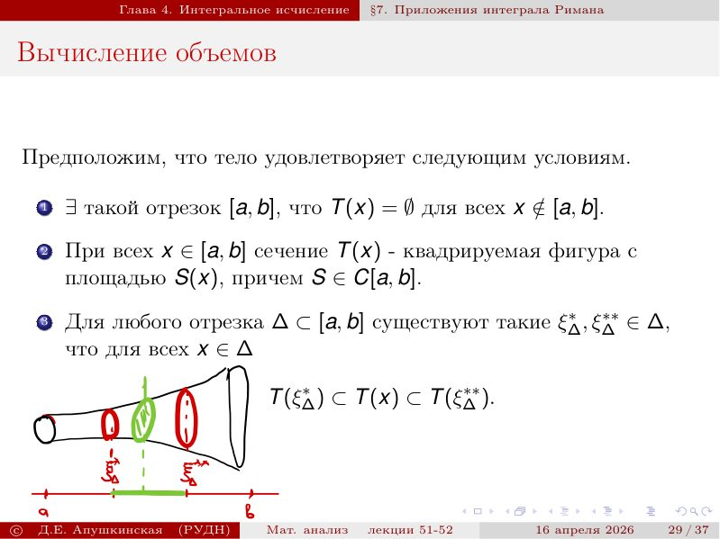

# Лекции 51–52 — площадь, объём, пути и приложения интеграла

[[ru/lectures-2025-26/lecture-49-50|← Лекции 49–50]] · [[ru/lectures-2025-26/index|Указатель лекций]] · [[ru/lectures-2025-26/lecture-53|Лекция 53 →]] · [[ru/term-index|Термины и теоремы]] · [[en/lectures-2025-26/lecture-51-52|English]] · [[es/lectures-2025-26/lecture-51-52|Español]]

> [!info] Источник и охват
> `ma25_26-lectures_51-52_notes.pdf.txt`: 40 страниц PDF, 37 печатных слайдов, дата 16 апреля 2026. Все страницы учтены; PDF 9, 17 и 27 — рукописные листы. Рукописные пометки на слайдах 5, 14–16, 21, 24, 28, 32 и 39 включены. Расшифровка основана только на приложенном PDF; папка исходных конспектов не просматривалась, поэтому архивные имена и ссылки не указываются.

> [!info] Дублирование семестра 2
> Эта самостоятельная расшифровка лекций 51–52 тематически пересекается с [[ru/lectures/07-measure-paths-4-6|§4.6]] и [[ru/lectures/08-integral-applications-4-7|§4.7]] регистра; также см. [[ru/lectures/index|указатель семестра 2]]. Семестр 2 охватывает лекции 33–64.

## Печатный слайд 1 (стр. PDF 1) — Титульный слайд

«Математический анализ», лекции 51–52; Д. Е. Апушкинская, РУДН; 16 апреля 2026.

## Печатный слайд 2 (стр. PDF 2) — Цитата дня

«В конечном итоге всё будет хорошо. Если пока не хорошо, значит, это ещё не конец». Пауло Коэльо.

## Печатный слайд 3 (стр. PDF 3) — Цели лекции

Длина, площадь и объём; путь и его свойства, [[ru/lectures-2025-26/lecture-53#^thm-4-7-1|длина пути]]; геометрические приложения [[ru/lectures-2025-26/lecture-39-40#^def-4-2-6|интеграла Римана]].

## Печатный слайд 4 (стр. PDF 4) — Глава 4, §6. Длина, площадь и объём

Геометрические характеристики вводятся в объёме, достаточном для последующих приложений интеграла.

## Печатный слайд 5 (стр. PDF 5) — Площадь и движение

> [!definition] Определение 4.6.1

^def-4-6-1

Евклидова длина отрезка в $\mathbb R^n$ задаётся формулой ниже. Движение сохраняет расстояние между любыми двумя точками.

$$
\|A-B\|=\sqrt{\sum_{i=1}^{n}(A_i-B_i)^2}
$$

## Печатный слайд 6 (стр. PDF 6) — Аксиомы площади

> [!definition] Определение 4.6.2

^def-4-6-2

Площадь задана на классе квадрируемых плоских фигур: конечная аддитивность непересекающихся фигур, нормировка прямоугольника и инвариантность относительно движений.

$$
S(P_1\cup P_2)=S(P_1)+S(P_2)
$$

$$
S([0,a]\times[0,b])=ab
$$

$$
S(U(P))=S(P)
$$

## Печатный слайд 7 (стр. PDF 7) — О пределах определения площади

Класс квадрируемых фигур формально не определяется; существование и единственность площади здесь принимаются как геометрические факты.

## Печатный слайд 8 (стр. PDF 8) — Прочие свойства площади

Площадь монотонна; подмножество отрезка имеет нулевую площадь; аддитивность сохраняется, когда пересечение имеет площадь ноль, например является отрезком.

$$
P_1\subset P\Longrightarrow S(P_1)\le S(P)
$$

$$
P\subset\text{ a line segment}\Longrightarrow S(P)=0
$$

$$
S(P_1\cup P_2)=S(P_1)+S(P_2)
$$

## Рукописная страница (стр. PDF 9) — Свойства площади: доказательство

Рукописный лист содержит три коротких доказательства свойств площади. Для монотонности сравниваются внешние и внутренние прямоугольники. Если множество помещается в прямоугольник сколь угодно малой площади, его площадь равна нулю. При пересечении нулевой площади аддитивность следует из удаления общей части, не меняющей площадь.

## Печатный слайд 9 (стр. PDF 10) — Объём

> [!definition] Определение 4.6.3

^def-4-6-3

Объём кубируемых тел в $\mathbb R^3$ обладает аддитивностью, нормировкой на прямоугольных параллелепипедах и инвариантностью при движениях.

$$
V(T_1\cup T_2)=V(T_1)+V(T_2)
$$

$$
V([0,a]\times[0,b]\times[0,c])=abc
$$

$$
V(U(T))=V(T)
$$

## Печатный слайд 10 (стр. PDF 11) — Существование объёма

Как и квадрируемость, кубируемость не определяется формально; существование объёма принимается без доказательства.

## Печатный слайд 11 (стр. PDF 12) — Прочие свойства объёма

Объём монотонен, тело внутри плоского прямоугольника имеет нулевой объём, а пересечение нулевого объёма не нарушает аддитивность.

$$
T_1\subset T\Longrightarrow V(T_1)\le V(T)
$$

$$
V(T)=0
$$

$$
V(T_1\cup T_2)=V(T_1)+V(T_2)
$$

## Печатный слайд 12 (стр. PDF 13) — Прямой цилиндр и сечение

> [!definition] Определение 4.6.4
> **Определение 4.6.5.**

^def-4-6-5

Для $P\subset\mathbb R^2$ и $h>0$ прямой цилиндр $P\times[0,h]$ имеет объём $S(P)h$. Сечение тела плоскостью с первой координатой $x$ обозначается $T(x)$.

$$
Q=P\times[0,h],\qquad V(Q)=S(P)h
$$

$$
T(x)=\{(y,z)\in\mathbb R^2:(x,y,z)\in T\}
$$

## Печатный слайд 13 (стр. PDF 14) — Путь

> [!definition] Определение 4.6.6

^def-4-6-6

Путь в $\mathbb R^m$ — непрерывное отображение отрезка $[a,b]$: $\gamma=(\gamma_1,\ldots,\gamma_m)$. Точки $\gamma(a)$ и $\gamma(b)$ — начало и конец.

$$
\gamma:[a,b]\to\mathbb R^m,\qquad \gamma=(\gamma_1,\ldots,\gamma_m)
$$

## Печатный слайд 14 (стр. PDF 15) — Свойства пути

Образ $\gamma([a,b])$ — носитель; путь замкнут, если концы совпадают, и прост, если не имеет самопересечений, кроме возможного совпадения концов. Гладкость задаётся гладкостью координат; кусочно-гладкий путь гладок на каждом отрезке некоторого [[ru/lectures-2025-26/lecture-37-38#^def-4-2-2|разбиения]].

$$
\gamma(a)=\gamma(b)
$$

$$
\gamma(t_1)=\gamma(t_2)\Longrightarrow t_1=t_2\text{ or }\{t_1,t_2\}=\{a,b\}
$$

## Печатный слайд 15 (стр. PDF 16) — Обратный путь и эквивалентность

> [!definition] Определение 4.6.7

^def-4-6-7

Обратный путь проходит ту же кривую в противоположном направлении. Пути эквивалентны при строго возрастающей перепараметризации; класс эквивалентных путей называют кривой, а его представителей — параметризациями.

$$
\gamma^-(t)=\gamma(a+b-t)
$$

$$
\gamma=\widetilde\gamma\circ u
$$

## Рукописная страница (стр. PDF 17) — Разные пути с одним носителем

Записаны четыре параметризации верхней полуокружности. Они различаются формулами и промежутками параметра, но имеют один геометрический носитель. Отдельно отмечено, что обращение пути меняет направление, не меняя носитель.

## Печатный слайд 16 (стр. PDF 18) — Вписанная ломаная

> [!definition] Определение 4.6.8

^def-4-6-8

Для разбиения $a=t_0<\cdots<t_n=b$ вписанная ломаная соединяет последовательные точки $\gamma(t_k)$; её длина — сумма длин звеньев.

$$
\ell_\tau=\sum_{k=0}^{n-1}\|\gamma(t_{k+1})-\gamma(t_k)\|
$$

## Печатный слайд 17 (стр. PDF 19) — Длина и спрямляемость

> [!definition] Определение 4.6.9
> **Определение 4.6.10.**

^def-4-6-10

Длина пути определяется как [[ru/lectures-2025-26/lecture-11-12#^def-2-3-1|супремум]] длин всех вписанных ломаных; путь спрямляем, если этот супремум конечен.

$$
s_\gamma=\sup_\tau\ell_\tau
$$

$$
s_\gamma<+\infty
$$

## Печатный слайд 18 (стр. PDF 20) — Глава 4, §7. Приложения интеграла Римана

Искомую геометрическую величину зажимают между специальными нижними и верхними суммами; предел этих сумм даёт интеграл.

## Печатный слайд 19 (стр. PDF 21) — Подграфик

> [!definition] Определение 4.7.1

^def-4-7-1

При $f\ge0$ множество под графиком функции на $[a,b]$ задаётся ниже. Для непрерывной функции его называют криволинейной трапецией.

$$
Q_f=\{(x,y)\in\mathbb R^2:x\in[a,b],\ 0\le y\le f(x)\}
$$

## Печатный слайд 20 (стр. PDF 22) — Площадь под графиком: суммы Дарбу

На разбиении отрезка берут [[ru/lectures-2025-26/lecture-11-12#^def-2-3-2|инфимум]] и супремум $f$ на каждом подотрезке. Их произведения на ширины подотрезков дают нижнюю и верхнюю суммы.

$$
m_k=\inf_{x\in[x_k,x_{k+1}]}f(x),\qquad M_k=\sup_{x\in[x_k,x_{k+1}]}f(x)
$$

$$
s_\tau=\sum_{k=0}^{n-1}m_k\Delta x_k,\qquad S_\tau=\sum_{k=0}^{n-1}M_k\Delta x_k
$$

## Печатный слайд 21 (стр. PDF 23) — Геометрический смысл сумм

Нижняя сумма — площади прямоугольников, лежащих внутри подграфика; верхняя сумма — прямоугольников, накрывающих его.

## Печатный слайд 22 (стр. PDF 24) — Площадь под графиком

Площадь находится между нижней и верхней суммами. Для интегрируемой $f$ обе [[ru/lectures-2025-26/lecture-39-40#^def-4-2-8|суммы Дарбу]] сходятся к одному числу — интегралу Римана.

$$
s_\tau\le S(Q_f)\le S_\tau
$$

$$
\sup_\tau s_\tau=\inf_\tau S_\tau=\int_a^b f(x)\,dx
$$

$$
S(Q_f)=\int_a^b f(x)\,dx
$$

## Печатный слайд 23 (стр. PDF 25) — Знак функции и площадь

Для неотрицательной функции площадь под графиком равна интегралу; для неположительной — интегралу от $-f$. Площадь между графиком и осью равна интегралу от $|f|$.

$$
S(Q_f)=\int_a^b|f(x)|\,dx
$$

## Печатный слайд 24 (стр. PDF 26) — Площадь между двумя графиками

Если интегрируемые функции удовлетворяют $f\le g$, площадь между их графиками выражается интегралом разности $g-f$.

$$
S=\int_a^b(g(x)-f(x))\,dx
$$

## Рукописная страница (стр. PDF 27) — Площадь между графиками: доказательство

Положим $c=\inf_{x\in[a,b]}f(x)$. Тогда $f-c\ge0$ и $g-c\ge0$. Площадь между графиками равна площади под $g-c$ за вычетом площади под $f-c$; постоянная $c$ сокращается, и остаётся интеграл $g-f$.

## Печатный слайд 25 (стр. PDF 28) — Формула площади в полярных координатах

Криволинейный сектор задаётся радиусом $0\le r\le f(\varphi)$ и углом $\varphi\in[\alpha,\beta]$, где $f\ge0$; на слайде рукописно подписаны $x=r\cos\varphi$, $y=r\sin\varphi$.

$$
x=r\cos\varphi,\qquad y=r\sin\varphi
$$

$$
\widetilde Q_f=\{(r\cos\varphi,r\sin\varphi):\varphi\in[\alpha,\beta],\ 0\le r\le f(\varphi)\}
$$

## Печатный слайд 26 (стр. PDF 29) — Полярные суммы секторов

На разбиении углового промежутка радиусы минимального и максимального значения $f$ задают вписанные и описанные круговые секторы; их площади равны половине квадрата радиуса, умноженной на угол.

$$
s_\tau=\frac12\sum_{k=0}^{n-1}m_k^2\Delta\varphi_k,\qquad S_\tau=\frac12\sum_{k=0}^{n-1}M_k^2\Delta\varphi_k
$$

## Печатный слайд 27 (стр. PDF 30) — Предел полярных сумм

Суммы площадей секторов зажаты и являются суммами Дарбу функции $f^2/2$.

## Печатный слайд 28 (стр. PDF 31) — Площадь в полярных координатах

Переход к интегралу даёт формулу площади криволинейного сектора.

$$
S(\widetilde Q_f)=\frac12\int_\alpha^\beta f^2(\varphi)\,d\varphi
$$

## Печатный слайд 29 (стр. PDF 32) — Объём тела по площадям сечений

Пусть тело лежит над конечным отрезком, его поперечные сечения квадрируемы с площадью $S(x)$, а внутри каждого короткого интервала вложены сечения, ограничивающие все промежуточные. Предполагается непрерывность $S$.

$$
S(x)=\operatorname{area}(T(x))
$$

$$
S\in C[a,b]
$$

## Печатный слайд 30 (стр. PDF 33) — Нижние и верхние сечения

Для каждого подотрезка выбирают сечения минимальной и максимальной площади; монотонность площади даёт значения инфимума и супремума $S$.

$$
m_k=\inf_{x\in[x_k,x_{k+1}]}S(x),\qquad M_k=\sup_{x\in[x_k,x_{k+1}]}S(x)
$$

## Печатный слайд 31 (стр. PDF 34) — Цилиндры, построенные на сечениях

Сечения наименьшей и наибольшей площади задают нижний и верхний цилиндры над каждым интервалом разбиения.

$$
q_k=[x_k,x_{k+1}]\times T(\xi_k^*),\qquad Q_k=[x_k,x_{k+1}]\times T(\xi_k^{**})
$$

## Печатный слайд 32 (стр. PDF 35) — Слои тела

Каждый слой тела заключён между соответствующими цилиндрами; объединения нижних цилиндров содержатся в теле, а тело содержится в объединении верхних.

$$
q_k\subset T_k\subset Q_k
$$

$$
w_\tau=\sum_{k=0}^{n-1}m_k\Delta x_k,\qquad W_\tau=\sum_{k=0}^{n-1}M_k\Delta x_k
$$

## Печатный слайд 33 (стр. PDF 36) — Суммы объёмов цилиндров

Аддитивность объёма превращает объёмы объединений в суммы площадей оснований, умноженных на длины интервалов.

$$
V\left(\bigcup_{k=0}^{n-1}q_k\right)=w_\tau,\qquad V\left(\bigcup_{k=0}^{n-1}Q_k\right)=W_\tau
$$

## Печатный слайд 34 (стр. PDF 37) — Объём как интеграл площадей

Объём заключён между суммами Дарбу функции площадей сечений; при интегрируемой $S$ обе стороны сходятся к одному интегралу.

$$
w_\tau\le V(T)\le W_\tau
$$

$$
V(T)=\int_a^b S(x)\,dx
$$

## Печатный слайд 35 (стр. PDF 38) — Тела вращения

Вращение подграфика $f\ge0$ вокруг оси $OX$ задаётся условием $y^2+z^2\le f^2(x)$.

$$
T_f=\{(x,y,z)\in\mathbb R^3:x\in[a,b],\ y^2+z^2\le f^2(x)\}
$$

## Печатный слайд 36 (стр. PDF 39) — Объём тела вращения вокруг $OX$

Каждое сечение — круг радиуса $f(x)$ и площади $\pi f^2(x)$; применяется формула объёма через интеграл площадей сечений.

$$
S(x)=\pi f^2(x)
$$

$$
V(T_f)=\pi\int_a^b f^2(x)\,dx
$$

## Печатный слайд 37 (стр. PDF 40) — Дополнительные формулы вращения

Для вращения вокруг $OY$ используются метод цилиндрических слоёв; сектор в [[ru/17-multiple-integrals#17.3 Выбор координат|полярных координатах]] даёт отдельную формулу. Для неограниченных множеств соответствующие интегралы становятся несобственными.

$$
V(T_f^\prime)=2\pi\int_a^b xf(x)\,dx
$$

$$
V(\widetilde T_f)=\frac{2\pi}{3}\int_\alpha^\beta f^3(\varphi)\cos\varphi\,d\varphi
$$

---

[[ru/lectures-2025-26/lecture-49-50|← Лекции 49–50]] · [[ru/lectures-2025-26/index|Указатель лекций]] · [[ru/lectures-2025-26/lecture-53|Лекция 53 →]] · [[ru/term-index|Термины и теоремы]] · [[en/lectures-2025-26/lecture-51-52|English]] · [[es/lectures-2025-26/lecture-51-52|Español]]

