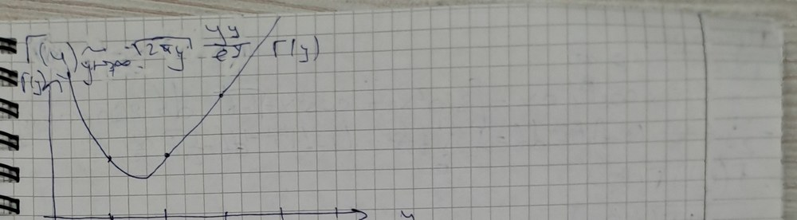
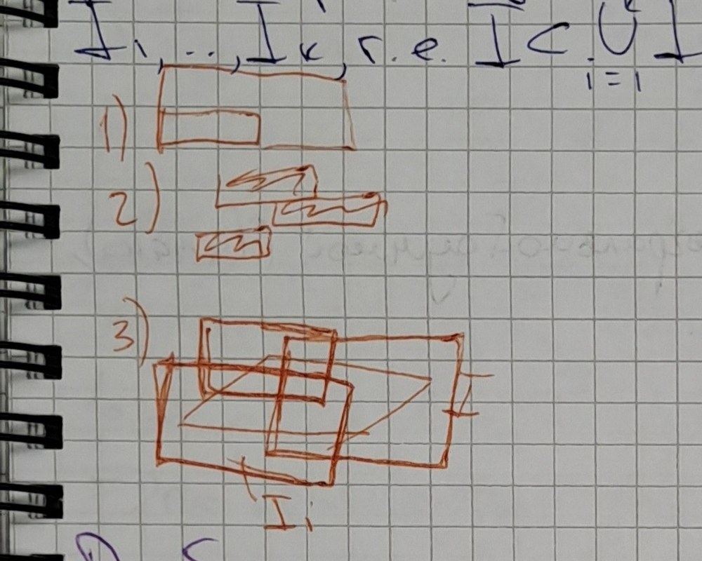

# Лекции 79–80 — гамма-функция и бета-функция, интеграл Римана на n-мерном промежутке

[[ru/lectures-2025-26/lecture-77-78|← Лекции 77–78]] · [[ru/lectures-2025-26/index|Указатель лекций]] · [[ru/lectures-2025-26/lecture-81-82|Лекции 81–82 →]] · [[ru/term-index|Термины и теоремы]]

> [!info] Источник и нумерация
> Конспект переписан с рукописной тетради (стр. p067–p073; сырой текст страниц — в [`ocr/raw/`](https://github.com/NikiHunter/matan/blob/main/ocr/raw/p067.md)). Сверху стр. p067 в рамке стоит дата «22 октября», ниже красным — начало записи «Лекции …» с планом: гамма-функция; [[ru/lectures-2025-26/lecture-39-40#^def-4-2-6|интеграл Римана]] на $n$-мерном промежутке; интеграл Римана по множеству; ещё один пункт, неразборчивый в расшифровке («пер-во тож-ва интегрирования»; возможно, «неравенства и тождества интегрирования», т.е. свойства интеграла). Номер пары в заголовке плана не читается; по порядку тетради это лекции 79–80, в которых разобраны первые два пункта плана (интеграл по множеству — в лекциях 81–82). Нумерация определений и теорем — лекторская; формулировки [[#^def-9-3-1|определения 9.3.1]], свойств гамма-функции, [[#^def-10-1-1|определений 10.1.1]]–[[#^def-10-1-7|10.1.7]] и [[#^thm-10-1-1|теоремы 10.1.1]] сверены со слайдами курса 2024/25 (ФС p88–p91). В конспекте нет доказательства формулы дополнения (свойство ⑨; оно оставлено без доказательства) и определения мелкости разбиения (восстановлено); формула Стирлинга (⑧) выведена в конспекте эвристически (добавлено обоснование); вывод связи бета- и гамма-функций записан искажённо и восстановлен по записи лекции 2024/25 (ФС p89) и стандартным курсам (Фихтенгольц, т. II, гл. XIV; Зорич, т. II, гл. XVII). Вставлены рисунки: график гамма-функции (стр. p070) и три малых рисунка к свойствам меры промежутка (стр. p072); остальные рисунки на полях описаны словами. Описки конспекта исправлены и отмечены блоками «Поправка к источнику», утраченные места восстановлены и отмечены блоками «Восстановлено»; номера пометок соответствуют [`ocr/RESOLVED.md`](https://github.com/NikiHunter/matan/blob/main/ocr/RESOLVED.md). Места, которые нужно сверить с тетрадью, перечислены в [`ocr/ISSUES.md`](https://github.com/NikiHunter/matan/blob/main/ocr/ISSUES.md).

## §9.3. Гамма-функция

> [!definition] Определение 9.3.1
> Гамма-функцией (в точке $y$) называется функция, задаваемая формулой
> $$
> \Gamma(y)=\int_0^{\infty}x^{y-1}e^{-x}\,dx\qquad(y>0).
> $$

^def-9-3-1

Проверим, что интеграл сходится при всех $y>0$. Он несобственный: при $y<1$ подынтегральная функция неограничена вблизи $x=0$, и, кроме того, [[ru/lectures-2025-26/lecture-13#Определение 2.3.9 (верхний и нижний пределы)|верхний предел]] бесконечен. Разобьём его на два интеграла (в конспекте точка деления обозначена $a$; возьмём $a=1$):
$$
\int_0^{\infty}e^{-x}x^{y-1}\,dx=\int_0^{1}e^{-x}x^{y-1}\,dx+\int_1^{\infty}e^{-x}x^{y-1}\,dx .
$$
Интеграл сходится, если сходятся оба слагаемых.

*Сходимость при $x\to0+$.* Так как $e^{-x}\to1$, при $x\to0+$ имеем $x^{y-1}e^{-x}\sim x^{y-1}=\dfrac1{x^{1-y}}$. Интеграл $\int_0^1\dfrac{dx}{x^{1-y}}$ сходится тогда и только тогда, когда $1-y<1$, т.е. $y>0$. По признаку сравнения интеграл $\int_0^1e^{-x}x^{y-1}\,dx$ сходится при $y>0$ (при $y\le0$ он расходится).

> [!info] Поправка к источнику
> (M326, A327). В конспекте: «$x^{y-1}e^{-x}\sim x^{y-1}=x^{\frac1{y-2}}\Rightarrow1-y<1\Rightarrow y>0$» и «$\int_0^\infty e^{-x}v^{y-1}\,dx$ — сходится по признаку сравнения при $y>0$». Запись «$x^{\frac1{y-2}}$» — описка: $x^{y-1}=\frac1{x^{1-y}}$, и именно показатель $1-y$ сравнивается с единицей. В последней строке «$v$» — это $x$, а верхний предел — не $\infty$, а точка деления ($a$ в конспекте, $1$ здесь): сходимость на бесконечности исследуется отдельно.

*Сходимость при $x\to+\infty$.* Если $y\in(0,1]$, то при $x\ge1$ имеем $x^{y-1}\le1$, поэтому $0<x^{y-1}e^{-x}\le e^{-x}$, и интеграл $\int_1^\infty e^{-x}x^{y-1}\,dx$ сходится по признаку сравнения, так как $\int_1^\infty e^{-x}\,dx<\infty$. Если $y>1$, то
$$
\frac{x^{y-1}e^{-x}}{1/x^2}=\frac{x^{y+1}}{e^x}\to0\qquad(x\to+\infty),
$$
т.е. $x^{y-1}e^{-x}=o\!\left(\dfrac1{x^2}\right)$, а интеграл $\int_1^\infty\dfrac{dx}{x^2}$ сходится; значит, сходится и $\int_1^\infty e^{-x}x^{y-1}\,dx$. (Оценка $o(1/x^2)$ верна при любом $y$.) Итак, $\Gamma(y)$ определена при всех $y>0$.

> [!info] Поправка к источнику
> (S328, A329, M330). В конспекте: красная пометка на поле «если $y\in(0,1)$, то $e^{-x}\cdot x^{y-1}\to0$», затем «$x\to\infty$: $e^{-x}\cdot x^{y-1}=o\left(\frac1{x^2}\right)$ при $y>1$» и «$\frac{x^{y-1}e^{-x}}{1/x^2}=\frac{x^{y+1}}{e^x}\to0\Rightarrow\int_a^\infty e^{-x}x^{y-1}\,dx\to0$». Пометка на поле прочитана как разбор случая $y\in(0,1)$ при $x\to\infty$, а строка с $o(1/x^2)$ — как разбор случая $y>1$; для $y\in(0,1)$ одного стремления подынтегральной функции к нулю для сходимости недостаточно, поэтому указана мажоранта $e^{-x}$. Заключение «$\int_a^\infty e^{-x}x^{y-1}\,dx\to0$» не является выводом о сходимости: из оценки $o(1/x^2)$ по признаку сравнения следует, что интеграл сходится (т.е. является конечным числом).

**Свойства.** Гамма-функция обладает следующими свойствами.

① $\Gamma(1)=1$.

② $\Gamma\!\left(\tfrac12\right)=\sqrt\pi$.

③ $\Gamma(y+1)=y\,\Gamma(y)$ при $y>0$.

④ $\Gamma(n+1)=n\,\Gamma(n)=\ldots=n!$ при $n\in\mathbb N$.

⑤ $\Gamma\!\left(n+\tfrac12\right)=\dfrac{(2n-1)!!}{2^n}\sqrt\pi=\dfrac{(2n)!}{4^n\,n!}\sqrt\pi$ при $n\in\mathbb N$.

> [!info] Поправка к источнику
> (T331). В конспекте: «$\Gamma\left(n+\frac12\right)=\frac{(2n-1)!!}{2^n}\sqrt\pi=\frac{(2n-1)!}{2^n}\sqrt\pi$». Второе равенство неверно: при $n=2$ имеем $\frac{3!}{2^2}\sqrt\pi=\frac32\sqrt\pi$, тогда как $\Gamma\left(\frac52\right)=\frac34\sqrt\pi$. Верно $(2n-1)!!=\frac{(2n)!}{2^nn!}$, откуда $\Gamma\left(n+\frac12\right)=\frac{(2n)!}{4^nn!}\sqrt\pi$.

⑥ $\Gamma'(y)=\displaystyle\int_0^{\infty}x^{y-1}e^{-x}\ln x\,dx$ при $y>0$ (гамма-функция дифференцируема, и производную можно вычислять под знаком интеграла).

⑦ $\Gamma''(y)=\displaystyle\int_0^{\infty}x^{y-1}e^{-x}\ln^2x\,dx>0$; в частности, $\Gamma$ выпукла (вниз) на $(0,+\infty)$. ^p068

⑧ $\Gamma(y+1)\sim\sqrt{2\pi y}\,\dfrac{y^y}{e^y}$ при $y\to+\infty$ (формула Стирлинга); для $y=n\in\mathbb N$, когда $\Gamma(n+1)=n!$, это даёт $n!\sim\sqrt{2\pi n}\,\dfrac{n^n}{e^n}$.

⑨ $\Gamma(y)\,\Gamma(1-y)=\dfrac{\pi}{\sin(\pi y)}$ при $0<y<1$ (формула дополнения). Доказательство в конспекте не приводилось.

⑩ $\dfrac{\Gamma(y)}{b^y}=\displaystyle\int_0^{\infty}u^{y-1}e^{-ub}\,du$ при $y>0$, $b>0$ (формула Эйлера).

### Доказательства свойств

> [!info] Поправка к источнику
> (T333). В конспекте блок доказательств открывает заголовок «Д-во (св. 6)»; далее по порядку доказываются свойства ①–⑥ (затем ⑦, ⑧ и ⑩; ⑨ не доказывается). Заголовок прочитан как «Д-во (св. 1–6)», и доказательства ниже сгруппированы по содержанию.

**Доказательство свойств ①–⑤.**

① $\Gamma(1)=\int_0^{+\infty}e^{-x}x^{0}\,dx=\int_0^{+\infty}e^{-x}\,dx=-e^{-x}\Big|_0^{+\infty}=1$.

② $\Gamma\left(\tfrac12\right)=\int_0^{+\infty}e^{-x}x^{-1/2}\,dx=\int_0^{+\infty}\dfrac{e^{-x}}{\sqrt x}\,dx$. Заменой $x=t^2$ ($dx=2t\,dt$, $\sqrt x=t$) получаем
$$
\Gamma\left(\tfrac12\right)=\int_0^{\infty}e^{-t^2}\,\frac{2t\,dt}{t}=2\int_0^{\infty}e^{-t^2}\,dt=\sqrt\pi ,
$$
так как $\int_0^\infty e^{-t^2}\,dt=\frac{\sqrt\pi}{2}$ (интеграл Эйлера–Пуассона; в конспекте он принят как известный, а независимый вывод равенства $\Gamma\left(\frac12\right)=\sqrt\pi$ дан в замечании после примера ниже).

③ При $y>0$ интегрируем по частям:
$$
\Gamma(y+1)=\int_0^{\infty}x^{y}e^{-x}\,dx=-\int_0^{\infty}x^y\,d\bigl(e^{-x}\bigr)=-x^ye^{-x}\Big|_0^{\infty}+y\int_0^{\infty}x^{y-1}e^{-x}\,dx=y\,\Gamma(y),
$$
так как $x^ye^{-x}\to0$ и при $x\to+\infty$, и при $x\to0+$ (здесь $y>0$).

④ Подставляя в ③ последовательно $y=n,\,n-1,\ldots,1$ и используя ①, получаем $\Gamma(n+1)=n\,\Gamma(n)=n(n-1)\,\Gamma(n-1)=\ldots=n!\,\Gamma(1)=n!$. Это следствие ③.

⑤ Из ② и ③: $\Gamma\left(\tfrac32\right)=\tfrac12\Gamma\left(\tfrac12\right)=\tfrac12\sqrt\pi$, $\ \Gamma\left(\tfrac52\right)=\tfrac32\Gamma\left(\tfrac32\right)=\tfrac32\cdot\tfrac12\sqrt\pi$. Вообще, применяя ③ $n$ раз, при $n\in\mathbb N$ получаем
$$
\Gamma\left(n+\tfrac12\right)=\left(n-\tfrac12\right)\left(n-\tfrac32\right)\cdots\tfrac12\,\Gamma\left(\tfrac12\right)=\frac{(2n-1)(2n-3)\cdots1}{2^n}\sqrt\pi=\frac{(2n-1)!!}{2^n}\sqrt\pi .
$$
Поскольку $(2n-1)!!=\dfrac{(2n)!}{(2n)!!}=\dfrac{(2n)!}{2^nn!}$, это равно $\dfrac{(2n)!}{4^nn!}\sqrt\pi$. $\square$

**Доказательство свойств ⑥ и ⑦.** Формально продифференцировав $\Gamma(y)=\int_0^{\infty}x^{y-1}e^{-x}\,dx$ по параметру $y$ под знаком интеграла и заметив, что $\frac{\partial}{\partial y}x^{y-1}=x^{y-1}\ln x$, мы получили бы ⑥. Обоснуем правомерность этого перехода, т.е. проверим условия [[ru/lectures-2025-26/lecture-77-78#^thm-9-2-2|теоремы 9.2.2]] о дифференцировании [[ru/lectures-2025-26/lecture-47-48#^def-4-5-2|несобственного интеграла]] по параметру. Интеграл имеет две особенности ($x=0$ и $x=+\infty$), поэтому, как и выше, представим его в виде $\int_0^1+\int_1^\infty$ и применим [[ru/lectures-2025-26/lecture-77-78#^thm-9-2-2|теорему 9.2.2]] к каждому слагаемому (особенность на нижнем конце рассматривается аналогично; см. замечание об особенностях в лекциях 77–78).

Зафиксируем числа $0<\delta<C<\infty$ и будем считать, что $y\in[\delta,C]$: любая точка $y_0>0$ лежит внутри такого отрезка (например, при $\delta=y_0/2$, $C=2y_0$), а дифференцируемость — локальное свойство. Функции $f(x,y)=x^{y-1}e^{-x}$ и $f'_y(x,y)=x^{y-1}e^{-x}\ln x$ непрерывны при $x>0$, $y\in[\delta,C]$, а интеграл от $f$ сходится при каждом таком $y$. Остаётся проверить [[ru/10-function-sequences-series#10.1 Два вида сходимости|равномерную сходимость]] интеграла $\int_0^{\infty}x^{y-1}e^{-x}\ln x\,dx$ на $[\delta,C]$; сделаем это по [[ru/10-function-sequences-series#^weierstrass-m-test|признаку Вейерштрасса]].

① *Окрестность нуля, $x\in(0,1]$.* Так как $y\ge\delta$, имеем $y-\frac\delta2\ge\frac\delta2>0$, откуда $x^{y-\delta/2}\le x^{\delta/2}$ при $x\in(0,1]$; кроме того, $e^{-x}\le1$. Поэтому
$$
\bigl|x^{y-1}e^{-x}\ln x\bigr|\le x^{\frac\delta2-1}\,\bigl|x^{y-\frac\delta2}\ln x\bigr|\le x^{\frac\delta2-1}\cdot x^{\frac\delta2}\,|\ln x| .
$$
По замечательному пределу $x^p\ln x\to0$ при $x\to0+$ для любого $p>0$ функция $x^{\delta/2}|\ln x|$ ограничена на $(0,1]$; точнее, $x^{\delta/2}|\ln x|\le\frac{2}{e\delta}$ (максимум функции $x^p\ln\frac1x$ на $(0,1]$ равен $\frac1{ep}$ и достигается при $x=e^{-1/p}$).

Следовательно, $\bigl|x^{y-1}e^{-x}\ln x\bigr|\le\frac{2}{e\delta}\,x^{\frac\delta2-1}$ при всех $x\in(0,1]$, $y\in[\delta,C]$, а интеграл $\int_0^1x^{\frac\delta2-1}\,dx=\frac2\delta$ сходится. Мы нашли сходящуюся мажоранту, не зависящую от $y$; по признаку Вейерштрасса интеграл $\int_0^1x^{y-1}e^{-x}\ln x\,dx$ сходится равномерно на $[\delta,C]$. ^p069

> [!info] Поправка к источнику
> (S336, U337, T338, M339, S340, M535). В конспекте: «Возвращаясь к 0», «Проверим, что $\exists\forall\delta(y)$, в кот. или интеграл сх-ся равномерно. Мы взяли разбиение $\delta>0$ такое, что $\delta\le y$», «$x^{y-1}=x^{\delta-1}x^{y-\delta}$», «$y=\delta+\delta$», «$\left|x^{y-1}e^{-x}\ln x\right|\le x^{\delta/2-1}\left|x^{y-\delta/2}\ln x\right|$», «② $x^{\delta/2-1}\ln x$» и «$\int_0^\infty x^{\delta/2-1}\,dx<+\infty$». По записи лекции 2024/25 (ФС p88) эти строки читаются так: «① В окрестности нуля. Проверим, что существует окрестность $V_\delta(y)$, в которой интеграл сходится равномерно; взято произвольное $\delta>0$, $\delta\le y$; $y=\delta+(y-\delta)$». Разложение $x^{y-1}=x^{\delta-1}x^{y-\delta}$ оставляет в мажоранте $x^{\delta-1}|\ln x|$ неподавленный логарифм (при $y=\delta$ множитель $x^{y-\delta}=1$ его не гасит); чтобы мажорантой была степень, часть показателя отдаётся на подавление $\ln x$ — поэтому в оценке стоит $\delta/2$ (так и в конспекте), а «②» — знак следующего неравенства цепочки ($x^{y-\delta/2}\le x^{\delta/2}$ и ограниченность $x^{\delta/2}\ln x$). Вместо окрестности $V_\delta(y)$ удобнее брать отрезок $[\delta,C]$. Наконец, интеграл от мажоранты записан как $\int_0^\infty x^{\delta/2-1}\,dx<+\infty$: на бесконечности он расходится (показатель $\frac\delta2-1>-1$), а нужен лишь интеграл вблизи нуля, $\int_0^1x^{\delta/2-1}\,dx<\infty$ (в записи 2024/25 — $\int_0^a$).

② *Окрестность бесконечности, $x\ge1$.* Так как $y\le C$ и $x\ge1$, имеем $x^{y-1}\le x^{C-1}$; кроме того, $\ln x\ge0$. Поэтому
$$
\bigl|x^{y-1}e^{-x}\ln x\bigr|\le x^{C-1}e^{-x}\ln x=:g(x),\qquad y\in[\delta,C],\ x\ge1 .
$$
Функция $g$ не зависит от $y$, и $x^2g(x)=\dfrac{x^{C+1}\ln x}{e^x}\to0$ при $x\to+\infty$, т.е. $g(x)=o\!\left(\frac1{x^2}\right)$; значит, интеграл $\int_1^\infty g(x)\,dx$ сходится. По признаку Вейерштрасса интеграл $\int_1^\infty x^{y-1}e^{-x}\ln x\,dx$ сходится равномерно на $[\delta,C]$.

> [!info] Поправка к источнику
> (M536). В конспекте (пункт «в окрестности $\infty$, $y\le C$»): «$\left|x^{y-1}e^{-x}\ln x\right|\le x^{C-1}e^{-x}\ln x\to0\Rightarrow$ ограниченность $\Rightarrow$ абсолютная мажоранта $\Rightarrow$ пр. Вейерштрасса». Ограниченности мажоранты недостаточно для её интегрируемости на $[1,\infty)$ (например, $g\equiv1$ ограничена, но не интегрируема); нужно, чтобы $g$ убывала достаточно быстро. Это и показано выше: $g(x)=o\left(x^{-2}\right)$.

Итак, интеграл $\int_0^\infty x^{y-1}e^{-x}\ln x\,dx$ сходится равномерно на $[\delta,C]$. Условия [[ru/lectures-2025-26/lecture-77-78#^thm-9-2-2|теоремы 9.2.2]] выполнены (непрерывность $f$ и $f'_y$, равномерная сходимость интеграла от $f'_y$, сходимость интеграла от $f$), поэтому $\Gamma$ дифференцируема на $[\delta,C]$ и $\Gamma'(y)=\int_0^\infty x^{y-1}e^{-x}\ln x\,dx$. Так как $\delta$ и $C$ произвольны, это верно при всех $y>0$: свойство ⑥ доказано.

Свойство ⑦ получается повторением этого рассуждения для интеграла из ⑥ (он сходится при каждом $y>0$). Производная его подынтегральной функции по $y$ равна $x^{y-1}e^{-x}\ln^2x$ и непрерывна при $x>0$; интеграл от неё сходится равномерно на $[\delta,C]$ по признаку Вейерштрасса: при $x\in(0,1]$
$$
x^{y-1}e^{-x}\ln^2x\le x^{\frac\delta2-1}\cdot x^{\frac\delta2}\ln^2x\le\frac{16}{e^2\delta^2}\,x^{\frac\delta2-1}
$$
(максимум $x^p\ln^2x$ на $(0,1]$ равен $\frac4{e^2p^2}$, $p=\frac\delta2$), а при $x\ge1$ эта функция не превосходит $x^{C-1}e^{-x}\ln^2x=o\left(x^{-2}\right)$. По [[ru/lectures-2025-26/lecture-77-78#^thm-9-2-2|теореме 9.2.2]]
$$
\Gamma''(y)=\bigl(\Gamma'(y)\bigr)'_y=\left(\int_0^{\infty}x^{y-1}e^{-x}\ln x\,dx\right)'_y=\int_0^{\infty}x^{y-1}e^{-x}\ln^2x\,dx .
$$
Подынтегральная функция неотрицательна и положительна при $x\ne1$, поэтому $\Gamma''(y)>0$ при всех $y>0$, т.е. $\Gamma$ строго выпукла (вниз). $\square$

> [!info] Поправка к источнику
> (T341, T342). В конспекте: «$(\Gamma'(y))'_y=\left(\int_0^\infty e^{-x}x^{y-1}\,dx\right)'_y=\int_0^\infty e^{-x}\frac{d}{dy}\left(x^{y-1}\right)dx=\int_0^\infty e^{-x}x^{y-1}\ln x\,dx$» и «③ $\Gamma'(y)>0\Rightarrow\Gamma(y)$ — выпукла. Доказывается из ⑥ путём повторения доказательства ⑥». В первой цепочке во втором выражении стоит $\Gamma$ вместо $\Gamma'$, и в результате пропущен квадрат: вторая производная получается дифференцированием интеграла из ⑥, $\frac{\partial}{\partial y}\bigl(x^{y-1}\ln x\bigr)=x^{y-1}\ln^2x$. Во второй записи имеется в виду свойство ⑦ ($\Gamma''>0$), а не ③; [[ru/lectures-2025-26/lecture-31-32#^def-3-8-1|выпуклость]] следует именно из $\Gamma''>0$, а условие $\Gamma'>0$ неверно (функция $\Gamma$ убывает при $y<1{,}46\ldots$) и означало бы возрастание, а не выпуклость.

**Вывод свойства ⑧ (эвристический).** При $y=n\in\mathbb N$ имеем $\Gamma(n+1)=n!$, и свойство ⑧ превращается в формулу Стирлинга $n!\sim\sqrt{2\pi n}\,n^ne^{-n}$, т.е. $\dfrac{n!}{\sqrt{2\pi n}\,n^ne^{-n}}\to1$. Выведем ⑧ методом Лапласа. Заменой $x=yt$ ($dx=y\,dt$) получаем
$$
\Gamma(y+1)=\int_0^{\infty}x^{y}e^{-x}\,dx=y^{y+1}\int_0^{\infty}t^{y}e^{-yt}\,dt .
$$
Положим $\varphi(t)=\ln t-t+1$; тогда $t^ye^{-yt}=e^{y(\ln t-t)}=e^{-y}e^{y\varphi(t)}$ и
$$
\Gamma(y+1)=y^{y+1}e^{-y}\int_0^{\infty}e^{y\varphi(t)}\,dt .
$$
При больших $y$ основной вклад в интеграл дают значения $t$ вблизи точки максимума $\varphi$. Находим: $\varphi'(t)=\frac1t-1=0$ только при $t=1$, $\varphi(1)=\ln1-1+1=0$ (так что $e^{\varphi(1)}=1$), $\varphi''(t)=-\frac1{t^2}<0$; значит, $t=1$ — точка максимума функции $\varphi$ на $(0,\infty)$ (глобального, так как $\varphi$ вогнута). Разложим $\varphi$ по формуле Тейлора в окрестности точки максимума:
$$
\varphi(t)=\varphi(1)+\varphi'(1)(t-1)+\tfrac12\varphi''(1)(t-1)^2+o\bigl((t-1)^2\bigr)=-\tfrac12(t-1)^2+o\bigl((t-1)^2\bigr),\qquad t\to1 .
$$
Отбросив остаток и заменив $(0,\infty)$ на всю прямую (добавленная часть экспоненциально мала), получим по Гауссу
$$
\int_0^{\infty}e^{y\varphi(t)}\,dt\approx\int_{-\infty}^{+\infty}e^{-\frac y2(t-1)^2}\,dt=\sqrt{\frac{2\pi}{y}},
$$
откуда
$$
\Gamma(y+1)\sim y^{y+1}e^{-y}\sqrt{\frac{2\pi}{y}}=\sqrt{2\pi y}\,\frac{y^y}{e^y}.
$$

> [!info] Поправка к источнику
> (U343, A344, M345, M533, T346, U347). В конспекте: «⑧ при $y\in\mathbb N$ $\Gamma(n+1)=n!$ и $\frac{n!\sqrt{2\pi n}}{n^ne^{-n}}$», «$[\varphi(t):=\ln t-t+1]$», «$\varphi'(t)=\frac1t-1$, $\varphi'(1)=0\Rightarrow\varphi=1-\frac1t-1=0\Rightarrow e^\varphi=1$ — единственный кандидат на критическую точку», «$\varphi''(t)=-\frac1{t^2}>0\Rightarrow t=1$ — max», «$\varphi(t)=\varphi(1)+\varphi'(1)(t-1)+\frac12\varphi''(1)(t-1)^2+O((t-1)^2)=-\frac12/(t-1)^2+O((t-1)^2)$» и «$e^{y\varphi}dx=\int_0^\infty e^{-y\frac12(t-1)^2}\,dt=\sqrt{\frac{2\pi}{y}}$ (получилось по Гауссу)». Исправлено: 1) формула Стирлинга — это $\frac{n!}{\sqrt{2\pi n}\,n^ne^{-n}}\to1$ (так на записи 2024/25, ФС p89: «$n!\sim\sqrt{2\pi n}\,\frac{n^n}{e^n}$»); 2) $\varphi(t)=\ln t-t+1$ — именно с этим слагаемым $+1$ получается $\varphi(1)=0$ и $e^{\varphi(1)}=1$; строка «$\varphi=1-\frac1t-1=0$» — описка, верно $\varphi(1)=\ln1-1+1=0$, а единственность критической точки означает: $\varphi'(t)=0\iff t=1$; 3) знак второй производной: $\varphi''(t)=-\frac1{t^2}<0$ — именно отрицательность $\varphi''$ даёт максимум (запись «$>0$» отвечала бы минимуму); 4) остаток в формуле Тейлора с остатком в форме Пеано — $o\left((t-1)^2\right)$, а не $O\left((t-1)^2\right)$ (иначе остаток нельзя отделить от главного члена), главный член — $-\frac12(t-1)^2$ (знак «/» в конспекте — описка); 5) в последней строке пропущено $\int_0^\infty$ перед $e^{y\varphi}$, вместо $dt$ стоит $dx$, а равенство приближённое: остаток отброшен, а интеграл по $(0,\infty)$ заменён интегралом по всей прямой.

> [!note] Восстановлено
> (обоснование вывода ⑧, по стандартному доказательству метода Лапласа; в конспекте шаг «отбросить остаток» не обосновывается). Докажем, что $\sqrt y\int_0^\infty e^{y\varphi(t)}\,dt\to\sqrt{2\pi}$ при $y\to+\infty$; тогда $\Gamma(y+1)=y^{y+1}e^{-y}\int_0^\infty e^{y\varphi}\,dt\sim y^{y+1}e^{-y}\sqrt{2\pi/y}$, т.е. ⑧. Пусть $\varepsilon\in(0,1)$. Функция $\varphi''(s)=-s^{-2}$ непрерывна и $\varphi''(1)=-1$, поэтому найдётся $\eta\in(0,1)$ такое, что $-(1+\varepsilon)\le\varphi''(s)\le-(1-\varepsilon)$ при $|s-1|\le\eta$. Так как $\varphi(1)=\varphi'(1)=0$, по формуле Тейлора с остатком в форме Лагранжа $\varphi(t)=\frac12\varphi''(s)(t-1)^2$ при некотором $s$ между $1$ и $t$; следовательно,
> $$
> -\tfrac{1+\varepsilon}{2}(t-1)^2\le\varphi(t)\le-\tfrac{1-\varepsilon}{2}(t-1)^2,\qquad|t-1|\le\eta .
> $$
> Отсюда
> $$
> \int_{|t-1|\le\eta}e^{y\varphi(t)}\,dt\le\int_{-\infty}^{+\infty}e^{-\frac{y(1-\varepsilon)}{2}(t-1)^2}\,dt=\sqrt{\frac{2\pi}{y(1-\varepsilon)}},
> $$
> $$
> \int_{|t-1|\le\eta}e^{y\varphi(t)}\,dt\ge\int_{|t-1|\le\eta}e^{-\frac{y(1+\varepsilon)}{2}(t-1)^2}\,dt=\sqrt{\frac{2\pi}{y(1+\varepsilon)}}\,\bigl(1-r(y)\bigr),
> $$
> где $r(y)=\frac{2}{\sqrt\pi}\int_{\eta\sqrt{y(1+\varepsilon)/2}}^{\infty}e^{-u^2}\,du\to0$ при $y\to+\infty$ (хвост интеграла Гаусса). Вне отрезка $|t-1|\le\eta$ воспользуемся вогнутостью $\varphi$: $\varphi(1)=0$, $\varphi(1\pm\eta)<0$ (максимум в точке $1$ строгий); положим $\kappa=\min\{-\varphi(1+\eta),-\varphi(1-\eta)\}>0$. При $t\ge1+\eta$ точка $1+\eta$ лежит между $1$ и $t$, и вогнутость даёт $\varphi(1+\eta)\ge\frac{\eta}{t-1}\varphi(t)$, т.е. $\varphi(t)\le-\kappa\frac{t-1}{\eta}$; аналогично $\varphi(t)\le-\kappa\frac{1-t}{\eta}$ при $0<t\le1-\eta$. Поэтому
> $$
> \int_{t>0,\ |t-1|>\eta}e^{y\varphi(t)}\,dt\le2\int_\eta^\infty e^{-y\kappa s/\eta}\,ds=\frac{2\eta}{y\kappa}\,e^{-y\kappa}=o\bigl(y^{-1/2}\bigr).
> $$
> Складывая оценки, получаем $\frac1{\sqrt{1+\varepsilon}}\le\liminf_{y\to+\infty}\sqrt{\frac{y}{2\pi}}\int_0^\infty e^{y\varphi}\,dt\le\limsup_{y\to+\infty}\sqrt{\frac{y}{2\pi}}\int_0^\infty e^{y\varphi}\,dt\le\frac1{\sqrt{1-\varepsilon}}$; так как $\varepsilon$ произвольно, предел равен $1$. $\square$

Рассмотрим поведение $\Gamma$ на границе области определения $y\in(0,+\infty)$. При $y\to0+$ по свойству ③ $\Gamma(y)=\dfrac{\Gamma(y+1)}{y}$ для всех $y>0$, а $\Gamma(y+1)\to\Gamma(1)=1$ при $y\to0+$ (функция $\Gamma$ дифференцируема, а значит, непрерывна). Поэтому $\Gamma(y)\sim\dfrac1y\to+\infty$ при $y\to0+$. При $y\to+\infty$ по свойству ⑧ $\Gamma(y)=\dfrac{\Gamma(y+1)}{y}\sim\sqrt{\dfrac{2\pi}{y}}\left(\dfrac{y}{e}\right)^{y}\to+\infty$.

> [!info] Поправка к источнику
> (U348, U349). В конспекте: «$\forall y>0\ \exists\delta(y)=\frac{y}{\Gamma(y+1)}=\frac1y$» и «$\Gamma(y+1)\xrightarrow[y\to0+]{}1$». По записи лекции 2024/25 (ФС p89) первая строка читается как «$\Gamma(y)=\frac{\Gamma(y+1)}{y}$» (знак «$\delta$» — это $\Gamma$, а дробь перевёрнута), вторая — как «$\Gamma(y+1)\to\Gamma(1)=1$ при $y\to0+$»; вместе они дают $\Gamma(y)\sim\frac1y$ при $y\to0+$.

Так как $\Gamma$ строго выпукла (⑦), стремится к $+\infty$ на обоих концах интервала $(0,+\infty)$ и $\Gamma(1)=\Gamma(2)=1$, у неё есть единственная точка минимума, лежащая между $1$ и $2$: по [[ru/lectures-2025-26/lecture-24-25-26#^thm-3-4-2|теореме Ролля]] $\Gamma'$ обращается в нуль внутри $(1,2)$, а $\Gamma'$ строго возрастает, так как $\Gamma''>0$ (численно $y_{\min}\approx1{,}46$, $\Gamma(y_{\min})\approx0{,}886$). Слева от этой точки $\Gamma$ убывает, справа возрастает. Так выглядит график, нарисованный в конспекте.

 ^p070

*Рисунок в конспекте (стр. p070): график $\Gamma(y)$ — ось $y$ с отметками $1,2,3,4,5$; кривая убывает от $+\infty$ при $y\to0+$, имеет минимум между $1$ и $2$ и затем возрастает; отмечены точки кривой при $y=1,2,3$ (значения $1,1,2$). Над рисунком на поле выписана асимптотика $\Gamma(y)\sim\sqrt{2\pi y}\,\frac{y^y}{e^y}$ при $y\to+\infty$.*

> [!info] Поправка к источнику
> (G350, T534). Асимптотика над графиком записана для $\Gamma(y)$, а свойство ⑧ относится к $\Gamma(y+1)$. Для самой $\Gamma$ из ⑧ и ③ следует $\Gamma(y)=\frac{\Gamma(y+1)}{y}\sim\sqrt{\frac{2\pi}{y}}\,\frac{y^y}{e^y}$; множитель $\sqrt{2\pi y}$ в записи на поле верен лишь для $\Gamma(y+1)$.

**Доказательство свойства ⑩ (формулы Эйлера).** В интеграле $\Gamma(y)=\int_0^{\infty}x^{y-1}e^{-x}\,dx$ сделаем замену $x=bu$, где $b>0$ — параметр, $dx=b\,du$:
$$
\Gamma(y)=\int_0^{\infty}(bu)^{y-1}e^{-bu}\,b\,du=b^y\int_0^{\infty}u^{y-1}e^{-ub}\,du ,
$$
откуда $\dfrac{\Gamma(y)}{b^y}=\displaystyle\int_0^{\infty}u^{y-1}e^{-ub}\,du$. $\square$

> [!info] Поправка к источнику
> (A332). В списке свойств конспекта (и на слайде ФС p88) формула Эйлера записана как $\frac{\Gamma(y)}{t^y}=\int_0^\infty u^{y-1}e^{-ut}\,du$, а в доказательстве (стр. p070) тот же параметр обозначен $b$. Здесь везде $b$: буква $t$ нужна ниже для переменной интегрирования.

> [!info] Поправка к источнику
> (U351). Перед выводом связи бета- и гамма-функций в конспекте стоит неразборчивая пометка «⑨ Скл.» (возможно, «⑨ Сл.» — «следствие»). В основном тексте она опущена: доказательство формулы дополнения ⑨ в конспекте не приводится; в блоке «Восстановлено» после вывода связи бета- и гамма-функций показано, как ⑨ сводится к ней.

### Бета-функция

Для $y,z>0$ функция
$$
B(y,z)=\int_0^1x^{y-1}(1-x)^{z-1}\,dx
$$
называется бета-функцией, или эйлеровым интегралом (первого рода). Интеграл сходится при $y>0$, $z>0$: вблизи $x=0$ подынтегральная функция эквивалентна $x^{y-1}$, вблизи $x=1$ — функции $(1-x)^{z-1}$ (сходимость следует и из вывода ниже). Бета-функция выражается через гамма-функцию:
$$
B(y,z)=\int_0^1x^{y-1}(1-x)^{z-1}\,dx=\frac{\Gamma(y)\,\Gamma(z)}{\Gamma(y+z)},\qquad y,z>0 .
$$

**Доказательство.** Возьмём $y,z>0$ и запишем формулу Эйлера ⑩ для $y+z$ вместо $y$ и $b+1$ вместо $b$ (переменную интегрирования обозначим $t$):
$$
\frac{\Gamma(y+z)}{(b+1)^{y+z}}=\int_0^{\infty}t^{y+z-1}e^{-(b+1)t}\,dt,\qquad b>0 .
$$
Умножим обе части на $b^{y-1}$ и проинтегрируем по $b$ от $0$ до $\infty$:
$$
\Gamma(y+z)\int_0^{\infty}\frac{b^{y-1}}{(b+1)^{y+z}}\,db=\int_0^{\infty}\left(\int_0^{\infty}b^{y-1}\,t^{y+z-1}e^{-t}\,e^{-bt}\,dt\right)db .
$$
Переставим порядок интегрирования (обоснование — в блоке «Восстановлено» ниже) и применим к внутреннему интегралу формулу Эйлера ⑩ с параметром $t$ вместо $b$: $\int_0^\infty b^{y-1}e^{-bt}\,db=\dfrac{\Gamma(y)}{t^y}$. Получим
$$
\int_0^{\infty}t^{y+z-1}e^{-t}\left(\int_0^{\infty}b^{y-1}e^{-bt}\,db\right)dt=\int_0^{\infty}t^{y+z-1}e^{-t}\,\frac{\Gamma(y)}{t^{y}}\,dt=\Gamma(y)\int_0^{\infty}t^{z-1}e^{-t}\,dt=\Gamma(y)\,\Gamma(z).
$$
Следовательно,
$$
\int_0^{\infty}\frac{b^{y-1}}{(b+1)^{y+z}}\,db=\frac{\Gamma(y)\,\Gamma(z)}{\Gamma(y+z)} .
$$
В левом интеграле сделаем замену $x=\dfrac{b}{b+1}$, т.е. $b+1=\dfrac1{1-x}$, $b=\dfrac{x}{1-x}$, $db=\dfrac{dx}{(1-x)^2}$; промежуток $b\in(0,\infty)$ переходит в $x\in(0,1)$:
$$
\int_0^{\infty}\frac{b^{y-1}}{(b+1)^{y+z}}\,db=\int_0^1\frac{x^{y-1}}{(1-x)^{y-1}}\,(1-x)^{y+z}\,\frac{dx}{(1-x)^2}=\int_0^1x^{y-1}(1-x)^{z-1}\,dx=B(y,z),
$$
так как $-(y-1)+(y+z)-2=z-1$. Сопоставляя два вычисления левой части, получаем доказываемое равенство. $\square$

> [!info] Поправка к источнику
> (M352, U353, U354). Вывод в конспекте (стр. p070) записан искажённо и частично нечитаем: после формулы Эйлера для $(y+z,b+1)$ стоит «$=\int_0^\infty\left(\int_0^\infty u^{y-1}e^{-ub}\,t^{y+z-1}e^{-t}\,du\right)dt$», затем «$=\int_0^\infty u^{y-1}e^{-ub}\left(\int_0^\infty t^{y+z-1}e^{-ut}\,dt\right)du=\int u^{y-1}e^{-ub}\frac{\Gamma(y+z)}{u^{y+z}}\,du=\Rightarrow\frac{\Gamma(y+z)}{\Gamma(z)}\int_0^\infty\frac{b^{z-1}}{(b+1)^{y+z}}\,db=\ldots=B(y,z)-$», далее «$\left[b+1=\frac1{1-x},\ db=\frac{dx}{(1-x)^2}\right]$ $=\int_0^1\frac{x^{y-1}-(1-x)^{y+z}}{(1-x)^2}=\int_0^1x^{y-1}(1-x)^{z-1}\,dx=:B(y,z)-$ $=$ Второв интеграл». Эти строки не согласованы между собой: первое равенство не следует из формулы Эйлера (интеграл по $u$ равен $\frac{\Gamma(y)}{b^y}$ и от $t$ не зависит), во втором двойном интеграле показатель $e^{-t}$ заменён на $e^{-ut}$, степень $b^{z-1}$ в одной строке сменяется на $x^{y-1}$ в другой, а знаки «$-$» в числителе и в конце строк — неразборчивые знаки умножения и равенства (в числителе имеется в виду $\frac{x^{y-1}}{(1-x)^{y-1}}\cdot(1-x)^{y+z}$). Шаги восстановлены по записи лекции 2024/25 (ФС p89): формула Эйлера для $(y+z,\,t+1)$ умножается на $t^{y-1}$ и интегрируется по $t$; выше то же сделано с параметром $b$. «Второв интеграл» — «эйлеров интеграл» (так на слайде ФС p89).

> [!note] Восстановлено
> (обоснование перестановки порядка интегрирования; в конспекте оно не обсуждается). Подынтегральная функция $F(b,t)=b^{y-1}t^{y+z-1}e^{-(b+1)t}$ непрерывна и неотрицательна при $b,t>0$. Для таких функций повторные несобственные интегралы совпадают ([[ru/20-lebesgue-integration#20.4 Произведение мер и Фубини–Тонелли|теорема Тонелли]]; в нашем случае её можно получить из [[ru/lectures-2025-26/lecture-77-78#^thm-9-1-3|теоремы 9.1.3]] для квадратов $[\frac1N,N]^2$ предельным переходом $N\to\infty$ с помощью теоремы Дини, так как оба внутренних интеграла — непрерывные функции: $\Gamma(y+z)\,b^{y-1}(b+1)^{-(y+z)}$ и $\Gamma(y)\,t^{z-1}e^{-t}$). Оба повторных интеграла при этом конечны, так как $\int_0^\infty\frac{b^{y-1}}{(b+1)^{y+z}}\,db<\infty$ при $y,z>0$ (подынтегральная функция $\sim b^{y-1}$ при $b\to0+$ и $\sim b^{-z-1}$ при $b\to+\infty$).

> [!note] Восстановлено
> (по стандартному курсу; в конспекте формула дополнения ⑨ оставлена без доказательства). Положим в доказанном равенстве $z=1-y$, $0<y<1$, и учтём $\Gamma(1)=1$: $\Gamma(y)\,\Gamma(1-y)=B(y,1-y)=\int_0^\infty\frac{b^{y-1}}{1+b}\,db$ (это первый интеграл из вывода при $y+z=1$). Значение этого интеграла равно $\frac{\pi}{\sin\pi y}$ — классический интеграл, вычисляемый, например, вычетами; отсюда следует ⑨. При $y=\frac12$ формула даёт $\Gamma\left(\frac12\right)^2=\pi$ в согласии со свойством ②.

**Пример.** Вычислим интеграл $\displaystyle\int_0^{\pi/2}\sin^{\alpha}x\cos^{\beta}x\,dx$, $\alpha,\beta>0$. Сделаем замену $t=\sin^2x$: тогда $\cos^2x=1-t$, $dt=2\sin x\cos x\,dx$, т.е. $dx=\dfrac{dt}{2\sqrt t\sqrt{1-t}}$, а при $x\in\left(0,\frac\pi2\right)$ переменная $t$ монотонно пробегает $(0,1)$. Следовательно,
$$
\begin{aligned}
\int_0^{\pi/2}\sin^{\alpha}x\cos^{\beta}x\,dx&=\frac12\int_0^1t^{\frac{\alpha-1}{2}}(1-t)^{\frac{\beta-1}{2}}\,dt=\frac12\int_0^1t^{\frac{\alpha+1}{2}-1}(1-t)^{\frac{\beta+1}{2}-1}\,dt\\
&=\frac12\,B\!\left(\frac{\alpha+1}{2},\frac{\beta+1}{2}\right)=\frac{\Gamma\!\left(\frac{\alpha+1}{2}\right)\Gamma\!\left(\frac{\beta+1}{2}\right)}{2\,\Gamma\!\left(\frac{\alpha+\beta}{2}+1\right)},
\end{aligned}
$$
так как $\frac{\alpha+1}{2}+\frac{\beta+1}{2}=\frac{\alpha+\beta}{2}+1$. Формула верна и при $\alpha,\beta>-1$ (именно при этом условии интеграл сходится и сходится бета-функция). ^p071

> [!note] Восстановлено
> (по стандартному курсу; независимый вывод свойства ②, не использующий интеграл Эйлера–Пуассона). Положим в формуле примера $\alpha=\beta=0$: $\frac\pi2=\int_0^{\pi/2}dx=\frac{\Gamma\left(\frac12\right)^2}{2\,\Gamma(1)}=\frac12\,\Gamma\left(\tfrac12\right)^2$. Так как $\Gamma\left(\frac12\right)>0$, отсюда $\Gamma\left(\frac12\right)=\sqrt\pi$, а из равенства $\Gamma\left(\frac12\right)=2\int_0^\infty e^{-t^2}\,dt$ (доказательство ②) получается и значение $\int_0^\infty e^{-t^2}\,dt=\frac{\sqrt\pi}{2}$.

## §10.1. Интеграл Римана на n-мерном промежутке

Начинается глава 10 «Кратные интегралы». Как от производной $f'(x)$ функции одной переменной $x\in\mathbb R$ мы перешли к [[ru/lectures-2025-26/lecture-61-62#Печатный слайд 8 (стр. PDF 9). Частные производные — определение 6.1.5|частным производным]] $\dfrac{\partial f}{\partial x_i}(x_1,\ldots,x_n)$ функций $n$ переменных $x=(x_1,\ldots,x_n)\in\mathbb R^n$, так теперь от интеграла функции одной переменной переходим к интегралу функции $n$ переменных:
$$
\int_a^bf(x)\,dx,\quad\int f(x)\,dx\ \longmapsto\ \int f(x_1,\ldots,x_n)\,dx_1\ldots dx_n ,\qquad\Omega\subset\mathbb R^n .
$$
Сначала интеграл определяется по «простейшему» множеству — $n$-мерному промежутку, затем (лекции 81–82) — по более общему множеству $\Omega\subset\mathbb R^n$.

### Промежуток и его мера

> [!definition] Определение 10.1.1
> Множество
> $$
> I=I_{a,b}=\{x\in\mathbb R^n:\ a_i\le x_i\le b_i,\ i=1,\ldots,n\},\qquad a=(a_1,\ldots,a_n),\ b=(b_1,\ldots,b_n)\in\mathbb R^n,\ a_i\le b_i ,
> $$
> называется промежутком (иначе — брусом) в $\mathbb R^n$.

^def-10-1-1

> [!definition] Определение 10.1.2
> Промежутку $I=I_{a,b}$ ставится в соответствие число
> $$
> \mu(I):=\prod_{i=1}^n(b_i-a_i),
> $$
> называемое мерой промежутка.

^def-10-1-2

> [!info] Поправка к источнику
> (A356, T355). В конспекте [[#^def-10-1-2|определение 10.1.2]] записано для «прямоугольника» $I=\{x\in\mathbb R^n:\ a_i<x_i<b_i\}$ (со строгими неравенствами), тогда как в [[#^def-10-1-1|определении 10.1.1]] и на слайде ФС p90 промежуток задан нестрогими неравенствами $a_i\le x_i\le b_i$. Взяты нестрогие неравенства: число $\prod_{i=1}^n(b_i-a_i)$ зависит только от $a_i$ и $b_i$ и одно и то же для открытого, замкнутого и полуоткрытых промежутков. Заголовок раздела в конспекте («Интеграл Римана или n-мерном промежутке») прочитан как «Интеграл Римана на $n$-мерном промежутке» (так на слайде ФС p90).

При $n=2$ промежуток $I_{a,b}=[a_1,b_1]\times[a_2,b_2]$ — прямоугольник со сторонами $b_1-a_1$ и $b_2-a_2$, и $\mu(I)=(b_1-a_1)(b_2-a_2)$ — его площадь.

*Рисунок в конспекте (стр. p071): справа на поле — заштрихованный прямоугольник $I_{a,b}$ на плоскости; на осях отмечены $a_1,b_1$ и $a_2,b_2$.*

**Свойства (меры промежутка).** Мера промежутка в $\mathbb R^n$:

^p072

- однородна: для любого $\lambda>0$ выполнено $\mu(I_{\lambda a,\lambda b})=\lambda^n\mu(I_{a,b})$ (на слайдах ФС p90 написано $\lambda\ge0$; при $\lambda=0$ промежуток вырождается в точку и равенство тоже верно);
- аддитивна: если $I=\bigcup_{i=1}^kI_i$, где промежутки $I_1,\ldots,I_k$ попарно не имеют общих внутренних точек, то $\mu(I)=\sum_{i=1}^k\mu(I_i)$;
- если промежуток $I$ покрыт конечной системой промежутков $I_1,\ldots,I_k$, т.е. $I\subset\bigcup_{i=1}^kI_i$, то $\mu(I)\le\sum_{i=1}^k\mu(I_i)$.

Эти свойства в конспекте приводятся без доказательства. Они верны и для открытых или полуоткрытых промежутков (в частности, для покрытия открытыми промежутками, как они используются в лекциях 81–82): мера зависит лишь от чисел $a_i$, $b_i$, а [[ru/lectures-2025-26/lecture-55-56#^def-5-3-2|замыкания]] промежутков имеют те же меры.

> [!info] Поправка к источнику
> (A358, M537). В конспекте (так же и на слайде ФС p90) условие аддитивности записано как «$I=\bigcup_{i=1}^kI_i$, $I_i\cap I_j=\varnothing$». Для замкнутых промежутков ([[#^def-10-1-1|определение 10.1.1]]) это условие при $k\ge2$ невыполнимо: связное множество $I$ нельзя представить в виде объединения двух непустых непересекающихся [[ru/lectures-2025-26/lecture-55-56#^thm-5-3-1|замкнутых множеств]]. Имеется в виду, что промежутки $I_i$ не имеют общих внутренних точек (соседние промежутки могут иметь общую грань); тогда равенство $\mu(I)=\sum\mu(I_i)$ верно. В однородности взято $\lambda>0$, как в конспекте.

*Рисунки в конспекте (стр. p072): 1) промежуток и вложенный в него меньший подобный промежуток (однородность); 2) несколько промежутков, лежащих рядом и не накладывающихся друг на друга (аддитивность); 3) промежуток $I$, покрытый наложенными друг на друга промежутками $I_1,\ldots,I_k$ (оценка меры при покрытии).*

### Разбиение промежутка

Пусть задан промежуток $I=I_{a,b}$. Разбиения координатных отрезков $[a_i,b_i]$, $i=1,\ldots,n$, индуцируют разбиение $I$ на более мелкие промежутки, получающиеся прямым произведением промежутков разбиений указанных координатных отрезков.

> [!definition] Определение 10.1.3
> Описанное выше представление промежутка $I$ в виде объединения $I=\bigcup_{j=1}^kI_j$ более мелких промежутков $I_j$ будем называть разбиением промежутка $I$ и обозначать символом $P$ (англ. partition).

^def-10-1-3

*Рисунок в конспекте (стр. p072): при $n=2$ — прямоугольник, разбитый сеткой прямых, параллельных осям координат; подпись: «$n=2$, partition — разбиение».*

### Разбиение с отмеченными точками

*Рисунок в конспекте (стр. p072): тот же прямоугольник с сеткой, в каждой ячейке отмечена точка; подпись: «[[ru/lectures-2025-26/lecture-37-38#^def-4-2-4|оснащение]]» (набор отмеченных точек называют оснащением разбиения).*

> [!definition] Определение 10.1.4
> Если в каждом промежутке $I_j$ разбиения $P$ фиксирована некоторая точка $\xi_j\in I_j$, то говорят, что имеется разбиение с отмеченными точками (оснащённое разбиение).

^def-10-1-4

### Интегральная сумма и интеграл

Пусть $f:I\to\mathbb R$ — заданная функция, а $P=\{I_1,\ldots,I_k\}$ — разбиение этого промежутка с отмеченными точками $\xi=\{\xi_1,\ldots,\xi_k\}$.

> [!definition] Определение 10.1.5
> Сумма
> $$
> \sigma(f,P,\xi):=\sum_{i=1}^kf(\xi_i)\,\mu(I_i)
> $$
> называется интегральной суммой (Римана) функции $f$, соответствующей разбиению промежутка $I$ с отмеченными точками $\xi$.

^def-10-1-5

*Рисунок в конспекте (стр. p073): при $I\subset\mathbb R^2$ — «столбик» над ячейкой $I_i$ с отмеченной точкой $\xi_i$ и высотой $f(\xi_i)$; при $f\ge0$ его объём $f(\xi_i)\,\mu(I_i)$ — слагаемое интегральной суммы.*

> [!note] Восстановлено
> (S538; по стандартному курсу: в конспекте и на слайдах ФС p91 мелкость $\lambda(P)$ используется в [[#^def-10-1-6|определении 10.1.6]] без определения; дано в согласии с лекциями 81–82, где мелкость — наибольший из диаметров промежутков разбиения). *Мелкостью* разбиения $P=\{I_1,\ldots,I_k\}$ называется число
> $$
> \lambda(P)=\max_{1\le j\le k}d(I_j),\qquad d(I_j)=\sup_{x,y\in I_j}|x-y| ,
> $$
> где $d(I_j)$ — диаметр промежутка $I_j$ (длина его главной диагонали). Равенство $\lim_{\lambda(P)\to0}\sigma(f,P,\xi)=J$ означает: для любого $\varepsilon>0$ существует $\delta>0$ такое, что $|\sigma(f,P,\xi)-J|<\varepsilon$ для любого разбиения $P$ промежутка $I$ с $\lambda(P)<\delta$ и любого выбора отмеченных точек $\xi$. Это не обычный предел функции одной переменной: сумма $\sigma(f,P,\xi)$ зависит от всего разбиения и всех отмеченных точек, а не только от числа $\lambda(P)$ (ср. определение интеграла Римана на отрезке в лекциях 39–40).

> [!definition] Определение 10.1.6
> ($I\subset\mathbb R^n$) Величина
> $$
> \int_If(x)\,dx:=\lim_{\lambda(P)\to0}\sigma(f,P,\xi)=\lim_{\lambda(P)\to0}\sum_{i=1}^kf(\xi_i)\,\mu(I_i),
> $$
> если указанный предел существует, называется интегралом (Римана) от функции $f$ по промежутку $I$.

^def-10-1-6

> [!definition] Определение 10.1.7
> Если для функции $f:I\to\mathbb R$ указанный в определении 10.1.6 конечный предел существует, то $f$ называется интегрируемой (по Риману) функцией на промежутке $I$. Множество всех таких функций обозначается символом $R(I)$.

^def-10-1-7

### Необходимое условие интегрируемости

> [!theorem] Теорема 10.1.1 (необходимое условие интегрируемости)
> Если $f\in R(I)$, то $f$ ограничена на $I$.

^thm-10-1-1

Доказательство записано в начале следующей страницы тетради (стр. p074) и приведено в лекциях 81–82.

## Перекрёстные ссылки

- Тема в курсе: [[ru/17-multiple-integrals|глава 17 «Кратные интегралы и замена переменных»]] — [[ru/17-multiple-integrals#17.1 Определение и повторные интегралы|§17.1 «Определение и повторные интегралы»]]; одномерный интеграл Римана, интегральные суммы — [[ru/08-riemann-integration|глава 8 «Интеграл Римана»]] — [[ru/08-riemann-integration#8.2 Интегральные суммы и свойства|§8.2 «Интегральные суммы и свойства»]]; несобственные интегралы и признаки сравнения — [[ru/09-improper-integrals-applications|глава 9 «Несобственные интегралы и приложения»]] — [[ru/09-improper-integrals-applications#9.1 Определения|§9.1 «Определения»]].
- Используемые результаты главы 9: признак Вейерштрасса, [[ru/lectures-2025-26/lecture-77-78#^thm-9-2-2|теорема 9.2.2]] о дифференцировании несобственного интеграла по параметру и замечание об особенностях на обоих концах (доказательство свойств ⑥ и ⑦) — [[ru/lectures-2025-26/lecture-77-78|лекции 77–78]]; [[ru/lectures-2025-26/lecture-77-78#^thm-9-1-3|теорема 9.1.3]] об интегрировании собственного интеграла по параметру (обоснование перестановки порядка интегрирования в выводе бета-функции) — там же.
- Одномерное определение интеграла Римана как предела интегральных сумм при стремлении мелкости разбиения к нулю: [[ru/lectures-2025-26/lecture-39-40|лекции 39–40]].
- Продолжение §10.1 (доказательство [[#^thm-10-1-1|теоремы 10.1.1]], [[ru/lectures-2025-26/lecture-41-42#^thm-4-2-5|критерий Лебега]], [[ru/lectures-2025-26/lecture-39-40#^def-4-2-8|суммы Дарбу]]) и интеграл по множеству: [[ru/lectures-2025-26/lecture-81-82|лекции 81–82]].

---

[[ru/lectures-2025-26/lecture-77-78|← Лекции 77–78]] · [[ru/lectures-2025-26/index|Указатель лекций]] · [[ru/lectures-2025-26/lecture-81-82|Лекции 81–82 →]] · [[ru/term-index|Термины и теоремы]]
