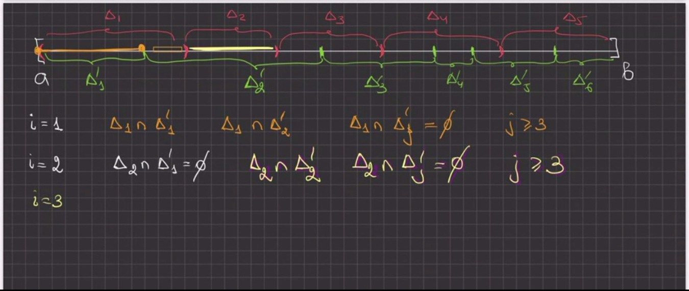
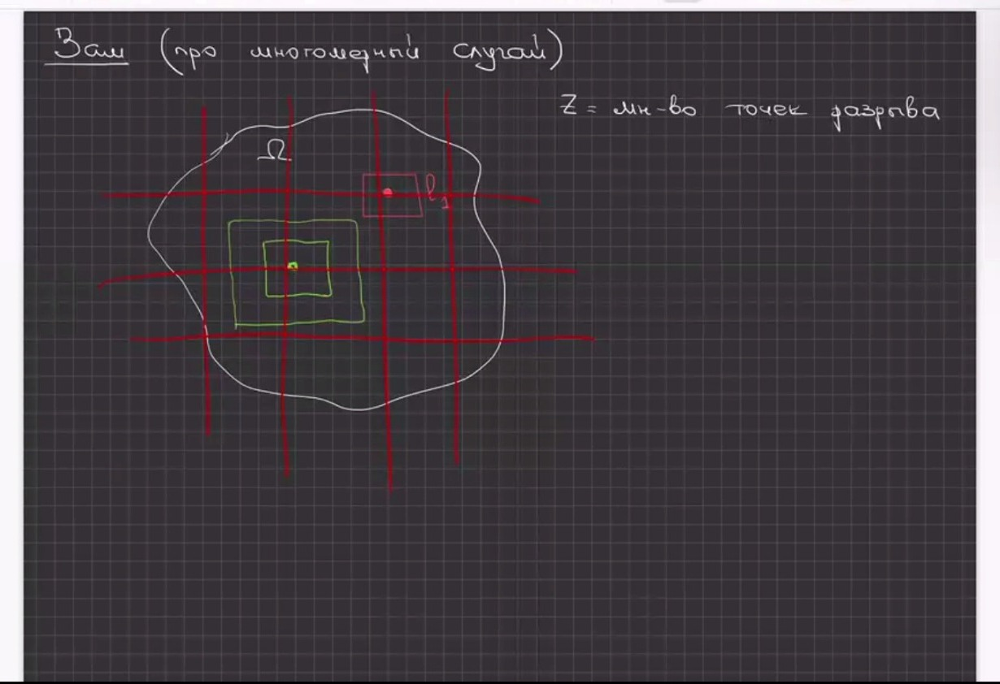
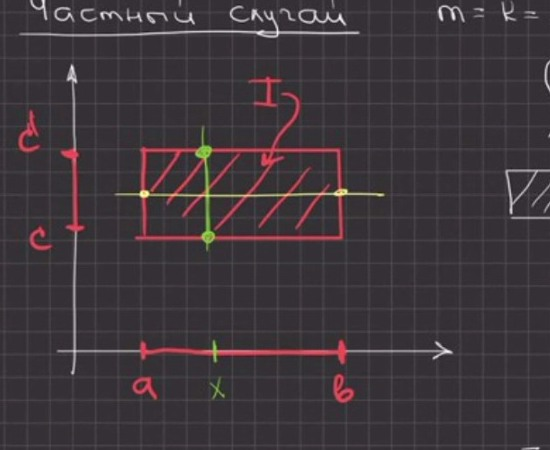

# Лекции 83–84 — свойства интеграла по множеству, достаточность критерия Лебега, теорема Фубини

[[ru/lectures-2025-26/lecture-81-82|← Лекции 81–82]] · [[ru/lectures-2025-26/index|Указатель лекций]] · [[ru/term-index|Термины и теоремы]] · [[en/lectures-2025-26/lecture-83-84|English]] · [[es/lectures-2025-26/lecture-83-84|Español]]

> [!info] Источник и нумерация
> Конспект составлен по 42 видеокадрам Zoom-лекций 83–84 от 31 октября 2026 г. (кадры p083–p124; сырой текст кадров — в [`ocr/raw/`](https://github.com/NikiHunter/matan/blob/main/ocr/raw/p083.md)): это печатные слайды «k / 10» (кадры p083–p090, слайды 1–8) и рукописная доска (кадры p091–p124). Слайды 9 / 10 и 10 / 10 в архив не вошли, а принцип Кавальери, объявленный в целях лекции, в присланных кадрах не сформулирован: [[#^thm-10-4-2|теорема 10.4.2]] и [[#^cor-10-4-3|следствие 10.4.3]], стоящее перед ней, восстановлены по слайдам курса 2024/25 (ФС p101–p102) и помечены блоками «Восстановлено»; в кадрах лекции 2026 года их текста нет. Кадры первых трёх страниц доски (из 11) в архиве отсутствуют; на кадрах доски стоят метки «4 of 11» (p091), «10 of 16» (p103) и «20 of 24» (p116) — число страниц доски росло по ходу лекции. Соседние кадры доски перекрываются (один и тот же лист снят несколько раз с небольшим сдвигом, например p091–p093, p097–p101, p119–p121, p122–p124); повторяющийся текст приведён один раз, а номера всех кадров сохранены в виде якорей страниц. Порядок кадров в архиве не хронологический: судя по меткам времени в именах файлов (10:37, 11:19, 12:55), лектор сначала доказывал на доске достаточность [[ru/lectures-2025-26/lecture-41-42#^thm-4-2-5|критерия Лебега]] (p091–p102), затем показал слайды 4–5 / 10 со свойствами интеграла и доказал свойства 1–3 (p103–p105) и лишь потом перешёл к [[ru/17-multiple-integrals#^fubini-theorem-continuous|теореме Фубини]] (p106–p124; слайды 6–8 / 10 показаны по ходу этой части). В тексте кадры идут по возрастанию номеров, так что формулировки со слайдов (p086–p090) стоят раньше доказательств на доске. Нумерация определений и теорем — лекторская; сокращение «Заш» на кадрах p102, p108, p114 и p124 — «Зам.» (замечание). Описки конспекта исправлены и отмечены блоками «Поправка к источнику», утраченные места восстановлены и отмечены блоками «Восстановлено»; номера пометок соответствуют [`ocr/RESOLVED.md`](https://github.com/NikiHunter/matan/blob/main/ocr/RESOLVED.md). Места, которые нужно сверить с видеозаписью, перечислены в [`ocr/ISSUES.md`](https://github.com/NikiHunter/matan/blob/main/ocr/ISSUES.md).

## Цели лекций

Лекции 83–84 прочитаны 31 октября 2026 г. (титульный слайд 1 / 10: «Математический анализ, лекции 83–84, 31 октября 2026»). ^p083

**Цитата дня** (слайд 2 / 10): «Продам дрова — недавно наломала.»

^p084

**Цели лекций** (слайд 3 / 10):

^p085

- доказать достаточность критерия Лебега интегрируемости функции по Риману;
- продолжить обсуждение свойств многомерного интеграла;
- разобрать теорему Фубини и ряд её следствий;
- сформулировать принцип Кавальери.

Последний пункт в присланных кадрах не представлен (слайды 9 / 10 и 10 / 10 отсутствуют в архиве). Формулировка принципа Кавальери ([[#^thm-10-4-2|теорема 10.4.2]]) восстановлена по слайдам 2024/25 в конце файла; там же восстановлено [[#^cor-10-4-3|следствие 10.4.3]], которое на слайдах 2024/25 идёт перед ней. Из следствий теоремы Фубини в кадрах есть [[#^cor-10-4-1|следствия 10.4.1]] и [[#^cor-10-4-2|10.4.2]].

## §10.3. Общие свойства интеграла (окончание)

Напомним: интеграл по допустимому множеству $\Omega$ определён равенством $\int_\Omega f\,dx=\int_If\chi_\Omega\,dx$, где $I\supset\Omega$ — промежуток ([[ru/lectures-2025-26/lecture-81-82#^def-10-2-4|определение 10.2.4]]), а $\mu(\Omega)=\int_\Omega1\,dx$ — мера Жордана ([[ru/lectures-2025-26/lecture-81-82#^def-10-2-5|определение 10.2.5]]). Слайды 4 и 5 / 10 («Свойства интеграла») перечисляют основные свойства такого интеграла. ^p086

**Свойства.** Пусть $\Omega\subset\mathbb R^n$ — [[ru/lectures-2025-26/lecture-81-82#^def-10-2-1|допустимое множество]] и $f,g\in R(\Omega)$. Тогда:

1. если $f(x)\ge0$ при всех $x\in\Omega$, то $\int_\Omega f(x)\,dx\ge0$;
2. если $f(x)\le g(x)$ при всех $x\in\Omega$, то $\int_\Omega f(x)\,dx\le\int_\Omega g(x)\,dx$;
3. если $m\le f(x)\le M$ при всех $x\in\Omega$, то $m\,\mu(\Omega)\le\int_\Omega f(x)\,dx\le M\,\mu(\Omega)$.

Продолжение (слайд 5 / 10): ^p087

4. если $m=\inf_{x\in\Omega}f(x)$ и $M=\sup_{x\in\Omega}f(x)$, то существует $\theta\in[m,M]$ такое, что $\int_\Omega f(x)\,dx=\theta\,\mu(\Omega)$;
5. если $\Omega$ — допустимое [[ru/13-metric-spaces#13.5 Непрерывность и связность|связное]] множество и $f:\Omega\to\mathbb R$ непрерывна, то существует $\xi\in\Omega$ такая, что $\int_\Omega f(x)\,dx=f(\xi)\,\mu(\Omega)$;
6. если $m\le f(x)\le M$ и $g(x)\ge0$ при всех $x\in\Omega$, то $m\int_\Omega g(x)\,dx\le\int_\Omega f(x)g(x)\,dx\le M\int_\Omega g(x)\,dx$.

> [!info] Поправка к источнику
> (M539). В конспекте (слайды 4–5 / 10; так же на слайде ФС p98 курса 2024/25): «Пусть функции $f,g\in\mathcal R(\Omega)$» — без указания, что $\Omega$ допустимо. Добавлено «$\Omega$ — допустимое множество»: иначе мера $\mu(\Omega)$ в свойствах 3–5 не определена ([[ru/lectures-2025-26/lecture-81-82#^def-10-2-5|определение 10.2.5]]); в свойстве 5 допустимость $\Omega$ на слайде записана явно. Класс интегрируемых функций обозначается $R(\Omega)$, как в лекциях 81–82 (на слайдах — каллиграфическое $\mathcal R$).

На слайде 5 / 10 синими чернилами вписана подсказка к свойству 6: неравенства $m\le f(x)\le M$ умножаются на $g(x)\ge0$.

> [!info] Поправка к источнику
> (S440, T441). В конспекте: подсказка «$[mg(x)\le f(x)\le Mg(x)]$» и произведение «$fg(x)$» в правой части свойства 6. В подсказке в средней части пропущен множитель $g(x)$: из $m\le f(x)\le M$ и $g(x)\ge0$ следует $mg(x)\le f(x)g(x)\le Mg(x)$ (так на слайде ФС p98: «$mg(x)\le f(x)g(x)\le Mg(x)$»); подынтегральная функция в свойстве 6 — произведение $f(x)g(x)$.

Доказательства свойств 1–3 лектор провёл на доске (кадры p103–p105, см. ниже); свойства 4–6 на слайде только сформулированы, их доказательства восстановлены там же.

## §10.4. Теорема Фубини

Пусть $\mathbb R^n=\mathbb R^m\times\mathbb R^k$, $m+k=n$; точки пространства $\mathbb R^n$ записываем в виде $(x,y)$, где $x\in\mathbb R^m$, $y\in\mathbb R^k$ (слайд 6 / 10, пометка синими чернилами). ^p088

> [!theorem] Теорема 10.4.1 (Фубини)
> Пусть $I=I_x\times I_y\subset\mathbb R^n$, где $I_x$ — промежуток в $\mathbb R^m$, $I_y$ — промежуток в $\mathbb R^k$, $m+k=n$. Если функция $f$ интегрируема на $I$ и, кроме того,

^thm-10-4-1

$(\ast)$ для каждого $x\in I_x$ функция $y\mapsto f(x,y)$ интегрируема на $I_y$,

то функция $F(x)=\int_{I_y}f(x,y)\,dy$ интегрируема на $I_x$ и
$$
\int_If(x,y)\,dx\,dy=\int_{I_x}\Bigl(\int_{I_y}f(x,y)\,dy\Bigr)dx .
$$

*Рисунок на слайде (стр. p088): прямоугольник $I=I_x\times I_y$ (заштрихован); промежуток $I_x\subset\mathbb R^m$ отложен по горизонтальной оси, $I_y\subset\mathbb R^k$ — по вертикальной. Условие $(\ast)$ на слайде обведено красной рамкой.*

Слайд 7 / 10, «Сведение кратного интеграла к повторным». ^p089

> [!corollary] Следствие 10.4.1
> Пусть $I=I_1\times I_2\times\dots\times I_n\subset\mathbb R^n$, $I_i=[a_i,b_i]\subset\mathbb R$, функция $f$ интегрируема на $I$, и на каждом шаге вывода из теоремы 10.4.1 выполнено условие $(\ast)$, т.е. все стоящие справа внутренние интегралы существуют (это так, например, если $f$ непрерывна на $I$). Тогда
> $$
> \int_If(x)\,dx=\int_{a_n}^{b_n}dx_n\int_{a_{n-1}}^{b_{n-1}}dx_{n-1}\dots\int_{a_1}^{b_1}f(x_1,x_2,\dots,x_n)\,dx_1 .
> $$
> Правая часть читается как вложенные интегралы: сначала при фиксированных $x_2,\dots,x_n$ вычисляется интеграл по $x_1$ от $a_1$ до $b_1$, затем результат интегрируется по $x_2$, и так далее до $x_n$.

^cor-10-4-1

> [!info] Поправка к источнику
> (M540, S444). В конспекте (слайд 7 / 10; так же на слайде ФС p100): условия на $f$ не указаны, а интегралы записаны в убывающем порядке индексов без пояснения. Добавлено: $f\in R(I)$ и выполнено условие $(\ast)$ на каждом шаге (без него существование внутренних интегралов не гарантировано, см. замечание о роли условия $(\ast)$ ниже); для непрерывной $f$ оно выполнено автоматически, так как сечения непрерывной функции непрерывны, а интеграл от непрерывной функции по одной из переменных непрерывен по остальным (§9.1 «Собственные [[ru/lectures-2025-26/lecture-75-76#^def-9-1-1|интегралы, зависящие от параметра]]»). Порядок записи пояснён: самый внутренний интеграл — крайний справа, по $x_1$.

> [!note] Восстановлено
> (вывод по стандартной схеме; на слайде следствие приведено без доказательства). [[ru/01-logic-sets-functions#^example-induction|Индукция]] по $n$. При $n=1$ формула тривиальна. Пусть $n\ge2$; положим $I_x=I_n=[a_n,b_n]$ и $I_y=I_1\times\dots\times I_{n-1}$ (с точностью до перестановки координат, на интеграл она не влияет). Условие $(\ast)$ означает, что при каждом $x_n\in[a_n,b_n]$ функция $(x_1,\dots,x_{n-1})\mapsto f(x_1,\dots,x_n)$ интегрируема на $I_y$, и по [[#^thm-10-4-1|теореме 10.4.1]]
> $$
> \int_If\,dx=\int_{a_n}^{b_n}\Bigl(\int_{I_y}f(x_1,\dots,x_n)\,dx_1\dots dx_{n-1}\Bigr)dx_n ;
> $$
> к внутреннему $(n-1)$-кратному интегралу применяется предположение индукции.

Слайд 8 / 10. ^p090

> [!corollary] Следствие 10.4.2
> Пусть $D\subset\mathbb R^{n-1}$ — допустимое множество, функции $\varphi_1,\varphi_2$ непрерывны на $\overline D$ и $\varphi_1(x)\le\varphi_2(x)$ при всех $x\in\overline D$, и пусть
> $$
> E=\{(x,y)\in\mathbb R^n:\ x\in D,\ \varphi_1(x)\le y\le\varphi_2(x)\}
> $$
> (здесь $x\in\mathbb R^{n-1}$, $y\in\mathbb R$). Если $f\in R(E)$ и для каждого $x\in D$ существует интеграл $\int_{\varphi_1(x)}^{\varphi_2(x)}f(x,y)\,dy$, то
> $$
> \int_Ef(x,y)\,dx\,dy=\int_Ddx\int_{\varphi_1(x)}^{\varphi_2(x)}f(x,y)\,dy .
> $$
> Синими чернилами под формулой выписана та же правая часть в другой записи: $\int_D\Bigl(\int_{\varphi_1(x)}^{\varphi_2(x)}f(x,y)\,dy\Bigr)dx$; внешний интеграл берётся по множеству $D$ в смысле [[ru/lectures-2025-26/lecture-81-82#^def-10-2-4|определения 10.2.4]].

^cor-10-4-2

> [!info] Поправка к источнику
> (M541, S445). В конспекте (слайд 8 / 10): «Пусть $\mathcal D$ — ограниченное множество в $\mathbb R^{n-1}$ и пусть $\mathcal E=\{\dots\}$. Если $f\in\mathcal R(\mathcal E)$, то …» — без условий на $\varphi_1$, $\varphi_2$ и без требования существования внутреннего интеграла. Добавлено: $D$ допустимо, $\varphi_1,\varphi_2$ непрерывны на $\overline D$, $\varphi_1\le\varphi_2$ (тогда $E$ ограничено, а его граница лежит в объединении графиков $\varphi_1$, $\varphi_2$ над $\overline D$ и цилиндра $\partial D\times[\min\varphi_1,\max\varphi_2]$ — множеств меры нуль, т.е. $E$ допустимо), и существование внутреннего интеграла при каждом $x\in D$: это условие $(\ast)$ [[#^thm-10-4-1|теоремы 10.4.1]] для функции $f\chi_E$ (см. доказательство ниже и замечание в его конце). Запись справа от знака равенства на слайде и в пометке чернилами — одна и та же формула.

## §10.1. Интеграл Римана на n-мерном промежутке (окончание)

### Достаточность в критерии Лебега (одномерный случай)

В лекциях 81–82 для [[ru/lectures-2025-26/lecture-81-82#^thm-10-1-2|теоремы 10.1.2]] (критерий Лебега) доказана необходимость и приведено $n$-мерное доказательство достаточности по схеме Зорича. На доске лектор доказывает достаточность в одномерном случае, на отрезке $[a,b]$ (для $n=1$ критерий Лебега — [[ru/lectures-2025-26/lecture-41-42#^thm-4-2-5|теорема 4.2.5]] — был в лекциях 41–42 сформулирован без доказательства). Используется критерий Коши. ^p091

**Утверждение (достаточность в критерии Лебега, одномерный случай).** Пусть функция $f$ определена и ограничена на $[a,b]$ и непрерывна [[ru/19-measure-theory#19.4 Измеримые функции|почти всюду]] на $[a,b]$. Тогда $f\in R([a,b])$.

**Доказательство.** Положим $M=\sup_{[a,b]}|f|<\infty$. Напомним критерий Коши: $f\in R([a,b])$, если для любого $\varepsilon'>0$ найдётся $\delta>0$ такое, что для любых двух разбиений $\Delta=\{\Delta_i\}$ и $\Delta'=\{\Delta'_j\}$ отрезка $[a,b]$ мелкости (на доске — «ранга разбиения») меньше $\delta$ и любых наборов отмеченных точек ([[ru/lectures-2025-26/lecture-37-38#^def-4-2-4|оснащений]]) $\xi=\{\xi_i\}$, $\xi'=\{\xi'_j\}$ выполнено
$$
\bigl|\sigma(f,\Delta,\xi)-\sigma(f,\Delta',\xi')\bigr|<\varepsilon',\qquad\sigma(f,\Delta,\xi)=\sum_if(\xi_i)\,\mu(\Delta_i),
$$
где $\mu(\Delta_i)$ — длина отрезка $\Delta_i$.

*Шаг 1 (покрытие точек разрыва).* Пусть $Z$ — множество точек разрыва $f$ на $[a,b]$. По условию $\mu(Z)=0$, т.е. (по определению множества меры нуль) для любого $\varepsilon>0$ существует не более чем [[ru/lectures-2025-26/lecture-01-02#^def-1-2-5|счётная]] система интервалов $\{l_i\}$, покрывающая $Z$, такая, что $\sum_i\mu(l_i)<\varepsilon$ ($\mu(l_i)$ — длина интервала). Зафиксируем такое $\varepsilon>0$.

*Шаг 2 (окрестности точек непрерывности).* Пусть $x\in[a,b]\setminus Z$ — точка непрерывности $f$. Тогда существует $\delta(x)>0$ такое, что
$$
f\bigl(B_{3\delta(x)}(x)\cap[a,b]\bigr)\subset B_\varepsilon\bigl(f(x)\bigr),
$$
где $B_r(c)=(c-r,c+r)$.

Иначе говоря, для всех $\tilde x\in[a,b]$
$$
|\tilde x-x|<3\delta(x)\ \Longrightarrow\ |f(\tilde x)-f(x)|<\varepsilon .\tag{1}
$$
Число $\varepsilon$ здесь то же, что в шаге 1. На доске нарисован отрезок с точками $x-3\delta$, $x$, $\tilde x$, $x+3\delta$. ^p092

*Шаг 3 (покрытие отрезка).* Весь отрезок $[a,b]$ покрыт системой [[ru/lectures-2025-26/lecture-55-56#^def-5-3-1|открытых множеств]], состоящей из интервалов $\{l_i\}$ (они покрывают $Z$) и окрестностей $B_{\delta(x)}(x)$ точек непрерывности:
$$
[a,b]\subset\bigcup_il_i\ \cup\bigcup_{x\in[a,b]\setminus Z}B_{\delta(x)}(x).
$$

^p093

> [!info] Поправка к источнику
> (M450). В конспекте: «весь отрезок $[a,b]$ будет покрыт системой интервалов $\{l_i\}$ и $\bigcup_{x\in Z}B_{3\delta(x)}(x)$». Окрестности строятся для точек непрерывности, т.е. для $x\in[a,b]\setminus Z$ (для $x\in Z$ числа $\delta(x)$ не определены); кроме того, на следующем кадре в [[ru/lectures-2025-26/lecture-57-58#^def-5-3-7|конечное подпокрытие]] входят окрестности $B_{\delta(x_j)}(x_j)$ радиуса $\delta(x_j)$, а не $3\delta(x_j)$: радиус $3\delta(x)$ нужен лишь в условии непрерывности (1).

Отрезок $[a,b]$ — компакт, поэтому из любого его покрытия открытыми множествами можно выбрать конечное подпокрытие. Оно имеет вид
$$
l_{i_1},\ l_{i_2},\ \dots,\ l_{i_p},\quad B_{\delta(x_1)}(x_1),\ B_{\delta(x_2)}(x_2),\ \dots,\ B_{\delta(x_q)}(x_q),
$$
т.е. состоит из $p$ интервалов покрытия $Z$ и $q$ окрестностей точек непрерывности $x_1,\dots,x_q$. Переобозначим выбранные интервалы $l_1,\dots,l_p$, $l_k=(\alpha_k,\beta_k)$; тогда $\sum_{k=1}^p\mu(l_k)<\varepsilon$. Выберем число $\delta>0$ так, чтобы
$$
\delta<\min_{1\le j\le q}\delta(x_j),\qquad2\delta p<\varepsilon .\tag{2}
$$

^p094

*Шаг 4 (два разбиения).* Рассмотрим два разбиения $\Delta=\{\Delta_i\}$ и $\Delta'=\{\Delta'_j\}$ отрезка $[a,b]$, мелкость каждого из которых меньше $\delta$, и пусть $\xi=\{\xi_i\}$, $\xi'=\{\xi'_j\}$ — их оснащения ($\xi_i\in\Delta_i$, $\xi'_j\in\Delta'_j$). Отрезки каждого разбиения покрывают $[a,b]$ и пересекаются лишь концами, поэтому $\mu(\Delta_i)=\sum_j\mu(\Delta_i\cap\Delta'_j)$ и $\mu(\Delta'_j)=\sum_i\mu(\Delta_i\cap\Delta'_j)$ (пересечение $\Delta_i\cap\Delta'_j$ — отрезок, точка или пустое множество; длина точки и пустого множества равна нулю). Следовательно,
$$
\sigma(f,\Delta,\xi)-\sigma(f,\Delta',\xi')=\sum_if(\xi_i)\mu(\Delta_i)-\sum_jf(\xi'_j)\mu(\Delta'_j)=\sum_i\sum_j\bigl(f(\xi_i)-f(\xi'_j)\bigr)\mu(\Delta_i\cap\Delta'_j).\tag{3}
$$

^p095

Чтобы наглядно представить сумму по $i$ и $j$, лектор рисует оба разбиения на одном отрезке: красные промежутки $\Delta_1,\dots,\Delta_5$ над отрезком и зелёные $\Delta'_1,\dots,\Delta'_6$ под ним, с концами $a$ и $b$ (кадры p096–p097; сам рисунок приведён ниже). ^p096

 ^p097

Для каждого $i$ лишь немногие $\Delta'_j$ пересекаются с $\Delta_i$: для $i=1$ непусты пересечения $\Delta_1\cap\Delta'_1$ и $\Delta_1\cap\Delta'_2$, а $\Delta_1\cap\Delta'_j=\varnothing$ при $j\ge3$; для $i=2$ имеем $\Delta_2\cap\Delta'_1=\varnothing$, непусто лишь $\Delta_2\cap\Delta'_2$ (так что $\Delta_2$ целиком лежит в $\Delta'_2$), и $\Delta_2\cap\Delta'_j=\varnothing$ при $j\ge3$; строка $i=3$ на доске не дописана. Для дальнейшего важно лишь, что слагаемые суммы (3) с пустым пересечением равны нулю и что $\sum_j\mu(\Delta_i\cap\Delta'_j)=\mu(\Delta_i)$.

*Шаг 5 (оценка суммы (3)).* Разобьём слагаемые на две группы:
$$
\bigl|\sigma(f,\Delta,\xi)-\sigma(f,\Delta',\xi')\bigr|\le\Sigma_1+\Sigma_2,
$$
где $\Sigma_1$ — сумма $\sum_j\bigl|f(\xi_i)-f(\xi'_j)\bigr|\mu(\Delta_i\cap\Delta'_j)$ по всем $i$, для которых $\xi_i\in\bigcup_{k=1}^pl_k$, а $\Sigma_2$ — та же сумма по остальным $i$. ^p098

*Случай 1: $\xi_i\in l_k=(\alpha_k,\beta_k)$ при некотором $k\le p$.* Так как $\xi_i\in\Delta_i$ и $\mu(\Delta_i)<\delta$, имеем $\Delta_i\subset(\alpha_k-\delta,\beta_k+\delta)$. Отнесём каждый такой $\Delta_i$ к одному из интервалов $l_k$, содержащих $\xi_i$. Отрезки $\Delta_i$ не перекрываются, поэтому сумма длин отрезков, отнесённых к $l_k$, не превосходит $\mu(l_k)+2\delta$. Так как $|f(\xi_i)-f(\xi'_j)|\le2M$ и $\sum_j\mu(\Delta_i\cap\Delta'_j)=\mu(\Delta_i)$, получаем (с учётом $\sum_k\mu(l_k)<\varepsilon$ и $2\delta p<\varepsilon$)
$$
\Sigma_1\le2M\sum_{i:\ \xi_i\in\bigcup_kl_k}\mu(\Delta_i)\le2M\Bigl(\sum_{k=1}^p\mu(l_k)+2\delta p\Bigr)\le4M\varepsilon .\tag{4}
$$

*Случай 2: $\xi_i\notin\bigcup_{k=1}^pl_k$.* Тогда точка $\xi_i\in[a,b]$ покрыта одной из окрестностей конечного подпокрытия: $\xi_i\in B_{\delta(x_s)}(x_s)$ для некоторого $s\le q$; положим $\delta_s=\delta(x_s)$. Пусть $\Delta_i\cap\Delta'_j\ne\varnothing$, и пусть $t$ — общая точка этих отрезков. Для любой точки $u\in\Delta'_j$, используя мелкость разбиений и $\delta<\delta_s$ из (2),
$$
|u-x_s|\le|u-t|+|t-\xi_i|+|\xi_i-x_s|<\delta+\delta+\delta_s<3\delta_s .
$$
Значит, $\Delta'_j\subset B_{3\delta_s}(x_s)$, и в частности $\xi'_j\in B_{3\delta_s}(x_s)\cap[a,b]$; кроме того, $\xi_i\in B_{\delta_s}(x_s)\subset B_{3\delta_s}(x_s)$. ^p099

По условию (1) для $x=x_s$ получаем $|f(\xi_i)-f(x_s)|<\varepsilon$ и $|f(\xi'_j)-f(x_s)|<\varepsilon$, откуда
$$
\Delta_i\cap\Delta'_j\ne\varnothing\ \Longrightarrow\ |f(\xi_i)-f(\xi'_j)|<2\varepsilon ,
$$
т.е. точка $\xi'_j$ лежит рядом с центром $x_s$ той же окрестности точки непрерывности, что и $\xi_i$. Слагаемые с пустым пересечением равны нулю, а все слагаемые неотрицательны, поэтому сумму по подмножеству индексов $i$ можно оценить суммой по всем $i$:
$$
\Sigma_2\le2\varepsilon\sum_i\sum_j\mu(\Delta_i\cap\Delta'_j)=2\varepsilon(b-a).\tag{5}
$$

^p100

> [!info] Поправка к источнику
> (M462, A461, S463, S464, M542). В конспекте: «если $\xi_i\notin\bigcup_{k=1}^pl_k$, то $\Delta_i\subset B_{\delta(\xi_i)}(\xi_i)$; если $\Delta_i\cap\Delta'_j\ne\varnothing$, то $\Delta'_j\subset B_{2\delta(\xi_i)}(\xi_i)$ (… $\mu(\Delta'_j)<\delta<\delta(\xi_i)$ …) $\Rightarrow f(\xi'_j)\in B_\varepsilon(f(\xi_i))$», далее «в этом случае $\xi_i$ — точка непрерывности, а $\xi'_j$ лежит рядом с $\xi_i$» и оценка $\varepsilon(b-a)$ вместо (5). Число $\delta(\xi_i)$ определено лишь для точек непрерывности, и неравенство $\delta<\delta(\xi_i)$ не следует из $\delta<\min_j\delta(x_j)$, так как $\xi_i$ не обязана быть одной из точек $x_1,\dots,x_q$; более того, $\xi_i\notin\bigcup_{k\le p}l_k$ не означает, что $\xi_i$ — точка непрерывности (она может лежать в интервале $l_m$, не вошедшем в конечное подпокрытие, и быть накрытой окрестностью $B_{\delta(x_s)}(x_s)$ точки непрерывности $x_s$). Рассуждение переписано через центр $x_s$ окрестности, содержащей $\xi_i$; радиус $3\delta(x)$ в условии (1) нужен именно для того, чтобы $\Delta'_j$ поместилось в $B_{3\delta_s}(x_s)$; оценка получается с множителем $2\varepsilon$ вместо $\varepsilon$ (разность $f(\xi_i)-f(\xi'_j)$ оценивается через $f(x_s)$ с двух сторон). Переход от суммы по подмножеству индексов к сумме по всем $i$ (S463) законен, так как слагаемые неотрицательны, а $\sum_{i,j}\mu(\Delta_i\cap\Delta'_j)=b-a$.

*Шаг 6 (вывод).* Из (4) и (5) следует, что для любых двух разбиений мелкости меньше $\delta$ и любых их оснащений
$$
\bigl|\sigma(f,\Delta,\xi)-\sigma(f,\Delta',\xi')\bigr|\le4M\varepsilon+2(b-a)\varepsilon=C\varepsilon,\qquad C=4M+2(b-a),
$$
причём постоянная $C$ не зависит от $\varepsilon$ (на доске: $\mathrm{const}\cdot\varepsilon$). Пусть задано $\varepsilon'>0$. Возьмём $\varepsilon=\varepsilon'/(2C)$ и построим по нему $\delta$ так, как описано в шагах 1–3; тогда для любых двух разбиений мелкости меньше $\delta$ с любыми оснащениями $\bigl|\sigma(f,\Delta,\xi)-\sigma(f,\Delta',\xi')\bigr|\le\varepsilon'/2<\varepsilon'$. По критерию Коши интегральные суммы имеют предел при стремлении мелкости к нулю, т.е. $f\in R([a,b])$. $\square$ ^p101

> [!info] Поправка к источнику
> (T465, S466). В конспекте итог записан как «$\bigl|\sigma(f,\xi,\Delta)-\sigma(f,\xi',\Delta')\bigr|\le4\varepsilon\sup|f|+\varepsilon(b-a)=\mathrm{const}\cdot\varepsilon$» без явной ссылки на критерий Коши. Здесь постоянная выписана ($C=4M+2(b-a)$; второе слагаемое удвоено по причине, объяснённой выше) и добавлен переход от оценки к критерию Коши (шаг 6).

**Замечание (про многомерный случай).** На доске записан лишь заголовок замечания — «Зам. (про многомерный случай)», — и рисунок; письменного текста нет.

^p102

На рисунке изображена область $\Omega$ с подписью «$Z$ — множество точек разрыва», сетка красных прямых (разбиение), красный квадрат $l_1$ с [[ru/lectures-2025-26/lecture-16#^def-2-5-4|точкой разрыва]] внутри и вложенные зелёные квадраты вокруг точки непрерывности. По-видимому, речь о том, что в $\mathbb R^n$ та же схема работает с [[ru/lectures-2025-26/lecture-79-80#^def-10-1-1|брусьями]] вместо отрезков: множество $Z$ покрывается брусьями $l_i$ с малой суммой объёмов, у каждой точки непрерывности берутся окрестности-кубы, а разбиения изображаются сеткой. Полное доказательство достаточности в $\mathbb R^n$ (с растяжениями покрытия в $2$ и $3$ раза) приведено в лекциях 81–82 после [[ru/lectures-2025-26/lecture-81-82#^thm-10-1-2|теоремы 10.1.2]].

## §10.3. Общие свойства интеграла (доказательства свойств 1–6)

*Метка доски «10 of 16».*

^p103

**Доказательство свойства 1.** Пусть $f(x)\ge0$ при всех $x\in\Omega$. По определению интеграла по множеству
$$
\int_\Omega f(x)\,dx=\int_{I\supset\Omega}f\chi_\Omega(x)\,dx,\qquad\chi_\Omega(x)=\begin{cases}1,&x\in\Omega,\\0,&x\notin\Omega\end{cases}
$$
(характеристическая функция из [[ru/lectures-2025-26/lecture-81-82#^def-10-2-2|определения 10.2.2]]). Так как $f\ge0$ на $\Omega$, а вне $\Omega$ функция $f\chi_\Omega$ равна нулю, то $f\chi_\Omega(x)\ge0$ при всех $x\in I$ (и даже при всех $x\in\mathbb R^n$).

Интеграл $\int_If\chi_\Omega\,dx$ есть предел интегральных сумм $\sigma(f\chi_\Omega,P,\xi)$ при $\lambda(P)\to0$ (здесь $\lambda(P)$ — мелкость разбиения $P$ промежутка $I$). Все эти суммы неотрицательны (каждое слагаемое $f\chi_\Omega(\xi_i)\mu(I_i)\ge0$), поэтому и предел неотрицателен: $\int_If\chi_\Omega\,dx\ge0$, т.е. $\int_\Omega f\,dx\ge0$. $\square$ ^p104

**Доказательство свойства 2.** Положим $\psi(x)=g(x)-f(x)$. По условию $\psi(x)\ge0$ при всех $x\in\Omega$, и $\psi\in R(\Omega)$ как разность интегрируемых функций. По свойству 1 $\int_\Omega\psi(x)\,dx\ge0$, а по линейности интеграла $\int_\Omega\psi\,dx=\int_\Omega g\,dx-\int_\Omega f\,dx$ (линейность следует из линейности интегральных сумм). Значит, $\int_\Omega f\,dx\le\int_\Omega g\,dx$. $\square$

^p105

**Доказательство свойства 3.** Пусть $f(x)\ge m$ при всех $x\in\Omega$. По свойству 2 (для функций $m$ и $f$) $\int_\Omega m\,dx\le\int_\Omega f\,dx$. Интеграл от константы равен $\int_\Omega m\,dx=m\int_\Omega1\,dx=m\,\mu(\Omega)$ ([[ru/lectures-2025-26/lecture-81-82#^def-10-2-5|определение 10.2.5]]), так что $m\,\mu(\Omega)\le\int_\Omega f\,dx$. Из $f(x)\le M$ так же получаем $\int_\Omega f\,dx\le M\,\mu(\Omega)$. $\square$

> [!note] Восстановлено
> (по стандартному доказательству; на слайде 5 / 10 свойства 4–6 только сформулированы, на слайде ФС p98 курса 2024/25 для свойства 6 приведена лишь подсказка $mg(x)\le f(x)g(x)\le Mg(x)$).
>
> *Свойство 4.* Функция $f\in R(\Omega)$ ограничена ([[ru/lectures-2025-26/lecture-81-82#^thm-10-2-1|теорема 10.2.1]]), так что $m$ и $M$ конечны, и по свойству 3 $m\,\mu(\Omega)\le\int_\Omega f\,dx\le M\,\mu(\Omega)$. Если $\mu(\Omega)>0$, то число $\theta=\frac1{\mu(\Omega)}\int_\Omega f\,dx$ лежит в $[m,M]$ и $\int_\Omega f\,dx=\theta\,\mu(\Omega)$. Если $\mu(\Omega)=0$, то $\int_\Omega f\,dx=0$, и равенство верно при любом $\theta\in[m,M]$.
>
> *Свойство 5.* Если $\mu(\Omega)=0$, то обе части равны нулю при любом $\xi\in\Omega$. Пусть $\mu(\Omega)>0$ и $\theta=\frac1{\mu(\Omega)}\int_\Omega f\,dx\in[m,M]$ — число из свойства 4. Образ $f(\Omega)$ связного множества при непрерывном отображении связен, т.е. является промежутком с концами $m$ и $M$, поэтому каждое $\theta\in(m,M)$ есть значение $f$ в некоторой точке $\xi\in\Omega$. Остаётся случай $\theta=m$ (случай $\theta=M$ аналогичен), когда значение $m$ может не достигаться. Здесь $\int_\Omega(f-m)\,dx=0$. Допустим, что $f>m$ всюду на $\Omega$. Так как $\mu(\Omega)>0$, у $\Omega$ есть [[ru/lectures-2025-26/lecture-57-58#Печатный слайд 4 (стр. PDF 4) — Внутренность множества — определение 5.3.3|внутренняя точка]] (иначе $\Omega\subset\partial\Omega$ и $\mu(\Omega)=0$); возьмём замкнутый шар $K\subset\Omega$ положительного радиуса. На компакте $K$ непрерывная положительная функция $f-m$ имеет положительный минимум $c$, и $f-m\ge c\chi_K$ на $\Omega$, откуда по свойству 2 $\int_\Omega(f-m)\,dx\ge c\,\mu(K)>0$ — противоречие. Значит, $f(\xi)=m=\theta$ для некоторой точки $\xi\in\Omega$.
>
> *Свойство 6.* По [[ru/lectures-2025-26/lecture-81-82#^def-10-2-4|определению 10.2.4]] и критерию Лебега функции $f\chi_\Omega$ и $g\chi_\Omega$ ограничены и непрерывны почти всюду на $I$, поэтому и $(fg)\chi_\Omega=(f\chi_\Omega)(g\chi_\Omega)$ ограничена и непрерывна почти всюду, т.е. $fg\in R(\Omega)$. Умножив $m\le f(x)\le M$ на $g(x)\ge0$, получаем $mg(x)\le f(x)g(x)\le Mg(x)$ при всех $x\in\Omega$. По свойству 2 и линейности интеграла $m\int_\Omega g\,dx\le\int_\Omega fg\,dx\le M\int_\Omega g\,dx$. $\square$

## §10.4. Теорема Фубини (продолжение)

### Кратный и повторный интегралы

Интеграл $\int_If(x,y)\,dx\,dy$ — многомерный (кратный) интеграл по промежутку $I$. Интеграл
$$
\int_{I_x}\Bigl(\int_{I_y}f(x,y)\,dy\Bigr)dx=\int_{I_x}dx\int_{I_y}f(x,y)\,dy
$$
(вторая запись — вариант записи первой) называется повторным интегралом. Как его понимать? При каждом фиксированном $x\in I_x$ вычисляем $F(x)=\int_{I_y}f(x,y)\,dy$; получаем функцию $F:I_x\to\mathbb R$; затем интегрируем $F$ по $I_x$. ^p106

Кадр p107 снимает тот же лист доски в чуть большем охвате; новых записей в нём нет. ^p107

**Замечание (о роли условия $(\ast)$).** Что случится, если убрать из условий теоремы Фубини требование

^p108

$(\ast)$ для каждого $x\in I_x$ функция $y\mapsto f(x,y)$ интегрируема на $I_y$?

Если условия $(\ast)$ нет, то может получиться, что $F(x)$ не существует при некоторых $x\in I_x$.

В таком случае $F(x)$ нужно доопределить для таких $x$. Доопределить можно так: в качестве $F(x)$ взять любое число из отрезка $\bigl[\underline J(x),\overline J(x)\bigr]$, где $\underline J(x)$ и $\overline J(x)$ — нижний и [[ru/lectures-2025-26/lecture-39-40#^def-4-2-8|верхний интегралы Дарбу]] функции $y\mapsto f(x,y)$ на $I_y$ ([[ru/lectures-2025-26/lecture-81-82#^def-10-1-10|определение 10.1.10]]). Но затем надо показать, что множество таких $x$ имеет меру нуль; тогда $F\in R(I_x)$. Доказательство этого утверждения дано ниже, после доказательства [[#^thm-10-4-1|теоремы 10.4.1]]. ^p109

### Доказательство теоремы Фубини

**Доказательство [[#^thm-10-4-1|теоремы 10.4.1]].** Пусть $|f|\le M$ на $I$ (интегрируемая функция ограничена, [[ru/lectures-2025-26/lecture-79-80#^thm-10-1-1|теорема 10.1.1]]). Разбиение $P$ бруса $I=I_x\times I_y$ получается из разбиений его координатных отрезков ([[ru/lectures-2025-26/lecture-79-80#^def-10-1-3|определение 10.1.3]]), поэтому оно имеет вид $P=P_x\times P_y$, где $P_x=\{I_{x_i}\}$ — разбиение промежутка $I_x$, а $P_y=\{I_{y_j}\}$ — разбиение промежутка $I_y$; обратно, любая пара разбиений $P_x$, $P_y$ задаёт разбиение $P$ с ячейками $I_{x_i}\times I_{y_j}$. При этом $\mu_n(I_{x_i}\times I_{y_j})=\mu_m(I_{x_i})\,\mu_k(I_{y_j})$ (индекс у $\mu$ — размерность пространства).

^p110

*Рисунок в конспекте (стр. p110): прямоугольник $I=I_x\times I_y$ с осями $x$ и $y$; промежуток $I_x$ отложен по горизонтальной оси, $I_y$ — по вертикальной; заштрихована ячейка $I_{x_i}\times I_{y_j}$ разбиения $P_x\times P_y$.*

Для $x\in I_x$ положим $f_x(y)=f(x,y)$ и $F(x)=\int_{I_y}f(x,y)\,dy$ (интеграл существует по условию $(\ast)$); $|F(x)|\le M\mu_k(I_y)$. Через $s(F,P_x)=\sum_i\inf_{x\in I_{x_i}}F(x)\,\mu_m(I_{x_i})$ и $S(F,P_x)=\sum_i\sup_{x\in I_{x_i}}F(x)\,\mu_m(I_{x_i})$ обозначим суммы Дарбу функции $F$ для разбиения $P_x$, а через $\underline J_F=\sup_{P_x}s(F,P_x)$ и $\overline J_F=\inf_{P_x}S(F,P_x)$ — её нижний и верхний интегралы Дарбу (на доске: $\underline{\int_{I_x}}F\,dx$ и $\overline{\int_{I_x}}F\,dx$). Докажем, что
$$
s(f,P)\le s(F,P_x)\le\underline J_F\le\overline J_F\le S(F,P_x)\le S(f,P).\tag{6}
$$

*Нижняя сумма.* По определению
$$
s(f,P)=\sum_{i,j}\inf_{\substack{x\in I_{x_i}\\y\in I_{y_j}}}f(x,y)\,\mu_n(I_{x_i}\times I_{y_j})=\sum_{i,j}\inf_{\substack{x\in I_{x_i}\\y\in I_{y_j}}}f(x,y)\,\mu_m(I_{x_i})\,\mu_k(I_{y_j}).
$$

По свойству inf $\inf_{x\in I_{x_i},\,y\in I_{y_j}}f(x,y)\le\inf_{x\in I_{x_i}}\bigl(\inf_{y\in I_{y_j}}f(x,y)\bigr)$ (на самом деле здесь равенство, но нужно лишь неравенство). Поэтому
$$
s(f,P)\le\sum_{i,j}\inf_{x\in I_{x_i}}\Bigl(\inf_{y\in I_{y_j}}f(x,y)\Bigr)\mu_k(I_{y_j})\,\mu_m(I_{x_i})=\sum_{i,j}\inf_{x\in I_{x_i}}\Bigl(\inf_{y\in I_{y_j}}f(x,y)\cdot\mu_k(I_{y_j})\Bigr)\mu_m(I_{x_i});
$$
множитель $\mu_k(I_{y_j})\ge0$ можно вносить под знак [[ru/lectures-2025-26/lecture-11-12#^def-2-3-2|инфимума]] по $x$. ^p111

Сумма инфимумов не превосходит инфимума суммы, поэтому
$$
s(f,P)\le\sum_i\inf_{x\in I_{x_i}}\Bigl(\sum_j\inf_{y\in I_{y_j}}f(x,y)\,\mu_k(I_{y_j})\Bigr)\mu_m(I_{x_i}).
$$
Выражение в скобках — нижняя сумма Дарбу $s(f_x,P_y)$ функции $f_x$ для разбиения $P_y$ (она зависит от $x$ через $f_x$). Итак,
$$
s(f,P)\le\sum_i\inf_{x\in I_{x_i}}s(f_x,P_y)\,\mu_m(I_{x_i})\le\sum_i\inf_{x\in I_{x_i}}\Bigl(\sup_{P_y}s(f_x,P_y)\Bigr)\mu_m(I_{x_i}),
$$
где верхняя грань берётся по всем разбиениям $P_y$ промежутка $I_y$. ^p112

Но $\sup_{P_y}s(f_x,P_y)=\underline J(x)$ — нижний интеграл Дарбу функции $f_x$, и $\underline J(x)\le F(x)$. Поэтому
$$
s(f,P)\le\sum_i\inf_{x\in I_{x_i}}\underline J(x)\,\mu_m(I_{x_i})\le\sum_i\inf_{x\in I_{x_i}}F(x)\,\mu_m(I_{x_i})=s(F,P_x).
$$

^p113

> [!info] Поправка к источнику
> (T484, A485). В конспекте: «$\le\sum_i\inf_{x\in I_{x_i}}\bigl(\int_{I_y}f(x,y)\,dy\bigr)\mu_m(I_{x_i})$» и оранжевая пометка лектора «на самом деле здесь стоит нижний интеграл Дарбу» ($\underline I$ на кадре, $\underline J$ на кадрах p109 и p114 и на слайде ФС p99). Записан нижний интеграл Дарбу $\underline J(x)$ — именно он получается из $\sup_{P_y}s(f_x,P_y)$; при условии $(\ast)$ он равен $F(x)$ ([[ru/lectures-2025-26/lecture-81-82#^thm-10-1-3|теорема 10.1.3]]), но доказательство использует лишь неравенство $\underline J(x)\le F(x)$.

Для функции $F$ верны неравенства $s(F,P_x)\le\underline J_F\le\overline J_F\le S(F,P_x)$ (упражнение после [[ru/lectures-2025-26/lecture-81-82#^def-10-1-10|определения 10.1.10]] в лекциях 81–82). Замечание лектора: для каждого $x$
$$
\underline J(x)\le F(x)=\int_{I_y}f(x,y)\,dy\le\overline J(x)
$$
(для интегрируемой функции $f_x$ все три числа совпадают). Отсюда и из определения верхней суммы Дарбу
$$
S(F,P_x)=\sum_i\sup_{x\in I_{x_i}}F(x)\,\mu_m(I_{x_i})\le\sum_i\sup_{x\in I_{x_i}}\overline J(x)\,\mu_m(I_{x_i})\le\sum_i\sup_{x\in I_{x_i}}\Bigl(\sum_j\sup_{y\in I_{y_j}}f(x,y)\,\mu_k(I_{y_j})\Bigr)\mu_m(I_{x_i}),
$$
потому что $\overline J(x)=\inf_{P'_y}S(f_x,P'_y)\le S(f_x,P_y)=\sum_j\sup_{y\in I_{y_j}}f(x,y)\,\mu_k(I_{y_j})$. ^p114

По свойству sup $\sup_{x\in I_{x_i}}\bigl(\sup_{y\in I_{y_j}}f(x,y)\bigr)\le\sup_{x\in I_{x_i},\,y\in I_{y_j}}f(x,y)$ (снова на самом деле равенство). Сумма верхних граней не меньше верхней грани суммы, поэтому
$$
S(F,P_x)\le\sum_{i,j}\sup_{\substack{x\in I_{x_i}\\y\in I_{y_j}}}f(x,y)\,\mu_k(I_{y_j})\,\mu_m(I_{x_i})=S(f,P),
$$
так как $\mu_k(I_{y_j})\mu_m(I_{x_i})=\mu_n(I_{x_i}\times I_{y_j})$. ^p115

> [!info] Поправка к источнику
> (M486, T488). В конспекте: «$\underline J\le F(x)=\int_{I_y}f(x,y)\,dy\le\overline J$» и «$=S(x,P)$». [[ru/02-real-numbers#2.2 Супремум и инфимум|Верхняя граница]] — это $\overline J(x)$, зависящая от $x$ (не константа); верхняя сумма Дарбу разбиения $P$ — это $S(f,P)$, а не $S(x,P)$.

Тем самым неравенства (6) доказаны. Так как $f\in R(I)$, при $\lambda(P)\to0$ обе суммы $s(f,P)$ и $S(f,P)$ стремятся к $\int_If\,dx\,dy$: интегральная сумма при любом выборе отмеченных точек лежит между ними, а сами они — точные нижняя и верхняя грани интегральных сумм по выбору отмеченных точек. Величины $\underline J_F$, $\overline J_F$ от разбиения $P$ не зависят. Переходя в (6) к пределу при $\lambda(P)\to0$ (разбиения вида $P_x\times P_y$ с малой мелкостью существуют), получаем
$$
\int_If\,dx\,dy\le\underline J_F\le\overline J_F\le\int_If\,dx\,dy ,
$$
откуда $\underline J_F=\overline J_F=\int_If\,dx\,dy$. По [[ru/lectures-2025-26/lecture-39-40#^thm-4-2-1|критерию Дарбу]] ([[ru/lectures-2025-26/lecture-81-82#^thm-10-1-3|теорема 10.1.3]]; $F$ ограничена) функция $F$ интегрируема на $I_x$, и
$$
\int_If(x,y)\,dx\,dy=\underline J_F=\overline J_F=\int_{I_x}F(x)\,dx=\int_{I_x}\Bigl(\int_{I_y}f(x,y)\,dy\Bigr)dx .\ \square
$$

^p116

> [!note] Восстановлено
> (по стандартному доказательству; лектор лишь отметил, что нужно показать, что множество $x$, при которых условие $(\ast)$ нарушено, имеет меру нуль). Пусть $f\in R(I)$, условие $(\ast)$ не предполагается; $\underline J(x)\le\overline J(x)$ — нижний и верхний интегралы Дарбу функции $f_x$ (конечные, так как $f$ ограничена). Приведённое доказательство использовало только неравенства $\underline J(x)\le F(x)\le\overline J(x)$, поэтому оно проходит для $F=\underline J$, для $F=\overline J$ и для любой функции $F$ со значениями между ними. Получаем: $\underline J,\overline J\in R(I_x)$ и $\int_{I_x}\underline J\,dx=\int_{I_x}\overline J\,dx=\int_If\,dx\,dy$. Значит, неотрицательная функция $\varphi=\overline J-\underline J\in R(I_x)$ имеет нулевой интеграл, а потому равна нулю вне множества меры нуль: для $\eta>0$ и $\varepsilon>0$ выберем разбиение $P_x$ с $S(\varphi,P_x)<\eta\varepsilon$ (оно есть, так как $\inf_{P_x}S(\varphi,P_x)=\int_{I_x}\varphi\,dx=0$); ячейки, содержащие точки множества $N_\eta=\{x:\ \varphi(x)\ge\eta\}$, покрывают $N_\eta$, и на каждой из них $\sup\varphi\ge\eta$, поэтому их суммарная мера меньше $\varepsilon$; значит, $\mu(N_\eta)=0$; множество $\{\varphi>0\}=\bigcup_kN_{1/k}$ имеет меру нуль по свойству ④ множеств меры нуль (лекции 81–82). При $x\notin\{\varphi>0\}$ функция $f_x$ интегрируема ([[ru/lectures-2025-26/lecture-81-82#^thm-10-1-3|теорема 10.1.3]]), т.е. условие $(\ast)$ нарушено лишь на множестве меры нуль; на нём $F(x)$ можно доопределить любым числом из $[\underline J(x),\overline J(x)]$, и равенство $\int_{I_x}F\,dx=\int_If\,dx\,dy$ сохраняется.

### Частный случай $n=2$ и обозначения

*Частный случай* $m=k=1$, т.е. $n=m+k=2$. Пусть $I=[a,b]\times[c,d]$. Тогда
$$
\int_If(x,y)\,dx\,dy=\int_a^b\Bigl(\int_c^df(x,y)\,dy\Bigr)dx=\int_c^d\Bigl(\int_a^bf(x,y)\,dx\Bigr)dy .
$$
Первое равенство — [[#^thm-10-4-1|теорема 10.4.1]] (условие $(\ast)$: при каждом $x\in[a,b]$ функция $y\mapsto f(x,y)$ интегрируема на $[c,d]$), второе — та же теорема с переставленными ролями $x$ и $y$ (при каждом $y\in[c,d]$ функция $x\mapsto f(x,y)$ интегрируема на $[a,b]$); обе пары условий выполнены, например, для непрерывной $f$. ^p117

**Обозначения.** При $n=2$ кратный интеграл по брусу $I=I_x\times I_y$ называют двойным и пишут
$$
\int_If(x,y)\,dx\,dy=\iint_If(x,y)\,dx\,dy ;
$$
при $n=3$ — тройным:
$$
\int_If(x,y,z)\,dx\,dy\,dz=\iiint_If(x,y,z)\,dx\,dy\,dz .
$$
Знаки $\iint$ и $\iiint$ — лишь обозначение кратного интеграла; повторный интеграл записывается вложенными знаками интеграла. ^p118

### Пример

**Пример.** Вычислить $\iiint_If(x,y,z)\,dx\,dy\,dz$ для $f(x,y,z)=z\sin(x+y)$ по промежутку
$$
I=\{(x,y,z):\ 0\le x\le\pi,\ |y|\le\pi/2,\ 0\le z\le1\}=I_x\times I_y\times I_z,
$$
где $I_x=[0,\pi]$, $I_y=[-\pi/2,\pi/2]$, $I_z=[0,1]$, $I\subset\mathbb R^3$. Функция $f$ непрерывна на $I$, поэтому по [[#^cor-10-4-1|следствию 10.4.1]]
$$
\iiint_If(x,y,z)\,dx\,dy\,dz=\int_0^1dz\int_{-\pi/2}^{\pi/2}dy\int_0^\pi z\sin(x+y)\,dx .
$$
(Порядок дифференциалов $dz$, $dy$, $dx$ — это порядок вложенных интегралов; он не обязан совпадать с порядком $dx\,dy\,dz$ в записи тройного интеграла.) ^p119

Вычисляем внутренний интеграл, используя $\cos(\pi+y)=-\cos y$:
$$
\int_0^\pi z\sin(x+y)\,dx=z\int_0^\pi\sin(x+y)\,dx=-z\cos(x+y)\Big|_{x=0}^{x=\pi}=-z\cos(\pi+y)+z\cos y=2z\cos y .
$$
Тогда
$$
\int_0^1dz\int_{-\pi/2}^{\pi/2}dy\int_0^\pi z\sin(x+y)\,dx=\int_0^1dz\int_{-\pi/2}^{\pi/2}2z\cos y\,dy,
$$
и
$$
\int_{-\pi/2}^{\pi/2}2z\cos y\,dy=2z\int_{-\pi/2}^{\pi/2}\cos y\,dy=2z\sin y\Big|_{-\pi/2}^{\pi/2}=4z .
$$

^p120

Остаётся внешний интеграл:
$$
\int_0^14z\,dz=4\,\frac{z^2}{2}\Big|_0^1=2 .
$$
Итак, $\iiint_If\,dx\,dy\,dz=2$ (ответ обведён рамкой). ^p121

### Доказательство следствия 10.4.2

**Доказательство [[#^cor-10-4-2|следствия 10.4.2]] (идея доказательства по записи лектора).** Выберем брус $I=I_x\times I_y\supset E$, где $I_x\subset\mathbb R^{n-1}$ — промежуток, содержащий $D$, а отрезок $I_y\subset\mathbb R$ содержит все сечения
$$
E_x=\{y\in\mathbb R:\ \varphi_1(x)\le y\le\varphi_2(x)\},\qquad x\in D
$$
(он существует, так как $E$ ограничено). По определению интеграла по множеству ([[ru/lectures-2025-26/lecture-81-82#^def-10-2-4|определение 10.2.4]]) и по теореме Фубини ([[#^thm-10-4-1|теорема 10.4.1]], применённая к функции $f\chi_E$ на $I$)
$$
\int_Ef(x,y)\,dx\,dy=\int_{I\supset E}f\chi_E(x,y)\,dx\,dy=\int_{I_x}dx\int_{I_y}f\chi_E(x,y)\,dy .
$$
Характеристическая функция множества $E$:
$$
\chi_E(x,y)=\begin{cases}1,&(x,y)\in E,\\0,&(x,y)\notin E.\end{cases}
$$
Так как $E$ состоит из точек $(x,y)$ с $x\in D$ и $y\in E_x$ (лектор пишет $E=D\times\{\varphi_1(x)\le y\le\varphi_2(x)\}$), то
$$
\chi_E(x,y)=\chi_D(x)\cdot\chi_{E_x}(y),\qquad\chi_{E_x}(y)=\begin{cases}1,&y\in E_x,\\0,&y\notin E_x,\end{cases}
$$
т.е. $\chi_{E_x}(y)=1$ при $\varphi_1(x)\le y\le\varphi_2(x)$ и $0$ иначе. ^p122

Сечение $E_x$ можно ещё понимать так: $E_x=\varnothing$ при $x\notin D$, т.е. $E_x$ определено при всех $x\in\mathbb R^{n-1}$ и $E=\{(x,y):\ y\in E_x\}$. ^p123

> [!info] Поправка к источнику
> (M498, T500, A499). В конспекте: «$E=D\times\{\varphi_1(x)\le y\le\varphi_2(x)\}$» и «$E_x=\varnothing$ при $x\notin D\Rightarrow E=D\cap E_x$». Множество $E$ не является декартовым произведением (сечение зависит от $x$), так что «$\times$» употреблено в «расслоённом» смысле: $E=\bigcup_{x\in D}\{x\}\times E_x$. Запись «$D\cap E_x$» смысла не имеет ($D\subset\mathbb R^{n-1}$, $E_x\subset\mathbb R$); на слайдах 2024/25 (ФС p100) в этом месте стоит «$E=D\times E_x$» (знак «$\times$» мог быть прочитан как «$\cap$»). Используется только равенство $\chi_E(x,y)=\chi_D(x)\chi_{E_x}(y)$, верное в обоих описаниях. Обозначение $E_x$ — сечение при фиксированном $x$.

Отсюда, вынося $\chi_D(x)$ за внутренний интеграл по $y$ (промежутки $I_x\supset D$ и $I_y\supset E_x$ выбраны заранее и не зависят от $x$),
$$
\int_{I_x}dx\int_{I_y}f\chi_E(x,y)\,dy=\int_{I_x}\Bigl(\int_{I_y}f(x,y)\chi_{E_x}(y)\,dy\Bigr)\chi_D(x)\,dx .
$$

> [!note] Восстановлено
> (проверка условий теоремы Фубини; лектор называет доказательство «идеей» и условие $(\ast)$ для $f\chi_E$ не проверяет). Применение [[#^thm-10-4-1|теоремы 10.4.1]] к $f\chi_E\in R(I)$ законно: при $x\notin D$ функция $y\mapsto f\chi_E(x,y)$ тождественно равна нулю, а при $x\in D$ она равна $f(x,y)$ на отрезке $[\varphi_1(x),\varphi_2(x)]$ и нулю вне него, т.е. интегрируема на $I_y$ по условию следствия, и её интеграл по $I_y$ равен $\int_{\varphi_1(x)}^{\varphi_2(x)}f(x,y)\,dy$.

Внутренний интеграл по $I_y$ равен нулю при $x\notin D$ и $\int_{\varphi_1(x)}^{\varphi_2(x)}f(x,y)\,dy$ при $x\in D$, поэтому
$$
\int_{I_x}\Bigl(\int_{I_y}f(x,y)\chi_{E_x}(y)\,dy\Bigr)\chi_D(x)\,dx=\int_{I_x}\Bigl(\int_{\varphi_1(x)}^{\varphi_2(x)}f(x,y)\,dy\Bigr)\chi_D(x)\,dx=\int_D\Bigl(\int_{\varphi_1(x)}^{\varphi_2(x)}f(x,y)\,dy\Bigr)dx ,
$$
где $\chi_D(x)=1$ при $x\in D$ и $\chi_D(x)=0$ иначе, а последнее равенство — определение интеграла по множеству $D$ ([[ru/lectures-2025-26/lecture-81-82#^def-10-2-4|определение 10.2.4]]). $\square$ ^p124

**Замечание.** Интеграл $\int_{\varphi_1(x)}^{\varphi_2(x)}f(x,y)\,dy$ здесь тоже может не существовать на некотором множестве точек $x\in D$ меры нуль. Как в замечании о роли условия $(\ast)$ выше, на этом множестве внутренний интеграл доопределяется любым числом между нижним и верхним интегралами Дарбу; значение внешнего интеграла от этого не меняется. То, что такое множество имеет меру нуль, получается тем же рассуждением, примененным к функции $f\chi_E$ на $I$ (при $x\notin D$ интеграл от $f\chi_E$ по $I_y$ существует). Так же в записи лекции 2024/25, ФС p100.

### Принцип Кавальери (восстановлено по слайдам 2024/25)

В кадрах лекций 83–84 принцип Кавальери не показан: слайды 9 / 10 и 10 / 10 в архив не вошли, хотя последний пункт целей лекции — «сформулировать принцип Кавальери». Ниже приведены соответствующие слайды курса 2024/25 (тот же лектор, та же нумерация).

> [!note] Восстановлено
> (по слайдам курса 2024/25, ФС p101; в кадрах лекций 83–84 этого слайда нет; по порядку слайдов 2024/25 он идёт сразу после [[#^cor-10-4-2|следствия 10.4.2]], так что, вероятно, был на отсутствующем слайде 9 / 10).
>
> **Следствие 10.4.3.** В условиях [[#^cor-10-4-2|следствия 10.4.2]] (множество $D$ допустимо, $\varphi_1,\varphi_2$ непрерывны на $\overline D$, $\varphi_1\le\varphi_2$) множество $E$ допустимо и его объём вычисляется по формуле
> $$
> \mu(E)=\int_D\bigl(\varphi_2(x)-\varphi_1(x)\bigr)\,dx .
> $$
> Допустимость $E$ обоснована в поправке к [[#^cor-10-4-2|следствию 10.4.2]]; формула получается из [[#^cor-10-4-2|следствия 10.4.2]] при $f\equiv1$ (функция $1$ интегрируема на допустимом множестве $E$, внутренний интеграл $\int_{\varphi_1(x)}^{\varphi_2(x)}1\,dy=\varphi_2(x)-\varphi_1(x)$ существует при каждом $x\in D$, а $\mu(E)=\int_E1\,dx\,dy$ по [[ru/lectures-2025-26/lecture-81-82#^def-10-2-5|определению 10.2.5]]). На слайде ФС p101 условия сформулированы так: «множество $D$ измеримо по Жордану, функции $\varphi_i:D\to\mathbb R$, $i=1,2$, непрерывны».

^cor-10-4-3

> [!note] Восстановлено
> (по слайду курса 2024/25, ФС p102, «Принцип Кавальери»; в кадрах лекций 83–84 этого слайда нет — вероятно, он был на отсутствующем слайде 10 / 10).
>
> **Теорема 10.4.2 (принцип Кавальери).** Пусть $A$ и $B$ — два тела в пространстве $\mathbb R^3$, имеющие объём (т.е. измеримые по Жордану). Пусть $A_c=\{(x,y,z)\in A:\ z=c\}$ и $B_c=\{(x,y,z)\in B:\ z=c\}$ — сечения тел $A$ и $B$ плоскостью $z=c$. Если при каждом $c\in\mathbb R$ множества $A_c$, $B_c$ измеримы и имеют одинаковую площадь, то тела $A$ и $B$ имеют одинаковые объёмы.
>
> **Доказательство** (на слайде не приводится; по теореме Фубини). Выберем брус $I=I_{xy}\times[z_0,z_1]\supset A\cup B$ ($I_{xy}$ — прямоугольник в плоскости $(x,y)$). Тогда $\mu_3(A)=\int_I\chi_A\,dx\,dy\,dz$. При каждом $c\in[z_0,z_1]$ функция $(x,y)\mapsto\chi_A(x,y,c)$ есть характеристическая функция сечения $A_c$; она интегрируема на $I_{xy}$, так как $A_c$ измеримо, и её интеграл равен площади $\mu_2(A_c)$. Это условие $(\ast)$ [[#^thm-10-4-1|теоремы 10.4.1]] (в роли «внешней» переменной выступает $z$), поэтому $\mu_3(A)=\int_{z_0}^{z_1}\mu_2(A_c)\,dc$. Так же $\mu_3(B)=\int_{z_0}^{z_1}\mu_2(B_c)\,dc$. Так как $\mu_2(A_c)=\mu_2(B_c)$ при всех $c$, получаем $\mu_3(A)=\mu_3(B)$. $\square$
>
> На той же странице ФС p102 курса 2024/25 далее идут замечание о том, что принцип Кавальери формулируется и для $\mathbb R^n$ любой размерности, и пример — вычисление объёма $n$-мерного шара; в кадрах лекций 83–84 этого нет.

^thm-10-4-2

## Перекрёстные ссылки

- Тема в курсе: [[ru/17-multiple-integrals|глава 17 «Кратные интегралы и замена переменных»]] — [[ru/17-multiple-integrals#17.1 Определение и повторные интегралы|§17.1 «Определение и повторные интегралы»]] (теорема Фубини и повторные интегралы).
- Одномерный случай: множество нулевой меры ([[ru/lectures-2025-26/lecture-41-42#^def-4-2-11|определение 4.2.11]]) и критерий Лебега ([[ru/lectures-2025-26/lecture-41-42#^thm-4-2-5|теорема 4.2.5]]) — [[ru/lectures-2025-26/lecture-41-42|лекции 41–42]]; $n$-мерный критерий Лебега ([[ru/lectures-2025-26/lecture-81-82#^thm-10-1-2|теорема 10.1.2]]), необходимость и $n$-мерное доказательство достаточности — [[ru/lectures-2025-26/lecture-81-82|лекции 81–82]].
- Интеграл по множеству, допустимые множества, мера Жордана, [[ru/lectures-2025-26/lecture-81-82#^thm-10-3-1|теорема 10.3.1]] и [[ru/lectures-2025-26/lecture-81-82#^prop-10-3-1|утверждение 10.3.1]] — [[ru/lectures-2025-26/lecture-81-82|лекции 81–82]]; начало §10.1 (промежуток, разбиения, интегральные суммы) — [[ru/lectures-2025-26/lecture-79-80|лекции 79–80]].

---

[[ru/lectures-2025-26/lecture-81-82|← Лекции 81–82]] · [[ru/lectures-2025-26/index|Указатель лекций]] · [[ru/term-index|Термины и теоремы]] · [[en/lectures-2025-26/lecture-83-84|English]] · [[es/lectures-2025-26/lecture-83-84|Español]]
