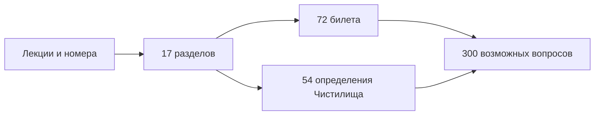

# Лекционный курс: указатель и нумерация

[[ru/index|Основное оглавление]] · [[ru/lectures/terms|Термины]] · [[ru/exam/index|72 билета]] · [[ru/purgatory/definitions|Чистилище]]

## Семестр 2 и параллельная серия 2025/26

Этот регистр охватывает **семестр 2 — лекции 33–64**. Семестр 1 заканчивается лекцией 32. В [[ru/lectures-2025-26/index|трёхъязычной иллюстрированной серии 2025/26]] теперь есть полные лекции 0–64. Материал лекций [[ru/lectures-2025-26/lecture-33-34|33–34]], [[ru/lectures-2025-26/lecture-35|35]], [[ru/lectures-2025-26/lecture-36|36]], [[ru/lectures-2025-26/lecture-37-38|37–38]], [[ru/lectures-2025-26/lecture-39-40|39–40]], [[ru/lectures-2025-26/lecture-41-42|41–42]], [[ru/lectures-2025-26/lecture-43-44|43–44]], [[ru/lectures-2025-26/lecture-45-46|45–46]], [[ru/lectures-2025-26/lecture-47-48|47–48]], [[ru/lectures-2025-26/lecture-49-50|49–50]], [[ru/lectures-2025-26/lecture-51-52|51–52]], [[ru/lectures-2025-26/lecture-53|53]], [[ru/lectures-2025-26/lecture-54|54]], [[ru/lectures-2025-26/lecture-55-56|55–56]], [[ru/lectures-2025-26/lecture-57-58|57–58]], [[ru/lectures-2025-26/lecture-59-60|59–60]], [[ru/lectures-2025-26/lecture-61-62|61–62]] и [[ru/lectures-2025-26/lecture-63-64|63–64]] **дублируется** с тематическими разделами этого регистра. Лекции 51–64 подготовлены исключительно по PDF, приложенным в чате; исходная папка не просматривалась и архивные имена не приписываются. Все 85 страниц трёх PDF и 8 иллюстраций партии 51–54, 96 страниц трёх PDF и 20 иллюстраций партии 55–60, а также 82 страницы двух PDF и 26 иллюстраций партии 61–64 учтены в соответствующих [манифестах 51–54](../../assets/lectures-2025-26/figures-51-54.json), [55–60](../../assets/lectures-2025-26/figures-55-60.json) и [61–64](../../assets/lectures-2025-26/figures-61-64.json) и [[assets/lectures-2025-26/provenance-51-54|журналах проверки 51–54]], [[assets/lectures-2025-26/provenance-55-60|55–60]], [[assets/lectures-2025-26/provenance-61-64|61–64]]. Все финальные изображения проверены индивидуально. Обе структуры сохранены: здесь — тематическая нумерация и связи с билетами, там — последовательные расшифровки PDF с рукописными страницами и переводами.

## Редакционный принцип

1. **Первичный источник истины и нумерации — `source/MathInMind/МАТАН_Л/`.** Номера не пересчитываются заново.
2. Формулировки аккуратно переписаны в переносимом Markdown. Очевидные опечатки индексов, пределов и пропущенные множители исправлены с пояснением в соответствующем разделе.
3. Доказательства, пояснения и примеры, добавленные редактором, не получают новых лекционных номеров.
4. `МАТАН_Б/` используется как источник формулировок билетов, но при любом расхождении приоритет остаётся за лекциями.
5. Существующие [[ru/index|21 глава общего курса]] служат фоновым справочником и не изменяют лекционную нумерацию.

## Карта лекций

| Раздел | Лекции | Содержание | Билеты | Нумерованные элементы |
|---|---:|---|---:|---:|
| [[ru/lectures/01-convexity-3-8\|§3.8]] | 33–35 | Выпуклость, опорные прямые, перегибы | 1–7 | 14 |
| [[ru/lectures/02-antiderivatives-4-1\|§4.1]] | 36–38 | Первообразная и неопределённый интеграл | 8–14 | 9 |
| [[ru/lectures/03-riemann-integral-4-2\|§4.2]] | 37–42 | Суммы Римана и Дарбу, критерии интегрируемости | 15–21 | 18 |
| [[ru/lectures/04-riemann-properties-4-3\|§4.3]] | 43–45 | Свойства, среднее, Ньютон–Лейбниц | 21–23 | 7 + ненумерованные свойства |
| [[ru/lectures/05-taylor-wallis-inequalities-4-4\|§4.4]] | 45–48 | Тейлор, Валлис, Бонне, неравенства | 24–28 | 8 |
| [[ru/lectures/06-improper-integrals-4-5\|§4.5]] | 47–50 | Несобственные интегралы | 29–34 | 16 |
| [[ru/lectures/07-measure-paths-4-6\|§4.6]] | 51–52 | Площадь, объём, пути и длина | 35–36 | 10 |
| [[ru/lectures/08-integral-applications-4-7\|§4.7]] | 51–53 | Площади, длины, объёмы, работа | 37–40 | 4 |
| [[ru/lectures/09-rn-foundations-5-1\|§5.1]] | 54 | Норма и окрестности в $\mathbb R^n$ | 41 | 2 |
| [[ru/lectures/10-vector-sequences-5-2\|§5.2]] | 54–56 | Векторные последовательности | 42–47 | 11 |
| [[ru/lectures/11-topology-rn-5-3\|§5.3]] | 55–58 | Множества, относительная топология, компакты | 47–51 | 12 |
| [[ru/lectures/12-mapping-limits-5-4\|§5.4]] | 57–58 | Пределы по Коши и Гейне | 52–54 | 6 + следствия |
| [[ru/lectures/13-continuity-rn-5-5\|§5.5]] | 59–60 | Непрерывность, компакты, Кантор | 55–58 | 9 |
| [[ru/lectures/14-differentiability-6-1\|§6.1]] | 59–62 | $o,O$, дифференциал, Якоби, градиент | 59–62 | 11 |
| [[ru/lectures/15-differentiation-rules-6-2\|§6.2]] | 61–62 | Композиция, арифметика, обратное отображение | 63–64 | 3 |
| [[ru/lectures/16-continuous-differentiability-6-3\|§6.3]] | 61–64 | $C^1$ и формула приращений | 65–66, 69 | 4 |
| [[ru/lectures/17-higher-derivatives-6-4\|§6.4]] | 63–64 | Высшие производные и дифференциалы | 67–72 | 4 + восстановленная теорема 6.4.1 |

Всего в исходных лекциях явно встречается **148 уникальных нумерованных элементов**: 60 определений, 65 теорем, 14 лемм и 9 следствий. Теорема 6.4.1 дополнительно восстановлена по ссылкам внутри лекции 63–64. Пропуск 4.3.4 оставлен как в источнике.

## Как готовить ответ

1. Начните с точной формулировки под номером из таблицы.
2. Назовите все условия: область, ограниченность, непрерывность, гладкость, монотонность, компактность.
3. Воспроизведите доказательство или его основную цепочку.
4. Приведите один пример и, где возможно, контрпример, показывающий необходимость условия.
5. Завершите связью с билетом и типовой задачей.

Примеры в разделах оригинальные и составлены по типам задач Демидовича, Фихтенгольца, Зорича и Рудина. Они не выдаются за дословные задачи с выдуманными номерами.
