# Чистилище: 54 определения и теоремы

[[ru/lectures/index|Лекционный указатель]] · [[ru/exam/index|72 билета]] · [[ru/purgatory/questions|300 возможных вопросов]]

> [!info] Состав архива
> В `опрМат/` находятся **53 изображения** с номерами 0–53; изображение 15 отсутствует. Ниже 53 скана сопровождаются пояснениями, а пункт 15 восстановлен по [[ru/lectures/03-riemann-integral-4-2#Теорема 4.2.5 — критерий Лебега|теореме 4.2.5]] ([[ru/lectures/03-riemann-integral-4-2#Теорема 4.2.5 — критерий Лебега|критерий Лебега]]) из лекций 41–42. Это даёт запрошенные 54 пунктов без выдумывания отсутствующего изображения.
>
> **Порядок изучения.** Сначала воспроизведите формулировку, затем объясните обозначения и условия, после этого раскройте скан и сверьте себя. Ссылки ведут к доказательствам и примерам в лекционных разделах.

## 00. Выпуклая и строго выпуклая функция

**Лекционный источник:** [[ru/lectures/01-convexity-3-8#Определение 3.8.1 — выпуклая и строго выпуклая функция|определение 3.8.1]] · [[ru/lectures/01-convexity-3-8|Перейти к разделу]]

Для любых $a,b$ промежутка и $\lambda\in(0,1)$:

$$
f(\lambda a+(1-\lambda)b)\le\lambda f(a)+(1-\lambda)f(b).
$$

При $a\ne b$ и строгом неравенстве функция строго выпукла. Хорда между точками графика лежит не ниже самого графика.

**Быстрая проверка / пример:** $x^2$ строго выпукла; $|x|$ выпукла, но на каждом луче совпадает с прямой, поэтому не строго выпукла.

> [!example]- Показать исходный скан 00
> 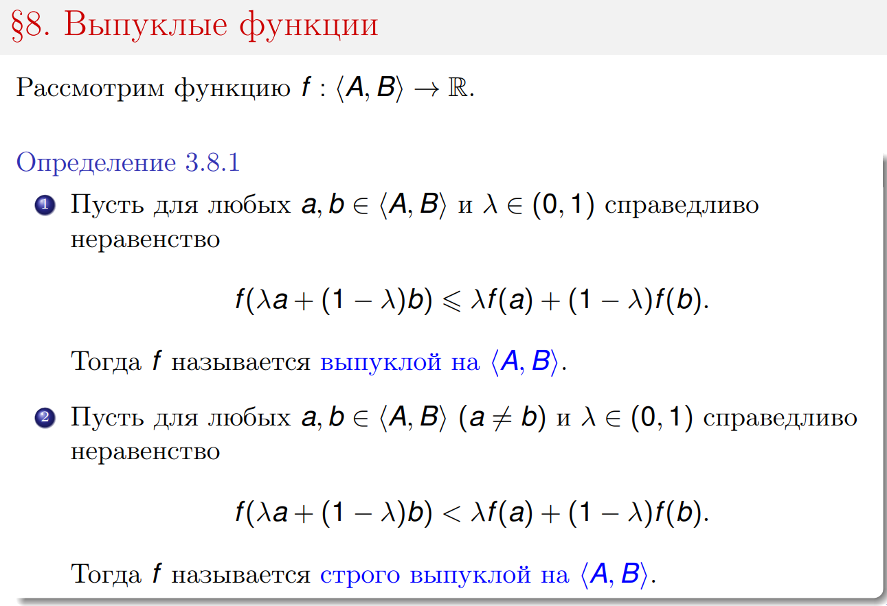

## 01. Точка перегиба

**Лекционный источник:** [[ru/lectures/01-convexity-3-8#Определение 3.8.3 — точка перегиба|определение 3.8.3]] · [[ru/lectures/01-convexity-3-8|Перейти к разделу]]

[[ru/lectures/11-topology-rn-5-3#Определение 5.3.3 — внутренность|Внутренняя точка]] $a$ — [[ru/lectures/01-convexity-3-8#Определение 3.8.3 — точка перегиба|точка перегиба]], если $f$ непрерывна в $a$, имеет там [[ru/lectures-2025-26/lecture-22-23#^def-3-1-1|производную]] из $\overline{\mathbb R}$ и на двух соседних односторонних промежутках имеет разный характер [[ru/lectures/01-convexity-3-8#Определение 3.8.1 — выпуклая и строго выпуклая функция|выпуклости]]: выпукла с одной стороны и вогнута с другой.

Равенство $f''(a)=0$ не входит в определение и само по себе ничего не доказывает.

**Быстрая проверка / пример:** Ноль — перегиб $x^3$, но не $x^4$, хотя у обеих $f''(0)=0$.

> [!example]- Показать исходный скан 01
> 

## 02. Опорная прямая

**Лекционный источник:** [[ru/lectures/01-convexity-3-8#Определение 3.8.2 — опорная прямая|определение 3.8.2]] · [[ru/lectures/01-convexity-3-8|Перейти к разделу]]

Прямая $g(x)=f(a)+k(x-a)$ опорна для $f$ в $a$, если $f(x)\ge g(x)$ для всех $x$ области. Если при $x\ne a$ неравенство строгое, она строго опорная.

Для выпуклой функции во внутренней точке допустимые наклоны образуют $[f'_-(a),f'_+(a)]$.

**Быстрая проверка / пример:** У $|x|$ в нуле опорны прямые $y=kx$ только с $-1\le k\le1$.

> [!example]- Показать исходный скан 02
> 

## 03. Первообразная функции

**Лекционный источник:** [[ru/lectures/02-antiderivatives-4-1#Определение 4.1.1 — первообразная на промежутке|определение 4.1.1]] · [[ru/lectures/02-antiderivatives-4-1|Перейти к разделу]]

$F$ называется [[ru/lectures/02-antiderivatives-4-1#Определение 4.1.1 — первообразная на промежутке|первообразной]] $f$ на промежутке, если $F$ [[ru/lectures-2025-26/lecture-22-23#^def-3-2-1|дифференцируема]] и $F'(x)=f(x)$ во всех его точках. На концах используются [[ru/06-derivatives#6.1 Определение и линейное приближение|односторонние производные]].

Все первообразные на промежутке отличаются на константу.

**Быстрая проверка / пример:** $F(x)=x^3/3$ — первообразная $x^2$ на $\mathbb R$; $x^3/3+C$ — все остальные.

> [!example]- Показать исходный скан 03
> 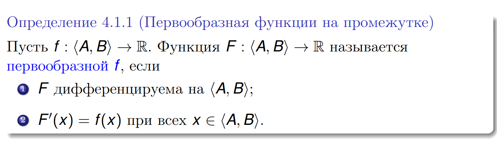

## 04. Неопределённый интеграл

**Лекционный источник:** [[ru/lectures/02-antiderivatives-4-1#Определение 4.1.2 — неопределённый интеграл|определение 4.1.2]] · [[ru/lectures/02-antiderivatives-4-1|Перейти к разделу]]

Неопределённый интеграл $\int f(x)\,dx$ — совокупность всех первообразных $f$ на заданном промежутке. Поэтому ответ записывают как $F(x)+C$.

Это семейство функций, а не числовая площадь и не [[ru/lectures/03-riemann-integral-4-2#Определение 4.2.6 — интеграл Римана|определённый интеграл]].

**Быстрая проверка / пример:** $\int\cos x\,dx=\sin x+C$ на $\mathbb R$; проверка — $(\sin x+C)'=\cos x$.

> [!example]- Показать исходный скан 04
> 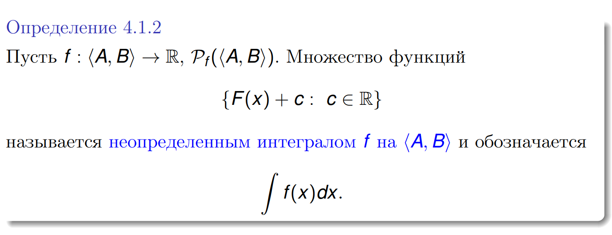

## 05. Первообразная на множестве

**Лекционный источник:** [[ru/lectures/02-antiderivatives-4-1#Определение 4.1.3 — первообразная на множестве|определение 4.1.3]] · [[ru/lectures/02-antiderivatives-4-1|Перейти к разделу]]

Для $E\subseteq\mathbb R$ функция $F$ — первообразная $f$ на $E$, если $F$ дифференцируема на $E$ и $F'=f$ во всех точках $E$.

На несвязном $E$ не следует автоматически писать одну общую константу: на разных компонентах константы могут различаться.

**Быстрая проверка / пример:** Для $1/x$ на $(-\infty,0)\cup(0,\infty)$ на каждом луче выбирается своя константа при $\log|x|$.

> [!example]- Показать исходный скан 05
> 

## 06. Целочисленный промежуток, разбиение и ранг

**Лекционный источник:** [[ru/lectures/03-riemann-integral-4-2#Определение 4.2.1 — целочисленный промежуток|определения 4.2.1]]–[[ru/lectures/03-riemann-integral-4-2#Определение 4.2.2 — разбиение и его ранг|4.2.2]] · [[ru/lectures/03-riemann-integral-4-2|Перейти к разделу]]

$[p:q]=[p,q]\cap\mathbb Z$. [[ru/lectures/03-riemann-integral-4-2#Определение 4.2.2 — разбиение и его ранг|Разбиение]] отрезка:

$$
\tau:a=x_0<x_1<\cdots<x_n=b,\qquad \Delta x_k=x_{k+1}-x_k.
$$

Его ранг $\lambda_\tau=\max_k\Delta x_k$ — длина наибольшего частичного отрезка.

**Быстрая проверка / пример:** Для $[0,1]$ и $n$ равных частей $\Delta x_k=1/n$, поэтому $\lambda_\tau=1/n$.

> [!example]- Показать исходный скан 06
> 

## 07. Оснащение и сумма Римана

**Лекционный источник:** [[ru/lectures/03-riemann-integral-4-2#Определение 4.2.3 — оснащение|определения 4.2.3]]–[[ru/lectures/03-riemann-integral-4-2#Определение 4.2.4 — суммы Римана|4.2.4]] · [[ru/lectures/03-riemann-integral-4-2|Перейти к разделу]]

[[ru/lectures/03-riemann-integral-4-2#Определение 4.2.4 — суммы Римана|Оснащение]] — выбор $\xi_k\in[x_k,x_{k+1}]$. Сумма Римана для оснащённого разбиения:

$$
\sigma_\tau(f,\xi)=\sum_{k=0}^{n-1}f(\xi_k)\Delta x_k.
$$

При $f\ge0$ она представляет сумму площадей прямоугольников.

**Быстрая проверка / пример:** Для $f=x$ на $[0,1]$ с правыми концами $\sigma_n=(n+1)/(2n)$.

> [!example]- Показать исходный скан 07
> 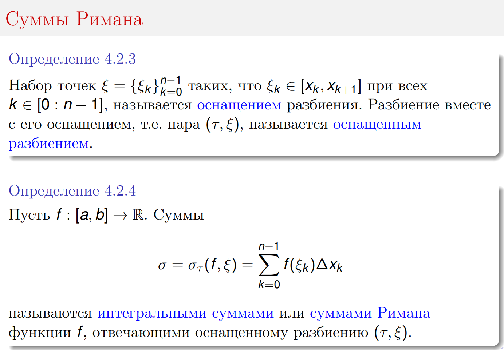

## 08. Предел интегральных сумм

**Лекционный источник:** [[ru/lectures/03-riemann-integral-4-2#Определение 4.2.5 — предел интегральных сумм|определение 4.2.5]] · [[ru/lectures/03-riemann-integral-4-2|Перейти к разделу]]

$I$ — предел сумм Римана при $\lambda_\tau\to0$, если для любого $\varepsilon>0$ найдётся $\delta>0$ такое, что при $\lambda_\tau<\delta$ для **любого** оснащения

$$
|\sigma_\tau(f,\xi)-I|<\varepsilon.
$$

Единый предел для одной выбранной схемы оснащений ещё не доказывает это определение.

**Быстрая проверка / пример:** Для $x$ на $[0,1]$ все схемы при мелком разбиении приближаются к $I=1/2$.

> [!example]- Показать исходный скан 08
> 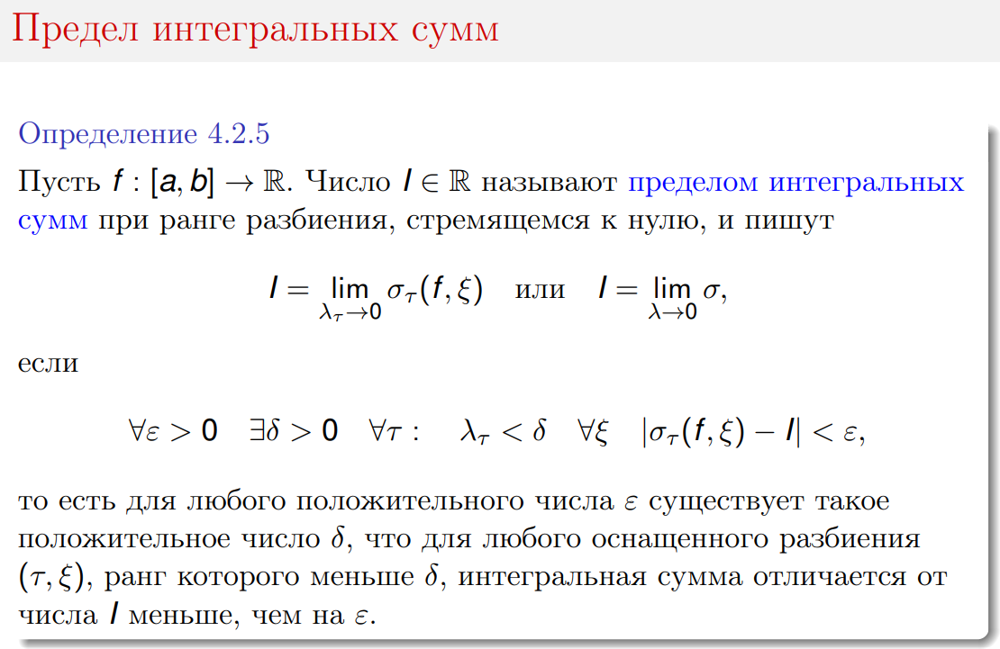

## 09. Интеграл Римана

**Лекционный источник:** [[ru/lectures/03-riemann-integral-4-2#Определение 4.2.6 — интеграл Римана|определение 4.2.6]] · [[ru/lectures/03-riemann-integral-4-2|Перейти к разделу]]

Если предел интегральных сумм существует, функция интегрируема по Риману на $[a,b]$, а число $I$ называется определённым интегралом:

$$
I=\int_a^b f(x)\,dx.
$$

Переменная интегрирования немая и может быть заменена любой другой буквой.

**Быстрая проверка / пример:** $\int_0^1x\,dx=1/2$, что подтверждается и суммами Римана, и [[ru/lectures/04-riemann-properties-4-3#Теорема 4.3.2 — формула Ньютона–Лейбница|формулой Ньютона–Лейбница]].

> [!example]- Показать исходный скан 09
> 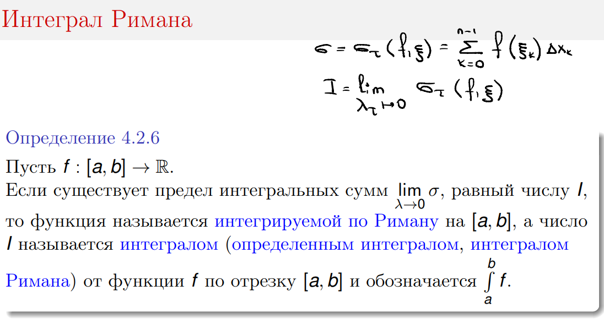

## 10. Верхняя и нижняя суммы Дарбу

**Лекционный источник:** [[ru/lectures/03-riemann-integral-4-2#Определение 4.2.7 — суммы Дарбу|определение 4.2.7]] · [[ru/lectures/03-riemann-integral-4-2|Перейти к разделу]]

Для ограниченной $f$ на каждом частичном отрезке берут $m_k=\inf f$, $M_k=\sup f$. Тогда

$$
s_\tau=\sum m_k\Delta x_k,\qquad S_\tau=\sum M_k\Delta x_k.
$$

Для любого оснащения $s_\tau\le\sigma_\tau\le S_\tau$.

**Быстрая проверка / пример:** Для возрастающей $f$ на $[x_k,x_{k+1}]$ имеем $m_k=f(x_k)$, $M_k=f(x_{k+1})$.

> [!example]- Показать исходный скан 10
> 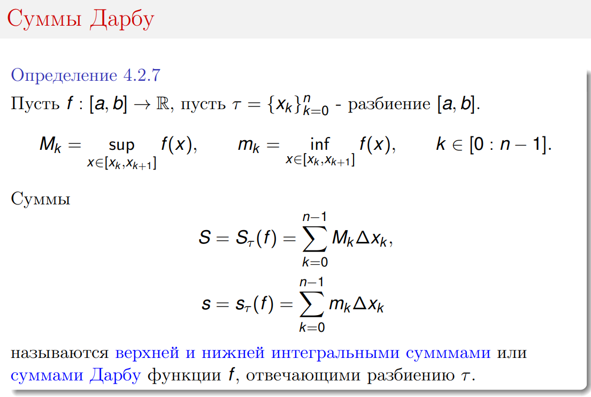

## 11. Верхний и нижний интегралы Дарбу

**Лекционный источник:** [[ru/lectures/03-riemann-integral-4-2#Определение 4.2.8 — верхний и нижний интегралы Дарбу|определение 4.2.8]] · [[ru/lectures/03-riemann-integral-4-2|Перейти к разделу]]

$$
I^*=\inf_\tau S_\tau,\qquad I_*=\sup_\tau s_\tau.
$$

Всегда $I_*\le I^*$. Равенство этих величин равносильно интегрируемости, а их общее значение равно интегралу Римана.

**Быстрая проверка / пример:** У функции Дирихле на $[0,1]$ имеем $I_*=0$ и $I^*=1$, поэтому интегрируемости нет.

> [!example]- Показать исходный скан 11
> 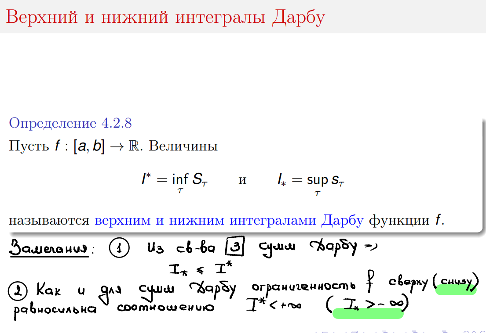

## 12. Колебание функции

**Лекционный источник:** [[ru/lectures/03-riemann-integral-4-2#Определение 4.2.9 — колебание функции|определение 4.2.9]] · [[ru/lectures/03-riemann-integral-4-2|Перейти к разделу]]

$$
\omega_D(f)=\sup_{x,y\in D}(f(x)-f(y))=\sup_Df-\inf_Df.
$$

На частичном отрезке $\omega_k=M_k-m_k$, поэтому $S_\tau-s_\tau=\sum\omega_k\Delta x_k$.

**Быстрая проверка / пример:** Для $x^2$ на $[0,1]$ [[ru/lectures/03-riemann-integral-4-2#Определение 4.2.9 — колебание функции|колебание]] равно $1$, а для постоянной функции — нулю.

> [!example]- Показать исходный скан 12
> 

## 13. Кусочно-непрерывная функция

**Лекционный источник:** [[ru/lectures/03-riemann-integral-4-2#Определение 4.2.10 — кусочно-непрерывная функция|определение 4.2.10]] · [[ru/lectures/03-riemann-integral-4-2|Перейти к разделу]]

Функция кусочно-непрерывна на $[a,b]$, если разрывов конечное число или нет и все они первого рода: существуют конечные [[ru/lectures-2025-26/lecture-15#^def-2-4-5|односторонние пределы]].

Такая функция интегрируема по Риману, а значения в отдельных точках не влияют на интеграл.

**Быстрая проверка / пример:** Ступенька с одним скачком кусочно-непрерывна; $\sin(1/x)$ в нуле имеет разрыв другого типа.

> [!example]- Показать исходный скан 13
> 

## 14. Множество нулевой меры

**Лекционный источник:** [[ru/lectures/03-riemann-integral-4-2#Определение 4.2.11 — множество нулевой меры|определение 4.2.11]] · [[ru/lectures/03-riemann-integral-4-2|Перейти к разделу]]

$E\subset\mathbb R$ имеет нулевую [[ru/19-measure-theory#19.2 Меры|меру]], если для любого $\varepsilon>0$ его можно покрыть не более чем [[ru/lectures-2025-26/lecture-01-02#^def-1-2-5|счётным]] семейством интервалов суммарной длины меньше $\varepsilon$.

Конечные и счётные множества имеют нулевую меру; [[ru/lectures-2025-26/lecture-03#^thm-1-2-5|несчётное]] множество также может её иметь.

**Быстрая проверка / пример:** $\mathbb Q\cap[0,1]$ имеет нулевую меру, хотя плотно в $[0,1]$.

> [!example]- Показать исходный скан 14
> 

## 15. Критерий Лебега — восстановленный пункт

**Лекционный источник:** [[ru/lectures/03-riemann-integral-4-2#Теорема 4.2.5 — критерий Лебега|теорема 4.2.5]] · [[ru/lectures/03-riemann-integral-4-2|Перейти к разделу]]

Ограниченная функция интегрируема по Риману на $[a,b]$ тогда и только тогда, когда множество её точек разрыва имеет нулевую меру.

Ограниченность обязательна. Сам критерий не утверждает непрерывность: допускаются разрывы, если их множество достаточно мало по мере.

**Быстрая проверка / пример:** Ступенька интегрируема, функция Дирихле — нет, поскольку разрывна на всём отрезке.

> [!note] Восстановленный пункт
> исходного скана 15 в архиве нет. Содержание взято из лекции, а не распознано из изображения.

## 16. Формула Тейлора с интегральным остатком

**Лекционный источник:** [[ru/lectures/05-taylor-wallis-inequalities-4-4#Теорема 4.4.1 — формула Тейлора с интегральным остатком|теорема 4.4.1]] · [[ru/lectures/05-taylor-wallis-inequalities-4-4|Перейти к разделу]]

Для $f\in C^{n+1}$:

$$
f(x)=\sum_{k=0}^n\frac{f^{(k)}(a)}{k!}(x-a)^k
+\frac1{n!}\int_a^x f^{(n+1)}(t)(x-t)^n\,dt.
$$

Последний интеграл — остаток $R_n(x)$. При $n=0$ получается формула Ньютона–Лейбница.

**Быстрая проверка / пример:** Для $e^x$ и $a=0$ остаток равен $\frac1{n!}\int_0^xe^t(x-t)^n\,dt$.

> [!example]- Показать исходный скан 16
> 

## 17. Локально интегрируемая функция

**Лекционный источник:** [[ru/lectures/06-improper-integrals-4-5#Определение 4.5.1 — локально интегрируемая функция|определение 4.5.1]] · [[ru/lectures/06-improper-integrals-4-5|Перейти к разделу]]

$f$ локально интегрируема на промежутке, если интегрируема по Риману на каждом закрытом отрезке внутри него. Класс обозначается $\mathcal R_{loc}$.

Локальная интегрируемость не гарантирует сходимость [[ru/lectures/06-improper-integrals-4-5#Определение 4.5.2 — несобственный интеграл|несобственного интеграла]] по всему промежутку.

**Быстрая проверка / пример:** $1/x$ локально интегрируема на $(0,1]$, но $\int_0^1dx/x$ расходится.

> [!example]- Показать исходный скан 17
> 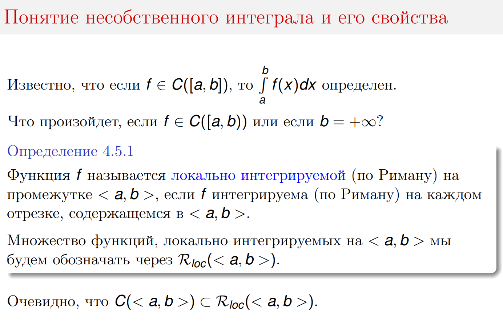

## 18. Несобственный интеграл

**Лекционный источник:** [[ru/lectures/06-improper-integrals-4-5#Определение 4.5.2 — несобственный интеграл|определение 4.5.2]] · [[ru/lectures/06-improper-integrals-4-5|Перейти к разделу]]

Для $f\in\mathcal R_{loc}[a,b)$:

$$
\int_a^{\to b}f=\lim_{B\to b^-}\int_a^Bf.
$$

Если предел конечен, интеграл сходится. При особенностях на обоих концах нужны две независимо сходящиеся части.

**Быстрая проверка / пример:** $\int_1^\infty x^{-2}dx=\lim_{R\to\infty}(1-1/R)=1$.

> [!example]- Показать исходный скан 18
> 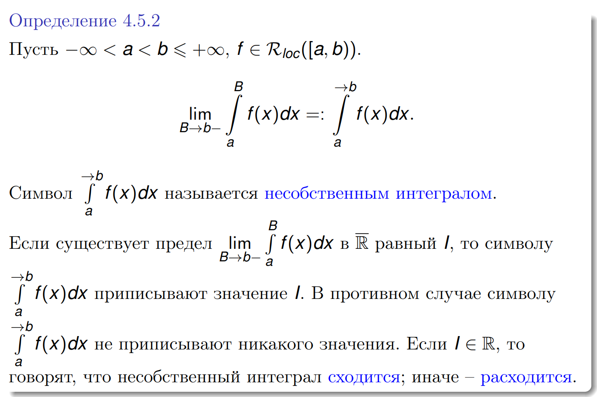

## 19. Остаток несобственного интеграла

**Лекционный источник:** [[ru/lectures/06-improper-integrals-4-5#Определение 4.5.3 — остаток интеграла|определение 4.5.3]] и [[ru/lectures/06-improper-integrals-4-5#Лемма 4.5.3 — остаток сходящегося интеграла стремится к нулю|лемма 4.5.3]] · [[ru/lectures/06-improper-integrals-4-5|Перейти к разделу]]

Остаток после $A$ — интеграл $\int_A^{\to b}f$. Если полный интеграл сходится, то остаток стремится к нулю при $A\to b^-$:

$$
\int_A^{\to b}f=I-\int_a^Af\longrightarrow0.
$$

**Быстрая проверка / пример:** Для $\int_1^\infty x^{-2}dx$ остаток после $A$ равен $1/A$.

> [!example]- Показать исходный скан 19
> 

## 20. Абсолютная и условная сходимость

**Лекционный источник:** [[ru/lectures/06-improper-integrals-4-5#Определение 4.5.4 — абсолютная сходимость|определение 4.5.4]] и [[ru/lectures/06-improper-integrals-4-5#Лемма 4.5.6 — абсолютная сходимость влечёт обычную|лемма 4.5.6]] · [[ru/lectures/06-improper-integrals-4-5|Перейти к разделу]]

Интеграл сходится абсолютно, если сходится $\int|f|$. [[ru/04-numeric-series#4.3 Абсолютная и условная сходимость|Абсолютная сходимость]] влечёт обычную. Если $\int f$ сходится, а $\int|f|$ расходится, сходимость условная.

**Быстрая проверка / пример:** $\int_1^\infty\sin x/x\,dx$ сходится условно: сам существует, а интеграл модуля расходится.

> [!example]- Показать исходный скан 20
> 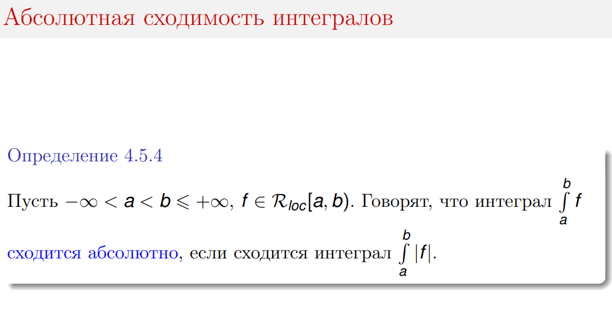

## 21. Движение пространства

**Лекционный источник:** [[ru/lectures/07-measure-paths-4-6#Определение 4.6.1 — движение пространства|определение 4.6.1]] · [[ru/lectures/07-measure-paths-4-6|Перейти к разделу]]

$U:\mathbb R^n\to\mathbb R^n$ — движение, если для всех $A,B$

$$
\|U(A)-U(B)\|=\|A-B\|.
$$

Переносы, повороты и отражения сохраняют расстояния, а значит площадь и объём.

**Быстрая проверка / пример:** $U(x)=x+c$ — движение; $U(x)=2x$ — нет.

> [!example]- Показать исходный скан 21
> 

## 22. Площадь

**Лекционный источник:** [[ru/lectures/07-measure-paths-4-6#Определение 4.6.2 — площадь|определение 4.6.2]] · [[ru/lectures/07-measure-paths-4-6|Перейти к разделу]]

Площадь $S$ — неотрицательная функция на квадрируемых фигурах, аддитивная для непересекающихся фигур, нормированная на прямоугольниках $S=ab$ и инвариантная относительно движений.

Эти свойства позволяют вычислять площади через разбиения и пределы.

**Быстрая проверка / пример:** Прямоугольник $2\times3$ имеет площадь $6$ независимо от поворота.

> [!example]- Показать исходный скан 22
> 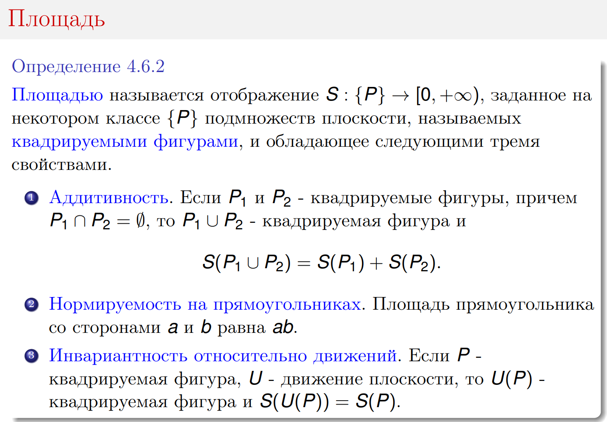

## 23. Объём

**Лекционный источник:** [[ru/lectures/07-measure-paths-4-6#Определение 4.6.3 — объём|определение 4.6.3]] · [[ru/lectures/07-measure-paths-4-6|Перейти к разделу]]

Объём $V$ — неотрицательная функция на кубируемых телах, аддитивная для непересекающихся тел, нормированная на параллелепипедах $V=abc$ и инвариантная относительно движений.

**Быстрая проверка / пример:** Параллелепипед с рёбрами $2,3,4$ имеет объём $24$.

> [!example]- Показать исходный скан 23
> 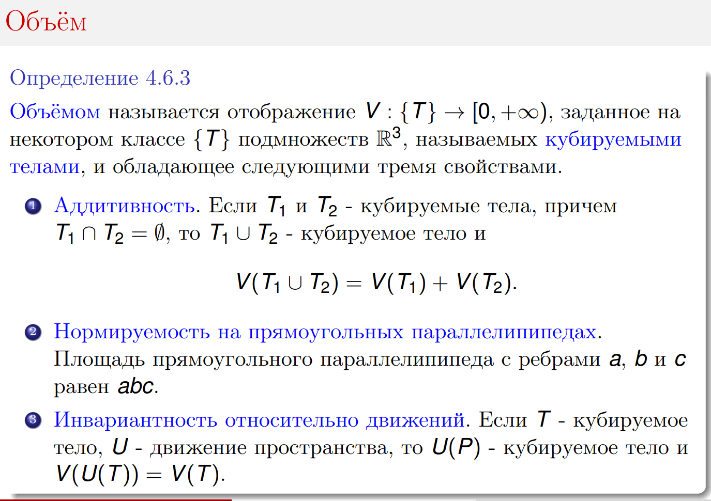

## 24. Прямой цилиндр и сечение

**Лекционный источник:** [[ru/lectures/07-measure-paths-4-6#Определение 4.6.4 — прямой цилиндр|определения 4.6.4]]–[[ru/lectures/07-measure-paths-4-6#Определение 4.6.5 — сечение тела|4.6.5]] · [[ru/lectures/07-measure-paths-4-6|Перейти к разделу]]

Прямой цилиндр — $P\times[0,h]$ или его образ при движении; $V=S(P)h$. Сечение тела $T$ координатой $x$:

$$
T(x)=\{(y,z):(x,y,z)\in T\}.
$$

Площади сечений используются в формуле $V=\int A(x)\,dx$.

**Быстрая проверка / пример:** Сечение шара радиуса $R$ — круг площади $\pi(R^2-x^2)$.

> [!example]- Показать исходный скан 24
> 

## 25. Путь

**Лекционный источник:** [[ru/lectures/07-measure-paths-4-6#Определение 4.6.6 — путь|определение 4.6.6]] · [[ru/lectures/07-measure-paths-4-6|Перейти к разделу]]

Путь в $\mathbb R^m$ — непрерывное отображение $\gamma:[a,b]\to\mathbb R^m$. $\gamma(a)$ — начало, $\gamma(b)$ — конец.

Путь включает параметризацию, а не только геометрический образ.

**Быстрая проверка / пример:** $\gamma(t)=(\cos t,\sin t)$ на $[0,2\pi]$ — путь по единичной окружности.

> [!example]- Показать исходный скан 25
> 

## 26. Вписанная ломаная

**Лекционный источник:** [[ru/lectures/07-measure-paths-4-6#Определение 4.6.8 — вписанная ломаная|определение 4.6.8]] · [[ru/lectures/07-measure-paths-4-6|Перейти к разделу]]

Для разбиения $a=t_0<\cdots<t_n=b$ вписанная ломаная соединяет последовательные $\gamma(t_k)$ отрезками. Её длина:

$$
\ell_\tau=\sum_{k=0}^{n-1}\|\gamma(t_{k+1})-\gamma(t_k)\|.
$$

**Быстрая проверка / пример:** Для прямолинейного пути длина любой вписанной ломаной равна длине всего отрезка.

> [!example]- Показать исходный скан 26
> 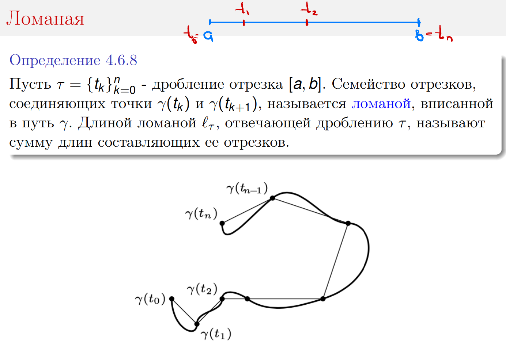

## 27. Длина пути и спрямляемость

**Лекционный источник:** [[ru/lectures/07-measure-paths-4-6#Определение 4.6.9 — длина пути|определения 4.6.9]]–[[ru/lectures/07-measure-paths-4-6#Определение 4.6.10 — спрямляемый путь|4.6.10]] · [[ru/lectures/07-measure-paths-4-6|Перейти к разделу]]

[[ru/lectures/08-integral-applications-4-7#Теорема 4.7.1 — длина гладкого пути|Длина пути]] — $s_\gamma=\sup_\tau\ell_\tau$ по всем вписанным ломаным. Если $s_\gamma<+\infty$, путь спрямляем.

Непрерывность пути не гарантирует конечную длину; для [[ru/lectures/07-measure-paths-4-6#Определение 4.6.1 — движение пространства|гладкого пути]] $s_\gamma=\int_a^b\|\gamma'\|$.

**Быстрая проверка / пример:** Для $\gamma(t)=(R\cos t,R\sin t)$ на $[0,2\pi]$ длина равна $2\pi R$.

> [!example]- Показать исходный скан 27
> 

## 28. Подграфик и криволинейная трапеция

**Лекционный источник:** [[ru/lectures/08-integral-applications-4-7#Определение 4.7.1 — подграфик и криволинейная трапеция|определение 4.7.1]] · [[ru/lectures/08-integral-applications-4-7|Перейти к разделу]]

Для $f\ge0$ подграфик:

$$
Q_f=\{(x,y):a\le x\le b,\ 0\le y\le f(x)\}.
$$

Для непрерывной $f$ он называется криволинейной трапецией, а его площадь равна $\int_a^bf$.

**Быстрая проверка / пример:** Площадь под $y=x^2$ на $[0,2]$ равна $8/3$.

> [!example]- Показать исходный скан 28
> 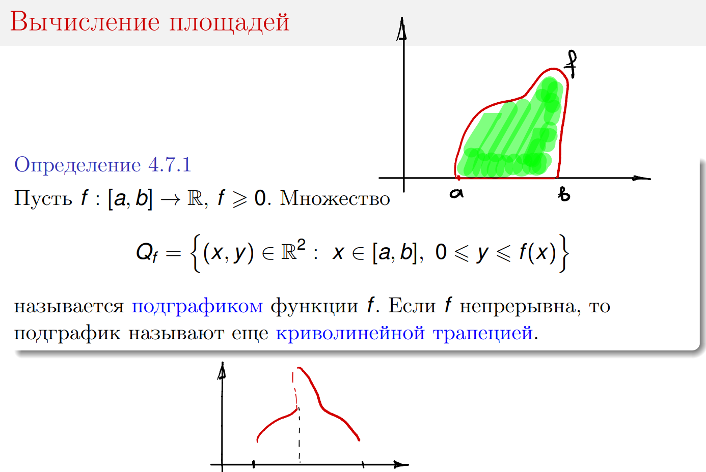

## 29. Евклидова норма вектора

**Лекционный источник:** [[ru/lectures/09-rn-foundations-5-1#Определение 5.1.1 — евклидова норма|определение 5.1.1]] · [[ru/lectures/09-rn-foundations-5-1|Перейти к разделу]]

$$
\|x\|=\sqrt{x_1^2+\cdots+x_n^2}.
$$

Выполнены положительность, $\|\lambda x\|=|\lambda|\|x\|$ и $\|x+y\|\le\|x\|+\|y\|$. Расстояние — $\|x-y\|$.

**Быстрая проверка / пример:** $\|(3,4)\|=5$, $\|(1,1,\ldots,1)\|=\sqrt n$.

> [!example]- Показать исходный скан 29
> 

## 30. Окрестности в расширенном $\mathbb R^n$

**Лекционный источник:** [[ru/lectures/09-rn-foundations-5-1#Определение 5.1.2 — окрестности конечной и бесконечно удалённой точек|определение 5.1.2]] · [[ru/lectures/09-rn-foundations-5-1|Перейти к разделу]]

$V_\delta(a)=\{x:\|x-a\|<\delta\}$, а $\dot V_\delta(a)=V_\delta(a)\setminus\{a\}$. Для бесконечно удалённой точки

$$
V_\delta(\infty)=\{x:\|x\|>\delta\}=\dot V_\delta(\infty).
$$

**Быстрая проверка / пример:** При $n=2$ окрестность конечной точки — открытый круг; $V_5(\infty)$ — внешность круга радиуса $5$.

> [!example]- Показать исходный скан 30
> 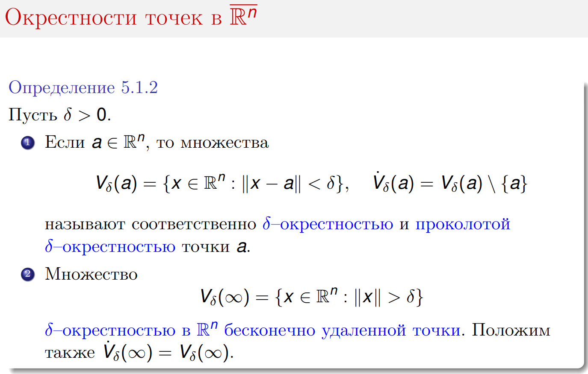

## 31. Предел последовательности векторов

**Лекционный источник:** [[ru/lectures/10-vector-sequences-5-2#^def-5-2-1|определение 5.2.1]] · [[ru/lectures/10-vector-sequences-5-2|Перейти к разделу]]

$x^k\to a$, если для любого $\varepsilon>0$ найдётся $N$ такое, что $k>N\implies x^k\in V_\varepsilon(a)$. Для конечного $a$ это $\|x^k-a\|\to0$.

Сходимость в $\mathbb R^n$ равносильна покоординатной сходимости.

**Быстрая проверка / пример:** $(1/k,1-1/k)\to(0,1)$, поскольку [[ru/14-several-variables#14.1 Евклидово пространство и нормы|норма]] разности $\sqrt2/k\to0$.

> [!example]- Показать исходный скан 31
> 

## 32. Ограниченность в $\mathbb R^n$

**Лекционный источник:** [[ru/lectures/10-vector-sequences-5-2#Определение 5.2.2 — ограниченное множество и отображение|определение 5.2.2]] · [[ru/lectures/10-vector-sequences-5-2|Перейти к разделу]]

$E\subseteq\mathbb R^n$ ограничено, если $E\subset V_C(0)$ для некоторого $C$. Отображение ограничено, если ограничен его образ $f(E)$.

[[ru/lectures-2025-26/lecture-08#^def-2-1-3|Сходящаяся последовательность]] ограничена; обратное неверно.

**Быстрая проверка / пример:** $((-1)^k,1/k)$ ограничена, но расходится; $[0,1]^n$ ограничен, $\mathbb R^n$ — нет.

> [!example]- Показать исходный скан 32
> 

## 33. Предельная и изолированная точки

**Лекционный источник:** [[ru/lectures/10-vector-sequences-5-2#Определение 5.2.3 — предельная и изолированная точки|определение 5.2.3]] · [[ru/lectures/10-vector-sequences-5-2|Перейти к разделу]]

$a$ — [[ru/lectures-2025-26/lecture-14#^def-2-4-1|предельная точка]] $E$, если $E\cap\dot V_\varepsilon(a)\ne\varnothing$ для любого $\varepsilon>0$. Точка $a\in E$ изолирована, если существует окрестность с $E\cap V(a)=\{a\}$.

Предельная точка характеризуется последовательностью $x^k\in E\setminus\{a\}$, $x^k\to a$.

**Быстрая проверка / пример:** Ноль предельный для $\{1/k\}$; точка $2$ изолирована в $(0,1]\cup\{2\}$.

> [!example]- Показать исходный скан 33
> 

## 34. Открытые и замкнутые множества

**Лекционный источник:** [[ru/lectures/11-topology-rn-5-3#Определение 5.3.1 — внутренняя точка, открытое и замкнутое множества|определение 5.3.1]] · [[ru/lectures/11-topology-rn-5-3|Перейти к разделу]]

$a\in E$ внутренняя, если некоторая её окрестность целиком лежит в $E$. $E$ открыто, если все его точки внутренние; замкнуто, если $\mathbb R^n\setminus E$ открыто.

[[ru/lectures/11-topology-rn-5-3#Теорема 5.3.1 — характеристики замкнутости|Замкнутое множество]] содержит все свои предельные точки.

**Быстрая проверка / пример:** $(0,1)$ открыто, $[0,1]$ замкнуто, $(0,1]$ — ни то ни другое в $\mathbb R$.

> [!example]- Показать исходный скан 34
> 

## 35. Замыкание множества

**Лекционный источник:** [[ru/lectures/11-topology-rn-5-3#Определение 5.3.2 — замыкание|определение 5.3.2]] · [[ru/lectures/11-topology-rn-5-3|Перейти к разделу]]

$\overline E$ — наименьшее замкнутое множество, содержащее $E$. Оно равно пересечению всех замкнутых множеств, содержащих $E$, и состоит из точек $E$ и его предельных точек.

**Быстрая проверка / пример:** Для $E=\{1/k\}$ [[ru/lectures/11-topology-rn-5-3#Определение 5.3.2 — замыкание|замыкание]] равно $E\cup\{0\}$.

> [!example]- Показать исходный скан 35
> 

## 36. Внутренность множества

**Лекционный источник:** [[ru/lectures/11-topology-rn-5-3#Определение 5.3.3 — внутренность|определение 5.3.3]] · [[ru/lectures/11-topology-rn-5-3|Перейти к разделу]]

$\operatorname{Int}E$ — множество всех внутренних точек $E$ и одновременно наибольшее [[ru/lectures/11-topology-rn-5-3#Определение 5.3.1 — внутренняя точка, открытое и замкнутое множества|открытое множество]], содержащееся в $E$.

**Быстрая проверка / пример:** $\operatorname{Int}[0,1]=(0,1)$ в $\mathbb R$, а $\operatorname{Int}\mathbb Q=\varnothing$.

> [!example]- Показать исходный скан 36
> 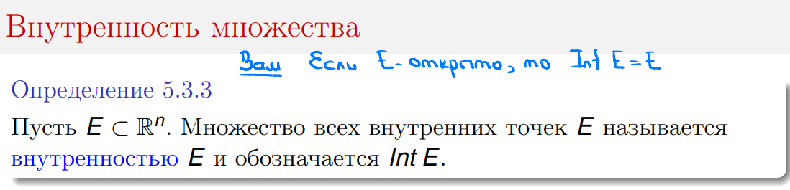

## 37. Граница множества

**Лекционный источник:** [[ru/lectures/11-topology-rn-5-3#Определение 5.3.4 — граница|определение 5.3.4]] · [[ru/lectures/11-topology-rn-5-3|Перейти к разделу]]

$$
\partial E=\overline E\setminus\operatorname{Int}E.
$$

Граница замкнута. Для шара граница — сфера; для $\mathbb Q$ в $\mathbb R$ граница равна $\mathbb R$.

**Быстрая проверка / пример:** Для $(0,1)$ граница $\{0,1\}$; для $[0,1]$ она та же.

> [!example]- Показать исходный скан 37
> 

## 38. Открытые и замкнутые подмножества в $E$

**Лекционный источник:** [[ru/lectures/11-topology-rn-5-3#^def-5-3-5|определение 5.3.5]] и [[ru/lectures/11-topology-rn-5-3#Теорема 5.3.4 — описание относительно открытых множеств|теорема 5.3.4]] · [[ru/lectures/11-topology-rn-5-3|Перейти к разделу]]

$F\subseteq E$ открыто в $E$, если у каждой $a\in F$ есть окрестность с $V_\delta(a)\cap E\subseteq F$. Равносильно, $F=E\cap G$ для открытого $G$ в окружающем пространстве.

Это относительная топология, а не обязательная открытость в $\mathbb R^n$.

**Быстрая проверка / пример:** $[0,1/2)$ открыто в $[0,1]$, но не в $\mathbb R$.

> [!example]- Показать исходный скан 38
> 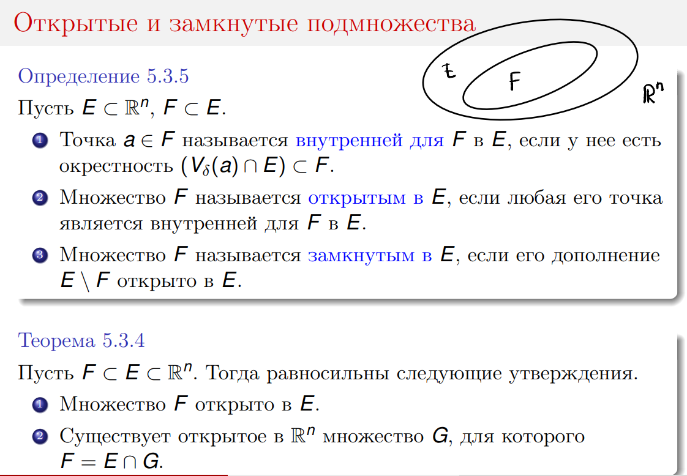

## 39. Покрытие и компакт

**Лекционный источник:** [[ru/lectures/11-topology-rn-5-3#Определение 5.3.6 — покрытие и подпокрытие|определения 5.3.6]]–[[ru/lectures/11-topology-rn-5-3#Определение 5.3.7 — компакт|5.3.7]] · [[ru/lectures/11-topology-rn-5-3|Перейти к разделу]]

Семейство $\Omega$ покрывает $E$, если его объединение содержит $E$. $E$ [[ru/lectures/11-topology-rn-5-3#Определение 5.3.7 — компакт|компактно]], если из любого открытого покрытия можно выбрать конечное подпокрытие.

В $\mathbb R^n$ компактность равносильна замкнутости и ограниченности.

**Быстрая проверка / пример:** $[0,1]$ компактен; $(0,1)$ — нет, поскольку не замкнут.

> [!example]- Показать исходный скан 39
> 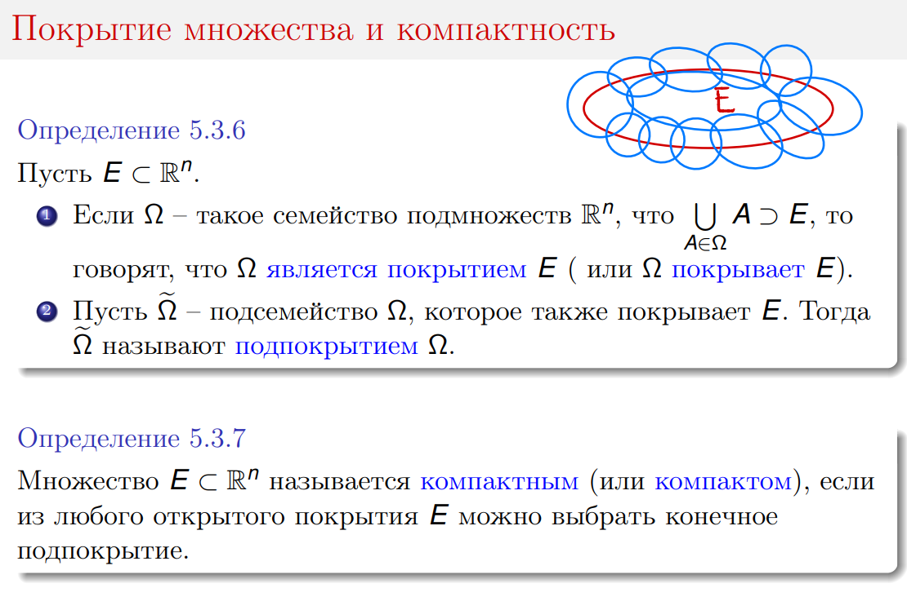

## 40. Предел отображения по Коши

**Лекционный источник:** [[ru/lectures/12-mapping-limits-5-4#Определение 5.4.1 — предел по Коши|определение 5.4.1]] · [[ru/lectures/12-mapping-limits-5-4|Перейти к разделу]]

$f(x)\to A$ при $x\to a$, если для любого $\varepsilon>0$ найдётся $\delta>0$ такое, что

$$
x\in\dot V_\delta(a)\cap E\implies f(x)\in V_\varepsilon(A).
$$

Для конечных точек это обычная запись через $\|f(x)-A\|<\varepsilon$.

**Быстрая проверка / пример:** $(x^3+y^3)/(x^2+y^2)\to0$ в нуле: модуль не превосходит $2\sqrt{x^2+y^2}$.

> [!example]- Показать исходный скан 40
> 

## 41. Предел отображения по Гейне

**Лекционный источник:** [[ru/lectures/12-mapping-limits-5-4#Определение 5.4.2 — предел по Гейне|определение 5.4.2]] · [[ru/lectures/12-mapping-limits-5-4|Перейти к разделу]]

$f(x)\to A$, если для любой последовательности $x^k\in E\setminus\{a\}$ с $x^k\to a$ выполняется $f(x^k)\to A$.

По [[ru/lectures/12-mapping-limits-5-4#Теорема 5.4.1 — эквивалентность Коши и Гейне|теореме 5.4.1]] это равносильно [[ru/lectures-2025-26/lecture-14#^def-2-4-4|определению по Коши]].

**Быстрая проверка / пример:** Для $xy/(x^2+y^2)$ две последовательности дают $0$ и $1/2$, поэтому предела нет.

> [!example]- Показать исходный скан 41
> 

## 42. Непрерывность отображения в точке

**Лекционный источник:** [[ru/lectures/13-continuity-rn-5-5#Определение 5.5.1 — непрерывность в точке|определение 5.5.1]] · [[ru/lectures/13-continuity-rn-5-5|Перейти к разделу]]

$f$ непрерывна в $a\in E$, если для любого $\varepsilon>0$ найдётся $\delta>0$ с

$$
x\in V_\delta(a)\cap E\implies f(x)\in V_\varepsilon(f(a)).
$$

Для предельной точки это $\lim_{x\to a}f(x)=f(a)$.

**Быстрая проверка / пример:** Многочлены непрерывны в каждой точке; $1/(x^2+y^2)$ непрерывна только вне нуля.

> [!example]- Показать исходный скан 42
> 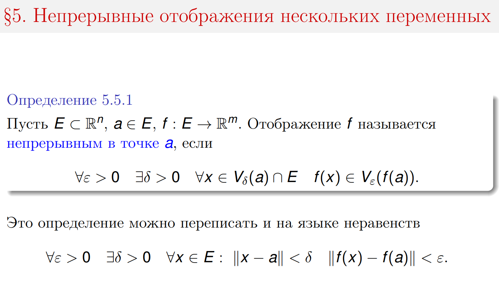

## 43. Непрерывность отображения на множестве

**Лекционный источник:** [[ru/lectures/13-continuity-rn-5-5#Определение 5.5.2 — непрерывность на множестве|определение 5.5.2]] и [[ru/lectures/13-continuity-rn-5-5#Теорема 5.5.3 — топологический критерий непрерывности|теорема 5.5.3]] · [[ru/lectures/13-continuity-rn-5-5|Перейти к разделу]]

$f$ непрерывна на $E$, если непрерывна в каждой его точке. Равносильный критерий: прообраз любого открытого множества открыт в относительной топологии $E$.

**Быстрая проверка / пример:** Для $f(x)=x$ на $[0,1]$ прообраз $(-1,1/2)$ равен $[0,1/2)$, открыт в $[0,1]$.

> [!example]- Показать исходный скан 43
> 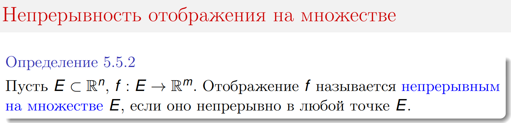

## 44. Равномерная непрерывность

**Лекционный источник:** [[ru/lectures/13-continuity-rn-5-5#Определение 5.5.3 — равномерная непрерывность|определение 5.5.3]] · [[ru/lectures/13-continuity-rn-5-5|Перейти к разделу]]

$f$ [[ru/lectures-2025-26/lecture-17-18#^def-2-5-7|равномерно непрерывна]] на $E$, если один $\delta$ работает для всех пар точек:

$$
\|x-y\|<\delta\implies\|f(x)-f(y)\|<\varepsilon.
$$

На компакте любая непрерывная функция равномерно непрерывна по теореме Кантора.

**Быстрая проверка / пример:** $1/x$ равномерно непрерывна на $[1,\infty)$, но не на $(0,1)$.

> [!example]- Показать исходный скан 44
> 

## 45. Символы Ландау $O$ и $o$

**Лекционный источник:** [[ru/lectures/14-differentiability-6-1#^def-6-1-1|определение 6.1.1]] · [[ru/lectures/14-differentiability-6-1|Перейти к разделу]]

$f=O(\|x-a\|^N)$, если $f/\|x-a\|^N$ ограничено в [[ru/lectures-2025-26/lecture-14#^def-2-4-2|проколотой окрестности]]. $f=o(\|x-a\|^N)$, если это отношение стремится к нулю.

Для векторной функции используются нормы. $o(g)$ сильнее $O(g)$.

**Быстрая проверка / пример:** $x^2=o(x)$ при $x\to0$, но $x=O(x)$ и $x\ne o(x)$.

> [!example]- Показать исходный скан 45
> 

## 46. Дифференцируемость и линейный оператор

**Лекционный источник:** [[ru/lectures/14-differentiability-6-1#Определение 6.1.2 — дифференцируемость и дифференциал|определения 6.1.2]]–[[ru/lectures/14-differentiability-6-1#Определение 6.1.3 — линейный оператор|6.1.3]] · [[ru/lectures/14-differentiability-6-1|Перейти к разделу]]

$f$ дифференцируема в $a$, если существует линейный $T$:

$$
f(a+h)=f(a)+Th+o(\|h\|).
$$

$T=d_af$ — [[ru/lectures-2025-26/lecture-24-25-26#^def-3-3-1|дифференциал]]. Линейность означает $T(\lambda x+\mu y)=\lambda T(x)+\mu T(y)$.

**Быстрая проверка / пример:** Для $f(x)=x^2$ в $a$ имеем $d_af(h)=2ah$, поскольку $(a+h)^2=a^2+2ah+h^2$ и $h^2=o(h)$.

> [!example]- Показать исходный скан 46
> 

## 47. Производная по вектору

**Лекционный источник:** [[ru/lectures/14-differentiability-6-1#Определение 6.1.4 — производная по вектору и по направлению|определение 6.1.4]] · [[ru/lectures/14-differentiability-6-1|Перейти к разделу]]

Для $e\ne0$:

$$
\frac{\partial f}{\partial e}(a)=\lim_{t\to0}\frac{f(a+te)-f(a)}t.
$$

При $\|e\|=1$ это [[ru/lectures/14-differentiability-6-1#Определение 6.1.4 — производная по вектору и по направлению|производная по направлению]]. При дифференцируемости она равна $d_af(e)$.

**Быстрая проверка / пример:** Для $f=x^2+y^2$ в $(1,2)$ по $e=(1,0)$ производная равна $2$.

> [!example]- Показать исходный скан 47
> 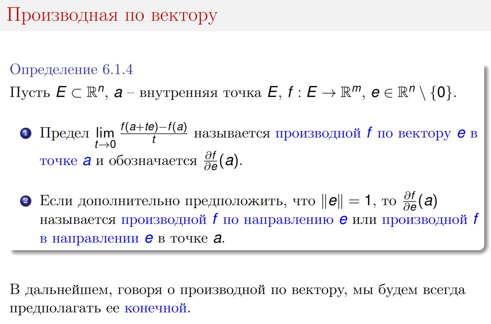

## 48. Частная производная

**Лекционный источник:** [[ru/lectures/14-differentiability-6-1#Определение 6.1.5 — частная производная|определение 6.1.5]] · [[ru/lectures/14-differentiability-6-1|Перейти к разделу]]

[[ru/lectures/14-differentiability-6-1#Определение 6.1.5 — частная производная|Частная производная]] по $x_k$ — производная по базисному вектору $e^k$:

$$
\partial_kf(a)=\lim_{t\to0}\frac{f(a+te^k)-f(a)}t.
$$

Остальные переменные фиксируются. Существование всех частных не гарантирует дифференцируемость.

**Быстрая проверка / пример:** Для $f=x^2y$ имеем $f_x=2xy$, $f_y=x^2$.

> [!example]- Показать исходный скан 48
> 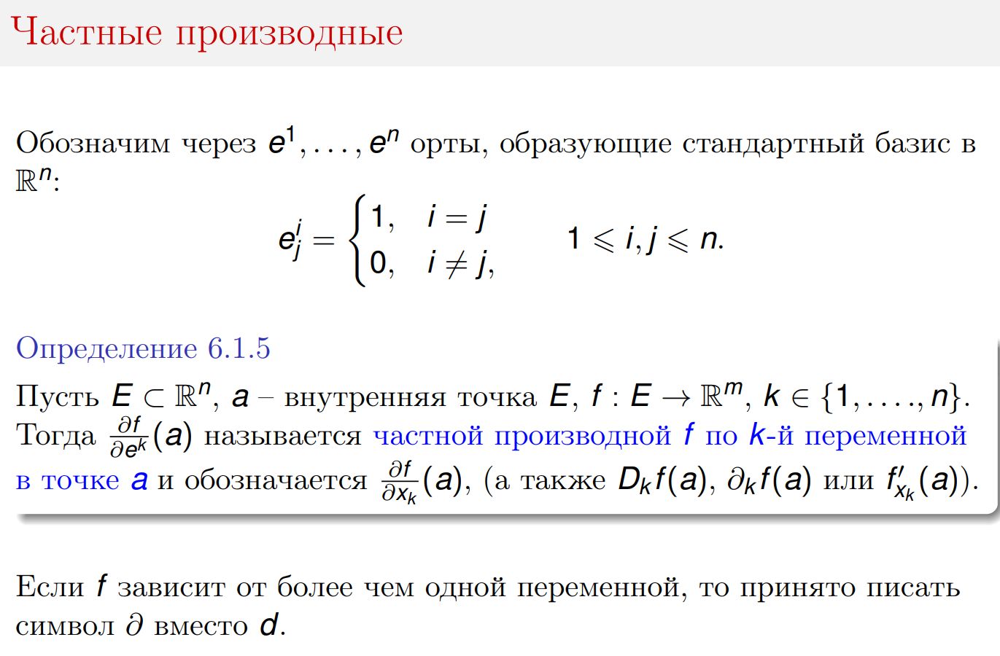

## 49. Матрица Якоби и градиент

**Лекционный источник:** [[ru/lectures/14-differentiability-6-1#Определение 6.1.6 — матрица Якоби и градиент|определение 6.1.6]] · [[ru/lectures/14-differentiability-6-1|Перейти к разделу]]

[[ru/lectures/14-differentiability-6-1#Определение 6.1.6 — матрица Якоби и градиент|Матрица Якоби]] состоит из $\partial f_i/\partial x_j$ и представляет дифференциал. Для скалярной $f$ градиент:

$$
\nabla f=(f_{x_1},\ldots,f_{x_n}),\qquad d_af(h)=\nabla f\cdot h.
$$

Он задаёт направление наискорейшего возрастания.

**Быстрая проверка / пример:** Для $f=x^2e^y$ в $(1,0)$ градиент равен $(2,1)$.

> [!example]- Показать исходный скан 49
> 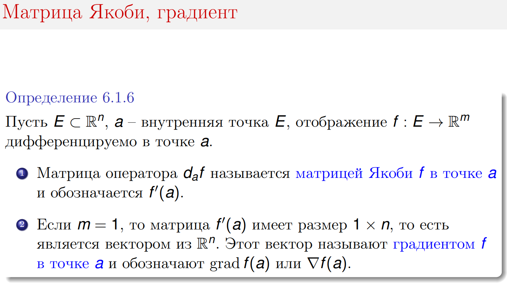

## 50. Дифференцируемость и непрерывная дифференцируемость

**Лекционный источник:** [[ru/lectures/16-continuous-differentiability-6-3#Определение 6.3.1 — дифференцируемость на открытом множестве|определения 6.3.1]]–[[ru/lectures/16-continuous-differentiability-6-3#Определение 6.3.2 — непрерывная дифференцируемость|6.3.2]] · [[ru/lectures/16-continuous-differentiability-6-3|Перейти к разделу]]

Дифференцируемость на $E$ — дифференцируемость в каждой точке. Непрерывная дифференцируемость в $a$ требует существования частных производных в окрестности и их непрерывности в $a$.

Класс $C^1$ сильнее простой дифференцируемости; по [[ru/lectures/16-continuous-differentiability-6-3#Теорема 6.3.1 — последствия непрерывной дифференцируемости|теореме 6.3.1]] он влечёт её.

**Быстрая проверка / пример:** $x^2\sin(1/x)$ дифференцируема везде после доопределения нулём, но не принадлежит $C^1$ около нуля.

> [!example]- Показать исходный скан 50
> 

## 51. Частные производные высших порядков

**Лекционный источник:** [[ru/lectures/17-higher-derivatives-6-4#^def-6-4-1|определение 6.4.1]] · [[ru/lectures/17-higher-derivatives-6-4|Перейти к разделу]]

Производная порядка $s$ записывается как

$$
\frac{\partial^sf}{\partial x_{i_1}\cdots\partial x_{i_s}}(a).
$$

Если все $i_l$ совпадают, она чистая, иначе смешанная. $f_{xy}=(f_x)_y$ и $f_{yx}=(f_y)_x$ могут различаться без условий регулярности.

**Быстрая проверка / пример:** Для $x^3y^2$ производная $\partial^5f/(\partial x^3\partial y^2)=12$.

> [!example]- Показать исходный скан 51
> 

## 52. Многократная дифференцируемость

**Лекционный источник:** [[ru/lectures/17-higher-derivatives-6-4#Определение 6.4.2 — многократная дифференцируемость|определение 6.4.2]] · [[ru/lectures/17-higher-derivatives-6-4|Перейти к разделу]]

$f$ $s$ раз дифференцируема в $a$, если частные производные порядков $0,\ldots,s-2$ дифференцируемы в окрестности, а порядка $s-1$ — в самой точке $a$.

Класс $C^s$ с непрерывными производными сильнее; $C^\infty$ означает выполнение для любого $s$.

**Быстрая проверка / пример:** Многочлены бесконечно дифференцируемы; существования одной старшей производной для $C^s$ недостаточно.

> [!example]- Показать исходный скан 52
> 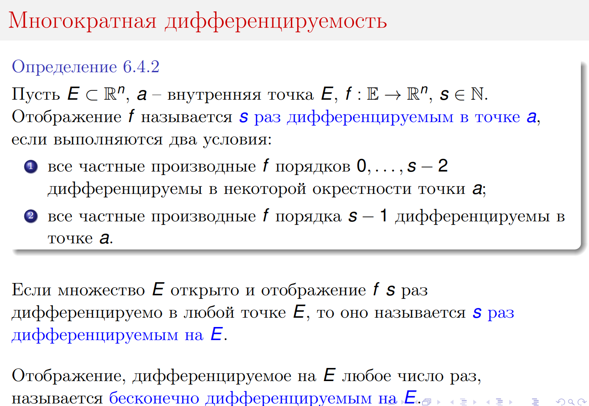

## 53. Дифференциалы высших порядков

**Лекционный источник:** [[ru/lectures/17-higher-derivatives-6-4#Определение 6.4.3 — дифференциалы высших порядков|определение 6.4.3]] и [[ru/lectures/17-higher-derivatives-6-4#Теорема 6.4.2 — вычисление высших дифференциалов|теорема 6.4.2]] · [[ru/lectures/17-higher-derivatives-6-4|Перейти к разделу]]

Рекурсивно $d_a^sf(h)=d_a(d^{s-1}f(h))(h)$, начиная с $d_a^0f(h)=f(a)$. Для $C^2$:

$$
d_a^2f(h)=\sum_{i,j}f_{x_ix_j}(a)h_ih_j.
$$

Общая формула: $d_a^sf(h)=\sum_{|\alpha|=s}\frac{s!}{\alpha!}\partial^\alpha f(a)h^\alpha$.

**Быстрая проверка / пример:** Для $f=x^2e^y$ в $(1,0)$: $d^2f(h,k)=2h^2+4hk+k^2$.

> [!example]- Показать исходный скан 53
> 
