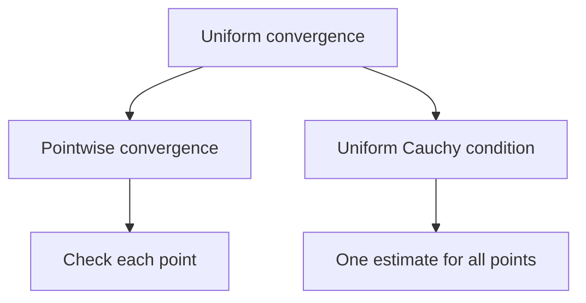

# 10. Sequences and Series of Functions

[← 9. Improper Integrals and Applications](09-improper-integrals-applications.md) · [Course index](index.md) · [Terms & theorems](term-index.md) · [11. Power Series and Analytic Functions →](11-power-series.md)

> **Goal.** Distinguish pointwise from [uniform convergence](#sec-10-1) and know when limits commute with analytic operations.

<a id="sec-10-1"></a>
## 10.1 Two modes of convergence

Let $`f_n,f:E\to\mathbb R`$. The sequence converges **pointwise** if

```math
\forall x\in E\;\forall\varepsilon>0\;\exists N\;\forall n\ge N:
|f_n(x)-f(x)|<\varepsilon.
```

It converges **uniformly** if

```math
\forall\varepsilon>0\;\exists N\;\forall n\ge N\;\forall x\in E:
|f_n(x)-f(x)|<\varepsilon.
```

Equivalently, $`\sup_{x\in E}|f_n(x)-f(x)|\to0`$. In pointwise convergence $`N`$ may depend on $`x`$; in uniform convergence it cannot.

On $`[0,1]`$, $`f_n(x)=x^n`$ tends pointwise to $`0`$ for $`x<1`$ and to $`1`$ at $`x=1`$. The limit is discontinuous, so convergence cannot be uniform. On $`[0,r]`$ with $`r<1`$, it is uniform because $`\sup|f_n|=r^n\to0`$.



<a id="sec-10-2"></a>
## 10.2 Uniform Cauchy criterion

A sequence is uniformly Cauchy if for every $`\varepsilon>0`$ there is $`N`$ such that

```math
m,n\ge N\implies \sup_{x\in E}|f_n(x)-f_m(x)|<\varepsilon.
```

On $`\mathbb R`$-valued functions, uniform convergence and the uniform [Cauchy condition](03-sequences.md#sec-3-4) are equivalent. This is the main tool when the limit is not known.

For series $`\sum f_n`$, these definitions apply to [partial sums](04-numeric-series.md#sec-4-1) $`s_N=\sum_{n=1}^N f_n`$.

> <a id="weierstrass-m-test"></a>**Weierstrass M-test.** If $`|f_n(x)|\le M_n`$ on $`E`$ and $`\sum M_n<\infty`$, then $`\sum f_n`$ converges absolutely and uniformly on $`E`$.

The proof follows from $`|f_n(x)+\cdots+f_m(x)|\le M_n+\cdots+M_m`$.

<a id="sec-10-3"></a>
## 10.3 Continuity and integration

> <a id="uniform-limit-continuity"></a>**Continuity theorem.** If each $`f_n`$ is continuous and $`f_n\to f`$ uniformly, then $`f`$ is continuous.

The standard $`3\varepsilon`$ proof chooses $`n`$ with $`|f_n-f|`$ uniformly small and then uses continuity of that single $`f_n`$.

> <a id="uniform-limit-integration"></a>**Integration theorem.** If $`f_n`$ are integrable on $`[a,b]`$ and converge uniformly to $`f`$, then $`f`$ is integrable and
> ```math
> \lim_{n\to\infty}\int_a^b f_n=\int_a^b f.
> ```

Indeed, the integrals differ by at most $`(b-a)\sup|f_n-f|`$. Pointwise convergence is insufficient: moving triangular “hats” on $`[0,1]`$ can converge to zero pointwise while their integrals stay equal to one.

<a id="sec-10-4"></a>
## 10.4 Differentiation

Uniform convergence of $`f_n`$ alone does not justify differentiating the limit. A sufficient theorem is:

> If $`f_n`$ are [continuously differentiable](15-multivariable-differentiation.md#sec-15-1) on a bounded interval $`[a,b]`$, $`f_n(x_0)`$ converges at one point, and $`f_n'\to g`$ uniformly, then $`f_n`$ converges uniformly on $`[a,b]`$ to a [differentiable](06-derivatives.md#sec-6-1) $`f`$ and $`f'=g`$.

For series on a bounded interval, differentiate term by term when the differentiated series converges uniformly and the original series converges at one point.

Dini's theorem gives another useful special case: on a [compact](13-metric-spaces.md#sec-13-4) set, a [monotone sequence](03-sequences.md#sec-3-3) of continuous functions converging pointwise to a continuous limit converges uniformly.

## Worked example

For $`|x|\le r<1`$,

```math
\sum_{n=0}^{\infty}x^n=\frac1{1-x}
```

uniformly by the [M-test](#weierstrass-m-test) with $`M_n=r^n`$. Differentiating the series is justified on $`|x|\le r`$ because $`\sum nx^{n-1}`$ also converges uniformly there. Therefore

```math
\sum_{n=1}^{\infty}nx^{n-1}=\frac1{(1-x)^2}.
```

Since $`r<1`$ is arbitrary, the identity holds for every $`|x|<1`$.

## Common pitfalls

1. Pointwise convergence does not preserve continuity.
2. The M-test proves uniform [absolute convergence](04-numeric-series.md#sec-4-3), not merely convergence at selected points.
3. To interchange derivatives and limits, control the derivatives as well as the functions.

## Exercises

1. Show that $`f_n(x)=x/(1+nx^2)`$ converges uniformly to zero on $`\mathbb R`$.
2. Decide whether $`\sum\sin(nx)/n^2`$ converges uniformly on $`\mathbb R`$.
3. Give an example showing that pointwise convergence does not preserve integrals.

<details>
<summary>Short answers</summary>

1. Maximize $`|x|/(1+nx^2)`$; its [supremum](02-real-numbers.md#sec-2-2) is $`1/(2\sqrt n)`$.
2. Yes, by the M-test with $`M_n=1/n^2`$.
3. Use a triangular spike supported on $`(0,1/n)`$ with height $`2n`$ and area $`1`$; it tends pointwise to zero.
</details>

---

[← 9. Improper Integrals and Applications](09-improper-integrals-applications.md) · [Course index](index.md) · [Terms & theorems](term-index.md) · [11. Power Series and Analytic Functions →](11-power-series.md)
