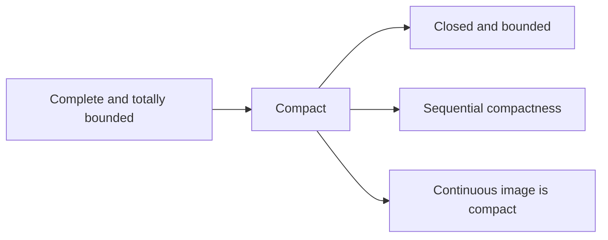

# 13. Metric Spaces, Compactness, and Completeness

[Previous](12-fourier-series.md) · [Course index](index.md) · [Next](14-several-variables.md)

> **Goal.** Generalize distance-based analysis and understand compactness and completeness as structural properties.

## 13.1 Metrics and examples

A metric on a set $X$ is a function $d:X\times X\to[0,\infty)$ satisfying

1. $d(x,y)=0\iff x=y$;
2. $d(x,y)=d(y,x)$;
3. $d(x,z)\le d(x,y)+d(y,z)$.

The pair $(X,d)$ is a metric space. Important examples are

$$
d_2(x,y)=\|x-y\|_2\quad\text{on }\mathbb R^n,
$$
$$
d_1(x,y)=\sum_{i=1}^{n}|x_i-y_i|,
\qquad
d_\infty(x,y)=\max_i|x_i-y_i|,
$$

and the discrete metric $d(x,y)=1$ for $x\ne y$. On $C([a,b])$, the space of continuous functions, $d_\infty(f,g)=\max_{x\in[a,b]}|f(x)-g(x)|$ metrizes uniform convergence.

## 13.2 Open and closed sets

The open ball is $B_r(x)=\{y\in X:d(x,y)<r\}$. A set $U$ is **open** if every $x\in U$ has a ball $B_r(x)\subseteq U$. A set is **closed** if its complement is open.

Arbitrary unions and finite intersections of open sets are open. Arbitrary intersections and finite unions of closed sets are closed.

The interior $A^\circ$ is the largest open set contained in $A$. The closure $\overline A$ is the smallest closed set containing $A$, and

$$
x\in\overline A\iff \forall r>0\;B_r(x)\cap A\ne\varnothing.
$$

The boundary is $\partial A=\overline A\setminus A^\circ$. A set $A$ is dense in $X$ if $\overline A=X$; for example, $\mathbb Q$ is dense in $\mathbb R$.

## 13.3 Convergence and completeness

A sequence $x_n$ converges to $x$ if $d(x_n,x)\to0$. It is Cauchy if for every $\varepsilon>0$ there is $N$ such that $d(x_m,x_n)<\varepsilon$ for $m,n\ge N$.

A metric space is **complete** if every Cauchy sequence converges in that space. The spaces $\mathbb R^n$ and $(C([a,b]),d_\infty)$ are complete; $\mathbb Q$ with its usual metric is not. A closed subspace of a complete space is complete.

Every metric space has a completion: a complete space containing an isometric dense copy of the original. This abstracts the construction of $\mathbb R$ from $\mathbb Q$.

## 13.4 Compactness

A set $K$ is **compact** if every open cover has a finite subcover. In metric spaces, compactness is equivalent to sequential compactness: every sequence in $K$ has a subsequence converging in $K$.

> **Heine–Borel theorem.** In $\mathbb R^n$, a set is compact exactly when it is closed and bounded.

In general metric spaces, closed and bounded is not sufficient. The general characterization is complete and totally bounded: for every $\varepsilon>0$, the set can be covered by finitely many $\varepsilon$-balls.

Compact sets are closed and bounded. A continuous image of a compact set is compact, which yields the extreme value theorem. A compact subset of a Hausdorff space, hence of any metric space, is closed.

## 13.5 Continuity and connectedness

For $f:X\to Y$, continuity at $a$ means

$$
\forall\varepsilon>0\;\exists\delta>0:
d_X(x,a)<\delta\implies d_Y(f(x),f(a))<\varepsilon.
$$

Globally, $f$ is continuous exactly when $f^{-1}(V)$ is open for every open $V\subseteq Y$. Continuous functions on compact sets are uniformly continuous.

A space is **connected** if it cannot be split into two nonempty disjoint open sets. The connected subsets of $\mathbb R$ are precisely intervals. Continuous images of connected sets are connected, giving the intermediate value theorem.

> **Baire category theorem.** In a complete metric space, a countable intersection of dense open sets is dense. This is a powerful existence tool in advanced analysis.

## Worked example

In the discrete metric, $B_{1/2}(x)=\{x\}$, so every subset is open and closed. A sequence converges exactly when it is eventually constant. The space is complete, but an infinite discrete space is not compact: the cover by singletons has no finite subcover.

## Common pitfalls

1. A set can be both open and closed; these are not opposites in the everyday sense.
2. Completeness depends on the metric and the ambient space.
3. Closed and bounded implies compact in $\mathbb R^n$, not in every metric space.

## Exercises

1. Describe convergence in a discrete metric space.
2. Find the interior, closure, and boundary of $(0,1)$ in $\mathbb R$.
3. Show that a compact metric space is bounded.

Short answers

1. Exactly the eventually constant sequences converge.
2. Interior $(0,1)$, closure $[0,1]$, boundary $\{0,1\}$.
3. Cover the space by balls $B_n(x_0)$ of integer radii and extract a finite subcover; alternatively use a finite $\varepsilon$-net.

---

[Previous](12-fourier-series.md) · [Course index](index.md) · [Next](14-several-variables.md)
